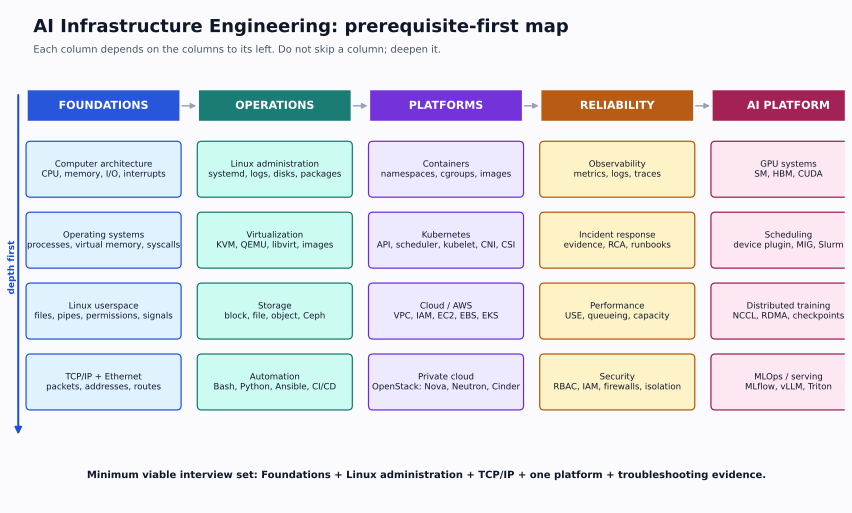
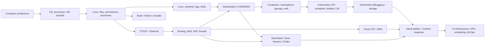
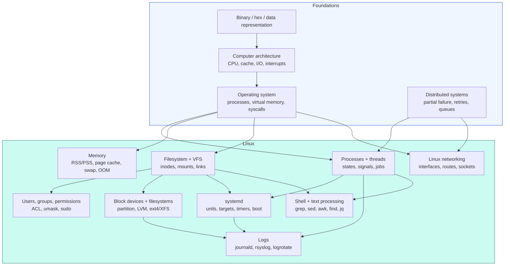
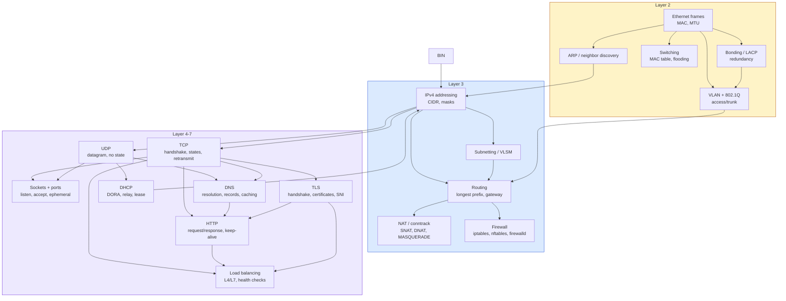
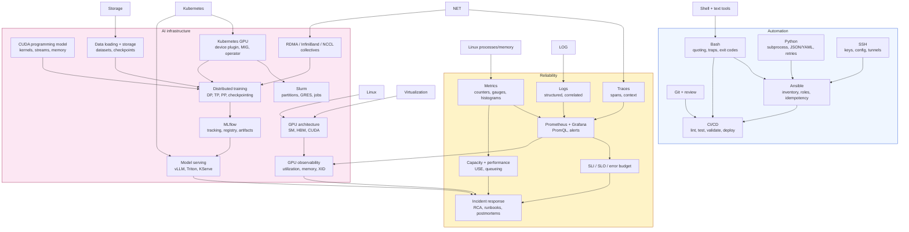

# Prerequisite Dependency Graph

> The graph is not decoration. It answers one question: **what must be true before this topic can make sense?** If a topic feels like a list of names, you are probably missing an incoming edge.

The map above is the compressed version. This document expands the dependencies and explains why each edge exists.

---

## The critical path

If you only had 12 weeks, this is the spine:

This path is deliberately narrow. It omits deep storage, advanced security, CI/CD, and AI until the base is stable.

---

## Full graph: foundations and Linux

**Why these edges exist**

| Edge | Why it is necessary |
|---|---|
| Architecture → OS | You cannot understand page faults, context switches, interrupts, or `iowait` without CPU/memory/I/O basics |
| OS → processes | `ps` states, run queues, signals, and `fork/exec` are OS concepts made visible |
| OS → memory | RSS, virtual address space, page cache, and OOM are OS-level mechanisms |
| OS → filesystem | The VFS, inodes, page cache, and mount namespace are kernel abstractions |
| OS → Linux networking | Sockets, `sk_buff`, netfilter, and routing live in the kernel |
| Filesystem → permissions | Permissions are metadata attached to inodes; ACLs extend that metadata |
| Processes + filesystem → systemd | A service is a process tree with a unit, dependencies, cgroup, and log stream |
| systemd + filesystem → logs | `journalctl -u` correlates unit lifecycle with kernel/userspace events |
| Disk → logs | Log growth, rotation, and disk-full incidents are storage problems |
| Distributed systems → processes/network | Retries, timeouts, and partial failure explain why a process or socket is stuck |

---

## Full graph: networking

**Why these edges exist**

| Edge | Why it is necessary |
|---|---|
| Ethernet → ARP | ARP resolves an IP to a MAC on the local link; you cannot read ARP without frames |
| IP → subnet | A mask defines the local link; routing begins where the local link ends |
| Subnet → routing | Longest-prefix match is meaningless without CIDR |
| VLAN → routing | Inter-VLAN routing is the first place you see a router with multiple subnets |
| Routing → NAT/firewall | NAT rewrites addresses after a route is chosen; firewalls filter at hooks in the same path |
| IP → TCP/UDP | Ports and checksums sit inside IP; MSS and fragmentation depend on MTU |
| TCP → sockets | `ss` shows kernel socket state; the state machine explains `TIME_WAIT` and `CLOSE_WAIT` |
| UDP/TCP → DNS | DNS uses UDP for most queries and TCP for large responses/zone transfers |
| DNS → HTTP | A URL is resolved before a connection; "works by IP, fails by name" is a DNS problem |
| TCP → TLS | TLS runs over a reliable byte stream; handshake failures are often TCP or certificate problems |
| TCP/HTTP/TLS → load balancer | L4 LB understands TCP; L7 LB understands HTTP/TLS and needs health checks |

---

## Full graph: virtualization, storage, containers, Kubernetes

```mermaid
graph TD
    subgraph VIRT["Virtualization + storage"]
        KVM[KVM<br/>CPU/memory virtualization]
        QEMU[QEMU<br/>device model, disk images]
        LIBVIRT[libvirt<br/>domain XML, lifecycle]
        VM[VM lifecycle<br/>create, boot, snapshot, migrate]
        BLOCK[Block storage<br/>disks, LVM, iSCSI]
        FILE[File storage<br/>NFS, shared filesystems]
        OBJ[Object storage<br/>S3/Swift]
        CEPH[Ceph<br/>MON, OSD, CRUSH, RGW]
        NVME[NVMe / NVMe-oF<br/>queues, latency]
    end

    subgraph CONT["Containers"]
        NS[Namespaces<br/>pid, net, mnt, uts, ipc, user]
        CG[Cgroups v2<br/>cpu, memory, pids, io]
        CAP[Capabilities, seccomp, LSM]
        IMG[Images + layers<br/>OCI, overlayfs, registry]
        VETH[veth + bridge + NAT<br/>container networking]
        CRI[containerd + runc<br/>CRI]
    end

    subgraph K8S["Kubernetes"]
        API[API server + etcd<br/>desired state]
        SCHED[Scheduler<br/>filter, score, bind]
        CTL[Controllers<br/>reconcile]
        KUBELET[kubelet + runtime<br/>Pod lifecycle]
        CNI[CNI<br/>Pod network]
        CSI[CSI<br/>PV/PVC/StorageClass]
        SVC[Service + EndpointSlice<br/>kube-proxy / eBPF]
        DNSK[CoreDNS<br/>service discovery]
        ING[Ingress / Gateway<br/>L7 path]
    end

    OS[OS fundamentals] --> KVM
    KVM --> QEMU
    QEMU --> LIBVIRT
    LIBVIRT --> VM
    BLOCK --> VM
    FILE --> VM
    NET[TCP/IP + routing] --> VM

    OS --> NS
    OS --> CG
    OS --> CAP
    NS --> CRI
    CG --> CRI
    CAP --> CRI
    IMG --> CRI
    VETH --> CNI
    NET --> VETH

    CRI --> KUBELET
    API --> SCHED
    API --> CTL
    SCHED --> KUBELET
    CTL --> KUBELET
    KUBELET --> CNI
    KUBELET --> CSI
    API --> SVC
    SVC --> DNSK
    SVC --> ING
    NET --> CNI

    KVM --> OPENSTACK
    BLOCK --> OPENSTACK
    FILE --> OPENSTACK
    NET --> OPENSTACK
    OPENSTACK[OpenStack<br/>Keystone, Nova, Neutron, Cinder, Glance]

    BLOCK --> CSI
    FILE --> CSI
    OBJ --> CSI
    CEPH --> BLOCK
    CEPH --> FILE
    CEPH --> OBJ
    NVME --> BLOCK

    style VIRT fill:#fef3c7,stroke:#b45309
    style CONT fill:#dbeafe,stroke:#1d4ed8
    style K8S fill:#ccfbf1,stroke:#0f766e
```

**Why these edges exist**

| Edge | Why it is necessary |
|---|---|
| OS → KVM | KVM is a kernel module; it uses CPU virtualization extensions and the kernel's memory/IRQ machinery |
| KVM → QEMU → libvirt | KVM accelerates execution; QEMU models devices and disks; libvirt manages the domain |
| Block/file/network → VM | A VM is not just CPU/RAM; its disk, NIC, and image are separate resources with separate failure modes |
| OS → namespaces/cgroups | Containers are kernel features, not a runtime invention |
| Namespaces/cgroups/caps → container runtime | containerd/runc configure the namespaces, cgroups, mounts, and capabilities |
| Images → runtime | A container is an image unpacked into a rootfs, then a process started with a changed view |
| Net + veth → CNI | Pod networking is Linux networking: veth pairs, bridges, routes, NAT, and often overlay/VXLAN |
| API → scheduler/controllers | The API server stores intent; controllers and the scheduler reconcile it |
| Scheduler → kubelet | The scheduler binds a Pod to a node; the kubelet on that node does the work |
| kubelet → CNI/CSI | Networking and storage are pluggable; the kubelet calls the plugins |
| API → Service → DNS/Ingress | Service and EndpointSlice objects are stored in the API; DNS and ingress consume them |
| KVM/storage/net → OpenStack | OpenStack orchestrates the primitives; it does not replace them |
| Block/file/object → CSI | Kubernetes storage is an abstraction over real block/file/object backends |
| NVMe/Ceph → block/file/object | These are implementations of the storage abstractions; learn the abstraction first |

---

## Full graph: automation, observability, AI

**Why these edges exist**

| Edge | Why it is necessary |
|---|---|
| Bash/Python/SSH → Ansible | Ansible modules ultimately run commands and Python on remote hosts; debugging requires both |
| Ansible → CI/CD | Configuration changes need linting, check mode, and gated execution |
| Metrics/logs/traces → Prometheus | Prometheus is a consumer of instrumented signals, not a source of truth by itself |
| Prometheus → SLO | An SLI must be measured; an SLO is a target on that measurement |
| SLO → incident response | An alert should fire on user-impacting symptoms, not raw CPU |
| Performance → capacity | Capacity planning is applied queueing and utilization analysis |
| Linux → GPU | Drivers, PCIe, NUMA, IRQs, memory mapping, and `nvidia-smi` are Linux-level concerns |
| Network → RDMA/NCCL | Distributed training is a collective communication problem; topology and loss matter |
| CUDA + data + RDMA → distributed training | Compute, feeding, and communication must all keep up; the slowest one dominates |
| Kubernetes → GPU plugin/serving | GPU and model serving are scheduled workloads with the same primitives plus device resources |
| Storage → data/checkpoints | Training reads datasets and writes checkpoints; storage stalls show up as GPU idle |
| Prometheus + GPU → GPU observability | Utilization without memory, ECC, XID, and power is misleading |
| Serving → incident response | Inference has latency SLOs, autoscaling, and failure modes distinct from training |

---

## The dependency rules, in plain language

### Rule 1: Linux before Kubernetes

Kubernetes does not create a new operating system. A Pod is a process with namespaces and cgroups. A Service is a set of iptables/nftables/eBPF rules. A volume is a mount. A node is a Linux host. If you cannot debug the host, you cannot debug the cluster.

**Test:** can you explain why a Pod is OOMKilled using `memory.max`, `oom_score`, and the container's RSS? If not, go back to Phase 1.

### Rule 2: TCP/IP before cloud networking

A VPC is a set of subnets, route tables, and gateways. Security groups are stateful packet filters. NAT gateways perform SNAT. An ALB is a reverse proxy. Every concept maps to something you should already understand at the packet level.

**Test:** can you explain why an EC2 instance in a private subnet cannot reach the internet even though it has a route to `0.0.0.0/0`? If not, go back to routing/NAT.

### Rule 3: Virtualization before OpenStack

OpenStack is an orchestration layer over KVM/QEMU, Linux networking, and storage. Nova does not run a VM; it asks libvirt on a compute node to define and start a domain. Neutron does not invent networking; it programs bridges, OVS/OVN, namespaces, and firewall rules. Cinder does not invent storage; it attaches block devices from a backend.

**Test:** can you draw the path from `openstack server create` to a `qemu-kvm` process and a tap device? If not, go back to KVM/Neutron.

### Rule 4: Networking and storage before distributed training

Distributed training is a bandwidth, latency, and synchronization problem. All-reduce is a collective over a network. Checkpointing is a storage write. Data loading is a read pipeline. GPUs that sit idle waiting for data or gradients are an infrastructure failure, not an ML failure.

**Test:** can you explain why adding a second GPU can make training slower? If not, learn about PCIe/NVLink topology, all-reduce, and data loading.

### Rule 5: Observability before AI platform operations

A GPU cluster without metrics is a space heater with a login prompt. You need utilization, memory, temperature, power, ECC errors, XID errors, queue depth, and job-level attribution. The same USE/RED method applies.

**Test:** can you tell whether a GPU is busy doing useful work or busy waiting on memory? If not, go back to observability and GPU architecture.

---

## What you can safely postpone

| Topic | Postpone until | Why |
|---|---|---|
| Service mesh (Istio/Linkerd) | After Kubernetes Services, DNS, and ingress are solid | It solves traffic management problems you do not yet have |
| Advanced Ceph tuning | After block/file/object basics and one Ceph cluster | Tuning without failure models is cargo cult |
| NVMe-oF fabrics | After NVMe, RDMA, and iSCSI | It is a transport optimisation, not a starting point |
| Terraform modules at scale | After VPC, IAM, and one small deployment | State and blast radius matter more than module syntax |
| GPU operator internals | After K8s scheduling, device plugins, and Linux drivers | It is an integration layer over primitives |
| Kubeflow | After MLflow, serving, and K8s GPU scheduling | It is a large platform; learn the pieces first |
| eBPF | After TCP/IP, tracing, and performance | Powerful, but easy to misuse without a model |

---

## Self-check

Without looking at the diagrams:

1. Why does a Pod need a CNI plugin if the node already has an IP address?
2. Why can a VM on a compute node reach the internet while a tenant network cannot, even though both use the same physical NIC?
3. Why is `kubectl apply` not the thing that starts your container?
4. Why does a distributed training job need more than "enough GPUs"?
5. Which two prerequisites would you study first if you had only one week before an interview?

If you can answer 1–4 with a causal chain, the graph is working. If not, identify the missing edge and study that node, not the leaf.
