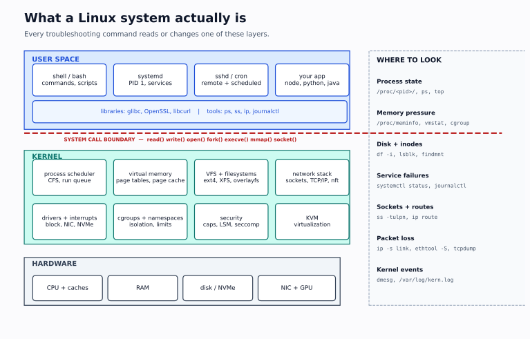

# Phase 1 — Linux Fundamentals

> **Why this phase is first:** the RTDS JD starts with Linux administration, and every later layer — KVM, containers, Kubernetes, OpenStack, GPU drivers — is a Linux mechanism wearing a different interface. If you cannot explain a process, a mount, a permission, or a unit, you will memorise Kubernetes symptoms instead of diagnosing them.



## Outcomes

By the end of this phase you can:

1. Navigate and inspect an unfamiliar Linux filesystem without a GUI.
2. Explain inodes, links, mounts, and the difference between `df` and `du`.
3. Fix permissions using ownership, mode bits, ACLs, and the parent-directory rule — without `chmod 777`.
4. Read a process table, explain every state, and choose the right signal.
5. Interpret memory usage correctly, including page cache, swap, and the OOM killer.
6. Add, mount, extend, and diagnose a filesystem; recognise inode exhaustion and deleted-open files.
7. Write and debug a systemd service and timer; read the boot chain.
8. Build a timeline from `journalctl` and `/var/log`, and configure log rotation.
9. Use `apt` and `dnf`/`yum` safely, including pins and history.
10. Use `ssh`, `grep`, `sed`, `awk`, `find`, and `jq` as operational tools.

## Prerequisites

- Comfort with a shell: `cd`, `ls`, `cat`, `cp`, `mv`, `rm`, pipes, redirection.
- Basic OS concepts: process, thread, virtual memory, filesystem.
- A disposable Linux VM (Ubuntu 24.04 or Rocky/Alma 9). Snapshot before labs.

If you are missing the OS concepts, read the first three chapters of your OS notes or *Operating Systems: Three Easy Pieces* before Lab 1.3. Do not skip the process/memory model; the commands will be trivia without it.

## Study order

| Order | Note | Why | Lab |
|---|---|---|---|
| 1 | [Filesystem and permissions](01-filesystem-and-permissions.md) | Every path, mount, and access decision starts here | L1.1, L1.2 |
| 2 | [Processes, signals, jobs](02-processes-signals-jobs.md) | A service is a process; debugging starts with state | L1.3 |
| 3 | [Memory, swap, OOM](03-memory-swap-oom.md) | Memory pressure is a leading cause of latency and kills | L1.4 |
| 4 | [Disks, filesystems, inodes](04-disks-filesystems-inodes.md) | Disk-full is a daily incident; inodes and deleted files are traps | L1.5 |
| 5 | [systemd, boot, logs](05-systemd-boot-logs.md) | Production Linux is systemd-managed; logs are evidence | L1.6, L1.7 |
| 6 | [Packages and SSH](06-packages-and-ssh.md) | Install, pin, roll back, and operate remotely | L1.8 |
| 7 | [Shell text toolkit](07-shell-text-toolkit.md) | Most evidence is text; speed matters in an OA | Drills |
| 8 | [Command field manual](08-command-field-manual.md) | The 15 commands you must read fluently | Drills |
| 9 | [Labs part 1](09-labs-part1.md), [Labs part 2](10-labs-part2.md) | Deliberate practice | L1.1–L1.8 |
| 10 | [Checkpoint](11-checkpoint.md) | Prove it without notes | Self-test |

## The mental model

```text
hardware
  CPU, RAM, disk/NVMe, NIC, GPU
        ↑ interrupts, DMA, MMIO
kernel
  scheduler | virtual memory | VFS | network stack | cgroups/namespaces | drivers
        ↑ system calls: read, write, open, fork, execve, mmap, socket, ioctl
userspace
  shell | systemd | sshd | cron | your application | libraries
```

Every command in this phase observes or changes one of these layers:

| Question | Layer | First commands |
|---|---|---|
| What is running? | process | `ps`, `top`, `pgrep`, `pstree` |
| What is it waiting on? | scheduler / I/O | `ps -o stat,wchan`, `pidstat`, `iostat`, `strace` |
| How much memory? | VM / cgroup | `free`, `vmstat`, `/proc/meminfo`, `smem` |
| Is the disk full? | filesystem / block | `df -h`, `df -i`, `du`, `lsof +L1`, `lsblk` |
| Why did the service fail? | systemd / logs | `systemctl status`, `journalctl -u`, `dmesg` |
| Can it reach the network? | sockets / net | `ss`, `ip`, `dig`, `tcpdump` (Phase 2) |
| Who can access it? | permissions / LSM | `id`, `ls -l`, `namei -l`, `getfacl`, `ls -Z` |

## Lab environment

| Item | Recommendation |
|---|---|
| Hypervisor | UTM, VMware Fusion, Parallels, VirtualBox, or Multipass |
| OS | Ubuntu Server 24.04 LTS (apt) **and** Rocky Linux 9 (dnf) if you can |
| Resources | 2–4 vCPU, 4–8 GB RAM, 40 GB disk |
| Network | NAT is fine for Phase 1; add a host-only/second NIC for Phase 2 |
| Snapshot | Before every lab that changes disks, users, or firewall |
| User | A normal sudo user, not root for daily work |

> macOS is not Linux. `launchd` is not systemd, `ps` flags differ, `sed -i` differs, and there is no `dnf`. Use the VM for every lab in this phase.

## The command set you must own

| Area | Commands |
|---|---|
| Files | `ls`, `stat`, `find`, `file`, `cp`, `mv`, `rm`, `ln`, `touch`, `tree` |
| Permissions | `id`, `umask`, `chmod`, `chown`, `chgrp`, `getfacl`, `setfacl`, `namei`, `lsattr`, `getcap`, `setcap` |
| Processes | `ps`, `top`, `htop`, `pgrep`, `pstree`, `kill`, `killall`, `nice`, `renice`, `pidstat`, `strace`, `lsof` |
| Memory | `free`, `vmstat`, `smem`, `pmap`, `/proc/meminfo`, `dmesg` |
| Disks | `lsblk`, `blkid`, `df`, `du`, `findmnt`, `mount`, `umount`, `iostat`, `iotop`, `smartctl` |
| systemd | `systemctl`, `journalctl`, `systemd-analyze`, `systemd-cgls`, `loginctl` |
| Packages | `apt`, `dpkg`, `dnf`, `yum`, `rpm` |
| Remote | `ssh`, `scp`, `rsync`, `ssh-keygen`, `ssh-copy-id`, `tmux` |
| Text | `grep`, `sed`, `awk`, `sort`, `uniq`, `cut`, `tr`, `xargs`, `jq` |

## How to study a command

Do not memorise flags. For each command, answer:

1. **What question does it answer?** (`ss -tulpn` → "is anything listening, and on which address?")
2. **What is the unit of output?** (process, socket, inode, block device, packet)
3. **What are the two or three options that change the answer?** (`-n`, `-p`, `-i`, `-a`)
4. **What does a healthy output look like?** (so you can spot the abnormal)
5. **What can it not tell you?** (`ss` shows the socket, not whether the application is healthy)
6. **What is the safer alternative?** (`ss` before `tcpdump`; `systemctl reload` before `restart`)

## Completion criterion

You can close the phase when you can, on a fresh VM:

- Create a shared directory for a team with the right ownership, SGID, and default ACL.
- Find a process stuck in `D` state and explain what it is waiting on.
- Explain why `free` shows 90% used memory on a healthy host.
- Find a deleted-but-open file that is filling a filesystem.
- Write a systemd service and timer, break the service, and fix it from journal evidence.
- Install a package, pin a version, and explain how to roll back.
- Answer 40 mixed Linux questions at ≥ 80%.

Then take [Mock 1](../11-assessments/02-mock-assessment-1-linux-networking.md).
