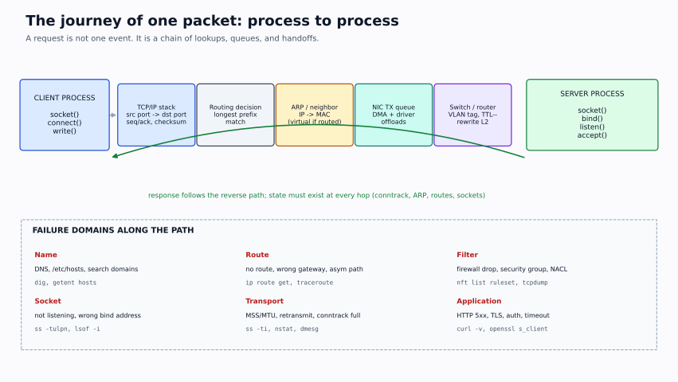

# Phase 2 — Networking from First Principles

> **Why this phase matters:** "the server is running but unreachable" is the most common infrastructure ticket. The answer is never "restart the network". It is a specific hop: name, route, ARP, firewall, socket, TLS, or application. This phase teaches you to find it with evidence.



## Outcomes

By the end of this phase you can:

1. Convert between binary, decimal, and CIDR quickly; subnet and supernet without a calculator.
2. Explain Ethernet, ARP, switching, VLANs, and why two hosts on different VLANs cannot communicate without a router.
3. Read a Linux route table and explain the chosen path for any destination.
4. Trace a TCP connection through handshake, data transfer, and teardown; read `ss` states correctly.
5. Explain DNS resolution, caching, search domains, and the difference between NXDOMAIN, SERVFAIL, and timeout.
6. Explain DHCP DORA, leases, relays, and address conflicts.
7. Explain NAT, conntrack, iptables/nftables, firewalld zones, and the difference between DROP and REJECT.
8. Debug HTTP/TLS/load-balancer failures without guessing.
9. Follow a packet from process to process and name the command that proves each hop.

## Prerequisites

- Phase 1 Linux (sockets, processes, filesystem).
- Binary arithmetic: powers of two, bitwise AND/OR.
- Two Linux VMs or one VM plus network namespaces.

## Environment

| Lab | What you need |
|---|---|
| Subnetting | Paper and pen; no calculator |
| Ethernet/ARP/VLAN | Two VMs on a host-only network, or one VM with network namespaces |
| Routing | Two VMs and a second virtual NIC; or Linux network namespaces |
| TCP/sockets | One VM; `nc`, `ss`, `tcpdump` |
| DNS | One VM; `dnsmasq`/`bind` optional; `/etc/hosts` enough for basics |
| NAT/firewall | One VM with a second NIC; or namespaces + `nft`/`iptables` |
| HTTP/TLS | One VM; `curl`, `openssl`, Python `http.server` |
| Packet capture | `tcpdump` on the VM; capture inside the VM, not on your Mac |

> On macOS, `ping`, `traceroute`, `dig`, and `tcpdump` exist but behave differently. Use Linux for the labs. Do not test firewall changes over SSH without console access.

## Study order

| Order | Note | Key question |
|---|---|---|
| 1 | [IP addressing and subnetting](01-ip-addressing-and-subnetting.md) | Is this address in this network? |
| 2 | [Ethernet, ARP, switching, VLANs](02-ethernet-arp-switching-vlans.md) | How does a frame reach the next hop? |
| 3 | [Routing and Linux networking](03-routing-and-linux-networking.md) | Which path does the kernel choose? |
| 4 | [TCP, UDP, sockets](04-tcp-udp-sockets.md) | Is the port open, and what state is the connection in? |
| 5 | [DNS and DHCP](05-dns-and-dhcp.md) | Is the name resolving, and did the host get an address? |
| 6 | [NAT and firewalls](06-nat-and-firewalls.md) | Is the packet being translated or dropped? |
| 7 | [HTTP, TLS, load balancing](07-http-tls-load-balancing.md) | Is the connection healthy but the application failing? |
| 8 | [Packet flows and debugging](08-packet-flows-and-debugging.md) | Which hop can I prove? |
| 9 | [Labs part 1](09-labs-part1.md), [Labs part 2](10-labs-part2.md) | Can I reproduce and fix it? |
| 10 | [Checkpoint](11-checkpoint.md) | Can I explain it without notes? |

## Lab sequence

| Lab | Builds | Proves |
|---|---|---|
| L2.1 | Subnetting and VLSM plan | You can allocate and verify an address plan without a calculator |
| L2.2 | VLANs + router-on-a-stick with namespaces | Same-VLAN switching, inter-VLAN routing, 802.1Q tags, ARP boundaries |
| L2.3 | TCP listener, backlog, CLOSE_WAIT, TIME_WAIT | You can read every socket state and explain who must act |
| L2.4 | dnsmasq DNS + DHCP DORA | Resolution, caching, split-horizon, NSS vs DNS, leases |
| L2.5 | NAT + default-deny nftables | SNAT/DNAT, conntrack, forward policy, DROP vs REJECT |
| L2.6 | Root → intermediate → leaf TLS chain | Chain building, SAN/SNI, 502/503/504, L7 health checks |
| L2.7 | Packet-capture capstone | ARP, DNS, TCP, TLS, ICMP, black-hole diagnosis from a pcap |

Do the labs after the matching note, not all at the end. L2.2 depends on L2.1; L2.5 depends on L2.3; L2.6 depends on L2.3; L2.7 depends on everything.

## The layered model (and what it hides)

```text
application   HTTP, TLS, DNS, SSH
transport     TCP, UDP, ports, sockets
network       IP, ICMP, routing, NAT
link          Ethernet, ARP, VLAN, MAC
physical      cable, NIC, wireless, virtual switch
```

The model is a diagnostic tool, not a law. In practice:

- A "DNS problem" can be a routing problem (query never arrives).
- A "TLS problem" can be a TCP problem (handshake times out).
- A "Kubernetes Service problem" can be a kube-proxy rule, an endpoint, or a NetworkPolicy.
- NAT rewrites packets at the network layer but is stateful at the transport layer.

Always ask: **which layer can I prove is working, and which layer have I not tested?**

## The command map

| Question | Commands |
|---|---|
| What addresses/interfaces? | `ip -br addr`, `ip link`, `ip -d link` |
| What is the route? | `ip route`, `ip route get <dst>`, `traceroute` |
| Is the neighbor known? | `ip neigh`, `arping` |
| Is the port open? | `ss -tulpn`, `nc -vz`, `curl` |
| Is DNS working? | `getent hosts`, `dig`, `resolvectl query` |
| Is the firewall dropping? | `nft list ruleset`, `iptables -S`, `firewall-cmd --list-all`, `tcpdump` |
| Is the packet leaving/arriving? | `tcpdump -ni any`, `ip -s link` |
| Is the link healthy? | `ethtool`, `ip -s link` |
| Is TLS okay? | `openssl s_client`, `curl -v` |
| Is the app responding? | `curl -v`, `journalctl -u app`, `strace` |

## The five-step network debug

```text
1. NAME     Does the name resolve?        getent hosts, dig
2. ROUTE    Is there a path?              ip route get
3. LINK     Is the next hop reachable?    ping, ip neigh, arp
4. PORT     Is the socket open?           ss -tulpn, nc -vz
5. APP      Does the protocol work?       curl -v, openssl s_client, logs
```

Do them in order. Each step rules out a layer. If you jump to `tcpdump`, you will capture a lot of packets and learn little.

## Completion criterion

You can close this phase when you can:

- Subnet a /22 into four /24s and explain the broadcast address.
- Trace a packet from a VM to an external host, naming the source/destination IP and MAC at each hop.
- Explain why `ping 8.8.8.8` works but `curl https://example.com` fails.
- Diagnose `connection refused`, `timeout`, and `reset` as different failures.
- Write a default-deny firewall with one allowed service and prove it with `tcpdump`.
- Explain a TLS certificate chain failure and fix it.
- Answer 40 mixed networking questions at ≥ 80%.

Then take [Mock 1](../11-assessments/02-mock-assessment-1-linux-networking.md) again; the networking half should be noticeably faster.
