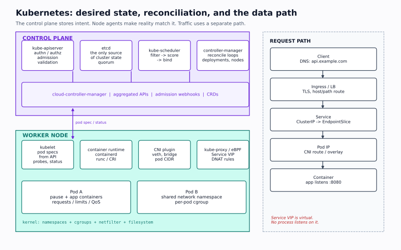

# Kubernetes Architecture and Workloads

> **The one-sentence model:** Kubernetes is a set of controllers that continuously compare desired state (stored in etcd) with observed state and take action. The API server is the only component that talks to etcd; everything else watches the API and writes status back.



---

## 1. The control plane

| Component | Responsibility | Failure symptom |
|---|---|---|
| `kube-apiserver` | REST API, authentication, authorization, admission, watch; the only etcd client | `kubectl` times out; existing Pods keep running but nothing changes |
| `etcd` | Consistent key-value store; source of truth; Raft quorum | API server read-only or unavailable; `etcdserver: no leader` |
| `kube-scheduler` | Assigns unscheduled Pods to nodes (filter + score + bind) | Pods stay `Pending` with no `Node` |
| `kube-controller-manager` | Runs built-in controllers (Deployment, ReplicaSet, Node, Job, EndpointSlice, etc.) | ReplicaSets not created; nodes not marked; endpoints stale |
| `cloud-controller-manager` | Cloud load balancers, node lifecycle, routes | `LoadBalancer` Service stays `Pending`; nodes not initialized |

The API server is stateless; scale it horizontally behind a load balancer. etcd is stateful and quorum-sensitive; run 3 or 5 members, never 2 or 4.

### etcd in one page

- Data model: a flat key space; Kubernetes objects live under `/registry/<resource>/<namespace>/<name>`.
- Raft: one leader accepts writes, replicates to a quorum, then commits. A 3-member cluster tolerates 1 failure; 5 tolerates 2.
- Writes require fsync; slow disks cause leader elections and API latency. Keep etcd on low-latency local SSD, not on a shared NFS mount.
- Watch cache: the API server maintains a cache so list/watch traffic does not hammer etcd.
- Compaction and defrag: etcd keeps old revisions until compacted; defrag reclaims space. Kubernetes compacts automatically, but defrag is an operational task.
- Backup: `etcdctl snapshot save` plus the certificates; restore is a separate, careful procedure. A snapshot is not a backup until you have restored it in a test cluster.

```bash
sudo etcdctl endpoint health --cluster
sudo etcdctl endpoint status --cluster -w table
sudo etcdctl member list -w table
sudo etcdctl snapshot save /backup/etcd-$(date +%F).db
```

```text
+----------------+------------------+---------+---------+-----------+------------+-----------+------------+--------------------+--------+
|    ENDPOINT    |        ID        | VERSION | DB SIZE | IS LEADER | IS LEARNER | RAFT TERM | RAFT INDEX | RAFT APPLIED INDEX | ERRORS |
+----------------+------------------+---------+---------+-----------+------------+-----------+------------+--------------------+--------+
| 10.0.0.11:2379 | 8e9e05c52164694d | 3.5.15  |   85 MB |      true |      false |        42 |      98231 |              98231 |        |
+----------------+------------------+---------+---------+-----------+------------+-----------+------------+--------------------+--------+
```

`DB SIZE` growing without bound suggests compaction/defrag is not running. `IS LEADER` tells you which member to watch for write latency; the others are followers.

### Control plane HA

```text
              ┌──────────────┐
   kubectl ──►│ load balancer│──┬── apiserver-1 ── etcd-1
              └──────────────┘  ├── apiserver-2 ── etcd-2
                                └── apiserver-3 ── etcd-3
```

- The load balancer health-checks `/readyz` (or `/healthz`) on each API server.
- Scheduler and controller-manager use leader election; only one instance acts at a time.
- etcd members need low latency between them; do not stretch a cluster across regions.
- Lose quorum (2 of 3 etcd members), and the API becomes read-only for writes; running workloads are not immediately killed, but no new scheduling or changes occur.

---

## 2. The node

| Component | Responsibility | Failure symptom |
|---|---|---|
| `kubelet` | Watches Pods bound to its node; drives CRI/CNI/CSI; probes; node status | Node `NotReady`; Pods not started; eviction |
| Container runtime (`containerd`/CRI-O) | Pulls images, creates containers, reports status | `ContainerCreating`; `runtime not ready`; image pull errors |
| `kube-proxy` | Programs Service rules (iptables/IPVS/nftables) | Service ClusterIP unreachable; stale endpoints |
| CNI plugin | Pod IP allocation, veth, routes, policy | Pods get no IP; cross-node traffic fails |
| CSI plugin | Attach/mount volumes | Pod stuck `ContainerCreating`; `FailedAttachVolume` |
| Node problem detector / exporters | Surface hardware/kernel issues | Metrics/logs, not core |

Node conditions: `Ready`, `MemoryPressure`, `DiskPressure`, `PIDPressure`, `NetworkUnavailable`. The kubelet reports a lease in `kube-node-lease` every few seconds; the node controller marks `NotReady` after a grace period (default 40 s in recent versions, configurable).

Eviction thresholds (defaults are illustrative):

```text
memory.available<100Mi
nodefs.available<10%
nodefs.inodesFree<5%
imagefs.available<15%
pid.available<10%
```

When a threshold is crossed, the kubelet evicts Pods in QoS order: BestEffort first, then Burstable exceeding requests, then Guaranteed. It also taints the node (`node.kubernetes.io/memory-pressure`) to stop new BestEffort Pods.

---

## 3. `kubectl apply` end to end

```text
1. kubectl reads the manifest and discovers the resource/version.
2. Client-side apply computes a patch against the last-applied annotation
   (or server-side apply sends the field manager and desired fields).
3. HTTPS request → API server.
4. Authentication: client certificate, bearer token, OIDC, or webhook.
5. Authorization: RBAC (or ABAC/webhook) checks verb/resource/namespace.
6. Mutating admission: defaults, sidecars, resource limits, namespace labels.
7. Schema validation: OpenAPI/types; unknown fields rejected or pruned.
8. Validating admission: policies (PSA, OPA/Gatekeeper, Kyverno).
9. Persist to etcd (with resourceVersion/optimistic concurrency).
10. Controllers watch the change:
    Deployment controller → ReplicaSet → Pods.
11. Scheduler filters/scoring → binds Pod to a node (`spec.nodeName`).
12. kubelet on that node sees the bound Pod:
    CRI pulls image → CNI sets up network → CSI mounts volumes →
    containers start → probes run → status reported.
13. EndpointSlice controller adds ready Pod IPs; kube-proxy programs
    Service rules; CoreDNS serves the Service name.
```

Each arrow is a place to fail. The `Events` on a Pod usually tell you which one.

### Declarative vs imperative

```bash
kubectl create deployment web --image=nginx:1.27        # imperative, one-off
kubectl apply -f deployment.yaml                        # declarative, idempotent
kubectl diff -f deployment.yaml                         # preview
kubectl apply --server-side -f deployment.yaml          # server-side apply
```

`kubectl apply` stores the last applied configuration in an annotation by default. If another tool changes the object, apply can produce a conflict or silently overwrite fields. Server-side apply uses field managers and is the modern approach; it surfaces conflicts instead of guessing.

---

## 4. Workload objects

### Pod

The smallest deployable unit: one or more containers sharing a network namespace, IPC namespace, and volumes. Containers in a Pod are scheduled together and share the Pod IP.

```yaml
apiVersion: v1
kind: Pod
metadata:
  name: web
  labels:
    app: web
spec:
  initContainers:
    - name: wait-db
      image: busybox:1.36
      command: ["sh", "-c", "until nc -z db 5432; do sleep 1; done"]
  containers:
    - name: app
      image: ghcr.io/example/app:1.0.0
      ports:
        - containerPort: 8080
      envFrom:
        - configMapRef:
            name: app-config
      resources:
        requests:
          cpu: 100m
          memory: 128Mi
        limits:
          cpu: 500m
          memory: 256Mi
      readinessProbe:
        httpGet:
          path: /ready
          port: 8080
        periodSeconds: 5
      livenessProbe:
        httpGet:
          path: /healthz
          port: 8080
        periodSeconds: 10
        failureThreshold: 3
      volumeMounts:
        - name: data
          mountPath: /data
  volumes:
    - name: data
      persistentVolumeClaim:
        claimName: app-data
```

### Deployment

Manages a ReplicaSet, which manages Pods. Use for stateless services. Rolling update defaults: `maxSurge=25%`, `maxUnavailable=25%`.

```yaml
apiVersion: apps/v1
kind: Deployment
metadata:
  name: web
spec:
  replicas: 3
  selector:
    matchLabels:
      app: web
  strategy:
    type: RollingUpdate
    rollingUpdate:
      maxSurge: 1
      maxUnavailable: 0
  template:
    metadata:
      labels:
        app: web
    spec:
      containers:
        - name: web
          image: ghcr.io/example/web:1.0.0
          ports:
            - containerPort: 8080
          readinessProbe:
            httpGet:
              path: /ready
              port: 8080
```

A Deployment with `maxUnavailable: 0` and a failing readiness probe will stall with old Pods still serving and new Pods never becoming ready. That is a safe failure, not a successful rollout.

### StatefulSet

For stateful workloads that need stable identity, ordered startup, and per-replica storage.

- Pod names are `<statefulset>-0`, `-1`, ...; each gets a stable DNS name through a headless Service.
- `volumeClaimTemplates` creates one PVC per replica.
- Default pod management is `OrderedReady`; `Parallel` is available but loses ordering guarantees.
- Scaling down does not delete PVCs by default; you must clean up deliberately.

### DaemonSet

One Pod per node (or per selected node). Use for node agents: log shippers, CNI, CSI node plugins, GPU device plugins, monitoring exporters.

### Job and CronJob

Run to completion; `backoffLimit`, `completions`, `parallelism`, `activeDeadlineSeconds`, `ttlSecondsAfterFinished`. CronJob adds a schedule and `concurrencyPolicy` (`Allow`, `Forbid`, `Replace`).

### ConfigMap and Secret

- ConfigMap: non-confidential key/value or files.
- Secret: base64-encoded by default, **not encrypted**; enable encryption at rest and restrict RBAC.
- Env vars are captured at container start; volume-mounted ConfigMaps/Secrets update eventually (kubelet sync period), but the app must watch/reload. `immutable: true` prevents accidental updates but requires a new object to change.
- `secretKeyRef`/`configMapKeyRef` for a single key; `envFrom` for all keys.

### HorizontalPodAutoscaler and PodDisruptionBudget

HPA scales replicas from metrics (CPU, memory, custom/external). It needs metrics-server or a custom metrics adapter, and it needs **requests** set to calculate utilization. PDB limits voluntary disruptions (drain, eviction); it does not prevent node failure.

---

## 5. Pod lifecycle and probes

```text
Pending ──scheduled──► Running ──exit 0──► Succeeded
   │                      │
   │                      └──exit != 0──► Failed
   └──cannot schedule──► Pending (events explain why)

Running ──kubelet loses node──► Unknown
```

Pod conditions:

| Condition | Meaning |
|---|---|
| `PodScheduled` | Scheduler assigned a node |
| `Initialized` | All init containers completed |
| `ContainersReady` | All containers pass readiness |
| `Ready` | Pod is ready to receive traffic (readiness gates + containers) |

Probes:

| Probe | On failure | Use |
|---|---|---|
| `startupProbe` | Kills/restarts according to policy; disables liveness/readiness until success | Slow-starting apps |
| `readinessProbe` | Removes Pod from Service endpoints; does not restart | Dependencies, warm-up |
| `livenessProbe` | Restarts the container | Deadlocks, unrecoverable states |

```yaml
startupProbe:
  httpGet: {path: /healthz, port: 8080}
  failureThreshold: 30
  periodSeconds: 2
readinessProbe:
  httpGet: {path: /ready, port: 8080}
  periodSeconds: 5
livenessProbe:
  httpGet: {path: /healthz, port: 8080}
  periodSeconds: 10
  failureThreshold: 3
```

**Design rule:** readiness should check dependencies needed to serve traffic; liveness should check only the process's own ability to make progress. A liveness probe that fails when the database is down will restart every Pod during a database outage and make it worse.

### Termination

```text
kubectl delete pod web-abc
  → API sets deletionTimestamp
  → endpoint controller removes Pod from ready endpoints
  → kubelet runs preStop hook
  → SIGTERM to PID 1
  → wait terminationGracePeriodSeconds (default 30)
  → SIGKILL
```

If the app ignores SIGTERM, it gets killed after the grace period. If `preStop` sleeps longer than the grace period, it is cut off. If the app needs to finish in-flight requests, handle SIGTERM, stop accepting, drain, then exit.

### Restart backoff

`CrashLoopBackOff` is not a separate state; it is `Waiting` with an exponential backoff (10 s, 20 s, 40 s, ... capped at 5 minutes). The container is restarting repeatedly. `kubectl logs --previous` is the key evidence.

---

## 6. Scheduling

The scheduler runs two phases:

1. **Filter (predicates):** eliminate nodes that cannot run the Pod.
   - insufficient CPU/memory requests
   - taints without tolerations
   - node selector/required affinity mismatch
   - volume topology/PVC not bound
   - hostPort conflict
   - Pod anti-affinity rules
   - unschedulable (`spec.unschedulable`)
2. **Score:** rank remaining nodes (least allocated, balancing, topology spread, image locality, inter-pod affinity).
3. **Bind:** set `spec.nodeName` via the API.

### Requests, limits, and QoS

| QoS class | Condition | Eviction order |
|---|---|---|
| `Guaranteed` | Every container has requests = limits for CPU and memory | Last |
| `Burstable` | At least one request/limit set, not all equal | Middle |
| `BestEffort` | No requests or limits | First |

- **Requests** are used for scheduling and are the guaranteed share under contention.
- **Limits** are enforced at runtime. CPU limit → throttling; memory limit → OOM kill.
- A container with no memory limit can consume the node and trigger eviction of others.
- Namespace `ResourceQuota` limits aggregate requests/limits/object counts; `LimitRange` supplies defaults and min/max.

### Constraints

```yaml
nodeSelector:
  disktype: nvme
affinity:
  nodeAffinity:
    requiredDuringSchedulingIgnoredDuringExecution:
      nodeSelectorTerms:
        - matchExpressions:
            - key: topology.kubernetes.io/zone
              operator: In
              values: ["us-east-1a"]
  podAntiAffinity:
    preferredDuringSchedulingIgnoredDuringExecution:
      - weight: 100
        podAffinityTerm:
          labelSelector:
            matchLabels: {app: web}
          topologyKey: kubernetes.io/hostname
tolerations:
  - key: dedicated
    operator: Equal
    value: gpu
    effect: NoSchedule
topologySpreadConstraints:
  - maxSkew: 1
    topologyKey: topology.kubernetes.io/zone
    whenUnsatisfiable: DoNotSchedule
    labelSelector:
      matchLabels: {app: web}
```

Taints:

```bash
kubectl taint nodes node1 dedicated=gpu:NoSchedule
kubectl taint nodes node1 dedicated=gpu:NoSchedule-   # remove
```

Effects: `NoSchedule` (new Pods only), `PreferNoSchedule` (soft), `NoExecute` (evicts existing Pods that do not tolerate it).

### Cordon, drain, PDB

```bash
kubectl cordon node1
kubectl drain node1 --ignore-daemonsets --delete-emptydir-data
kubectl uncordon node1
```

`drain` evicts Pods; a PDB can block eviction if it would violate `minAvailable`/`maxUnavailable`. Drain can hang forever if a PDB is too strict or a Pod has no controller. `--force` is a last resort, not a habit.

---

## 7. Controllers and the reconciliation loop

Every controller follows the same pattern:

```text
watch desired state / events
  → enqueue key
  → read current state
  → compare
  → act (create/update/delete)
  → update status
  → repeat
```

Properties:

- **Level-triggered, not edge-triggered:** controllers react to current state, so missed events are repaired on resync.
- **Idempotent:** repeating the reconcile must not create duplicates.
- **Owner references:** garbage collection deletes dependents when the owner is deleted.
- **Finalizers:** block deletion until cleanup completes; a stuck finalizer means a controller is not doing its job.

A Deployment does not create Pods directly: it creates a ReplicaSet, which creates Pods. That is why `kubectl get rs` is part of a rollout investigation.

```bash
kubectl rollout status deployment/web
kubectl rollout history deployment/web
kubectl rollout undo deployment/web --to-revision=2
kubectl get rs -l app=web
kubectl describe rs web-7d9f8c6b5
```

---

## 8. Failure scenarios

### A — Pod Pending

```text
$ kubectl describe pod web-abc
Events:
  Warning  FailedScheduling  ...  0/3 nodes are available: 3 Insufficient memory.
```

Fault domain: scheduling. Check requests vs allocatable, taints, affinity, PVC, quota, hostPort. `kubectl describe node` shows `Allocated resources`; `kubectl get pods -A -o wide` shows density. Fix by lowering requests, adding capacity, removing a taint/toleration mismatch, or binding the PVC.

### B — CrashLoopBackOff

```text
$ kubectl get pod api-0
NAME    READY   STATUS             RESTARTS
api-0   0/1     CrashLoopBackOff   7
```

Fault domain: application/config/runtime. `kubectl logs api-0 --previous`, `kubectl describe pod api-0` (exit code, events), `kubectl exec` if it stays up, check ConfigMap/Secret, command/args, permissions, probes. Do not delete the Pod first; you lose the previous logs and evidence.

### C — ImagePullBackOff

```text
Events:
  Failed to pull image "ghcr.io/example/app:1.0.0": ... unauthorized
```

Fault domain: image reference/auth/registry/network. Check the exact image, tag, `imagePullSecrets`, registry credentials, rate limits, architecture (`docker manifest inspect`), and node egress/proxy. `ErrImagePull` is the first failure; `ImagePullBackOff` is the retry state.

### D — Service has no endpoints

```text
$ kubectl get endpointslices -l kubernetes.io/service-name=web
NAME        ADDRESSTYPE   PORTS   ENDPOINTS   AGE
web-abc     IPv4          8080    <unset>     5m
```

Fault domain: selector/labels/readiness. Compare `kubectl get svc web -o yaml` selector with `kubectl get pods --show-labels`; check readiness (`kubectl get pod -o wide`, `describe`); check port names/targetPort. A Service without endpoints returns connection refused/timeout depending on the proxy mode.

### E — OOMKilled

```text
$ kubectl describe pod api-0
Last State:  Terminated
  Reason:    OOMKilled
  Exit Code: 137
```

Fault domain: container memory limit or node pressure. Check `resources.limits.memory`, actual usage (`kubectl top pod`, metrics), heap/GC, leaks, and whether the node is under `MemoryPressure`. Raising the limit may just move the problem; find why the process exceeds it.

### F — Node NotReady

```text
$ kubectl get nodes
NAME     STATUS     ROLES           AGE   VERSION
node1    NotReady   control-plane   10d   v1.30.0
```

Fault domain: node/kubelet/runtime/network. On the node: `systemctl status kubelet`, `journalctl -u kubelet -n 100`, `systemctl status containerd`, `crictl info`, `df -h`, `free -m`, `dmesg`, certificates, clock. On the control plane: `kubectl describe node node1` conditions and events. Do not delete the node object first; it may recover and re-register.

### G — Deployment rollout stuck

Fault domain: readiness, quota, image, scheduling. `kubectl rollout status`, `kubectl get rs`, `kubectl describe deployment`, new Pod events, `kubectl get pods -l app=web`. A new ReplicaSet with 0 ready Pods and old Pods still running is a failed rollout, not a completed one.

### H — API server or etcd quorum loss

Fault domain: control plane. `kubectl get --raw /readyz?verbose`, `etcdctl endpoint health`, API server logs, etcd logs, disk latency, certificates. Existing Pods continue, but no scheduling or changes. Do not restart all control plane nodes at once; restore quorum first.

---

## 9. Command field manual

### `kubectl get` — inventory

```bash
kubectl get pods -A -o wide
kubectl get pods -n app --show-labels
kubectl get deploy,rs,pods -n app
kubectl get events -A --sort-by=.lastTimestamp
```

**Interpretation:** `-o wide` adds node/IP; `--show-labels` is essential for selector debugging; events are namespaced and expire (default 1 h), so capture them early.

### `kubectl describe` — the evidence page

```bash
kubectl describe pod web-abc
kubectl describe node node1
```

**Why:** combines spec, status, conditions, containers, volumes, and the last events. For scheduling and image failures, this is usually enough to name the fault domain.

**Mistake:** reading only the top `Status` and ignoring `Events` at the bottom.

### `kubectl logs` — application and previous container

```bash
kubectl logs web-abc
kubectl logs web-abc -c app
kubectl logs web-abc --previous
kubectl logs -f deploy/web --all-containers
```

**Interpretation:** `--previous` reads the last terminated container instance; without it, a CrashLoop shows the current (possibly empty) attempt. `-f` follows; `--tail` limits.

### `kubectl exec` / `debug` — inside the Pod

```bash
kubectl exec -it web-abc -- sh
kubectl exec web-abc -- nslookup web
kubectl debug -it web-abc --image=busybox:1.36 --target=app
```

**Why:** `exec` needs a shell/binary in the image; `debug` adds an ephemeral container with tools, or copies the Pod for node-level debugging. Distroless images often have no shell.

**Mistake:** debugging the network from a Pod that has no tools and concluding the network is broken. Use a debug container or a test Pod on the same node.

### `kubectl apply` / `diff` / `rollout`

```bash
kubectl diff -f app.yaml
kubectl apply -f app.yaml
kubectl rollout status deploy/web --timeout=120s
kubectl rollout undo deploy/web
```

**Interpretation:** `diff` shows what would change; `rollout status` blocks until the new ReplicaSet is complete or the timeout expires. A timeout is a failure signal, not a reason to rerun blindly.

### `kubectl auth can-i`

```bash
kubectl auth can-i get pods -n app
kubectl auth can-i --list -n app
kubectl auth can-i create pods --as=system:serviceaccount:app:deployer -n app
```

**Why:** answers authorization questions without guessing from Role YAML; `--as` tests another identity (requires impersonation permission).

### `kubectl top` / `crictl`

```bash
kubectl top pods -n app
kubectl top nodes
sudo crictl ps -a
sudo crictl logs <container-id>
```

**Why:** `top` needs metrics-server; `crictl` is the node-level view when the API/`kubectl` is unavailable.

### `kubectl explain` and `api-resources`

```bash
kubectl explain pod.spec.containers.resources
kubectl api-resources | grep -i ingress
```

**Why:** the cluster's own schema is the source of truth for the version you are running; blog posts may be for a different version.

---

## 10. Checkpoint

1. Which component writes to etcd?
2. What happens to running Pods when the API server is down?
3. Why does etcd need an odd number of members?
4. What does the scheduler use to filter nodes?
5. What is the difference between a request and a limit?
6. Which QoS class is evicted first?
7. What does a readiness probe failure do? A liveness probe failure?
8. Why does a Deployment create a ReplicaSet?
9. What is the difference between a StatefulSet and a Deployment?
10. When would you use a DaemonSet?
11. What does `kubectl drain` do, and what can block it?
12. What is a finalizer?
13. What is the difference between `ImagePullBackOff` and `ErrImagePull`?
14. Why can a Pod be `Running` but not `Ready`?
15. What does `kubectl logs --previous` show?
16. What is the risk of a liveness probe that checks the database?
17. What does a `NoExecute` taint do?
18. Why does HPA need resource requests?
19. What is the difference between a ClusterRole and a Role?
20. What evidence would you collect first for a Pod that is Pending?

### Answers

1. `kube-apiserver` is the only component that talks to etcd; controllers and kubelets use the API.
2. They keep running; the control plane cannot schedule or change anything. Existing containers are not killed by an API outage.
3. Raft requires a majority quorum; 3 tolerates 1 failure, 5 tolerates 2. An even number does not increase fault tolerance and can split evenly.
4. Resource requests, node selectors/affinity, taints/tolerations, volume topology, host ports, Pod affinity/anti-affinity, and unschedulable nodes.
5. A request is used for scheduling and is the guaranteed share; a limit is the runtime ceiling (CPU throttling, memory OOM).
6. BestEffort, then Burstable, then Guaranteed.
7. Readiness failure removes the Pod from Service endpoints; liveness failure restarts the container.
8. The Deployment manages versions/rollouts; the ReplicaSet maintains a stable replica count for one Pod template. This separation enables rollbacks and history.
9. StatefulSet provides stable names, ordered lifecycle, and per-replica PVCs; Deployment provides interchangeable replicas.
10. For a node agent that must run on every node (or a selected subset): CNI, CSI node plugin, log/metrics exporter, GPU device plugin.
11. It cordons the node and evicts Pods. PDBs, bare Pods without a controller, local storage, and DaemonSets (unless ignored) can block it.
12. A finalizer delays deletion until a controller removes it after cleanup; a stuck finalizer leaves the object in `Terminating`.
13. `ErrImagePull` is the initial pull failure; `ImagePullBackOff` is the exponential retry state after repeated failures.
14. The container is running but readiness gates/probes are failing, or the Pod is terminating; it is excluded from Service endpoints.
15. The logs from the previous terminated instance of the container, which is essential for `CrashLoopBackOff`.
16. A database outage causes liveness failures, restarting every Pod and amplifying the outage. Liveness should test the process, not its dependencies.
17. It evicts running Pods that do not tolerate the taint, in addition to preventing new scheduling.
18. HPA calculates utilization as usage/request; without requests, CPU utilization is undefined and the HPA cannot scale reliably.
19. A Role is namespaced; a ClusterRole is cluster-scoped (or can be bound in a namespace for namespaced resources).
20. `kubectl describe pod` (events), node allocatable/requests, taints, PVC status, quota, and affinity. Do not start by deleting and recreating.
