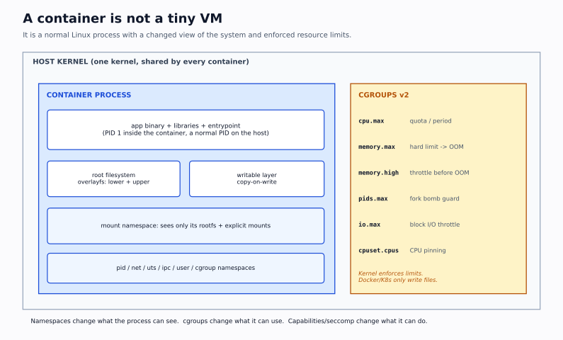

# Phase 4 — Containers and Kubernetes

> **Why this phase matters:** RTDS runs infrastructure that hosts containers and Kubernetes. You are not expected to be a cluster administrator on day one, but you are expected to explain why a Pod is Pending, why a Service has no endpoints, and what a container actually is. This phase builds that from the kernel up.



## Outcomes

By the end of this phase you can:

1. Explain a container as namespaces + cgroups + a root filesystem + security controls, not a small VM.
2. Build a container by hand with `unshare`, `chroot`/`pivot_root`, cgroups v2, and overlayfs.
3. Trace an image from Dockerfile to registry to containerd to `runc`.
4. Explain the Kubernetes control plane and node components, and trace `kubectl apply` end to end.
5. Explain Pod networking, CNI, Services, EndpointSlices, CoreDNS, kube-proxy, Ingress, and NetworkPolicy.
6. Explain PV/PVC/StorageClass/CSI and the StatefulSet storage model.
7. Explain requests/limits, QoS, OOM kills, scheduling constraints, taints, and eviction.
8. Apply least-privilege RBAC and explain why `cluster-admin` is not a debugging tool.
9. Diagnose Pending, CrashLoopBackOff, ImagePullBackOff, OOMKilled, no-endpoints, DNS failure, and NotReady from evidence.

## Prerequisites

- Phase 1: processes, signals, memory, filesystems, systemd.
- Phase 2: IP, routing, NAT, DNS, TCP, HTTP, TLS.
- Phase 3: VMs, block/file storage, IOPS.
- A Linux VM with at least 4 vCPU, 8 GB RAM, 30 GB free disk. **Docker is optional**; `podman` or `nerdctl` work for L4.2. `kind` needs a working container runtime or a Linux host.

## Environment

| Lab | Needs | Cost/safety |
|---|---|---|
| L4.1 container from scratch | Ubuntu/Debian VM, root, cgroups v2 | Destructive only to `/tmp` sandbox |
| L4.2 runtime and networking | Docker/Podman, `iproute2`, `iptables`/`nft` | Safe; clean up containers |
| L4.3 kind and core K8s | kind, kubectl, 8 GB RAM | Free; delete cluster after |
| L4.4 Services/DNS/policy | L4.3 cluster | Free |
| L4.5 storage/scheduling/RBAC | L4.3 cluster, local-path provisioner | Free; PVCs consume disk |
| L4.6 workload failure lab | L4.3 cluster | Free; intentionally broken workloads |
| L4.7 node failure and capstone | L4.3 cluster, ability to stop kubelet/containerd | Free; may need to recreate the cluster |

> **macOS note:** Docker Desktop/OrbStack can run Linux containers, but the kernel is a Linux VM. Namespace and cgroup labs must run inside that VM or a separate Linux VM. `kind` works with Docker Desktop/OrbStack, but node-level labs are limited. Prefer a disposable Ubuntu VM for the full phase.

> **Cost warning:** If you use a cloud VM, stop or terminate it after each session. A forgotten `kind` cluster plus a GPU instance is an expensive way to learn. Tag resources and set a budget alert.

## Study order

| Order | Note | Key question |
|---|---|---|
| 1 | [Container internals](01-container-internals.md) | What is actually isolated, and by what? |
| 2 | [Kubernetes architecture and workloads](02-kubernetes-architecture-and-workloads.md) | Who decides where my Pod runs, and how does it get there? |
| 3 | [Kubernetes networking, Services, DNS](03-kubernetes-networking-services-dns.md) | Why can my Pod resolve the name but not connect? |
| 4 | [Storage, RBAC, scheduling, resources](04-kubernetes-storage-rbac-scheduling.md) | Why is it Pending, and why was it OOMKilled? |
| 5 | [Debugging Kubernetes](05-debugging-kubernetes.md) | What is the next piece of evidence? |
| 6 | [Labs part 1](06-labs-part1.md) | Can I build a container and a cluster? |
| 7 | [Labs part 2](07-labs-part2.md) | Can I break and fix a cluster? |
| 8 | [Checkpoint](08-checkpoint.md) | Can I explain the failure without notes? |

## The one-diagram model

```text
                 kubectl / API client
                         │ HTTPS
                 ┌───────▼────────┐
                 │   kube-apiserver│─────────── etcd (Raft, quorum)
                 └───┬───────┬────┘
          watch/CRUD │       │ watch/CRUD
        ┌────────────▼─┐   ┌─▼──────────────┐
        │ scheduler    │   │ controller-mgr  │
        └──────┬───────┘   └───────┬─────────┘
               │ binds Pod         │ creates/repairs objects
               └─────────┬─────────┘
                         │
                 ┌───────▼────────┐
                 │ kubelet (node) │── CRI ── containerd ── runc
                 └───┬────────┬───┘
             CNI     │        │ CSI
          pod network│        │ volumes
```

Every troubleshooting question starts with: **which component owns this decision?** Scheduling is the scheduler; container start is kubelet + CRI; name resolution is CoreDNS + kube-proxy/CNI; storage attach is CSI + kubelet; access denial is RBAC/admission.

## The layer model

| Layer | What it provides | Where it fails |
|---|---|---|
| Kernel namespaces | Isolation of PID, net, mount, UTS, IPC, user, cgroup | Wrong namespace, shared host namespace, `hostNetwork` |
| cgroups | CPU, memory, I/O, PID limits and accounting | Limit too low, controller not enabled, OOM |
| Root filesystem | Image layers + writable layer | Missing binary, wrong arch, permission, read-only FS |
| Runtime | containerd/CRI-O + runc | Image pull, runtime socket, cgroup driver |
| Pod | Scheduling and lifecycle unit | Pending,CrashLoop, probe failure |
| Service | Stable virtual IP + load balancing | No endpoints, selector mismatch, policy |
| Ingress | L7 host/path routing + TLS | Controller, class, backend, certificate |
| Cluster | API, etcd, nodes, addons | NotReady, quorum loss, addon failure |

## Conventions

- Commands assume a kind cluster named `opslab` unless stated otherwise.
- `kubectl` alias `k` is optional; the labs spell it out.
- Never paste a production kubeconfig into a lab shell. Use a dedicated context and confirm with `kubectl config current-context`.
- When a lab says "break it", break only the lab namespace and clean up.
- Record evidence before fixing: `kubectl get`, `describe`, `events`, `logs --previous`, and the relevant node/runtime logs.

## Completion criterion

You can:

- Build a running process tree with `unshare` and a cgroup limit, and explain each namespace.
- Show where a container's writable layer lives and why deleting the container deletes it.
- Trace a Pod from YAML to running container, naming every component and API object.
- Prove a Service's endpoint selection with `EndpointSlice` and `kubectl get pod --show-labels`.
- Explain the difference between a ClusterIP, a headless Service, and an Ingress.
- Resize a PVC, or explain why the StorageClass forbids it.
- Show a Pod being denied by RBAC and fix it with a minimal Role.
- Diagnose six broken workloads from evidence, without guessing.

Then take [the checkpoint](08-checkpoint.md).
