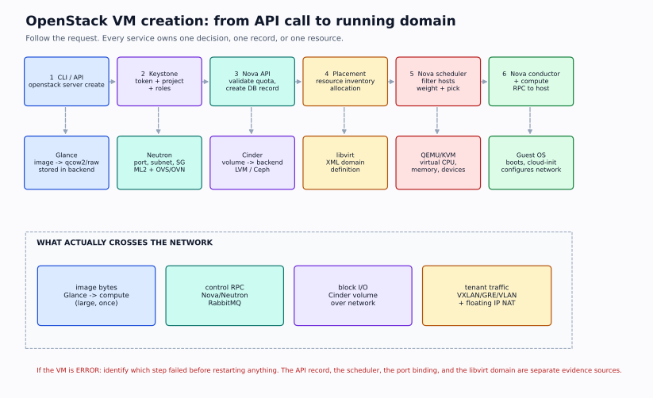

# Phase 6 — OpenStack

> **Why this phase matters:** OpenStack is the private-cloud control plane many AI infrastructure teams actually run. The vocabulary is different from AWS, but the problems are the same: identity and scope, image and flavor selection, scheduling against real capacity, tenant networking, block storage attachment, and a VM that is `ACTIVE` but unreachable. If you understand the OpenStack request path, you can debug a private GPU cloud instead of treating it as a black box.



> The diagram is a high-level path from API request to a running VM. This phase fills in each box: Keystone authenticates, Glance supplies the image, Placement and Nova choose a host, Neutron wires the port, Cinder attaches volumes, and libvirt starts the domain.

## Outcomes

By the end of this phase you can:

1. Explain OpenStack as a set of APIs and agents, not a single monolith, and separate control-plane from data-plane failures.
2. Trace a request through Keystone: domain → project → user → role assignment → service catalog → endpoint → token scope.
3. Read a Glance image's status, format, visibility, and backend; explain why an image can be `active` but unusable on a host.
4. Explain Nova's API, scheduler, conductor, compute, and cells; read an instance's state, task state, fault, and event history.
5. Use Placement to prove whether a host has inventory, traits, and free allocation for a requested flavor.
6. Build a tenant network with Neutron: network, subnet, port, router, external gateway, floating IP, security group, DHCP, and metadata.
7. Explain east-west and north-south packet paths, including SNAT, DNAT, namespaces, OVS/OVN, and MTU.
8. Create, attach, snapshot, restore, and detach a Cinder volume; explain the iSCSI/RBD path and the AZ constraint.
9. Diagnose the classic private-cloud failures: 401 vs 403, no valid host, stuck `BUILD`, no DHCP, no metadata, no floating IP, port binding failure, volume stuck `attaching`, and an AZ mismatch.
10. Clean up every VM, floating IP, volume, snapshot, router, and network you created, and prove it with CLI output.

**Non-goal:** becoming an OpenStack operator who installs and upgrades a production cloud. You need to operate and debug workloads on someone else's OpenStack, and understand enough of the control plane to ask the right question.

## Prerequisites

- Phase 1 Linux: processes, systemd, logs, disks, namespaces.
- Phase 2 networking: CIDR, routes, NAT, DNS, TCP, bridges, packet capture.
- Phase 3 virtualization and storage: KVM/QEMU/libvirt, qcow2, LVM, iSCSI, block vs file vs object.
- Phase 4 Kubernetes: declarative APIs, controllers, scheduling, Services, PV/PVC. The mental model transfers.
- Phase 5 AWS: VPC, IAM, EBS, ALB. You will map each concept to its OpenStack counterpart.

## Environment and safety

| Option | What you get | Cost/safety | Use when |
|---|---|---|---|
| **Existing OpenStack project** | A real cloud, real quotas, real agents | Best; use a sandbox project and a budget/expiry tag | You have access through work/university |
| **DevStack in a disposable VM** | A single-node all-in-one cloud | Free; needs 4 vCPU, 8–16 GB RAM, 40+ GB disk, nested virtualization for real VMs | You need to see services and logs locally |
| **Packstack/Kolla in VMs** | A more production-like multi-node lab | Heavy; 3+ VMs, 16–32 GB RAM | You want to practice multi-node failures |
| **Read-only API walkthrough** | No resources created | Free; limited to what your project can see | You have no lab cloud and cannot run DevStack |

> **Do not install DevStack on your daily laptop or on a machine you cannot rebuild.** It changes networking, installs services, and expects a clean host. Use a disposable Ubuntu 22.04/24.04 VM with nested virtualization, snapshots, and no production credentials. If you use an existing cloud, never run cleanup commands with `--all-projects` or delete resources you did not create.

> **Credentials:** source an `openrc` file or use `clouds.yaml`; never commit either. Prefer application credentials or a scoped project user over the admin account. A token is a bearer credential: treat it like a password.

### DevStack minimum

```text
Ubuntu 22.04/24.04 VM
4 vCPU, 8 GB RAM minimum (16 GB comfortable)
40 GB free disk (more if you create volumes)
Nested virtualization enabled if you want /dev/kvm
A second NIC or host-only network is convenient, but DevStack can use one
```

A single-node DevStack is enough for L6.1–L6.3 and the control-plane half of L6.4. It is not a realistic HA or multi-tenant cloud; do not generalize its timing or failure behavior to production.

## Study order

| Order | Note | Key question |
|---|---|---|
| 1 | [Architecture and Keystone](01-architecture-and-keystone.md) | Who am I, which project am I in, and which endpoint will I call? |
| 2 | [Images and compute: Glance, Nova, Placement](02-images-and-compute.md) | Why did this flavor land on this host, or not land at all? |
| 3 | [Neutron networking](03-neutron-networking.md) | Why does the VM have an IP but no path? |
| 4 | [Cinder storage](04-cinder-storage.md) | Why is the volume `available` but not attached? |
| 5 | [The VM creation flow](05-vm-creation-flow.md) | At which stage did the request fail, and what is the evidence? |
| 6 | [Troubleshooting playbook](06-troubleshooting.md) | What do I check first, and what would prove me wrong? |
| 7 | [Labs part 1](07-labs-part1.md) | Can I map a cloud and launch a reachable VM? |
| 8 | [Labs part 2](08-labs-part2.md) | Can I attach storage and diagnose a failed launch? |
| 9 | [Checkpoint](09-checkpoint.md) | Can I explain and debug the whole path? |

## The service map

| Service | Project name | Job | Data plane? |
|---|---|---|---|
| **Keystone** | `keystone` | Identity, projects, roles, service catalog, tokens | No |
| **Glance** | `glance` | Image registry and metadata | Stores image bytes |
| **Nova** | `nova` | VM API, scheduling, lifecycle, console | Yes, via compute/libvirt |
| **Placement** | `placement` | Resource inventory, traits, allocations | No (scheduling data) |
| **Neutron** | `neutron` | Networks, subnets, ports, routers, floating IPs, security groups | Yes, via agents/OVS/OVN |
| **Cinder** | `cinder` | Block volumes, snapshots, backups, volume types | Yes, via storage backend |
| **Swift** | `swift` | Object storage (S3-like API) | Yes |
| **Horizon** | `horizon` | Web dashboard | No |
| **Heat** | `heat` | Orchestration (CloudFormation-like) | No |
| **Octavia** | `octavia` | Load balancing | Yes |
| **Barbican** | `barbican` | Secrets/key management | No |
| **Manila** | `manila` | Shared file systems | Yes |
| **Ironic** | `ironic` | Bare-metal provisioning | Yes |
| **Cyborg** | `cyborg` | Accelerator (GPU/FPGA) management | No |

The projects share Keystone for identity and often use a shared message queue (RabbitMQ) and databases. An API service can be up while its agents or backend are down; that is why "the API returns 200" is not the same as "the data plane works."

## The control-plane pattern

```text
client (openstack CLI / SDK / Horizon)
  │  HTTPS + token
  ▼
API service (nova-api, neutron-server, cinder-api, glance-api)
  │  validates, writes DB, sends RPC
  ▼
scheduler / conductor / placement
  │  chooses host or backend
  ▼
agent on the host (nova-compute, neutron-openvswitch-agent, cinder-volume)
  │  talks to libvirt, OVS, iSCSI, Ceph
  ▼
data plane (VM, veth/tap, bridge, volume)
```

Most "OpenStack is broken" tickets are one of:

- the client is in the wrong project, region, or endpoint;
- the API accepted the request but the scheduler could not place it;
- the control plane chose a host but the agent/backend could not complete the data-plane step;
- the data plane is fine but the tenant network/security group/floating IP is wrong.

## AWS ↔ OpenStack ↔ Kubernetes translation

| Concept | AWS | OpenStack | Kubernetes |
|---|---|---|---|
| Identity | IAM | Keystone | RBAC + ServiceAccount |
| Project/tenant | Account | Project | Namespace (loosely) |
| Region/AZ | Region/AZ | Region/AZ | Cluster/zone |
| Image | AMI | Glance image | Container image |
| VM | EC2 instance | Nova server | Pod |
| Flavor | Instance type | Flavor | Resource requests/limits |
| Scheduling | Capacity | Nova scheduler + Placement | kube-scheduler |
| Virtual network | VPC | Neutron network | CNI network |
| Subnet | Subnet | Neutron subnet | Pod/node CIDR |
| Router | Route table/IGW/NAT | Neutron router | Node routing/CNI |
| Firewall | SG/NACL | Security group | NetworkPolicy |
| Public IP | EIP | Floating IP | LoadBalancer/Ingress |
| Block volume | EBS | Cinder volume | PV/PVC |
| Object store | S3 | Swift | External object store |
| Load balancer | ALB/NLB | Octavia | Service/Ingress |
| Metadata | IMDS | Metadata service | Downward API |

The mapping is conceptual, not one-to-one. A Neutron router is not a VPC route table; a Cinder volume is not an EBS volume with the same failure modes; a Nova flavor is not a Kubernetes request. Use the map to ask better questions, not to assume identical behavior.

## How to study this phase

1. Read the architecture and Keystone note first. Every other command depends on a valid token and scope.
2. Run L6.1 read-only before creating anything. Build a map of your cloud: services, endpoints, agents, hypervisors, images, flavors, external networks.
3. Run L6.2 with the smallest image and flavor. Prove the VM is reachable, not just `ACTIVE`.
4. Run L6.3 with a disposable volume. Snapshot, restore, and verify the data.
5. Run L6.4 last. Break a launch and a volume attach on purpose, then diagnose from evidence.
6. Take the checkpoint closed book. If you cannot draw the path from `openstack server create` to a running domain, re-read the VM flow note.

## Completion criterion

You can:

- Explain the difference between a domain, project, user, role, and token scope.
- Given a 401 and a 403, name the likely fault domain and the next command for each.
- Explain why a flavor can fit the aggregate CPU/RAM but still fail to schedule.
- Trace a packet from a VM to the internet through a Neutron router and floating IP.
- Explain why a VM can be `ACTIVE` with an IP but unreachable.
- Attach a Cinder volume, grow the filesystem, snapshot it, restore it, and explain the AZ constraint.
- Read a Nova event history and identify the failing stage.
- Clean up every resource and prove it with CLI output.

Then take [the checkpoint](09-checkpoint.md).
