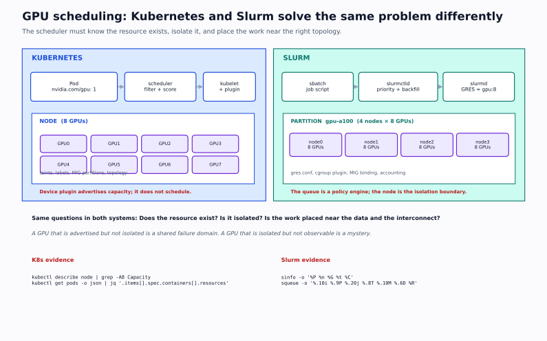

# GPU Scheduling: Kubernetes, MIG, and Slurm

> **The one-sentence model:** a GPU scheduler is an admission system for a non-overcommittable, expensive, and sometimes shared device; it must decide *who* gets *which* device, *how much* of it, and *for how long*, while keeping the topology that the workload depends on.



---

## 1. Why GPU scheduling is different

A CPU is timesliced by the kernel. You can put 20 containers on one core and they all make progress, slowly. A GPU is not scheduled that way by default:

- **It is not overcommittable in Kubernetes.** `nvidia.com/gpu: 2` means two whole devices. You cannot request `0.5` unless the device is pre-partitioned (MIG) or a sharing mode is configured.
- **It is expensive.** An idle GPU costs the same as a busy one. Utilization is a first-class scheduling goal.
- **It has topology.** NVLink, PCIe root complex, NUMA node, and NIC locality determine whether a multi-GPU job runs at 2× or 0.6×.
- **It has memory that is not elastic.** Two processes sharing a GPU can each allocate until one gets `CUDA out of memory`. The scheduler does not see inside the device.
- **It fails in ways that leave the node unhealthy.** XID errors, fallen-off-the-bus, ECC faults, and thermal throttling require draining, not just a pod restart.
- **The workload is often long-running and gang-scheduled.** Eight pods of a distributed job must start together or not at all; a default Kubernetes scheduler starting seven of eight wastes seven GPUs while it waits.

The scheduler's job is therefore broader than "pick a node." It includes **admission, placement, isolation, preemption, and health**.

---

## 2. The Kubernetes device plugin contract

Kubernetes does not know what a GPU is. It knows about **extended resources**: integer quantities advertised by a node and consumed by pods.

The flow:

```text
┌──────────────┐   1. Register (Unix socket)   ┌──────────────┐
│ kubelet      │◄──────────────────────────────│ device plugin│
│              │                               │ (DaemonSet)  │
│              │   2. ListAndWatch             │              │
│              │◄──────────────────────────────│              │
│              │      device IDs, health       │              │
│              │                               │              │
│              │   3. Allocate(deviceIDs)      │              │
│              │──────────────────────────────►│              │
│              │      env, mounts, annotations │              │
└──────┬───────┘                               └──────────────┘
       │ 4. Node status: capacity/allocatable
       ▼
   nvidia.com/gpu: 8
       │
       ▼
┌──────────────┐   5. Pod requests 2 GPUs      ┌──────────────┐
│ scheduler    │──────────────────────────────►│ kubelet      │
│ (filter/score)                               │ + runtime    │
└──────────────┘                               └──────────────┘
```

### What each component does

| Component | Responsibility | Does **not** do |
|---|---|---|
| Device plugin (DaemonSet) | Advertise devices, report health, allocate device IDs, set env/mounts | Schedule pods, enforce memory limits, isolate compute |
| kubelet | Report capacity/allocatable, call `Allocate` at pod admission | Choose the node; understand MIG profiles beyond the resource name |
| kube-scheduler | Filter feasible nodes, score, bind | Guarantee GPU-to-GPU topology unless you add plugins |
| Container runtime | Start the container with the device nodes mounted | Enforce GPU memory or SM partitioning |
| NVIDIA driver / CUDA | Provide `/dev/nvidia*`, run kernels | Partition for you (except MIG) |
| GPU Operator | Install/manage driver, plugin, DCGM, MIG manager, validator | Replace your scheduling policy |

### The registration API, in one paragraph

The plugin serves gRPC on `/var/lib/kubelet/device-plugins/kubelet.sock` and registers itself with the kubelet, then opens a socket named after its resource. `ListAndWatch` streams a device list with IDs and health. When a pod is admitted, kubelet calls `Allocate` with the chosen device IDs; the plugin returns environment variables (for example `NVIDIA_VISIBLE_DEVICES=GPU-...`) and host paths to mount. If the plugin dies, the resource eventually becomes unhealthy and new pods cannot be admitted — existing pods may keep running.

**Key consequence:** the device plugin is an *advertiser and allocator*, not a scheduler and not an isolation mechanism. If it advertises 8 GPUs, Kubernetes believes there are 8 allocatable units. Nothing prevents two containers from sharing one if you configure a sharing mode.

---

## 3. Requesting a GPU in a Pod

```yaml
apiVersion: v1
kind: Pod
metadata:
  name: train
spec:
  containers:
    - name: trainer
      image: pytorch/pytorch:2.4.0-cuda12.1-cudnn9-runtime
      resources:
        limits:
          nvidia.com/gpu: 1
        requests:
          nvidia.com/gpu: 1
      env:
        - name: NVIDIA_VISIBLE_DEVICES
          value: "all"   # the runtime/plugin narrows this at allocation
```

Rules that trip people up:

1. **Requests and limits must be equal for extended resources.** Kubernetes rejects a pod where they differ. There is no burst or overcommit.
2. **The resource name is plugin-defined.** `nvidia.com/gpu` is the common one; MIG resources look like `nvidia.com/mig-1g.5gb`; AMD uses `amd.com/gpu`.
3. **No GPU request means no GPU.** Setting `NVIDIA_VISIBLE_DEVICES=all` without a resource request gives the container access to every device on the node. That is a isolation bug and a security problem.
4. **A GPU request consumes a whole device even if the process uses 100 MiB.** The scheduler sees the count, not the memory.
5. **Init containers and sidecars count.** A GPU request in an init container or a logging sidecar changes the pod's total and can make it unschedulable.

Check what a node advertises:

```bash
kubectl get node gpu-node-1 -o jsonpath='{.status.capacity}' | jq
kubectl get node gpu-node-1 -o jsonpath='{.status.allocatable}' | jq
kubectl describe node gpu-node-1 | sed -n '/Allocatable/,/System Info/p'
```

Representative output:

```text
Capacity:
  cpu:                64
  memory:             1056483792Ki
  nvidia.com/gpu:     8
  pods:               110
Allocatable:
  cpu:                63500m
  memory:             1046000000Ki
  nvidia.com/gpu:     8
```

Interpretation: capacity is the hardware; allocatable is what the kubelet offers after reserved system resources. If `nvidia.com/gpu` is missing, the plugin is not registered, not healthy, or the driver is not loaded — in that order, check `kubectl get pods -n kube-system -l name=nvidia-device-plugin-ds` and `kubectl logs`.

### Whole-node vs whole-pod accounting

```bash
kubectl describe node gpu-node-1 | sed -n '/Non-terminated Pods/,/Events/p'
```

Look at the `Requests` column. A pod that requests 8 GPUs blocks the node for every other GPU pod, even if its actual utilization is 3%. This is why **right-sizing the request** and **sharing modes** matter. It is also why "the GPU is idle but the pod is pending" is a common and correct behavior.

---

## 4. What the default scheduler sees

The default scheduler filters nodes by:

- resource fit (CPU, memory, GPU count, ephemeral storage);
- node selectors and node affinity;
- taints and tolerations;
- pod affinity/anti-affinity;
- topology spread constraints;
- volume zone/region constraints;
- unschedulable state and cordon.

It does **not** by default see:

- which physical GPU is free or its model (unless labeled);
- NVLink topology between GPUs;
- NUMA locality of the GPU and NIC;
- MIG profile fragmentation beyond the advertised resource name;
- gang membership (all-or-nothing for a distributed job);
- GPU memory or utilization.

That gap is filled by node labels, topology-aware scheduling plugins, and gang schedulers.

### Labeling GPU nodes

Use labels that describe facts the scheduler can filter on:

```bash
kubectl label node gpu-node-1 \
  accelerator=nvidia-a100 \
  gpu.count=8 \
  gpu.memory=80gb \
  topology.nvidia.com/nvlink=true \
  node.kubernetes.io/instance-type=p4d.24xlarge

kubectl label node gpu-node-2 \
  accelerator=nvidia-t4 \
  gpu.count=4 \
  gpu.memory=16gb \
  topology.nvidia.com/nvlink=false
```

Then constrain:

```yaml
spec:
  nodeSelector:
    accelerator: nvidia-a100
  affinity:
    nodeAffinity:
      requiredDuringSchedulingIgnoredDuringExecution:
        nodeSelectorTerms:
          - matchExpressions:
              - key: gpu.memory
                operator: In
                values: ["80gb"]
```

**Label hygiene:** labels are not enforced by hardware. A stale label sends an A100 job to a T4 node and the job fails at CUDA init with an architecture mismatch. Reconcile labels from the GPU Operator/DCGM or a node inventory job; do not let humans type them once and forget.

### Taints for GPU nodes

If GPU nodes are precious, keep general workloads off them:

```bash
kubectl taint node gpu-node-1 dedicated=gpu:NoSchedule
```

```yaml
spec:
  tolerations:
    - key: dedicated
      operator: Equal
      value: gpu
      effect: NoSchedule
  nodeSelector:
    accelerator: nvidia-a100
```

`NoSchedule` prevents new pods; `NoExecute` also evicts running pods that do not tolerate the taint. Use `NoExecute` carefully on a node running a multi-hour training job unless you intend to drain it.

### Topology: the part the scheduler usually misses

A node with 8 GPUs and 4 NICs can be wired in many ways:

```text
NUMA0: GPU0 GPU1 GPU2 GPU3 ── PCIe switch ── NIC0 NIC1
NUMA1: GPU4 GPU5 GPU6 GPU7 ── PCIe switch ── NIC2 NIC3
```

If a tensor-parallel job lands GPUs 0–3 and its all-reduce traffic exits through NIC2 on NUMA1, every collective crosses a CPU interconnect. The job runs, slowly. `nvidia-smi topo -m` and `numactl -H` show the truth; the default scheduler does not read them.

Mitigations:

- **Node-level:** one GPU type and one topology per node pool; label pools, not individual nodes, when possible.
- **Pod-level:** request all GPUs for a tensor-parallel group in one pod (common for single-node TP), so the device plugin allocates them together and the process controls placement.
- **Scheduler plugins:** topology-aware scheduling (NUMA, GPU-to-NIC affinity) or a gang scheduler with topology constraints.
- **Admission:** reject multi-GPU pods that request a count the node cannot supply contiguously, or route them to a pool with full NVLink.

---

## 5. GPU sharing: MIG, time-slicing, and MPS

There are three different answers to "can two workloads share one GPU?" They are not interchangeable.

### 5.1 MIG — Multi-Instance GPU

MIG partitions a supported GPU (A100, H100, A30, some others) into **hardware-isolated instances**, each with its own SMs, memory slices, and memory bandwidth.

```text
A100 80GB, 7-way MIG
┌────────┬────────┬────────┬────────┬────────┬────────┬────────┐
│ 1g.10gb│ 1g.10gb│ 1g.10gb│ 2g.20gb│ 2g.20gb│ 1g.10gb│ 1g.10gb│
│  SM 14 │  SM 14 │  SM 14 │  SM 28 │  SM 28 │  SM 14 │  SM 14 │
└────────┴────────┴────────┴────────┴────────┴────────┴────────┘
```

Profiles are named `<compute>.g<memory>`: `1g.10gb`, `2g.20gb`, `3g.40gb`, `7g.80gb`. The exact menu depends on the GPU and the driver.

**What MIG gives you:**

- fault isolation: a CUDA fault in one instance does not kill the others;
- memory isolation: an OOM in one instance cannot consume another's memory;
- deterministic QoS: each instance has dedicated SMs and bandwidth slices;
- scheduling granularity: advertise each instance as a resource.

**What MIG does not give you:**

- free partitioning: the profiles are fixed; you cannot make an arbitrary 1.5g;
- perfect linear scaling: a 1g slice has a fraction of the SMs and bandwidth, and small slices may not fit large models;
- transparent resizing: changing the layout requires draining the GPU and recreating instances;
- support on every GPU: consumer cards generally do not support MIG.

Enable MIG (on a **disposable** GPU host; this disrupts every workload on the device):

```bash
sudo nvidia-smi -mig 1
sudo nvidia-smi mig -lgip          # list GPU instance profiles
sudo nvidia-smi mig -cgi 1g.10gb,1g.10gb,2g.20gb -C
sudo nvidia-smi mig -lci          # list compute instances
```

Representative output:

```text
+-----------------------------------------------------------------------------+
| GPU instance ID   GPU instance profile    Placement                  Status |
|=============================================================================|
| 0                 1g.10gb                 {0,1}                      Created|
| 1                 1g.10gb                 {2,3}                      Created|
| 2                 2g.20gb                 {4,5,6,7}                  Created|
+-----------------------------------------------------------------------------+
```

With the NVIDIA GPU Operator, the MIG manager applies a label such as `nvidia.com/mig.config=all-1g.10gb` and recreates the layout. The device plugin then advertises:

```text
nvidia.com/mig-1g.10gb: 7
nvidia.com/mig-2g.20gb: 3
```

A pod requests the profile by resource name:

```yaml
resources:
  limits:
    nvidia.com/mig-1g.10gb: 1
```

**MIG traps:**

- A node with a mixed layout has fragmented free capacity. A pod needing `2g.20gb` may be pending while two `1g.10gb` instances sit idle; they cannot be combined.
- The device plugin must be configured with the MIG strategy (`single` vs `mixed`). `single` exposes only one profile type per node; `mixed` exposes all. Choose deliberately.
- Monitoring must report per-instance metrics; node-level `nvidia-smi` utilization is misleading.
- Some CUDA features and libraries behave differently under MIG (peer-to-peer, certain collectives). Test the actual workload.

### 5.2 Time-slicing

The NVIDIA device plugin can advertise a physical GPU multiple times. Multiple containers share it by time-slicing the GPU context.

```yaml
# device-plugin ConfigMap (conceptual)
version: v1
sharing:
  timeSlicing:
    resources:
      - name: nvidia.com/gpu
        replicas: 4
```

**Properties:**

- no memory isolation: one workload can OOM another;
- no fault isolation: a GPU fault or XID affects all tenants;
- oversubscription hides real capacity: 4 replicas × 8 GPUs = 32 "GPUs" that are not 32 physical devices;
- good for interactive notebooks, small inference, and dev/test where utilization is low and isolation is not required;
- bad for production multi-tenant training or latency-sensitive serving without other controls.

**Scheduling consequence:** a node may be "full" by resource count while the physical GPU is 5% utilized, or "empty" by count while a shared GPU is saturated. Utilization-based autoscaling must use DCGM metrics, not the Kubernetes resource count.

### 5.3 MPS — Multi-Process Service

MPS lets multiple CUDA processes share a GPU context with better concurrency than the default time-slicing. It can improve utilization for small kernels, but it is not a security boundary and a fault in one client can affect others. It is typically configured by the workload/runtime, not by Kubernetes resource accounting. Treat it as an optimization, not an isolation mechanism.

### 5.4 Comparison

| Mode | Isolation | Granularity | Typical use | Main risk |
|---|---|---|---|---|
| Whole GPU | Strong (process/device) | 1 GPU | Training, large serving | Low utilization, high cost |
| MIG | Strong (hardware partition) | Fixed profiles | Multi-tenant inference, small jobs | Fragmentation, model fit |
| Time-slicing | Weak | Configurable replicas | Dev notebooks, bursty small jobs | OOM/fault blast radius |
| MPS | Weak | Process-level | Small-kernel concurrency | No security boundary |
| Slurm GRES | Strong by allocation | Whole GPU or MIG | Batch/HPC clusters | Scheduler-specific config |

---

## 6. Quotas, limits, and multi-tenancy

A device plugin advertises capacity; it does not enforce fairness. Without quotas, one team can occupy every GPU.

### ResourceQuota

```yaml
apiVersion: v1
kind: ResourceQuota
metadata:
  name: team-a-gpu
  namespace: team-a
spec:
  hard:
    requests.nvidia.com/gpu: "4"
    limits.nvidia.com/gpu: "4"
    requests.cpu: "32"
    requests.memory: 128Gi
    pods: "20"
```

### LimitRange

```yaml
apiVersion: v1
kind: LimitRange
metadata:
  name: gpu-defaults
  namespace: team-a
spec:
  limits:
    - type: Container
      default:
        nvidia.com/gpu: "0"
      defaultRequest:
        nvidia.com/gpu: "0"
```

A `LimitRange` cannot force a GPU request, but it can prevent accidental `NVIDIA_VISIBLE_DEVICES=all` by policy (admission control) and set default CPU/memory. Use a validating policy (OPA/Gatekeeper, Kyverno, or Pod Security Admission plus a custom check) for GPU-specific rules:

- every container with `NVIDIA_VISIBLE_DEVICES` must have a GPU request;
- no `privileged: true` on GPU nodes;
- no hostPath to `/dev/nvidia*`;
- multi-GPU pods must select a pool labeled with NVLink;
- MIG resource names must match an allowed profile list.

### Priority and preemption

Kubernetes `PriorityClass` can preempt lower-priority pods to make room for a high-priority job. With GPUs, preemption is expensive: the victim may be a multi-hour training job. Use it deliberately.

```yaml
apiVersion: scheduling.k8s.io/v1
kind: PriorityClass
metadata:
  name: research-batch
value: 1000
globalDefault: false
preemptionPolicy: PreemptLowerPriority
```

Preemption does not checkpoint for you. A preempted training pod restarts from its last checkpoint; if it has none, the work is lost. Pair priority with checkpointing and a `PodDisruptionBudget` where appropriate.

### Gang scheduling

The default scheduler is not gang-aware. For an 8-pod distributed job, it may place 7 pods and leave the 8th pending, wasting 7 GPUs. Options:

- **Volcano**, **Kueue**, **Slurm**, or a vendor scheduler with gang scheduling;
- **Kubernetes Job with pods that wait at a barrier** — still wastes resources while waiting;
- **single-pod multi-GPU** for small jobs, avoiding the problem;
- **elastic training** that can start with fewer ranks (advanced; changes the math).

A gang scheduler admits the whole group or none. That is the correct default for synchronous data parallel training.

### Node health and draining

```bash
kubectl cordon gpu-node-1
kubectl drain gpu-node-1 --ignore-daemonsets --delete-emptydir-data
```

Before draining a GPU node:

1. Check for running training jobs and their checkpoint age.
2. Notify owners; draining is a disruption, not a free operation.
3. Use `kubectl drain` with a grace period long enough to checkpoint, or a custom eviction path.
4. Verify the GPU is healthy after maintenance with `nvidia-smi` and a DCGM diagnostic before uncordoning.

A node with an XID error or ECC failure should be drained and diagnosed, not silently returned to the pool. The GPU Operator's operator/validator and DCGM can help detect this, but the decision to drain is yours.

---

## 7. The NVIDIA GPU Operator

The GPU Operator packages the software stack as Kubernetes components:

| Component | Purpose |
|---|---|
| NVIDIA driver | Kernel driver, either preinstalled or containerized |
| Container toolkit | Makes GPUs available to containers |
| Device plugin | Advertises `nvidia.com/gpu` and MIG resources |
| DCGM / DCGM Exporter | Health and metrics |
| MIG manager | Applies MIG layouts from node labels |
| GPU Feature Discovery (GFD) | Labels nodes with GPU model, memory, MIG profile |
| Validator | Runs a smoke test of the stack |
| Node status exporter | Reports driver/plugin health as node conditions |

Install (conceptual; check the current chart and your platform's supported version):

```bash
helm repo add nvidia https://helm.ngc.nvidia.com/nvidia
helm repo update
helm install gpu-operator nvidia/gpu-operator \
  --namespace gpu-operator --create-namespace \
  --set driver.enabled=false \
  --set toolkit.enabled=true
```

Set `driver.enabled=false` when the node image already has a supported driver; otherwise the operator tries to install one and may conflict with the host.

Verify:

```bash
kubectl get pods -n gpu-operator
kubectl get nodes -o json | jq '.items[].metadata.labels | with_entries(select(.key|test("nvidia")))'
kubectl logs -n gpu-operator -l app=nvidia-device-plugin-daemonset --tail=50
```

Representative GFD labels:

```text
nvidia.com/gpu.product=NVIDIA-A100-SXM4-80GB
nvidia.com/gpu.memory=81920
nvidia.com/gpu.count=8
nvidia.com/mig.capable=true
nvidia.com/gpu.present=true
```

**Do not treat "the operator is Running" as "the GPU works."** Run a real CUDA smoke test and a DCGM diagnostic. A pod can be Running with a broken device if the plugin advertised stale health.

---

## 8. DCGM and GPU health

DCGM (Data Center GPU Manager) exposes metrics that Kubernetes does not:

| Metric | Meaning | Why it matters |
|---|---|---|
| `DCGM_FI_DEV_GPU_UTIL` | SM utilization | Low with a running job means starvation or idle |
| `DCGM_FI_DEV_MEM_COPY_UTIL` | Memory bandwidth utilization | Distinguishes memory-bound from compute-bound |
| `DCGM_FI_DEV_FB_USED` / `FB_FREE` | Framebuffer used/free | OOM prediction, leak detection |
| `DCGM_FI_DEV_POWER_USAGE` | Power draw | Throttle and cost |
| `DCGM_FI_DEV_GPU_TEMP` | Temperature | Thermal throttling |
| `DCGM_FI_DEV_SM_CLOCK` / `MEM_CLOCK` | Clocks | Throttle evidence |
| `DCGM_FI_DEV_XID_ERRORS` | XID error code | Hardware/driver fault |
| `DCGM_FI_DEV_ECC_*` | ECC errors | Silent data corruption risk |
| `DCGM_FI_DEV_NVLINK_*` | NVLink throughput/errors | Topology and link health |
| `DCGM_FI_PROF_PIPE_TENSOR_ACTIVE` | Tensor core activity | Real compute utilization |

DCGM Exporter scrapes these and exposes Prometheus metrics. Query them per pod/GPU:

```promql
avg by (node, gpu) (DCGM_FI_DEV_GPU_UTIL)
sum by (node) (DCGM_FI_DEV_FB_USED) / sum by (node) (DCGM_FI_DEV_FB_TOTAL)
avg by (node) (DCGM_FI_DEV_GPU_TEMP)
max by (node) (DCGM_FI_DEV_XID_ERRORS)
```

**Interpretation:** `GPU_UTIL=100%` does not mean useful work; it means at least one kernel was resident. A memory-bound job can show 100% while tensor cores are idle. Pair utilization with `PIPE_TENSOR_ACTIVE`, memory bandwidth, and the application's tokens/s or samples/s.

**XID errors:** XID 48 (double-bit ECC), 79 (fallen off the bus), 94 (contained ECC), 95 (uncontained ECC), 31 (MMU fault), 13 (graphics engine fault) are signals to drain and investigate. A container restart does not repair a hardware fault; a node reboot may clear a transient, but repeated XIDs mean the GPU should be replaced or serviced.

---

## 9. Slurm: the other scheduler

Many AI clusters, especially HPC-derived ones, use Slurm rather than Kubernetes. The concepts rhyme, but the vocabulary and failure modes differ.

### 9.1 GRES — Generic Resource

Slurm describes GPUs as **GRES**. A node's configuration:

```bash
# slurm.conf (excerpt)
NodeName=gpu[001-008] Gres=gpu:a100:8 CPUs=64 RealMemory=1000000
GresTypes=gpu
```

Or with `gres.conf`:

```text
NodeName=gpu001 Name=gpu Type=a100 File=/dev/nvidia[0-7]
```

Check:

```bash
sinfo -o "%20N %10c %10m %25G %10T"
```

Representative output:

```text
NODELIST             CPUS       MEMORY     GRES                      STATE
gpu[001-004]         64         1000000    gpu:a100:8                idle
gpu[005-006]         32         500000     gpu:t4:4                  mixed
cpu[001-020]         64         256000     (null)                    alloc
```

`sinfo -G` shows GRES details; `scontrol show node gpu001` shows configured and used GRES.

### 9.2 Submitting a GPU job

```bash
#!/bin/bash
#SBATCH --job-name=train
#SBATCH --partition=gpu
#SBATCH --nodes=1
#SBATCH --ntasks=1
#SBATCH --cpus-per-task=16
#SBATCH --gres=gpu:a100:2
#SBATCH --mem=128G
#SBATCH --time=04:00:00
#SBATCH --output=%x-%j.out

srun python train.py --epochs 10
```

Key directives:

| Directive | Meaning | Trap |
|---|---|---|
| `--gres=gpu:a100:2` | Request 2 A100 GPUs | Model must match; `gpu:2` without a type may take any |
| `--gpus=2` | Newer alias (Slurm 22.05+) | Not available on older clusters |
| `--ntasks` | Number of tasks | For one process using 2 GPUs, `--ntasks=1` is correct; `--ntasks=2` starts two ranks |
| `--cpus-per-task` | CPU cores per task | Too few starves the data loader |
| `--mem` | Memory per node (default) | `--mem-per-cpu` changes the meaning |
| `--time` | Wall-clock limit | The job is killed at the limit; checkpoint before it |
| `--partition` | Queue with policy | A GPU partition may have a max time or a charge factor |

Check the job:

```bash
squeue -u "$USER" -o "%.10i %.20j %.8T %.10M %.6D %R %b"
scontrol show job 12345
```

Representative output:

```text
JOBID      NAME                 STATE    TIME     NODES NODELIST(REASON)   TRES
12345      train                RUNNING  00:12:03 1     gpu001            gpu:a100:2
12346      eval                 PENDING  0:00     1     (Resources)        gpu:a100:1
```

`(Resources)` means the cluster does not have free GPUs; `(Priority)` means higher-priority jobs are ahead; `(QOSMaxGRESPerUser)` means a policy limit. The reason code is the first diagnostic; do not guess.

### 9.3 Partitions, QOS, and fair-share

A **partition** is a queue with a set of nodes and limits:

```text
PartitionName=gpu Nodes=gpu[001-008] Default=NO MaxTime=24:00:00 MaxNodes=2 PriorityTier=10
PartitionName=debug Nodes=gpu001 MaxTime=00:30:00 PriorityTier=100
PartitionName=cpu Nodes=cpu[001-020] Default=YES MaxTime=7-00:00:00
```

A **QOS** adds limits and a charge factor:

```text
QOSName=research Priority=100 MaxTRESPerUser=gpu=16 MaxWall=24:00:00 UsageFactor=1.0
QOSName=burst Priority=1000 MaxTRESPerUser=gpu=4 MaxWall=02:00:00 UsageFactor=2.0
```

**Fair-share** adjusts priority based on historical usage. The classic formula:

```text
priority ≈ site_factor
         + fair_share_factor × normalized_shares
         + age_factor
         + job_size_factor
         + partition_factor
         + qos_factor
```

The scheduler computes a **shares** value from the account's allocated share and recent usage. An account that has consumed more than its share gets a lower fair-share factor; an idle account gets a higher one. This is not a hard quota; it is a scheduling weight. Hard limits come from QOS/partition `MaxTRES`.

Inspect:

```bash
sshare -U -l
sacctmgr show assoc user="$USER" format=Account,User,Share,GrpTRES,MaxTRES
sprio -u "$USER" -l
```

Representative `sshare` output:

```text
Account       User  RawShares  NormShares  RawUsage  EffectvUsage  FairShare
root          alice 1          0.0100      1234567   0.0500        0.850
research      alice 10         0.1000      1234567   0.0500        0.920
```

Interpretation: `EffectvUsage` above `NormShares` means the account is over its share and its `FairShare` factor will fall, reducing future priority. `RawUsage` is decayed over time (the half-life is configurable), so old usage matters less.

### 9.4 Backfill

Slurm's main scheduler allocates the highest-priority jobs. **Backfill** starts lower-priority jobs earlier if they can finish before the expected start time of the highest-priority pending job, without delaying it.

This improves utilization but creates a subtle failure: a short job can start and finish, then a longer job waits. If your job is repeatedly backfilled and killed, check its time limit; a job with a long `--time` is harder to backfill.

```bash
squeue --start -j 12346
```

shows the estimated start time. Treat it as an estimate, not a promise; backfill and preemption change it.

### 9.5 Preemption and requeue

```text
PreemptType=preempt/qos
PreemptMode=REQUEUE
```

A higher-priority job can preempt yours. With `REQUEUE`, your job goes back to pending; with `CANCEL`, it is killed. Either way, **checkpoint**. Pair preemption with:

- `#SBATCH --requeue`;
- application-level checkpointing;
- a signal handler for `SIGTERM` (Slurm sends a warning before preemption if configured);
- a restart path that reads the latest checkpoint.

### 9.6 Slurm vs Kubernetes

| Concern | Kubernetes | Slurm |
|---|---|---|
| Unit | Pod/container | Job/step |
| GPU resource | Extended resource `nvidia.com/gpu` | GRES `gpu:type:count` |
| Isolation | Namespace, cgroups, device plugin | Allocation, cgroups, GRES |
| Gang scheduling | Optional (Volcano/Kueue) | Native |
| Fair-share | ResourceQuota (hard), no native fair-share | Native fair-share |
| Preemption | PriorityClass | Priority/QOS/preempt |
| Backfill | No native equivalent | Native |
| Topology | Labels + plugins | `SelectType`, `lln`, `topology.conf` |
| Long-running services | Strong | Weak (not its purpose) |
| Ecosystem | Broad | HPC/AI batch |

Many organizations run both: Kubernetes for services and interactive work, Slurm for large batch training. The platform engineer's job is to make the boundary explicit, not to pretend one is the other.

---

## 10. Command field manual

### Kubernetes

#### `kubectl get nodes -o custom-columns`

```bash
kubectl get nodes -o custom-columns=\
NAME:.metadata.name,\
GPU:.status.allocatable.nvidia\.com/gpu,\
MIG1G:.status.allocatable.nvidia\.com/mig-1g\.10gb,\
PRODUCT:.metadata.labels.nvidia\.com/gpu\.product
```

**Purpose:** inventory GPU capacity without describing every node.

**Interpretation:** blank GPU column = no plugin/allocatable; a product label without capacity = labeling/plugin mismatch; MIG columns confirm the advertised profiles.

**Mistake:** treating `allocatable` as free. Subtract running pod requests.

#### `kubectl describe node` — allocated resources

```bash
kubectl describe node gpu-node-1 | sed -n '/Allocated resources/,/Events/p'
```

**Purpose:** see requests vs limits and the remaining allocatable GPU count.

**Interpretation:** `nvidia.com/gpu  6 (75%)  6 (75%)` means 6 of 8 allocated. The percentage is of allocatable, not utilization.

**Mistake:** reading `Requests` as actual usage. A pod requesting 8 GPUs shows 100% even if idle.

#### `kubectl get pods -A -o json` — who holds GPUs

```bash
kubectl get pods -A -o json | jq -r '
  .items[] |
  select(.spec.containers[].resources.limits["nvidia.com/gpu"] != null) |
  [.metadata.namespace, .metadata.name, .spec.nodeName,
   ([.spec.containers[].resources.limits["nvidia.com/gpu"]] | add)] |
  @tsv'
```

**Purpose:** attribute GPU requests to workloads.

**Interpretation:** a pod with a GPU request but no GPU activity is a candidate for right-sizing or eviction. Cross-check with DCGM.

#### `kubectl get events --field-selector reason=FailedScheduling`

```bash
kubectl get events -A --field-selector reason=FailedScheduling \
  --sort-by=.lastTimestamp | tail -20
```

**Purpose:** find why a GPU pod is pending.

**Interpretation:** `0/12 nodes are available: 8 Insufficient nvidia.com/gpu, 4 node(s) had untolerated taint` tells you both the resource and the taint problem. The message is a filter trace, not a single cause.

#### `kubectl auth can-i` — quota/RBAC check

```bash
kubectl auth can-i create pods --namespace team-a
kubectl get resourcequota -n team-a
kubectl describe resourcequota -n team-a
```

**Purpose:** distinguish "cannot create" (RBAC/admission) from "cannot schedule" (capacity).

**Interpretation:** `Used` vs `Hard` on the quota; a GPU quota of 0 blocks creation even if the cluster has free GPUs.

#### Device plugin logs

```bash
kubectl logs -n kube-system -l name=nvidia-device-plugin-ds --tail=100
kubectl get pods -n kube-system -l name=nvidia-device-plugin-ds -o wide
```

**Purpose:** confirm registration, device discovery, and allocation errors.

**Interpretation:** `Registered device plugin for 'nvidia.com/gpu' with Kubelet` is the success line. `Failed to allocate` or `device not found` points to the driver or the container runtime.

### MIG

```bash
nvidia-smi -L
nvidia-smi mig -lgip
nvidia-smi mig -lgi
nvidia-smi mig -lci
```

**Purpose:** show physical GPUs, supported profiles, created GPU instances, and compute instances.

**Interpretation:** `MIG 1g.10gb Device 0: (UUID: MIG-...)` is an instance. A profile listed by `-lgip` is *supported*, not *created*.

```bash
nvidia-smi -mig 1          # enable MIG mode (destructive; drains the GPU)
nvidia-smi mig -cgi 1g.10gb -C
nvidia-smi mig -dci         # delete compute instances
nvidia-smi mig -dgi         # delete GPU instances
```

**Safety:** these commands disrupt all workloads on the GPU. Never run them on a shared or production host without a drain and an owner's approval.

### Slurm

```bash
sinfo -o "%20N %10c %10m %25G %10T"
scontrol show node gpu001
squeue -u "$USER" -o "%.10i %.20j %.8T %.10M %.6D %R %b"
scontrol show job <jobid>
scancel <jobid>
scontrol hold <jobid>
scontrol release <jobid>
```

**Purpose:** inventory, inspect, submit/queue, cancel, and hold jobs.

**Interpretation:** `STATE=mixed` means some resources are allocated; `idle` means all free; `drain` means the node is intentionally unavailable; `down` means it failed. `REASON=Resources` is capacity; `Priority` is queue order; `QOSMaxGRESPerUser` is policy.

```bash
sacct -j <jobid> --format=JobID,JobName,State,Elapsed,AllocTRES,MaxRSS,ExitCode
```

**Purpose:** post-mortem a job: state, elapsed time, allocated TRES, memory, exit code.

**Interpretation:** `OUT_OF_MEMORY` and exit code `137` point to memory; `TIMEOUT` points to the wall clock; `NODE_FAIL` points to hardware.

---

## 11. Failure scenarios

### F1 — Pod pending: `Insufficient nvidia.com/gpu`

Evidence: `kubectl describe pod`, scheduler events, node allocatable, running GPU pods, quota.

Likely causes: all GPUs allocated by idle pods; request larger than any node; wrong resource name (`nvidia.com/gpu` vs MIG); quota exhausted; taint not tolerated.

Next action: identify idle GPU holders and right-size or evict; do not add nodes until you know the request is correct.

Prevention: utilization-based reclamation, accurate requests, quota review, and a pending-GPU alert.

### F2 — Node advertises GPUs, but CUDA fails in the pod

Evidence: `nvidia-smi` inside the pod, device plugin logs, container runtime config, driver version on host vs container, `NVIDIA_VISIBLE_DEVICES`.

Likely causes: plugin allocated a device but the runtime did not mount `/dev/nvidia*`; driver/library mismatch; container image CUDA version newer than the driver; `NVIDIA_DRIVER_CAPABILITIES` missing `compute`.

Next action: run `nvidia-smi` in a debug pod on the same node; compare with the host; fix the runtime or image, not the scheduler.

Prevention: a GPU smoke-test DaemonSet or the GPU Operator validator after every driver/node change.

### F3 — Two pods share a GPU and one OOMs the other

Evidence: `nvidia-smi` PIDs, DCGM memory per instance, pod specs, sharing configuration.

Likely causes: time-slicing with `replicas > 1`; both pods set `NVIDIA_VISIBLE_DEVICES=all` without resource requests; MPS; a sidecar.

Next action: stop the sharing mode or move to MIG; set memory limits at the application level; do not rely on Kubernetes to enforce GPU memory.

Prevention: admission policy that forbids visibility without a request; MIG for multi-tenant isolation; per-workload memory budgets.

### F4 — MIG pod pending while instances are free

Evidence: `nvidia-smi mig -lgi`, node allocatable per profile, pod resource name, plugin MIG strategy.

Likely causes: requested `2g.20gb` but only `1g.10gb` instances exist; fragmented layout; `single` strategy exposing only one profile; plugin not restarted after a layout change.

Next action: recreate the layout to match demand or reschedule to a node with the right profile; do not assume free memory can be combined.

Prevention: capacity planning by profile, a MIG layout policy, and alerts on per-profile pending pods.

### F5 — Multi-GPU job runs at half speed

Evidence: `nvidia-smi topo -m`, NCCL logs, per-rank step time, node labels, pod placement, NIC counters.

Likely causes: GPUs split across NUMA nodes; PCIe instead of NVLink; cross-node traffic on the wrong NIC; straggler; tensor parallel across a slow link.

Next action: constrain the job to a topology-homogeneous pool; use the right parallel strategy; fix NIC affinity.

Prevention: topology labels, pool design, and a scaling test as part of acceptance.

### F6 — Node NotReady after a GPU fault

Evidence: node conditions, `dmesg`, XID errors, DCGM health, kubelet logs, `nvidia-smi`.

Likely causes: XID 79 (fallen off the bus), driver crash, ECC fault, thermal shutdown.

Next action: cordon/drain, preserve logs, reboot only if policy allows, run a diagnostic, and return the node only after a clean test. Replace the GPU if the fault repeats.

Prevention: DCGM alerts, a health-check DaemonSet, and a maintenance runbook.

### F7 — Slurm job pending with `Resources`

Evidence: `squeue -j`, `sinfo`, `scontrol show node`, `sprio`, `sshare`, QOS limits.

Likely causes: no free GPUs; request exceeds partition/QOS max; wrong GPU type; fair-share priority low; a held job; a draining node.

Next action: read the reason code, check the QOS/partition limits, and estimate start time. Do not resubmit repeatedly; it does not improve priority.

Prevention: document limits, monitor queue depth and GPU utilization, and right-size requests.

### F8 — Slurm job killed at the time limit with no checkpoint

Evidence: `sacct` state `TIMEOUT`, `--time`, checkpoint files, application logs.

Likely causes: wall-clock limit too short; checkpoint interval too long; checkpoint written to node-local disk and lost.

Next action: resume from the last valid checkpoint; adjust the limit or checkpoint frequency; move checkpoints to shared storage.

Prevention: checkpoint on a time-based interval and on `SIGTERM`; test resume; set `--time` from measured run time plus margin.

### F9 — The scheduler says the GPU is free, but utilization is 100%

Evidence: DCGM per-GPU utilization, pod-to-GPU mapping, time-slicing config, MPS, zombie processes.

Likely causes: a process outside Kubernetes (host training, a leftover notebook); a shared GPU; a zombie CUDA context; metrics aggregated at the wrong level.

Next action: `nvidia-smi` process list, map PIDs to containers (`crictl ps`, cgroups), kill only with owner approval.

Prevention: exclusive GPU allocation for production, process accounting, and alerts on GPU use without a matching pod.

### F10 — Preemption kills a training job, and it restarts from zero

Evidence: pod events (`Preempted`), priority classes, checkpoint age, restart policy.

Likely causes: no checkpoint, checkpoint on ephemeral storage, restart policy recreating the pod without resume logic.

Next action: restore the last checkpoint; add checkpointing and a resume path; use a priority class that matches the job's value.

Prevention: checkpoint to durable storage, test preemption, and use gang scheduling with a disruption budget where possible.

---

## 12. Design checklist

- [ ] GPU nodes are labeled with model, memory, count, MIG capability, and topology facts; labels are reconciled automatically.
- [ ] GPU nodes are tainted; only GPU workloads tolerate them.
- [ ] Every GPU container has a GPU request; visibility without a request is blocked by admission.
- [ ] Requests are right-sized; idle GPU holders are visible and reclaimable.
- [ ] The sharing mode is deliberate: whole GPU, MIG, or time-slicing, with the isolation trade-off documented.
- [ ] MIG layouts match the demand profile; fragmentation is monitored.
- [ ] Multi-GPU jobs are topology-aware or confined to a homogeneous pool.
- [ ] Distributed jobs are gang-scheduled or single-pod multi-GPU.
- [ ] Quotas exist per team; priority and preemption are defined.
- [ ] GPU health (XID, ECC, temperature, throttle) is monitored and alerts route to an owner.
- [ ] Draining a GPU node has a checkpoint/notification procedure.
- [ ] Slurm clusters document partitions, QOS, GRES types, and fair-share; users can read their own limits.
- [ ] The cost model distinguishes allocated GPU-hours from utilized GPU-hours.
- [ ] A GPU smoke test runs after every driver, plugin, or operator change.

---

## 13. Checkpoint

1. What does the device plugin do, and what does it not do?
2. Why must GPU requests equal limits in Kubernetes?
3. Why can a pod with a GPU request be pending while `nvidia-smi` shows an idle GPU?
4. What does `nvidia.com/gpu: 1` guarantee, and what does it not guarantee?
5. How does MIG differ from time-slicing in isolation and failure modes?
6. Why is a mixed MIG layout prone to fragmentation?
7. What is a gang scheduler, and why does a distributed job need one?
8. Why is `GPU_UTIL=100%` not proof of useful work?
9. What do XID 79 and XID 48 indicate, and what is the immediate action?
10. What is the difference between a Kubernetes ResourceQuota and Slurm fair-share?
11. What does `sinfo` state `mixed` mean?
12. What does Slurm `REASON=Resources` tell you, and what does it not tell you?
13. How does backfill improve utilization, and what job property makes backfill easier?
14. What happens to a Slurm job under `PreemptMode=REQUEUE`?
15. Why is `--gres=gpu:2` without a type risky?
16. How would you detect a GPU held by a pod that is not using it?
17. What evidence would you collect before draining a GPU node?
18. Why is a topology-unaware scheduler a cost problem, not just a performance problem?
19. How would you calculate allocated vs utilized GPU-hours for a team?
20. Design a two-tenant GPU cluster policy: one team needs 8-GPU training, the other needs many small inference replicas.
