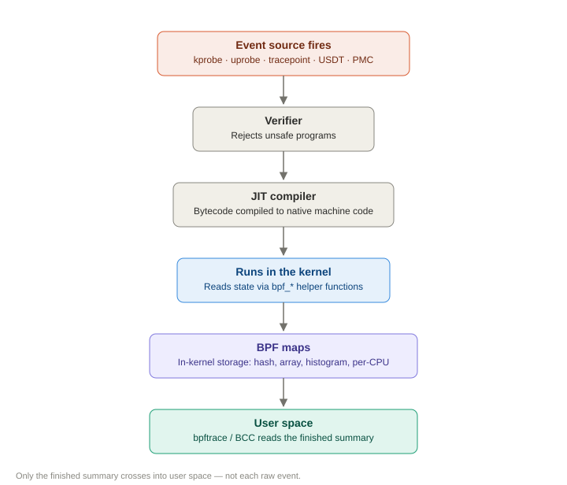
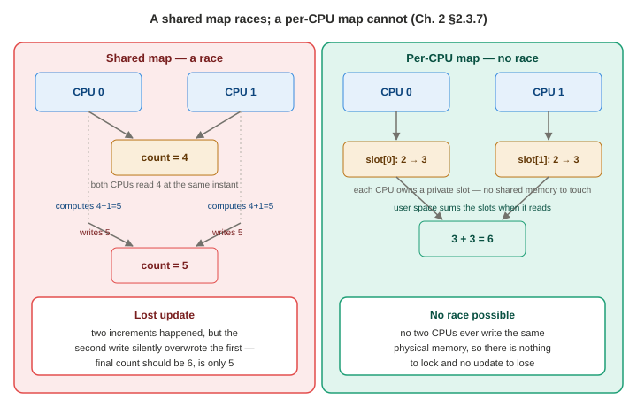
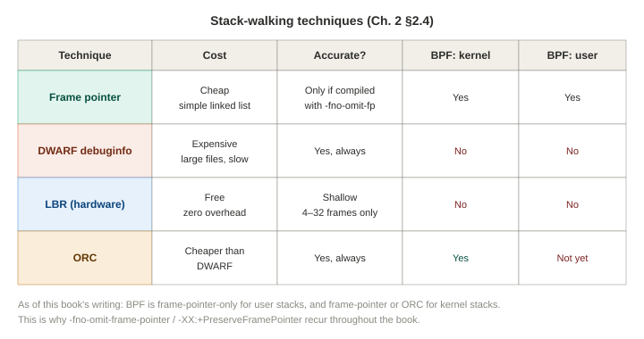
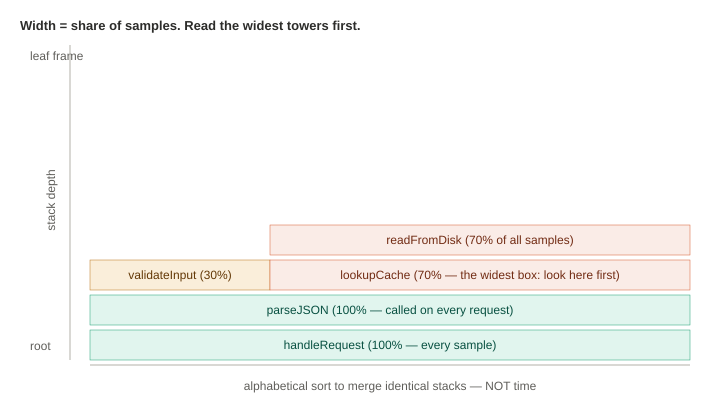
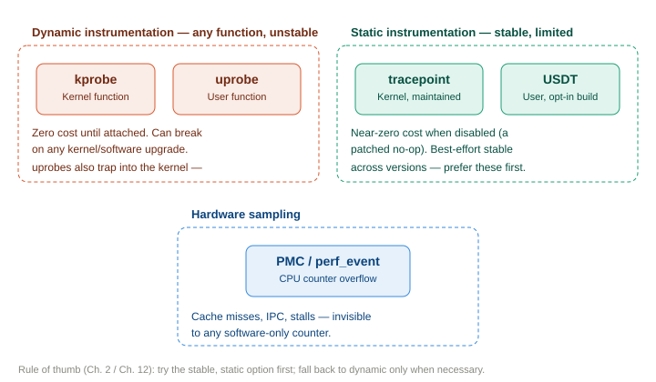
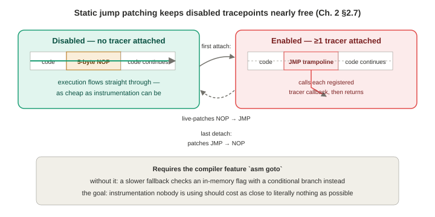

# Chapter 2 — Technology Background

*Study notes on Chapter 2 of BPF Performance Tools (Brendan Gregg, 2019). Original notes, not book text — see `00-index.md` for how these notes are written.*

> The book itself calls this "the most technically deep chapter in the book" and says you don't need to memorize it on a first pass — skim it, get the shape of it, and come back to specific sections as later chapters reference them. These notes are written with that same spirit: read it once end to end for the mental model, then treat it as a reference.

This single chapter is the technical foundation for the *entire rest of the book*. Every tool you'll meet in Part II is built from some combination of: an **event source** (kprobes, uprobes, tracepoints, USDT, or PMCs), a **BPF program** attached to that event, **BPF maps** for storing results, and (often) a **stack trace** or **flame graph** for visualizing where time is spent. This chapter explains each of those pieces properly, once, so later chapters can just say "this tool uses a uprobe" without re-explaining what that means.

---

## 2.2 Classic BPF: where this all started

BPF began in 1992, described in a paper about efficient user-level packet capture on BSD. The core idea, still visible in its modern descendant: let the **user** define a filter (e.g., "only packets on port 80"), compile that filter into a small **instruction set for a virtual machine**, and run it **inside the kernel** — so the kernel can decide packet-by-packet whether to bother copying that packet up to a user-space process at all, instead of copying *everything* and filtering in user space. This is the origin of `tcpdump`'s efficiency, and you can literally see the generated instructions with `tcpdump -d`.

**Classic BPF was a genuinely tiny machine**: 2 registers, 16 memory "slots," a program counter, all 32-bit. It arrived in Linux in 1997. Two milestones before the 2013 rewrite are worth knowing: a **JIT compiler** was added in 2011 (making the interpreter path optional for speed), and in 2012 BPF got its first use *outside* networking — as the filtering engine behind `seccomp` (a Linux syscall-sandboxing feature). That seccomp use is the first hint that BPF could become a general-purpose engine, not just a packet filter.



## 2.3 Extended BPF (what people usually mean by "BPF" today)

**Who and when:** Alexei Starovoitov proposed the rewrite in 2013 while at PLUMgrid (originally for software-defined networking use cases); Daniel Borkmann (then at Red Hat) helped rework it for kernel inclusion. Both are now the kernel's official BPF maintainers. The pieces landed over about a year: patches started merging **March 2014**, the **JIT compiler** for the new instruction set landed in **Linux 3.15 (June 2014)**, and the **`bpf(2)` syscall** — the actual user-space control interface — landed in **Linux 3.18 (December 2014)**.

**What actually changed, and why each change matters:**

| Factor | Classic BPF | Extended BPF | Why it matters |
|---|---|---|---|
| Registers | 2 (`A`, `X`) | 10 general-purpose (`R0`–`R9`) + `R10` (read-only frame pointer) | Enough registers to support real function-call calling conventions — this is what makes helper function calls practical |
| Register width | 32-bit | 64-bit | Matches modern CPU word size natively |
| Storage | 16 fixed memory slots | 512 bytes of stack **plus effectively unlimited "map" storage** | Maps are the real unlock — arbitrary key/value data structures, not a handful of scratch words |
| Kernel calls | Very limited, JIT-specific hacks | A real, extensible mechanism (`bpf_call` + helper functions) | This is what turns BPF from "packet filter" into "programmable observability engine" |
| Event targets | Packets, seccomp only | Packets, kernel functions, user functions, tracepoints, USDT, PMCs | This is the entire reason this book exists |

A subtlety worth internalizing: **"BPF" is now best understood as a technology name, not a literal acronym.** The team briefly used "eBPF" during early development, then standardized on plain "BPF" — but "eBPF" stuck as a popular nickname in blogs and marketing. When you see "eBPF" anywhere, it means exactly the same thing as "BPF" in this book.

**The runtime, end to end:** a BPF program's instructions first pass the **verifier** (rejects anything unsafe — including programs that might not terminate), and are then executed either by an **interpreter** or, more commonly, a **JIT compiler** that emits native machine instructions for the actual CPU. Calling BPF a "virtual machine" describes its *instruction-set specification*, not its runtime — once JIT-compiled, there's no extra machine layer at execution time; it just runs as native code.

### 2.3.1 Why performance tools specifically need BPF (not just "a tracer")

This is the single most important conceptual point in the whole chapter, so it's worth walking through carefully with a concrete before/after, based on the book's own `bitehist` (disk I/O size histogram) example.

**Before BPF**, building a histogram of disk I/O sizes required this pipeline:
1. Enable kernel instrumentation for disk I/O events.
2. For **every single I/O**, write a full event record (with several metadata fields) to a buffer.
3. Periodically copy that **entire buffer** up to user space.
4. In user space, walk **every record**, extract just the one field you actually care about (size in bytes), and discard the rest.
5. In user space, build the histogram from those extracted values.

Steps 2–4 are where the cost lives: on a busy system doing 10,000 disk I/Os per second, you're copying and re-parsing 10,000 full event records *every second*, just to throw away every field except one.

**With BPF**, the pipeline collapses to:
1. Attach a small BPF program to the disk I/O event.
2. **For every I/O, the BPF program itself** extracts just the size field and increments the matching bucket in a **BPF map** that's already shaped like a histogram — entirely inside the kernel.
3. User space reads that already-summarized map **once**, whenever it wants a snapshot, and prints it.

The only data that ever crosses the kernel/user-space boundary is the finished histogram's bucket counts — a handful of numbers — regardless of whether the underlying workload did 10 or 10,000 I/O per second. **This is the general pattern behind almost every tool in this book**: push the filtering, extraction, and aggregation into the kernel via a small BPF program, and only surface the final summary to user space. Keep this pattern in mind — you'll see the phrase "computed efficiently by the BPF program" throughout the rest of the book, and this section is what it actually means underneath.

### 2.3.2 BPF versus kernel modules

kprobes and tracepoints have technically been usable from a hand-written kernel module for years — so why does this book insist on BPF instead? The advantages of BPF:

- **Verified safety** — a buggy kernel module can panic the kernel or open a security hole; a BPF program is checked by the verifier first.
- **Rich map-based storage**, vs. whatever ad-hoc data structures you'd hand-roll in a module.
- **Portability** — BPF bytecode, maps, and helpers form a comparatively stable ABI, so (with caveats around unstable kernel-struct access — see CO-RE below) a compiled BPF program can run on more than just the exact kernel build it was compiled against.
- **No kernel build toolchain required just to compile the tracing program itself.**
- **A far shallower learning curve** than real kernel module engineering.

The one thing kernel modules can still do that BPF can't: call *any* kernel function, not just an allow-listed set of helpers — more power, but with correspondingly more risk of introducing a bug.

### 2.3.3 How BPF programs actually get written (and by whom)

There's a three-level tower of front ends, from lowest- to highest-level:

1. **LLVM** — BPF is an LLVM compilation target; you can write BPF logic in C (via Clang) or even LLVM's own intermediate representation.
2. **BCC** — writes the kernel-side logic in C, compiled via LLVM under the hood.
3. **bpftrace** — its own dedicated high-level language, also compiled to BPF via LLVM internally.

The practical takeaway: **as a user of this book, you will only ever need BCC or bpftrace.** Writing raw BPF instructions, or LLVM IR, is squarely "BCC/bpftrace *internals* developer" territory — the book explicitly says this is unnecessary for people using or even *developing* BPF observability tools, and pushes that material out to Appendixes D and E for the curious.

*(§2.3.4–2.3.5, skimmed: the book briefly shows `bpftool` — a kernel-shipped CLI for listing loaded BPF programs/maps and dumping their translated or JIT'd instructions — and bpftrace's own debug-output flags for viewing generated instructions. Treat both as debugging aids you'll reach for occasionally, not core daily tools; bpftrace's debug modes get proper coverage in Chapter 5, §5.17.)*

### 2.3.6 The BPF API, in the four pieces that actually matter

**(a) Helper functions.** A BPF program can't call arbitrary kernel functions — it can only call a curated, stable set of **helpers**. As of the Linux version current when the book was written (5.2), there were 98 of them; that number has grown substantially since, so treat it as a historical data point rather than today's count. The ones worth actually knowing by name, because you'll see them constantly in tool internals:

| Helper | What it does |
|---|---|
| `bpf_map_lookup_elem(map, key)` | Read a value from a map |
| `bpf_map_update_elem(map, key, value, flags)` | Write/update a value in a map |
| `bpf_map_delete_elem(map, key)` | Remove an entry from a map |
| `bpf_probe_read(dst, size, src)` | **Safely** copy bytes from an arbitrary (possibly invalid) address |
| `bpf_probe_read_str(dst, size, ptr)` | Safely copy a NUL-terminated string |
| `bpf_ktime_get_ns()` | Nanosecond timestamp since boot — the basis of every latency calculation in this book |
| `bpf_trace_printk(...)` | A debugging helper that writes to the trace pipe |
| `bpf_get_current_pid_tgid()` | Returns the current PID and TID packed into one 64-bit value (see the naming gotcha below) |
| `bpf_get_current_comm(buf, size)` | Copies the current process's command name |
| `bpf_perf_event_output(ctx, map, data, size)` | Emits one raw event record to user space via the perf ring buffer |
| `bpf_get_stackid(ctx, map, flags)` | Captures a stack trace and returns an ID for it — the basis of every flame graph in this book |
| `bpf_get_current_task()` | Returns the current kernel `task_struct` (explicitly documented as an *unstable* API — use with care) |
| `bpf_spin_lock()` / `bpf_spin_unlock()` | Concurrency control, added Linux 5.1 (originally for networking programs — see §2.3.7) |

**The PID/TID naming gotcha, worth memorizing because it trips people up constantly:** in kernel terms, `bpf_get_current_pid_tgid()`'s "pid" field is what **user space** calls the **thread ID (TID)**, and its "tgid" (thread group ID) field is what **user space** calls the **PID**. The kernel and user-space vocabularies for "process" vs. "thread" are inverted from each other. Every BPF tool that filters "by PID" is really filtering on the kernel's *tgid*.

**Why `bpf_probe_read()` specifically deserves its own mention:** ordinary memory access inside a BPF program is restricted to BPF registers, the small on-stack scratch space, and maps (via helpers). Any other memory — including perfectly normal-looking kernel structs, or user-space memory — **must** go through `bpf_probe_read()` (or its string variant), because the verifier cannot statically prove an arbitrary pointer is safe to dereference. The helper performs the actual safety check and disables page faults during the read, since faulting from inside probe context (which may have interrupts or preemption disabled) could destabilize the kernel.

**(b) `bpf(2)` syscall commands.** All control of BPF from user space goes through one syscall, `bpf(2)`, with a command argument selecting the action: `BPF_MAP_CREATE`, `BPF_MAP_LOOKUP_ELEM`, `BPF_MAP_UPDATE_ELEM`, `BPF_MAP_DELETE_ELEM`, `BPF_MAP_GET_NEXT_KEY` (map iteration), `BPF_PROG_LOAD` (verify + load a program), `BPF_PROG_ATTACH`/`BPF_PROG_DETACH`, and `BPF_OBJ_PIN` (persist a program/map into `/sys/fs/bpf` — see §2.3.8). You can literally watch these happen with `strace -ebpf <tool>` — a genuinely useful debugging trick for understanding what a tracer is doing under the hood.

**(c) Program types.** The type tells the kernel what kind of event this program expects to attach to and what argument shape to expect. For tracing, the ones that matter are `BPF_PROG_TYPE_KPROBE` (covers *both* kprobes and uprobes, despite the name), `BPF_PROG_TYPE_TRACEPOINT`, `BPF_PROG_TYPE_PERF_EVENT` (PMCs and other perf events), and `BPF_PROG_TYPE_RAW_TRACEPOINT`. Several more exist purely for networking (`SOCKET_FILTER`, `SCHED_CLS`, `XDP`, `CGROUP_SKB`) — outside this book's scope, but worth recognizing if you see them elsewhere.

**(d) Map types.** `BPF_MAP_TYPE_HASH` and `BPF_MAP_TYPE_ARRAY` are the general-purpose key/value and indexed stores; `BPF_MAP_TYPE_PERF_EVENT_ARRAY` is the conduit for shipping raw per-event data to user space (via `bpf_perf_event_output`); `BPF_MAP_TYPE_STACK_TRACE`/`BPF_MAP_TYPE_STACK` store captured stack traces; and — critically for the next section — `BPF_MAP_TYPE_PERCPU_HASH` / `BPF_MAP_TYPE_PERCPU_ARRAY` give each logical CPU its own private copy of the map.

### 2.3.7 Concurrency controls — and a direct echo of a lesson you may already know

This section deserves extra attention if you've ever debugged a data race in ordinary multi-threaded C/C++, because **BPF solves the identical problem in a strikingly similar way, at a different layer of the stack.**

The problem: multiple CPUs can run copies of the same BPF program **in parallel** (e.g., a kprobe on a hot function fires simultaneously on several cores). If they all try to update the *same* shared map entry — say, a global event counter — you get the classic **"lost update"** problem: two CPUs both read the current count, both compute count+1, and both write back the same new value, silently losing one of the two increments. Until **Linux 5.1**, BPF had **no locking primitives at all** for this (spin locks arrived in 5.1, and per the book weren't even usable in tracing programs yet at the time of writing).

**The actual fix BCC and bpftrace use is per-CPU maps** — `BPF_MAP_TYPE_PERCPU_HASH` and `BPF_MAP_TYPE_PERCPU_ARRAY` give each logical CPU its own **private, uncontended copy** of the map. There's no race to resolve, because no two CPUs ever touch the same physical memory — user space simply sums the per-CPU copies together when it wants a final total. **This is the exact same idea as giving each OS thread its own private copy of a shared resource to eliminate contention entirely, rather than adding a lock around a single shared copy** — if that pattern sounds familiar from user-space concurrent programming, it's because it's a genuinely general technique, not something specific to the kernel.


> **How to read this:** the left side is the lost-update bug — nothing crashes, a write is just silently discarded. The right side isn't a smarter fix for the same scheme; it sidesteps the problem entirely by giving each CPU its own memory, so there's no shared location left to race on.

The book includes a striking, concrete demonstration of what happens *without* this protection. Running two counting one-liners side by side against the same busy kernel function on an 8-CPU system — one using `count()` (which bpftrace implements internally as a per-CPU hash) and one using a plain `@hash++` increment (a single, shared, non-per-CPU hash entry) — the plain shared counter **undercounted the true number of events by about 0.01%**, purely from lost updates during real concurrent access. Nothing crashed; the corruption is silent and easy to miss unless you specifically compare it against a correct count. It's worth noting this is a *milder* failure mode than the classic user-space data-race story: `bpf_map_update_elem()` on an ordinary (non-per-CPU) hash is still internally atomic *per update* — you get lost updates (dropped increments), not memory corruption or a crash. That's a meaningfully different (and less dangerous) failure mode than an unsynchronized concurrent write to a raw C++ object's internal state, but it's still wrong data, and still caused by the same root issue: parallel execution contexts touching shared mutable state with no coordination.

Besides per-CPU maps, the book mentions three other, less commonly used concurrency mechanisms: `BPF_XADD` (an atomic exclusive-add instruction), "map-in-map" atomic swaps, and the spin lock helpers themselves (`bpf_spin_lock()`/`bpf_spin_unlock()`, Linux 5.1+).

### 2.3.8 The BPF sysfs interface (pinning)

Since Linux 4.4, a BPF program or map can be **"pinned"** into a virtual filesystem (conventionally `/sys/fs/bpf`), which does two useful things: it lets the program keep running **after the process that loaded it exits** (turning a one-shot tool into something more like a persistent daemon), and it gives other user-space programs a way to read/write that program's maps directly. This book's tools don't use pinning — they're modeled on ordinary Unix utilities that start and stop on demand — but it's the mechanism networking-focused BPF projects (the book names Cilium) and Android (which auto-loads and pins BPF programs at boot from `/system/etc/bpf`) rely on.

### 2.3.9 BTF (BPF Type Format)

**The recurring problem this solves:** BPF tool developers constantly need to know the exact shape (field names, types, byte offsets) of kernel structs to read them safely — but that information traditionally comes from installing matching kernel-headers packages, which can be missing entirely, incomplete, or subtly mismatched from the running kernel. This forces workarounds like redefining missing structs by hand inside a tool's own source.

**BTF is a metadata format that embeds real type/debug information** — for BPF programs, BPF maps, and (increasingly) the kernel's own internal structs — either directly in the kernel binary (`vmlinux`) or alongside a compiled BPF program. Loaders like `libbpf` and tools like `bpftool` can then use it to pretty-print map contents using real C struct layouts instead of raw hex, and to reliably discover struct shapes **without needing kernel headers installed at all**. The book is explicit that BTF was still actively evolving at the time of writing — worth knowing this section describes a *moving target* whose details will have advanced significantly since 2019; check current kernel documentation if you need BTF specifics today.

### 2.3.10 CO-RE (Compile Once – Run Everywhere)

**The problem:** a BPF program compiled against one specific kernel's struct layouts can break on a different kernel where a struct's field offsets differ — today's practical workaround is compiling the BPF program *on the target machine itself* (which is what BCC does at runtime), but that requires a full LLVM/Clang toolchain to be present everywhere you want to run a tool, which is a real burden on space-constrained systems (the book specifically calls out embedded Linux).

**CO-RE's goal**, built on top of BTF and led (per the book) by developer Andrii Nakryiko: compile a BPF program to bytecode **once**, and have `libbpf` **rewrite the struct-offset instructions at load time** on each target machine to match whatever that machine's actual kernel layout is — using BTF as the source of truth for what the real layout is. The book describes this as still in active development at the time of writing. Worth flagging explicitly: CO-RE has since become a foundational, widely-adopted part of how modern BPF tooling is built and shipped — if you're learning BPF today rather than in 2019, expect CO-RE/BTF-based tooling (including newer libbpf-based versions of BCC tools) to be the default, not an emerging feature.

### 2.3.11 BPF limitations worth memorizing

These aren't obscure edge cases — they're the specific constraints you will personally run into the first time you write a nontrivial bpftrace script:

- **Stack size is capped at `MAX_BPF_STACK` = 512 bytes.** This sounds like plenty until you remember a single `char[256]` buffer eats *half* your entire budget. The escape hatch is BPF map storage instead of stack variables — maps are effectively unbounded, unlike the stack. (The book notes bpftrace itself was moving toward using map storage for strings for exactly this reason.)
- **Instruction-count limits.** Originally capped at 4096 total instructions; Linux 5.2 raised the limit for privileged programs to roughly one million (`BPF_COMPLEXITY_LIMIT_INSNS`), though the original 4096 cap (`BPF_MAXINSNS`) still applies specifically to **unprivileged** BPF programs. (Again, treat exact numbers as historical — check `bpf(2)` for current limits.)
- **No unbounded loops.** The verifier must be able to prove a program terminates in bounded time — a BPF program stuck in an infinite loop could be holding a critical kernel lock and hang the whole system. Workarounds include manually unrolling small fixed-count loops; Linux 5.3 added support for verifiably-bounded loops natively.
- **A fun aside worth remembering:** the BPF instruction set *could* in principle express Turing-complete programs, but the verifier's safety restrictions (specifically, rejecting anything that can't be proven to halt) deliberately prevent any *loaded* BPF program from actually being Turing complete. This is a genuine, deliberate safety-over-generality tradeoff, not an accidental limitation.

---

## 2.4 Stack trace walking: four competing techniques



Reconstructing "how did we get here" from a captured moment in a running program is harder than it sounds, and there isn't one universal answer — different techniques trade off accuracy, cost, and where they can run:

| Technique | How it works | Strength | Weakness |
|---|---|---|---|
| **Frame pointers** | Follow a linked list via a dedicated register (RBP on x86_64); each frame's return address sits at a fixed `+8` offset | Cheap, simple, works from a restricted/interrupted context | **Broken by default on most modern x86-64 binaries** — see below |
| **debuginfo (DWARF)** | Reads `.eh_frame`/`.debug_frame` ELF sections that a debugger like GDB can use to unwind even without frame pointers | Accurate even without frame pointers | CPU-intensive; debuginfo files can be enormous (book example: a 17MB library with a 222MB debuginfo file); **not currently usable by BPF at all**, since it requires reading ELF sections that might not be resident in memory, unsafe from BPF's restricted context |
| **LBR (Last Branch Record)** | An Intel CPU feature recording recent branches in a small hardware buffer | Zero overhead | Limited depth — as few as 4–32 branches recorded, often not enough for deep stacks (Java routinely exceeds 32 frames); not yet supported by BPF as of the book |
| **ORC** | A newer, less CPU-intensive Linux-specific unwind format (`.orc_unwind` sections) | Lower overhead than DWARF; BPF *can* use this for kernel stacks today (via `perf_callchain_kernel()`) | Kernel-only so far — no user-space ORC support yet per the book |

**The frame-pointer gotcha deserves special attention because it's the single most common thing that silently breaks profiling in practice.** Using RBP as a dedicated frame-pointer register is only a *convention*, not a hardware requirement — and modern `gcc` **defaults to omitting it**, freeing RBP as an ordinary general-purpose register instead. The book traces this default back to a decision made for 32-bit x86 (where freeing a 5th register out of only 4 was a meaningful win) that never made sense for x86-64 (which already has 16 usable registers) but simply carried forward as the default anyway. The real-world consequence: **most software compiled with stock `gcc` defaults on x86-64 today has broken frame-pointer stack walking**, and needs to be explicitly recompiled with `-fno-omit-frame-pointer` before frame-pointer-based profiling (which is what most of the CPU-flame-graph tooling in this book relies on) will produce complete, correct stacks. The book notes the measured real-world performance cost of re-enabling frame pointers is usually under 1%, often too small to reliably measure — a small price for stack traces that actually work.

Symbols themselves are a separate concern from *walking* the stack: raw stack traces are recorded in the kernel as bare addresses, translated to human-readable function names **later**, in user space. If the mapping from address to symbol has changed between the moment you captured the stack and the moment you translate it (a JIT recompiling code, or a process that's already exited), you get garbled or missing names — a problem that resurfaces in more detail in Chapter 12 for Java specifically.

## 2.5 Flame graphs: how to actually read one



Flame graphs were invented by this book's author while debugging a real MySQL performance issue, specifically to solve the problem of comparing CPU profiles that were "thousands of pages of text" if printed as raw stack-trace-plus-count listings. They're used constantly throughout the rest of this book, so getting comfortable reading one now pays off repeatedly later.

**Start from the raw data.** Imagine a CPU profiler recorded 10 stack samples total, distributed like this (my own illustrative numbers, not the book's literal example):

```
handleRequest -> parseJSON -> validateInput        : 1 sample
handleRequest -> parseJSON                          : 2 samples
handleRequest -> parseJSON -> lookupCache           : 7 samples
```

**Turning this into a flame graph:**
- **Each box is one stack frame (one function call).**
- **The y-axis is stack depth** — the root of the call stack sits at the *bottom*, and each frame stacked above it is one level deeper. Read bottom-up to follow code flow forward; read top-down to trace a function's ancestry (who called whom).
- **The x-axis is NOT time.** This is the single most commonly misunderstood fact about flame graphs, worth over-emphasizing: the x-axis position of a box is just an **alphabetical sort** applied to maximize how much adjacent, identical stack frames can be visually merged into one wide box. **Width, however, does mean something real: it's proportional to that frame's share of the total samples.** A wide box means "this code path was sampled often"; a narrow box means "this code path was sampled rarely" — narrow boxes may even be too thin to fit a readable function-name label, which is actually a helpful side effect: your eye is naturally drawn to the wide, legible boxes first, which is exactly where you should be looking first anyway.
- **The reading strategy the book recommends, and it's genuinely the right one:** find the *widest towers* first, and understand those before worrying about the narrow slivers.

In the tiny example above, `lookupCache` — sitting directly on top of `parseJSON` — would render as the widest box at its depth, representing 70% of all samples; that's the function that was actually *running on the CPU* most of the time (as opposed to `parseJSON` and `handleRequest`, which mostly appear as "ancestors," never directly caught executing themselves).

**Interactive features** (from the book's own original flame graph implementation, an SVG file with embedded JavaScript):
- **Color** is mostly cosmetic by default — random warm colors chosen just to help visually separate adjacent boxes — but can optionally be made *meaningful*: hue can encode code type (e.g., kernel vs. user code vs. a specific language), and background color can signal the *type* of flame graph (e.g., yellow for CPU profiles, blue for off-CPU/I/O profiles). Don't assume color always means something specific without checking how a given flame graph was generated.
- **Mouse-over** reveals a frame's exact percentage of the total.
- **Click-to-zoom** lets you horizontally zoom into a narrow tower to read its otherwise-illegible label.
- **Search** (often bound to Ctrl-F) highlights every frame matching a term and shows the *cumulative* percentage of the profile that passed through it — genuinely useful for questions like "how much total time was spent somewhere inside the TCP stack," answered with one search instead of manual addition.

**Variants worth being able to recognize, since they look similar but answer different questions:**
- **Icicle graphs** — the same idea, flipped vertically (root at the top). Useful when a flame graph is taller than the screen and you want the root to always stay visible.
- **Flame *charts*** (not graphs) — visually similar, but the x-axis genuinely *is* time-ordered, not alphabetical. Popular in browser dev-tools for single-threaded JavaScript profiling, where "when did this happen" is exactly the question you want answered. Easy to confuse with flame graphs by appearance alone — check which axis convention a given tool actually uses.
- **Differential flame graphs** — visualize the *difference* between two profiles (e.g., before and after a code change, or before and after a regression), useful for spotting exactly what changed rather than re-reading two separate flame graphs side by side.



## 2.6 Event sources — the unifying summary

Everything in this chapter funnels into five categories of "thing a BPF program can attach to": **kprobes**, **uprobes**, **tracepoints**, **USDT**, and **PMCs/`perf_events`**. Kernel support for attaching BPF to each of these arrived at different times across the Linux 3.x–4.x series (kprobes/uprobes earliest; tracepoints in Linux 4.7; the newer, faster raw-tracepoint interface in 4.17). The next five sections cover each in depth.

## 2.7 kprobes in depth

kprobes provide **dynamic** kernel instrumentation — a team at IBM built the groundwork (DProbes) around 2000, which was rejected upstream, but the *concept* was later merged as kprobes in **Linux 2.6.9 (2004)**. `kretprobes` is the companion interface for instrumenting a function's *return* (and, when paired with an entry kprobe on the same function, lets you compute the function's duration).

**How it actually works, mechanically, step by step:**
1. kprobes saves the original bytes at the target instruction.
2. Those bytes are replaced with a breakpoint instruction (`int3` on x86_64 — or, when an optimization path is available, a `jmp` instead).
3. When execution hits that breakpoint, a handler checks whether *kprobes itself* installed it, and if so, dispatches to the registered kprobe handler.
4. The original instruction is then actually executed (single-stepped or emulated), and normal execution resumes.
5. When the probe is removed, the original bytes are restored.

**kretprobes work differently** because a function can only be entered once but has one specific return moment to catch: a kprobe is placed at the function's *entry*; when that fires, the real return address is saved and swapped for a substitute **trampoline** function; when the traced function eventually executes its own `ret`, control lands in the trampoline instead, which runs the kretprobe handler and *then* jumps to the real, saved return address.

**Safety mechanisms** worth knowing about: a blacklist of functions kprobes will never instrument (including kprobes' own internals, to prevent a recursive trap), and `stop_machine()` — briefly pausing all other CPU cores — used specifically when installing the faster `jmp`-based optimization, to guarantee no other core is mid-execution of the exact bytes being rewritten. In practice, the book notes the biggest *real* risk isn't correctness but overhead: probing an extremely hot function adds a small cost that, multiplied by a huge call rate, can measurably slow the system while the probe is active.

**Interfaces, oldest to newest:** the raw kernel API (`register_kprobe()`/`unregister_kprobe()` — the book notes almost nobody uses this directly, since it was built as an internal building block for tracers, not an end-user API); an Ftrace-based text interface (writing configuration strings to `/sys/kernel/debug/tracing/kprobe_events`); and `perf_event_open()` (support for the `perf_kprobe` PMU added in **Linux 4.17**), which is the path modern BPF tracing actually uses.

**BCC vs. bpftrace, functionally:** BCC's `attach_kprobe()`/`attach_kretprobe()` support instrumenting a function **plus an arbitrary instruction offset within it**; bpftrace's `kprobe`/`kretprobe` probe types (as of the book) only support instrumenting a function's **entry**. This is a genuine capability gap worth remembering if you ever need mid-function instrumentation.

A great illustration of kprobes' raw power: `bpftrace -e 'kprobe:vfs_* { @[probe] = count() }'` wildcard-matches *every* kernel function starting with `vfs_` and counts calls to each, in one line — instant workload characterization across an entire kernel subsystem with zero custom tool development.

## 2.8 uprobes in depth

uprobes bring the same dynamic-instrumentation idea to **user-space** code, merged in **Linux 3.5 (2012)**, building on earlier "utrace" groundwork.

**A structural difference from kprobes worth internalizing explicitly:** a kprobe conceptually attaches to *the kernel* — there's only one. **A uprobe attaches to a specific file on disk** (an executable or shared library). This means instrumenting a function in, say, `libc.so`, affects **every process using that library, including ones that start after you began tracing** — a single uprobe gives you a genuinely system-wide, and even future-proof-within-the-session, view of every caller of that function.

Mechanically, uprobes work the same way as kprobes underneath (breakpoint swap-in, handler dispatch, restore), which the book demonstrates by literally disassembling `readline()` from a running `bash` shell with `gdb` before and after attaching a uprobe — the targeted instruction visibly becomes `int3`.

**Interfaces:** Ftrace-based (`/sys/kernel/debug/tracing/uprobe_events`) and `perf_event_open()` (the `perf_uprobe` PMU, Linux 4.17+). **BCC vs. bpftrace:** the same asymmetry as kprobes — BCC's `attach_uprobe()`/`attach_uretprobe()` support an arbitrary offset; bpftrace's `uprobe`/`uretprobe` types support entry only.

**The overhead caveat you genuinely need to remember before using this in production:** every uprobe hit requires a full user-space-to-kernel mode transition. That's fine for something that fires occasionally, but for a function that can be called **millions of times per second** — the book's specific examples are `malloc()` and `free()` — the cumulative cost of that mode-switch tax can be severe: **the book cites real observed slowdowns of 10x or more** on the traced application. The practical rule: uprobing extremely hot allocator-style functions is a technique for a **test environment, or an already-broken production system where you've accepted the tradeoff**, not routine always-on production monitoring. (The book mentions a shared-library-based approach that would avoid the kernel trap entirely was under discussion at the time, inspired by LTTng-UST's reported 10–100x speedup over the trap-based approach — worth checking current documentation for how far that work has progressed since.)

## 2.9 Tracepoints in depth

Tracepoints provide **static** kernel instrumentation — deliberately placed, developer-maintained hooks, as opposed to kprobes' "attach to any function, dynamically, with no guarantees." Developed by Mathieu Desnoyers starting in 2007 (originally called "Kernel Markers"), merged as tracepoints in **Linux 2.6.32 (2009)**.

**kprobes vs. tracepoints, side by side:**

| | kprobes | Tracepoints |
|---|---|---|
| Type | Dynamic | Static |
| Roughly how many exist | 50,000+ (any kernel function) | ~100s (curated) |
| Ongoing kernel-maintenance burden | None | Required — developers must keep them working |
| Disabled overhead | None | Tiny (a no-op instruction plus some fixed metadata) |
| API stability | None — can break on any kernel change | "Best-effort stable" |

The guidance repeats from Chapter 1 and is worth internalizing as a default habit: **prefer a tracepoint when one exists and covers what you need; fall back to a kprobe only when it doesn't.**

**Naming convention:** `subsystem:eventname` — e.g., `kmem:kmalloc`, `sched:sched_process_exec`. Kernel developers add a tracepoint using the `TRACE_EVENT()` macro family in a header under `include/trace/events/`, which defines: the real function signature at the tracepoint site (`TP_PROTO`), which fields actually get recorded (`TP_STRUCT__entry`), how those fields are copied out of the live arguments (`TP_fast_assign`), and a human-readable format string (`TP_printk`) that tools like `perf` use for display. At runtime, this same metadata is exposed live under `/sys/kernel/debug/tracing/events/<subsystem>/<name>/format` — which is *why* tools (including bpftrace) can correctly parse a tracepoint's fields without needing a matching kernel-headers package installed: the running kernel is self-describing for its own tracepoints.

**The clever mechanism that keeps *disabled* tracepoints nearly free — "static jump patching":** at compile time, the tracepoint site becomes a small no-op instruction (5 bytes on x86_64, sized to later fit a jump instruction in the same space) plus a small trampoline routine appended nearby that, when actually reached, iterates over a list of currently-registered tracer callbacks. While **no tracer has the tracepoint enabled**, execution simply flows straight through that no-op — about as cheap as instrumentation can possibly be. The **first** time any tracer enables it, the kernel live-patches that no-op into an actual jump to the trampoline; the **last** time a tracer disables it, the jump gets patched back into a no-op. (This requires a compiler feature called `asm goto`; without it, a slower fallback using a conditional branch on an in-memory flag is used instead.) The entire point of this design is that "instrumentation nobody is currently using" should cost as close to *literally nothing* as engineering can make it.


> **How to read this:** the no-op and the jump occupy the exact same 5 bytes — this isn't a flag being checked, it's the machine code itself being rewritten, which is why "disabled" costs essentially nothing rather than just "a cheap check."

**BPF integration:** BCC's `TRACEPOINT_PROBE()` macro, or bpftrace's `tracepoint` probe type. A genuinely instructive real-world pattern comes from the `tcplife(8)` tool: it was originally written using a kprobe on `tcp_set_state()`, *before* a suitable tracepoint (`sock:inet_sock_set_state`, added in **Linux 4.16**) existed. Rather than dropping kprobe support for older kernels, the tool defines **both** a tracepoint-based and a kprobe-based program, and picks which one to actually load at runtime by checking `BPF.tracepoint_exists(...)` — a clean, reusable pattern for "prefer the stable static hook, gracefully fall back to the dynamic one on older kernels" that's worth copying if you ever write your own tools.

**`BPF_RAW_TRACEPOINT`** (added **Linux 4.17**, by Alexei Starovoitov) is a middle ground: it skips the cost of packaging tracepoint arguments into their normal stable structure, exposing the raw underlying arguments instead — faster, and with access to more fields, at the cost of losing the normal argument-stability guarantee (though the tracepoint *names* themselves remain stable, just not their exact argument shape). A microbenchmark cited in the book (recreated here, exact numbers will differ on current hardware/kernels) showed `raw_tracepoint+bpf` outperforming both plain `tracepoint+bpf` and even `kprobe+bpf` on one stress-test workload — worth considering for anything you intend to leave instrumented 24/7.

## 2.10 USDT in depth

USDT (User-level Statically Defined Tracing) is the user-space sibling of tracepoints — instrumentation points **deliberately placed by application developers**, that do **nothing at all** until an external tracer specifically attaches to them. That last property is the defining feature: unlike an application's own built-in logging or metrics system (which is self-contained and doesn't need anyone watching), a USDT probe's entire purpose is to be externally observed. USDT was popularized by Sun's DTrace and reached Linux via conventions and tooling originally built for SystemTap, which BCC and bpftrace both build on.

**A practical gotcha worth knowing up front:** many applications only compile in their USDT probes behind an **opt-in build flag** (the book's examples: `--enable-dtrace-probes`, `--with-dtrace`). "Does this software support USDT" in practice often really means "was *this specific build* compiled with that flag turned on" — it's easy to conclude a probe doesn't exist at all when it's just not compiled into the binary you happen to be running.

**How a probe actually gets added** (the book walks through Facebook's Folly C++ library as a concrete example): include a tracing header, wrap the code location of interest in a macro naming a **provider**, a **probe name**, and some arguments (e.g. `FOLLY_SDT(provider, name, arg1, arg2)`), and rebuild. You can then confirm the probe compiled in correctly with `readelf -n` on the resulting binary, which shows a `.note.stapsdt` section containing the provider name, probe name, its exact instruction offset, and how its arguments are encoded (which register or stack offset each one lives in).

**The semaphore optimization, and the tradeoff it forces:** sometimes preparing a probe's arguments is itself expensive (e.g., it requires formatting a string nobody may ever read). To avoid paying that cost when no tracer is even attached, a probe can be guarded by a **semaphore** flag: application code checks the flag first, and only does the expensive argument prep if it's set. The tracer is responsible for setting that flag when it attaches — but this means a semaphore-guarded probe can no longer be traced blindly, system-wide; the tracer now needs to target a **specific PID** so it knows exactly whose semaphore to flip.

**The machine-code mechanism is uprobes underneath** — a USDT probe compiles down to a no-op that the kernel dynamically rewrites into a breakpoint when instrumented, exactly like §2.8. The one extra wrinkle: because modern binaries are typically **position-independent executables (PIE)** loaded at a randomized address (ASLR), the ELF notes section only gives you an *offset* — you have to separately discover the binary's actual runtime load address (e.g., from `/proc/<pid>/maps`-style information) and add the offset to it before you know the real instrumentable address. This is a genuinely easy step to overlook if you're ever debugging USDT by hand rather than letting BCC/bpftrace handle it for you.

**BPF integration:** BCC's `USDT().enable_probe()`, or bpftrace's `usdt` probe type.

## 2.11 Dynamic USDT: solving USDT for JIT'd and interpreted languages

**The gap this section closes:** everything in §2.10 assumes a probe's location is baked into a real, compiled, on-disk ELF binary with a static notes section. That fundamentally doesn't exist for code that's **JIT-compiled or interpreted on the fly** — the canonical example is a user's own Java code running under the JVM. (Important nuance: the **JVM's own internal C++ code** — garbage collection, class loading, and so on — already ships genuine, static USDT probes; it's specifically *user-written, JIT-compiled Java bytecode* that has nowhere to attach a static probe to.)

**The workaround pattern, which generalizes to basically any dynamic language runtime:**
1. Pre-compile a small, real, on-disk shared library that **does** contain genuine, static USDT probes in ordinary C/C++ functions.
2. `dlopen()` that shared library at runtime, from inside the dynamic language's own runtime.
3. Expose a thin, idiomatic API in the target language that, under the hood, just calls into the pre-compiled library's probe functions (the book's Node.js example wraps this as something like `probe1.fire(callback)`, where the callback is only invoked — and its arguments only computed — if the probe is actually being traced externally).

**Concrete coverage per the book:** implemented for **Node.js and Python** via a library called `libstapsdt` (built by Matheus Marchini, also a bpftrace USDT contributor); ported to **Ruby** separately via Ruby's native C-extension mechanism. The general lesson: this pattern isn't language-specific — it can, in principle, be wrapped for any runtime that has some kind of native-extension or FFI mechanism for calling into a C shared library.

## 2.12 PMCs (performance monitoring counters)

**What they are:** programmable **hardware** counters built directly into the processor, tracking things no software-only counter can ever see — cache hit ratios, instructions-per-cycle, memory/interconnect bus utilization, stall cycles. (You may also see them called PICs, CPCs, or PMU events elsewhere — all the same underlying concept.)

Intel defines a portable baseline **"architectural set" of 7 PMCs** you can generally count on across recent Intel chips (discoverable via the `CPUID` instruction): unhalted core cycles, instructions retired, unhalted reference cycles, LLC (last-level cache) references, LLC misses, branch instructions retired, and branch misses retired. Beyond this baseline, there are **hundreds** more vendor- and model-specific PMCs available.

**A genuinely strange, hardware-imposed constraint worth remembering:** even though hundreds of PMCs might exist, the CPU physically has only a **handful of actual counter registers** available to measure with at any one instant — the book says "perhaps as few as six." Practically, this means you either pick a small subset of PMCs to watch at once, or your tooling automatically **cycles** through different PMC sets over time to approximate broader coverage (`perf(1)` does this cycling automatically). This is a hardware limitation that ordinary software counters simply never have to deal with.

**Two operating modes:**
- **Counting mode** — a free-running tally the kernel reads on demand; overhead is essentially zero.
- **Overflow sampling mode** — the counter is pre-loaded with a target and fires an interrupt to the kernel every time it wraps (e.g., "interrupt me once every 10,000 LLC misses"). This is the mode that actually matters for BPF tracing, since it's what generates discrete *events* a BPF program can attach custom logic to. (You can't practically interrupt on literally every occurrence of an event happening billions of times per second — the system would spend all its time servicing interrupts — so sampling a controlled subset via the overflow trick is the only workable option.)

**PEBS (Precise Event-Based Sampling)** exists to fix a specific accuracy problem with overflow sampling: interrupt latency and modern out-of-order execution mean the instruction pointer the kernel sees when an overflow interrupt actually lands may not be the exact instruction that triggered the event — a phenomenon called **"skid."** For plain CPU-cycle profiling this fuzziness is often tolerable (some profilers even deliberately add jitter, or intentionally use an odd sampling rate like 99 Hz, specifically to *avoid* artifacts from sampling in lockstep with some other periodic activity — a preview of Chapter 18's "sample at 49 or 99 Hertz" advice). But for something requiring precision — "which exact instruction caused this specific LLC miss" — skid is unacceptable, so Intel built dedicated hardware (PEBS) to record the truly precise instruction pointer at the moment of the event, which Linux's `perf_events` framework knows how to consume.

**A cloud-computing caveat worth checking before you assume PMCs are available:** many virtualized cloud environments have historically not exposed PMC access to guest VMs at all, since the hypervisor owns the real hardware counters. The book notes this is technically solvable (citing Xen's `vpmu` option, and that AWS Nitro-based instances specifically do expose many PMCs to guests) — but don't assume PMC-based tools will work inside an arbitrary VM without checking first.

## 2.13 `perf_events`

`perf_events` is the kernel facility (added 2009) underneath the familiar `perf(1)` command — and it matters to *this* book, despite the book being about BCC/bpftrace and not `perf`, for two concrete reasons: BCC and bpftrace both use the `perf_events` **ring buffer** as their mechanism for shipping raw per-event data to user space (`bpf_perf_event_output()`), and both increasingly use `perf_event_open()` itself as the actual *attachment* mechanism for kprobes, uprobes, tracepoints, and PMCs alike. The book also notes `perf(1)` itself gained a (then still-developing) ability to run BPF programs directly, technically making it a third BPF front end — explicitly scoped out of this book, which focuses on BCC and bpftrace. One fact worth remembering as a quick distinguishing detail: **`perf(1)`'s source code lives inside the Linux kernel tree itself**, unlike BCC and bpftrace, which are separate IO Visor / Linux Foundation projects hosted on GitHub.

## 2.14 Summary

BPF performance tools are built from a common set of underlying technologies: **extended BPF** itself (the verified, JIT-compiled execution engine, with maps for storage and helpers for controlled kernel access); **dynamic instrumentation** via kprobes (kernel) and uprobes (user-space); **static instrumentation** via tracepoints (kernel) and USDT (user-space); and **PMCs/`perf_events`** for hardware-level counters. BPF can also capture **stack traces** (via frame-pointer or ORC walks) and render them as **flame graphs** for visualization. Every tool in the rest of this book is some specific combination of these pieces — which is exactly why this chapter earns its reputation as the one worth returning to as a reference.

---

## Why this chapter is the load-bearing wall of the whole book

If you take away exactly five things from this chapter before moving on, make them these — they're the ones that will keep surfacing, unannounced, in almost every later chapter:

1. **Push aggregation into the kernel, not just observation** (§2.3.1) — this is *why* BPF tools are efficient enough for production, not just a neat implementation detail.
2. **Per-CPU maps solve concurrent-update races by giving each CPU its own private copy** (§2.3.7) — the same "eliminate contention instead of locking against it" idea that shows up constantly in concurrent systems programming generally.
3. **Frame-pointer stack walking is silently broken on most modern x86-64 binaries by default** (§2.4) — the single most common reason a profiler "doesn't show real function names."
4. **A flame graph's x-axis is not time** (§2.5) — arguably the most-repeated correction anyone learning flame graphs needs to internalize.
5. **Prefer stable, static instrumentation (tracepoints/USDT) over unstable, dynamic instrumentation (kprobes/uprobes) whenever both are available** (§2.7–2.10) — a design default worth carrying into your own tool-writing habits.

## Check your understanding

1. Walk through, in your own words, why a BPF-based histogram tool avoids the cost that a "collect all raw events, then summarize in user space" approach pays.
2. Why don't per-CPU BPF maps need a lock, and what failure mode do you get if you use a *non*-per-CPU map for the same purpose under concurrent access?
3. You compile a C program with default `gcc` settings on x86-64 and then try to CPU-profile it using frame-pointer-based stack walking. What likely goes wrong, and what compiler flag fixes it?
4. A colleague looks at a flame graph and says "the request handling clearly took twice as long on the right side of the graph as on the left." What's wrong with that statement?
5. Why can a single uprobe on a shared library function end up instrumenting processes that hadn't even started yet when you began tracing? Would the same be true of a uprobe placed via PID-targeted semaphore-guarded USDT?
6. Give one concrete scenario where you'd deliberately choose a kprobe over a tracepoint that exists for the same event, and one where you'd never do that.

<details>
<summary>Answers</summary>

1. The raw-event approach has to (a) write a full metadata record per event in the kernel, (b) periodically copy the *entire* buffer of these records to user space, and (c) parse every record in user space just to extract the one field of interest before finally computing the summary — meaning cost scales with the number of *events*. The BPF approach runs a small program per event that extracts only the needed field and updates a summary structure (like a histogram) directly in a kernel-resident map; user space then reads the already-finished summary once. Cost now scales with the number of *distinct summary buckets*, not the number of events, regardless of how high the event rate is.
2. Per-CPU maps give each logical CPU its own completely separate copy of the map, so there is never a shared memory location that two CPUs could contend over — the race simply cannot occur, no lock required. With a single shared (non-per-CPU) map instead, concurrent CPUs performing a read-modify-write update (like an increment) can race: both read the same old value, both compute the same "old + 1," and both write it back, silently losing one of the two increments — undercounting the true total, without crashing or corrupting anything.
3. Because `gcc` defaults to omitting the frame pointer on x86-64 (repurposing RBP as a general-purpose register instead), frame-pointer-based stack walking will produce broken, truncated, or nonsensical stack traces — profiling tools relying on this technique won't be able to correctly show the call chain leading to hot code. The fix is recompiling with `-fno-omit-frame-pointer`.
4. Position along a flame graph's x-axis is an alphabetical sort of frame names chosen to maximize visual merging of identical stacks — it carries no time-ordering information at all. "Left vs. right" says nothing about when something happened or how long it took; only a box's *width* (its share of total samples) is meaningful. The colleague may be thinking of a flame *chart* instead, which genuinely does order its x-axis by time — but that's a different visualization with the same visual style.
5. A uprobe attaches to a specific file on disk, not to a specific already-running process — any process that maps and uses that file, including ones that start after tracing began, gets instrumented, because the breakpoint lives in the shared underlying file's mapped code. Semaphore-guarded USDT is different specifically because it requires a tracer to target a particular PID (to know whose semaphore flag to set) — so it does *not* automatically extend to future or other processes the way an ordinary system-wide uprobe does.
6. You'd choose a kprobe over an available tracepoint when you need a field the tracepoint's stable, curated argument set doesn't expose, or when you need to instrument an arbitrary instruction offset inside a function rather than just its entry (something BCC's kprobe interface supports but tracepoints don't offer at all). You would essentially never prefer a kprobe purely for convenience or performance when a suitable tracepoint already exists and gives you everything you need, because you'd be trading away a stable API (tracepoints) for one that can silently break on the next kernel or software upgrade (kprobes) for no real benefit.

</details>
