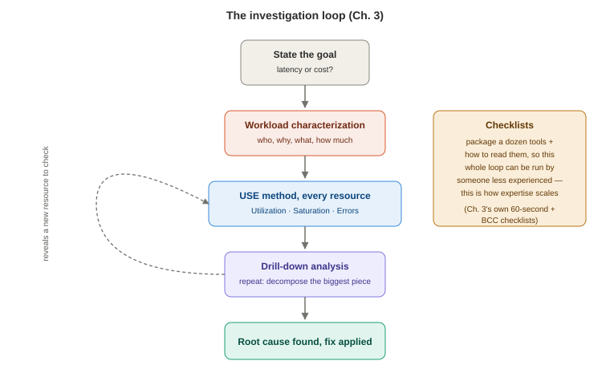

# Chapter 3 — Performance Analysis

*Study notes on Chapter 3 of BPF Performance Tools (Brendan Gregg, 2019). Original notes, not book text — see `00-index.md` for how these notes are written.*

## Why this chapter exists

Chapters 1–2 gave you the *mechanism* (BPF, kprobes, tracepoints, flame graphs...). This chapter gives you the **method** — what to actually do with all of that, before you touch a single BPF tool. The warning embedded in this chapter is worth taking seriously: **with BPF tools it is extremely easy to generate an overwhelming pile of numbers and then burn hours chasing a metric that was never actually the problem.** Method comes before tooling.

## 3.1 Goals and activities: start by asking what you're actually optimizing for

Performance work ultimately serves one of two goals: **improve end-user performance** (usually: reduce *latency* — how long a request takes) or **reduce operating cost** (usually: better utilize the hardware/cloud spend you already have). These pull in different directions, and it's worth being explicit up front about which one you're chasing, because it changes what "success" looks like.

The book lists five measurement types worth knowing precisely, because different tools report different ones and confusing them leads to wrong conclusions:

| Measurement | What it means |
|---|---|
| **Latency** | Time to complete one request/operation (typically ms) |
| **Rate** | Operations/requests per second |
| **Throughput** | Data movement, typically bits or bytes per second |
| **Utilization** | How busy a resource is, as a percentage of time |
| **Cost** | Price/performance ratio |

A useful reality check the book includes, worth adopting verbatim as a habit: when someone hands you an "interesting-looking" metric with no stated problem behind it, the first question to ask is **"do we actually have a known performance issue, or are we looking at this because it looked interesting?"** The goal is what gives numbers meaning — a metric in isolation is not automatically worth chasing.

**Be prepared to find multiple performance issues at once**, and to have to *prioritize* rather than fix everything you find — usually by asking which issue most affects the goal you actually stated (latency or cost) rather than which one is most visually dramatic. It's also common for one issue to have several contributing causes, and for fixing one bottleneck to simply reveal the next one underneath it.

## 3.2 Four performance methodologies

> **How to read this:** these four methodologies aren't independent — they're stages of one repeatable loop, and a checklist exists specifically to let someone less experienced run the whole loop reliably.

A **methodology** is a repeatable process — a starting point, a sequence of steps, and a clear ending point — as opposed to randomly running tools and hoping something jumps out. The book summarizes four (with pointers to the author's other book, *Systems Performance*, for the full catalog of dozens more).

### 3.2.1 Workload characterization

**Goal: understand what work is being demanded of the system — without yet analyzing how well it's being served.** This is listed first because it tends to produce the single biggest category of wins the book has personally found: **eliminating unnecessary work entirely**, which beats optimizing work you didn't need to do in the first place.

Four questions to work through in order:
1. **Who** is causing the load (PID, process name, UID, IP address)?
2. **Why** is the load happening (code path, stack trace, flame graph)?
3. **What** is the load, concretely (IOPS, throughput, request type)?
4. **How** is it changing over time (per-interval breakdowns)?

Worked example from the book: `vfsstat(8)` printing per-second read/write/create/open/fsync rates answers question 3 (the *type* of load) and question 4 (how it varies second to second) directly from its normal output. A one-liner like `bpftrace -e 'kprobe:vfs_read { @[comm] = count(); }'` answers question 1 by attributing reads to the specific process names generating them.

### 3.2.2 Drill-down analysis

**Goal: repeatedly decompose the largest contributor to a metric until you hit an actual root cause.** The book's own analogy is a great mental model: seeing an unexpectedly large credit card bill, drilling into the transaction list, finding one big charge, drilling into *that* merchant's records, and so on until you've found the specific purchases behind it.

Suggested loop:
1. Start at the highest, most aggregate level.
2. Examine the next level of detail.
3. Pick the single most interesting breakdown or clue.
4. If unsolved, go back to step 2 with your new, narrower target.

The book gives two versions of the same starting fact ("an application spends 89ms blocked on the file system per request") to show how far you can push this and how much the destination changes depending on how far you go:
- **Shallow version:** 89ms blocked on the file system → mostly blocked on storage devices → conclusion: "we need faster disks."
- **Deeper version:** 89ms blocked on the file system → mostly blocked on file system *writes specifically* (not reads) → almost all of *that* is blocked on **access-timestamp updates** → conclusion: disable atime updates (a simple mount option), no hardware purchase required.

The lesson: **stopping a drill-down too early can lead you to a technically-true but expensive or wrong fix.** Drill-down analysis, especially for latency, benefits enormously from bpftrace's flexibility for writing exactly this kind of custom, ad hoc decomposition tool on the spot.

### 3.2.3 The USE Method

The author's own methodology (developed separately, referenced here): **for every resource in the system, check Utilization, Saturation, and Errors.**

The process: first, get or draw an inventory of every hardware *and* software resource in the system (CPUs, memory, disks, network interfaces, buses, and the interconnects between them). Then, for each one, ask all three questions — how busy is it, is work queuing up waiting for it, and is it throwing errors.

Why this ordering is powerful, and worth remembering as the actual argument for using it: **most monitoring setups start from whatever metrics happen to already exist**, then try to work backward to figure out if they matter. The USE method inverts that — it starts from the **questions you actually want answered** for every resource, whether or not a convenient existing metric currently answers them. That inversion is exactly what surfaces monitoring **blind spots**: resources you have zero visibility into utilization, saturation, or errors for, which is often precisely where an unsolved problem is hiding.

### 3.2.4 Checklists

A checklist just packages "a dozen or so commonly useful tools/metrics, with instructions for interpreting each" into something anyone on a team can follow — explicitly framed as a way to **scale expertise** beyond just the one performance specialist, by giving less-experienced staff a reliable, repeatable first pass. The rest of this chapter provides two concrete checklists in exactly this spirit.

## 3.3 The Linux 60-second checklist (traditional, non-BPF tools)

This is presented as literally what the author runs in the first 60 seconds after logging into a struggling Linux system — and it's included in a *BPF* book deliberately, because these traditional tools can solve some problems outright, and at minimum they generate the clues that tell you which BPF tool to reach for next. Ten commands, each covered below with the columns/values actually worth reading (not every column — just the ones that matter for a fast first pass):

| # | Command | What to actually look at |
|---|---|---|
| 1 | `uptime` | The three load averages (1/5/15-min). A high 15-min average with a *low* 1-min average can mean you logged in just after the worst of an issue already passed. |
| 2 | `dmesg \| tail` | Recent kernel log messages — OOM-killer activity, TCP issues, hardware errors. Often points you directly at the next tool to run. |
| 3 | `vmstat 1` | `r` (runnable processes waiting for CPU — compare against CPU count for saturation), `free`, `si`/`so` (any nonzero swap activity means you're out of memory), and the `us`/`sy`/`id`/`wa`/`st` CPU time breakdown |
| 4 | `mpstat -P ALL 1` | Per-CPU breakdown — reveals a **single hot core pegged at 100%** (a classic single-threaded bottleneck signature) that an *averaged* view across all CPUs would hide entirely |
| 5 | `pidstat 1` | Per-process CPU usage over rolling intervals (unlike `top`'s snapshot style) — note percentages are summed across cores, so 500% means 5 full CPUs' worth of one process |
| 6 | `iostat -xz 1` | `r/s`/`w/s`/`rkB/s`/`wkB/s` (workload characterization for storage), `await` (the time an application actually *feels*, including queuing — not just device service time), `avgqu-sz` (queued requests — evidence of saturation), `%util` (a *busy-time* percentage, **not** true capacity-planning utilization for devices that can serve requests in parallel — a subtle, easy-to-misread column) |
| 7 | `free -m` | The `available` column specifically — how much real memory is actually available, buffer/page cache included |
| 8 | `sar -n DEV 1` | Network interface throughput (`rxkB/s`/`txkB/s`) — check against known link limits |
| 9 | `sar -n TCP,ETCP 1` | `active/s` (locally-initiated connections) vs. `passive/s` (remotely-initiated, i.e. accepted) for workload characterization; `retrans/s` as a sign of network or remote-host trouble |
| 10 | `top` | A final sanity-check browse of overall system and process summaries, after the more targeted tools above |

**The one column above worth a dedicated warning:** `iostat`'s `%util` looks like ordinary utilization but isn't, for storage — it's really "percentage of time the device was doing *something*," and modern storage (RAID arrays, cloud block volumes fronting multiple physical disks, NVMe with deep queues) can often accept **more** concurrent work even while already reporting 100% `%util`, because it's built to serve requests in parallel rather than one at a time. Treat sustained high `%util` as a signal worth investigating alongside `await`, not as proof the device is literally saturated.

## 3.4 The BCC/BPF tool checklist

An 11-tool checklist (maintained by the author in the BCC repository itself) as the natural next step once the traditional 60-second checklist has narrowed things down or run out of answers:

| Tool | One-line purpose |
|---|---|
| `execsnoop` | New process creation — catches short-lived processes invisible to snapshot tools |
| `opensnoop` | Every `open()`-family syscall — reveals config/log/data file access patterns, and failures |
| `ext4slower` (or the `btrfs*`/`xfs*`/`zfs*` equivalents) | Individual file-system operations slower than a threshold — confirms or rules out "the app is waiting on slow disk I/O via the file system" |
| `biolatency` | Disk I/O latency as a histogram — reveals multiple modes and outliers that a plain average from `iostat` would hide |
| `biosnoop` | Per-I/O detail with latency — useful for spotting time-ordered patterns like reads queuing behind writes |
| `cachestat` | File-system page-cache hit ratio — a low hit ratio is a concrete, actionable tuning lead |
| `tcpconnect` | Every outbound (active) TCP connection — good for spotting unexpected destinations (misconfiguration, or worse, an intruder) |
| `tcpaccept` | Every inbound (passive) TCP connection — the accept-side companion to `tcpconnect` |
| `tcpretrans` | Every TCP retransmission — a direct signal of network or remote-host trouble |
| `runqlat` | How long threads wait for their turn on a CPU, as a histogram — reveals CPU scheduling saturation or misconfiguration invisible to plain CPU-percentage metrics |
| `profile` | Timer-based CPU stack sampling — the tool that actually tells you *which code* is consuming CPU time, typically visualized as a flame graph |

Every one of these gets a full, dedicated treatment later in the book (mostly Chapters 6, 8, 9, and 10) — this chapter's job is just to establish that this *specific, ordered* list is a reasonable default starting point, not to teach each tool in depth yet.

## 3.5 Summary

Performance analysis is ultimately in service of two goals — better end-user latency, or lower operating cost — and the danger with a toolset as rich as BPF's is generating far more numbers than you can meaningfully interpret without a method. This chapter covered four methodologies (workload characterization, drill-down analysis, the USE method, and checklists) and two concrete checklists: a 60-second pass with traditional Linux tools, and an 11-tool BCC/BPF follow-up checklist. Together, these give you a repeatable starting sequence for *any* unfamiliar performance problem — which matters more than knowing any single tool well, since a method tells you which tool to reach for next even when you don't yet know what's wrong.

---

## Check your understanding

1. A teammate shows you a graph and says "look how high this metric is" with no other context. What's the first question the book suggests asking, and why does it matter before you spend any time on the graph?
2. Explain, using the atime example, why stopping a drill-down analysis one level too early can lead to a correct-but-wrong conclusion.
3. What specific blind spot does the USE method help you find that a "start from whatever metrics we already collect" approach systematically misses?
4. Why is `iostat`'s `%util` column a trap for someone doing capacity planning, specifically for modern storage?
5. You run the 60-second checklist and `mpstat -P ALL 1` shows one CPU core pinned at 100% while the system-wide average CPU usage looks unremarkable. What does this suggest, and which single-averaged tool would have hidden it?

Answers

1. Ask whether there's a known performance issue this metric is supposed to explain, or whether it's just being flagged because it "looks interesting." Without a stated goal (reduce latency? reduce cost?), there's no way to know whether the metric is actually a problem worth anyone's time, and you risk spending hours investigating something that was never actually hurting anything.
2. Stopping at "89ms blocked on the file system, mostly on storage devices" leads to the conclusion "buy faster disks" — a real fix, but an expensive and somewhat blunt one. Continuing one more level (writes specifically, then specifically access-timestamp updates within those writes) reveals a free, one-line mount-option fix that addresses the actual root cause rather than just throwing more hardware at a symptom.
3. It surfaces resources for which you currently have **no visibility at all** into utilization, saturation, or errors — because the method starts by listing every resource and asking the three questions regardless of whether a convenient metric already exists, rather than starting from whatever dashboards happen to already be built and hoping they cover everything that matters.
4. `%util` for a storage device measures the percentage of time the device was doing *something*, not true utilization in the capacity-planning sense — modern storage (RAID, cloud block volumes backed by multiple disks, deep-queue NVMe) can often still accept more concurrent work even while reporting 100% `%util`, because it serves requests in parallel rather than strictly one at a time. Reading 100% as "this device is maxed out and can't take more load" can be simply wrong for this class of hardware.
5. It suggests a single-threaded bottleneck — one core, and therefore very likely one specific thread or process, is fully saturated, even though that fact is completely invisible if you only look at the *system-wide average* CPU usage across all cores, since the other idle cores dilute the average into looking unremarkable. A tool that only reports an all-CPU average (rather than `mpstat`'s per-CPU breakdown) would hide this entirely.

