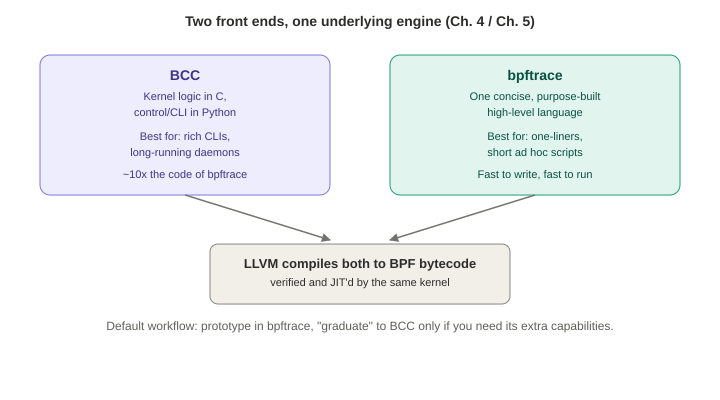
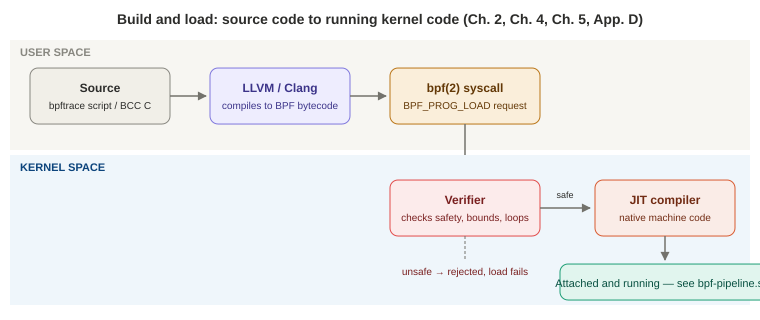

# Chapter 4 — BCC

*Study notes on Chapter 4 of BPF Performance Tools (Brendan Gregg, 2019). Original notes, not book text — see `00-index.md` for how these notes are written.*

## What this chapter is for

Chapter 2 gave you the *mechanism* (kprobes, tracepoints, maps...). This chapter gives you your first real *tool front end* to actually use that mechanism — BCC, the older and more capable of the two. By the end you should be able to run any of BCC's 70+ tools, understand *why* they're designed the way they are, and use four specific "multi-tools" (`funccount`, `stackcount`, `trace`, `argdist`) to investigate things no pre-built tool covers.

**Origin, worth knowing:** BCC was created by Brenden Blanco in April 2015. This book's author (Brendan Gregg) joined shortly after, encouraged by BPF co-creator Alexei Starovoitov, and became a major contributor of tools and documentation. By the time of writing, BCC was a default server install at both Netflix and Facebook — worth remembering as evidence this isn't a toy project, it's production infrastructure at major companies.



## 4.1 Components and where the tools actually live

BCC's repository (`github.com/iovisor/bcc`) ships documentation, man pages, example-output files, and language front ends for **Python, C++, and Lua** (Python is what this book — and virtually everyone — actually uses). A genuinely practical gotcha worth knowing before you go looking for a tool: **where BCC tools end up on disk, and even what they're named, depends entirely on how you installed BCC** — covered concretely in §4.3 below, because it trips people up constantly.

## 4.2 Features — organized differently from Chapter 2's list, on purpose

Chapter 2 organized BPF's capabilities by *underlying kernel technology* (kprobes, maps, helpers...). This chapter reorganizes the same capabilities by *what BCC exposes them as* — split into **kernel-level features** (things BPF itself does: dynamic/static instrumentation, timed sampling, PMC events, filtering, histograms, stack traces — all covered in depth in Chapter 2) and **BCC's own user-level additions**, worth calling out specifically since they're not BPF itself, they're BCC's Python convenience layer on top:

- `table.print_log2_hist()` — turns a raw map of bucketed counts into the readable ASCII histograms you'll see throughout this book.
- `BPF.trace_pipe()` / `BPF.trace_fields()` — Python-side reading of the debug trace buffer (used constantly for debugging — see §4.12.1).
- `ksym()`/`ksymaddr()` and `usymaddr()` — kernel- and user-level symbol resolution, so tools can print function *names* instead of raw addresses.
- `BPF_PERF_OUTPUT` macro and `open_perf_buffer()` — the plumbing behind per-event output (§2.3.6's `bpf_perf_event_output()` helper, wrapped for you).
- USDT support specifically **via uprobes** (Python-level convenience wrapper — the real mechanism underneath is still what §2.10–2.11 described).

## 4.3 Installation — and the naming inconsistency you should expect

BCC packages exist for most major distributions, but genuinely worth internalizing up front: **the same tool can have a different name or location depending on your install method**, and this is one of the most common early points of confusion:

| Install method | Package | Tools end up... | Naming |
|---|---|---|---|
| Ubuntu multiverse | `bpfcc-tools` | `/sbin` | `-bpfcc` suffix (e.g. `opensnoop-bpfcc`) |
| iovisor apt repo | `bcc-tools` | `/usr/share/bcc/tools` | Plain names (`opensnoop`) |
| Ubuntu snap | `bcc` | `/snap/bin` | `bcc.` prefix (e.g. `bcc.opensnoop`) |
| RHEL 7.6+ yum repo | `bcc-tools` | `/usr/share/bcc/tools` | Plain names |

**Kernel requirements:** the major BPF components BCC relies on landed between Linux 4.1 and 4.9 — the book recommends **4.9 (December 2016) or later** as a practical minimum, and notes several `CONFIG_BPF*` kernel build options need to be enabled (usually on by default in modern distro kernels).

## 4.4 The tools, and the philosophy behind how they're built

### 4.4.1–4.4.2 Where to look, and shared design rules

The highlighted-tools table maps topics to later chapters — debugging/multi-purpose tools live in *this* chapter; CPU, memory, file system, disk, networking, security, language, application, and kernel tools each get their own dedicated chapter later. **Every BCC tool shares a consistent set of design rules**, worth knowing because they tell you what to expect from *any* tool you haven't used before: a man page, an examples file with annotated sample output, a `-h` usage message, consistent PEP8-style source code, and a design philosophy of **"write the tool to solve the problem and no more."**

### 4.4.3–4.4.4 Single-purpose vs. multi-purpose: a real engineering tradeoff, not just style

This is worth understanding as a genuine design decision with real tradeoffs, not just a stylistic preference:

**Single-purpose tools** (`opensnoop`, `execsnoop`, `biolatency`, and most of BCC's 70+ tools) follow the classic Unix philosophy — do one thing well. `opensnoop -h` is a good illustration: it accepts `-x` (failed opens only), `-p PID`, `-u UID`, `-d DURATION`, `-n NAME` (substring filter), `-f FLAG_FILTER`, and more — a rich set of options, but every single one is scoped to "tracing opens," nothing more. The book lists four concrete benefits: **easy for beginners** (useful output with zero configuration, no need to know what a kprobe even is), **easy to maintain** (a focused tool needs less regression testing when changed), **good learning examples** (small, complete, readable source code — many people's first BCC tool is a copy of one of these), and **cleaner custom arguments/output** (nothing has to be generic enough to also serve some other use case).

**Multi-purpose tools** (`funccount`, `stackcount`, `trace`, `argdist` — this chapter's real content) trade a steeper learning curve for genuine flexibility: one tool that can investigate *any* function, tracepoint, or USDT probe you point it at, rather than one narrow, pre-built question. The tradeoff the book states explicitly: **you don't need to master these deeply if you only reach for them occasionally — collecting a personal library of one-liners to reuse when needed is a completely legitimate way to use them.**

## 4.5 `funccount` — how often is this event happening?

**Purpose:** count events — especially function calls — efficiently, using a BPF map to tally in kernel context so only the final count (not every individual call) crosses into user space.

**Worked examples, each demonstrating a different real investigative question:**
- `funccount tcp_drop` — "is this kernel function even being called?" (a yes/no + count question).
- `funccount 'vfs_*'` — wildcard-count *every* kernel function starting with `vfs_` at once; in the book's sample run, `vfs_write` (6,938 calls) and `vfs_read` (5,533 calls) dominated a 55-function match — instant workload characterization across an entire subsystem, no custom tool needed.
- `funccount -i 1 c:pthread_mutex_lock` — `-i 1` makes it print a fresh count **every second** instead of only at the end, turning a one-shot counter into a live rate meter (about 2,000 calls/sec in the book's example) — note this instruments a **user-level** library function (`c:` prefix = libc) **system-wide**, across every process using it, not just one.
- `funccount 't:syscalls:sys_enter_*'` — count literally every syscall by wildcard-matching their tracepoints; in the book's run, `futex` (42,929 calls) was by far the most frequent — a genuinely useful fact about what a typical busy Linux system spends its syscall time doing.

**Syntax for `eventname`** (this exact pattern reappears in `stackcount`, `trace`, and `argdist` — worth memorizing once): `name` (kernel function), `lib:name` (user-level function in library `lib`), `path:name` (user-level function in a specific binary/file), `t:system:name` (tracepoint), `u:lib:name` (USDT probe), and `*` as a wildcard (or `-r` to use full regular expressions instead).

**A genuinely useful capability worth remembering:** `-p PID` scopes any of this to one process, and `-i INTERVAL` turns any one-shot count into an ongoing custom rate metric — the book calls this "in a way, mini performance tools" territory: you can build a live, custom, per-second dashboard metric for *any* function or tracepoint on the system with a single command line.

## 4.6 `stackcount` — *why* is this event happening?

**Purpose:** answer "what code path leads here?" by capturing and frequency-counting the **stack traces** that led to an event — the natural next question after `funccount` tells you *that* something is happening a lot.

**A genuinely instructive real investigation from the book:** noticing via `funccount` that an *idle* system was calling `ktime_get()` (a time-fetching kernel function) over 8,000 times a second — surprising for a system doing "nothing." `stackcount ktime_get` reveals the actual call sites: the single most frequent stack (1,077 occurrences in the sample) traced straight back through `do_idle()` — **the kernel's own CPU idle loop periodically checking the time.** A smaller, separate stack (52 occurrences) traced through a completely different path — `dmcrypt_write()` → block I/O submission — timestamping I/O for later use. **The `-P` option** additionally splits output by process (and reveals PID 0 — process name `swapper/2` — as the source of the idle-loop calls, confirming the CPU-idle theory directly).

**Turning stackcount output into a flame graph:** for genuinely large outputs (the book's own example ran to *hundreds of pages* of individual stacks), `stackcount -f` emits **folded format** (one line per unique stack, semicolon-delimited frames, a trailing count) — exactly the input format Brendan Gregg's original `flamegraph.pl` tool expects (`git clone https://github.com/brendangregg/FlameGraph`). Piping `stackcount -f -P -D 10 ktime_get > out.txt` into `flamegraph.pl` turned those hundreds of pages into one browsable SVG, immediately showing (as wide, similar-looking towers) that most calls came from eight near-identical idle threads — one per CPU on that system.

**A concrete, memorable illustration of Chapter 2's inlining/frame-pointer warning:** the captured stack showed `tick_nohz_idle_enter()` calling `ktime_get()` directly — but the *actual* kernel source shows `tick_nohz_idle_enter()` calling a different function, `tick_nohz_start_idle()`, which is what really calls `ktime_get()`. The missing frame is gone because the compiler **inlined** that small function directly into its caller — and, consistent with it being inlined away, that function's symbol doesn't even appear in `/proc/kallsyms` anymore. This is exactly the "broken/incomplete stack, symbols quietly missing" problem Chapter 2 warned about, seen here in a real, reproducible example rather than the abstract.

**Syntax:** identical `eventname` grammar to `funccount`. Worth knowing options: `-P` (split by process), `-K`/`-U` (kernel-only / user-only stacks), `-s` (show address offsets), `-f` (folded output for flame graphs).

## 4.7 `trace` — custom per-event printing

**Purpose:** print a fully custom line of output for *every individual occurrence* of an event — arguments, return values, even stack traces — which makes it the natural tool once `funccount`/`stackcount` have told you *what* and *why*, and you now want to see the actual data flowing through, event by event. The explicit tradeoff: because it prints one line per event, `trace` is only appropriate for events that fire **infrequently** — something happening millions of times a second (packets, context switches, allocations) would generate overwhelming output and real overhead; for those, reach for one of the other three multi-tools instead, which summarize in-kernel rather than printing every event.

**Basic example**, essentially a hand-rolled version of `opensnoop`: `trace 'do_sys_open "%s", arg2'` prints the second argument (the filename, `char *`) to `do_sys_open()` on every call.

**Syntax**, worth internalizing as a small language in itself: `probe(signature) (filter) "format string", arguments` — the `eventname` grammar adds one thing over `funccount`'s: `r::name` (or `r:lib:name`) to instrument a function's **return**, giving access to `retval`. The format string supports C-`printf`-style specifiers (`%d`, `%u`, `%lu`, `%x`, `%s`...) plus two BCC-specific ones worth remembering: **`%K`** (resolve a value as a kernel symbol name) and **`%U`** (resolve as a user-level symbol name).

**Struct field access:** `trace` can dereference struct pointers directly (e.g., `t->task` on a `struct hrtimer_sleeper *`) by reading the matching struct definition from the installed **kernel headers package** — and when a struct isn't in the kernel's own headers, you can pull in an extra header manually with `-I 'net/sock.h'`, as the book does to filter `udpv6_sendmsg()` calls down to DNS traffic (destination port 53) by checking `sk->sk_dport`. The book explicitly flags BTF (§2.3.9) as the technology meant to eventually remove this "you need matching kernel headers installed" requirement entirely.

**A genuine production war story worth remembering in full, because it's a real, reusable investigative pattern:** the book's author was debugging a real socket file-descriptor leak on a Netflix production instance — sockets being allocated (via `sock_alloc()`) but some subset never being freed (`__sock_release()`). The trick: trace **both** the allocation and the release event, printing the **socket's address** as a correlating key for each, along with the full stack trace on allocation:

```
trace -tKU 'r::sock_alloc "open %llx", retval' '__sock_release "close %llx", arg1'
```

Post-processing this output for addresses that appear in an `open` line but **never** in a matching `close` line reveals exactly which allocation stack traces correspond to genuinely leaked sockets — including, in this real case, a full Java call stack (down through `DefaultRequestDirector::execute` and friends), since the leaking process was a JVM application. **The general pattern here — trace an allocation event and a matching free event with a shared correlating key, then post-process for unmatched allocations — is exactly the technique a dedicated leak-detection tool like `memleak(8)` (Chapter 7) automates for you**, tracking outstanding allocations directly in a BPF map instead of requiring after-the-fact log post-processing.

## 4.8 `argdist` — summarizing arguments and return values

**Purpose:** where `trace` prints one line per event, `argdist` **summarizes** an argument or return value across many events — as either a frequency count (`-C`) or a power-of-two histogram (`-H`) — computed in-kernel, printed once per interval (default: once a second).

**Another real production story, again from Netflix:** a Hadoop server had a TCP performance problem eventually traced to **zero-sized TCP window advertisements**. A single `argdist` one-liner —

```
argdist -H 'r::__tcp_select_window():int:$retval'
```

— instruments the *return* of the kernel's `__tcp_select_window()` function and histograms its return value. The live output showed a huge spike specifically in the `"0 -> 1"` bucket (6,100 occurrences in one interval) — direct, quantified, in-production confirmation of the zero-window theory, and (just as importantly) a tool the team could **leave running while testing a fix**, to confirm in real time whether the count dropped to zero.

**Syntax**, the most involved of the four multi-tools: `argdist {-C|-H} probe`, where `probe` follows `eventname(signature)[:type[,type...]:expr[,expr...][:filter]][#label]`. `type` is the C type being summarized (`u32`, `u64`, `char *`, ...); `expr` is what to actually summarize (a function argument, a tracepoint field, or one of three **return-probe-only special variables**: `$retval`, `$latency` — entry-to-return time in nanoseconds — and `$entry(param)`, letting you reference an *entry* argument's value from inside the *return* probe, which is genuinely useful for computing something like "nanoseconds per byte" from a size known at entry and a duration known at return). `filter` and `label` are optional, the latter purely for annotating output with a human-readable name.

## 4.9 Tool documentation

Every BCC tool ships **both** a man page (full syntax/option reference) **and** a separate examples file (real, annotated sample output) — worth checking both when a tool's `-h` output alone doesn't answer your question, since the examples file in particular often clarifies what a given output line actually *means* in practice, not just its syntax.

## 4.10 Developing your own BCC tools — and when *not* to bother

**Given bpftrace exists (Chapter 5) as a much higher-level language, why would you ever write a *new* tool in BCC specifically?** The book's honest answer: BCC is worth the extra effort specifically for **complex tools with rich command-line interfaces, or long-running daemons** — e.g., a tool that needs to ship event data to a message queue or database, which is naturally a job for a real Python library ecosystem, not a small tracing DSL. The explicit, sobering cost estimate given: a BCC tool can take **roughly 10x as long to develop and contain roughly 10x as many lines of code** as the equivalent bpftrace tool. The recommended workflow, worth adopting: **prototype in bpftrace first** (fast iteration, short scripts) and only "graduate" a proven idea into a full BCC tool if you specifically need BCC's extra capabilities. (Full worked BCC tool-development examples live in Appendix C, treated as optional material by the book itself.)

## 4.11 BCC internals — the compile-and-load pipeline


> **How to read this:** this is the "build" half of the pipeline — the other diagram in Chapter 2 (`bpf-pipeline.svg`) picks up once the program is already running and attached.

Worth knowing at a conceptual level even if you never write a tool yourself, since it explains *why* certain debugging techniques in §4.12 work the way they do. BCC's own internal layering: a **C++ front-end** composes kernel-side BPF programs (including a **rewriter** that automatically turns ordinary-looking memory dereferences in your C code into safe `bpf_probe_read()` calls behind the scenes — you write `task->pid`, BCC's rewriter silently turns that into the safe helper call underneath), a **C++ back-end** drives the actual Clang/LLVM compilation, kernel loading, event attachment, and map I/O, and thin **Python/C++/Lua** front ends expose all of that to you as ordinary-looking objects (`BPF`, `Table`, `USDT`). One nice, concrete detail: BCC's Python `Table` object supports Python's dictionary-style syntax as sugar — `b.get_table("counts")` and `b["counts"]` are literally the same call, via Python's `__getitem__` magic method.

**The full nine-step pipeline from source to running tool, worth having as a mental model for debugging:**
1. A Python `BPF` object is created with your C source as text.
2. BCC's rewriter preprocesses it, replacing raw dereferences with `bpf_probe_read()` calls.
3. Clang compiles the (now-safe) C into LLVM IR.
4. BCC's codegen adds any additional LLVM IR it needs.
5. LLVM compiles that IR into actual BPF bytecode.
6. Any BPF maps your program uses get created.
7. The bytecode is sent to the kernel and checked by the **verifier**.
8. The target events are enabled, and your BPF program is attached to them.
9. User space reads results back — either via maps, or via the `perf_event` ring buffer for per-event output.

**USDT is handled as a special case** in this pipeline: unlike kprobes/uprobes/tracepoints, a USDT-based tool must be told a target **PID or binary path** at *initialization* time (step 1), because — as Chapter 2's §2.10 explained — some USDT probes are guarded by semaphores the tracer itself is responsible for setting in that specific process's memory image.

## 4.12 Debugging BCC tools

**`printf()`-style debugging (§4.12.1):** inside a BPF C program, the equivalent of `printf()` is the helper `bpf_trace_printk()`, which writes to a special Ftrace buffer readable via `cat /sys/kernel/debug/tracing/trace_pipe`. The book's own concrete example: temporarily adding `bpf_trace_printk("BDG req=%llx ts=%lld\n", req, ts);` into a copy of `biolatency.py` (the initials as a personal marker to grep for, since this shared buffer mixes messages from every tracer currently using it) to confirm a probe is really firing and that a variable holds the value you expect. **`trace` (no pipe) vs. `trace_pipe`**: `trace` prints a header and returns immediately without blocking; `trace_pipe` blocks, waiting for and consuming new messages as they arrive — pick whichever fits how you want to watch the output.

**The undocumented `--ebpf` flag (§4.12.2):** many BCC tools (deliberately undocumented in their own `-h` output, to avoid clutter for ordinary users) accept `--ebpf`, which prints the *entire generated BPF C program* instead of running it — genuinely useful when the kernel's verifier rejects a program and you need to actually read what got generated to see why.

**The `debug=` bitflag (§4.12.3):** passing `debug=0x2` (or higher) to a tool's `BPF(text=bpf_text, debug=0x2)` call prints progressively more internal detail — the flags are individually toggleable bits you can combine:

| Bit | Name | Shows |
|---|---|---|
| `0x1` | `DEBUG_LLVM_IR` | Compiled LLVM IR |
| `0x2` | `DEBUG_BPF` | BPF bytecode + register state at branches |
| `0x4` | `DEBUG_PREPROCESSOR` | The rewriter's output (same as `--ebpf`) |
| `0x8` | `DEBUG_SOURCE` | Assembly interleaved with source lines |
| `0x10` | `DEBUG_BPF_REGISTER_STATE` | Register state at *every* instruction |
| `0x20` | `DEBUG_BTF` | BTF-specific debug info |

`debug=0x1f` turns everything on at once — the book warns this can run to dozens of pages of output, so use it deliberately, not as a first resort.

**Other debugging tools worth knowing about:** `bpflist` (lists which running processes currently have BPF programs/maps/probes loaded — `-vv` mode even lists the exact kprobe/uprobe event names, which conveniently encode the owning tool's PID); `bpftool` (Chapter 2's kernel-shipped introspection CLI); `dmesg` (kernel-level BPF/event-source errors surface here — the book's example: a typo'd function name in a kprobe request producing `Could not insert probe at vfs_rread+0: -2`); and `reset-trace.sh` (cleans up leftover, still-enabled Ftrace-based event sources after a BCC tool crashes mid-run — the book notes this was mainly a pre-Linux-4.17 problem, since BCC's later switch to `perf_event_open()`-based attachment means the kernel automatically cleans up a crashed process's enabled events as part of ordinary file-descriptor cleanup).

## 4.13 Summary

BCC ships 70+ ready-to-run, production-oriented tools (mostly single-purpose, following Unix philosophy) plus four particularly powerful **multi-purpose** tools worth knowing well: `funccount` (how often), `stackcount` (why — via stack traces), `trace` (per-event custom detail), and `argdist` (argument/return-value distributions). Writing new tools in BCC is real, non-trivial engineering effort — worthwhile specifically for complex, option-rich tools or long-running daemons, but the recommended default is to prototype in bpftrace first. Chapter 5 covers that language in full.

---

## Quick-reference glossary (this chapter's terms)

- **Multi-purpose tool** — a general instrumentation tool (like `funccount`) that lets *you* choose the target event, as opposed to a single-purpose tool built for one specific question.
- **BPF rewriter** — BCC's preprocessing step that turns ordinary-looking C memory dereferences into safe `bpf_probe_read()` calls automatically.
- **`bpf_trace_printk()`** — the BPF-program-side debug-print helper, writing to the shared Ftrace `trace_pipe` buffer.
- **Folded stack format** — one line per unique stack trace (semicolon-delimited frames + a trailing count); the standard input format for flame-graph generation tools.

## Check your understanding

1. You install BCC via the Ubuntu snap package and go looking for `opensnoop` in `/usr/share/bcc/tools` — it's not there. What's actually going on, and where should you look (or what should you type) instead?
2. Why is `trace(8)` explicitly *not* recommended for instrumenting something like every memory allocation on a busy system, while `funccount(8)` handles the same scenario fine?
3. In the `ktime_get()` stackcount investigation, what specific piece of evidence confirmed that most calls were coming from the CPU idle loop rather than, say, application code?
4. Walk through, in your own words, why the Netflix socket file-descriptor leak investigation needed to trace *two* separate events (`sock_alloc` and `__sock_release`) rather than just one.
5. You've prototyped a working one-liner in bpftrace and now want to turn it into a polished tool with several command-line flags and a man page. Per this chapter's own guidance, is BCC or bpftrace the better next step, and why?

<details>
<summary>Answers</summary>

1. Different install methods place tools in different locations with different names — the snap package installs tools under `/snap/bin` with a `bcc.` prefix, so the actual command would be `bcc.opensnoop`, not a bare `opensnoop` sitting in `/usr/share/bcc/tools` (that particular location and plain naming is specific to the iovisor apt-repo install method instead).
2. `trace(8)` prints one line of output for *every single event* — for something firing millions of times a second (like `malloc()`/`free()`), that would generate overwhelming output and real overhead just from the printing itself. `funccount(8)` instead tallies a running count entirely inside a BPF map in kernel context and only reports the final total to user space, so its cost doesn't scale with how much output it would otherwise have to print.
3. The `-P` option split the stack counts out by process, and the dominant stack trace's associated process was PID 0 with the name `swapper/2` — `swapper` is the conventional name Linux gives its idle thread (one per CPU, hence `/2` for CPU 2), which directly confirmed the theory that this was idle-loop time-fetching, not real application activity.
4. Tracing only the allocation event (`sock_alloc()`) would show every socket ever created, including the ones that were properly closed later — there'd be no way to tell a leaked socket apart from a normal, correctly-released one just from that data. Tracing the release event (`__sock_release()`) too, using the socket's address as a shared correlating key between the two event streams, lets you specifically identify addresses that appear in the allocation trace but never show up in a matching release trace — exactly the definition of a leak.
5. BCC — per the chapter's explicit guidance, once you want rich command-line options, persistent daemon-style behavior, or customized/structured output beyond plain text, that's specifically the territory BCC is built for, even though it costs meaningfully more development time (the book's own estimate: roughly 10x the code and development time versus the equivalent bpftrace version) than staying in bpftrace.

</details>
