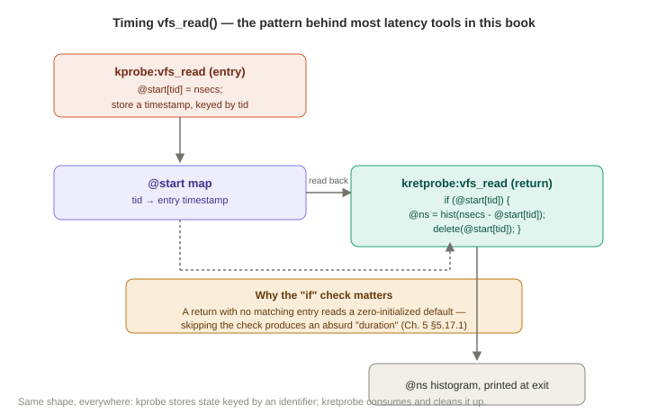
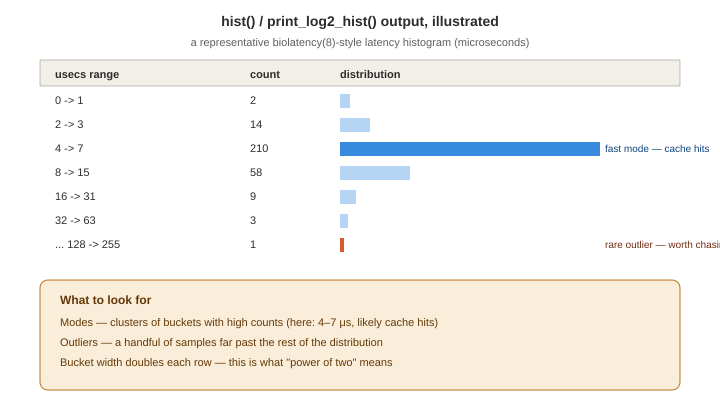

# Chapter 5 — bpftrace

*Study notes on Chapter 5 of BPF Performance Tools (Brendan Gregg, 2019). Original notes, not book text — see `00-index.md` for how these notes are written.*

> This is the longest, most reference-heavy chapter in Part I, and it's written to be reused — you're not meant to memorize it in one pass. Read §5.1–5.8 once, straight through, for the mental model and the flagship worked example. Treat §5.9–5.14 (probe types, flow control, variables, functions, map functions) as a **reference you come back to** every time you write a new one-liner, the same way you'd keep a language's standard-library docs open in a tab.

## 5.1–5.2 What bpftrace actually is, and where it sits relative to other tracers

bpftrace is built on the same foundations as BCC (`libbcc`/`libbpf` for attaching probes and loading programs, LLVM for compiling its own language down to BPF bytecode) — it's a **different front end to the same underlying BPF machinery** from Chapter 2, not a competing technology. Its own event-source coverage maps directly onto Chapter 2's five categories: dynamic (kprobes/uprobes), static (tracepoints/USDT), and timed/hardware (profile, interval, hardware PMCs) — §5.9 below gives the full syntax for each.

**General features worth knowing exist, even if you don't need them on day one:** low-overhead instrumentation (same BPF JIT + map foundation as everything else in this book), production safety (same verifier guarantee), a `/tools` directory of ready-made scripts bundled with the project, and two pieces of official documentation worth bookmarking — the **bpftrace One-Liner Tutorial** and the **bpftrace Reference Guide**, both in the `/docs` directory of the `iovisor/bpftrace` repository.

### How bpftrace compares to other tracers (worth knowing so you pick the right tool)

The book is refreshingly honest that bpftrace isn't a strict upgrade over every alternative — each has a real, situational advantage:

| Compared to... | The actual tradeoff |
|---|---|
| **`perf(1)`** | bpftrace's language is far more concise for custom logic; `perf` is better at efficient raw event dumping to a binary file (`perf record`) and has its own in-kernel summary modes, but they're limited to plain counts (`perf stat`) — bpftrace can build arbitrary custom in-kernel summaries like histograms. |
| **Ftrace** | bpftrace's language is closer to C/`awk`; Ftrace's custom-instrumentation syntax (hist-triggers) is more special-purpose, but Ftrace has far fewer dependencies (good for tiny/embedded Linux) and, per the book's own testing, its `funccount`-equivalent had faster start/stop times and lower runtime overhead than bpftrace's at the time of writing. |
| **SystemTap** | Both offer a high-level language; SystemTap relies on its own kernel modules, which the book notes had proven unreliable outside RHEL (work on a BPF back end for SystemTap was underway at the time). SystemTap's helper-function libraries ("tapsets") were more mature/extensive at the time of writing. |
| **LTTng** | LTTng optimizes for efficient *event dumping plus offline analysis tooling* — a fundamentally different workflow than bpftrace's ad hoc, real-time analysis model. |
| **Application-specific tools** (a MySQL query profiler, a JVM GC profiler) | These already understand their target domain deeply (you get query- or GC-aware output for free) but are blind to anything outside that one application — bpftrace can cross from kernel to hardware to any application, but you have to write that logic yourself. |

The explicit, healthy framing worth internalizing: **the goal is solving the problem, not using bpftrace exclusively** — reaching for a combination of tools, including ones outside this book, is completely normal.

## 5.3 Installation

**Kernel requirement:** the same Linux **4.9+** recommendation as BCC (§4.3), since bpftrace relies on the same underlying BPF components that landed between kernel 4.1 and 4.9, plus the same five `CONFIG_BPF*` build options. At the time of writing, native distro *packages* for bpftrace were only just beginning to appear (a Canonical snap and an early Debian/Ubuntu package) — building from source was still the common path, requiring `bison`, `cmake`, `flex`, `g++`/`gcc-c++`, `libelf-dev`, `zlib1g-dev`, `systemtap-sdt-dev`, and a matching `llvm`/`clang` version (the book uses LLVM/Clang 7). If you're installing today, check for a native package first — this landscape has matured substantially since 2019.

## 5.4 Tools — same philosophy as BCC, opposite complexity direction

bpftrace tools share BCC's design values from §4.4.2: solve real observability problems, safe to run in production as root, a man page and an examples file for every tool, source that starts with a block-comment introduction. **The one value that flips direction from BCC's advice:** bpftrace tools are kept **as simple and short as possible**, with genuinely complex tooling deliberately pushed over to BCC instead (echoing §4.10's "bpftrace for short scripts, BCC for complex tools" guidance from the *other* side).

**Execution model:** bpftrace scripts (`.bt` files) are executable text files with a `#!/usr/bin/env bpftrace` shebang — you run them directly (`sudo ./opensnoop.bt`), and bpftrace refuses to run at all as a non-root user. A representative highlighted-tools-by-topic mapping (full detail in each later chapter): CPU (`execsnoop.bt`, `runqlat.bt`, `runqlen.bt`, `offcputime.bt` — Ch. 6), Memory (`oomkill.bt`, `vmscan.bt` — Ch. 7), File systems (`vfsstat.bt`, `filelife.bt` — Ch. 8), Storage I/O (`biosnoop.bt`, `biolatency.bt` — Ch. 9), Networking (`tcpaccept.bt`, `tcpretrans.bt` — Ch. 10), Security (`ttysnoop.bt`, `setuids.bt` — Ch. 11).

## 5.5 One-liners worth having memorized

These are short enough to be genuinely worth internalizing as reusable idioms, and each demonstrates a distinct capability you'll reuse constantly:

```
# Who is executing what:
bpftrace -e 'tracepoint:syscalls:sys_enter_execve { printf("%s -> %s\n", comm, str(args->filename)); }'

# Count syscalls by the calling program:
bpftrace -e 'tracepoint:raw_syscalls:sys_enter { @[comm] = count(); }'

# Count syscalls by which specific syscall it is (wildcard probe name as the key):
bpftrace -e 'tracepoint:syscalls:sys_enter_* { @[probe] = count(); }'

# Total bytes read, per process:
bpftrace -e 'tracepoint:syscalls:sys_exit_read /args->ret/ { @[comm] = sum(args->ret); }'

# Read-size distribution, per process:
bpftrace -e 'tracepoint:syscalls:sys_exit_read { @[comm] = hist(args->ret); }'

# Count major page faults (satisfied by storage I/O) per process:
bpftrace -e 'software:major-faults:1 { @[comm] = count(); }'

# Sample user-level stacks at 49 Hz, for one specific PID:
bpftrace -e 'profile:hz:49 /pid == 189/ { @[ustack] = count(); }'
```

Notice the shared shape: an **event source**, an optional **filter**, and an **action** that almost always updates a **map** — that shape is the entire grammar of the language, formalized next.

## 5.6 Documentation

Same pattern as BCC: a man page and an examples file per tool, plus the two project-level guides mentioned in §5.2 (One-Liner Tutorial, Reference Guide) — worth reading directly for anything these notes don't cover, since bpftrace's own syntax has continued evolving since 2019.

## 5.7 Programming — the core language

### 5.7.1 Usage

Two invocation styles: `bpftrace -e 'program text'` for one-liners typed directly on the command line, or `bpftrace ./script.bt` (or a self-executing `.bt` file) for anything longer. `bpftrace -l` **lists** matching probes without attaching to them — genuinely essential for exploration (`bpftrace -l 'tracepoint:syscalls:sys_enter_open*'` from Chapter 1's `open()`/`openat()` investigation is exactly this flag).

### 5.7.2–5.7.3 Program structure and comments

A bpftrace program is one or more `probe { action }` blocks, evaluated top-to-bottom as they're defined but **triggered independently and asynchronously** as their respective events actually occur — there's no implied ordering between separate probe blocks at runtime beyond whatever order their real-world events happen to fire in. Two special probe names exist for setup/teardown: **`BEGIN`** (runs once, immediately, before any other probe attaches — used for printing a header or initializing state) and **`END`** (runs once, when the program is about to exit, e.g. from Ctrl-C — used for final summary printing). Comments follow C syntax: `// line comment` and `/* block comment */`.

### 5.7.4–5.7.6 Probe format, wildcards, and filters

**Probe format:** `type:identifier` (the exact identifier grammar differs by probe type — full reference in §5.9). Multiple probes can share one action by comma-separating them: `kprobe:vfs_read,kprobe:vfs_write { ... }`. **Wildcards** (`*`) are supported in probe identifiers for many probe types (`kprobe:vfs_*` — you've already seen this exact pattern in both Chapter 1's investigation and Chapter 4's `funccount` examples). **Filters** are a boolean expression in slashes immediately after the probe: `probe /filter/ { action }` — the action only runs if the filter evaluates true (full operator list in §5.11).

### 5.7.7–5.7.8 Actions, and "Hello, World!"

An **action** is a semicolon-separated list of statements inside the `{ }`. The minimal possible program:
```
bpftrace -e 'BEGIN { printf("Hello, World!\n"); }'
```
This is worth actually running once — it confirms your bpftrace install works and gives you a template to build every future one-liner from: swap `BEGIN` for a real probe, and swap the `printf` for whatever action you actually need.

### 5.7.9–5.7.11 Functions, variables, and map functions — a preview

This subsection is just a forward-reference: **functions** (like `printf()`, `str()`, `hist()`) are covered fully in §5.13; **map functions** (functions specifically meant to be *assigned into* a map, like `count()`, `sum()`, `hist()`) in §5.14; and **variables** get their own full treatment next, since getting comfortable with the three variable kinds is the single most important conceptual step in learning the language.

**The three variable kinds, and how to tell them apart on sight:**

| Prefix | Kind | Scope | Type determined... |
|---|---|---|---|
| (none, e.g. `pid`, `comm`, `nsecs`) | **Built-in** | Read-only, refers to the current event | Fixed by bpftrace itself |
| `$name` | **Scratch** | Local to one action's execution — gone when the block finishes | On first assignment |
| `@name` / `@name[key]` | **Map** | Global, persists across every event and every probe, for the life of the whole program | On first assignment |

**Maps are the important one to really understand**, because it's the mechanism behind almost everything in this book: a `@name` map is backed by a real BPF map (Chapter 2's `BPF_MAP_TYPE_HASH`, under the hood), so it's the same efficient, in-kernel, cross-event storage every C-based BCC tool uses — bpftrace just gives you `@` as friendly syntax for it. **Maps are also bpftrace's built-in "print a summary at the end" mechanism**: unless you explicitly `delete()` or `clear()` a map's contents, bpftrace automatically prints every surviving map's contents when the program exits (e.g., on Ctrl-C) — which is *why* so many one-liners in this book have no explicit "print" step at all; assigning into `@` is enough.

### 5.7.12 Timing `vfs_read()` — the flagship example, worth understanding line by line



This is the example the whole chapter has been building toward — the first program that actually needs *two* cooperating probes and real per-thread state, and it's worth walking through completely rather than skimming, since every idea introduced above shows up here at once:

```
kprobe:vfs_read
{
        @start[tid] = nsecs;
}

kretprobe:vfs_read
/@start[tid]/
{
        @ns[comm] = hist(nsecs - @start[tid]);
        delete(@start[tid]);
}
```

Reading it piece by piece:
- **`kprobe:vfs_read { @start[tid] = nsecs; }`** — every time `vfs_read()` is *entered*, on *any* thread, record the current nanosecond timestamp in a map keyed by thread ID. Keying by `tid` (not a single scalar `@start`) is essential: the kernel runs many threads concurrently, so without a per-thread key, a fast thread's entry timestamp could be overwritten by a different thread's entry before the first thread even returns.
- **`kretprobe:vfs_read /@start[tid]/ { ... }`** — on *return* from `vfs_read()`, first check the filter: does `@start[tid]` actually exist (i.e., is it non-zero) for *this* thread? This filter matters more than it looks — §5.17.1 below shows exactly what silently goes wrong if you skip it.
- **`@ns[comm] = hist(nsecs - @start[tid]);`** — compute this call's duration (now minus the recorded start), and feed it into a **power-of-two histogram**, keyed by process name — so you get one latency-distribution histogram per distinct program name, accumulated for as long as the tool runs.
- **`delete(@start[tid]);`** — clean up the now-used start-time entry, both to free map space and so a *future* unmatched kretprobe firing (see the filter above) correctly finds nothing there.

**This exact pattern — entry probe stashes a per-thread/per-key timestamp, matching return probe computes `now - stashed` and clears the entry — is the single most common structural idiom in this entire book.** Nearly every latency-measuring tool you'll meet in Part II, in both bpftrace and BCC form, is a variation on precisely this shape.

## 5.8 bpftrace usage — command-line flags worth knowing

| Flag | Purpose |
|---|---|
| `-e 'program'` | Run a program given directly on the command line |
| `-l [search]` | List matching probes without attaching (optionally filtered by a wildcard search term) |
| `-p PID` | Attach to a specific already-running process (relevant for uprobes/USDT) |
| `-c 'command'` | Launch a new command, attach to it, and exit automatically when it exits |
| `-v` | Verbose mode — prints extra internal detail while running (§5.17.3) |
| `-d` / `-dd` | Debug mode — prints the AST/LLVM IR instead of running (§5.17.2) |
| `-B` | Set the output buffering mode |
| `-I dir` | Add an extra directory to search for C headers (for struct navigation, same idea as BCC's `-I`) |
| `--unsafe` | Enables otherwise-blocked "destructive" actions like `system()` (§5.13.7) |

## 5.9 Probe types — the full reference

This is the section you'll return to most often. Every probe type follows `type:identifier`, and the identifier grammar differs by type:

### `tracepoint` — static kernel instrumentation (Ch. 2 §2.9)
Format: `tracepoint:category:event`, e.g. `tracepoint:syscalls:sys_enter_open`. Fields are accessed through the built-in `args` struct (e.g. `args->filename`), whose members bpftrace discovers automatically from the kernel's own live tracepoint format description (Chapter 2's `/sys/kernel/debug/tracing/events/.../format` files) — no matching kernel-headers package required for tracepoint field access specifically.

### `usdt` — static user-space instrumentation (Ch. 2 §2.10)
Format: `usdt:binary_path:provider:probe`, or `usdt:binary_path:probe` when there's only one provider. Combine with `-p PID` when the target probe is semaphore-guarded (Chapter 2's semaphore optimization).

### `kprobe` / `kretprobe` — dynamic kernel instrumentation (Ch. 2 §2.7)
Format: `kprobe:function_name` / `kretprobe:function_name`. **Reminder of the real limitation from Chapter 2:** bpftrace (as of this book) only supports instrumenting a function's *entry*, not an arbitrary offset inside it — reach for BCC if you specifically need offset-level instrumentation.

### `uprobe` / `uretprobe` — dynamic user-space instrumentation (Ch. 2 §2.8)
Format: `uprobe:binary_path:function_name` / `uretprobe:binary_path:function_name`. Same entry-only limitation as kprobes, and the same "instruments every process using that file, present and future" semantics from Chapter 2, and the same hot-function overhead caveat (mode-switch cost on every hit).

### `software` and `hardware` — predefined kernel- and CPU-level counters
Format: `software:event_name:count` / `hardware:event_name:count`. These are **sampled by design** — the `count` field means "fire once every `count` occurrences," which exists specifically to bound overhead on events that can occur extremely frequently (billions of times a second, in the hardware case). Selected software events (full list depends on kernel version):

| Event | Alias | Default sample count | Meaning |
|---|---|---|---|
| `page-faults` | `faults` | 100 | Any page fault |
| `major-faults` | — | 1 | Page fault satisfied by storage I/O |
| `context-switches` | `cs` | 1000 | Thread context switches |
| `cpu-migrations` | — | 1 | A thread moved to a different CPU |

Selected hardware events (PMCs, Ch. 2 §2.12 — availability depends on kernel and processor):

| Event | Alias | Default sample count | Meaning |
|---|---|---|---|
| `cpu-cycles` | `cycles` | 1,000,000 | CPU clock cycles |
| `instructions` | — | 1,000,000 | CPU instructions retired |
| `cache-misses` | — | 1,000,000 | Last-level cache misses |
| `branch-instructions` | `branches` | 100,000 | Branch instructions retired |

(Hardware events default to much higher sample counts than software events, since they occur far more frequently — recall Chapter 2's "billions of events a second" framing for why sampling is mandatory here, not optional.)

### `profile` and `interval` — timer-based events
Format: `profile:hz:rate` (or `:s:`/`:ms:`/`:us:` for other units) and `interval:s:rate` (or `:ms:`). **The distinction that matters:** `profile` fires **on every CPU simultaneously** — this is what CPU stack sampling for flame graphs is built from (e.g., `profile:hz:49 { @[kstack] = count(); }`); `interval` fires **on just one CPU**, making it the right choice for periodic summary printing (`interval:s:1 { print(@counts); clear(@counts); }`) rather than sampling. The specific choice of **99 Hz rather than a round 100 Hz** for CPU profiling is deliberate — it avoids accidentally sampling in lockstep with some other periodic activity on the system (a direct callback to Chapter 2's PEBS/sampling-artifact discussion).

## 5.10 Flow control

Three constructs, all working over the standard comparison/logical operators from §5.11:

- **Filters**: `probe /filter/ { action }` — the action only runs if `filter` is true.
- **Ternary operator**: `test ? true_value : false_value` — e.g. `$abs = $x >= 0 ? $x : -$x;`.
- **If statements**: `if (test) { ... }` and `if (test) { ... } else { ... }` — note **`else if` is not supported** (a real, current-as-of-the-book language limitation, not an oversight on your part if a chained `else if` fails to parse).

**Loops are deliberately restricted**, for the same reason as everywhere else in this book: the verifier must be able to prove a program terminates, so ordinary unbounded loops are rejected outright. bpftrace's workaround is `unroll(count) { statements }` — the compiler literally duplicates `statements` `count` times inline rather than looping at runtime. The constraint worth remembering: `count` **must be a compile-time integer literal, maximum 20** — a variable is not accepted, precisely because the number of iterations has to be known when bpftrace compiles the program, not at the moment it runs. (Linux 5.3 added genuine BPF-verified bounded loops at the kernel level — the book flags proper `for`/`while` loop support as expected in a future bpftrace version once that lands; worth checking current bpftrace documentation, since this has likely arrived by now.)

## 5.11 Operators

Standard comparison and logical operators, usable in filters, ternaries, and if-statements, with parentheses for grouping:

`==` equal · `!=` not equal · `>` greater than · `<` less than · `>=` ≥ · `<=` ≤ · `&&` and · `||` or

## 5.12 Variables in depth

### 5.12.1 The built-in variable table

Worth having as a genuine reference table — these are what you build every filter and every `printf()` argument list from:

| Built-in | Type | Meaning |
|---|---|---|
| `pid` | integer | Process ID — **this is the kernel's `tgid`**, matching what user-space tools call "PID" |
| `tid` | integer | Thread ID — **this is the kernel's `pid`** field, matching what user-space tools call "TID" |
| `uid` | integer | User ID |
| `username` | string | Username |
| `nsecs` | integer | Current timestamp, in nanoseconds |
| `elapsed` | integer | Nanoseconds since this bpftrace program started |
| `cpu` | integer | Current processor ID |
| `comm` | string | Process (thread) name |
| `kstack` / `ustack` | string | Kernel / user-level stack trace |
| `arg0`...`argN` | integer | Positional arguments, for probe types that support them |
| `args` | struct | Named arguments, for probe types that support them (tracepoints) |
| `retval` | integer | Return value, for return-probe types |
| `probe` | string | Full name of the currently firing probe |
| `curtask` | integer | The current kernel `task_struct`, as a castable integer |

**The `pid`/`tid` naming gotcha is the exact same one flagged in Chapter 2's §2.3.6** — worth reinforcing because it's so easy to get backwards: bpftrace's own `pid` built-in already does the "translation" for you into the meaning user-space tools expect (the kernel's `tgid`), and `tid` gives you what user-space calls the thread ID (the kernel's raw `pid` field). If you ever write raw BPF C code instead of bpftrace, remember the kernel-level helper `bpf_get_current_pid_tgid()` uses the opposite-feeling raw kernel names for these same two concepts.

### 5.12.2 `pid`, `comm`, and `uid` in practice

```
bpftrace -e 't:syscalls:sys_enter_setuid { printf("setuid by PID %d (%s), UID %d\n", pid, comm, uid); }'
```
A useful, easy-to-miss detail: a syscall being *called* doesn't mean it *succeeded* — tracing `sys_enter_setuid` only tells you an attempt happened. To check the actual outcome, trace the matching **exit** tracepoint instead and read `args->ret`:
```
bpftrace -e 'tracepoint:syscalls:sys_exit_setuid { printf("setuid by %s returned %d\n", comm, args->ret); }'
```

### 5.12.3 `kstack` and `ustack`

`kstack`/`ustack` return up to **127 frames** as a multi-line string, printed child-to-parent (leaf function first), each frame shown as `function_name+offset`. They work equally well as ordinary `printf()` arguments *or* as map keys — and using them as a map key with `count()` is dramatically cheaper than printing every individual stack, because **the frequency-counting itself happens in kernel context**; bpftrace assigns each unique stack a compact ID, counts the IDs in a BPF map, and only resolves IDs to full symbolic stacks in user space once, at the end:
```
bpftrace -e 't:block:block_rq_insert { @[kstack] = count(); }'
```
(This is the exact same technique as Chapter 4's `stackcount -f` for flame-graph generation, just expressed directly in the bpftrace language instead of via a BCC tool.) The separate `kstack()`/`ustack()` **functions** (§5.13.4) exist specifically to let you control the number of frames captured, when the default 127-frame cap isn't what you want.

### 5.12.4 Positional parameters

`$1`, `$2`, ... refer to extra arguments passed after the script on the command line — deliberately modeled on shell-script positional parameters. A minimal example (`watchconn.bt`):
```
BEGIN { printf("Watching connect() calls by PID %d\n", $1); }

tracepoint:syscalls:sys_enter_connect
/pid == $1/
{ printf("PID %d called connect()\n", $1); }
```
run as `./watchconn.bt 181`. Parameters are **integers by default**; access a string parameter with `str($1)` instead. An **unsupplied** parameter reads as `0` in integer context, or `""` via `str()` — worth knowing so a missing argument fails predictably rather than crashing your script.

### 5.12.5–5.12.6 Scratch and map variables, formally

**Scratch** (`$name`): local to the current action's execution, gone once the block finishes; type fixed on first assignment (integer, string, struct pointer, or struct). **Maps** (`@name`, `@name[key]`, or multiple comma-separated keys `@name[key1, key2]`): backed by a real BPF hash map; type — of both the value *and* every key position — is likewise fixed by the first assignment and must stay consistent for the life of the program. A few first-assignment examples showing how type inference actually plays out:
```
@start = nsecs;              // @start becomes: integer-valued, no key
@last[tid] = nsecs;          // @last becomes: integer-valued, keyed by integer (tid)
@bytes = hist(retval);       // @bytes becomes: a special power-of-two-histogram type
@who[pid, comm] = count();   // @who becomes: keyed by (integer, string), a count() value
```

## 5.13 Functions

| Function | Purpose |
|---|---|
| `printf(fmt, ...)` | C-style formatted output |
| `join(array)` | Prints a string array (e.g. `argv`) space-separated on one line |
| `str(ptr)` | Reads a NUL-terminated string from a pointer (kernel or user, depending on probe context) |
| `kstack(mode, count)` / `ustack(mode, count)` | Stack trace with an explicit frame-count limit and formatting mode, instead of the built-ins' fixed defaults |
| `ksym(addr)` / `usym(addr)` | Resolve a raw address to its kernel / user-level symbol name |
| `kaddr(name)` / `uaddr(name)` | The reverse — look up a known symbol's address |
| `system(fmt, ...)` | Run a shell command (requires `--unsafe` — this is a genuinely destructive capability, gated deliberately) |
| `exit()` | Terminate the bpftrace program early |

`str()` deserves a specific callback to Chapter 2's `bpf_probe_read_str()` helper — this is exactly what `str()` compiles down to; bpftrace is giving you a safe, ergonomic wrapper over the same safety-checked memory read the raw BPF API requires.

## 5.14 Map functions — how summarization actually happens



These are the functions you assign *into* a map to get automatic in-kernel aggregation — this table is arguably the single most reused piece of reference material in the whole language:

| Function | What it computes |
|---|---|
| `count()` | Running count of calls (internally, a per-CPU counter — Chapter 2 §2.3.7's concurrency-safe pattern, for free) |
| `sum(expr)` | Running total |
| `avg(expr)` / `min(expr)` / `max(expr)` | Running average / minimum / maximum |
| `hist(expr)` | **Power-of-two histogram** — buckets doubling in width (0, 1, 2–3, 4–7, 8–15, ...); the default, general-purpose choice for latency/size distributions throughout this book |
| `lhist(expr, min, max, step)` | **Linear histogram** — fixed-width buckets over an explicit range; better than `hist()` when you specifically need even resolution across a narrow, known range rather than power-of-two buckets |
| `delete(@map[key])` | Remove one specific key's entry |
| `clear(@map)` | Remove **every** entry from a map |
| `zero(@map)` | Reset every entry's *value* to zero, but keep the keys (cheaper than `clear()` + waiting for entries to repopulate, when you want to keep printing the same keys every interval) |
| `print(@map)` | Print a map's contents immediately, without waiting for program exit — the way to build `interval`-driven periodic output (`interval:s:1 { print(@x); clear(@x); }`) |

This table, combined with §5.7.12's timestamp-pair idiom, is genuinely enough to write the large majority of custom one-liners you'll ever need.

## 5.15 Future work (as of the book's writing — worth checking current status)

The book flags several planned additions that were not yet implemented when it was written — worth knowing about, but treat every item here as "check current bpftrace documentation for whether/how this landed," since bpftrace has continued to evolve significantly since 2019:

- **Explicit address-space functions** (`kptr()`/`uptr()`) — needed to eventually split the single `bpf_probe_read()` helper into separate kernel/user variants (required for correctness on a small number of processor architectures with split address spaces). The book is explicit this is mostly invisible plumbing for ordinary users; `*addr` and `str()` would keep working exactly as before for the common case.
- **`for`/`while` loops**, once bpftrace adopts Linux 5.3's genuine BPF bounded-loop support, replacing today's compile-time-constant `unroll()` workaround.
- **`ehist()`** — an exponential histogram with finer resolution than the default power-of-two `hist()`.
- **`pcomm`** — process-level command name, distinct from `comm` (which is actually the *thread* name — usually identical to the process name, except for runtimes like Java that give individual threads their own names).
- A dedicated **`ply`** front end is also mentioned as a lighter-weight, dependency-minimal alternative (no LLVM/Clang needed) aimed at embedded environments — with the real limitation that it can't do struct navigation or pull in header files the way bpftrace and BCC can, which rules out many of this book's more involved tools.

## 5.16 bpftrace internals — the pipeline, briefly

bpftrace's own compilation pipeline, worth knowing as a mental model for the debug modes in §5.17: your program text is parsed (via `lex`/`yacc`, through `flex`/`bison`) into an **abstract syntax tree (AST)**; tracepoint and struct definitions get resolved via dedicated tracepoint and Clang-based parsers; a **semantic analyzer** checks for misuse and throws the human-readable errors bpftrace is known for; then the AST is converted to **LLVM IR**, which LLVM finally compiles down to **BPF bytecode** — at which point it's loaded and verified exactly as described in Chapter 2.

## 5.17 Debugging bpftrace programs

**`printf()` debugging (§5.17.1)** is your first and most practical tool — and the book's own worked example is a genuinely great "spot the bug" exercise. Take another look at §5.7.12's `vfs_read()` timer *without* the `/@start[tid]/` filter:
```
kprobe:vfs_read { @start[tid] = nsecs; }
kretprobe:vfs_read {
    $duration_ms = (nsecs - @start[tid]) / 1000000;
    @ms = hist($duration_ms);
    delete(@start[tid]);
}
```
If bpftrace happens to start running **while a `vfs_read()` call is already in progress**, its kretprobe fires with no matching entry ever having been recorded — `@start[tid]` reads back as its zero-initialized default, and the duration calculation becomes `nsecs - 0`: an absurdly, unbelievably large "duration" polluting your histogram with garbage outliers. The fix is exactly the filter that was in the real version: check `@start[tid]` is genuinely set before trusting it. A well-placed `printf("$duration_ms = (%d - %d) / 1000000\n", nsecs, @start[tid]);` is exactly how you'd have caught this by inspection if the bug weren't already explained to you.

**Debug mode (`-d`, §5.17.2)** doesn't run your program at all — it prints the parsed AST, then the generated LLVM IR. **`-dd`** goes further, showing the LLVM IR both before and after optimization. The book is candid that this level of detail is really aimed at people developing bpftrace *itself*, not at ordinary users troubleshooting a tool — but it's there if you ever need to see exactly how a construct compiles.

**Verbose mode (`-v`, §5.17.3)** runs your program normally, but additionally prints the loaded BPF program's ID (usable with `bpftool` to inspect kernel-side state, Chapter 2 §2.3.4) and the actual disassembled BPF **bytecode** — including inline verifier register-state annotations at branch points, letting you watch the exact safety reasoning the verifier applied.

A genuinely useful practical distinction the book draws between bpftrace and BCC debugging, worth carrying forward: **bpftrace's language is a small, rigid, purpose-built set of capabilities, so bpftrace programs tend to fail with clear, human-readable error messages that rarely need any of the modes above.** BCC, by contrast, exposes the full generality of C and Python — capabilities that weren't all designed to work together for tracing specifically — so BCC failures are more likely to be unexpected ones that genuinely benefit from the debug flags covered in Chapter 4 §4.12. (For any issue that isn't a bug in your own script logic — missing events, missing stack frames, missing symbols — Chapter 18's troubleshooting chapter is the more targeted next stop, and per this book's own roadmap suggestion in `00-index.md`, worth reading earlier than its chapter number suggests.)

## 5.18 Summary

bpftrace is a concise, high-level tracing language built on the same BPF foundations as BCC — this chapter covered its tools, one-liners, full programming model (probes, filters, actions, three kinds of variables), the complete probe-type reference, flow control, functions, and map functions, finishing with how to debug a program that isn't behaving as expected. Because bpftrace source is often short enough to include inline, **the rest of this book prints full bpftrace tool source directly** wherever it's covered — this chapter is what makes that source legible on sight from here on.

---

## Quick-reference glossary (this chapter's terms)

- **Scratch variable (`$name`)** — temporary, local to one action's execution.
- **Map variable (`@name`)** — global, persistent, BPF-map-backed storage; auto-printed at program exit unless cleared.
- **Power-of-two histogram (`hist()`)** — the default histogram shape used throughout this book; bucket width doubles each step.
- **Filter** — a `/boolean expression/` gating whether a probe's action runs.
- **Unroll** — bpftrace's compile-time-constant-count loop workaround, standing in for genuine loops until BPF bounded-loop support is adopted.
- **`profile` vs. `interval`** — timer probes that fire on *every* CPU (profile — for stack sampling) vs. *one* CPU (interval — for periodic output).

## Check your understanding

1. In the `vfs_read()` timing example, why is `@start` keyed by `tid` instead of being a single plain map like `@start = nsecs;`?
2. What specifically goes wrong if you remove the `/@start[tid]/` filter from the `vfs_read()` kretprobe, and why does it only show up intermittently rather than every single time?
3. You want to print a live, per-second updating count of syscalls without waiting for the program to exit. Which two map functions do you need together, and why both?
4. Why does `profile:hz:99 { @[kstack] = count(); }` make sense for building a CPU flame graph, while `interval:hz:99 { ... }` would not?
5. A one-liner using `else if` fails to parse. Is this a mistake in how you wrote it, or a real language limitation — and what's the correct alternative?

<details>
<summary>Answers</summary>

1. The kernel runs many threads concurrently, and `vfs_read()` can be entered by multiple threads at effectively the same time. A single plain `@start` would have each new entry overwrite the previous one regardless of which thread it belonged to, so by the time any one thread's kretprobe fires, `@start` might hold a *different* thread's much more recent entry timestamp — producing a nonsensical duration. Keying by `tid` gives every thread its own independent slot, so each thread's return always matches up with that same thread's own entry.
2. Without the filter, a kretprobe that fires with no prior matching kprobe entry for that thread (because bpftrace started running mid-call) reads `@start[tid]` back as its zero-initialized default value, making the computed duration `nsecs - 0` — an enormous, meaningless number that shows up as an outlier in the histogram. It only happens intermittently because it specifically requires bpftrace's *startup* to race against an *already-in-progress* `vfs_read()` call on some thread — a rare, timing-dependent condition, not something that happens on every single call.
3. `print(@map)` together with `clear(@map)` (or `zero(@map)`, if you want to keep the existing keys around and just reset their values), driven by an `interval:s:1 { ... }` probe — `print()` forces immediate output instead of waiting for program exit, and `clear()`/`zero()` resets the counts so each printed interval reflects only that interval's new events rather than an ever-growing cumulative total.
4. `profile` fires on **every CPU simultaneously**, which is exactly what's needed to sample what every core is actually executing at that instant — the raw material a CPU flame graph is built from. `interval` fires on only **one** CPU, so it would only ever observe activity from whichever single core happened to be running the interval probe itself, missing everything happening on every other core — useless for CPU-wide sampling, but appropriate for periodic reporting (which only needs to happen once per tick, not once per core).
5. It's a real, current language limitation — bpftrace's documented `if` statement does not support `else if` chaining. The correct alternative is nested `if`/`else` blocks: `if (test1) { ... } else { if (test2) { ... } else { ... } }`.

</details>
