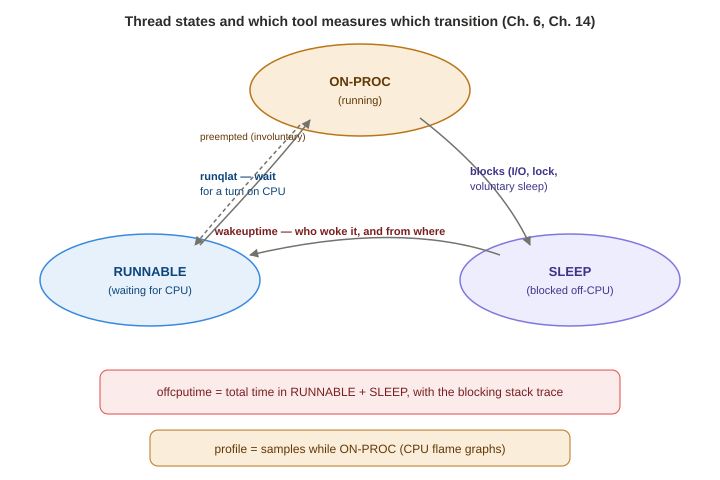
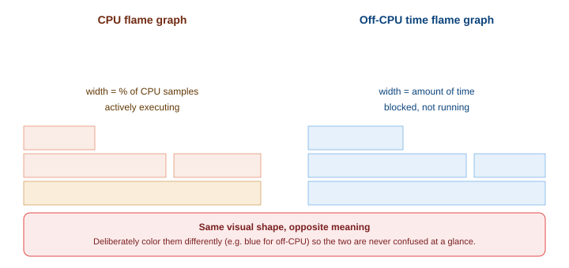

# Chapter 6 — CPUs

*Study notes on Chapter 6 of BPF Performance Tools (Brendan Gregg, 2019). Original notes, not book text — see `00-index.md` for how these notes are written.*

> This is the first Part II chapter, and the index file already flagged the recurring shape every subsystem chapter follows: **Background → Traditional Tools → BPF Tools → One-Liners → Optional Exercises → Summary**. These notes follow that same shape. Several patterns introduced here — the entry/return timestamp-pair idiom from Chapter 5, off-CPU analysis, CPU flame graphs — get reused constantly in every chapter from here on, so this one is worth reading in full even though later chapters will move faster by referencing back to it.

## 6.1 Background

### CPU fundamentals


> **How to read this:** every tool in this chapter is measuring one arrow on this diagram, not the whole picture — that's why you often need more than one tool to explain a CPU problem fully.

**Modes:** the kernel runs in a privileged **system mode**; ordinary applications run in **user mode** and can only touch kernel resources through explicit requests (syscalls) or implicit ones (a page fault triggered by a memory access). The kernel tracks how much CPU time goes to each mode — the "user/system time split" you see in nearly every CPU tool. The kernel doesn't normally run unprompted — it's usually triggered by syscalls and interrupts — though there are real exceptions worth knowing about: background housekeeping threads (e.g., NUMA memory-page balancing, or a file system's periodic checksum verification) can consume real CPU with no application ever explicitly asking for it.

**The scheduler and thread states:** the kernel shares CPUs between consumers — mainly threads belonging to processes, but also soft- and hard-interrupt routines — via a **CPU scheduler**. Three thread states matter here: **ON-PROC** (running on a CPU right now — this book calls this **"on-CPU"**), **RUNNABLE** (could run, but waiting its turn — sitting in a "run queue," a mental model that persists even though Linux's actual CFS scheduler internally uses a red-black tree, not a literal queue), and **SLEEP** (blocked on something else — I/O, a lock, an uninterruptible wait — this book calls every non-ON-PROC state **"off-CPU"**). A thread leaves the CPU either **voluntarily** (it blocks on I/O, a lock, or sleeps) or **involuntarily** (it's used up its scheduled time slice, or a higher-priority thread preempts it) — this on/off-CPU and voluntary/involuntary vocabulary reappears throughout the rest of the chapter, so it's worth having solid. Switching from running one thread to another (switching address space and other metadata) is a **context switch**. If a thread is runnable and waiting while a *different* CPU sits idle, the scheduler can **migrate** it there — but migration itself has a cost (losing a CPU's "warm" cache state for that thread), so the scheduler deliberately avoids migrating when the cost looks likely to exceed the benefit.

**CPU caches:** multiple levels, growing in size and latency — L1 (split into instruction and data caches, KB-sized, nanosecond latency, usually per-core) up through the **last-level cache (LLC)** (MB-sized, much slower, usually shared across a whole socket). The **TLB** (translation lookaside buffer) is a separate, dedicated cache for the memory-management unit's virtual-to-physical address translations. The book's framing worth remembering: CPU core counts and clock speeds have scaled dramatically for decades, but memory performance hasn't kept pace — pushing many real workloads to become **memory-bound** rather than purely CPU-bound, which is exactly why cache-related PMC tools (like `llcstat`, §6.3.16) matter.

### What BPF specifically adds over traditional CPU tools

Traditional tools already give you CPU utilization by process/mode, context-switch rates, and average run-queue length. BPF tracing adds a layer of *why* and *distribution*, answering things like: which new processes are being created and how long do they live; is system time high because of syscalls, and which ones; how long do threads spend on-CPU per wakeup, and how long do they wait on run queues (as full **distributions**, not just averages); are run queues balanced across CPUs; why are threads voluntarily leaving the CPU, and for how long; and what's the LLC hit ratio, broken down **by application request** (mixing a uprobe for application context with PMC events — a nice concrete example of combining event sources from different layers in one tool).

**Event sources for CPU analysis, gathered in one place:** kprobes/kretprobes (kernel functions), uprobes/uretprobes (user functions), syscall tracepoints, `irq:softirq*` tracepoints, `irq:irq_handler*` tracepoints, workqueue tracepoints (Chapter 14), timer/PMC-based sampling, `power` tracepoints (CPU frequency/power events), and PMCs for CPU cycles.

**Overhead — worth internalizing precisely, since scheduler events are the highest-frequency events you'll instrument in this whole book:** context switches can occur **millions of times per second** on a busy system, and even a BPF program that only costs a few microseconds can add up to noticeable — in a worst case, the book cites **over 10%** — system overhead if it runs on every single switch. The practical guidance: use scheduler-tracing tools for **short-term, ad hoc analysis**, quantify the actual overhead yourself (compare steady-state CPU utilization with the tool running vs. not), and prefer **infrequent-event tools** (process exec, migrations — at most thousands of events/sec) or **timed sampling** (fixed overhead regardless of workload intensity) for anything you want to leave running longer.

### Strategy — a concrete, ordered starting workflow

Worth adopting close to verbatim as your own default sequence when facing an unfamiliar CPU-performance problem:

1. **Confirm a CPU workload is actually running** and that all CPUs are online (`mpstat(1)`).
2. **Confirm the workload really is CPU-bound** — high utilization (`mpstat(1)`) *and* high run-queue latency (`runqlat(8)`). A genuinely counterintuitive scenario worth remembering: a container or cgroup CPU limit can make an application CPU-bound even on an otherwise mostly-idle system — run-queue latency is what reveals this, since plain utilization numbers won't.
3. **Quantify usage** — system-wide, then broken down by process, mode, and CPU ID (`mpstat`, `top`). For high system time specifically, frequency-count syscalls by process and type.
4. **Profile stack traces and view them as a CPU flame graph** — the book calls this the technique that finds "many CPU issues" just from browsing.
5. **Write custom tools for context a profiler can't give you** — a profiler shows *which functions* are hot, not the *arguments/objects* they're operating on (e.g., which specific filenames a hot `stat()` code path is actually processing).
6. **Measure hard-interrupt time separately** (`hardirqs(8)`) — this can be invisible to timer-based profilers.
7. **Browse the rest of this chapter's BPF tools** for anything not yet covered.
8. **Measure instructions-per-cycle (IPC) via PMCs** to understand, at a high level, how much CPUs are stalled — and drill further into cache hit ratios, thermal stalls, etc. from there.

## 6.2 Traditional tools

### Kernel statistics (cheap, usually root-not-required)

**`uptime(1)`** prints load averages — **not** simple means, but exponentially-damped moving sums reflecting demand (runnable tasks *plus* tasks in **uninterruptible wait**, which includes tasks blocked on disk I/O or locks, not just CPU demand). This inclusion of uninterruptible-wait time is the specific reason the book is skeptical of the common "divide load average by CPU count to get saturation" interpretation — a load average can be elevated purely from disk-I/O-blocked tasks with zero CPU contention at all. Load averages are genuinely useful for **spotting trends over time** (comparing 1-, 5-, and 15-minute figures), but for actually distinguishing CPU-bound from I/O-bound demand, reach for `offcputime(8)` (§6.3.9) instead.

**`top(1)`** shows per-process CPU%, aggregated system-wide in its header. A real example worth internalizing the arithmetic of: on a 48-CPU system, a single Java process reported at **1681% CPU** is consuming `1681/4800 ≈ 35%` of total system capacity — a good reminder that `top`'s per-process percentages are summed *across all cores*, so a number well above 100% just means "using more than one core's worth," not something exotic. A real caveat worth remembering: `top`'s live-refreshing screen means a transient issue can appear and vanish before you can capture it — worth pairing with `pidstat(1)` (which prints rolling, appendable output) or a monitoring system for anything you need to prove happened later.

**`mpstat -P ALL 1`** — the **per-CPU** breakdown (as opposed to `top`'s system-wide average) that reveals **imbalance**: a workload pinned to too few CPUs, thread-pool sizing that doesn't use all available cores, or software limits like a container CPU-count restriction. Its `%irq`/`%soft` columns point you toward `hardirqs(8)`/`softirqs(8)` (§6.3.13–14) for further drill-down.

### Hardware statistics (PMC-based — Chapter 2 §2.12)

**`perf stat -d`** counts a default (or, with `-d`, extended) PMC set for one command's execution — cycles, instructions, an **instructions-per-cycle (IPC)** figure, branch misses, L1/LLC cache load and miss counts. `perf list` shows every available PMC by name for use with `-e`; combined with `-a -I 1000`, you get a live, system-wide, per-second rate for any specific PMC. **`tlbstat`** is a purpose-built PMC tool the book's author wrote specifically to analyze **KPTI** (the kernel page-table-isolation patches that mitigated the Meltdown vulnerability) — worth remembering as a concrete real-world case where PMC analysis answered a question ordinary counters couldn't: the book's own stress-test measurement found **27% of CPU cycles in data-TLB walks and 22% in instruction-TLB walks** under worst-case KPTI overhead — meaning roughly half the system's CPU budget was going to the MMU servicing address translations, a genuinely actionable, quantified finding.

### Hardware sampling

`perf record -e <pmc> -c <count> -a -g` captures a **stack trace** every `count`-th occurrence of a chosen PMC event (e.g., every 50,000th LLC miss), across all CPUs, for later `perf report`/`perf script` analysis. The Chapter 2 PEBS reminder resurfaces here directly: use PEBS-capable events wherever precision matters, to avoid interrupt "skid" corrupting which instruction gets blamed for the event.

### Timed sampling, and the case for flame graphs

`perf record -F 99 -a -g -- sleep 30` — the familiar **99 Hz** (not 100 — avoiding lockstep sampling artifacts, per Chapter 2/5) capture across all CPUs. The genuinely persuasive argument for flame graphs shows up here in scale terms: the book's own `perf report` output for a real capture ran to **six thousand lines**, and the fully-expanded per-sample `perf script` dump ran to **over sixty thousand** — "easily 10 times this size on busier systems." A CPU flame graph collapses that into one browsable picture. **A concrete real example worth remembering**: a flame graph of an `iperf` loopback test immediately showed two wide "plateau" towers under `sock_sendmsg()` — `copy_user_enhanced_fast_string()` and `move_freepages_block()` — identifying exactly what the process was spending its CPU on, at a glance, from data that would otherwise have been unreadable as text.

**The generation workflow**, worth having memorized:
```
git clone https://github.com/brendangregg/FlameGraph
cd FlameGraph
perf record -F 49 -ag -- sleep 30
perf script --header | ./stackcollapse-perf.pl | ./flamegraph.pl > flame1.svg
```
`stackcollapse-perf.pl` converts `perf script` output into the standard folded format (Chapter 4's format); converters exist in the same repository for many other profilers' native formats. (The book also mentions Netflix's newer d3-based flame graph implementation and a companion tool, **FlameScope**, which visualizes a profile as a subsecond-offset heatmap you can select time ranges from before generating a flame graph — useful when an issue is a short-lived spike buried inside a longer capture.)

**Internals worth knowing before you're confused by it in the field:** `perf(1)`'s preferred timed-sampling mechanism is a PMC-driven **non-maskable interrupt (NMI)** — but many **cloud instances don't expose a PMU to the guest at all** (visible via `dmesg | grep PMU` reporting "no PMU driver, software events only"), in which case `perf` silently falls back to a **software `hrtimer`-based interrupt** instead. This fallback is generally adequate, but can't interrupt code paths that run with IRQs disabled (parts of the scheduler and hardware-event handling) — meaning a profile taken this way will be systematically missing samples from exactly those paths.

### Event statistics and tracing

`perf stat -e sched:sched_process_exec -I 1000` is effectively a **manual, traditional-tools precursor to `execsnoop(8)`** — counting the process-exec tracepoint reveals a hidden rate of over 160 execs/second, and `perf record`/`perf script` on the same tracepoint reveals the actual process names (`make`, `sh`, `cmake` — a software build in progress). **A genuinely important footnote from the book, worth treating as a standing rule:** the current (as of writing) `strace(1)` implementation uses breakpoint-based tracing that can slow its target by **over 100x** — dangerous in production. Treat `strace` as a last resort *after* trying BPF tooling, not a first reach, specifically because of this overhead risk (this generalizes the exact same overhead-consciousness the rest of this book applies to BPF itself).

`perf sched record`/`perf sched timehist` is a dedicated scheduler-analysis subcommand — a dump-and-post-process design (record every context-switch event to a file, then analyze offline) that shows per-switch wait time, scheduler delay, and run time. The book's own caution: even **one second** of scheduler tracing on an 8-CPU system produced a **1.9 MB** `perf.data` file — on a larger, busier, longer-running capture, this can balloon to hundreds of megabytes, itself becoming a real source of overhead (CPU time to write it, file-system I/O). The book's explicit preference from here on: **use BPF's in-kernel summarization (`runqlat(8)`, `runqlen(8)`) instead of `perf sched`'s dump-everything approach** wherever it answers the same question.

**Ftrace**, the traditional kernel tracing framework (Steven Rostedt, Linux 2.6.27/2008), can also do function counting — the book's own `perf-tools` (Ftrace-based, pre-BPF) `funccount` example counting `ext4_*` calls found `ext4_getattr()` called **7,285 times** while tracing, the most frequent by far — a useful illustration that a function's *name* alone (matched against open kernel source) is often enough of a clue to point you toward what workload is actually running, before you've written any custom tooling at all.

## 6.3 BPF Tools

### 6.3.1 `execsnoop` — new process execution

Already introduced in Chapter 1 — the tool that catches short-lived processes invisible to snapshot-based tools. Traces `execve(2)` specifically, so processes created via `fork()`/`clone()` alone **without** ever calling `exec()` (e.g., a hand-rolled worker-process pool) won't appear — the book notes this should be rare, since applications should generally be pooling *threads*, not raw processes. BCC options: `-x` (include failed execs), `-n`/`-l` (filter by command/argument substring), `--max-args`. The bpftrace version is exactly the `sys_enter_execve` + `join(args->argv)` one-liner from Chapter 1's investigation, formalized into a script with a header line.

### 6.3.2 `exitsnoop` — process exit, age, and reason

A BCC-only tool (the book explicitly flags writing a bpftrace version as a good learning exercise) that traces `sched:sched_process_exit`, reporting each process's **age** (creation to termination, on-CPU *and* off-CPU time combined) and exit code — including whether it died from a signal (e.g., `signal 9 (KILL)`). Complements `execsnoop` for the same "short-lived process" investigative class, from the other end of the lifecycle.

### 6.3.3 `runqlat` — run-queue (scheduler) latency, the primary CPU-saturation metric

The tool for **quantifying CPU saturation** — how long threads actually wait for their turn on a CPU, as a histogram. Two contrasting real examples make the point vividly: on a healthy 48-CPU instance at 42% utilization, wait times cluster in the **2–15 microsecond** range; on a 36-CPU build server mistakenly configured for **72 parallel jobs** (double the core count), the distribution becomes **tri-modal**, with the slowest mode centered in the **8–16 millisecond** bucket — a thousand-fold-worse experience, confirmed independently by `sar -uq` showing 0% idle and a run-queue size of 72.

**The full bpftrace source is worth understanding as a direct extension of Chapter 5's timestamp-pair idiom**, with one added subtlety:
```
tracepoint:sched:sched_wakeup,
tracepoint:sched:sched_wakeup_new
{
        @qtime[args->pid] = nsecs;
}

tracepoint:sched:sched_switch
{
        if (args->prev_state == TASK_RUNNING) {
                @qtime[args->prev_pid] = nsecs;
        }
        $ns = @qtime[args->next_pid];
        if ($ns) {
                @usecs = hist((nsecs - $ns) / 1000);
        }
        delete(@qtime[args->next_pid]);
}
```
A thread's queue-wait clock starts either when it's **woken up** (`sched_wakeup`/`sched_wakeup_new`) *or* the moment it's **involuntarily** switched off the CPU while still `TASK_RUNNING` (checked explicitly in `sched_switch`) — because in that case it goes straight back onto a run queue rather than sleeping, and its wait clock needs to restart from that exact instant. The final `sched_switch` block does the actual latency computation for whichever thread is about to start running next. **Overhead warning, worth repeating from §6.1**: this instruments wakeup and switch events directly, which can exceed a million events/second on busy production systems — "use with caution," in the book's own words.

### 6.3.4 `runqlen` — run-queue length, a cheaper proxy

`runqlen` samples (at 99 Hz, via `profile`) rather than traces every event — trading precision for dramatically lower overhead. The book poses this deliberately as a **latency vs. length** question, with a memorable analogy: at a grocery checkout, what actually matters to you — the length of the line, or how long you personally wait? **Latency (`runqlat`) is the primary metric**; length is secondary. So why use it at all? Two reasons: it helps **explain** a `runqlat`-identified problem (a long run queue is *why* latency was high), and because it's **sampled rather than traced**, it's cheap enough to leave running continuously (24×7 monitoring can use `runqlen` to detect an issue cheaply, then reach for `runqlat` ad hoc to actually quantify it). A concrete example — four busy threads pinned to one CPU (`taskset -c 0`) — shows `runqlen -C`'s per-CPU histogram correctly reporting a queue length of **3** on that CPU (one thread running, three waiting), and near-zero elsewhere. The bpftrace version has to walk `curtask` → the CFS run-queue struct directly, and because the relevant struct member (`nr_running`) isn't in standard kernel headers, the script hand-declares a **partial struct** just large enough to reach that one field — flagged explicitly as a workaround BTF (Chapter 2 §2.3.9) should eventually make unnecessary.

### 6.3.5 `runqslower` — a threshold-based outlier tool

Prints only individual run-queue waits **exceeding a threshold** (default 10 ms) — a way to catch "this specific request suffered noticeably" events by exception, rather than reading a whole histogram. Currently kprobe-based (`ttwu_do_wakeup()`, `wake_up_new_task()`, `finish_task_switch()`) rather than tracepoint-based, so it carries similar overhead to `runqlat` even while producing no visible output.

### 6.3.6 `cpudist` — on-CPU time distribution per wakeup

Where `runqlat` measures *waiting*, `cpudist` measures *actually running* time per scheduling turn — useful for characterizing whether a workload does short, frequent bursts or long, uninterrupted stretches on CPU. **A real, concrete Netflix story attached to this tool**: after a production change made a machine-learning application run **3x faster**, `perf(1)` showed the context-switch rate had dropped, and `cpudist` quantified exactly what that meant in practice — the application went from running only **0–3 microseconds** between involuntary context switches to running **2–4 milliseconds** at a stretch, a roughly thousand-fold improvement in how much useful work happened per scheduling turn.

### 6.3.7 `cpufreq` — CPU clock frequency by process

Only produces output under power-saving governors (like `powersave`) that actually vary frequency — under `performance` governor, CPUs are pinned at max speed and there's nothing to sample. A real production discovery: an `nginx` process was found running mostly in the **1200–2000 MHz** range because the system's `scaling_governor` had defaulted to `powersave` rather than `performance` — a concrete, actionable finding (fix the governor setting) that plain CPU-percentage metrics would never have revealed, since "35% busy at 1.3 GHz" and "35% busy at 3.6 GHz" look identical to a utilization-only tool. Source works by tracing the `power:cpu_frequency` tracepoint into a per-CPU map, then sampling that map at 100 Hz via `profile`, splitting histograms by `comm` for any sample with a nonzero `pid` (excluding the idle thread).

### 6.3.8 `profile` — the single most useful CPU tool in the book's own words

Samples stack traces (kernel + user, by default, at 49 Hz across all CPUs) and frequency-counts them **in kernel context** — this in-kernel summarization is explicitly called out as `profile`'s advantage over `perf(1)`'s sample-then-dump-to-file approach, avoiding both the CPU cost of writing every individual sample and any file-system/disk I/O for recording them. Because its cost is bounded by a fixed, tunable sample rate rather than the workload's actual event rate, its overhead stays "relatively negligible" regardless of how busy the system is — a meaningfully different overhead story than the trace-every-event tools above it in this chapter. `-f` produces folded output for the exact same flame-graph pipeline as §6.2's `perf` workflow; `-a` adds `_[k]`/`_[u]` kernel/user frame annotations that `flamegraph.pl --color=java` can use to color kernel frames distinctly. The bpftrace equivalent, worth having memorized as a genuinely complete one-liner: `bpftrace -e 'profile:hz:49 /pid/ { @samples[ustack, kstack, comm] = count(); }'` (the `/pid/` filter specifically excludes the kernel idle thread, whose PID is 0).

### 6.3.9 `offcputime` — the exact complement to `profile`



Where `profile` explains on-CPU time, `offcputime` explains **blocked** time — summarizing, by stack trace, how long threads spend off-CPU and *why*. Together, the book notes, the two tools account for **the entire time spent by every thread on the system**. Three real example stacks make the tool's value concrete: `iperf` blocked 5 ms in `sk_stream_wait_memory()` (waiting for send-buffer memory), the same `iperf` process blocked **1.02 seconds total** in `sk_wait_data()` (waiting for incoming data — expected for a network benchmark), and `offcputime` itself blocked **5.00 seconds** in a `select()` syscall (matching its own 5-second run duration) — each illustrating a different *reason* for going off-CPU, all captured by the identical mechanism. **A direct, concrete callback to Chapter 2's frame-pointer warning**: the book notes these particular user-level stacks are visibly **incomplete**, cut off right at `libc`, because that specific library wasn't built with frame pointers preserved — a real instance of the exact problem Chapter 2 described in the abstract. The bpftrace source hooks a **single** kprobe, `finish_task_switch()` — doing double duty: recording a start timestamp for the thread that's *leaving* the CPU, and (from the *same* call, since `finish_task_switch` runs with both the outgoing and incoming thread's context available) computing and summing elapsed off-CPU time for the thread that's *starting*:
```
kprobe:finish_task_switch
{
        $prev = (struct task_struct *)arg0;
        if ($1 == 0 || $prev->tgid == $1) {
                @start[$prev->pid] = nsecs;
        }
        $last = @start[tid];
        if ($last != 0) {
                @[kstack, ustack, comm] = sum(nsecs - $last);
                delete(@start[tid]);
        }
}
```
Off-CPU results can be visualized as an **off-CPU time flame graph** — visually similar to a CPU flame graph, but the book recommends deliberately re-coloring it (e.g., `--bgcolors=blue`) as a visual reminder that width here means *time blocked*, not *time executing* — an easy, costly mix-up if the two flame-graph types look identical at a glance. **Overhead is a genuine concern**: context-switch tracing here can exceed 10% overhead on busy systems, so the guidance is to run this tool for **short durations only**.

### 6.3.10 `syscount` — syscall counts, a starting point for high system time

A simple frequency count of syscalls, useful as the very first step when system CPU time is high and you don't yet know why. A real example shows `futex(2)` dominating at over 150,000 calls/second — an extremely common finding on any lock-heavy multi-threaded application (`futex` is the primitive underlying most userspace mutex implementations). **A genuinely instructive efficiency detail**: rather than instrument the ~300 separate `syscalls:sys_enter_*` tracepoints individually, `syscount` uses the **single** `raw_syscalls:sys_enter` tracepoint that fires for *every* syscall — faster to attach, at the cost of only getting a numeric syscall ID back (requiring a separate ID-to-name lookup table, which BCC provides as a library helper). **A worked overhead-extrapolation example worth remembering as a technique in itself**: a synthetic stress test measured a 30% slowdown at 3.2 million syscalls/second on one CPU; scaling that ratio down to a real production rate of ~6,000 syscalls/second/CPU predicts an expected overhead around **0.06%** — small enough that the book couldn't even measure it directly against production's natural variability. This kind of "measure worst-case overhead under stress, then linearly extrapolate to your real, lower rate" reasoning is a reusable technique for estimating whether any tracing tool is safe to run in production.

### 6.3.11 `argdist` and `trace` applied to syscalls

A direct continuation of Chapter 4's two multi-tools, now aimed specifically at syscall arguments. `tplist -v syscalls:sys_enter_read` reveals a tracepoint's exact argument names (`fd`, `buf`, `count`) without needing kernel headers — worth remembering as the standard way to discover what fields are available before writing an `argdist`/`trace`/bpftrace one-liner against a tracepoint you haven't used before. A genuinely instructive pairing: histogramming `sys_enter_read`'s `args->count` (the *requested* size) against `sys_exit_read`'s `args->ret` (the *actual* bytes read) side by side reveals that most real reads return far less than what was requested (many 0- and 1-byte results) — the kind of gap between "intended" and "actual" that's easy to miss without measuring both ends. **A nice concrete debugging vignette**: bpftrace's histogram groups negative `args->ret` values (syscall error returns) into a distinct `(..., 0)` bucket; a follow-up `lhist()` one-liner filtering specifically on `args->ret < 0` and negating the value reveals error code **11** appearing exclusively — checked against `asm-generic/errno-base.h`, that's `EAGAIN` ("try again"), a normal, expected condition rather than a real problem. This is a good small model of a complete investigative loop: notice something in a histogram, narrow in with a more targeted one-liner, and resolve the final number against kernel headers.

### 6.3.12 `funccount` applied to CPU analysis

The book poses a sharp distinction worth remembering generally: `profile(8)` can tell you a function is **hot** on CPU, but it fundamentally can't tell you **why** — whether that function is simply *slow per call*, or merely *called extremely often*. `funccount -i 1 get_page_from_freelist`, run against the exact function `profile` had earlier shown as hot, resolves this ambiguity directly: **586,000+ calls per second**, confirming "called constantly" rather than "individually slow" as the explanation.

### 6.3.13–6.3.14 `softirqs` and `hardirqs` — interrupt time, invisible to CPU profilers

Both report **time**, not just event counts (which `/proc/softirqs` and `/proc/interrupts` already give you for free) — the genuine value-add over what's already available. A production example shows `net_rx` (network packet receive processing) consuming **1,358 ms** of a 10-second, 48-CPU trace — about 3% of total system CPU capacity, a real, quantifiable cost that a purely timer-based CPU profiler could miss (hard-interrupt handling can run with interrupts disabled, exactly the blind spot §6.2's `perf` internals discussion flagged for hrtimer-based sampling). `hardirqs` is currently kprobe-based (`handle_irq_event_percpu()`), with a tracepoint-based version (`irq:irq_handler_entry`/`exit`) noted as a likely future improvement; `softirqs` has no bpftrace version yet, though a starting one-liner (`tracepoint:irq:softirq_entry { @[args->vec] = count(); }`) is given as a base to build from.

### 6.3.15 `smpcalls` — a real "I found a bug the first time I ran this" story

Traces **SMP/cross calls** — one CPU asking another CPU (or *all* other CPUs) to run a function, which becomes genuinely expensive on large multi-processor systems. **This is one of the best worked examples in the whole chapter for demonstrating the full investigative loop end to end**: running `smpcalls.bt` for the very first time on a real system immediately surfaced `aperfmperf_snapshot_khz` as an unexpectedly frequent, unexpectedly slow (up to 128 microseconds) cross call. Extending the tool's map key to also capture the kernel stack traced the call back through `cpuinfo_open()` — meaning some process was opening `/proc/cpuinfo` and triggering this expensive cross-CPU call as a side effect. A **second** tool, `opensnoop`, confirmed the culprit directly: a monitoring agent (`snmp-pass`) was re-reading `/proc/cpuinfo` **every single second**, purely to count the number of processors — a field that never changes, from a syscall that also happens to trigger this specific expensive kernel path. This is a clean illustration of Chapter 3's workload-characterization theme in action: **the fix was eliminating unnecessary work entirely, discovered by chaining two different BPF tools together**, not by tuning or scaling anything.

### 6.3.16 `llcstat` — cache hit ratio by process, via PMCs

Notable as **BCC's first tool to use PMCs outside of pure timed sampling** — it uses PMC *overflow* sampling (Chapter 2 §2.12.1) on cache-reference and cache-miss events (default: one in every 100 occurrences) to attribute LLC hit ratio to whichever process happens to be running when the sample interrupt fires. The book flags a real subtlety of this sampling approach worth being cautious about: because references and misses are sampled *independently* at the same fixed ratio, a process can, purely by chance, appear to have more sampled misses than sampled references in a short window — nonsensical on its face (misses are a strict subset of references), but an artifact of independent sampling rather than a real measurement error.

### 6.3.17 Other tools worth knowing exist

`cpuwalk(8)` (bpftrace) — samples which CPU each process ran on, as a linear histogram of CPU balance. `cpuunclaimed(8)` (BCC, experimental) — detects idle CPUs coexisting with runnable threads stuck on a different CPU's run queue (possibly CPU-affinity-related, possibly a scheduler bug). `loads(8)` (bpftrace) — a minimal example of fetching load averages directly from a BPF tool (with the same "these numbers are often misleading" caveat as §6.2). `vltrace` — an in-development Intel project aiming to be a BPF-powered, low-overhead replacement for `strace(1)`.

## 6.4 BPF One-Liners

A representative sample, each demonstrating a distinct idiom worth remembering:

```
# BCC: sample user stacks at 49 Hz for one PID
profile -F 49 -U -p 189

# bpftrace: syscall count by syscall function name, resolved via the syscall table directly
bpftrace -e 'tracepoint:raw_syscalls:sys_enter {
    @[sym(*(kaddr("sys_call_table") + args->id * 8))] = count(); }'

# bpftrace: sample the currently running CPU ID as a linear histogram (balance check)
bpftrace -e 'profile:hz:99 { @cpu = lhist(cpu, 0, 256, 1); }'

# bpftrace: count SMP calls by name and a short kernel stack
bpftrace -e 'kprobe:smp_call* { @[probe, kstack(5)] = count(); }'
```

## 6.5 Optional exercises worth actually trying

The book's own list (paraphrased) is genuinely worth doing hands-on rather than just reading: characterize an artificially overloaded CPU (bind two busy infinite loops to one core with `taskset` and compare `uptime`/`mpstat`/`runqlen`/`runqlat`); generate both a CPU flame graph and an off-CPU time flame graph for the same disk-read workload (`dd if=/dev/nvme0n1p3 ... | dd of=/dev/null ...`) and compare what each reveals; write a `procsnoop(8)` that catches `fork()`/`clone()` as well as `exec()`, closing `execsnoop`'s known blind spot; and (flagged explicitly as advanced and unsolved even by the book's author) build a tool measuring time spent specifically in CPU-affinity wait — runnable, with an idle CPU available, but not migrated because the scheduler judged the cache-warmth cost not worth it.

## 6.6 Summary

CPU analysis starts with the fundamentals — modes, the scheduler's thread states, CPU caches — and traditional statistical, PMC, and event-tracing tools already answer a lot. BPF's specific additions are the ones worth carrying forward as this chapter's real takeaways: **run-queue latency as a histogram** (not just an average) for quantifying saturation, **CPU and off-CPU flame graphs** as the two halves of "where did all the time go," **in-kernel frequency counting** (`funccount`, `profile`) for efficiently answering "how often" without paying per-event output cost, and interrupt-time accounting (`hardirqs`/`softirqs`) for CPU consumption invisible to ordinary timer-based profiling.

---

## Quick-reference glossary (this chapter's terms)

- **On-CPU / off-CPU** — this book's terminology for a thread actually running (ON-PROC) versus everything else (RUNNABLE or SLEEP).
- **Run-queue latency** — time a runnable thread waits for its turn on a CPU; the primary metric for CPU saturation.
- **Run-queue length** — how many threads are waiting; a secondary, cheaper-to-sample proxy for latency.
- **Off-CPU time flame graph** — a flame graph of *blocked* time and its causing stack traces, the complement to an ordinary CPU flame graph.
- **IPC (instructions per cycle)** — a PMC-derived measure of how efficiently a CPU is executing, useful for detecting stalls invisible to plain utilization percentages.

## Check your understanding

1. A load average of 20 on a 48-CPU system — does this necessarily mean the CPUs are 20/48 = ~42% saturated? Why is the book skeptical of that interpretation?
2. Why does `runqlen(8)` sample at 99 Hz instead of tracing every scheduler event the way `runqlat(8)` does, and what's the practical consequence of that difference?
3. In the `smpcalls` investigation, what were the *two separate* BPF tools used, and what did each one individually contribute to solving the problem?
4. Explain, in your own words, why `profile(8)` alone couldn't tell whether `get_page_from_freelist()` was hot because it was slow or because it was simply called very often — and which tool resolved the ambiguity.
5. Why is an off-CPU time flame graph conventionally given a different background color than a CPU flame graph, even though the two are generated by visually near-identical tooling?

<details>
<summary>Answers</summary>

1. No — load averages are exponentially-damped moving sums of demand that specifically **include tasks in uninterruptible wait** (e.g., blocked on disk I/O or locks), not just CPU-runnable tasks. A high load average can therefore reflect I/O contention rather than CPU contention, so dividing it by CPU count doesn't reliably tell you CPU saturation on its own — you'd need a tool like `offcputime(8)` to actually separate CPU-bound from I/O-bound waiting.
2. `runqlen(8)` uses timed sampling (`profile:hz:99`) rather than tracing every scheduler wakeup/switch event, which makes its overhead fixed and low regardless of how busy the scheduler is — unlike `runqlat(8)`, whose cost scales with the real event rate and can become significant on very busy systems (potentially exceeding a million events/second). The practical consequence is that `runqlen` is cheap enough to leave running continuously for monitoring, while `runqlat` is better reserved for shorter, ad hoc, more precise investigations once you already suspect a problem.
3. `smpcalls.bt` itself identified that `aperfmperf_snapshot_khz` was an unexpectedly slow, frequent cross-CPU call, and (once its map key was extended to include the kernel stack) traced that call back to `cpuinfo_open()` — narrowing the *what*. `opensnoop(8)` then independently confirmed the *who*: a specific process (`snmp-pass`) was repeatedly opening `/proc/cpuinfo` every second, which is what was actually triggering the expensive call in the first place.
4. `profile(8)` only samples the CPU instruction pointer at intervals and tallies which functions appear most often in those samples — a function can appear "hot" in that tally either because each individual call takes a long time, or because it's simply called an enormous number of times, and a plain frequency-of-samples count can't distinguish those two very different explanations on its own. `funccount(8)`, run against that specific function, measured its actual call rate directly (over 586,000 calls/second) — confirming it was hot because it was called constantly, not because any single call was slow.
5. Because the two flame graph types look visually almost identical (same shape, same interactive behavior) but answer opposite questions — width in a CPU flame graph means time spent *actively executing*, while width in an off-CPU flame graph means time spent *blocked/waiting*. Deliberately using a different background color (e.g., blue for off-CPU) is a simple, low-cost safeguard against misreading one type as the other at a glance, especially when switching between the two during the same investigation.

</details>
