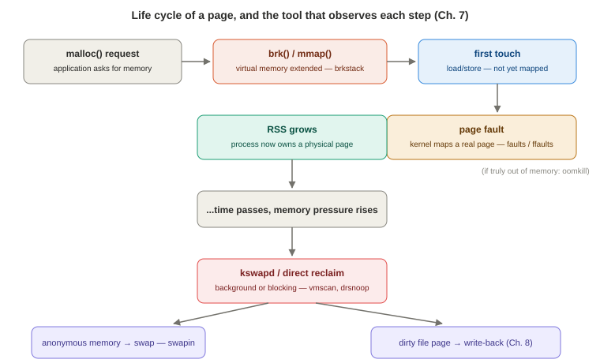

# Chapter 7 — Memory

*Study notes on Chapter 7 of BPF Performance Tools (Brendan Gregg, 2019). Original notes, not book text — see `00-index.md` for how these notes are written.*

> Same shape as Chapter 6: Background → Traditional Tools → BPF Tools → One-Liners → Exercises → Summary. Several ideas carry straight over from Chapter 6 — the timestamp-pair latency idiom (§7.3.8's `vmscan`), overhead-consciousness for high-frequency events, and flame graphs applied to a new kind of stack (page faults, not CPU samples).

## 7.1 Background

### Memory fundamentals — the life cycle of a page

**Allocators:** processes using `libc` store dynamic data on the **heap**; `malloc()`/`free()` track freed regions internally so they can reuse them without needing to grow the heap every time — there's normally no reason to *shrink* the heap afterward, since it's all virtual memory rather than physical. (Other allocators — `tcmalloc`, `jemalloc`, and runtime-specific ones like the JVM's, often paired with garbage collection — follow the same broad shape.) The kernel and processor jointly map virtual to physical memory in fixed-size **pages** (commonly 4 KB, with larger **huge pages** also supported), serviced from per-DRAM-group, per-CPU free lists that the kernel's own allocator (commonly the **slab allocator**) also draws from for its own needs.


> **How to read this:** the left-to-right spine is the common case; the branch at the bottom only happens under real memory pressure, and most of this chapter's tools sit at a specific labeled step.

**The full life cycle of a user memory page, worth having as a mental sequence:**
1. An application requests memory (e.g., `malloc()`).
2. The allocator either serves it from its own free list, or extends virtual memory — via `brk(2)` (grow the heap) or `mmap(2)` (a new segment).
3. The application eventually actually *touches* that memory (a load/store) — at which point the MMU discovers there's no real mapping yet, and raises a **page fault**.
4. The kernel handles the fault, establishes a real physical-to-virtual mapping from its free lists, and the process's **RSS (resident set size)** — its actual physical memory footprint — grows by one page.
5. Under memory pressure, the kernel page-out daemon may reclaim pages of three kinds: unmodified file-backed pages (freed immediately, reread later if needed), *modified* ("dirty") file-backed pages (must be written back first), and **anonymous memory** (application memory with no file origin) — which, if swap is configured, gets written out to a swap device first. This is **swapping**.

**A critical frequency distinction worth keeping in mind for the rest of the chapter, mirrored directly in the book's own figure:** allocation calls happen up to millions of times a second, and load/store instructions (MMU lookups) billions of times a second — both far too frequent to trace directly without serious overhead. `brk()`/`mmap()` calls, page faults, and page-outs are comparatively **infrequent** (thousands/sec at most) — and this frequency gap is exactly why most of this chapter's tools instrument the *infrequent* events rather than allocation calls themselves.

**The page-out daemon (`kswapd`)** wakes when free memory crosses a low watermark, and sleeps again once it crosses a high watermark — background, asynchronous reclaim that shouldn't directly hurt application performance beyond normal CPU/disk contention. If `kswapd` can't free memory fast enough and a minimum-pages threshold is crossed, the kernel falls back to **direct reclaim** — a **foreground**, synchronous mode where the allocation that triggered it actually **blocks** waiting for pages to be freed. This distinction (background vs. foreground reclaim) is exactly what `vmscan(8)` (§7.3.8) is built to measure.

**Swap devices** provide a degraded-but-survivable mode when memory runs out; some production environments (the book cites Netflix's own cloud instances as an example) deliberately run **without swap at all**, on the reasoning that a severely degraded server is worse than losing one redundant instance outright — applications are instead configured to stay within hard memory limits. Without swap, the **OOM killer** is the last resort: it picks a victim (biggest memory user that isn't a critical task like `init`) and kills it outright.

**File system caching**: Linux borrows otherwise-free memory for the file system cache and buffering, releasing it back to "free" status on demand — which is *why* free memory reported by a freshly-booted system rushes toward zero (it's warming the cache, not running low). `vm.swappiness` tunes whether the kernel prefers reclaiming from the file cache or from swap first. (Full file-system caching detail is Chapter 8's territory.)

### What BPF adds

Traditional tools already show capacity breakdowns (virtual/physical usage, page-operation rates). BPF answers the *why* and *which code path*: why does a process's RSS keep growing (and via which code path); which files are backing the page faults; which processes are actually blocked waiting on swap-ins; what mappings are being created system-wide; what was the system state at the exact moment of an OOM kill; which application code paths allocate memory and what object types; and — genuinely valuable — whether any allocations are **never freed**, a potential leak signal.

**Event sources:** uprobes on allocator functions + libc USDT probes (user allocations); kprobes + `kmem` tracepoints (kernel allocations); `brk` syscall tracepoints (heap growth); syscall tracepoints (shared memory); kprobes/software events/exception tracepoints (page faults); `migrate`/`compaction`/`vmscan` tracepoints; PMCs (memory-access-cycle overflow sampling). **A genuinely rich, often-overlooked resource worth knowing exists:** glibc itself ships a substantial set of **USDT probes** (`bpftrace -l usdt:/lib/.../libc-2.27.so` lists dozens — `memory_malloc_retry`, `memory_arena_new`, `memory_heap_new`, `memory_mallopt_*`, and more) giving direct visibility into the allocator's own internal behavior (arena creation, heap expansion/contraction, tunable settings) without needing to guess at `malloc()`'s internals via kprobes/uprobes alone.

**Overhead, worth internalizing precisely:** because allocation events are so frequent, tracing them directly can slow target software by **more than 10%, and in some cases by 10x**. The chapter's whole tool selection strategy follows directly from this: favor the *infrequent* events (page faults, page-outs, `brk()`/`mmap()` calls) that the life-cycle diagram marks as low-frequency, since these can answer many of the same questions at negligible cost. For understanding *which code paths* call `malloc()` specifically, the book suggests a clever low-overhead workaround instead of tracing `malloc()` directly: **search for "malloc" in an ordinary CPU flame graph** (Chapter 6) — a coarse, but essentially free, way to spot hot allocation-calling code paths, since you're reusing samples you'd likely capture anyway rather than adding new instrumentation.

### Strategy

1. Check `dmesg(1)` for recent OOM-killer activity.
2. Check for configured swap devices and whether they have active I/O (`swapon`, `iostat`, `vmstat`).
3. Check system-wide free memory and cache usage (`free`).
4. Check per-process memory usage (`top`, `ps`).
5. Check the page-fault rate and its stack traces — these explain RSS growth directly.
6. Check which **files** were backing those page faults.
7. Trace `brk()`/`mmap()` calls for a different, allocation-request-level view.
8. Browse this chapter's BPF tools for anything not yet covered.
9. Measure hardware cache misses/memory accesses via PMCs (ideally with PEBS) to find the specific functions/instructions driving memory I/O.

## 7.2 Traditional Tools

**Kernel log:** `dmesg(1)` — always check this *first*, before deeper analysis. An OOM-killer event logs a full memory-state summary (active/inactive/anon page counts, slab usage, free pages) plus the specific victim process and its RSS at time of death — genuinely rich forensic detail worth reading in full when an OOM kill has occurred, not just noting that one happened.

**Kernel statistics** (cheap, `/proc`-backed): `swapon(1)` shows configured swap devices and usage (no output at all if none configured — increasingly common). `free -m`'s **`available`** column (not the easily-misread `free` column) is the one to trust for "how much memory can this system actually still use," since it already accounts for reclaimable cache. `ps aux`'s `%MEM`/`VSZ`/`RSS` columns give per-process usage; `pmap -x PID` breaks a single process's usage down **by memory segment** (library, heap, anonymous mapping), including a "dirty" column for pages modified but not yet written back. `vmstat 1`'s memory columns (`free`, `buff`, `cache`, `si`/`so` for swap activity) — remembering that vmstat's **first line is a since-boot summary**, not a live sample, a common misreading trap. `sar -B 1` shows page-fault and page-scan rates — the book's own two contrasting examples are worth internalizing as calibration points: a healthy busy production server showing **under 300 faults/sec** with **zero page scanning** (no memory saturation), versus a software-build server showing **over 1.4 million faults/sec** — not from memory pressure at all, but simply from a storm of short-lived processes each faulting in a fresh address space on first execution (a direct callback to Chapter 6's `execsnoop` territory).

**Hardware statistics/sampling:** `perf stat -e LLC-loads,LLC-load-misses -a -I 1000` gives a live, system-wide LLC miss ratio at essentially zero overhead (counting mode); `perf record -e L1-dcache-load-misses -c 100000 -a` samples symbol-level detail for cache misses — the book notes L1 accesses are frequent enough that you need a **large** sampling threshold (here, 1-in-100,000) to avoid perturbing the very thing you're measuring, and recommends discovering the right threshold empirically by checking the *rate* with `perf stat` counting mode first, before switching to sampling mode. **The PEBS reminder resurfaces here in concrete, actionable form**: for memory PMCs specifically, append `:p`/`:pp`/`:ppp` to a `perf` event name to request increasingly precise (PEBS-backed) sampling — more `p`s, less interrupt skid, more trustworthy instruction-pointer attribution.

## 7.3 BPF Tools

### 7.3.1 `oomkill` — context at the exact moment of an OOM kill

Traces `oom_kill_process()` via kprobe, printing which process *triggered* the OOM condition, which process was *sacrificed*, its size in pages, and (read directly from `/proc/loadavg`) the load averages at that instant — giving you a sense of whether the system was steadily busy or spiking. A real example: a `perl` process's memory request triggered the OOM killer to sacrifice an 18-million-page `java` process, with load averages showing the system getting busier at the time — exactly the kind of forensic context `dmesg`'s raw OOM log gives you in bulk but not conveniently summarized per-event.

### 7.3.2 `memleak` — outstanding (potentially leaked) allocations

Traces allocation *and* free events together with allocation stack traces, and periodically (every 5 seconds by default) reports the stacks whose allocations are still **outstanding** — not yet freed. **The book is explicit and important about what this tool cannot tell you on its own**: it cannot distinguish a genuine leak (memory with no remaining references, that will *never* be freed) from ordinary long-lived allocations or gradual legitimate growth — that judgment call requires actually reading and understanding the flagged code paths. Run without `-p PID`, it traces **kernel** allocations instead, via the `kmem:kmalloc`/`kmem:kfree` tracepoints. Options include `-s RATE` (sample only 1-in-RATE allocations, to cut overhead) and `-o OLDER` (only show allocations older than a given age, filtering out normal short-lived ones). **Overhead is explicitly flagged as severe** — user-level allocation tracing here can slow a busy target by 10x or more, which the book frames plainly: this is a **troubleshooting/debugging tool, not an everyday production tool**, until uprobe performance improves substantially (Chapter 2 §2.8's overhead caveat, applied concretely).

### 7.3.3 `mmapsnoop` — every `mmap(2)` call, system-wide

Traces the `mmap(2)` syscall tracepoint and decodes its protection flags (`R`/`W`/`E`) and mapping flags (`S`hared/`P`rivate/`F`ixed/`A`non) into a readable one-line summary per call — useful general-purpose debugging for memory-mapping usage (a Java process's startup mapping in its shared libraries, `ld.so.cache`, `passwd`, and so on, in the book's own example). Low, negligible overhead expected, since new mappings should be relatively infrequent events.

### 7.3.4 `brkstack` — heap-growth stack traces

`brk(2)` growths are infrequent, so tracing them (unlike tracing `malloc()` itself) carries negligible overhead — making stack traces on `brk()` a cheap way to get *some* signal about what's driving heap growth, even though you're not tracing every individual allocation. The book shows this can be done ad hoc with existing multi-tools (`stackcount -PU t:syscalls:sys_enter_brk`) but also ships a small, dedicated, memorable-by-name script:
```
tracepoint:syscalls:sys_enter_brk
{
        @[ustack, comm] = count();
}
```
**A real, concrete callback to Chapter 2's frame-pointer warning shows up again here**: one example stack traces cleanly through a Java list-allocation path (`JLI_List_new()` → `JLI_MemAlloc()` → `sbrk()` → `brk()`), while a second stack (from `cron`) shows up simply as `[unknown]` — broken because that particular binary wasn't compiled with frame pointers preserved.

### 7.3.5 `shmsnoop` — System V shared memory calls

Traces `shmget(2)`/`shmat(2)`/`shmdt(2)`/`shmctl(2)` with full arguments — useful for debugging shared-memory usage directly. A real example shows a Java process creating a shared memory segment (`shmget`) and the X server (`Xorg`) subsequently attaching to that **same** segment ID read-only — direct, concrete evidence of the two processes actually sharing memory, not just each independently allocating their own.

### 7.3.6–7.3.7 `faults` and `ffaults` — page faults, two different ways to slice them

**`faults(8)`** groups page faults by **user-level stack trace** — revealing *which code path first touched memory* and triggered RSS growth (a different, complementary question from `brkstack`'s "which code path grew the heap request itself"). Genuinely elegant one-liner as the whole tool:
```
software:page-faults:1
{
        @[ustack, comm] = count();
}
```
A real example shows a JVM's JIT compiler thread (`C2 CompilerThread`) faulting memory while compiling code — exactly the kind of "who's actually consuming RSS, and why" answer traditional capacity tools can't give you. **Page fault flame graphs** are a direct, natural extension: `stackcount -f -PU t:exceptions:page_fault_user` piped through the standard `flamegraph.pl` pipeline (Chapter 6) — the book notes Netflix automated this specific flame-graph type as a one-click feature in their internal instance-analysis tooling (Vector, covered further in Chapter 17), a sign of how routinely useful this particular view turned out to be in production.

**`ffaults(8)`** instead groups by **filename** (which file's mapped region is being faulted in) — a different axis on the same underlying event. A software-build example shows the overwhelming majority of faults (537,925 of them) attributed to **no filename at all** — meaning anonymous memory, i.e. process heaps — with `libc` a distant second (84,814) — again reflecting the same "storm of short-lived processes each faulting a fresh address space" pattern seen in §7.2's `sar -B` example, now attributed down to the specific library/region level. Source works by tracing `handle_mm_fault()` via kprobe and reading the filename straight off the fault's `vm_area_struct`.

### 7.3.8 `vmscan` — timing the page-out daemon's actual work

Instruments the `vmscan` tracepoint family to time **shrink slab** (reclaiming kernel cache memory), **direct reclaim** (the foreground, allocation-blocking mode from §7.1), and **memory-cgroup reclaim** (a cgroup exceeding its own memory limit), plus counting `kswapd` wakeups and page writes — all as **per-second totals across all CPUs**, which the book notes is a genuinely different, more useful measure of *cost* than the plain event counts other tools (like `vmstat`) give you. **The one column worth actively watching, in the book's own words: `D-RECLAIMms`** — direct reclaim is "bad but necessary," and any nonzero time there is a direct, causal source of application-visible latency (allocations literally blocking), that further `vm.*` sysctl tuning (getting background reclaim to kick in earlier) can often eliminate. **The source is the clearest large-scale demonstration yet of Chapter 5's entry/return timestamp-pair idiom, applied three separate times in one tool** — one paired tracepoint-begin/tracepoint-end block each for shrink-slab, direct-reclaim, and memcg-reclaim, each independently accumulating a running sum and a histogram, all reset once a second by an `interval:s:1` block. Worth reading the full source once as a model for "how do I time three *different*, independently-occurring event pairs in one script" — the answer is simply: repeat the same paired-probe pattern per event type, with separate map names.

### 7.3.9 `drsnoop` — per-event direct-reclaim latency

The per-event companion to `vmscan`'s aggregate `D-RECLAIMms` column — printing each individual direct-reclaim's process, latency, and page count, so you can see the actual distribution and which specific processes are suffering it (a real example shows a `java` process's direct reclaims running 1–7 ms each). Traces the same `mm_vmscan_direct_reclaim_begin`/`_end` tracepoint pair; expected to be low-frequency (bursty), so overhead should be negligible.

### 7.3.10 `swapin` — who's actually paying the swap-in cost

The book is precise about *why* this specific metric matters over other swap-related counters: **swap-ins are the metric that directly represents application-visible pain** — an application tried to use memory that had been paged out, and had to block while it was read back in. Other swap metrics (scanning, swap-*outs*) don't necessarily hurt the application experiencing them the same direct way. A real, personal debugging story from the book: noticing SSH logins taking longer than expected on a system that was known to be swapping, and using an ancestor of this exact tool to finally identify *which* process was actually affected — `systemd-logind`, with swap-in counts that, multiplied by the 4 KB page size, exactly matched the `si` column `vmstat(1)` had been showing all along, now attributed to a specific, actionable process rather than a mystery system-wide number. Traces `swap_readpage()` via kprobe — since this runs in the swapping thread's own context, `comm`/`pid` naturally resolve to the affected process.

### 7.3.11 `hfaults` — huge page faults, to confirm huge pages are actually in effect

A minimal tool (`kprobe:hugetlb_fault { @[pid, comm] = count(); }`) for confirming huge pages are genuinely being used by a given workload — useful as a direct verification step after configuring an application or the kernel for huge-page use, rather than trusting configuration alone. The book notes it could be extended to pull more detail (like the backing filename, the same way `ffaults` does) straight from the fault's `vm_area_struct`/`mm_struct` arguments.

### 7.3.12 Other tools worth remembering

`llcstat(8)` (Chapter 6) — LLC hit ratio by process, relevant here too given the memory-bound-workload framing from §7.1. `profile(8)` (Chapter 6) — reused here specifically as the cheap, coarse way to spot `malloc()`-heavy code paths (§7.1's overhead workaround) without tracing allocation calls directly.

## 7.4 BPF One-Liners

A representative sample, each a distinct reusable idiom:

```
# BCC: count vmscan operations by which specific tracepoint fired
funccount 't:vmscan:*'

# BCC: count page migrations
funccount t:migrate:mm_migrate_pages

# bpftrace: count heap-growth calls by full user code path
bpftrace -e 'tracepoint:syscalls:sys_enter_brk { @[ustack, comm] = count(); }'

# bpftrace: count page faults by process
bpftrace -e 'software:page-fault:1 { @[comm, pid] = count(); }'

# bpftrace: time compaction events
bpftrace -e 't:compaction:mm_compaction_begin { time(); }'
```

## 7.5 Optional exercises worth trying

Run `vmscan(8)` for ten minutes on a real system and, if any `D-RECLAIMms` time shows up, follow up with `drsnoop(8)` for the per-event breakdown; capture a page-fault flame graph during a real application's startup; build a tool tracking virtual-memory growth via **both** `brk(2)` *and* `mmap(2)` together (neither tool in this chapter covers both at once); and — flagged explicitly as advanced and unsolved even by the book's own author — build a tool measuring **swap thrashing** directly: a histogram of how long individual pages spend sitting out on the swap device, which requires correlating a page's swap-out moment with its later swap-in.

## 7.6 Summary

Memory analysis starts from the page life cycle — allocation, faulting, RSS growth, and (under pressure) reclaim and swapping — and traditional tools already give solid *capacity* numbers. BPF's specific value-add, echoing this chapter's throughout: because allocation itself is too frequent to trace cheaply, nearly every tool here instruments the **infrequent** proxy events instead (page faults, `brk()`/`mmap()` calls, reclaim tracepoints, OOM kills) to answer the same "why is memory growing / where does reclaim time go / who's paying for swap" questions at a fraction of the overhead direct allocation tracing would cost.

---

## Quick-reference glossary (this chapter's terms)

- **RSS (resident set size)** — a process's actual physical memory footprint, as opposed to its virtual size.
- **Direct reclaim** — foreground, allocation-blocking memory reclaim, triggered when background reclaim (`kswapd`) can't keep up; the specific thing `vmscan(8)`'s `D-RECLAIMms` and `drsnoop(8)` measure.
- **Anonymous memory** — application memory with no backing file (as opposed to file-backed/mmap'd pages); what gets written to a swap device.
- **Swap-in** — the specific, application-blocking event of reading a previously-swapped-out page back into memory; the metric `swapin(8)` targets as the one that directly represents user-visible pain from swapping.

## Check your understanding

1. Why do almost all of this chapter's BPF tools instrument page faults, `brk()`/`mmap()` calls, or reclaim tracepoints, rather than tracing `malloc()`/`free()` directly?
2. A colleague says "our system is swapping, so of course it's slow" after seeing nonzero numbers in `vmstat`'s `so` (swap-out) column. What does this chapter suggest is the more precise metric to check before concluding the application is actually suffering, and why?
3. `memleak(8)` reports a stack trace with 50 MB of outstanding allocations. Does this on its own prove a memory leak? What would you need to do next?
4. In the `vmscan(8)` source, why does the tool need three separate pairs of begin/end tracepoint probes instead of just one?
5. Why is searching for "malloc" in an ordinary CPU flame graph suggested as a substitute for directly tracing `malloc()` calls?

<details>
<summary>Answers</summary>

1. Because allocation calls (and the memory accesses that follow them) are extremely frequent — up to millions of times a second for allocations, and billions of times a second for the underlying loads/stores — so tracing them directly can slow target software by more than 10%, and sometimes by 10x. Page faults, heap-growth syscalls, and reclaim events are comparatively rare (thousands of times a second at most), so tracing those instead answers many of the same underlying questions (why is RSS growing, is the system under memory pressure) at dramatically lower overhead.
2. The more precise metric is **swap-ins** (what `swapin(8)` measures), not swap-outs. Swapping *out* is comparatively low-impact background activity, but a swap-*in* means some application actually tried to use memory that had been paged out and had to block waiting for it to be read back — that's the specific event that directly represents user-visible performance pain, and `swapin(8)` additionally identifies exactly which process is suffering it.
3. No — the book is explicit that `memleak(8)` alone cannot distinguish a genuine leak (memory with no remaining references that will never be freed) from ordinary long-lived allocations or legitimate gradual growth. The next step is reading and understanding the actual code path shown in the flagged stack trace to judge which case it is.
4. Because it's separately timing three functionally distinct kinds of reclaim activity that can each start and end independently and don't share a single begin/end event pair: shrink-slab (kernel cache reclaim), direct reclaim (foreground, allocation-blocking), and memory-cgroup reclaim (cgroup-limit-triggered). Each needs its own timestamp map and its own begin/end tracepoint pair so their durations can be measured and reported separately rather than conflated into one number.
5. Because it reuses data you'd likely already be capturing for other CPU-analysis purposes (a routine CPU profile) rather than adding new, expensive instrumentation specifically for `malloc()` — which, being an extremely frequent function, would otherwise carry the same high-overhead risk this whole chapter is built around avoiding. It's coarser (you only see that `malloc`-related code paths were sampled as executing, not full allocation-event detail) but effectively free by comparison.

</details>
