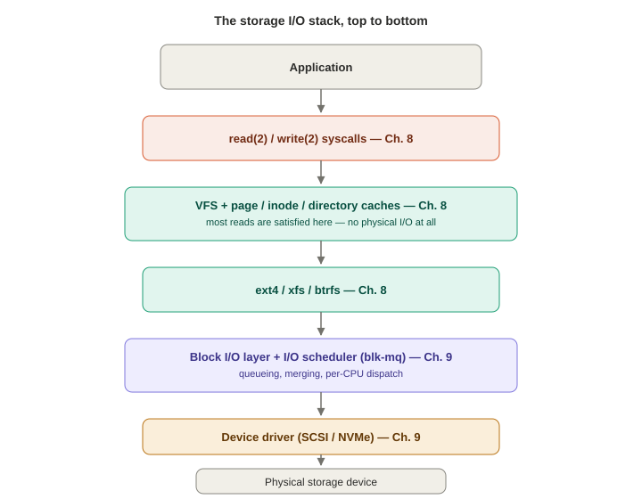
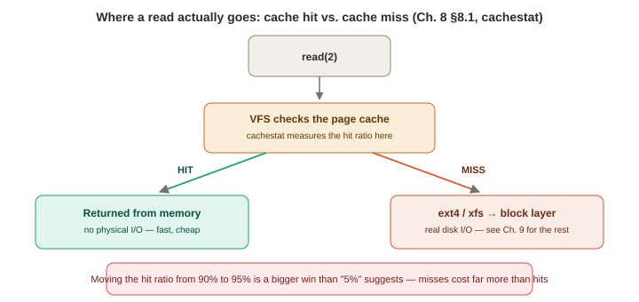

# Chapter 8 — File Systems

*Study notes on Chapter 8 of BPF Performance Tools (Brendan Gregg, 2019). Original notes, not book text — see `00-index.md` for how these notes are written.*

> Same shape as prior chapters. This is the largest tool catalog yet (27 tools) and the chapter's central argument is worth holding onto throughout: **file systems, not disks, are usually the more relevant place to start analysis**, because caching, read-ahead, buffering, and asynchronous I/O all sit between the application and the disk — an application can suffer real latency that never shows up as slow disk I/O at all, and disk I/O can look "slow" while causing the application no pain whatsoever. Chapter 9 covers the disk layer next.

## 8.1 Background



### The I/O stack, and a vocabulary worth being precise about

**Logical I/O** = requests made *to the file system*. **Physical I/O** = requests that actually reach the storage device — many logical reads are satisfied entirely from the file system cache and never become physical I/O at all. (**Raw I/O** — bypassing the file system entirely — is mentioned as a legacy option, rarely used today.) Applications talk to file systems through the **VFS (virtual file system)** — a generic kernel interface (`read`, `write`, `open`, `close`, ...) that every concrete file system (ext4, XFS, btrfs, ...) maps onto its own internal functions. Below the file system sits an optional volume manager, then the block I/O subsystem (queueing, merging — Chapter 9's territory).

**Three caches, worth distinguishing precisely:**
- **Page cache** — virtual memory pages holding file contents and I/O buffers (the old, separate "buffer cache" is now folded into this). This is by far the largest of the three, since it holds both clean cached data *and* "dirty" pages modified but not yet written to disk.
- **Inode cache** — cached VFS inodes (the generic metadata structure every file system maps its own object descriptors onto), since inodes are read constantly for permission checks and other metadata.
- **Directory cache (dcache)** — caches directory-entry-name → inode mappings, accelerating pathname lookups specifically.

**Read-ahead** detects a sequential read pattern and speculatively pre-loads the pages that will likely be requested next — a pure win for sequential workloads, actively wasted (or even counterproductive) work for random-access ones; this is exactly what `readahead(8)` (§8.3.26) is built to measure and tune. **Write-back** is the mechanism behind dirty-page writes: buffers are dirtied in memory and flushed to disk later, by kernel worker threads, specifically so applications aren't forced to block directly on slow disk I/O for every write — `writeback(8)` (§8.3.17) instruments exactly this.

### What BPF adds

BPF fills a real gap here, more so than in the CPU/memory chapters, because traditional file-system-specific tooling is comparatively sparse. Questions BPF can answer: what are file system requests, broken down by type; what are read sizes; how much write I/O is synchronous; is the access pattern random or sequential; which files are accessed, by which process/code path, and how many bytes/IOPS; what file system errors occurred and for whom; is latency coming from disks, code paths, or locks; what's the latency distribution; what are dcache/icache hit ratios; what's the page-cache hit ratio for reads; and how effective is read-ahead.

**Event sources:** uprobes (application/library I/O); syscall tracepoints (system-call-level I/O); file-system-specific tracepoints where they exist (ext4 alone ships **over one hundred** tracepoints) or kprobes where they don't; kprobes for cache hit/miss paths and page-cache write-back/write-through; `writeback` tracepoints; `block` tracepoints/kprobes (physical disk I/O — Chapter 9); kprobes for raw I/O.

**Overhead, precisely calibrated:** logical I/O — especially cache-served reads/writes — can exceed **100,000 events/second**, at which point tracing overhead starts becoming noticeable; VFS tracing specifically also picks up **network I/O** (sockets go through VFS too), adding cost there as well. **Physical disk I/O, by contrast, is typically under 1,000 IOPS on most servers** — cheap enough to trace with negligible overhead (though the book notes storage/database servers can be real exceptions, worth checking with `iostat(1)` first).

### Strategy

1. Identify mounted file systems (`df`, `mount`).
2. Check their **capacity** — file systems nearing 100% full can suffer real performance issues as free-block-finding algorithms degrate (this varies by file system implementation, but is worth a quick glance regardless).
3. **Validate unfamiliar BPF tools against a known workload first** (e.g., a synthetic `fio(1)` run on an idle system) before trusting their output on an unknown production workload — good general validation hygiene, not specific to file systems.
4. Run `opensnoop(8)` to see what's being opened.
5. Run `filelife(8)` to check for short-lived-file issues.
6. Look for unusually slow I/O and its process/file details (`ext4slower`/`xfsslower`/`fileslower`).
7. Examine the latency *distribution* (`ext4dist`/`xfsdist`) — bi-modal distributions or outliers are the interesting finding, not the average.
8. Examine the page-cache hit ratio over time (`cachestat`) — does anything perturb it, and does tuning improve it?
9. Compare logical I/O rates (`vfsstat`) against physical I/O rates (`iostat`) — ideally logical vastly exceeds physical, meaning caching is doing real work.
10. Browse the rest of this chapter's tools for anything not yet covered.

## 8.2 Traditional Tools

`df -h` shows capacity by mount — worth a routine glance since file systems above roughly 90% full can start turning sequential write workloads into effectively random ones as free space fragments (implementation-dependent). `mount` lists file system types and mount **options** — the book's own example is `noatime`, a common performance tuning that skips recording access timestamps on every read (this is a direct, concrete instance of the exact "disable atime updates" fix that Chapter 3's drill-down-analysis example built its whole lesson around).

**`strace -tttT`** gives human-readable syscall arguments and per-call timing — genuinely valuable data, but with the same **100x-slowdown risk** flagged already in Chapter 6, because of its breakpoint-based `ptrace(2)` implementation; a troubleshooting tool, not a production one. **`perf trace`** is a more efficient, BPF/tracepoint-aware `strace` alternative built into `perf(1)`.

**`perf stat -e 'ext4:*' -a`** counts every one of ext4's roughly one hundred tracepoints system-wide — XFS ships around **500**. **A genuinely important cautionary tale worth remembering as a standing rule, not just a one-off anecdote:** the book's own author demonstrates `perf record -e ext4:ext4_da_write_begin -a` accidentally creating a **feedback loop** — because `perf record` itself writes its captured event data *to the file system*, tracing file system writes captures the recording process's own writes, which get traced too, spiraling into **14 million samples and a 1.3 GB `perf.data` file** from one Ctrl-C-interrupted run. The moral, stated plainly: **be deliberate about what you trace relative to what your tracing tool itself does** — and this is precisely the kind of risk BPF's in-kernel summarization avoids, since a `bpftrace` one-liner computing the exact same `ext4_da_write_begin` length histogram never has to write a raw event log to disk at all.

**`fatrace(1)`** (via the `fanotify` API) traces opens/reads/writes/closes system-wide with a compact per-line format — useful for workload characterization, but the book includes a **direct, measured overhead comparison worth remembering as the single best illustration of "why BPF" in this whole chapter**: running `fatrace -f O` and BCC's `opensnoop(8)` against the *same* heavy file-system workload, `pidstat` showed `fatrace` consuming **67% CPU** versus `opensnoop`'s **1.1%** — a roughly 60x efficiency difference for functionally overlapping output, purely from BPF's in-kernel filtering/summarization versus `fatrace`'s per-event notification-and-format overhead.

## 8.3 BPF Tools

### Open and stat/sync tracing: `opensnoop`, `statsnoop`, `syncsnoop`

**`opensnoop(8)`** (from Chapters 1 and 4) traces `open(2)`/`openat(2)`. **A genuinely great real investigative story, worth remembering as a model of "one tool leads to the next":** running it on a random production server, the book's author immediately (on the *first* server tried) noticed a Java process opening the same four `/proc`/`/sys/fs/cgroup` metric files **one hundred times a second** — clearly excessive for data that changes rarely if ever. The follow-up step: `stackcount -p <pid> 't:syscalls:sys_enter_openat'` to get the calling stack trace directly, which identified the culprit as newly-deployed load-balancing software. This exact two-tool sequence (`opensnoop` to spot *that* something's excessive, `stackcount` to find *why*) is a template worth reusing generally.

**`statsnoop(8)`** does the same for the `stat(2)` family. **A second real production story, this one with actual measured impact**: a Netflix microservice hit **100% disk utilization**, traced back to a disk-usage monitoring agent calling `stat(2)` continually against a large file system whose metadata didn't fully fit in cache — meaning each `stat()` call became genuine disk I/O. Ordinarily `stat(2)` is fast enough that even very high call rates (tens of thousands/second, which the book notes it has personally observed without incident elsewhere) don't matter; this was the specific exception where cache-miss `stat()` calls became a real, quantified problem.

**`syncsnoop(8)`** traces the `sync(2)` family (`sync`, `syncfs`, `fsync`, `fdatasync`, `sync_file_range`, `msync`) with timestamps — useful specifically for **correlating sync-triggered I/O bursts with application latency spikes** seen in separate monitoring dashboards, since sync calls can force a burst of writes that perturbs other, unrelated I/O queued behind them.

### Mapping and low-level file-identity tools: `mmapfiles`, `scread`, `fmapfault`

**`mmapfiles(8)`** frequency-counts which files get `mmap()`'d, resolved via the mapped file's `struct dentry` (walking up two parent directories for readable context). **`scread(8)`** resolves `read(2)`'s target filename from the **file descriptor table** directly — the book uses this specifically as a teaching example for the two available techniques for turning an FD into a filename: (1) walk `task->files->fdt->fd[N]` directly to the `struct file` (what `scread` does — fast, but explicitly called out as an **unstable** technique, since that exact struct path is kernel-version-dependent and was already known to be under active kernel-side rework at the time of writing), versus (2) trace `open(2)` separately and build your own `(PID, FD) → filename` lookup table to query later (adds probes/overhead, but stable). **`fmapfault(8)`** counts page faults for **memory-mapped** files specifically — a different I/O path than `read()`/`write()` entirely (no syscall involved at all), which the book flags as an easy blind spot: tools that only watch `read()`/`write()` syscalls (`filetop`, `fileslower`, `xfsslower`, `ext4dist`) can systematically miss I/O that happens purely through mapped-memory access.

### `filelife` — short-lived file lifespans

Traces file creation (`vfs_create()`, falling back to the LSM hook `security_inode_create()` on newer kernels where `vfs_create()` may not fire) paired with deletion (`vfs_unlink()`), reporting each file's total lifetime. Genuinely useful for finding **eliminable temporary-file usage** — the book notes this has found real, if modest, performance wins in practice by identifying applications creating-then-immediately-deleting files that could avoid the round-trip entirely.

### `vfsstat` and `vfscount` — the highest-level workload characterization

**`vfsstat(8)`** is the file-system equivalent of `vmstat(1)`: per-second reads/writes/creates/opens/fsyncs, using kprobes on five specific VFS functions. A real production example (a 36-CPU Hadoop server) shows **over a million reads/second** — and a genuinely surprising secondary finding worth remembering as a lesson in reading summary tools closely: **over 5,000 opens/second**, which the book flags as worth investigating further with `opensnoop`, since opens are comparatively expensive (path lookups, FD/metadata struct creation) and that rate is unusually high. **Overhead is explicitly quantified rather than just gestured at**: at million-events-per-second rates, expect **1–3%** overhead — fine for ad hoc investigation, too much for the book's own stated 24×7-monitoring bar of "well under 0.1%." **`vfscount(8)`** generalizes this to **all 50+** VFS functions rather than just the five `vfsstat` picks — useful as a first, broad pass, equivalent to `funccount 'vfs_*'`, but the book stresses this only gives a high-level view: VFS covers *any* subsystem routed through it, including sockets and `/proc`/`/dev`, so distinguishing real file system I/O from everything else VFS also carries requires the next tool.

### `vfssize` and `fsrwstat` — separating file, socket, and pipe I/O within VFS

**`vfssize(8)`** histograms read/write sizes by process name **and** VFS target — and because VFS is genuinely shared infrastructure, its real output mixes actual files, `TCP` (network reads pulled directly through VFS's socket path), and `FIFO` (pipes) all in one report. A real example surfaces a process doing **266,897 one-byte reads or writes** — flagged directly as "an opportunity for a performance optimization, by increasing the I/O size," a concrete, actionable finding that a size-blind counter like `vfsstat` could never have revealed. **`fsrwstat(8)`** takes the complementary approach — grouping by **file system type** (`ext4`, `sockfs`, `pipefs`, `devpts`, `anon_inodefs`, ...) — letting you separate, say, real `ext4` I/O from the socket and pipe traffic that also flows through the same VFS functions.

### `fileslower`/`xfsslower` and `filetop` — the chapter's central "application pain" argument, made concrete

**`fileslower(8)`** prints individual **synchronous** file reads/writes exceeding a threshold (default 10 ms). **This tool is where the chapter's opening thesis becomes concrete and falsifiable, worth internalizing as the key methodological point of the whole chapter**: because it specifically targets *synchronous* I/O — I/O the calling process actually blocks on — the book states plainly that if `fileslower(8)` shows a latency problem, **it's probably a real problem**, in a way that disk-level latency numbers alone can't guarantee (an application might not even be waiting on a given disk operation — it could be background I/O from an unrelated thread). The book notes this tool has been used both to **prove** file-system-caused production latency and to **exonerate** the file system entirely by showing no synchronous I/O was actually slow, contrary to assumption. The important caveat: synchronous I/O *likely*, but not *certainly*, causes application-level pain — a background I/O thread could itself be doing synchronous I/O without any user request blocking on it directly.

**`xfsslower(8)`** is the XFS-specific equivalent, instrumenting XFS's own `file_operations` struct functions (`xfs_file_read_iter()`, etc.) rather than a generic VFS entry point — meaning, unlike `fileslower`, it's inherently scoped to just that one file system type, at the cost of needing separate implementations per file system (`ext4slower`, `btrfsslower`, `zfsslower`, `nfsslower` all exist as siblings, §8.3.27).

**`filetop(8)`** is `top(1)` for files — the highest-read/write-byte files, refreshed per second, sorted by read bytes by default. A production example finds a single Spark shuffle file at **~60 MB read in one second** from ~15,000 reads (implying a ~4 KB average read size) — exactly the kind of "which specific file is unexpectedly hot" answer a workload-characterization pass is looking for. `-a` reveals TCP sockets too, since it's built on the same shared `vfs_read()`/`vfs_write()` kprobes as everything else in this section.

### `writesync` and `filetype` — cheap classification tools worth having on hand

**`writesync(8)`** flags VFS writes to **regular files** carrying the `O_SYNC`/`O_DSYNC` flag — synchronous writes must wait for the actual storage write to complete (rather than returning once buffered in the page cache for later write-back), making them inherently slower; if a synchronous flag turns out to be unnecessary for a given workload, removing it can be a substantial, low-risk performance win. **`filetype(8)`** classifies VFS reads/writes by the underlying inode type (`regular`, `socket`, `fifo`, `character`, ...) plus process name — the book's own small worked demo (`tar cf - dir1 | gzip > dir1.tar.gz`, watched live) makes the FIFO/pipe mechanics visible directly in the tool's output: `tar` reading regular files and writing to a FIFO, `gzip` reading that same FIFO and writing a regular file — the shell pipeline's data flow, observed rather than assumed. **A genuinely charming, honest aside from the book worth remembering as a lesson in its own right**: the author discovered, two months after writing `filetype(8)`, that he'd accidentally written **a second, independent version** of essentially the same tool using a *different* kernel header's type-constant definitions (`uapi/linux/stat.h` vs. `include/linux/fs.h`) — kept in the book explicitly as "a lesson that sometimes there is more than one way to write these tools," and a nice reminder that even experienced tool authors duplicate their own work sometimes.

### `cachestat` — page cache hit ratio, and why a "small" percentage gap matters enormously


> **How to read this:** `cachestat(8)` measures the branch point itself; everything down the "miss" path is Chapter 9's territory.

**`cachestat(8)`** reports page-cache hits/misses/dirties/hit-ratio (plus buffer and cache sizes) every interval. **The single number worth internalizing from this whole section**: the book states that pushing a 90% hit ratio toward 100% "can result in very large performance wins (much larger than the 10% difference in hit ratio)" — because the *cost* of a miss (a real disk I/O) is so much larger than the cost of a hit (a memory access) that the gap between 90% and 100% represents a disproportionate share of total *time*, not just of *event count*. **Real-world relevance flagged directly**: Netflix teams running stateful services (Cassandra, Elasticsearch, PostgreSQL) use exactly this tool to help decide whether a dataset's working set actually fits in provisioned memory, and whether adding memory to a cluster would meaningfully help. The book walks a clean before/after demo: creating a 1 GB file shows up as pure `DIRTIES` activity (0% hit ratio, since nothing's been *read* yet) and a matching `CACHED_MB` jump; dropping caches (`echo 3 > /proc/sys/vm/drop_caches`) and reading the file twice shows the **first** read as a wall of `MISSES` (cache empty) and the **second** read landing at a clean 100% hit ratio. **Overhead and a maintainability caveat are both stated frankly**: the underlying kprobed functions can fire millions of times a second, and overhead can exceed **30%** on extreme workloads; the tool is explicitly described as "tied to kernel implementation details" and likely to need ongoing maintenance as internals shift — a rare moment where the book frames a tool's main value as "proof this kind of measurement is even possible," rather than as a finished, maintenance-free artifact.

### `writeback` — timing dirty-page flushes, and why the *reason* matters

Instruments the `writeback` tracepoint pair to report, per flush event: device, page count, **reason**, and duration. The `reason` field is genuinely the interesting part — `periodic` (routine, low-volume, e.g. every 5 seconds), `background` (async flushing triggered by low free memory — the book's own example shows bursts writing tens of thousands of pages taking 6–22 ms each), and `sync` (an explicit, larger, slower flush — one example writes 38,836 pages in 64 ms). Correlating these timestamps against separately-observed application latency spikes is exactly the intended use — and the flush *policy* itself is directly tunable (`vm.dirty_writeback_centisecs` and related `sysctl` knobs).

### `dcstat`/`dcsnoop` and `icstat` — cache hit ratios one layer below VFS

**`dcstat(8)`** reports dcache references/slow-path-lookups/misses/hit% per second — production numbers in the high-90s% are typical, with the `SLOW/s` column specifically flagging cases where a cacheline-bouncing-avoidance fast path (for common entries like `/`) *wasn't* usable, falling back to a slower lookup. **`dcsnoop(8)`** is the verbose, per-lookup companion — the book's own example shows a single `/proc/sys/net/ipv6/conf/eth0/forwarding` access decomposing into **seven separate sequential path-component lookups**, a vivid illustration of just how much lookup work one "simple" file access can actually involve; explicitly meant for short, targeted use once `dcstat` has flagged elevated misses, not continuous monitoring. **`icstat(8)`** does the same job one layer over, for the **inode** cache — a `find /var -ls` example shows a clean 100% hit rate in the first second (already-cached inodes) collapsing to single-digit-percent hit rates as the walk reaches inodes never before touched.

### `mountsnoop` — mount/unmount activity

Traces `mount(2)`/`umount(2)` system-wide — useful for troubleshooting container startup specifically, where mounting file systems is a routine, frequent part of container lifecycle. Expected to be negligible overhead, since mounts should be rare events on any system.

### `xfsdist`/`ext4dist` — latency distributions, and a real lesson in kprobe fragility

**`xfsdist(8)`** histograms per-operation (read/write/open/fsync) latency by instrumenting XFS's own `file_operations` functions directly — a real production example shows a **bimodal** read distribution (a fast mode under 7 μs, a second mode at 16–31 μs, both consistent with page-cache hits but reached via different code paths or read sizes) plus a small population of genuinely slow (65–131 ms) reads consistent with real storage I/O and queueing.

**`ext4dist(8)`'s section is worth reading as a case study in exactly the kind of kprobe fragility Chapter 2 warned about in the abstract, now shown concretely across two real kernel versions.** In kernels before **4.10**, `ext4`'s own `file_operations` struct pointed its **read** path at a *generic*, shared kernel function (`generic_file_read_iter()`) rather than an ext4-specific one — meaning a naive kprobe on that function would also catch reads from *every other file system* using the same generic path, polluting the results. The actual workaround used: kprobe the generic function anyway, then manually check inside the BPF program whether the call's `struct file`'s `f_op` pointer matched the *known address* of `ext4_file_operations` (read from `/proc/kallsyms` at tool startup) — filtering by struct identity rather than by function identity, a real, slightly hacky pattern worth remembering as an available technique when the function you actually want to instrument doesn't exist as a distinct symbol. **Then Linux 4.10 shipped a genuinely dedicated `ext4_file_read_iter()` function**, making the whole workaround unnecessary — and the book's `ext4dist.bt` is written specifically to target 4.10+ only, directly tracing the now-real, ext4-specific function. The book's own framing is worth keeping as a general expectation-setter: this is exactly the kind of "kprobe target changed between kernel versions, the tool needs updating" maintenance burden Chapter 2 described abstractly, observed here as something that actually happened, with a real before/after fix.

### `bufgrow` and `readahead`

**`bufgrow(8)`** tracks **buffer cache** growth specifically (the block-I/O-buffer subset of the page cache, filtered by inode mode) by process — a synthetic `dd` test shows a process growing the buffer cache by ~100 MB, independently cross-checked against `free -wm`'s own `buffers` column. **`readahead(8)`** measures read-ahead effectiveness directly: how many read-ahead pages were **never used** at all (pure waste) during the trace, and — for the ones that *were* used — a histogram of the time between the page being read ahead and actually being accessed. **A real, named production motivation is given**: this tool was built specifically to analyze Netflix production instances running on **SSDs**, where read-ahead's whole premise (cheaply prefetching sequentially-adjacent data before a slow, seek-bound rotational disk would need it) is much less valuable — and can actively hurt performance by wasting I/O bandwidth and cache space on data that a fast SSD didn't need pre-warmed in the first place. (The same underlying production issue is referenced again in Chapter 9's `biosnoop(8)` section, since that was the tool originally used to first notice the problem before `readahead(8)` existed to measure it directly.)

### Other tools worth knowing exist

`ext4slower`/`ext4dist`, `btrfsslower`/`btrfsdist`, `zfsslower`/`zfsdist`, `nfsslower`/`nfsdist` — file-system-specific siblings of `xfsslower`/`xfsdist`, all in BCC, following the identical latency-histogram-per-operation pattern established above.

## 8.4 BPF One-Liners

```
# BCC: trace creat(2) calls with the target filename
trace 't:syscalls:sys_enter_creat "%s", args->pathname'

# BCC: count VFS calls by function (equivalent to vfscount)
funccount 'vfs_*'

# bpftrace: histogram ext4 write-begin request sizes (from §8.2's perf comparison)
bpftrace -e 'tracepoint:ext4:ext4_da_write_begin { @ = hist(args->len); }'

# bpftrace: count VFS calls by function
bpftrace -e 'kprobe:vfs_* { @[func] = count(); }'
```

## 8.5 Optional exercises worth trying

Rewrite `filelife(8)` to use the `creat(2)`/`unlink(2)` **syscall tracepoints** instead of VFS kprobes, and weigh the pros/cons of that swap (stability vs. what you can see); build a `vfsstatx` that separately breaks out your local file system and TCP, using `vfssize(8)`/`fsrwstat(8)` as models; build a tool comparing **logical** (VFS/file-system) I/O against **physical** (block-layer) I/O ratios directly; build a file-descriptor-leak detector tracing `__alloc_fd()`/`__close_fd()` for allocations never freed during a trace; and — flagged explicitly as advanced and **unsolved** even by the book's own author — build a tool measuring the **time between accesses** to the same page-cache page as a distribution, and think through what makes that specific measurement genuinely hard.

## 8.6 Summary

File systems sit between applications and disks, mediated by VFS and three separate caches (page, inode, directory) plus read-ahead and write-back — and because traditional file-system-specific tooling is comparatively sparse, this is an area where BPF adds outsized value. This chapter's tools span syscall-level tracing (`opensnoop`, `statsnoop`, `syncsnoop`), VFS-level workload characterization and latency (`vfsstat`, `fileslower`, `filetop`), file-system-specific latency histograms (`xfsdist`/`ext4dist`, with a real kprobe-fragility lesson attached), and each of the three caches' hit ratios (`cachestat`, `dcstat`, `icstat`) plus write-back and read-ahead behavior — together answering the chapter's opening claim in concrete, measured terms: file system analysis is often more directly relevant to application performance than disk-level analysis alone.

---

## Quick-reference glossary (this chapter's terms)

- **Logical vs. physical I/O** — requests to the file system vs. requests that actually reach the storage device; the gap between them is exactly what caching buys you.
- **Synchronous I/O** — a read/write the calling process actually blocks on; the specific thing `fileslower(8)`/`xfsslower(8)` target, since it's the I/O most likely to cause real, provable application-level pain.
- **Write-back** — deferred, asynchronous flushing of dirty pages to disk by kernel worker threads.
- **Read-ahead** — speculative prefetching of pages for a detected sequential access pattern; a net loss for random-access workloads and, per this chapter's real example, sometimes for SSD-backed workloads generally.
- **Page/inode/directory (dcache) caches** — the three distinct file-system-related caches this chapter separately instruments and measures hit ratios for.

## Check your understanding

1. The chapter opens by arguing file systems are often a more relevant analysis target than disks. What specific property of file systems (caching, read-ahead, buffering, async I/O) makes this true, and which tool in this chapter most directly proves or disproves it for a given application?
2. Explain the feedback loop the book's author accidentally triggered with `perf record -e ext4:ext4_da_write_begin -a`, and why an equivalent BPF-based one-liner doesn't have the same risk.
3. `cachestat(8)` shows a hit ratio improving from 90% to 95%. Why does the book suggest this is likely a much bigger performance win than "5%" would suggest at first glance?
4. In the `ext4dist(8)` story, what specific kernel change (and which Linux version) let the tool drop its `f_op` pointer-comparison workaround?
5. A colleague sees `vfsstat(8)` reporting over a million reads/second and concludes the disks must be extremely busy. What does this chapter suggest checking next before accepting that conclusion, and why?

<details>
<summary>Answers</summary>

1. File systems interpose caching, read-ahead, buffering, and asynchronous I/O between the application and the disk, meaning an application's actual experienced latency can differ substantially from disk-level latency in either direction — cached logical I/O can be fast even when the disk is struggling elsewhere, and background/asynchronous I/O can make a disk look busy without the application waiting on it at all. `fileslower(8)`/`xfsslower(8)` most directly prove or disprove real application impact, because they specifically isolate *synchronous* I/O — the I/O the application actually blocks on — rather than all I/O indiscriminately.
2. `perf record` writes its captured event data to the file system as it runs; tracing ext4 write-begin events therefore also captures `perf record`'s own writes of its output file, which are themselves further write-begin events, compounding into an enormous, unintended capture (14 million samples, 1.3 GB) from a single run. A BPF-based one-liner instead summarizes results (e.g., into a histogram) directly inside a kernel map and never has to write a raw per-event log to the file system in the first place, so there's no file-system-write output for the trace itself to recursively capture.
3. Because the *cost* of a cache miss (a real, comparatively slow disk I/O) is disproportionately larger than the cost of a cache hit (a fast memory access) — so even though the hit ratio only moved 5 percentage points, that 5% represents a disproportionately large share of total actual *time* spent, since each of those newly-converted misses-to-hits was previously among the most expensive operations happening on the system.
4. Linux 4.10 changed ext4's `file_operations` struct to point its read path at a genuinely ext4-specific function, `ext4_file_read_iter()`, instead of the generic, shared `generic_file_read_iter()` that earlier kernels used — once that dedicated function existed, the tool could kprobe it directly and no longer needed the earlier workaround of kprobing the generic function and manually filtering by comparing the calling file's `f_op` pointer against ext4's known struct address.
5. The chapter's strategy explicitly recommends comparing the **logical** I/O rate (`vfsstat`) against the **physical** I/O rate (`iostat`) next — a very high `vfsstat` read rate combined with a much lower physical disk IOPS rate would actually indicate the *opposite* conclusion: that the page cache is absorbing the vast majority of those reads, and the disks are comparatively idle. Only a genuinely elevated physical I/O rate (from `iostat`, covered fully in Chapter 9) would actually support the "disks are busy" conclusion.

</details>
