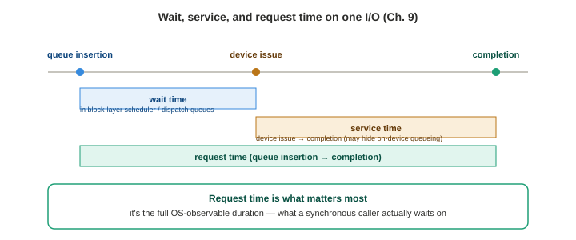

# Chapter 9 — Disk I/O

*Study notes on Chapter 9 of BPF Performance Tools (Brendan Gregg, 2019). Original notes, not book text — see `00-index.md` for how these notes are written.*

> Same shape as prior chapters. This chapter finally goes *below* the file system to the block layer — and its own strategy section opens by pointing you back to Chapter 8 first, reinforcing the book's running theme: start at the file system, and only come down here once you know the I/O actually matters to the application.

## 9.1 Background

### The block I/O stack, and the vocabulary that shows up in every tool's source

**"Disk I/O" is used broadly here** — rotational magnetic media, flash, and even network storage are all exposed to Linux as the same abstraction (storage devices) and analyzed with the same tools. Between an application and the device usually sits a file system (Chapter 8); below the file system sits the **block I/O stack**: optional volume managers, a device mapper (for virtual devices), and I/O schedulers. I/O is represented internally as `struct request` (upper layers) and `struct bio` (lower layers) — worth knowing these two type names, since they show up constantly as the argument types this chapter's tools cast kprobe arguments to.

**`rwbs`** is a compact string encoding used throughout block-layer tracing to describe an I/O's type — worth having as a lookup table since you'll decode it by eye constantly:

| Char | Meaning |
|---|---|
| R | Read |
| W | Write |
| M | Metadata |
| S | Synchronous |
| A | Read-ahead |
| F | Flush / force unit access |
| D | Discard |
| E | Erase |
| N | None |

Characters combine — `"WM"` means a metadata write.

**I/O schedulers**, and a real architectural transition worth understanding precisely, since it affects which kprobes several of this chapter's tools can actually attach to on a given kernel: **classic schedulers** (Noop, Deadline, CFQ) used a **single request queue protected by a single lock** — a genuine bottleneck at high I/O rates. **Multi-queue (`blk-mq`, added Linux 3.13)** fixed this with **separate submission queues per CPU** and multiple device dispatch queues, enabling real parallelism and — critically — processing on the *same* CPU the I/O was issued from. This was specifically necessary to support flash devices capable of millions of IOPS, which the old single-lock design simply couldn't keep up with. Multi-queue schedulers include None, BFQ, mq-deadline, and Kyber (which dynamically adjusts read/write dispatch queue lengths to hit target latencies). **Linux 5.0 removed the classic schedulers and legacy stack entirely — every scheduler is multi-queue now.** This transition is directly why several tools in this chapter (`biostacks`, `iosched`, `scsilatency`) include an explicit note that one of their kprobe targets (`blk_start_request()`, `scsi_done()`) was **removed in Linux 5.0** and will print a harmless "could not attach" warning on newer kernels — a real, dated, concrete instance of exactly the kprobe-fragility problem Chapter 2 warned about, this time affecting several tools in the same chapter simultaneously because they all depended on the same now-removed function.

**Three timing concepts, worth being precise about since different tools/columns measure different ones:** **wait time** (time in block-layer scheduler/dispatch queues), **service time** (device issue to completion, which may itself include on-device queueing you can't see from the OS), and **request time** (the full OS-observable duration, queue insertion to completion) — **request time is what matters most**, since that's what a synchronous caller actually waits on.


> **How to read this:** wait and service time are adjacent, non-overlapping segments; request time is the outer bracket spanning both. A tool reporting only service time can look deceptively fast while queueing (the wait-time segment) is where all the real damage is happening.

**A genuinely important, repeated caution about disk utilization (`%util`)**: it measures the *time the device was doing something*, not true capacity headroom — it doesn't account for virtual/multi-backed devices, or for on-device queueing that lets a device accept more concurrent work even while "100% busy." The book's blunt framing: **a disk at 90% utilization may be able to accept much more than an extra 10% of workload.** Utilization is still a useful, readily-available *clue* — but **saturation metrics (time spent waiting) are the better measure of an actual problem**, echoing the exact same warning `iostat`'s `%util` column got in Chapter 3's 60-second checklist.

### What BPF adds

Traditional tools give IOPS, average latency, queue length, and per-process I/O. BPF adds: full type/size breakdowns of requests; separate queued vs. device time; latency **outliers**; whether the latency **distribution** is multi-modal; disk **errors**; the actual **SCSI commands** sent; and **timeouts**. Event sources: `block` tracepoints/kprobes (block interface/layer), kprobes (I/O scheduler internals), `scsi` tracepoints/kprobes, and kprobes for device-driver-specific I/O (this chapter's `nvmelatency` example). A representative tracepoint worth knowing directly: `block:block_rq_issue` exposes `dev`, `sector`, `nr_sector`, `bytes`, `rwbs`, `comm`, and `cmd` — enough on its own for a genuinely useful one-liner: `bpftrace -e 'tracepoint:block:block_rq_issue { @bytes = hist(args->bytes); }'`.

### Strategy

1. **For application performance issues, start at the file system (Chapter 8), not here.** The book is explicit about *why*: I/O may be entirely asynchronous to the application, in which case high disk latency is real and worth understanding, but for *different* reasons than application impact — contention with other synchronous I/O, and capacity planning — not "the app is waiting on this."
2. Check basic disk metrics — request times, IOPS, utilization (`iostat`) — looking for high utilization *and* unusually high request times/IOPS together. If unsure what's "normal," benchmark a known workload (`fio`) on an idle system first.
3. Trace block I/O latency **distributions** and check for multi-modal shapes or outliers (`biolatency`).
4. Trace individual I/O and look for patterns like reads queueing behind writes (`biosnoop`).
5. Use the rest of this chapter's tools and one-liners as needed.

## 9.2 Traditional Tools

**`iostat -dxz 1`** is the standard first stop — `rrqm/s`/`wrqm/s` (merged read/write requests — I/O to adjacent disk locations combined for efficiency), `r/s`/`w/s`/`rkB/s`/`wkB/s` for workload characterization, and on the right side, `avgqu-sz` (queue depth), `await`/`r_await`/`w_await` (the request-time metric that matters most for delivered performance — the book notes that if writes are effectively hidden from the application via write-back, `r_await` alone may be the more relevant number to watch), `svctm` (inferred device service time), and `%util`. A real worked production example: a device's normal baseline read throughput (from the "since boot" summary line) was ~5,500 KB/s, while live one-second samples showed over 90,000 KB/s — immediately flagging a much heavier-than-usual read workload, which turned out to trace back to files that had grown too large to stay cached in the page cache, now being read from disk instead (a nice callback to Chapter 8's caching material — the "problem" here wasn't really a disk problem at all, it was a cache-sizing problem manifesting as disk load).

**`perf record` on the block tracepoints** (`block_rq_insert`/`block_rq_issue`/`block_rq_complete`) gives the same raw event stream `blktrace` does, but the book notes plainly that post-processing these dumped events for latency histograms means paying the cost of writing *every* event to user space first — exactly the inefficiency BPF's in-kernel summarization (the later `biosnoop(8)`) avoids.

**`blktrace`/`btrace`** is a dedicated, specialized block-I/O tracer, with its own compact per-line action codes (`Q`=queued, `G`=get request, `P`=plug, `M`=merge, `D`=issued, `C`=completed) — output can be visualized with the companion `seekwatcher` tool. Same overhead caveat as `perf`'s per-event dumping: real cost for busy I/O workloads, which in-kernel BPF summarization sidesteps.

**SCSI logging** (`sysctl dev.scsi.logging_level`, or the `sg3-utils` package's `scsi_logging_level(8)`) writes raw SCSI-level events to the kernel log — useful for debugging errors/timeouts, but the book flags a real practical limitation: **calculating I/O latency from these log lines is difficult without a unique identifier** to match a command's start to its completion — precisely the problem BPF-based SCSI tools (`scsilatency`, `scsiresult`, §9.3.11–12) solve directly by computing latency in-kernel instead.

## 9.3 BPF Tools

### 9.3.1 `biolatency` — device latency as a histogram, and a real Netflix production story

The disk equivalent of Chapter 6's `runqlat` — device latency (issue-to-completion, including OS queue time if in scope) as a histogram, immediately revealing shape that an average alone hides. A real production example shows a clearly **bi-modal** distribution (one mode at 128–2047 μs, a second at ~4–32 ms) plus outliers reaching 262–524 ms — described as "sounds like deep queueing on the device." **A genuinely significant real production story worth remembering in full**: Netflix's Cloud Database team used `biolatency`/`biosnoop` to identify individual small cloud instances with unacceptably bi-modal or latent drives (a classic **noisy-neighbor** symptom on shared/multi-tenant storage) and **evicted those specific machines** from both their distributed caching and database tiers. The finding went further than a one-off fix: the team changed their whole **deployment strategy**, moving toward fewer, larger nodes chosen specifically to have **dedicated drives** — eliminating the latency-outlier problem at the architecture level, at no extra infrastructure cost, directly because BPF tracing had made the underlying pattern (not just an average, but its *bimodality*) visible in the first place.

**Options worth knowing:** `-Q` includes OS-queued time in the histogram (not just device time); `-D` splits output per-disk (the book's own example shows two wildly different devices side by side — an NVMe drive clustering at 32–127 μs vs. a USB device with its own bimodal millisecond-scale distribution — a vivid, concrete illustration of why mixed storage types need to be examined separately, not blended into one histogram); `-F` splits by I/O flag type (Read, Sync-Write, Flush, Metadata-Read, ...), revealing that different I/O *classes* can have very different latency behavior even on the same device.

**A genuinely important, generalizable technical subtlety in the source, worth understanding on its own merits**: most of this book's latency tools key their start-timestamp map by **thread ID**, since the same thread that starts an operation also finishes it. **Disk I/O breaks that assumption** — an I/O can be *initiated* on one thread and *completed* on a different one entirely (interrupt context, a different worker thread, etc.), so keying by `tid` would silently mismatch or lose entries. The fix used here: key the timestamp map by **the memory address of the `struct request` itself** (`arg0` of the relevant kprobes) — as long as the kernel doesn't relocate that struct between issue and completion, its address is a valid, unique-enough identifier. Where the tracepoint-based version is used instead (the `struct request` pointer isn't exposed in tracepoint arguments), the key becomes **(device, sector)** instead — with the caveat that this assumes no two concurrent in-flight I/Os to the exact same device-and-sector pair. **This is worth remembering as a general pattern**: when thread ID doesn't reliably pair an event's start and end, look for some other value that's stable and unique across the operation's lifetime instead — an address, a request ID, or a composite key.

### 9.3.2 `biosnoop` — per-event I/O with PID and latency, and another real Netflix use case

Per-I/O output: completion time, process (if it could be resolved — more on this below), disk, direction, sector, size, and latency. A real example shows a sequence of reads to the same disk with latency **climbing steadily from 14.00 to 15.15 ms** across contiguous sector offsets within the same fraction of a millisecond — the book reads this directly as evidence of **queued I/O completing in turn**, each one waiting slightly longer than the last purely from queue position. **`-Q` adds OS queued time as a separate column from device latency** — a real example shows queue time for writes exceeding **two seconds**, dramatically larger than the device latency itself, making unmistakably clear that the OS queue, not the device, was the actual bottleneck in that case.

**A second real, named production use case, tying directly back to Chapter 8's `readahead(8)` motivation**: Netflix teams running stateful services routinely use `biosnoop` to catch **read-ahead degrading performance** on fast SSD-backed data stores — the same underlying issue that later motivated building `readahead(8)` as a purpose-built tool. The investigative workflow described: use `biosnoop` (and `bitesize`/`vfssize` for size histograms) to spot aggressive read-ahead, then fix it via an appropriate `madvise()` hint, switching to direct I/O, or simply lowering the read-ahead window (the book suggests values like 16 KB as a starting point for SSD-backed stores).

**The same "thread ID doesn't work" problem from `biolatency` reappears here, worth reinforcing as a template rather than a one-off**: `pid`/`comm` are captured and stashed in a map **at I/O start** (`blk_account_io_start()`, which reliably runs in the initiating process's context) specifically *because* later stages (device issue, completion — often interrupt or kworker context) can no longer trust the `pid`/`comm` builtins to reflect the original requester. I/O that was already queued **before tracing began** shows up with missing PID/COMM/DISK fields, since `biosnoop` never got the chance to cache those details at the (already-past) start event — a clean, concrete illustration of a general limitation of this entire timestamp-pair-in-a-map technique: it can only describe events whose *start* your tracer was actually running to observe.

### 9.3.3 `biotop` — `top(1)` for disks

Per-process (or per-kworker-thread) I/O summary, refreshed per second — a real example shows **kworker threads doing background write flushing** dominating the top of the list, with the book noting directly that the *real* process responsible for dirtying those pages isn't visible from this tool alone — you'd need Chapter 8's file-system tools to trace that back further. A clean illustration that "who's issuing this I/O right now" and "who's actually responsible for this I/O existing" can be two different questions requiring two different layers of tooling.

### 9.3.4 `bitesize` — I/O size distributions, and concrete sizing guidance

Histograms I/O size by process name, via `block:block_rq_issue`. The book pairs this with genuinely actionable, general tuning guidance worth remembering on its own: **sequential workloads should push toward the largest I/O size that still performs well** (noting there's often a practical "sweet spot," e.g. around 128 KB, past which returns diminish or even reverse due to allocator/device behavior); **random workloads should match I/O size to the application's actual record size** — oversized I/O wastes page-cache space on data that won't be reused, undersized I/O pays unnecessary per-operation overhead. A real technical note worth keeping in mind when extending this tool: `args->comm` and the `comm` builtin are only reliable at the **insert** tracepoint (still in the originating process's context) — later tracepoints (like completion) fire asynchronously (e.g., on a device interrupt) and can't be trusted to reflect the original requester, the same underlying constraint `biosnoop` works around.

### 9.3.5–9.3.6 `seeksize` and `biopattern` — random vs. sequential, measured two different ways

**`seeksize(8)`** measures how far each new I/O request's sector offset is from the *previous* request's (`block_rq_issue` — i.e., the pattern as **requested** by the application/file system, before the I/O scheduler or on-device logic get a chance to reorder anything). Genuinely only a real cost for **rotational media** specifically (the book notes flash devices show at most a tiny, sub-1% slowdown across large seek distances — likely a flash-translation-layer/TLB-like effect, not true mechanical seek cost). A real example contrasts a `dd` sequential-read workload (offset-0 "seeks" nearly every time — i.e., no seeking) against a `tar` backup workload showing a genuinely mixed distribution. **`biopattern(8)`** answers a related but distinct question — the *actual completed* I/O pattern (via `block_rq_complete`), reported as a live %random/%sequential/count/throughput summary rather than a seek-distance histogram. The book explicitly separates these as two different, complementary questions: **`seeksize` tells you what the application/file system asked for; `biopattern` (on completion) tells you what the disk actually ended up doing**, and the two can diverge once the I/O scheduler and on-device reordering logic get involved.

### 9.3.7 `biostacks` — full I/O latency *with the initiating stack trace*

Extends `biolatency`'s device-latency measurement with the **kernel stack trace present when the I/O was first initiated** — directly answering "why did this I/O happen at all," not just "how long did it take." **The book's own motivating framing is worth remembering as a general debugging pattern**: "mysterious" disk I/O with no obvious application cause is often a **background kernel task** (the book's own example: ZFS's periodic background checksum scrubber) — invisible to any tool that only reports *processes*, since the real cause is asynchronous kernel-internal activity, not a userspace request. Two real illustrative stacks are shown side by side: one tracing a **page fault → swap-in** (`handle_pte_fault` → `swapin_readahead` → `read_swap_cache_async` → `swap_readpage`) and one tracing a `newfstatat()` syscall that triggered a metadata **read-ahead** deep in ext4's inode-lookup path — two completely different root causes for disk I/O, both invisible without the initiating stack, both revealed by exactly the same tool.

### 9.3.8 `bioerr` — a real, live debugging story worth reading start to finish

Traces `block:block_rq_complete` filtered on `args->error != 0`. **The book's own worked example here is one of the best "here's what actually happens when you run this on your own machine" stories in the chapter**: running `bioerr` on a personal laptop with no expectation of finding anything turned up a recurring zero-byte I/O to device `0,0` failing with `EIO` **every two seconds**. Following up with a targeted one-liner capturing the kernel stack at `block:block_rq_issue` for that specific device traced the call back through `scsi_test_unit_ready()` → `disk_check_events()` — which turned out to be the kernel **periodically polling for removable USB media**, confirmed by watching the same function's return value change the moment a USB flash drive was actually inserted. **Worth remembering as the methodological point, not just the anecdote**: a tool built for one purpose (`biostacks`, tracing *why* I/O happens) was reused directly to explain an error found by a completely different tool (`bioerr`) — this kind of "chain two purpose-built tools together" workflow has now appeared repeatedly across this book (Chapter 6's `smpcalls`→`opensnoop`, Chapter 8's `opensnoop`→`stackcount`, and now this) and is worth internalizing as a default instinct: **a single tool rarely tells the whole story on its own.**

### 9.3.9 `mdflush` — software RAID flush events

Traces `md_flush_request()` — flush events on Linux's `md` software-RAID driver, which cause bursts of writes worth correlating against monitoring dashboards for latency spikes. A real example (again, discovered live while writing the tool) shows a process called `filebeat` (a log-shipping agent) triggering an `md` flush **every five seconds exactly** — a clean, actionable, periodic signature once you know to look for it.

### 9.3.10 `iosched` — I/O scheduler queueing time, by scheduler name

Times how long requests sit queued specifically **inside the I/O scheduler** (from `__elv_add_request()`'s "elevator" add to `blk_start_request()`/`blk_mq_start_request()`'s actual dispatch), grouped by the active scheduler's name (read directly off the request's queue/elevator struct) — letting you isolate scheduler-induced queueing specifically from total device latency. As noted in §9.1, this tool's `blk_start_request()` kprobe target was **removed in Linux 5.0**'s move to multi-queue-only, so on newer kernels you'll see (and can safely ignore, or delete) a "could not attach" warning for that one probe.

### 9.3.11–9.3.12 `scsilatency` and `scsiresult` — down at the SCSI command level

**`scsilatency(8)`** times individual SCSI commands (`scsi_init_io()` start to `scsi_done()`/`scsi_mq_done()` completion) and histograms latency **per opcode** (`TEST_UNIT_READY`, `READ_10`, `WRITE_10`, ...), decoded from a small built-in opcode-to-name lookup table the tool ships (extensible by consulting `scsi/scsi_proto.h` for codes it doesn't yet know). A structural note worth remembering as a recurring theme: the **`scsi` tracepoints exist but lack a unique per-command identifier** usable as a map key for latency pairing, which is specifically why this tool falls back to kprobes (keyed by the `struct scsi_cmnd` pointer) instead of the otherwise-preferred, more-stable tracepoint interface. **`scsiresult(8)`** instead summarizes SCSI **result/status codes** (host byte + status byte, decoded via built-in lookup tables sourced from `include/scsi/scsi.h`/`scsi_proto.h`) via the `scsi:scsi_dispatch_cmd_done` tracepoint — useful for spotting anomalous device results (the example output's single `DID_BAD_TARGET` result among thousands of normal `DID_OK`/`SAM_STAT_GOOD` ones is exactly the kind of rare-but-real anomaly this kind of aggregate counting surfaces that per-event log-watching would likely miss).

### 9.3.13 `nvmelatency` — a genuinely instructive case study in *building* a tool without tracepoints

Times NVMe driver commands (`nvme_setup_cmd()` start to `nvme_complete_rq()` completion) per disk and per command opcode (flush/write/read/etc., decoded via a built-in opcode table from `linux/nvme.h`). **The real value of this section isn't the tool's output — it's the book's own account of *how it was built*, on a system that didn't yet have NVMe tracepoints available, which is a genuinely reusable methodology for developing kprobe-based tools against any driver you don't already know the internals of:**
1. **Cast a wide net first**: `bpftrace -e 'kprobe:nvme* { @[func] = count(); }'` — frequency-count *every* function matching the driver's naming prefix under a representative workload, to see which ones are actually active.
2. **Read the source** for the most active candidates to understand the real call relationship — here, identifying that `nvme_setup_cmd()` through `nvme_complete_rq()` was the right start/end pair to time.
3. **Borrow structure from adjacent, related interfaces even if you don't use them directly** — the book specifically describes reading the (separately-existing) NVMe **tracepoint** source to understand how to correctly decode NVMe opcodes, then applying that same decoding logic inside a kprobe-based tool that doesn't actually use those tracepoints at all. Tracepoint source, in other words, is valuable *reference documentation* for a subsystem's internals even when you end up building something that doesn't use tracepoints.

This is worth remembering as a template you can apply to *any* unfamiliar driver or subsystem, not just NVMe.

## 9.4 BPF One-Liners

```
# bpftrace: histogram of requested I/O sizes system-wide
bpftrace -e 'tracepoint:block:block_rq_issue { @bytes = hist(args->bytes); }'

# bpftrace: count I/O by disk device
bpftrace -e 'tracepoint:block:block_rq_issue { @[args->rwbs, args->comm] = count(); }'

# BCC: SCSI command result codes (equivalent to scsiresult)
argdist -C 't:scsi:scsi_dispatch_cmd_done():int:args->result'
```

## 9.5 Optional exercises worth trying

Modify `biolatency(8)` to print a **linear** (not power-of-two) histogram over a fixed 0–100 ms range — useful when you specifically want even resolution across a known range rather than power-of-two buckets; build a per-CPU disk-I/O-completion-interrupt-balance tool; rewrite `biosnoop(8)`'s output as CSV and actually **plot it** — a scatter plot colored by read/write, and a proper latency heat map from `biolatency`'s per-second output — turning the numbers this chapter has been describing in prose into the kind of visualization the book's own production stories (like the Netflix bimodal-drive story) were originally built from; and — flagged explicitly as advanced and **unsolved** even by the book's own author — build a tool showing the **length distribution of block I/O merging** (how many individual requests get coalesced into one, and how often).

## 9.6 Summary

This chapter traced every layer of the block I/O stack: the block interface itself (`biolatency`, `biosnoop`, `biotop`, `bitesize`), access-pattern characterization (`seeksize`, `biopattern`), root-cause attribution via initiating stack traces (`biostacks`), errors (`bioerr`), software RAID (`mdflush`), the I/O scheduler (`iosched`), and down to the SCSI and NVMe command level. The chapter's own opening framing is worth carrying forward as the real takeaway: disk I/O tracing finds real, sometimes very large wins (the Netflix noisy-neighbor eviction story is the clearest example), but the file system — not the disk — is usually where analysis should start, since caching and asynchronous I/O mean disk-level latency and application-level pain are often two different numbers entirely.

---

## Quick-reference glossary (this chapter's terms)

- **Wait / service / request time** — time queued, time actually being serviced by the device, and total OS-observable duration respectively; request time is what a synchronous caller actually experiences.
- **`rwbs`** — the compact character-code string (R/W/M/S/A/F/D/E/N) describing an I/O's type throughout block-layer tracing.
- **blk-mq (multi-queue)** — the post-Linux-3.13, mandatory-since-5.0 I/O scheduling architecture using per-CPU submission queues instead of one globally-locked request queue.
- **Noisy neighbor** — a multi-tenant storage/compute scenario where another tenant's activity degrades your own latency, the pattern `biolatency`/`biosnoop` caught in the Netflix production story.
- **Initiating stack trace** — the kernel stack captured at I/O *start* rather than completion, used by `biostacks(8)` to attribute otherwise-mysterious disk I/O to its true root cause.

## Check your understanding

1. Why can't most of this chapter's latency-measuring tools key their start-timestamp map by thread ID (`tid`), the way many CPU/memory tools from earlier chapters do? What do they use instead?
2. A colleague sees a disk reporting 100% utilization via `iostat` and concludes it cannot accept any more work. What does this chapter suggest might be wrong with that conclusion, and what metric would you check instead?
3. In the `bioerr(8)` investigation, what was the actual root cause of the recurring zero-byte, EIO-failing I/O to device 0,0 — and which *other* tool from this chapter was used to find it?
4. What's the difference between what `seeksize(8)` measures and what `biopattern(8)` measures, and why might they disagree for the same workload?
5. Describe, in your own words, the three-step process the book used to build `nvmelatency(8)` on a system that didn't yet have NVMe tracepoints available.

<details>
<summary>Answers</summary>

1. Disk I/O can be *initiated* on one thread and *completed* on a completely different one (e.g., in interrupt or kworker context) — keying by thread ID would mean the completion-side lookup misses or mismatches the entry stored at issue time. Instead, these tools key their timestamp maps by something that stays stable and unique across the I/O's full lifetime: the memory address of the `struct request` itself (for kprobe-based tools), or the (device, sector) pair (for tracepoint-based tools, which don't expose the request pointer directly).
2. `%util` only measures the percentage of time the device was doing *something* — it doesn't account for on-device queueing or, for virtual/multi-backed devices, the fact that the visible "device" may actually be backed by several real devices working in parallel. A disk already at 90–100% utilization may still have real capacity to accept more concurrent work. A better metric to check is a saturation/wait-time metric (like `await`, or a `biolatency`-style latency distribution) — if latency stays low and stable, the device likely has real headroom left despite the high utilization reading.
3. The root cause was the kernel periodically checking for removable USB media (via `scsi_test_unit_ready()`, called from `disk_check_events()`), confirmed by watching that function's return value visibly change the moment a USB flash drive was physically inserted. `biostacks(8)` (or an equivalent targeted one-liner capturing the kernel stack at `block:block_rq_issue`) was the tool used to trace the failing I/O back to its initiating code path.
4. `seeksize(8)` measures the seek distance implied by each newly *requested* I/O relative to the previous request (via `block_rq_issue`) — i.e., the pattern as the application/file system asked for it. `biopattern(8)` measures the pattern of *completed* I/O (via `block_rq_complete`) — i.e., what actually happened at the device. They can disagree because the I/O scheduler and on-device reordering/merging logic sit between "requested" and "completed," and can reorder or coalesce I/O in ways that change how sequential or random the final, device-level pattern ends up looking compared to what was originally requested.
5. First, cast a wide net by frequency-counting every function matching the driver's naming prefix (`kprobe:nvme* { @[func] = count(); }`) under a representative workload to see which functions are actually active. Second, read the kernel source for the most active/promising candidates to understand which pair of functions genuinely represents a command's start and its completion. Third, consult the *separately existing* NVMe tracepoint source as reference documentation for correctly decoding NVMe command opcodes, even though the resulting tool uses kprobes rather than those tracepoints directly.

</details>
