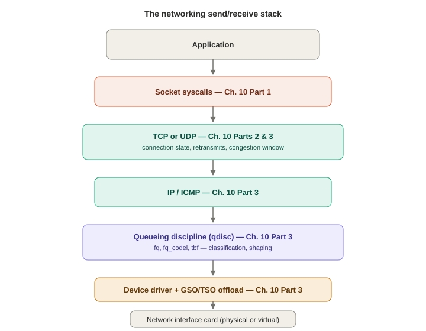
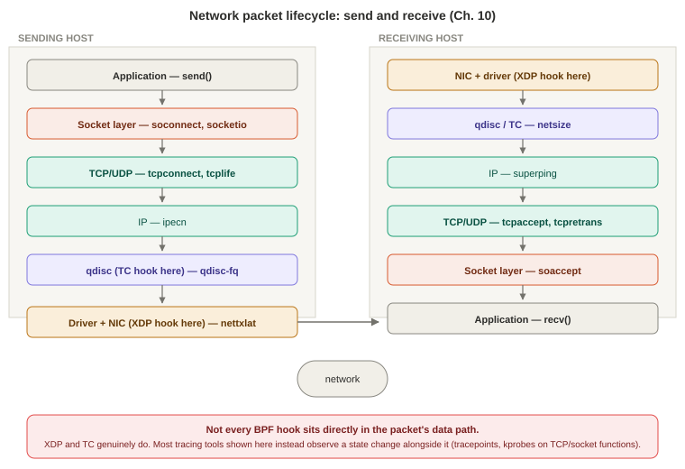

# Chapter 10 — Networking (Part 1 of 3: Background, Traditional Tools, Socket Tools)

*Study notes on Chapter 10 of BPF Performance Tools (Brendan Gregg, 2019). Original notes, not book text — see `00-index.md` for how these notes are written.*

> At 100 pages and 31 BPF tools, this is by far the largest chapter in the book — split here into three files. **Part 1** (this file) covers the background and fundamentals, traditional tools, and the ten socket-level tools. **Part 2** covers the nine TCP-specific tools. **Part 3** covers UDP, DNS, IP/ICMP, queueing disciplines, network devices, and the one-liners/exercises/summary.

## 10.1 Background

### 10.1.1 Networking fundamentals — the stack, and why BPF fits naturally here

**A grounding fact worth keeping in mind for this whole chapter**: extended BPF originated as a *packet-processing* technology (Chapter 2) — so unlike some of the other subsystems in this book, network tracing isn't a technology being retrofitted for a new purpose, it's closer to BPF's original home turf. The book cites Cilium (container networking/security policy) and Facebook's Katran (a scalable load balancer, also used for DDoS mitigation) as production evidence BPF genuinely handles millions of packets per second in the real world.

> **How to read this:** XDP and TC are the two hooks that genuinely sit in the packet's data path; every other tool shown here observes a state change alongside the path rather than intercepting the packet itself.

**The stack, component by component**: **sockets** (endpoints, including the TCP send/receive buffers this chapter returns to repeatedly), **TCP** (ordered, reliable, error-checked), **UDP** (simple, no ordering/reliability guarantees), **IP** (packet delivery, v4/v6), **ICMP** (routing/error signaling for IP), an optional **queueing discipline (qdisc)** layer (classification, scheduling, shaping — configured via `tc(8)`), **device drivers** (with their own RX/TX ring queues), and the **NIC** itself (which can be virtual — tunnels, veths, loopback). Two alternate paths exist worth knowing by name even though this chapter doesn't build tools for them directly: **DPDK** (kernel-bypass — an application talks to the NIC directly from user space for maximum throughput, at the cost of losing all traditional *and* BPF kernel-stack observability, since the traffic never enters the kernel path at all) and **XDP** (eXpress Data Path — a programmable BPF fast path integrated *inside* the NIC driver, early enough to make forward/drop decisions before full TCP/IP processing, used for fast DDoS mitigation and software-defined routing; XDP can fall back to normal stack processing when needed, unlike DPDK's full bypass).

**Internals worth knowing before reading tool source**: packets are represented as `struct sk_buff` ("skb" — you'll see this constantly); sockets are `struct sock`, embedded at the start of protocol-specific structs like `struct tcp_sock`; and each protocol attaches to sockets via a `struct proto` (`tcp_prot`, `udp_prot`, ...) defining its own callback functions (`connect`, `sendmsg`, `recvmsg`) — this is exactly the struct `soprotocol(8)` (§10.3.3) reads a human-readable protocol name directly out of.

**Scaling the receive/transmit path across CPUs**: without a load-balancing strategy, a NIC might interrupt only one CPU, driving it to 100% and creating a hard bottleneck. Linux has several named mechanisms for spreading this work (NAPI, RSS, RPS, RFS, Accelerated RFS, XPS) — worth recognizing these acronyms if you see them in `/proc/interrupts`-style investigation, even without memorizing every distinction. **`SO_REUSEPORT`** (UDP: Linux 4.5, TCP: 4.6) lets a pool of processes/threads all bind the same address and have the kernel balance new connections across them — and can itself be steered by a supplied BPF program (`SO_ATTACH_REUSEPORT_EBPF`), a nice example of BPF appearing as infrastructure, not just an observability tool, inside the very subsystem this chapter is about to instrument.

**TCP SYN backlogs — worth understanding precisely, since it's directly relevant to `tcpsynbl(8)` later**: a passive (incoming) TCP connection starts a **SYN backlog** entry (minimal metadata, deliberately lightweight so it survives SYN-flood attacks) before the handshake completes, then moves to a **listen backlog** once complete, waiting for the application to `accept()` it. Either queue can drop packets under load — the SYN backlog under a flood, the listen backlog when the application can't `accept()` fast enough — and a legitimate remote host recovers via its own timer-based retransmit. (An aside worth remembering as a scale data point: the engineer who made the TCP listen path lockless reportedly reached **six million SYN packets/second** after fixing a final false-sharing issue — a concrete reminder that even lock-free, per-CPU designs can still hide subtle cache-line-contention bottlenecks, directly echoing Chapter 2 §2.3.7's per-CPU-map concurrency discussion.)

**TCP retransmits — two mechanisms, worth distinguishing since they have very different latency signatures**: **timer-based** (waiting for an ACK that never comes; Linux's minimum is **200 ms** for the first retry, `TCP_RTO_MIN`, doubling via exponential backoff after that — this is the mechanism responsible for the "200ms+ latency cliff" that makes retransmits so costly) versus **fast retransmits** (triggered immediately by duplicate ACKs, with no timer wait at all). **SACK (selective acknowledgment)** lets a receiver acknowledge packets *after* a gap without needing everything from the gap onward resent — avoiding a much larger retransmission than necessary.

**TCP send/receive buffers and the offload chain**: Linux dynamically sizes these based on connection activity (tunable min/default/max) — bigger buffers trade memory for throughput. Because real networks cap packet size at an MSS (as low as 1500 bytes), TCP uses **GSO** (generic segmentation offload — build up to 64 KB "super packets" in software, split into MSS-sized segments just before the device) and, where the NIC supports it, **TSO** (hands that splitting off to hardware entirely, offloading more work from the CPU); **GRO** is the receive-side complement. **Congestion control algorithms** (Cubic — the default, Reno, Tahoe, DCTCP, BBR) adjust send/receive windows in response to detected congestion — you'll see BBR-specific stats appear directly in `ss(8)` output in §10.2.1 below.

**A cluster of other, smaller performance mechanisms worth being able to name, since several show up as dedicated tools later in this chapter**: **Nagle** (delays small packets briefly to let more coalesce — the specific mechanism `tcpnagle(8)`, §10.3.19 in Part 2, traces directly), **Byte Queue Limits (BQL)** (auto-sizes driver queues just large enough to avoid starvation without adding excess latency), **Pacing** (spreads out transmissions to avoid bursts), **TCP Small Queues (TSQ)** (reduces how much the stack queues, fighting **bufferbloat**), and **Early Departure Time (EDT)** (Linux 4.20 — a timing-wheel-based alternative to a queue, ordering packets to the NIC by per-packet timestamp instead). The book's own summary framing is worth keeping in mind whenever a single TCP send looks slower than expected: a single sent packet can pass through *any combination* of congestion control, TSO, TSQ, pacing, and qdisc queueing before it ever reaches the NIC — there are a lot of places for latency to hide.

**Six named latency measurements, worth having as a checklist for diagnosing *where* in a connection's lifecycle a problem sits**: **name resolution (DNS) latency**, **ping latency** (ICMP echo round trip — network + kernel stack on both hosts, no application involved), **TCP connection latency** (SYN to SYN-ACK — similar to ping latency but with a little extra kernel TCP-session-setup work; **TCP Fast Open (TFO)** exists specifically to eliminate this on repeat connections via a cryptographic cookie), **TCP first-byte latency (TTFB)** (connection-established to first data byte — this one specifically *includes* remote application scheduling/think time, making it a measure of *application* load/responsiveness, not just network health), **RTT** (round-trip time for a packet, which congestion control algorithms themselves consume as an input), and **connection lifespan** (full duration — protocols like HTTP deliberately keep connections open/idle via keep-alive specifically to amortize the cost of the earlier latencies across many requests). **Using these together, by elimination, is the core diagnostic technique this whole chapter is organized around**: if ping latency is low but TCP connection latency is high, the problem is TCP-specific; if connection latency is low but TTFB is high, the problem is almost certainly the remote application, not the network.

### 10.1.2 What BPF specifically adds

Traditional tools give kernel-maintained statistics and packet captures. BPF adds: *why* socket I/O is happening (with user-level stacks); which processes create new TCP sessions; socket/TCP/IP-level errors; TCP window sizes (including zero-size transmits — a real problem `tcpwin(8)` in Part 2 targets directly); I/O sizes at each stack layer down to the device; which packets get **dropped**, and why; the three connection-latency measurements from §10.1.1 broken down individually; inter-network-stack latency; qdisc/driver queueing time; and protocol identification.

**Event sources, and a genuinely important observation about why TCP tracepoints are so sparse**: uprobes (application protocols), syscall tracepoints (sockets), `tcp` tracepoints + kprobes (TCP), kprobes (UDP, IP, ICMP — no dedicated tracepoints for either yet), `skb` tracepoints + kprobes (packets), `qdisc`/`net` tracepoints + kprobes (queueing/driver), `xdp` tracepoints (XDP), kprobes (device drivers). **The book is candid about why TCP tracepoint coverage is thin**: historically (pre-BPF) there simply wasn't much demand for them, and the *first* TCP tracepoints only landed in Linux 4.15/4.16 — by 5.2 there were still only seven (`tcp_retransmit_skb`, `tcp_send_reset`, `tcp_receive_reset`, `tcp_destroy_sock`, `tcp_rcv_space_adjust`, `tcp_retransmit_synack`, `tcp_probe`). **Adding send/receive tracepoints specifically has been deliberately avoided**, because doing so means modifying genuinely latency-sensitive hot-path code, and even a *disabled* tracepoint's tiny fixed cost (Chapter 2 §2.9) needs to be weighed carefully at packet-processing rates. This is *why* so many of this chapter's tools fall back to kprobes despite the general "prefer tracepoints" guidance from Chapter 2 — the tracepoints frequently just don't exist yet for the specific event needed.

**Overhead — the numbers here are the most extreme in the book, worth taking seriously**: some servers exceed **several million packets per second**, at which point even BPF's genuinely tiny per-event cost can add up to real, measurable overhead. **The book's own concrete recommendation, backed by a real production anecdote, is the chapter's single most important practical lesson**: prefer tracing a **low-frequency proxy event** over the high-frequency event itself wherever one exists. Its own example: on a server doing over 100,000 packets/second but only ~1,000 retransmits/second, tracing `tcp_retransmit_skb()` *directly* (rather than tracing every packet and filtering for retransmits) cut overhead by roughly **100x**, purely by choosing which event to instrument. Where truly per-packet tracing is unavoidable, **raw tracepoints** (Chapter 2 §2.9's `BPF_RAW_TRACEPOINT`) are more efficient than ordinary tracepoints or kprobes. And directly relevant to why this whole chapter exists rather than just recommending `tcpdump`: full packet capture (`tcpdump`/`libpcap`) pays cost on *every* packet just for the capture, then again writing captured packets to the file system, then again reading them back for post-processing — BPF's in-kernel-summary approach (emit only computed results, no capture file at all) is a large, structural efficiency improvement over that whole workflow, not just a faster version of the same idea.

### 10.1.3 Strategy

1. Use counter-based tools for basic stats — packet rates, throughput, TCP connection/retransmit rates (`ss`, `nstat`, `netstat`, `sar`).
2. Trace new TCP connections and their duration to characterize the workload and spot inefficiencies (`tcplife`) — the book's own example: discovering frequent connections re-fetching a resource that could be cached locally instead.
3. Check whether network interface throughput limits have actually been hit (`sar`, `nicstat`'s utilization%).
4. Trace retransmits and other unusual TCP events (`tcpretrans`, `tcpdrop`, the `skb:kfree_skb` tracepoint).
5. Measure DNS latency specifically — flagged as a common, easy-to-overlook source of real performance issues (`gethostlatency`).
6. Measure latency from multiple points (connection, first-byte, inter-stack) — with an explicit caution that **network latency can vary significantly under load due to bufferbloat** (excessive queueing latency), so where possible, measure both under real load *and* on an idle network for comparison.
7. Use load-generation tools (`iperf`, `netperf`) to explore throughput limits against a known, controlled workload.
8. Browse this chapter's remaining tools.
9. Use high-frequency CPU profiling of kernel stacks (Chapter 6) to quantify time in protocol/driver processing specifically.
10. Explore network stack internals directly via tracepoints/kprobes as needed.

### 10.1.4 Common tracing mistakes — worth reading before writing your own network tool

Three real, specific pitfalls the book flags, all worth internalizing since they're easy to get wrong silently (your tool will run and produce *plausible-looking* output even when it's subtly broken):

- **Events may not happen in application/process context.** Packets can be received while the *idle* thread is on-CPU, and TCP session init/state changes can happen right then — reading `pid`/`comm` at that moment tells you nothing about the actual application endpoint. The fix, seen repeatedly across this chapter's tool sources: either pick a different event that genuinely *does* run in application context, or cache application-identifying context (at a point where it's still valid) keyed by something stable like the `struct sock` pointer, to be retrieved later.
- **There may be fast paths and slow paths.** A tool that looks correct against one test workload may silently be missing a whole other code path used by different traffic. The book's own validation habit, worth adopting as standard practice: run a **known** workload and check that packet/byte counts match what you independently expect, rather than trusting a tool's output at face value the first time it produces something plausible.
- **TCP has "full" and "non-full" sockets** — request sockets before the three-way handshake completes, or sockets sitting in `TIME_WAIT`, are non-full, and some `struct sock` fields simply aren't valid to read on them. A tool that assumes every socket is "full" can silently read garbage or crash on these.

## 10.2 Traditional Tools

**`ss(8)`** (from `iproute2`, maintained by the network kernel engineers themselves — worth remembering as a reason `iproute2` tools tend to support the newest kernel features first) summarizes open sockets; `ss -tiepm` layers on TCP internals, extended info, process info, and memory, exposing genuinely deep per-connection detail directly from the kernel — `rto` (retransmit timeout), `rtt`/its deviation, `mss`, `cwnd` (congestion window, in units of MSS), `bytes_acked`/`bytes_received`, live BBR congestion-control statistics, and `pacing_rate` all in one line, sourced via the `AF_NETLINK` socket family.

**`ip -s link`** shows per-interface RX/TX byte/packet/**error** counts (errors, drops, overruns for receive; errors, drops, carrier errors, collisions for transmit) — worth a routine glance, since these can point to faulty hardware directly. `ip route` shows the routing table — misconfigured routes are a real, if easy-to-overlook, source of performance problems.

**`nstat -s`** prints kernel-maintained metrics under their **SNMP names** (`TcpActiveOpens`, `TcpPassiveOpens`, `TcpRetransSegs`, ...) — the `-s` flag specifically avoids resetting counters, so you can also run it without `-s` before/after a reproducer command to isolate just that command's effect on the counters.

**`netstat`** is the traditional multi-tool: default (open sockets), `-a` (all sockets), `-s` (stack-wide stats — a genuinely dense, useful dump covering active/passive TCP opens, retransmitted segments, and deep `TcpExt` detail like delayed-ACK counts and SACK-based reordering detection), `-i` (per-interface RX/TX OK/ERR/DRP/OVR), `-r` (routing table). **A real, easy-to-hit footgun worth remembering**: running `netstat` *without* `-n` can trigger a burst of reverse-DNS lookups as an unwanted side effect, itself generating real network traffic while you're trying to diagnose network traffic. The book also flags `netstat -s`'s output as meant for **humans**, not automated parsing — monitoring agents should read `/proc/net/snmp` and `/proc/net/netstat` (or use `nstat`) directly instead.

**`sar -n SOCK,TCP,ETCP,DEV 1`** gives live per-second breakdowns of open TCP sockets, connection rate (active+passive/s), retransmit rate, and interface packet/throughput rates all together — genuinely convenient as a single one-line-per-second dashboard for exactly the workload-characterization metrics Chapter 10's own strategy step 1 asks for.

**`nicstat`** (modeled directly on `iostat`) adds a **saturation** statistic combining various interface-level error signals into one number, plus (with `-U`) separate read/write utilization percentages to check whether one direction specifically is hitting a limit while the other has headroom.

**`ethtool -S`** exposes driver-specific statistics (queue-level TX/RX counters, DMA mapping errors, ...); `-i` shows driver identity/version; `-k` shows interface feature tunables (TSO/GSO/GRO on/off, checksumming, etc.) — directly relevant background for understanding *which* of §10.1.1's offload mechanisms are actually active on a given box, rather than assumed.

**`tcpdump`** captures raw packets for offline study (with Wireshark as a common companion GUI for following full TCP sessions) — but the book is explicit about **both** directions of its real limitation: it shows exactly what went out on the wire and nothing about *kernel state* (no process attribution, no stack traces, no socket/TCP internal state), **and** even packets that get filtered out by a capture expression still cost real CPU, because (per a footnote worth remembering) every `skb` must be cloned before being handed to a packet-capture handler, filtering happens only *after* that clone — a cost BPF-based network tools can avoid entirely, since a BPF program filters before any such clone/copy is needed. (This is also, fittingly, the literal historical origin of the name "BPF" — Berkeley Packet Filter began as exactly this kind of capture-filtering technology, later generalized into everything covered in Chapter 2.)

**`/proc/net/*`** is where most of the above tools actually source their numbers from — worth knowing directly (`/proc/net/snmp`, `/proc/net/netstat`, and interrupt/softirq balance via `/proc/interrupts`/`/proc/softirqs`, the same files Chapter 6's `hardirqs`/`softirqs` tools relate to). **The book is explicit about a real design choice worth understanding**: there is deliberately **no BPF `tcpstat`/`udpstat`/`ipstat`** tool for basic system-wide counters, because `/proc/net` and `netstat`/`sar` already maintain and expose exactly that data efficiently — writing a BPF tool to re-derive numbers the kernel already tracks for free would be pure duplication. **BPF's tools in this chapter exist specifically to extend, not replace, this layer**: breaking statistics down by process, address, port, code path (stack trace), and exposing latencies and kernel state that `/proc` simply doesn't expose at all.

## 10.3 BPF Tools — Part 1: Sockets

This first batch of ten tools operates at the **socket** layer — the level closest to the application, and (per §10.1.4's first common mistake) generally the layer where you can *most* reliably attribute activity back to a specific process, since socket syscalls run in application context far more consistently than deeper TCP/IP internals do.

### 10.3.1 `sockstat` — high-level socket event rates

Prints per-second counts for the core socket syscalls (`bind`, `socket`, `connect`, `accept4`) plus `sock_sendmsg()`/`sock_recvmsg()` kprobe counts — a first-pass workload characterization tool, meant as a jumping-off point: if one event's rate looks unexpectedly high, the book shows following up with a targeted one-liner (`bpftrace -e 'kprobe:sock_sendmsg { @[comm] = count(); }'`) to attribute it to a specific process immediately. **A footnote worth remembering as a standing caveat for every tool in this chapter that prints `comm`**: applications can override their own `comm` string by writing to `/proc/self/comm`, so `comm`-based attribution, while normally reliable, isn't strictly tamper-proof.

### 10.3.2–10.3.3 `sofamily` and `soprotocol` — new-connection workload characterization

**`sofamily(8)`** counts new `accept()`/`connect()` calls by process and **address family** (`AF_INET`, `AF_INET6`, `AF_UNIX`, ...) — good for spotting unexpected socket usage (e.g., an application unexpectedly making `AF_UNIX` connections) worth investigating further. Structurally worth noting: `connect()`'s address family is read directly at syscall **entry** (the argument is already populated by the caller), but `accept()`'s must be read at syscall **exit** instead, since the kernel only *populates* the returned peer address once the call actually completes — the tool stashes the pointer at entry and re-reads through it after exit, checking the return value succeeded first (unread/invalid on failure). **`soprotocol(8)`** does the same job one layer down, for **transport protocol** rather than address family — and because neither the `accept()`/`connect()` syscalls nor any current tracepoint expose the protocol, it kprobes the LSM (Linux Security Module) hooks `security_socket_accept()`/`security_socket_connect()` instead specifically because they're described as "a relatively stable interface" (LSM hooks are meant to be called for *every* relevant operation, for security-mediation purposes, making them an unusually durable kprobe target compared to arbitrary internal functions). **A nice small detail worth remembering as a generally reusable trick**: the protocol's human-readable name ("TCP", "UDP") is read directly out of the kernel's own `struct proto` `.name` field (`tcp_prot.name = "TCP"` in the kernel source) rather than hand-maintained in the tool — convenient, though the book flags this specific field as an internal implementation detail that could in principle change, unlike the numeric protocol constant, which is kept as a fallback.

### 10.3.4–10.3.5 `soconnect` and `soaccept` — per-connection detail with real error decoding

**`soconnect(8)`** prints one line per `connect()` call: PID, process, address family, IP, port, syscall latency, and a human-readable **result** (decoded from `errno`, using a lookup table built directly from the `connect(2)` man page's documented error codes). Genuinely useful worked example from the book's own output: an IPv6 connection attempt failing with "Network unreachable" sitting right next to successful IPv4 attempts to the same logical destination — visible instantly as a decoded string rather than a bare negative number. **A real, important limitation flagged explicitly**: the reported latency is *only* the `connect()` syscall's own duration — for a **non-blocking** socket, `connect()` can return immediately with `EINPROGRESS` well before the connection is actually established, meaning this tool systematically under-measures true connection latency for any application using non-blocking sockets (common in event-loop-based servers) — `soconnlat(8)` (§10.3.9) exists specifically to close this gap. **`soaccept(8)`** is the direct accept-side counterpart, with its own error table sourced from the `accept(2)` man page. Both work by instrumenting syscall tracepoints specifically (not kprobes) — which the book notes as a genuine advantage over the later `tcpconnect`/`tcpaccept` tools (Part 2): syscalls reliably run in the calling process's own context, so process attribution here is trustworthy in a way it may not be deeper in the stack.

### 10.3.6–10.3.7 `socketio` and `socksize` — I/O counts and sizes by process/protocol/port

**`socketio(8)`** counts socket reads/writes by process, direction, protocol, and (byte-order-corrected — ports arrive in network/big-endian order and need manual flipping for a little-endian x86 display) port. **The tool's own choice of kprobe target is a genuinely instructive small lesson in reading kernel source carefully rather than guessing**: the obvious candidates, `sock_read_iter()`/`sock_write_iter()` (the functions literally named in `socket_file_ops`), turned out to **miss real I/O** when tested against varied workloads — the fix was reading the surrounding kernel source comment, which explained that additional "special operations" (including `sock_recvmsg()`/`sock_sendmsg()`, called directly by other paths, not just through the iterator functions) also perform socket I/O and aren't listed in that struct at all. **`socksize(8)`** extends this to **byte counts** via `hist()` on each function's return value — with a real, concrete bpftrace-language gotcha worth remembering: the return value is a 64-bit **unsigned** `int64` by bpftrace's default handling, while the actual kernel function returns a signed 32-bit value, so a naive `retval >= 0` filter to exclude negative-error returns silently fails (a small negative int, reinterpreted as unsigned 64-bit, looks enormous, not negative) — the tool's workaround is comparing against `0x7fffffff` directly rather than trusting a sign-aware comparison (the book notes proper `int` casts were in development for bpftrace at the time of writing). The tool also demonstrates bpftrace's **`stats()`** map function (not covered explicitly back in Chapter 5's reference table, so worth noting here directly) — an alternative to `hist()` that reports **count, average, and total** in one compact line instead of a full distribution, useful when you want a quick summary rather than shape detail.

### 10.3.8 `sormem` — receive buffer usage vs. its tunable limit

Histograms **actual allocated receive-buffer memory** (`sk_backlog.rmem_alloc`) against the **configured limit** (`sk_rcvbuf`, tunable via `sysctl`) — directly relevant because **exceeding the limit causes packets to be dropped**, a real, quantifiable performance problem. The book runs a genuinely clean, three-step controlled demonstration worth remembering as a model of good tuning methodology: baseline shows the limit clustering in the 8–16 MB range with actual usage far lower; after `sysctl -w net.ipv4.tcp_rmem='... 10485760'`, the observed limit shifts to match; after tightening it further (`'... 100000'`), the observed limit correctly drops to the 64–128 KB range — **directly confirming, by measurement, that a `sysctl` change actually took effect and is being honored in practice**, rather than just trusting the configuration file. Two `sock` tracepoints (`sock_rcvqueue_full`, `sock_exceed_buf_limit`) are also traced to print an immediate, per-event line the moment a limit is actually exceeded — the book notes that in its own example runs, these never fired, i.e., the traced workload never actually hit its configured limit.

### 10.3.9 `soconnlat` — connection latency *with the calling code path*, and a real cautionary Java story

Where `soconnect(8)` identifies connections by IP/port, `soconnlat(8)` identifies them by **user-level stack trace** — answering "which code path is opening this connection, and how long does it take" rather than "which address." **The book's own real example output doubles as a vivid, concrete illustration of two ideas from earlier chapters landing together**: one captured stack shows a complete, richly detailed Java call chain (down through `FreeColClient` — an actual open-source Java game) for a single 32–64 μs connection; a *second* stack, representing over 200 connections at 128 μs–2 ms latency, shows only a single frame, `__connect+71`, before abruptly cutting off — **a live instance of Chapter 2's frame-pointer warning**, here explicitly attributed to the application's default libc having been built without frame pointers preserved. **The tool also solves the exact non-blocking-`connect()` gap `soconnect(8)` left open**, using a deliberately-flagged **"giant shortcut"** worth understanding as a real, named limitation rather than a hidden one: for a non-blocking connect that returns `EINPROGRESS`, it assumes the *first* subsequent successful `poll()`/`select()`/`epoll`/`pselect` call **on the same thread** represents that connection completing — usually correct, but not guaranteed if the same thread is simultaneously polling multiple file descriptors and receives an event for a *different* one first. **A genuinely good real debugging story is attached to validating this assumption**: counting `poll()` calls by process and file-descriptor count (`bpftrace -e 't:syscalls:sys_enter_poll { @[comm, args->nfds] = count(); }'`) incidentally revealed a `python3` process polling **96 file descriptors** — confirmed as a real, unintentional bug via `lsof` (not a measurement artifact), though a quick follow-up sanity check against the process's actual CPU usage showed the wasted cost was only about **0.02%** — worth remembering as a model of *proportionate* response: confirm a real bug, but also measure its actual cost before treating it as urgent.

### 10.3.10 `so1stbyte` — connect-to-first-byte latency, a proxy for remote-host load

Times from `connect()` entry to the **first successful read/recv** on that same socket — deliberately different from (and, the book notes, slightly larger than) the TCP-level "time to first byte" concept from §10.1.1, since this version also includes the `connect()` syscall's own duration. **The stated value of this specific measurement is what it indirectly reveals about the remote system**: since it includes remote-host application scheduling and think-time, watching this metric *over time* can surface periods when a remote dependency is more heavily loaded — a signal about *their* health, observed entirely from *your* side of the connection, with no cooperation or instrumentation needed on the remote host at all. Mechanically, it has to instrument a wide net of syscalls (`connect`, then the whole `read`/`readv`/`pread*`/`recvfrom`/`recvmsg`/`recvmmsg` family) keyed by `(pid, fd)`, cleaning up on both connection failure and `close()` without ever having read — the book candidly notes this breadth of instrumented syscalls is itself a real overhead cost, and suggests kprobing `sock_recvmsg()` directly (keyed by the `struct sock` pointer instead of the PID/FD pair) as a lower-overhead alternative, at the usual cost of trading tracepoint stability for kprobe fragility.

---

*Continue to Part 2 (`10-networking-part2.md`) for the nine TCP-specific tools: `tcpconnect`, `tcpaccept`, `tcplife`, `tcptop`, `tcpsnoop`, `tcpretrans`, `tcpsynbl`, `tcpwin`, and `tcpnagle`.*
