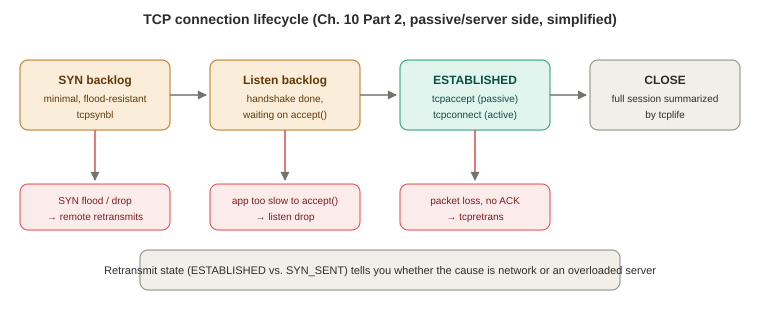

# Chapter 10 — Networking (Part 2 of 3: TCP Tools)

*Study notes on Chapter 10 of BPF Performance Tools (Brendan Gregg, 2019). Original notes, not book text — see `00-index.md` for how these notes are written. Continues directly from Part 1 (background, traditional tools, socket tools).*

> These nine tools trace **deeper in the stack than the socket tools from Part 1** — TCP state machinery and kernel functions, not syscalls. That shift has a real, recurring consequence worth watching for across every tool below: TCP-level events don't always run in the originating **process's** context (§10.1.4's first common mistake), so PID/COMM attribution here is frequently described as "best effort," in contrast to Part 1's socket-syscall tools, where it was reliable by construction.

> **How to read this:** the three red boxes are the "unusual event" tools (§10.1.3's strategy step 4) — each one answers a different question about where a connection went wrong.

## 10.3.11–10.3.12 `tcpconnect` and `tcpaccept` — active and passive connections, and a real production capacity-planning story

**`tcpconnect(8)`** traces new **active** (outbound) TCP connections — named after `connect(2)`, though it works by tracing TCP state transitions, not the socket syscall itself. Good for workload characterization: who's connecting to whom, how often. **The book is explicit and specific about the PID/COMM reliability tradeoff this deeper tracing point introduces**: unlike Part 1's `soconnect(8)`, this tool's process attribution is "best-effort... at the TCP level, these events may not happen in process context" — for reliable attribution, the socket-layer tools are recommended instead. Mechanically, the original BCC version kprobes `tcp_v4_connect()`/`tcp_v6_connect()`; a newer bpftrace version (`tcpconnect-tp.bt`) instead uses the `sock:inet_sock_set_state` tracepoint, filtering specifically on the transition from `TCP_CLOSE` to `TCP_SYN_SENT` — directly illustrating the general "prefer the tracepoint once one exists" upgrade path this book has demonstrated in several earlier chapters. **A concrete overhead number worth remembering**: on a server doing ~50,000 packets/sec, the new-TCP-session rate was only ~350/sec — tracing sessions instead of packets here is roughly a **hundred-fold** overhead reduction, a second real instance of §10.1.2's central overhead lesson (trace the low-frequency proxy event, not the high-frequency one).

**`tcpaccept(8)`** is the direct **passive** (inbound) counterpart, tracing the transition from `TCP_SYN_RECV` to `TCP_ESTABLISHED` (tracepoint version) or kprobing `inet_csk_accept()` (kernel-version-independent version) — chosen specifically because it's the function assigned to `tcp_prot`'s own `.accept` callback (the same struct `soprotocol(8)` reads its protocol name from in Part 1), making it a natural, meaningful instrumentation point rather than an arbitrary internal helper. **A genuinely valuable real production story is attached to the kprobe version specifically**: extending it to also read `sk_ack_backlog`/`sk_max_ack_backlog` (the live SYN/listen backlog state, straight off the `struct sock`) was how a Shopify engineer diagnosed a production incident where **Redis was degrading under peak load due to TCP listen drops** — adding one extra column to an existing tool's output was enough to make the backlog's real-time size directly observable for capacity planning, closing the loop on exactly the "TCP backlog" background material from §10.1.1. A smaller but genuinely instructive **forward-compatibility detail** in the source: variables first assigned *inside* an `if` block (`$daddr`, `$saddr`) are pre-initialized to a neutral default (`ntop(0)`) *before* the conditional, specifically because a future bpftrace version might scope such variables to the `if` block only — the tool is written defensively against a language change that hadn't happened yet, worth remembering as a general habit when writing code you expect to keep working across tool-version upgrades.

## 10.3.13 `tcplife` — session lifespans, and a clean lesson in kprobes vs. tracepoints exposing *different* information

Traces full TCP session **lifespan** (creation to `TCP_CLOSE`) along with throughput and (best-effort) process attribution — genuinely one of the book's most-used tools in its own words ("one of the most popular tools I've developed... forms the basis of several higher-level GUIs"), with a nice origin story: it began as a reply to a Julia Evans tweet wishing for exactly this. **Because it triggers on state-change events rather than packets, its overhead is low enough that Netflix runs it continuously in production as a TCP flow logger** — a strong practical endorsement of the "trace infrequent proxy events" pattern applied at real production scale, not just as a one-off investigation.

**The tool's own comparison between its two implementations is a genuinely sharp, concrete lesson in something easy to assume is always true: that a tracepoint and an "equivalent" kprobe expose the *same* information.** Counting TCP state numbers seen via `kprobe:tcp_set_state` side-by-side against `tracepoint:sock:inet_sock_set_state` in the same run reveals the kprobe **never observes state 3 (`TCP_SYN_RECV`) at all**, while the tracepoint does. The reason: the kernel's own `tcp_set_state()` function is simply **never called** with that particular state — it's set some other way internally — so a kprobe on that one function is blind to a transition the tracepoint (instrumented at a different, more complete point) can see. **The lesson generalizes well beyond this one tool**: a kprobe only shows you what the *specific function you chose* actually does — if the real behavior you care about happens through a different code path, a seemingly reasonable kprobe target can have real, silent blind spots that only show up when you specifically go looking for them, exactly as done here.

**The source's own three-part logic is worth understanding as a small case study in the tradeoffs of correlating asynchronous kernel events**: record a birth timestamp on the *first* state transition seen for a given socket (using the `struct sock` pointer as the map key — not thread ID, following the same pattern Chapter 9's `biolatency` established for events that don't share a single owning thread); cache process context specifically on `TCP_SYN_SENT` (client-initiated) or `TCP_LAST_ACK` (server-side close) — the two states the book's own comment identifies as most likely to still be running in real application context; and compute and print everything at `TCP_CLOSE`, falling back to whatever process happens to be currently on-CPU if no context was ever successfully cached. Throughput (`bytes_acked`/`bytes_received`) is read directly off `struct tcp_sock` rather than summed from individually-traced packets — a nice small efficiency win layered on top of the state-transition-only tracing approach.

## 10.3.14 `tcptop` — `top(1)` for TCP throughput, with a real, named blind spot

Per-process TCP RX/TX throughput, refreshed per second. Built on `tcp_sendmsg()` (send) and, deliberately, `tcp_cleanup_rbuf()` rather than `tcp_recvmsg()` for receive — **a genuinely instructive small efficiency choice worth remembering**: `tcp_cleanup_rbuf()` conveniently provides *both* the `sock` struct and the size as simple entry arguments in one kprobe, whereas getting the same two pieces of information from `tcp_recvmsg()` would require *two* separate probes (an entry kprobe for the struct, a return kretprobe for the byte count) — doubling the instrumentation points for equivalent information, a real, quantifiable overhead difference driven purely by which specific function happened to expose the needed data most cheaply. **A real, explicitly documented blind spot worth remembering**: this tool does **not** currently see traffic sent via the `sendfile(2)` syscall, since that path may bypass `tcp_sendmsg()` entirely — a workload that leans on `sendfile()` (common for efficient static file serving) would under-report here, a concrete instance of §10.1.4's "fast paths and slow paths" common mistake, called out candidly by the tool's own author as a known limitation rather than something discovered by accident.

## 10.3.15 `tcpsnoop` — the tool deliberately *not* ported, kept as a cautionary tale

This section is unusual and worth reading in full even though there's no BPF tool to actually run: the author explains **why he chose not to port his own popular Solaris/DTrace tool** to BPF, using its history as a two-part lesson.

`tcpsnoop(8)` printed a per-**packet** line with PID and UID attribution — solving a real, felt gap in 2004 (packet sniffers like `snoop`/`tcpdump` show no process information at all). Getting this correct required instrumenting **eleven separate points** in the Solaris kernel and walking multiple internal structs, because packet size had to be captured *after* MTU fragmentation, separately from the socket-level code where PID context was available. The tool grew past 500 lines. **Over roughly six years and a dozen-plus kernel updates, it broke on seven of them** — and worse, each fix had to be re-validated against *every* earlier supported kernel version to avoid silent regressions, eventually becoming genuinely impractical to maintain as one tool, forcing separate per-kernel-version releases.

**Two lessons, worth internalizing as design principles rather than just history**:
1. **More kprobes and more struct field usage means more surface area for kernel changes to break your tool.** This book's own tools "purposely use the fewest possible kprobes" specifically as a direct, deliberate response to this lesson — and prefer tracepoints wherever one exists, precisely because they're a maintained interface rather than an implementation detail.
2. **The tool's entire premise was arguably the wrong scope from the start.** The actual underlying goal — "which processes are generating network traffic" — never actually required **per-packet** granularity; a tool summarizing data transfers (missing some packets, like bare TCP handshakes with no payload, in exchange for dramatically simpler, more stable instrumentation) would have been "close enough" for the vast majority of real uses. The book points directly at `socketio(8)`/`tcptop(8)` (only two kprobes each) and `tcplife(8)` (one tracepoint plus some struct reads) as proof that the same underlying question can be answered with a fraction of the instrumentation surface, once you're willing to give up strict per-packet completeness.

## 10.3.16 `tcpretrans` — retransmit tracing, and two real production incidents it helped resolve

Traces `tcp_retransmit_skb()` directly (Linux 4.15+ has dedicated `tcp:tcp_retransmit_skb`/`tcp:tcp_retransmit_synack` tracepoints the tool can be updated to use instead), printing address, port, and **TCP state** for each retransmit — with state specifically flagged as diagnostically meaningful: **a high retransmit rate in `ESTABLISHED` points toward an external network problem; a high rate in `SYN_SENT` points toward an overloaded server application not draining its SYN backlog fast enough** — two very different root causes, distinguished by one column.

**Two separate, named real production stories are attached to this specific tool, both worth remembering as evidence for why summarized BPF tracing beats packet capture for this exact class of problem**: at **Netflix**, it helped diagnose network traffic exceeding external limits (causing drops/retransmits) — being able to watch retransmits live across many instances, with source/destination/state immediately visible, avoided the overhead of per-packet-dump post-processing entirely. At **Shopify**, the workload itself was heavy enough that `tcpdump` was **dropping so many packets its own output became unreliable**, and its overhead was "too painful" to run at all — `tcpretrans(8)` (paired with `tcpdrop(8)`, mentioned but not covered in depth) supplied enough signal instead to trace the real root cause to an overwhelmed firewall dropping packets under load. **This is a clean, concrete, twice-repeated real-world instance of §10.1.2's abstract overhead argument actually mattering**: not just "BPF tracing is more efficient," but "the traditional tool was *unreliable*, not merely slower," at genuinely high production traffic rates.

## 10.3.17 `tcpsynbl` — SYN backlog size vs. limit, as a histogram

Ties directly back to §10.1.1's SYN-backlog background material: histograms the **actual** backlog length (`sk_ack_backlog`) grouped by its **configured limit** (`sk_max_ack_backlog`, itself set via the `listen(2)` syscall's `backlog` argument and truncated by the system-wide `/proc/sys/net/core/somaxconn`), and prints an explicit, timestamped line the moment the backlog actually **exceeds** its limit (meaning a SYN was just dropped, forcing the remote client into a retransmit — one of the "unusual TCP events" the chapter's own strategy step 4 recommends watching for). A small, recurring bpftrace-language workaround shows up here too: `& 0xffffffff` on the backlog-limit value, the same signed/unsigned int-casting gotcha `socksize(8)` (Part 1) worked around, flagged again as expected to become unnecessary once bpftrace gains proper int casts.

## 10.3.18 `tcpwin` — congestion window over time, built for external plotting

Deliberately emits **CSV output** rather than an in-tool summary — a different design choice from almost every other tool in this book, made specifically because the *shape of change over time* is the whole point here, which a live terminal histogram can't show as clearly as an actual time-series plot can. **The book walks a complete, realistic external-analysis workflow worth having as a template for any tool whose output you want to graph**: pipe `tcpwin.bt`'s output to a file; use `awk` to frequency-count by the `sock` struct address (used as a connection identifier, the same "use a stable non-thread-ID key" pattern from Chapter 9/§10.3.13) to find the single busiest connection; filter the file down to just that one connection's rows (plus the header) with a second `awk` pass; import the resulting small CSV into a real statistics/plotting tool (the book uses R). The resulting plot shows a textbook **sawtooth pattern** — Cubic congestion control's send window growing steadily, then dropping sharply the moment packet loss is detected, repeating as the algorithm hunts for an optimal window size — a nice, concrete visual confirmation of the congestion-control theory from §10.1.1, produced entirely from a few kprobe'd struct field reads. Traces `tcp_rcv_established()`, reading `snd_cwnd`/`snd_ssthresh` directly off `struct tcp_sock` and `sk_sndbuf`/`sk_wmem_queued` off `struct sock` — and is explicitly designed to be **extended**: the book notes a `tcp:tcp_probe` tracepoint (Linux 4.16+, evolved from an older `tcp_probe` kernel module built for exactly this kind of congestion-control analysis) could replace the kprobe, at the cost of not every field being available through the tracepoint's own arguments.

## 10.3.19 `tcpnagle` — Nagle's algorithm and transmit delay, measured directly

Traces both the **Nagle-related flag state** on each transmit attempt and, separately, how long a transmit was actually **delayed** by tracing `tcp_write_xmit()`'s entry and return. Genuinely useful, concrete real output: on a production edge server, Nagle's algorithm was mostly **off** (226,697 occurrences — likely from applications explicitly setting `TCP_NODELAY`) or set to **push** (11,418 — likely `TCP_CORK` usage), with only **5** actual transmit delays observed, capped at 4–8 μs — i.e., on this particular workload, Nagle-related delay was essentially a non-issue, a genuinely useful negative finding (ruling something out) obtained directly rather than assumed. Mechanically, the kretprobe checks the return value's "inflight" bits to detect the specific moment a call to `tcp_write_xmit()` **failed to send** anything (for whatever reason — possibly Nagle, possibly something else), starts a timer at that point, and stops it the next time that same socket successfully transmits — measuring the *effect* (a stall) directly, rather than trying to prove Nagle specifically caused every individual delay.

---

*Continue to Part 3 (`10-networking-part3.md`) for UDP, DNS, IP/ICMP, queueing disciplines, network device tools, one-liners, exercises, and the chapter summary.*
