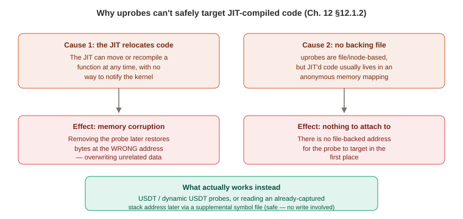

# Chapter 12 — Languages (Part 1 of 3: Background, and C)

*Study notes on Chapter 12 of BPF Performance Tools (Brendan Gregg, 2019). Original notes, not book text — see `00-index.md` for how these notes are written.*

> This is one of the most conceptually important chapters in the book for a systems-engineering audience specifically, because its core lesson **generalizes far beyond the three languages it actually covers**. Split into three files given its size: **Part 1** (this file) covers the background taxonomy — the single most reusable idea in the whole chapter — plus C, the easy case. **Part 2** covers Java, by far the largest section, as the worked example for JIT-compiled languages. **Part 3** covers Bash (the interpreted-language example), brief notes on JavaScript/C++/Golang, and the summary.

## 12.1 Background

### The core idea: it's not the language, it's the runtime

**This is the single most important sentence in the whole chapter, worth internalizing before anything else**: *"Java, for example, is not a JIT-compiled language: Java is just a language."* Whether code can be traced easily, with difficulty, or barely at all is **not a property of the source language** — it's a property of **how that specific execution engine happens to run it**. The JVM (from OpenJDK or OracleJDK) executes Java through a pipeline that moves from interpretation to JIT compilation — but that's an attribute of the JVM, not of Java as a language. And a fully-instrumented Java application can genuinely span **all three** categories at once: the JVM's own internals (class loading, garbage collection) are ordinary **compiled** C++ code; Java methods start out **interpreted**; and hot methods eventually get **JIT compiled**. Each of those three needs a different tracing approach, in the same process, at the same time.

**The practical, transferable question this leads to, worth carrying into any future language you need to trace that this book never covers**: *"What is the thing we are currently using to run X, and how does it work?"* — compiler, JIT compiler, or interpreter. Everything else in this chapter follows from correctly answering that one question first.

### 12.1.1 Compiled languages (C, C++, Golang, Rust, Pascal, Fortran, COBOL)

Functions compile directly to machine code, stored in an ELF binary. Three attributes worth knowing as a checklist:
- **Symbol tables live in the ELF file itself**, mapping addresses to function/object names — and, critically, these addresses **don't move during execution**, so the symbol table can be trusted and read at any time. (Kernel-level software differs slightly: its symbol table, `/proc/kallsyms`, is dynamic and can *grow* as modules load — but it's still a real, readable table, just not a static one.)
- **Arguments and return values sit in registers/stack offsets following a standard calling convention** for the processor — *usually*. The book flags two real, named exceptions worth remembering specifically because they'll bite you if you assume the standard convention always applies: **Golang uses a different calling convention**, and **V8's own built-in functions use no standard convention at all**.
- **Frame-pointer stack walking works, *if* the compiler actually initializes the frame-pointer register in each function's prologue** — which, per Chapter 2's now-familiar warning, compilers frequently don't do by default, repurposing that register for general use instead as a performance optimization.

**The diagnostic checklist worth having memorized for any compiled-language tracing problem**: check whether symbol tables are present (`nm(1)`, `objdump(1)`, `readelf(1)`); if missing, check for a **debuginfo** package; if that's a dead end, check whether the build process explicitly strips symbols (`strip(1)`) and consider recompiling without it. Separately, check whether frame-pointer stack walking is actually working — if not, recompile with `-fno-omit-frame-pointer`, or, if that's infeasible, look toward the other stack-walking techniques from Chapter 2 (LBR, DWARF, user-level ORC, BTF) — all explicitly flagged here, again, as still needing more BPF tooling work to be generally usable.

### 12.1.2 JIT-compiled languages (Java, JavaScript, Julia, .NET, Smalltalk) — the hard case, explained precisely

Functions compile to bytecode first, then to machine code **at runtime**, often adaptively based on observed behavior. Three attributes, each one harder than the compiled-language equivalent:
- **No pre-built symbol table exists at all** — mappings live only in the JIT runtime's own memory, used internally for things like printing exception stacks, and **these mappings can change** as the runtime recompiles or relocates functions over the program's lifetime.
- Calling conventions **may or may not** be standard.
- Frame pointers **may or may not** be honored by the JIT-generated code — if not, a stack walk will visibly end abruptly at a bogus address, exactly as you'll see demonstrated concretely with bash in §12.2.2 below (and, in Part 2, with unoptimized Java frames).


> **How to read this:** either cause alone is sufficient to rule out a direct uprobe — they don't need to both occur.

**Why the seemingly obvious workaround — using an existing supplemental symbol file, like Java's own `/tmp/perf-PID.map`, together with uprobes — genuinely doesn't work, for two distinct, precise technical reasons worth understanding fully rather than just accepting as a rule:**
1. **The JIT compiler can move an already-uprobed function in memory without telling the kernel.** A uprobe works by physically overwriting bytes at a specific address with a breakpoint instruction, and restoring the original bytes later. If the function has since been relocated, the kernel's "restore" step ends up **writing to the wrong address entirely — corrupting whatever unrelated code or data now happens to occupy that memory location**. This isn't a missed feature; it's a real correctness/safety hazard, which is exactly why this approach isn't simply enabled anyway with a warning label.
2. **uprobes are fundamentally file/inode-based** — they need a real, on-disk file location to attach to. JIT-compiled functions typically live in **anonymous private memory mappings** with no backing file at all, so there's nothing for a uprobe to attach to in the first place, independent of the relocation problem above.

**The real solutions, worth having as an ordered set of fallbacks**:
- If the runtime ships **USDT probes** for function entry/exit, those can be traced directly — though the book notes this "usually incurs high overhead, whether it is enabled or not" if it means instrumenting *every* function call.
- **Dynamic USDT** (Chapter 2 §2.11) is the more efficient version — instrumenting only the specific points you actually care about, rather than every function.
- **If stack traces via frame pointers already work**, a supplemental symbol file (like Java's `perf-map`) *can* still be used safely — specifically to **translate the addresses in an already-captured stack trace into function names after the fact**, which is a fundamentally different, safe operation from what uprobes need (placing a breakpoint *at* a specific address). This distinction — *reading* a captured address is safe, *writing* a breakpoint at a JIT'd address is not — is worth keeping precise, since it explains why one technique works and a seemingly similar one doesn't.
- **If stack traces genuinely don't work at all**, the fallback options escalate in engineering cost: check for a frame-pointer-preserving runtime option; explore LBR; or, as heavier last resorts, modify the JIT compiler itself to preserve frame pointers, add USDT probes that report the runtime's *own* internal call-stack representation as a string argument, or have BPF **signal the process** and have a user-space helper thread write a stack trace into memory that BPF can then read back — the book cites this last approach as something **Facebook implemented for HHVM** specifically. Java is used as the book's full worked example of how these tradeoffs play out in practice — covered in Part 2.

### 12.1.3 Interpreted languages (bash, Perl, Python, Ruby — and Java/JavaScript during their own interpretation stage)

The runtime never compiles user code to machine code at all — it parses and executes the program using its own built-in routines. Attributes:
- **The binary's own symbol table shows only interpreter internals** — none of the user-supplied program's own function names, which live purely in an interpreter-specific in-memory table/object structure instead.
- Arguments/return values are **processed and often bundled as interpreter-internal objects**, not simple machine-level ints/strings — meaning even once you can see a function call, reading its "arguments" may require real struct navigation through the interpreter's own object representation.
- **Frame-pointer stack walking, even when it technically works, only shows the *interpreter's own* call stack — never the user program's logical call stack**, since the interpreter itself is really just one C/C++ program with its own (uninteresting, from the user's perspective) internal function calls; the actual program stack the interpreter is executing lives entirely in the interpreter's own custom data structures, not in real machine-level stack frames at all.

**The same USDT/dynamic-USDT escalation path as JIT languages applies here too, with a real example**: the book notes the **Ruby runtime ships built-in USDT probes**, directly traceable — at the cost of the same "usually means instrumenting every function call, then filtering" overhead tradeoff seen in §12.1.2, unless a **dynamic USDT** library exists for that language (the book names `ruby-static-tracing` specifically) to instrument only the functions you actually care about. Without any USDT support at all, the fallback is uprobes on the interpreter's own internal functions, reading arguments via manual struct navigation into the interpreter's object representation.

**Stack traces are described as the single hardest capability to get working for interpreted languages** — one real, if expensive, technique: trace **every** function call and return via BPF and **build a synthetic stack yourself, in BPF memory**, purely from that stream of enter/exit events — genuinely costly, but a real, working fallback when nothing else is available. The same alternative techniques from the JIT section apply here too: custom USDT probes reporting the interpreter's own stack-fetching mechanism as a string (the book names Ruby's `caller` built-in and exception methods as examples of exactly this kind of mechanism you could tap into), or the same BPF-signals-a-userspace-helper approach.

### 12.1.4 What BPF is actually trying to answer, and why bother when debuggers already exist

Five target questions, worth having as a checklist for any language you're about to instrument: what functions are called; what are their arguments; what's the return value (did it error); what's the **stack trace/code path** that led to a given event; and what's a function's **duration**, ideally as a full histogram, not just an average.

**A fair question the book addresses head-on**: many language runtimes already ship debuggers that can answer the first four of these easily — so why BPF at all? **The real answer given is about crossing layers, not about any single layer alone**: BPF's distinct value is tracing **multiple layers of the software stack in one single tool** — instead of examining disk I/O or page faults purely in kernel context, you can trace them **together with the user-level code path responsible**, connecting a specific kernel-level resource-usage event back to the specific application request that actually caused it. **A second, genuinely important, practical point specific to hard-to-instrument languages like Java**: getting a **stack trace** attached to a kernel event is very often **easier to get working than full function/method-level tracing** — and a stack trace alone, combined with everything else BPF can already see (disk I/O, page faults, off-CPU blocking, and CPU flame graphs via timed sampling), is often enough to solve a large fraction of real problems even without ever getting individual Java method tracing working at all. This point becomes very concrete in Part 2.

### 12.1.5 Strategy — the six-step process for tackling an unfamiliar language

1. **Determine how it's actually executed** — compiled, JIT-compiled, interpreted, or some mix — per §12.1.1–12.1.3's taxonomy.
2. Browse this chapter's tools/one-liners for the matching category to see what's realistically achievable.
3. **Search the internet** for prior art — the book's own suggested search terms are literally `"[e]BPF <language>"`, `"BCC <language>"`, `"bpftrace <language>"` — a refreshingly concrete, practical piece of advice worth remembering: don't assume you're the first person to need this.
4. **Check for USDT probes** (and whether they're actually enabled in your distributed binaries, or need a recompile — Chapter 2's USDT opt-in-build-flag gotcha, resurfacing here) — preferred as a stable interface. If none exist, the book explicitly suggests **adding them yourself**, noting most language runtimes are open source.
5. **Write a small, known test program before trusting any new tool's output** — call a function a known number of times, with a known, explicit (`sleep`-based) latency — specifically so you can verify your tracing tool reports the *correct* count and *correct* latency against ground truth you control, rather than trusting plausible-looking output on a real, unknown workload. This is the same validation discipline Chapter 9's strategy already recommended for disk tools, generalized here to language tracing specifically.
6. Use **uprobes** for user-level software, **kprobes** for kernel-level — the actual mechanics, once you know what you're instrumenting and why.

## 12.2 C — "the easiest of the languages to trace"

For **kernel-level C**: the kernel has its own symbol table, and most distributions build their kernels with `CONFIG_FRAME_POINTER=y` — meaning kprobe-based tracing and stack walking generally just work out of the box. The real exceptions worth remembering: **inlined functions** (no separate symbol/address to target at all) and functions on the kernel's own tracing **blacklist** (unsafe to instrument, usually to avoid recursive faults, echoing Chapter 2's kprobe safety discussion).

For **user-level C**: works just as cleanly, *if* the binary isn't stripped and doesn't omit the frame pointer — but the book is candid that **many real-world binaries fail both conditions by default**, meaning "C is easy to trace" often still requires some work to *get to* that easy state (recompiling, or finding an alternate symbol source) rather than being automatic. USDT can be added to C programs for static instrumentation, and some libraries — notably **libc itself** — already ship USDT probes by default.

### 12.2.1 C function symbols — reading, losing, and recovering them

`readelf -s` on an unstripped binary shows two separate symbol tables worth distinguishing precisely: **`.dynsym`** (external, dynamically-linked symbols the binary actually calls — e.g., `malloc`, `puts`, `atoi` from libc) and **`.symtab`** (a superset: everything in `.dynsym` *plus* the binary's own local/internal function symbols). **`strip(1)` removes only `.symtab`, leaving `.dynsym` intact** — meaning a stripped binary still shows *some* symbols (the external library calls it makes) but loses precisely the symbols most likely to be interesting: **its own internal functions**. Statically-compiled binaries that get stripped can lose essentially **all** their symbols, since everything had been consolidated into the one table that got removed.

**Two fixes, in order of preference**: remove `strip(1)` from the build process and recompile (the clean fix, when you control the build), or find an **alternate source of symbols** — DWARF debuginfo, or (in the future, kernel-only so far) BTF. Debuginfo packages typically ship as a separate `-dbg`/`-dbgsym`/`-debuginfo` package, either matching the binary's name with a `.debuginfo` extension or addressed via a **build-ID checksum** (visible in the binary's own ELF notes section via `readelf -n`) under `/usr/lib/debug/.build-id/` — and is directly supported by `perf(1)`, BCC, and bpftrace.

**A real, concrete number worth remembering as a vivid illustration of just how much a strip operation can remove**: the book compares a real `libjvm.so` (456 symbols after stripping) against its matching `libjvm.debuginfo` file (**52,299 symbols**) — over a hundredfold difference from the same underlying binary.

**A genuinely clever technique worth remembering, presented candidly as an unproven proof-of-concept rather than a fully validated production practice**: full debuginfo files can be enormous (222 MB for that same `libjvm.debuginfo`, versus 17 MB for the stripped `.so` itself) — but the book shows, by checking section sizes directly with `readelf -S`, that the **actual `.symtab` section inside that 222 MB file is only about 1.2 MB**; nearly all the size comes from *other* debug sections (`.debug_*`, used for full source-level debugging, not just symbol names). The demonstrated fix: use `objcopy -R.debug_\* libjvm.debuginfo libjvm.symtab` to strip away everything **except** the symbol table, producing a small (a few MB) standalone symbol file, then `eu-unstrip` to reattach just those symbols onto the original stripped binary — producing a new file (~20 MB in the book's example) with the **full 52,748-symbol count**, at roughly a tenth the size of installing the complete debuginfo package. **This is a genuinely good, generalizable lesson**: before assuming you need an entire heavyweight artifact, check *which part of it* you actually need — the same "understand what's actually costing you space/time before reaching for the full-size fix" instinct that's shown up repeatedly elsewhere in this book (Chapter 8's ext4/kernel-headers workarounds, Chapter 9's opcode-table extraction).

**A tool feature worth knowing exists, with a nice small story attached**: `bpftrace -l 'uprobe:/bin/bash'` lists every symbol in a binary that's actually available to instrument as a uprobe (wildcards supported, e.g. `uprobe:/bin/bash:read*`) — a convenient, no-`readelf`-needed way to explore what's traceable. The book's own footnote credits this specific feature to **Matheus Marchini**, who added it after reviewing an early draft of this very chapter and realizing it was needed — a nice, concrete, small example of documentation-writing directly driving a real tooling improvement.

### 12.2.2 C stack traces — a live, layered demonstration of Chapter 2's frame-pointer warning

BPF currently supports **frame-pointer-based** stack walking only, requiring the target to be compiled with `-fno-omit-frame-pointer`. **A genuinely charming bit of project history worth remembering**: before official BPF support for this existed, the book's own author hand-wrote a frame-pointer walker in *pure BPF bytecode* just to make it work at all — Alexei Starovoitov then added real, first-class kernel support (a dedicated `BPF_MAP_TYPE_STACK_TRACE` map type, plus the `bpf_get_stackid()` helper), with a genuinely nice efficiency property worth understanding: the helper returns a **unique ID** for a given stack's contents, and the map stores the actual stack data keyed by that ID — meaning **identical stacks captured from many different events are stored only once**, not once per occurrence, minimizing memory for exactly the kind of highly-repetitive stack data a busy system generates.

**The book's own worked example here is worth reading in full, since it's one of the clearest, most concrete demonstrations of Chapter 2's frame-pointer warning in the entire book — shown live, with real broken output, not just described abstractly.** Tracing `bash` reading from STDIN, **before** recompiling with frame pointers preserved:
```
@[
    read+16
    0x6c63004344006d
]: 7
```
The second "frame" is nonsense — not a real address (confirmed with `pmap(1)`, which shows it falls outside any of the process's actual mapped memory ranges) — the walk broke immediately past the syscall wrapper. **After** recompiling `bash` with `-fno-omit-frame-pointer`, the *identical* trace produces a full, rich, 18-frame stack — `read` → `rl_read_key` → `readline_internal_char` → ... → `reader_loop` → `main` — cleanly showing the shell's entire `readline()`-based input-handling call chain. **But even this "fixed" stack still ends in one more bogus address**, right after `__libc_start_main` — because the walk has now crossed *out of* the recompiled `bash` binary and *into* `libc`, which (on this particular system) still lacks frame pointers of its own. **The lesson worth internalizing precisely**: fixing frame pointers in one binary only fixes stack walking *within that binary* — a walk that crosses into any other library still compiled without frame pointers will break again, right at that exact crossing point, no matter how thoroughly you fixed the first binary. This is exactly the same phenomenon Chapter 6 and Chapter 9 each showed once (an off-CPU stack cutting off at `libc`); here it's shown as a live, reproducible, before/after experiment with the actual bogus hex value visible both times.

### 12.2.3 C function tracing — a genuinely fun live demo, and a real distro gotcha

Tracing `readline(char *prompt)` directly with a uprobe on `arg0` (the prompt string) live-shows another terminal's `$PS1` prompt being printed, in real time, from a completely separate tracing session; a uretprobe on `retval` similarly shows **the actual text being typed** into that other shell — a genuinely vivid, slightly unsettling demonstration of exactly how much visibility uprobes give you into "unrelated" running software. **A real, concrete distro-variation gotcha worth remembering, directly following up on the same issue flagged back in Chapter 5's `bashreadline` and Chapter 11's `bashreadline` recap**: some distributions (the book names Arch Linux) build `bash` so that `readline()` is actually implemented in a **separate shared library**, `libreadline`, rather than compiled directly into the `/bin/bash` binary — meaning a uprobe targeting `/bin/bash:readline` will simply find nothing there and silently fail to attach, with the fix being to retarget the same uprobe at `libreadline.so` directly instead.

### 12.2.4 C function-offset tracing — a capability that exists, but isn't yet safely exposed everywhere

uprobes/kprobes technically support instrumenting an **arbitrary offset** within a function, not just its entry/return — useful for inspecting a function's code flow, or local-variable state, mid-execution — and BCC's Python API (`attach_uprobe()`/`attach_kprobe()`) exposes this directly. **But, as of the book's writing, this capability is deliberately not yet exposed in the higher-level tools** (`trace(8)`, `funccount(8)`) or in bpftrace at all — and the reason given is a genuine, concrete safety concern worth understanding rather than assuming it's just an unfinished feature: **uprobes performs no instruction-alignment checking**. Targeting the wrong address — for instance, landing mid-way through a multi-byte x86 instruction — will **corrupt the target program's actual instructions**, causing unpredictable failures that could be far worse than a simple "probe didn't attach" error. The book contrasts this with `perf(1)`, which specifically consults **debuginfo** to validate alignment before allowing this kind of offset-based instrumentation. This is a good, concrete lesson in its own right: a capability existing at a low level doesn't automatically mean it's safe to expose at a high, easy-to-misuse level without additional safeguards.

### 12.2.5 C USDT

Worth confirming directly rather than assuming: **libc itself ships real, default-enabled USDT probes** — `bpftrace -l 'usdt:/lib/x86_64-linux-gnu/libc-2.27.so'` reveals probes like `setjmp`, `longjmp`, `memory_mallopt_arena_max`, and others (several of which are exactly the ones referenced back in Chapter 7's memory-allocator background material). Libraries specifically for *adding* USDT support to your own C code include `systemtap-sdt-dev` and Facebook's **Folly** (already the book's own worked example for USDT probe-adding back in Chapter 2 §2.10).

## 12.2.6 C One-Liners

```
# BCC: count function calls starting with "a" in a specific binary
funccount '/bin/bash:a*'

# BCC: trace a function's argument and return value together (two separate commands)
trace '/bin/bash:readline "%s", arg1'
trace 'r:/bin/bash:readline "%s", retval'

# BCC: count a library function's return values (e.g. fopen() success/failure codes)
argdist -C 'r:/lib/x86_64-linux-gnu/libc.so.6:fopen():int:$retval'

# bpftrace: trace a function's argument
bpftrace -e 'u:/bin/bash:readline { printf("prompt: %s\n", str(arg0)); }'

# bpftrace: count a user-level stack trace leading to a function call
bpftrace -e 'u:/bin/bash:readline { @[ustack] = count(); }'

# bpftrace: sample user-level stacks at 49 Hz (a CPU flame graph's raw data)
bpftrace -e 'profile:hz:49 { @[ustack] = count(); }'
```

---

*Continue to Part 2 (`12-languages-part2.md`) for Java — the chapter's largest section, and its full worked example of tracing a JIT-compiled runtime.*
