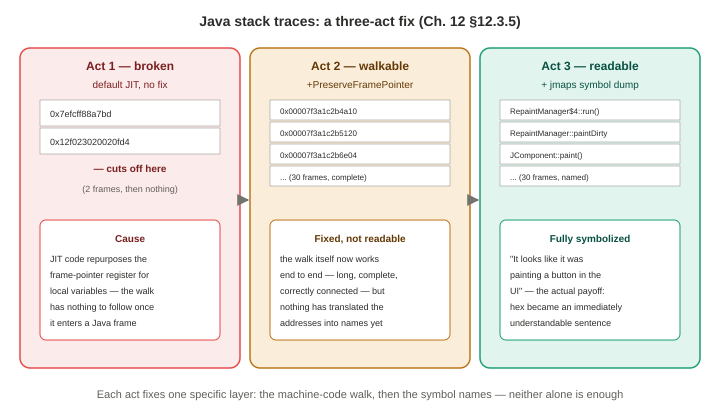

# Chapter 12 — Languages (Part 2 of 3: Java)

*Study notes on Chapter 12 of BPF Performance Tools (Brendan Gregg, 2019). Original notes, not book text — see `00-index.md` for how these notes are written. Continues directly from Part 1 (background taxonomy, and C).*

> This is the chapter's — and arguably the book's — richest worked example: a full, honest, warts-and-all account of tracing a real JIT-compiled language, using an actual open-source Java game (**freecol**) as the target throughout, specifically chosen because it's complex and performance-sensitive enough to stand in for real production Java without needing to redact anything. If Part 1's taxonomy was the theory, this is the theory tested against reality, repeatedly, including the parts that didn't work the first time.

## 12.3 Java — why it's hard, told through a real target

The JVM (HotSpot, originally Sun Microsystems) runs Java methods through **all three** of Part 1's categories at once: it interprets bytecode first, then JIT-compiles "hot" methods past a threshold (`-XX:CompileThreshold`) — and keeps *re*-profiling and *re*-compiling methods afterward, meaning a method's memory location can keep moving even after it's already been compiled once. The JVM's own internals (`libjvm`) are ordinary compiled C++, traceable exactly as covered in the C section. The genuinely hard part — and the reason this section exists — is the **Java methods themselves**.

### 12.3.1 `libjvm` tracing — the easy 80%, and its own stripped-binary gotcha

Tracing `libjvm.so`'s own C++ functions works exactly like any other compiled-language tracing (§12.2). A real example counts JNI (Java Native Interface) function calls with `funccount '/.../libjvm.so:jni_*'`, finding `jni_GetPrimitiveArrayCritical()` the most frequent by far (3,787 calls). **The exact same stripped-symbol problem from §12.2.1 shows up again here, in a real, concrete instance worth remembering**: the `libjvm.so` shipped with most JDK packages is stripped, confirmed directly with `file(1)`, blocking this kind of tracing entirely without one of §12.2.1's fixes (build your own unstripped `libjvm`, install the JDK's debuginfo package, or `unstrip` the two together) — the book uses the debuginfo-package route for its own examples.

### 12.3.2 `jnistacks` — a purpose-built tool, and the introduction of `jmaps`

A tool written specifically for this book: counts the **stack traces** leading into `jni_NewObject*()` calls, to reveal which Java code paths are creating new JNI objects. A real captured stack (18 frames deep) traces a button-paint event all the way down through Swing's rendering internals to a call into `sun.awt.X11GraphicsConfig::pGetBounds()` — plausibly needing to call into the X11 graphics library, which is exactly what would explain the JNI call. **Two things worth flagging from this first real Java stack trace, since both recur constantly for the rest of the section**: frames literally named `Interpreter` appear, marking exactly where execution was still running interpreted Java bytecode rather than JIT-compiled native code; and the Java method symbols themselves appear in **raw JVM class-signature format** (`Ljavax/swing/RepaintManager;::prePaintDirtyRegions+1556`) rather than familiar dotted Java notation (`javax.swing.RepaintManager::prePaintDirtyRegions()+1556`) — the book notes plainly that **neither bpftrace nor `c++filt(1)` demangles this format yet**, so reading raw Java stacks fluently is a skill worth building rather than something tooling currently does for you.

**This tool is also where `jmaps` — the single most-used utility for the rest of this section — is first introduced**: a program (written by the book's author, building on the open-source `perf-map-agent` project) that finds all running Java processes and dumps a **supplemental symbol file** for each to `/tmp/perf-PID.map`, which BCC/bpftrace tools can then use to translate raw Java method addresses into names. Because it uses `system()` internally, it requires bpftrace's `--unsafe` flag. **The design choice of running `jmaps` in an `END` clause (right before printing results) rather than as a separate, earlier step is deliberate and worth remembering as a general pattern**: the longer the gap between dumping symbols and using them, the more likely the JIT has since moved something, producing mistranslated output — running it as late as possible, immediately before translation happens, minimizes that window.

### 12.3.3 Java thread names — why matching on `comm == "java"` silently finds nothing

**A real, easy-to-hit trap demonstrated directly**: `bpftrace -e 'profile:hz:99 /comm == "java"/ { @ = count(); }'` produces **zero output** against a genuinely busy Java process — because the JVM gives each of its own threads a **custom name** (`C2 CompilerThread`, `AWT-EventQueue-`, `Sweeper thread`, ...), and `comm` reflects the **thread's** name, not the parent **process's** name. Matching on PID instead (`pid == 16914`) and keying the output by `(tid, comm)` reveals the real thread breakdown — in the book's own CPU-sampling example, the `C2 CompilerThread` alone accounted for the largest share of samples. **This cuts both ways, worth remembering as a genuine tradeoff rather than pure upside**: per-thread names give you richer context (you immediately know *which* JVM subsystem was consuming CPU) but can also be confusing, since common tools like `top(1)` only ever show the parent process name "java," so the same activity can look completely different depending on which tool you're looking at it through. **This is also given as the specific, concrete reason every later example in this section matches on PID rather than on the process name "java"** — and the book adds a second reason on top: bpftrace's own semaphore-guarded USDT probes (Chapter 2 §2.10) need a specific PID to know whose semaphore to set in the first place, so PID-based targeting isn't just clearer, it's often required.

### 12.3.4 Java method symbols — `perf-map-agent`, `jmaps`, and a hard-won trust threshold

`perf-map-agent` (open source, used by `jmaps` under the hood) attaches to a **live** Java process and dumps a `/tmp/perf-PID.map` file in the same `START SIZE symbolname` text format `perf(1)` itself uses — real example entries include `Lsun/misc/FormattedFloatingDecimal;::getMantissa` and `Lsun/security/util/Cache;::newSoftMemoryCache`. **The dump itself has a real cost** — for a large Java application, more than a second of CPU time — and, being a point-in-time snapshot, it **goes stale** the moment the JIT compiler moves or recompiles methods afterward, which it can keep doing indefinitely, even once a workload looks like it's reached steady state. **A genuinely valuable, concrete rule of thumb the book states directly, worth adopting as a personal standard**: *"For busy production workloads with high rates of compilation, I do not trust Java symbol dumps that are more than 60 seconds old."* `jmaps` exists specifically to minimize this staleness window by automating the dump-and-translate sequence as tightly together as possible — a real example on a busy 48-CPU, 174 GB production server shows it dumping **116,000 symbols in 10.5 seconds**.

**The book is refreshingly candid that `perf-map-agent`/`jmaps` is a working-but-imperfect solution, and lists real, named alternatives under active discussion at the time of writing** — worth knowing exist, even without expecting to use them directly: **timestamped symbol logging** (already in `perf(1)`'s own source, trading always-on overhead for the ability to reconstruct symbol state at any past moment, rather than only a between-snapshot moment); **stale-symbol visibility** (diff two snapshots and flag the addresses that changed as unreliable, rather than silently mistranslating them); **async-profiler** (an approach combining `perf_events` stacks with Java's own `AsyncGetCallTrace` interface, notably **not requiring frame pointers at all**); **future kernel-level support** for in-kernel symbol translation (mentioned already in Chapter 2); and, longest-term, **built-in JVM support** for writing its own supplemental symbol files directly (e.g., on receiving a signal), which the book suggests could be considerably more efficient than an external, single-threaded tool bounded by the JVMTI interface. **The book's own framing is worth remembering as the honest state of the art**: *"This is an evolving space."*

### 12.3.5 Java stack traces — a full three-act demonstration, worth reading start to finish

**This is the chapter's single best worked example, and deserves to be walked through in its entirety rather than summarized, because each act builds directly on the lesson from the one before it.**

**Act one — completely broken, by default.** A plain `profile:hz:99` stack sample against a real running Java process produces output like:
```
@[
    0x7efcff88a7bd
    0x12f023020020fd4
]: 1
```
— nonsense: raw, untranslated addresses, cut off after one or two frames. **The cause, explained precisely**: by default, the JVM's JIT-compiled code **repurposes the frame-pointer register for local variables** as a performance optimization (faster on register-constrained processors), which is a deliberate, JVM-specific instance of the exact same frame-pointer-omission problem Chapter 2 and §12.2.2 already covered for ordinary compiled C code — just happening inside a JIT compiler's code generator instead of `gcc`. (One captured stack in this same broken batch is shown as **fully intact and entirely C++** — because that particular code path never actually entered any Java method, so the frame pointer was never disturbed — a nice, concrete confirmation that the breakage is specifically tied to *Java* frames, not the process as a whole.)

**Act two — fixed at the machine-code level, but still unsymbolized.** Since Java 8 update 60, the JVM has shipped `-XX:+PreserveFramePointer` specifically to fix this — **a JVM feature the book's own author personally developed and contributed** (sent as a patch with a supporting CPU flame graph to demonstrate its value, later generalized/integrated into the official JDK by Oracle's Zoltán Majó). Re-running the identical one-liner with this flag enabled now produces long, complete, correctly-connected stacks of **raw hex addresses** — the walk itself now works end to end, but nothing has translated those addresses into names yet.

**Act three — fully readable, via `jmaps`.** Adding `system("jmaps")` in an `END` clause (or running it manually right before capturing) produces the same stack, now **fully symbolized**: a complete, readable, 30-frame Java call chain through Swing's event-dispatch and painting machinery, ending recognizably at `RepaintManager$4::run()`. **The book's own plain-language read of this stack — "It looks like it was painting a button in the UI" — is worth remembering as the actual payoff of the whole three-act sequence**: getting from meaningless hex to an immediately-understandable sentence about what the program was doing took a compile flag, a symbol-dump utility, and understanding *why* each was necessary — not any single trivial fix.


> **How to read this:** the fix is two independent layers, not one. Act two alone fixes *whether* the walk completes; act three alone would have nothing walkable to symbolize. Both are required, and neither substitutes for the other.

**A fourth, quieter but important beat, worth treating as its own lesson rather than an afterthought**: tracing the `read(2)` syscall on the *same* Java process, with `-XX:+PreserveFramePointer` still active, produces stacks that are **still broken** — cutting off right at `read+68`. **The reason is exactly the C-section lesson from §12.2.2, now demonstrated a second time on a completely different binary boundary**: the walk has left the (now frame-pointer-fixed) JVM entirely and entered `libc`'s own `read()` implementation, which — on this particular system — still lacks frame pointers of its own. Fixing frame pointers in one binary (here, the JVM) only ever fixes stack walking *within* that binary; any walk that crosses into a still-unfixed library breaks again, right at that exact crossing point, no matter how thoroughly the first binary was fixed. The book's own closing line for this whole section is worth taking at face value as real, earned advice rather than boilerplate: *"Fixing stack traces can be a lot of work. But it is worth it: it enables profiling including CPU flame graphs and stack trace context from any event."*

### 12.3.6 Java USDT probes — a stable interface, a real live bug, and a striking overhead demonstration

The JVM ships USDT probes for VM/thread lifecycle, class loading, garbage collection, method compilation, monitors, method calls, and object allocation — but **only if the JDK was built with `--enable-dtrace`**, which the book notes is "unfortunately, is not yet commonly enabled for Linux distributions of the JDK" — directly echoing Chapter 2's general USDT opt-in-build-flag caveat, now confirmed as a real, current, practical obstacle for this specific runtime. `tplist -p PID` lists **over 500** available probes on a live JVM once built this way; `readelf -n` on `libjvm.so` shows the same probes' raw `.note.stapsdt` metadata directly in the ELF binary.

**A genuinely instructive, real implementation walkthrough is given for one probe (`hotspot:gc__begin`), worth understanding as a template for how USDT actually gets wired into a large C++ codebase**: a `.d` provider-definition file declares the probe's name and signature; a build step compiles this into a header exposing a `HOTSPOT_GC_BEGIN(arg1)` macro; that macro is called directly from a real JVM function (`notify_gc_begin()`); and a **paired `_ENABLED` macro** lets the calling code check, cheaply, whether any tracer currently cares about this probe before doing any more expensive argument-preparation work — a concrete, real-code instance of Chapter 2's semaphore-optimization concept.

**A real bug is shown occurring live in the book's own example output, worth reading as a genuine, unfiltered lesson rather than a polished, error-free demo**: tracing `method__compile__begin`'s method-name argument with BCC's `trace(8)` works for eleven lines, then throws an actual `UnicodeDecodeError` Python traceback mid-output. The explanation, and the fix, are both concrete: **the JVM's USDT string arguments are not NUL-terminated** — instead, a *separate* argument carries the string's length, and a tracer that doesn't use that length argument (assuming a normal C-style terminated string instead) will eventually try to decode trailing garbage bytes as if they were more string content. Switching to bpftrace's `str(ptr, length)` two-argument form (rather than the single-argument version used for ordinary NUL-terminated strings) fixes it cleanly — worth remembering as a standing rule for *any* USDT probe whose documentation pairs a pointer argument with a separate length argument, not just this specific JVM probe.

**The overhead demonstration in this section is one of the most concrete, dramatic numbers in the entire book, worth remembering precisely rather than just as "it's expensive."** Some JVM USDT probes — `method__entry`, `method__return`, object-allocation, and monitor probes — are **disabled by default even when the JDK is built with `--enable-dtrace`**, specifically because their *disabled* overhead alone is estimated to exceed 10%, just from existing. They only become available at all with a **second**, separate opt-in flag, `-XX:+ExtendedDTraceProbes`. The book measures the *actual, enabled* cost directly on the `freecol` game: with extended probes active, `method__entry`/`method__return` fired **over 26 million times** during a short trace, and the game's own splash-screen startup time went from **2 seconds to 22 seconds** — an over 10x slowdown, matching the book's own advance warning almost exactly. **The practical conclusion drawn directly from this measurement**: these specific, high-frequency probes are realistically "more useful for troubleshooting software issues in a lab environment than for the analysis of production workloads" — a conclusion earned by an actual measurement, not just general caution.

### 12.3.7 `profile` — CPU flame graphs, including the inlining problem and its (costly) fix

`profile(8)` (Chapter 6) works for Java once the two §12.3.5 prerequisites are satisfied — `-XX:+PreserveFramePointer` running, and a fresh `jmaps` symbol dump available. The book's own full worked example (`jmaps; profile -afp 16914 10 > out.profile01.txt`, piped through `flamegraph.pl --color=java --hash`) produces a genuinely actionable **mixed-mode flame graph**: a `--color=java` palette (green for Java, yellow for C++, red for native user-level, orange for kernel) immediately shows **55% of CPU time inside the C2 JIT compiler itself**, versus only **29%** in the actual `freecol` game code — a real, quantified, at-a-glance finding (*the compiler is costing more than the program it's compiling*) that points directly at JVM compiler tunables (`-XX:CompileThreshold`, `-XX:MaxInlineSize`, and others named directly) as a first place to look for improvement, entirely separate from optimizing the application's own source.

**Inlining is flagged as a real, distinct visual gotcha worth understanding on its own**: since this flame graph shows the code that's *actually executing*, and the JVM can inline "as much as two frames out of every three," the visible call graph can look like methods are calling each other directly when the real source shows an intermediate method in between that simply never got its own stack frame. **The fix demonstrated is `jmaps -u`, which dumps a symbol table including inlined-method boundaries** — at a real, measured cost (symbol count jumping from ~9,000 to over **75,000** in the book's own example, meaningfully slowing both the dump itself and later flame-graph generation) — producing a visibly **taller** flame graph with the previously-hidden inlined frames now shown in a distinct color. **The book's own pragmatic middle-ground advice is worth keeping as the default**: an ordinary (non-uninlined) flame graph is often sufficient to solve real problems, since it still shows overall code flow — reach for the more expensive `-u` version specifically when you need to see exactly which intermediate methods got inlined away, not as a routine default.

### 12.3.8 `offcputime` — a real, concrete production-style discovery, told in full

`offcputime(8)` (Chapter 6) applied to Java, once symbolized, surfaces real, named categories of blocking worth being able to recognize on sight: a thread blocked briefly (5.1 ms total) on a JVM **safepoint** (internally implemented via a futex); a `WatcherThread` blocked for nearly the entire trace duration in `pthread_cond_timedwait()`, simply waiting for periodic work — the book explicitly warns that output like this, from threads that are *supposed* to be idle, can dominate and bury the stacks that actually matter, and that you need to deliberately read past it. **The genuinely great, worked "aha" moment in this section**: one stack shows Java blocked on an `unlink(2)` syscall, waiting on real disk I/O (`io_schedule()`) just to **delete a file** — surprising enough that the book's own author reacted with "this surprised me," and followed up immediately with a targeted one-liner tracing `sys_enter_unlink`'s pathname argument, which revealed `freecol` was deleting its own **autosave files** during normal gameplay. This is a clean, real, small-scale instance of exactly the same investigative instinct that's appeared throughout this book (Chapter 6's `smpcalls`→`opensnoop`, Chapter 9's `bioerr`→`biostacks`): a surprising stack trace becomes a specific, answerable question, answered with one more small, targeted tool.

**A second real frame-pointer instance is shown here too, worth noting as yet another concrete confirmation of the same recurring lesson**: with a **default**, unmodified `libpthread` (compiled with `-fomit-frame-pointer`, as most distributions ship it), the same `WatcherThread` stack breaks cleanly at `pthread_cond_timedwait()` — versus the book's own custom-compiled `libpthread` (with frame pointers preserved) showing the walk continuing further, into `finish_task_switch()`/`schedule()`/`futex_wait_queue_me()` kernel frames. **Off-CPU time flame graphs** get the same blue-background treatment established in Chapter 6, plus a `--countname=us` `flamegraph.pl` option (since the underlying numbers here are microseconds of blocked time, not CPU sample counts) — and the book demonstrates a genuinely practical technique for navigating an off-CPU flame graph dominated by "waiting for work" threads: using the flame graph's own **search** feature to highlight only frames containing the application's own name (`"freecol"`), or, more surgically, pre-filtering the raw folded-format file with `grep` *before* generating the SVG at all — a nice reminder that the folded-format's plain-text nature (Chapter 4) makes it trivially scriptable before visualization.

### 12.3.9 `stackcount` — page-fault flame graphs

`stackcount(8)` (Chapter 4) applied to `t:exceptions:page_fault_user` for a Java process reveals two very different real fault sources side by side: one stack tracing through actual `freecol` AI game logic (`InGameController::move` → ... → an interpreted method), and a second, much more frequent one (414 occurrences vs. 4) tracing entirely through the **C2 compiler's own register-allocation code** (`PhaseChaitin::Register_Allocate()`) — a direct, measured reminder that a meaningful share of a Java process's own memory growth can come from the **compiler doing its job**, not from the application's own logic at all. A green-background **page fault flame graph** (following the same color-coding convention as CPU/off-CPU flame graphs) is generated the same way, from `stackcount`'s folded-format output.

### 12.3.10–12.3.15 The BCC/USDT tool catalog — `javastat`, `javathreads`, `javacalls`, `javaflow`, `javagc`, `javaobjnew`

These six tools are all built on the Java USDT probes covered in §12.3.6, and largely share that section's two overhead tiers — worth keeping in mind as you read their descriptions:

- **`javastat(8)`** — a `top(1)`-style, per-second summary (methods/sec, GC/sec, new-objects/sec, class-loads/sec, exceptions/sec, threads/sec) across all running JVMs. **Its `METHOD/s` and `OBJNEW/s` columns will read as zero unless `-XX:+ExtendedDTraceProbes` is active** — a direct, visible consequence of §12.3.6's two-tier probe design. (It's genuinely a thin wrapper around a shared, language-agnostic `ustat(8)` helper in BCC's own library directory — worth knowing since several of the tools below share this same "thin wrapper around a shared multi-language helper" structure.)
- **`javathreads(8)`** — a bpftrace tool (written specifically for this book) tracing `hotspot:thread__start`/`thread__stop` directly, printing each thread's creation and (if it happens during the trace) its stop, with full names — since thread creation/destruction is comparatively rare, the book notes overhead here "should be negligible," a useful contrast to the extended-probe tools around it.
- **`javacalls(8)`** — counts (or, with `-L`, times) individual Java method calls, keyed by class and method name — real example output shows `java/lang/String.coder()` called **1,268,791 times** in one short trace, the most frequent by far. **Requires `-XX:+ExtendedDTraceProbes`**, with the same expected order-of-magnitude overhead as §12.3.6 (the tool's own help text reminds the user of this directly if no output appears).
- **`javaflow(8)`** — shows the actual **call/return flow** between Java methods as indented `->`/`<-` lines, letting you read a real call graph directly rather than just aggregate counts. **A real, honest limitation surfaces directly in its own output**: occasional `"Possibly lost N samples"` messages, meaning BPF's own event buffer couldn't keep up with the sheer volume of method-entry/exit events even in a live, running trace — a live, concrete instance of Chapter 2's general BPF-buffer-overflow caveat (and Chapter 11's related security-monitoring warning about needing to detect and account for exactly this kind of drop), here simply reported honestly in the tool's own output rather than silently swallowed.
- **`javagc(8)`** — timestamps and durations for individual garbage-collection events, using the *standard* (non-extended) USDT probes — meaning, unlike the previous two tools, this one doesn't require `-XX:+ExtendedDTraceProbes` or its associated overhead penalty at all.
- **`javaobjnew(8)`** — counts (with `-C`) or sizes (with `-S`) new object allocations by class name — real example output shows `java/util/HashMap$KeyIterator` allocated over 900,000 times in one trace. **Also requires `-XX:+ExtendedDTraceProbes`**, and the book notes its `BYTES` column reads as zero for Java specifically (unlike some other languages the same shared underlying `uobjnew(8)` helper supports), since that particular size information isn't available from the Java USDT probes used.

**A recurring authorial detail worth noting across several of these tools, since it's a nice, human throughline for the whole section**: many trace their origin back to tools Sasha Goldshtein originally wrote as BCC's shared, multi-language `u*` helpers (`ustat`, `ucalls`, `uflow`, `ugc`, `uobjnew`), with this book's author writing thin, Java-specific wrapper scripts around them — and several *also* trace back to the author's own, much earlier (2007) DTrace-based Java tools (`j_stat.d`, `j_calls.d`, `j_flowtime.d`, `j_objnew.d`) — a nice, concrete illustration that this whole toolkit is the second or third generation of a genuinely long-running effort to solve the same underlying Java-observability problem across different tracing technologies.

## 12.3.16 Java One-Liners

```
# BCC: count JNI events by name
funccount '/.../libjvm.so:jni_Call*'

# bpftrace: same
bpftrace -e 'u:/.../libjvm.so:jni_Call* { @[probe] = count(); }'

# BCC: count Java method-related USDT events
funccount -p $(pidof java) 'u:/.../libjvm.so:method*'

# bpftrace: same
bpftrace -e 'usdt:/.../libjvm.so:method* { @[probe] = count(); }'

# BCC: profile Java stacks and thread names at 49 Hz
profile -p $(pidof java) -UF 49

# bpftrace: same
bpftrace -e 'profile:hz:49 /execname == "java"/ { @[ustack, comm] = count(); }'

# bpftrace: trace method compilation as it happens
bpftrace -p $(pgrep -n java) -e 'U:/.../libjvm.so:method__compile__begin {
    printf("compiling: %s\n", str(arg4, arg5)); }'

# bpftrace: trace class loads as they happen
bpftrace -p $(pgrep -n java) -e 'U:/.../libjvm.so:class__loaded {
    printf("loaded: %s\n", str(arg0, arg1)); }'
```

---

*Continue to Part 3 (`12-languages-part3.md`) for Bash (the interpreted-language worked example), brief coverage of JavaScript/C++/Golang, and the chapter summary.*
