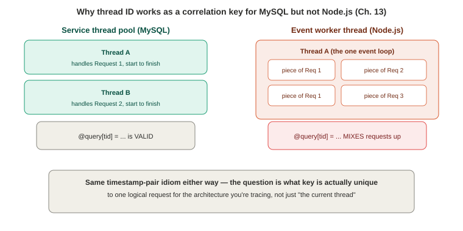

# Chapter 13 — Applications

*Study notes on Chapter 13 of BPF Performance Tools (Brendan Gregg, 2019). Original notes, not book text — see `00-index.md` for how these notes are written.*

> Same shape as the resource chapters, but a different axis: instead of one subsystem, this chapter's throughline is one real application — **MySQL** — traced continuously across thread management, CPU/off-CPU analysis, application context, locks, signals, and sleeps. Explicitly framed as *supplemental* to Chapters 6–10: full visibility of a real system needs both resource-level analysis (the earlier chapters) and this chapter's application-level view.

## 13.1 Background

### Application fundamentals — thread models, locks, sleeps

**Four thread-usage patterns worth being able to name and recognize**, since which one an application uses changes how you'd trace it:
- **Service thread pool** — a fixed or elastic pool where each thread services one client connection/request at a time, sleeping when blocked (MySQL's own model).
- **CPU thread pool** — one thread per CPU, running continuously on queued work (batch processing, e.g., video encoding).
- **Event worker thread(s)** — one or more threads processing a queue of work piecemeal, switching to the next queued item whenever the current one blocks; avoids lock contention if single-threaded, but risks becoming a single-thread bottleneck under load (Node.js's model, directly echoing Chapter 12 §12.1's own framing of it).
- **SEDA (Staged Event-Driven Architecture)** — requests decomposed into distinct stages, each potentially serviced by its own thread pool.


> **How to read this:** both use the identical timestamp-pair idiom from Chapter 5 — the only question is whether `tid` is actually unique to one logical request in this particular architecture.

**Why this distinction matters directly for how you'd write a BPF tool, stated as a concrete, load-bearing methodological point**: for a **service thread pool**, the same thread processes a request start to finish, so **thread ID is a valid, unique key** for correlating events across a request's lifetime (Chapter 5's flagship timestamp-pair idiom applies directly) — e.g., stash a query string in a map keyed by `tid` when a query starts, and read it back later when disk I/O begins, to attribute that I/O to the query that caused it. **Event worker thread architectures break this assumption entirely**, since one thread services many concurrent requests piecemeal — thread ID is no longer unique to one request, and a different correlation key (something request-specific) is needed instead. This is the same "find a key that's actually stable and unique across the event you're measuring" lesson from Chapters 9/10, now applied at the *application-architecture* level rather than the kernel-data-structure level.

**Locks** (mutexes, reader-writer, spin locks — usually via `libpthread` on Linux) protect shared memory in multi-threaded applications, with the book's own traffic-light analogy worth keeping: they can also *cause* wait time (**lock contention**) when multiple threads compete for the same one. **Sleeps** get a small, memorable, very true aside: a deliberate "sleep for a second here so the thing I'm waiting on finishes, we'll fix it properly later" often never gets fixed, and years later end users are left wondering why some requests take at least a second — exactly the kind of thing `naptime(8)` (§13.2.15) is built to catch.

### MySQL as the worked example, and its real USDT probe set

MySQL uses a **service thread pool**, is written in **C++**, and ships **real USDT probes** — for connections, commands, queries, filesorts, inserts/updates, and network I/O — **but only when compiled with `-DENABLE_DTRACE=1`**, which the book notes plainly the standard Linux `mysql-server` package does **not** do by default — the same USDT opt-in-build-flag gotcha from Chapter 2, now confirmed for a second, specific, widely-used piece of production software. **Because of this, the chapter deliberately covers both the USDT-based tools *and* uprobe-based fallbacks for when USDT isn't available** — a real, worked demonstration of Chapter 12's own "prefer USDT, fall back to uprobes" strategy (§12.1.5), applied end to end to one real application rather than described abstractly.

### What BPF adds, and the strategy

BPF answers: what are the application's requests and their latency; where does request time actually go; why is the application on/off CPU; what I/O is it doing and why (code path); what locks does it block on, and for how long; what other kernel resources does it use, and why. **Overhead is request-rate-dependent, and the book gives a genuinely useful rule of thumb**: tracing the requests themselves is typically negligible-cost, while tracing **lock contention, off-CPU events, and syscalls** can be noticeably more expensive on busy workloads — directly foreshadowing the real overhead numbers shown later for `offcputime(8)` and `pmlock(8)`/`pmheld(8)`.

**The ten-step strategy, worth having as an ordered checklist for any new application you need to analyze**: (1) learn the application's actual unit of work, and what "better" would even mean for it (throughput, latency, resource usage); (2) find existing documentation on its internals (thread model, caches, API); (3) check for background periodic tasks that could affect performance independent of the main workload; (4) check for USDT probes (application or language-level); (5) do on-CPU analysis (`profile(8)`); (6) do off-CPU analysis, focused specifically on blocking *during requests* (`offcputime(8)`, and two Chapter 14 tools previewed here: `wakeuptime(8)`, `offwaketime(8)`); (7) profile syscalls (`syscount(8)`); (8) browse the resource-chapter tools (Ch. 6–10); (9) use uprobes to explore internals, guided by whatever functions the on/off-CPU stack traces already surfaced; (10) for distributed systems, consider tracing **both** the server and the client side (e.g., MySQL's own client library).

## 13.2 BPF Tools

The book groups its sixteen tools into seven themes — CPU analysis, off-CPU analysis, application context, thread execution, lock analysis, signals, and sleep analysis — which is a cleaner organizing frame than reading them in numeric order, and is followed here.

### Thread execution: `execsnoop`, `threadsnoop`, `threaded`

**`execsnoop(8)`** (Ch. 6) — new processes; here specifically useful for catching applications that shell out to external scripts for functionality that should really be native code, a real, concrete inefficiency pattern the book names directly. **`threadsnoop(8)`** (written for this book) traces `pthread_create()` via uprobe, printing each new thread's starting function (resolved with `usym()`) — a real MySQL startup trace shows the server spinning up its I/O handler threads, worker threads, and various monitor/purge/dump threads by name, immediately revealing the server's own internal thread architecture without reading any documentation. Adding a `ustack` to the print statement shows the **code path that led to thread creation** — useful when, unlike MySQL's self-explanatory thread names, an application's thread purpose isn't obvious from its name alone.

**`threaded(8)`** (also written for this book, with a nice long lineage back to a 2005 DTrace tool the author built specifically to demonstrate a lock-contention teaching example in his own performance classes) samples on-CPU threads per second, to check **how evenly a multi-threaded application is actually spreading work**. A real MySQL example shows one single thread ID dominating CPU time far above all others — direct, quantified evidence of *how* multi-threaded a workload really is in practice, as opposed to how many threads it merely *has*. **A real, useful cross-reference back to Chapter 12 is given directly**: running the same tool against the `freecol` Java application from Chapter 12 shows CPU time dominated by **compiler threads** (`C1`/`C2 CompilerThread`) — the same JIT-compilation-cost finding Chapter 12's own Java flame graph revealed, now confirmed independently through a completely different, much simpler tool.

### CPU analysis: `profile`, `syscount`

**`profile(8)`** (Ch. 6) applied to MySQL, once symbolized and with working stacks (§13.2.9 explains what that requires), produces a real, actionable CPU flame graph: `dispatch_command()` present in **69%** of samples, `JOIN::exec()` in **19%** — a direct, quantified map of where CPU time actually goes inside a real production database server, and (as the book notes) a flame graph's visible functions (`do_command()`, `mysqld_stmt_execute()`, `JOIN::exec()`, `JOIN::optimize()`) double as a **ready-made shortlist of uprobe targets** for whatever deeper investigation comes next — a clean, direct instance of Chapter 12 §12.1.4's point that CPU profiling and application tracing feed into each other. **`syscount(8)`** (Ch. 6) applied to MySQL reveals `sched_yield()` as the single most frequent syscall (over 10,000/sec) — and, switching to its `-L` latency-summing mode, reveals `futex(2)` consuming **over 108 seconds of total time in a 10-second trace** (only possible because many threads call it in parallel) and, more directly actionable, `fsync(2)` consuming **4,393 ms total** — a concrete, quantified pointer toward the file system/storage layer as a specific place to look for optimization, arrived at purely from counting and timing syscalls.

### Off-CPU analysis: `offcputime`, `offcpuhist`, `ioprofile`

**`offcputime(8)`** (Ch. 6) applied to MySQL produces an off-CPU time flame graph dominated (as expected) by idle thread pools waiting for work — with the **genuinely actionable** narrow tower being the time spent specifically inside `do_command()`, which zooming in reveals is mostly **`ext4_sync_file()`**, at **3.95 seconds total** — a direct, quantified target for optimization (the file system, again, confirming `syscount`'s `fsync` finding through a completely independent measurement path). **Overhead is stated precisely and honestly**: can exceed **5%** depending on context-switch rate — real but manageable, and explicitly contrasted with the pre-BPF alternative (dumping every stack to user space for post-processing), whose overhead the book says was "usually prohibitive for production use" — a direct, concrete instance of this book's recurring in-kernel-summarization efficiency argument.

**`offcpuhist(8)`** (written for this book, with real lineage back to a 2011 DTrace tool, and noted as **the first off-CPU analysis tool written for bpftrace**) is `offcputime`'s histogram-instead-of-sum sibling. A real MySQL example shows one stack (worker threads waiting for work via a futex) with a genuinely **bimodal** distribution — one mode around 16 microseconds, a second between 8–16 **milliseconds** — and a second stack (waiting for network input via `poll()`) with most waits under 128 microseconds. **Its source is a clean, complete illustration of a single kprobe doing double duty**, exactly like Chapter 6's `offcputime`: one `finish_task_switch()` probe both records a start timestamp for the thread *leaving* the CPU and computes/histograms elapsed time for the thread that's *arriving* — the same one-probe, two-roles pattern, here shown as a fully worked, readable bpftrace script rather than described abstractly.

**`ioprofile(8)`** (written for this book, originally intended for a new flame-graph type in Netflix's internal Vector tool) traces I/O-related syscalls (read/write/send/recv families) with full calling stack traces — real MySQL output shows a `pwrite64()` call traced all the way back through a transaction-commit code path, and a `recvfrom()` call traced back through packet-reading — directly attributing specific I/O operations to specific, named application code paths. **A genuinely candid footnote is worth remembering on its own**: the book's author states that building this specific tool, "more than any other tool," exposed just how painful it is to not have frame pointers preserved in `libc` and `libpthread` — to the point of speculating it "may inspire a change in the Netflix BaseAMI libraries." This is worth remembering as a real, concrete instance of a recurring theme finally motivating an actual infrastructure change, not just a recurring annoyance.

### 13.2.9 libc Frame Pointers — the recurring lesson, stated as its own dedicated subsection

**This short section is worth reading as the chapter's own explicit acknowledgment of just how often the frame-pointer problem has now recurred**, and it's worth remembering as a standing checklist. With MySQL itself compiled with frame pointers but a **standard, unmodified** system `libc`, `ioprofile(8)`'s stacks break down to one or two frames — `__pwrite+79` followed immediately by a bogus address, or `__libc_recv+94` with nothing after it at all — the exact same failure mode demonstrated live in Chapter 12 §12.2.2/12.3.5, now confirmed for a real production database server's actual I/O path specifically. **Four concrete fix options are given, worth having as a menu rather than a single fix**: recompile `libc` itself with `-fno-omit-frame-pointer`; trace `libc`'s interface functions specifically *before* the frame-pointer register has been reused inside them (a narrower, more fragile workaround); trace the **application's own** functions instead of library internals (MySQL's `os_file_io()`, in this case) — an application-specific approach that sidesteps the library problem entirely; or fall back to one of Chapter 2's alternative stack-walking techniques (DWARF, LBR, ORC, BTF). The book notes `glibc` (which also provides `libpthread`) has previously been the subject of a real, public request that Debian ship an alternate, frame-pointer-preserving build — evidence this is a recognized, ongoing point of friction in the wider ecosystem, not just an inconvenience specific to this book's own examples.

### Application context: `mysqld_qslower`, `mysqld_clat`

**`mysqld_qslower(8)`** (written for this book, evolved from a 2011 DTrace tool) prints individual MySQL queries slower than a threshold, with the **query string itself** as application context — real output shows specific `SELECT ... REGEXP` queries each taking 95–206 ms. The book notes this genuinely overlaps with MySQL's own built-in slow-query log, but frames the BPF version's real advantage precisely: **it can be extended to include details the slow-query log doesn't have**, like the disk I/O or other resource usage specifically caused by that query — the general Chapter 12 point about crossing layers in one tool, now made completely concrete. The USDT-based version keys `@query`/`@start` maps by `tid`, exactly following §13.1's "service thread pool → thread ID is a valid per-request key" rule stated explicitly in the source's own commentary. **A full uprobes-based fallback is also given**, targeting `dispatch_command()` directly (identified as a promising target from the same `profile(8)` flame graph shown earlier in the chapter) — filtered specifically to the `COM_QUERY` command type (checked via a raw integer constant, `3`, taken directly from MySQL's own header) so that only true queries, not every command type `dispatch_command()` handles, get timed. **The book's own closing caveat for this fallback version is worth remembering as a standing rule, not just specific to MySQL**: *"the traced function names, the arguments, and the logic, are all dependent on the version of MySQL... this tool may not work on other versions if any of these details change. This is why USDT probes are preferred."*

**`mysqld_clat(8)`** (written for this book) times the interval between `mysql:command__start` and `mysql:command__done`, histogrammed **per command type** (using a hand-built lookup table translating MySQL's own numeric command-type constants into readable names, sourced directly from MySQL's own header file) — real output shows `COM_QUERY` mostly landing in the 8–256 microsecond range, while `COM_STMT_EXECUTE` shows a genuinely **bimodal** distribution across several distinct latency bands. A clean, minimal diff is shown for converting this same tool to a uprobes-based fallback (retarget the probes at `dispatch_command()`'s entry/return, read the command type from a different argument position) — a nice, concrete demonstration that the USDT-vs-uprobes choice is often a small, mechanical substitution once you understand *what* you're actually trying to measure, not a fundamentally different tool design.

### Lock analysis: `pmlock` and `pmheld`

**`pmlock(8)`** (written for this book, explicitly modeled on Solaris's `lockstat(1M)`) times `pthread_mutex_lock()`'s own **latency** — how long a thread waits to *acquire* a lock — histogrammed by lock address and calling stack; **`pmheld(8)`** instead times how long a lock is **held**, from successful acquisition to `pthread_mutex_unlock()`. **The book frames these as a deliberate, two-step diagnostic pair, worth remembering as the actual workflow rather than two independent tools**: use `pmlock(8)` first to confirm lock contention exists and *where* threads are waiting; then use `pmheld(8)` to find *which code path* is responsible for holding that same lock too long, which is the thing you'd actually need to fix. Real MySQL output shows both tools converging on the same lock address (`0x7f3728...`) from related-but-distinct code paths through `THD::set_query()` — letting you connect "this is where threads wait" directly to "this is what's making them wait." **Overhead is given a real, precise, measured number, not just a general caution**: `funccount`'s own one-second measurement shows `pthread_mutex_lock()`/`unlock()` called tens of thousands of times *per second* on a busy MySQL server — the book's blunt conclusion, worth remembering as the standing rule for lock tracing specifically: *"At such rates, adding a tiny amount of overhead to each call will add up."* Both tools are explicitly recommended for output-to-file, short-duration, PID-scoped use rather than continuous system-wide monitoring, for exactly this reason.

### Signals: `signals`, `killsnoop`

**`signals(8)`** (written for this book, tracing back to a 2005 DTrace example) traces the `signal:signal_generate` tracepoint — catching **every** signal sent on the system, from any source, not just ones sent via the `kill(2)` syscall — summarized by signal name (via a hand-built numeric-to-name lookup table), target PID, and process name. Framed directly as a troubleshooting tool for **unexpected application termination** — a real example shows a `SIGKILL` delivered to a `sleep` process, and a recurring `SIGALRM` hitting `Xorg` 87 times during the trace. **`killsnoop(8)`** (Ch. 6/BCC heritage, with the book's own author noting he built the very first version in 2004 specifically to debug a case of mysterious application terminations) is narrower by design — tracing only signals sent via the explicit `kill(2)` **syscall**, but in exchange showing the **sender's** identity directly (PID, process name), which the broader `signal:signal_generate` tracepoint alone doesn't surface as directly. **The two tools are complementary along exactly this axis**: `signals(8)` for breadth (catches signals from any delivery mechanism), `killsnoop(8)` for a specific, common delivery mechanism plus sender attribution.

### Sleep analysis: `naptime`

**`naptime(8)`** (written for this book) traces the `nanosleep(2)` syscall, printing the calling process (and, read directly from `task_struct`, its **parent** process) plus the requested sleep duration. **A real, concrete, personally-motivated origin story is given directly**: the author built this specifically to debug an internal build process that mysteriously took minutes while "seemingly doing nothing" — and it directly caught a `build-init` process sleeping for a **flat 30 seconds**, which, once found and removed/tuned, made the whole build **10x faster**. The same trace incidentally reveals MySQL and `iscsid` both sleeping for exactly one second, every second — routine, expected polling behavior, shown here mainly as a contrast to the genuinely fixable 30-second outlier. **The tool's own explicit caveat, worth remembering as a recurring theme by now**: reading parent-process details via `task_struct` directly is **unstable**, and may need updating if that struct's layout changes in a future kernel — the same "reading raw kernel struct fields is inherently more fragile than a stable interface" caveat that's appeared throughout Chapters 6–13.

### 13.2.16 Other tools worth knowing exist

**`deadlock(8)`** (BCC, contributed by Kenny Yu) detects **potential deadlocks** from mutex lock-order inversions, by building a directed graph of observed lock-acquisition orderings and checking for cycles — flagged as high-overhead, but valuable specifically because it can help debug an otherwise genuinely difficult class of bug (a real production deadlock) that's hard to reproduce and diagnose by other means.

## 13.3–13.4 BPF One-Liners

```
# BCC: new processes with their arguments
execsnoop

# BCC: syscall count by process, and by syscall name
syscount -P
syscount

# BCC / bpftrace: sample user stacks at 49 Hz for one PID
profile -U -F 49 -p 189
bpftrace -e 'profile:hz:49 /pid == 189/ { @[ustack] = count(); }'

# BCC / bpftrace: count off-CPU user stack traces
stackcount -U t:sched:sched_switch
bpftrace -e 'tracepoint:sched:sched_switch { @[ustack] = count(); }'

# bpftrace: sum malloc() requested bytes by user stack (explicitly flagged as high overhead)
bpftrace -e 'u:/lib/x86_64-linux-gnu/libc-2.27.so:malloc { @[ustack(5)] = sum(arg0); }'

# bpftrace: count LLC misses by process name
bpftrace -e 'hardware:cache-misses: { @[comm] = count(); }'

# bpftrace: count libpthread conditional-variable functions, capped to exactly one second
bpftrace -e 'u:/lib/x86_64-linux-gnu/libpthread.so.0:pthread_cond_* {
    @[probe] = count(); } interval:s:1 { exit(); }'
```

**The conditional-variable one-liner is worth a second look as a genuinely nice small pattern in its own right**: pairing a `u:...pthread_cond_*` wildcard probe with a **separate `interval:s:1 { exit(); }` probe** is a clean, reusable way to run any one-liner for **exactly** a fixed duration and then stop automatically, without needing `timeout(1)` or manual Ctrl-C timing — worth remembering as a general technique any time you want a bounded, one-shot measurement rather than an open-ended trace. Its real MySQL output shows `pthread_cond_signal()`/`broadcast()` firing thousands of times in that single second — direct, quantified evidence of how much thread-wakeup coordination (via condition variables, the mechanism threads use to sleep until signaled rather than busy-waiting) is happening under the hood of an ordinary, moderately busy request.

## 13.5 Summary

This chapter extended the resource-oriented view of Chapters 6–10 with an application-level one, using MySQL as a single, consistent, real-world example throughout — thread management, CPU and off-CPU analysis (revisited specifically because of how central they are), application-context tracing via both USDT and uprobes, lock contention, signals, and sleeps. The throughline worth carrying forward: application tracing is rarely a single technique — it's resource-chapter tools, USDT where available, uprobes as an honestly-caveated fallback, and stack traces from CPU/off-CPU sampling, all pointed at the same target application together, exactly as this chapter's own strategy section laid out at the start.

---

## Quick-reference glossary (this chapter's terms)

- **Service thread pool** — MySQL's own threading model, where each thread handles one client's full request lifecycle, making thread ID a valid per-request correlation key.
- **Lock contention** — multiple threads competing for the same lock, causing wait time; diagnosed with the `pmlock`(wait)/`pmheld`(hold-time) pair.
- **Application context** — request-level detail (like a SQL query string) that resource-level tracing alone can't supply; the specific gap `mysqld_qslower`/`mysqld_clat` fill.
- **Condition variable** — a `libpthread` synchronization primitive letting threads sleep until explicitly signaled, rather than busy-waiting; what the `pthread_cond_*` one-liner counts.

## Check your understanding

1. Why does a MySQL-style service thread pool make thread ID a valid key for correlating a query's start with its later disk I/O, while an event-worker-thread architecture would not?
2. In the `mysqld_qslower`/`mysqld_clat` sections, what specific, concrete downside does the book attach to the uprobes-based fallback version that doesn't apply to the USDT-based version?
3. Explain the intended workflow relationship between `pmlock(8)` and `pmheld(8)` — why would you typically run one before the other, rather than either alone?
4. The `naptime(8)` story describes a 30-second sleep being found and fixed, making a build "10 times faster." Why was this specific finding actionable in a way that MySQL's own recurring one-second sleeps (also visible in the same tool's output) were not?
5. What real, measured evidence does this chapter give for why `pmlock(8)`/`pmheld(8)` are recommended for short, PID-scoped, file-redirected runs rather than continuous system-wide monitoring?

<details>
<summary>Answers</summary>

1. In a service thread pool, the same single thread processes one client's request from start to finish — so at any point during that request, the current thread ID uniquely identifies which request is being handled, letting a tool stash context (like a query string) in a map keyed by thread ID and reliably retrieve it later in the same request's lifecycle. In an event-worker architecture, one thread processes pieces of many different concurrent requests, switching between them as each one blocks — so the thread ID no longer identifies a single request, and a map keyed on it would mix up context from unrelated requests.
2. The uprobes-based fallback depends on the exact function names, argument positions, and internal logic of the specific MySQL version being traced — the book states directly that this tool "may not work on other versions if any of these details change." The USDT-based version instead relies on MySQL's own maintained, stable probe interface, which is far less likely to break across version upgrades.
3. `pmlock(8)` identifies *that* lock contention exists and measures how long threads wait to acquire a given lock; `pmheld(8)` then identifies *why*, by showing which code paths are holding that same lock, and for how long, once acquired. Running `pmlock` first tells you there's a real problem and roughly where it is; running `pmheld` next (often for the same lock address) tells you specifically which code path is responsible for the excessive hold time you'd actually need to fix — one tool locates the symptom, the other locates the cause.
4. The 30-second sleep in `build-init` was a single, large, clearly abnormal delay directly on the critical path of a build process the author was actively trying to speed up — removing or reducing it produced an immediate, large, measurable improvement (10x faster). MySQL's and `iscsid`'s one-second sleeps, by contrast, were recurring, expected, routine polling behavior integral to how those services normally operate — not evidence of a bug or an inefficiency waiting to be fixed, just background housekeeping that happened to also show up in the same tool's output.
5. The chapter cites a direct measurement with BCC's `funccount`: on a busy MySQL server, `pthread_mutex_lock()` and `pthread_mutex_unlock()` were each called tens of thousands of times *per second*. At that event rate, even a very small per-call instrumentation overhead accumulates into a real, noticeable total cost — which is why the book recommends scoping these tools to a specific PID, running them for a short, bounded duration, and redirecting output to a file for later analysis, rather than leaving them running broadly and indefinitely.

</details>
