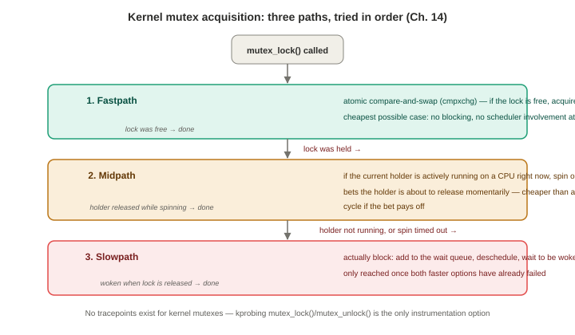
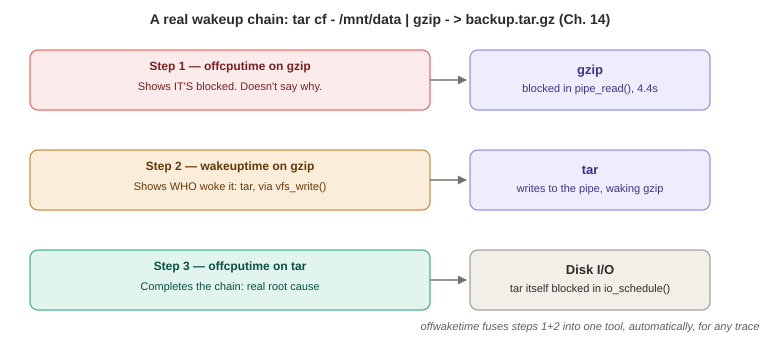

# Chapter 14 — Kernel

*Study notes on Chapter 14 of BPF Performance Tools (Brendan Gregg, 2019). Original notes, not book text — see `00-index.md` for how these notes are written.*

> Same supplemental relationship to Chapters 6–10 that Chapter 13 had, but pointed inward: this is about understanding **the kernel's own behavior** — wakeups, kernel-internal memory allocation, kernel-internal locks, tasklets, and work queues — useful for kernel troubleshooting and kernel development specifically, not for explaining what an application is doing to the kernel.

## 14.1 Background

### Wakeups — the missing half of off-CPU analysis

When a blocked thread returns to a CPU, it's usually because something else triggered a **wakeup event** — and sometimes there's a genuine **dependency chain**: thread A wakes thread B, which wakes thread C, which finally wakes the originally-blocked application thread. **Tracing the wakeup side specifically, not just the blocking side, is this chapter's single biggest new capability over what Chapter 6 already covered** — and the reason becomes very concrete in §14.4.2–14.4.4 below.

### Kernel memory allocation — the two allocators, by name

The **slab allocator** (now implemented as **slub** in Linux — a functionally-equivalent but less complex descendant of the original slab design) is the general-purpose allocator for fixed-size objects, supporting caching/recycling for efficiency. The **page allocator** allocates whole memory pages using a **buddy algorithm** (pairing up adjacent free "buddy" pages so they can be coalesced/allocated together), and is NUMA-aware. **The actual kernel API calls worth recognizing by name**, since they show up directly as kprobe/tracepoint targets throughout §14.4: `kmalloc()`/`kzalloc()`/`kmem_cache_alloc()` (slab, for small chunks), `vmalloc()`/`vzalloc()` (large virtual areas), and `alloc_pages()` (whole pages).

### Kernel locks — a three-path hybrid mutex, and RCU

Kernel locks come in the same broad families as user-level ones (Chapter 13) — spin locks, mutexes, reader-writer locks — but **Linux kernel mutexes specifically are a three-path hybrid, tried in this exact order**, worth remembering as a genuinely elegant escalation design: **(1) fastpath** — an atomic compare-and-swap (`cmpxchg`) instruction, no blocking at all if the lock is free; **(2) midpath** — if the current lock holder is *actively running on a CPU right now*, optimistically spin for a short while first, on the bet that it's about to release the lock momentarily (cheaper than the full block/wake cost if the bet pays off); **(3) slowpath** — actually block and wait to be woken, only once the first two options have failed.


> **How to read this:** each path only runs if the one above it didn't already succeed — the common, uncontended case never leaves the fastpath, and the expensive block/wake machinery is reserved for genuine contention.

**RCU (read-copy-update)** is mentioned separately as a synchronization mechanism letting many readers proceed concurrently with an in-progress update, improving scalability specifically for data that's read far more often than it's written.

### Tasklets and work queues — the bottom half of interrupt handling

Device drivers split interrupt handling into two halves: a **top half** that runs immediately, in interrupt-disabled mode, and must therefore be extremely fast (since it postpones all other interrupt delivery for as long as it runs); and a **bottom half** — either **tasklets** (lighter-weight, can't sleep) or **work queues** (real, kernel-schedulable threads that *can* sleep) — which handles the rest of the work at a less time-critical moment. This top/bottom split is the direct motivation for §14.4.12–14.4.13's tools.

### BPF capabilities and event sources

BPF answers: why are threads leaving the CPU, and for how long; what events were off-CPU threads actually waiting for (the wakeup side); who's using the kernel slab allocator right now; is the kernel actively rebalancing NUMA pages; what work-queue events are occurring, and with what latency; and, for kernel developers specifically, arbitrary function-level tracing of their own in-development code. A reference table of event sources worth having on hand: kernel function execution → **kprobes**; scheduler events → **`sched` tracepoints**; syscalls → **`syscalls`/`raw_syscalls` tracepoints**; kernel memory allocation → **`kmem` tracepoints**; page-out daemon scanning → **`vmscan` tracepoints**; interrupts → **`irq`/`irq_vectors` tracepoints**; workqueue execution → **`workqueue` tracepoints**; timers → **`timer` tracepoints**; IRQ/preemption-disabled sections → **`preemptirq` tracepoints** (needs `CONFIG_PREEMPTIRQ_EVENTS`). `bpftrace -l 'tracepoint:*'` or `perf list tracepoint` will show exactly what's available on your specific running kernel.

## 14.2 Strategy — a nine-step process for a new kernel-internal question

1. **If possible, create a workload that triggers the event of interest a known number of times** — potentially writing a short C program specifically for this, echoing the same known-workload validation discipline from Chapters 9 and 12.
2. Check for an existing tracepoint, or an existing tool (including this chapter's own).
3. If the event is frequent enough to consume significant CPU (**>5%**), **CPU profiling** can quickly reveal the relevant kernel functions (and will also reveal spin-lock and optimistic-mutex-spin activity directly, since both show up as ordinary CPU-consuming functions in a profile); for rarer events, a longer profile duration may be needed to gather enough samples.
4. **Count function calls by name pattern** to find related functions — e.g., `funccount 'ext4_*'` when investigating ext4 specifically.
5. **Count stack traces** (`stackcount`) to understand the calling code path — though profiling in step 3 should already have revealed much of this.
6. **Trace function call flow through child functions** (Ftrace-based `funcgraph(8)`, covered in §14.3.1).
7. Inspect function arguments (`trace(8)`/`argdist(8)`, or bpftrace).
8. Measure function latency (`funclatency(8)`, or bpftrace).
9. Write a custom tool once the above has narrowed down exactly what to instrument.

## 14.3 Traditional Tools

### 14.3.1 Ftrace — a genuinely complete worked investigation, worth reading end to end

Ftrace (Steven Rostedt, added Linux 2.6.27/2008 — the book notes Rostedt specifically prefers the capitalized spelling "Ftrace," a small detail worth getting right) is, like `perf(1)`, a multi-capability tool with **at least four different ways to use it**: directly via the `/sys/kernel/debug/tracing` files; via the `trace-cmd` front end; via the `KernelShark` GUI; or via **`perf-tools`** (a collection of shell-script wrappers around the same debugfs files, also written by this book's own author) — used for all of this section's examples.

**The book walks a complete, realistic investigation of file-system read-ahead from scratch, worth reading as a template for "how do I explore an unfamiliar kernel subsystem with Ftrace specifically":**
1. **Function counting**: `funccount '*readahead*'` while running a representative workload finds five real, active functions (`page_cache_async_readahead`, `ondemand_readahead`, `__do_page_cache_readahead`, ...) with their call counts — the same wildcard-discovery technique used throughout this book, just via Ftrace instead of BPF this time.
2. **Stack traces**: `kprobe -Hs 'p:page_cache_async_readahead'` (Ftrace's own kprobe front end) prints a full stack **per event**, confirming this specific function fires during an ordinary `read()` syscall, descending through `ext4_file_read_iter()`.
3. **Efficient, in-kernel-summarized stack counting**: for busy events, printing one line per occurrence doesn't scale — Ftrace's **hist triggers** (histogram triggers) let you frequency-count stack traces **directly in the kernel**, by hand-writing to a few specific debugfs control files (`kprobe_events`, then a `trigger` file set to `hist:key=stacktrace`, then reading the resulting `hist` file) — conceptually the exact same in-kernel-summarization idea BPF is built around, here achieved through Ftrace's own, much older, pre-BPF mechanism. The book's own real output shows one specific stack path taken **235 times**.
4. **Function graphing**: `funcgraph page_cache_async_readahead` shows the actual **child-call tree** beneath the traced function, with per-call durations inline (`dm_any_congested()` taking 11.634 μs total, broken down into its own children) — a genuinely different, complementary view from a flat stack trace, showing *what happened underneath* a call rather than *what led up to* it.

### 14.3.2 `perf sched`

`perf sched record` + `perf sched timehist` gives a per-scheduling-event table with three separate timing columns worth distinguishing precisely, since they map directly onto concepts covered throughout this book: **wait time** (blocked, waiting for a wakeup), **sch delay** (a.k.a. run-queue latency — Chapter 6's `runqlat` territory, the time spent runnable-but-not-yet-running), and **run time** (actual on-CPU duration).

### 14.3.3 `slabtop`

`slabtop -s c` (sorted by cache size) shows live kernel slab-cache usage system-wide — the book's own real production example finds `radix_tree_node` and `buffer_head` among the largest caches, at tens of megabytes each, explicitly contextualized as "relatively tiny" against a 180 GB total-memory system. Useful specifically for confirming or ruling out "is some kernel subsystem unexpectedly consuming a lot of memory" during a memory-pressure investigation. (Two other traditional interfaces worth knowing exist: `/proc/lock_stat`, gated behind `CONFIG_LOCK_STAT`, and `/proc/sched_debug`, aimed more at kernel scheduler development than routine troubleshooting.)

## 14.4 BPF Tools

### 14.4.1 `loads` — mostly a teaching example for reading kernel variables directly

Prints load averages every second — the book repeats Chapter 6's own skepticism about their usefulness, and instead frames this tool's real value as a clean demonstration of **`kaddr()`** — fetching a kernel symbol's address directly (here, `avenrun`) and manually dereferencing and bit-unpacking it according to the kernel's own internal fixed-point encoding (documented directly in the source's own comment, pointing at `fs/proc/loadavg.c`) — a reusable technique for reading *any* kernel global variable directly from bpftrace, not just this one.

### 14.4.2 `offcputime` revisited — thread states, and a real, honest limitation

**Filtering specifically on the `TASK_UNINTERRUPTIBLE` state** (`--state 2`) is presented as a genuinely important refinement over Chapter 6's basic usage: it isolates time blocked specifically waiting on a **resource** (like storage I/O), deliberately excluding `TASK_RUNNING` (involuntary preemption — interesting for CPU saturation, not for explaining *why* a thread blocked) and `TASK_INTERRUPTIBLE` (which the book says otherwise "pollutes the output with many off-CPU stacks in sleeping and waiting for work code paths" — routine, uninteresting idle-waiting that would otherwise drown out the real findings). **A useful factual aside worth remembering**: `TASK_UNINTERRUPTIBLE` time is specifically what's counted toward Linux load averages, alongside CPU-runnable time — directly explaining why load averages can spike from pure disk-I/O contention with zero actual CPU pressure, a callback to Chapter 3's own load-average skepticism, now given its precise mechanical cause.

**The section's real, honest limitation, worth remembering as the direct motivation for the next tool**: many off-CPU stacks are **inconclusive** — they show *that* a thread is blocked and roughly *where*, but not *why*, or *on whom*. The book's own concrete example: a `gzip` process shown blocked in `pipe_read()` for 4.4 of a 5-second trace — the stack alone can't tell you what was supposed to be writing to the other end of that pipe, or why it was so slow. **This exact gap is what `wakeuptime(8)` closes.**

### 14.4.3 `wakeuptime` — a complete, connected real example, worth following start to finish


> **How to read this:** each arrow is a separate tool invocation on a different target — `offwaketime` (next section) automates steps 1 and 2 into a single run.

Traces `schedule()` and `try_to_wake_up()`, showing the **waker's** stack trace and how long the target was blocked. **The book's own worked example directly resolves the exact `gzip` mystery left open in the previous section, using a real shell pipeline as the connecting thread**: `wakeuptime -p $(pgrep -n gzip)` reveals that `gzip` was woken by **`tar`**, specifically via a `vfs_write()` → `pipe_write()` code path — and only *then* does the book reveal the actual command being run: `tar cf - /mnt/data | gzip - > /mnt/backup.tar.gz`. **This is worth remembering as a genuinely satisfying, complete demonstration of exactly why wakeup-side tracing matters**: `offcputime` alone told you `gzip` was waiting on *something*; `wakeuptime` tells you it was specifically waiting on `tar`; and running `offcputime` a second time, now against `tar` itself, completes the chain by showing `tar` was in turn blocked on real disk I/O (`io_schedule()` under XFS) — **three separate tool invocations, on three different targets, reconstructing one complete, real dependency chain**, exactly matching §14.1's abstract "wakeup dependency chain" description with real, concrete data. **Overhead is flagged directly**: `schedule()`/`try_to_wake_up()` can be very frequent on busy systems, so cost may be significant — mitigated in practice by scoping with `-p`, and by generating **folded output (`-f`)** for a wakeup-time flame graph when tracing system-wide (likely to produce, in the book's own words, "hundreds of pages of output" otherwise).

### 14.4.4 `offwaketime` — both halves, fused into one tool and one flame graph

Combines the previous two tools' logic directly: traces the same `schedule()`/`try_to_wake_up()` pair, but **saves the waker's stack trace in a BPF map for later lookup by the blocked thread**, so a single output entry shows *both* stacks stitched together — the waker's stack (printed inverted, so it visually "points down" toward) meeting the blocked thread's stack in the middle. **The book's own origin story for this tool is worth remembering as a nice illustration of how BPF specifically unlocked something that wasn't practical before**: the underlying idea (which the author calls "chain graphs") was first built for a conference talk using **DTrace**, which — lacking BPF's ability to save and later retrieve a stack trace by key — could only be done by dumping *every* raw event to be stitched together in **post-processing**, at a cost the book calls "too expensive for real production use." BPF's map-based stack storage made the *same* fused waker+blocked view practical to compute **live, in-kernel**, which is exactly what `offwaketime(8)` does. (Alexei Starovoitov later contributed an equivalent version directly into the kernel's own `samples/bpf/` source tree — a small, concrete sign of how directly useful this specific technique turned out to be.)

### 14.4.5 `mlock` and `mheld` — the kernel-level mirror of Chapter 13's `pmlock`/`pmheld`

Structurally identical in purpose to Chapter 13's user-level pair, just aimed at **kernel** mutexes instead: `mlock(8)` times `mutex_lock()`'s own acquisition latency (with kernel stack + lock address as the map key); `mheld(8)` times how long a lock stays held once acquired. A real example (a `chrome` process's socket-receive path) shows both tools converging on the same lock address, with `mlock` showing thousands of fast (1–2 microsecond) acquisitions and `mheld` confirming the same process/stack as the actual holder. **A genuinely important, concrete technical reason given for why these specific tools use kprobes rather than tracepoints, worth remembering as more than just "tracepoints don't exist yet"**: kernel mutex tracepoints **genuinely don't exist as of this writing** — so kprobing `mutex_lock()`/`mutex_lock_interruptible()`/`mutex_trylock()`/`mutex_unlock()` directly is the *only* available option, not merely the fallback choice.

### 14.4.6 Spin locks — a real, serious safety constraint, not just an inconvenience

**This short section contains a genuinely important safety warning worth remembering precisely, in the same spirit as Chapter 12's Golang `uretprobe` warning.** `funccount '*spin_lock*'` can count spin-lock function **entries** just fine via ordinary kprobes — but **the book states directly that these functions' *returns* cannot be safely traced with kretprobes at all**. The reason, given in a footnote worth taking seriously: **it was discovered that instrumenting these specific functions with kretprobes could deadlock the entire system** — which is exactly why BCC maintains an explicit list of **banned kretprobe targets**, and why other similarly-dangerous kernel functions are separately marked `NOKPROBE_SYMBOL` in the kernel source itself, unavailable to *any* kind of probing, kprobe or kretprobe alike. **The practical consequence, and the book's own stated workaround**: since you can't time spin-lock duration directly this way, look **higher up the call stack** for a safely-traceable parent function instead (using `stackcount` to find one), or — the book's own personal preference, stated directly — debug spin-lock issues via ordinary **CPU profiling and flame graphs**, since actively-spinning code shows up as CPU-consuming functions in a profile just like any other hot code path, sidestepping the kretprobe restriction entirely by not needing it in the first place.

### 14.4.7 `kmem` — allocation stacks with `stats()`, not just `hist()`

Traces `kmem:kmalloc`/`kmem:kmem_cache_alloc`, keyed by kernel stack and process name, using bpftrace's **`stats()`** map function (introduced back in Chapter 10 §10.3.7's `socksize` discussion) to print a compact **count / average / total** triplet per stack rather than a full histogram — a real example shows an `open(2)`-triggered `getname_flags()` allocation path on the `Xorg` process, 44 calls averaging 4096 bytes, 180,224 bytes total. The book notes this could be trivially switched to `hist()` if the full size *distribution* (not just the average) were wanted instead — a good small reminder that `stats()` and `hist()` are two different lenses on the same underlying event stream, and the choice is just about which shape of summary you actually need.

### 14.4.8 `kpages` — the page-allocator-specific sibling

Traces `kmem:mm_page_alloc` specifically (as opposed to `kmem`'s slab-allocator focus) — a real example shows Chrome allocating over 11,000 pages via ordinary page-fault handling. The book notes plainly this **could** be written as a one-off one-liner, but was packaged as a proper named tool "to ensure that it isn't overlooked" — a small, telling detail about tool design philosophy: sometimes a tool's value is less about complexity and more about being discoverable and memorable enough that people actually reach for it.

### 14.4.9 `memleak` revisited

Briefly revisited from Chapter 7, now shown in its **default, kernel-allocation-tracing mode** (rather than the `-p PID` user-level mode shown previously) — a real example traces nearly 7 MB of outstanding allocations back through `ext4_da_write_begin()`'s page-cache-write path, the same "outstanding, not-yet-freed allocation" technique from Chapter 7, now pointed at the kernel's own memory instead of an application's.

### 14.4.10 `slabratetop` — the *rate* companion to `slabtop`'s *volume*

Where `slabtop(1)` (§14.3.3) shows the current **size** of each slab cache (a snapshot), `slabratetop(8)` shows the current **allocation rate** by cache name (a flow) — tracing `kmem_cache_alloc()` directly via kprobe. A real 48-CPU production example shows `kmalloc-4096` leading in total bytes allocated per interval. The bpftrace version demonstrates a small but genuinely useful portability detail worth remembering: it conditionally includes a different kernel header (`linux/slub_def.h` vs. `linux/slab_def.h`) depending on whether `CONFIG_SLUB` is set, since the exact struct layout needed to read a cache's own `name` field differs between the slab and slub allocator implementations.

### 14.4.11 `numamove` — a real, dramatic production war story

Traces `migrate_misplaced_page()` — the function responsible for physically moving a memory page to a different NUMA node to improve locality — with both a per-second migration count and total time spent migrating. **The book's own attached story is genuinely striking and worth remembering as a concrete "the optimization made things worse" cautionary tale**: the author reports having personally encountered a real production issue where **up to 40% of total CPU time** was spent performing exactly this kind of NUMA page migration — meaning the automatic NUMA-balancing feature's own overhead had grown to outweigh whatever memory-locality benefit it was supposed to provide. `numamove(8)` exists specifically as an ongoing, lightweight check the author built to watch for a **recurrence** of that exact problem — a nice, concrete example of a monitoring tool built directly in response to a specific, remembered incident, rather than written speculatively. (NUMA balancing itself must be enabled via `sysctl kernel.numa_balancing=1` for this activity to occur at all.)

### 14.4.12 `workq` — work-queue execution latency by function name

Traces the paired `workqueue:workqueue_execute_start`/`_end` tracepoints (§14.1's "bottom half" concept, now directly instrumented), histogrammed by the work function's resolved kernel symbol name. A real example shows `kcryptd_crypt()` (disk-encryption work) firing extremely frequently at single-digit-to-tens-of-microseconds latency, alongside a much rarer, much slower `intel_atomic_commit_work()` (display/graphics) function running in the 8–32 **millisecond** range — a clean, concrete illustration of how differently-shaped two work queues' latency profiles can be even on the same running system.

### 14.4.13 Tasklets — no tracepoints yet, but a real, working generic fallback

A 2009 patch proposing tasklet tracepoints was never merged — so tasklet functions must be traced via ordinary kprobes on whatever function each tasklet was initialized to call (visible directly in the calling code's own `tasklet_init()` invocation — the book's own example is TCP's `tcp_tasklet_func()`). **A nice, concrete demonstration that you don't always need a purpose-built tool**: simply running BCC's generic `funclatency -u tcp_tasklet_func` against that one known function name produces a complete, working latency histogram with zero custom tool-writing required — worth remembering as a reminder that a generic, well-designed multi-tool (Chapter 4's whole `funccount`/`stackcount`/`trace`/`argdist`/`funclatency` family) often makes a dedicated tool unnecessary, once you know the specific function name to point it at.

### 14.4.14 Other tools worth knowing exist

Cross-references to earlier chapters' own kernel-relevant tools: `runqlat(8)`, `syscount(8)`, `hardirqs(8)`, `softirqs(8)`, `xcalls(8)` (Ch. 6), `vmscan(8)` (Ch. 7), `vfsstat(8)`, `cachestat(8)` (Ch. 8), `biostacks(8)` (Ch. 9), `skblife(8)` (Ch. 10). Two tools worth knowing about specifically, since they're genuinely different in *kind* from everything else in this book: **`inject(8)`** (BCC) uses `bpf_override_return()` — a helper that lets a BPF program **replace a kernel function's real return value entirely** — specifically to deliberately inject synthetic errors for **testing error-handling code paths**, a rare, concrete example of BPF being used for **active fault injection** rather than passive observation. **`criticalstat(8)`** (Joel Fernandes) measures atomic critical sections — specifically IRQ-disabled code paths — flagging any exceeding 100 microseconds by default, requiring `CONFIG_DEBUG_PREEMPT` and `CONFIG_PREEMPTIRQ_EVENTS`.

## 14.5–14.6 BPF One-Liners, and two worked examples

```
# BCC: count syscalls by process, and by name
syscount -P
syscount

# BCC: count kernel functions matching a pattern
funccount 'attach*'

# BCC: time a kernel function as a histogram
funclatency vfs_read

# BCC: frequency-count an integer argument / return value of a custom function
argdist -C 'p::func1(int a):int:a'
argdist -C 'r::func1():int:$retval'

# bpftrace: syscall count by process
bpftrace -e 'tracepoint:raw_syscalls:sys_enter { @[pid, comm] = count(); }'

# bpftrace: time vfs_read() as a histogram (the flagship Ch.5 idiom, one more time)
bpftrace -e 'k:vfs_read { @ts[tid] = nsecs; } kr:vfs_read /@ts[tid]/ {
    @ = hist(nsecs - @ts[tid]); delete(@ts[tid]); }'

# bpftrace: count workqueue requests by function name
bpftrace -e 't:workqueue:workqueue_execute_start { @[ksym(args->function)] = count() }'
```

**Two one-liners get full worked examples in the book, both worth understanding for the technique, not just the output:**

**Counting syscalls by resolved function name** (`tracepoint:raw_syscalls:sys_enter { @[ksym(*(kaddr("sys_call_table") + args->id * 8))] = count(); }`) — the same efficient "one raw tracepoint plus a manual `sys_call_table` lookup" technique Chapter 9's `syscount(8)` used, shown here as a raw, from-scratch one-liner. Real output finds `sys_recvmsg()` the most frequent by far (51,683 calls).

**Counting `hrtimer` starts by function** (`tracepoint:timer:hrtimer_start { @[ksym(args->function)] = count(); }`) — the book's own stated *reason* for building this one-liner is a genuinely clever diagnostic trick worth remembering: it was used specifically to **determine which underlying mode `perf(1)`'s own CPU profiling was using** — a real capture shows `perf_swevent_hrtimer()` firing 3,521 times, directly confirming `perf` was using its **software-based** (`cpu-clock`) sampling mode rather than the **hardware PMC-based** (`cycles`) mode, since only the software mode relies on a kernel `hrtimer` to generate its sampling interrupts. This is a nice, concrete instance of using kernel-internal tracing to answer a question about a *different tool's own behavior*, not just about application or resource activity.

## 14.7 Challenges — a genuinely useful closing checklist

Three real, named challenges specific to kernel-function tracing, worth keeping as a standing mental checklist any time a kprobe-based investigation doesn't behave as expected:

- **Inlined functions are invisible to BPF tracing** — there's no separate symbol/address to attach to at all. Workarounds: trace a parent or child function that *isn't* inlined instead (possibly adding a filter to narrow back down to just the case you actually wanted), or use kprobe **instruction-offset** tracing (Chapter 12 §12.2.4) to reach into the middle of the function that absorbed it.
- **Some kernel functions are unsafe to trace** — those running with interrupts disabled, or that are themselves part of the tracing framework — and are deliberately **blacklisted** by the kernel specifically to prevent exactly this kind of instrumentation (the same blacklist concept from Chapter 2's kprobe safety discussion, and the same spirit as this chapter's own spin-lock kretprobe ban).
- **Any kprobe-based tool needs ongoing maintenance as the kernel changes** — the book states plainly that several BCC tools have already broken and needed fixes across kernel versions, and that the real, long-term fix is **using tracepoints instead, wherever one is available** — the single most repeated piece of practical advice across this entire book, restated here as this chapter's own closing lesson.

## 14.8 Summary

This chapter used kernel-internal tracing to study the kernel's own behavior — off-CPU analysis extended with wakeup-side tracing (closing the "inconclusive stack" gap Chapter 6 left open), kernel memory allocation (slab and page allocators), kernel mutex and spin-lock contention (with a real, serious kretprobe safety constraint), and work queue/tasklet execution. Combined with the traditional-tools coverage of Ftrace's own considerable capabilities, this chapter's tools round out the picture Chapters 6–13 built, this time from the kernel's own point of view rather than a resource's or an application's.

---

## Quick-reference glossary (this chapter's terms)

- **Wakeup chain** — one thread waking another, which wakes another, until the originally-blocked application thread finally resumes; the specific gap `wakeuptime(8)`/`offwaketime(8)` close that plain `offcputime(8)` cannot.
- **Fastpath / midpath / slowpath** — the Linux kernel mutex's three-tier acquisition strategy: atomic compare-and-swap, then optimistic spinning, then blocking.
- **Top half / bottom half** — the two-part device-driver interrupt model; tasklets and work queues are the two bottom-half mechanisms.
- **Hist trigger** — Ftrace's own, pre-BPF mechanism for in-kernel-summarized stack-trace frequency counting.
- **`bpf_override_return()`** — the helper behind `inject(8)`'s fault-injection capability: replacing a kernel function's actual return value for testing purposes, a rare active (not passive) use of BPF.

## Check your understanding

1. Why couldn't `offcputime(8)` alone explain why the `gzip` process in this chapter's worked example was blocked for 4.4 seconds, and what specifically did `wakeuptime(8)` add to resolve it?
2. Why is it dangerous to attach a kretprobe to a kernel spin-lock function, and what does BCC do to prevent this from happening accidentally?
3. In the NUMA migration story, why was disabling or reducing NUMA balancing potentially the *right* fix, even though NUMA balancing is generally meant to improve performance?
4. What real, technical reason does the book give for why `mlock(8)`/`mheld(8)` use kprobes rather than tracepoints, distinct from the general "tracepoints don't exist for everything" caveat?
5. Explain the reasoning behind the `hrtimer_start` one-liner: how does counting timer function calls tell you which CPU-profiling mode `perf(1)` is using?

<details>
<summary>Answers</summary>

1. `offcputime(8)` can only show *that* a thread is blocked and the stack trace at the point of blocking — in `gzip`'s case, a `pipe_read()` call — but it has no visibility into what's happening on the *other end* of that pipe, or why it's taking so long to supply data. `wakeuptime(8)` traces the wakeup side instead, showing which *other* thread or process (`tar`, in this case) eventually performed the wakeup, and what that waker was doing (a `vfs_write()`/`pipe_write()` call) — directly identifying the actual dependency `gzip` was waiting on, which `offcputime(8)` alone could never reveal.
2. It's dangerous because instrumenting certain kernel spin-lock functions with a kretprobe has been found to be able to deadlock the entire system — likely because of how spin locks interact with interrupt state and the kretprobe's own trampoline mechanism in a context where blocking or extra overhead is never supposed to happen. BCC prevents this by maintaining an explicit list of banned kretprobe targets, refusing to let a kretprobe attach to those specific functions at all.
3. Because NUMA page migration itself has a real CPU cost, and in the described incident that cost (up to 40% of total CPU time) had grown large enough to outweigh whatever memory-locality performance benefit the migrations were supposed to provide — meaning the "optimization" had become a net performance loss overall. In that specific situation, reducing or disabling the automatic migration behavior would free up CPU capacity that was being spent on a mechanism no longer paying for itself.
4. The book states directly that kernel mutex **tracepoints do not currently exist at all** — this isn't a case of a tracepoint existing but a kprobe being chosen for some other reason (like extra fields or speed); kprobing `mutex_lock()`/`mutex_unlock()`/etc. is the only available instrumentation option for kernel mutexes as of this writing.
5. `perf(1)`'s software-based (`cpu-clock`) sampling mode generates its periodic sampling interrupts using a kernel `hrtimer`, while its hardware PMC-based (`cycles`) mode instead relies on a hardware performance-counter overflow interrupt and doesn't need an `hrtimer` for this purpose at all. Seeing `perf_swevent_hrtimer()` show up with a significant count in the `hrtimer_start` tracepoint's output is therefore direct, positive evidence that `perf` was actively running in its software-timer-based mode rather than its hardware-PMC-based one.

</details>
