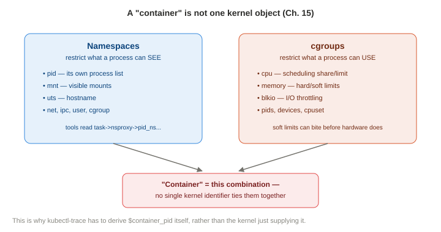

# Chapter 15 — Containers

*Study notes on Chapter 15 of BPF Performance Tools (Brendan Gregg, 2019). Original notes, not book text — see `00-index.md` for how these notes are written.*

> A short chapter (18 pages), and its own opening line is worth taking at face value as the real scope-setter: *"with containers, CPUs are still CPUs, file systems are still file systems, and disks are still disks."* Almost everything you need for container performance analysis is already in Chapters 6–14 — this chapter covers only the genuinely container-specific layer on top: namespaces, cgroups, and the real, still-unsolved gap between "what the kernel can see" and "what a container orchestrator calls a container."

## 15.1 Background



### Two ways to build a container, and which one this chapter covers

**OS virtualization** — partitioning one running kernel via **namespaces**, usually combined with **cgroups** for resource limits (Docker, Kubernetes). **Hardware virtualization** — lightweight VMs, each with its own kernel (Intel Clear/Kata Containers, AWS Firecracker) — covered instead in Chapter 16. This chapter is entirely about the OS-virtualization case.

**Namespaces** restrict what a process can *see*: `pid` (a container sees only its own processes in `/proc`), `mnt` (restricts visible file system mounts), `uts` (isolates `uname(2)` output — named after the historical `utsname` struct, itself named after "UNIX Time-sharing System"), plus `cgroup`, `ipc`, `net`, and `user`. **cgroups** restrict what a process can *use* — hard or soft (share-based) limits on `cpu`, `memory`, `blkio`, `cpuset`, `devices`, `pids`, and others (cgroups v1 naming; v2 exists specifically to fix v1's shortcomings, and the book notes most container tech, including Kubernetes at the time, was still on v1). Cgroups can nest hierarchically, with some shared "system" cgroups sitting alongside container-specific ones.

**The "noisy neighbor" framing worth keeping precise**: since every container on a host shares one real kernel, this is fundamentally the same **traditional multi-tenant analysis problem** performance engineers have always dealt with on shared systems — the one genuinely new wrinkle is that **cgroup soft limits can be hit well before any real hardware limit is reached**, and monitoring tools that were never updated to understand cgroups can be completely blind to this — showing a system with plenty of idle hardware capacity while a specific container is nonetheless being throttled.

### 15.1.1 What BPF adds

Traditional container tools are metrics-based (which containers/cgroups/namespaces exist, their configured sizes). BPF answers the deeper, per-event questions: run-queue latency **per container**; whether the scheduler is actively switching between different containers sharing one CPU; and whether CPU or disk **soft limits** are actually being hit in practice. A handful of `cgroup` tracepoints (`cgroup:cgroup_setup_root`, `cgroup:cgroup_attach_task`, ...) exist specifically for debugging container **startup**. (Networking-specific BPF — `BPF_PROG_TYPE_CGROUP_SKB` programs attached to cgroup ingress/egress — exists but is out of this chapter's scope.)

### 15.1.2 Challenges — the real, structural gaps worth understanding precisely

**BPF privileges**: since BPF tracing requires root, and containers are deliberately unprivileged, **tracing tools can normally only run from the host, not from inside a container** — directly reiterating Chapter 11's unprivileged-BPF-user discussion, now framed as the specific, concrete container-analysis obstacle that's actually motivating that kernel work.

**Container IDs — the single most important structural gap in this whole chapter, worth understanding fully.** Docker/Kubernetes container IDs are a **pure user-space construct** — in the kernel, a container is really just "a set of cgroups and namespaces" with **no single kernel-space identifier tying them together as one "container."** (Adding one has been proposed, but as of this writing, hadn't happened.) **The practical consequence**: a BPF tool run from the host sees events from *every* container at once, with no built-in way to filter or group by "container" — you have to reconstruct that grouping yourself. **The workaround, shown as real, working code**: every task has an `nsproxy` struct (`linux/nsproxy.h`) holding pointers to each of its namespaces — a container almost certainly has its own **PID namespace**, so reading `task->nsproxy->pid_ns_for_children->ns.inum` gives you a numeric ID that's at least *stable and unique per container* (matching what `/proc/PID/ns/pid_for_children` shows) even though it's not the "container ID" a human would recognize. **If the container runtime additionally sets a UTS namespace nodename to the container's name** (common for both Docker and Kubernetes), reading `task->nsproxy->uts_ns->name.nodename` gets you something human-readable too — exactly what `pidnss(8)` (§15.3.2) does. **A real, important caveat worth remembering**: this technique only works when the instrumentation runs in **process context** (so `curtask` is valid) — another concrete instance of Chapter 10 §10.1.4's "events may not run in application context" caution, now specifically relevant to container-identification logic.

**Orchestration**: running BPF tools across many container hosts is the same problem as running them across many cloud VMs — either use existing fleet-orchestration tooling, or a purpose-built tool like **`kubectl-trace`** (a Kubernetes scheduler for running bpftrace programs cluster-wide, which conveniently exposes a ready-made `$container_pid` variable referring to a pod's root process — covered further in Chapter 17).


> **How to read this:** this extends the namespaces/cgroups diagram upward — Kubernetes and the container runtime are both user-space layers sitting on top of the exact same kernel gap already identified: nothing down here knows the word "container."

**FaaS (Function as a Service)**: end users of a FaaS platform typically have no SSH access to the underlying host at all, so **BPF tracing in a FaaS context is expected to only ever be possible from the host itself**, performed by the platform operator — not something an end user can realistically do themselves, now or (barring some future non-privileged-BPF mechanism) in the near future either.

### 15.1.3 Strategy

1. **Start with the ordinary hardware/resource analysis from Chapters 6–14 first** — in particular, generate CPU flame graphs. The book states directly, from real experience, that *"most container issues that I've encountered were caused by application or hardware problems, not the container configuration"* — a genuinely important expectation-setter worth remembering before assuming a container-specific cause.
2. Check whether cgroup **soft limits** are actually being hit.
3. Browse and apply the Chapter 6–14 BPF tool catalog as normal.

## 15.2 Traditional Tools

**From the host**: `systemd-cgtop` (top for cgroups — a real production example shows one Docker cgroup consuming 610% CPU and 24 GB memory across 200 tasks); `kubectl top nodes`/`kubectl top pods` (requires a metrics server); `docker stats` (per-container CPU%, memory-used-vs-limit, network/block I/O); `/sys/fs/cgroup/.../cpu.stat` (raw cgroup v1 statistics, including a real, directly actionable pair of fields worth remembering — `nr_throttled`, the count of throttle events, and `throttled_time`, the cumulative nanoseconds spent throttled — the book's own example shows a cgroup throttled 74 out of 507 periods, 3.8 seconds total); and `perf(1)`, which supports a `--cgroup`/`-G` filter directly on both `perf record` (profiling scoped to one cgroup) and `perf stat` (event counting scoped to one cgroup, multiple cgroups specifiable at once).

**From inside the container — a genuinely important, standing gotcha worth memorizing as a table.** As of the kernel version the book references, **none** of the familiar tools are properly "container-aware" (showing only that container's own view): `top`/`ps` show container *processes* correctly, but their summary/header lines reflect the **host's** overall stats; `uptime`, `mpstat`, `vmstat`, `iostat`, `free` all show **host-wide** figures regardless of which container you run them from. **The practical consequence worth internalizing**: numbers that look like they describe "my container" from inside a container may actually describe the entire host — a real, easy way to draw a wrong conclusion if you don't know to check for this specifically.

## 15.3 BPF Tools

Four tools, three purpose-built for this book, all explicitly meant to be used **alongside**, not instead of, the full Chapter 6–14 catalog.

### 15.3.1 `runqlat --pidnss` — CPU saturation, broken down per container

Chapter 6's `runqlat(8)` gains a `--pidnss` option that breaks its histogram output out **by PID namespace** — a real production example shows one specific PID namespace suffering dramatically worse run-queue latency than others, directly localizing a CPU-scheduling problem to one specific container rather than the host in general. **The tool deliberately doesn't print a human container name** (since, per §15.1.2, that mapping is technology-specific and not something the kernel knows) — the book's own suggested manual cross-reference is simply `ls -lh /proc/PID/ns/pid` to read off a known process's namespace ID and match it by hand against the tool's output.

### 15.3.2 `pidnss` — confirming (or ruling out) container CPU contention directly

Detects a **PID namespace switch** at every scheduler context switch — i.e., literally catches the moment a CPU stops running one container's process and starts running a different container's — specifically to **confirm or exonerate** the theory that multiple containers are contending for the same CPU. A real example resolves cleanly to human-readable names via the UTS-nodename technique from §15.1.2, distinguishing the host itself (28 switches) from one specific Docker container (27 switches) — confirmed independently against `uname -n` and `docker ps`. **A second, real example from a live Kubernetes cluster setup is worth noting as a nice, concrete "reading is believing" moment**: it shows the switch counts naturally scaling with how much CPU-scheduling churn is really happening for each named pod (`coredns` pods reaching tens of thousands of switches, versus low hundreds for others) — a live view of relative container activity, derived purely from the scheduler's own switching pattern. The source is a clean, minimal, single-kprobe (`finish_task_switch()`) tool: read both the outgoing and incoming task's PID-namespace ID, and only increment a counter when they actually differ — worth remembering as a nice, small template for "detect any transition between two namespace-scoped entities" more generally. **Overhead is flagged directly as likely significant for busy I/O workloads** (context switching itself can be very frequent), and the book notes this could be ported into BCC specifically to add richer container-runtime-specific lookups (real Kubernetes/Docker metadata) beyond what raw kernel namespace/nodename data alone can supply.

### 15.3.3 `blkthrot` — cgroup block-I/O hard-limit throttling, counted directly

Traces `blk_throtl_bio()` — the kernel function actually responsible for enforcing a cgroup's **blkio hard limit** — counting throttled versus not-throttled outcomes, keyed by the cgroup's own numeric ID (read directly off the `struct blkcg_gq`/`blkcg`/`cgroup_subsys_state` chain, another real example of pulling a genuine cgroup identifier straight out of kernel structs, the same general technique as §15.1.2's namespace-ID extraction). A real example shows one specific cgroup throttled 31 times against 506 non-throttled requests during the trace — a direct, per-event confirmation of exactly the kind of soft/hard-limit throttling this chapter's strategy section told you to go check for. Overhead is expected to be minimal, since block I/O is comparatively low-frequency.

### 15.3.4 `overlayfs` — container file system latency, and a real, honest identification workaround shown in full

**OverlayFS is the file system layering technology most commonly backing container root file systems** — tracing its read/write latency (via kprobes on `ovl_read_iter()`/`ovl_write_iter()`, added in Linux 4.19) gives a direct view of container-perceived file system performance. A real example shows writes clustering tightly around 256–512 μs and reads mostly in the 16–64 μs range, refreshed every second. **The tool takes a PID namespace ID as its filtering argument directly** (rather than trying to resolve a container name inside the BPF program itself) — and the book shows the complete, real, small shell wrapper (`overlayfs.sh`) needed to make this usable with an actual Docker container ID: `docker inspect` to get the container's root PID, then `stat` on that PID's `/proc/PID/ns/pid` symlink to extract the numeric namespace ID, which is *then* passed into the bpftrace script as `$1`. **This whole wrapper is worth remembering as the concrete, working payoff of §15.1.2's "container IDs are a user-space construct" point**: the wrapper's entire job is bridging exactly that gap — translating a real, orchestrator-level container ID into the raw, kernel-level PID-namespace ID that a BPF program can actually filter on — and the book says directly that adapting this same pattern to a different container technology is expected, straightforward work.

## 15.4 BPF One-Liners

```
# bpftrace: sample which cgroup is running at 99 Hz
bpftrace -e 'profile:hz:99 { @[cgroup] = count(); }'

# bpftrace: trace file opens for one specific cgroup v2 path
bpftrace -e 't:syscalls:sys_enter_openat
    /cgroup == cgroupid("/sys/fs/cgroup/unified/container1")/ {
    printf("%s\n", str(args->filename)); }'
```

**The second one-liner is worth noting for a small but genuinely useful detail**: bpftrace's built-in `cgroup` variable and `cgroupid()` function give you a **cgroup v2**-aware filtering mechanism directly in the language itself, without needing to manually walk kernel structs the way `blkthrot(8)`'s cgroup v1-era source had to — a sign of the ecosystem gradually catching up to make exactly this kind of container-aware filtering easier to write.

## 15.5 Optional Exercises worth trying

Add UTS-nodename container identification (the `pidnss(8)` technique) to Chapter 6's `runqlat(8)` and Chapter 8's `opensnoop(8)`, making both directly container-aware; and build a tool watching `mem_cgroup_swapout()` specifically, to identify **which containers are being forced to swap** due to their own memory cgroup limit — a genuinely practical, unsolved-in-this-chapter extension directly relevant to the "cgroup soft limits can bite before any real hardware limit" theme from §15.1.

## 15.6 Summary

Container performance analysis is mostly ordinary resource and application analysis (Chapters 6–14) — this chapter's real, narrow contribution is the container-specific layer on top: quantifying CPU run-queue latency and scheduling contention *per container* (`runqlat --pidnss`, `pidnss`), confirming cgroup-enforced throttling actually happening (`blkthrot`, and the raw `/sys/fs/cgroup` statistics), and measuring the latency of the overlay file system commonly backing container storage (`overlayfs`) — all built around the same real, structural workaround: reading namespace and cgroup identifiers directly out of kernel structs, since no single, ready-made "container ID" exists in the kernel to filter or group on directly.

---

## Quick-reference glossary (this chapter's terms)

- **Namespace** — restricts what a process can *see* (its own PIDs, mounts, hostname, ...); the basis for OS-virtualized containers.
- **cgroup (control group)** — restricts what a process can *use* (CPU, memory, block I/O, ...), via hard or soft limits.
- **`nsproxy`** — the kernel struct holding a task's namespace pointers; the direct source of the PID-namespace-ID workaround this whole chapter's tools rely on.
- **Soft limit / throttling** — a cgroup-imposed resource ceiling reached well before any real hardware limit, and a common source of container performance problems invisible to hardware-only monitoring.
- **Container-aware** — describes a tool that, run from inside a container, shows only that container's own view; the book notes essentially no traditional tool achieved this as of its writing.

## Check your understanding

1. Why can't a BPF tool simply filter or group its output "by container ID" directly, the way it might filter by PID?
2. A teammate runs `free -m` from inside a container and concludes the container has 64 GB of available memory. What does this chapter say is likely wrong with that conclusion?
3. In the `overlayfs(8)` example, why does the tool take a raw PID namespace ID as its argument instead of a Docker container ID directly, and what does the accompanying shell wrapper actually do?
4. What's the difference between what `runqlat --pidnss` measures and what `pidnss(8)` measures, even though both are about containers sharing CPU resources?
5. Why does the book recommend starting container performance analysis with ordinary CPU flame graphs and resource-level tools, rather than jumping straight to container-specific tools like the ones in this chapter?

<details>
<summary>Answers</summary>

1. Because, in the kernel, a "container" isn't a single first-class object at all — it's really just a particular combination of cgroups and namespaces, with no unified kernel-space identifier tying them together as one thing. A BPF program can only filter or group on what the kernel actually exposes, such as a PID namespace ID or a cgroup ID — getting anything resembling a real container ID requires reading one of these lower-level identifiers and separately (in user space) mapping it back to whatever ID a container orchestrator like Docker or Kubernetes uses.
2. As of the kernel version this chapter references, `free(1)` run from inside a container shows the **host's** total memory, not the container's own configured memory limit — so 64 GB likely describes the entire host's memory, not necessarily what this specific container is actually allowed to use. The container's real limit would need to be checked through a cgroup-aware mechanism instead, such as reading the memory cgroup's own limit file directly.
3. Because there is no kernel-level container ID to filter on directly — the tool can only filter on something the kernel actually understands, like a PID namespace ID. The shell wrapper's job is bridging that gap: it uses `docker inspect` to find the container's root process ID, then reads that process's `/proc/PID/ns/pid` symlink to extract the actual numeric PID namespace ID, which is what actually gets passed into the bpftrace script.
4. `runqlat --pidnss` measures **how long** threads within each PID namespace (container) wait in the run queue before getting CPU time — a saturation/latency measurement, broken out per container. `pidnss(8)` instead measures **how often** the CPU actually switches from running one container's process to running a different container's — a measurement of scheduling churn/contention between containers, not of how long any individual wait was. The two are complementary: one tells you if a given container is suffering delayed access to the CPU; the other tells you how much the CPU is actually being shared (or fought over) between different containers in the first place.
5. Because, per the book's own stated real-world experience, most container performance issues turn out to be ordinary application or hardware problems that have nothing specifically to do with the container configuration — a CPU flame graph or standard resource analysis will often reveal the real cause directly and more quickly than starting from container-specific tooling, which is better reserved for confirming or ruling out genuinely container-specific causes (namespace scheduling contention, cgroup throttling) once the more common causes have already been checked.

</details>
