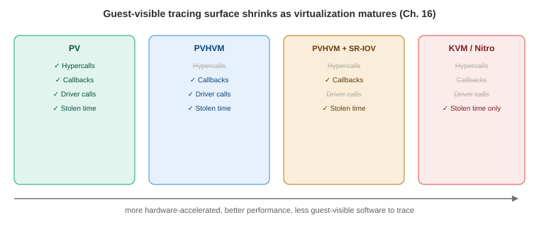

# Chapter 16 — Hypervisors

*Study notes on Chapter 16 of BPF Performance Tools (Brendan Gregg, 2019). Original notes, not book text — see `00-index.md` for how these notes are written.*

> The counterpart to Chapter 15: hardware virtualization (a full guest kernel per VM) rather than OS-level virtualization (one shared kernel). A short chapter (20 pages) with a genuinely distinctive character — several sections end not with a working tool, but with an honestly-stated **open question**, since this is an area the book itself frames as still actively developing.

## 16.1 Background

### Two configurations, and why the classic "type 1 vs. type 2" split no longer holds up

The book explicitly sets aside the traditional type-1/type-2 hypervisor classification as no longer practically meaningful (type-2 hypervisors have effectively become type-1-like through kernel modules), and describes two real configurations instead:

- **Config A — native/bare-metal hypervisor** (e.g., **Xen**): the hypervisor itself runs directly on the hardware, creating **domains** for guest VMs and scheduling their virtual CPUs onto real ones; a privileged domain (**domain 0**) administers the rest.
- **Config B — hosted hypervisor** (e.g., **KVM**): the hypervisor is implemented via kernel modules plus user-level processes running *under* an ordinary host OS kernel, which schedules VM virtual CPUs alongside its own normal processes.

Both configurations commonly run an **I/O proxy** (typically **QEMU**) in domain 0 or the host OS to service guest I/O — adding overhead that's been progressively optimized away over the years via shared-memory transports and similar techniques.

### The historical progression, worth knowing as a real trend actively shrinking what guests can observe

Full hardware virtualization (VMware, 1998) originally relied on **binary translation**. This was improved by, in order: **processor virtualization support** (AMD-V/Intel VT-x, 2005–2006 — hardware-assisted VM operations); **paravirtualization** (**PV**) — the guest OS is made *aware* it's virtualized and makes explicit **hypercalls** to the hypervisor for more efficient handling of certain operations (Xen specifically batches these into a **multicall** for efficiency); and **device hardware support** (SR-IOV for network/storage, with dedicated drivers like `ixgbe`, `ena`, `nvme`). Modern Xen guests typically boot into **HVM** (hardware VM mode) and then layer PV drivers back on top for the operations that still benefit from them — a hybrid called **PVHVM** — which can be pushed further by handing specific devices (network, storage) entirely to SR-IOV hardware support. **AWS's Nitro hypervisor** (launched 2017, KVM-based) represents the current end state of this trend: hardware support for *all* major resources (CPU, network, storage, interrupts, timers), with **no QEMU proxy at all**.

> **How to read this:** each struck-through item is something a guest could trace in the previous generation but can no longer see — the trend is monotonic, not occasional.

**This progression matters directly for tracing, worth stating as its own explicit lesson**: the AWS EC2 guest-visible tracing surface has **shrunk monotonically** as each successive hypervisor generation moved more functionality into hardware:

| Generation | What's traceable from the guest |
|---|---|
| PV | Hypercalls (multicalls), hypervisor callbacks, driver calls, stolen time |
| PVHVM | Hypervisor callbacks, driver calls, stolen time |
| PVHVM + SR-IOV | Hypervisor callbacks, stolen time |
| KVM (Nitro) | Stolen time only |

**Nitro is described as having "little code running in the guest that is special to hypervisors" — by design**, since moving hypervisor functionality into hardware is precisely what improves its performance. The direct, somewhat paradoxical consequence worth internalizing: **the more a hypervisor genuinely optimizes itself via hardware, the less a guest is able to observe about it directly** — a real, structural tension between virtualization performance and virtualization observability that this chapter has to work around, rather than solve outright.

### 16.1.2 Suggested strategies

**For guests**: (1) instrument hypercalls, if any are in use, checking for excessive operations; (2) check for **stolen CPU time**; (3) fall back to the ordinary Chapter 6–14 resource-analysis tools — bearing in mind these now measure **virtual** resources, whose performance may be additionally capped by hypervisor-imposed resource controls or contended by other guests on the same physical hardware.

**For hosts**: (1) instrument VM **exits**, checking for excessive occurrences; (2) if an I/O proxy (QEMU) is in use, instrument its own workload and latency directly; (3) fall back to ordinary resource-analysis tools. **The chapter's own closing expectation for this whole area, worth remembering as the honest state of play**: as more hypervisors follow Nitro's hardware-everything model, **more analysis will simply have to rely on the ordinary Chapter 6–14 toolset rather than specialized hypervisor tools** — this chapter's own specialized tools are, by its own admission, most relevant to older/PV-style configurations, and progressively less applicable as the industry moves toward Nitro-style designs.

## 16.2 Traditional Tools

Xen provides its own host-side tools (`xl top`, `xentrace`). For KVM, `perf(1)`'s `kvm` subcommand (`perf kvm stat live`) gives a live breakdown of VM-exit reasons with per-reason sample counts, time percentages, and min/max/average durations — the book's own real example shows `HLT` (the virtual CPU entering its idle state — entirely normal, expected behavior) dominating total *time* (99.63%) despite being only the second-most-frequent exit reason by *count* — a nice, concrete reminder (echoing this book's repeated "profile vs. count" distinction from Chapters 6 and 9) that the most frequent event and the most time-costly event aren't always the same one. KVM also ships real tracepoints for exits, directly usable by BPF for more detailed, custom tooling (exactly what §16.4.1's `kvmexits(8)` does).

## 16.3 Guest BPF Tools

### 16.3.1 Xen hypercalls — a live demonstration of the guest-visibility trend from §16.1

**On a Xen PV guest**, hypercalls are directly traceable via real tracepoints — `funccount 't:xen:*'` reveals ~30 available Xen tracepoints, with the `xen_mc_*` family specifically covering **multicalls**: a batch begins (`xen_mc_batch`), accumulates individual calls (`xen_mc_entry`), and the *actual* hypercall only fires on `xen_mc_flush`. **Two "lazy" PV modes (for MMU updates and for context switching) let a flush's issue be deferred and buffered further** — worth knowing since it explains why a captured `xen_mc_issue`/`xen_mc_flush` pair can sometimes correspond to **zero** real hypercalls having been made. `argdist -C 't:xen:xen_mc_flush():int:args->mcidx'` directly counts how many hypercalls were bundled into each flush — the book's own real example shows roughly 130 hypercalls/second with no batching beyond one hypercall per flush observed. `stackcount 't:xen:xen_mc_issue'` reveals the calling code paths driving hypercall volume — a real example shows over 565,000 occurrences tracing back through `sys_clone()`/`_do_fork()`, directly attributing most hypercall volume to process creation.

**Measuring hypercall *latency* specifically requires falling back to a kprobe**, since no tracepoint marks the real hypercall's start/end — `funclatency xen_mc_flush` (the function that actually performs the real hypercall during a flush) shows most calls landing in the 256 ns – 8 μs range in a real example. **CPU profiling can also reveal hypercall cost directly** — the book shows a real CPU flame-graph excerpt with a TCP-receive code path ending in `hypercall_page()` (which is really a table of hypercall functions, not a single function) — but with an important, honestly-stated caveat worth remembering: **this profiling approach can be misleading**, because PV guests typically lack PMC access and fall back to **software-based profiling** (Chapter 6 §16.2.4's own limitation, cross-referenced directly here), which **cannot sample during IRQ-disabled code paths** — and hypercall execution can itself run with interrupts disabled, meaning exactly the code you're trying to profile can be systematically under-sampled or invisible.

**On a Xen HVM guest, by contrast, the same Xen tracepoints simply never fire at all** (`funccount 't:xen:xen*'` returns nothing) — because HVM code paths make **native** calls that the hypervisor traps and handles transparently, rather than explicit guest-initiated hypercalls. **The direct consequence, worth remembering as the chapter's recurring theme in miniature**: hypervisor inspection on an HVM guest has to fall back entirely to ordinary resource-oriented tools from earlier chapters, with the standing caveat that observed latency is now "resource plus hypervisor latency" blended together, with no way to cleanly separate the two components from the guest side.

### 16.3.2 `xenhyper` — hypercall counting, with a real, fragile lookup table shown directly

Counts hypercalls via `xen:xen_mc_entry`, resolved to readable names (`mmu_update`, `stack_switch`, `mmuext_op`, ...) through a **hand-written, hardcoded lookup table** translating numeric hypercall operation codes to names, built directly for this book. **The tool's own source comment is worth treating as a standing warning, not a throwaway detail**: *"needs updating to match your kernel version"* — this numeric-to-name mapping genuinely changes across kernel versions, making this a real, concrete instance of the same "hand-maintained lookup table as a stability tradeoff" pattern seen elsewhere in this book (Chapter 9's SCSI opcode tables, Chapter 13's MySQL command-type tables) — just made unusually explicit here as an up-front caveat rather than something you'd discover only after the tool silently mis-labeled something.

### 16.3.3 Xen callbacks — the reverse direction, and a real "who's actually getting interrupted" finding

**Callbacks are the reverse of hypercalls**: the hypervisor calling *into* the guest, for things like IRQ notifications — visible per-CPU in `/proc/interrupts` (`grep HYP`), and traceable via a kprobe on `xen_evtchn_do_upcall()`. A real example (`bpftrace -e 'kprobe:xen_evtchn_do_upcall { @[comm] = count(); }'`) shows the **idle threads** (`swapper/0` through `swapper/7`) receiving the large majority of these callbacks — a genuinely intuitive, confirmable finding once you remember that interrupts routinely arrive while a CPU has nothing else scheduled, so the "current" process interrupted is very often just whichever idle thread happened to be running. `funclatency xen_evtchn_do_upcall` shows most callback processing completing within 1–32 microseconds in a real example, with the book noting that tracing the **child** functions of this callback handler would reveal more about the specific interrupt type involved.

### 16.3.4 `cpustolen` — stolen CPU time, and a genuine terminology nuance worth remembering

**"Stolen" CPU time** is time a guest's virtual CPU didn't get to run because it was given to *other* guests instead — though the book flags a real, precise nuance worth not glossing over: depending on exactly how it's measured, "stolen" time can also include time the hypervisor/VMM itself spent working *on behalf of* the guest (e.g., an I/O proxy processing that guest's own I/O in another domain) — meaning the name "stolen" is, strictly, **somewhat misleading**; not all of it represents time truly taken away for some *unrelated* guest's benefit. `cpustolen(8)` histograms this as a distribution (not just a total), which is genuinely useful precisely because it reveals **whether stolen time occurs in short, frequent slices or occasional long stretches** — different patterns with different practical implications for an application's latency sensitivity. A real example shows the overwhelming majority of samples landing in the "0 stolen" bucket, with the ratio of actual stolen time to total time calculable directly from the histogram (0.1% in the book's own example). **Mechanically, it works by kprobing each hypervisor's own specific steal-clock function** (`xen_steal_clock()`, `kvm_steal_clock()`) rather than a unified, hypervisor-agnostic one — and the book notes directly *why*: a higher-level, genuinely hypervisor-agnostic function, `paravirt_steal_clock()`, does exist and would be the obviously preferable single instrumentation point, **but it isn't available for tracing at all — almost certainly because it's inlined away** (yet another concrete, real instance of Chapter 2's inlining warning, this time blocking the *cleanest possible* version of a tool and forcing a less elegant, per-hypervisor fallback instead).

### 16.3.5 HVM exit tracing — an honestly-stated open problem

Once a guest is running in HVM mode, explicit hypercalls are gone, but the guest is still making **exits** to the hypervisor for resource access — and the book is direct that **there is currently no good way to instrument these from the guest side at all**. The stated fallback: use the ordinary resource-latency tools from earlier chapters, understanding that some (unmeasurable, from the guest) fraction of observed latency is really hypervisor overhead — with **comparing guest-observed latency against equivalent bare-metal measurements** offered as the closest available proxy for isolating that hidden component indirectly. **A genuinely interesting piece of forward-looking research is named directly**: **hyperupcalls** — a research technology letting a guest ask the hypervisor to safely run a small BPF program *inside the hypervisor itself* (an extended BPF VM embedded in the hypervisor, compiled to by the guest) specifically for use cases like hypervisor-side tracing requested *from* the guest. The book is candid that this isn't available from any cloud provider (and "may never be") — included specifically as an example of where BPF's reach might extend to next, not as a tool you can actually use today.

## 16.4 Host BPF Tools

### 16.4.1 `kvmexits` — guest exit latency by reason, from the host side

Times the interval between the `kvm:kvm_exit` and `kvm:kvm_entry` tracepoints, histogrammed by **exit reason** (translated from a numeric code via another hand-built lookup table, this one sourced directly from `arch/x86/include/uapi/asm/vmx.h`) — giving the host a direct, per-reason latency distribution for guest exits. A real example shows `HLT` exits reaching as long as several seconds in the tail (entirely expected — the guest's own idle state), alongside `IO_INSTRUCTION` exits reaching into the **8-millisecond** range — a genuinely actionable finding, since I/O-instruction exits reflect the guest actually needing something serviced, unlike idle-related `HLT` exits. **The book's own origin note for this tool is worth remembering**: it's a direct bpftrace port of a tool the author first wrote in **DTrace in 2013** for his earlier *Systems Performance* book — a nice, small piece of continuity showing how a genuinely useful technique migrates forward across tracing technologies over the years, the same lineage pattern seen for several tools across this whole book (Chapter 13's `naptime`, Chapter 14's `wakeuptime`, and others). **A real, stated limitation**: some KVM configurations don't use the kernel KVM module at all, so these specific tracepoints never fire — the suggested fallback is instrumenting the **QEMU** process directly via uprobes instead (with the book noting USDT probes would be a preferable, more stable alternative, if QEMU shipped them).

### 16.4.2 Future work — the chapter's own open research questions, worth taking seriously

**This section is unusually candid for the book, posing real, unanswered questions rather than a tool.** Since KVM guest CPUs are visible to the host as ordinary processes (showing up in `top(1)` like anything else), the book asks directly: *can the host determine what the guest is actually doing on-CPU — its functions, its stack traces? Can the host tell why a guest is calling I/O?* A real, working proof-of-concept is shown for capturing **half** of this: `bpftrace -e 't:kvm:kvm_exit /args->exit_reason == 30/ { printf("guest exit instruction pointer: %llx\n", args->guest_rip); }'` genuinely retrieves the **guest's own instruction pointer** at the moment of an I/O-instruction exit, directly from the host. **But the book is explicit about exactly where this falls short, and why it can't simply be pushed further with more code**: the host has **no symbol table** to translate that raw guest address into a function name (it's a completely different kernel/binary's address space), and **no process context** to even know *which guest process* was running, or which address space the pointer belongs to. Possible future directions are named without being solved here: reading the **CR3 register** (the root of the current page table) as a way to infer which process is running inside the guest, or having the **guest voluntarily supply its own symbol table** to the host somehow. **The chapter's own blunt, honest closing line for this specific gap is worth remembering as-is**: *"These questions can currently be answered by instrumentation from the guest, but not the host."*

## 16.5 Summary

Hardware virtualization observability is shaped entirely by *how* a given hypervisor virtualizes — paravirtualized guests expose real, traceable hypercalls and callbacks; HVM and hardware-accelerated (Nitro-style) guests expose progressively less, pushing more analysis back onto ordinary resource-level tooling and leaving real, currently-unsolved gaps (HVM exit visibility from the guest, guest-internals visibility from the host) that this chapter states honestly rather than papering over. The tools that do exist — `xenhyper`, `cpustolen`, `kvmexits` — follow patterns you've now seen throughout this book: hand-built numeric-to-name lookup tables (with real staleness risk), kprobe fallbacks where tracepoints don't exist, and the same inlining and address-space problems that have recurred since Chapter 2.

---

## Quick-reference glossary (this chapter's terms)

- **Hypercall** — an explicit, paravirtualized guest request to the hypervisor for more efficient handling of an operation; the traceable event that disappears as guests move toward HVM/hardware virtualization.
- **VM exit** — a guest transitioning control to the hypervisor (for I/O, certain instructions, etc.); the host-visible event `kvmexits(8)` times by reason.
- **Stolen time** — CPU time a guest's virtual CPU didn't get, given instead to other guests (or, more precisely, sometimes including hypervisor work done on the guest's own behalf).
- **PV / HVM / PVHVM** — paravirtualization, hardware VM mode, and the hybrid combining both; a real, ordered progression of decreasing guest-side observability.
- **Hyperupcalls** — a research technology letting a guest request a small BPF program run safely inside the hypervisor itself; not currently available from any cloud provider.

## Check your understanding

1. Why does a Xen HVM guest show zero results from `funccount 't:xen:xen*'`, when the identical command on a Xen PV guest shows dozens of active tracepoints?
2. Why is "stolen CPU time" described as a somewhat misleading name, and what does it actually include beyond time given to genuinely unrelated guests?
3. `cpustolen(8)` and `kvmexits(8)` both kprobe hypervisor-specific functions rather than one clean, universal function. In each case, what specific technical reason does the book give for why the "obviously better" universal option isn't available?
4. In the host-side future-work example, a one-line bpftrace command successfully retrieves the guest's instruction pointer at the moment of an I/O exit. What two specific pieces of information does the host still lack that prevent this from being turned into a full guest-function-tracing tool?
5. Why does the book expect specialized hypervisor tools like the ones in this chapter to become progressively less relevant over time, rather than more developed?

Answers

1. Because an HVM guest doesn't make explicit, guest-initiated hypercalls at all for the operations that would trigger these tracepoints — instead, it makes ordinary native instructions that the hypervisor transparently traps and handles underneath the guest, with the guest never being aware a hypervisor is involved at that moment. Since the tracepoints are tied to the explicit hypercall code path specifically used by paravirtualization, and HVM guests don't use that code path, the tracepoints simply never fire.
2. Because, depending on exactly how it's measured, "stolen" time can also include time spent by the hypervisor or an I/O proxy actively working *on behalf of* the guest itself (such as processing that guest's own I/O in another domain) — not just time truly taken away and given to some other, unrelated guest. Calling all of it "stolen" implies it was purely lost to competition from other tenants, when some portion of it may actually represent legitimate work being done for the guest, just not counted as the guest's own CPU time.
3. For `cpustolen(8)`, the universally-preferable function (`paravirt_steal_clock()`) isn't available to trace at all, almost certainly because it's been inlined away by the compiler — forcing the tool to instrument each hypervisor's own specific steal-clock function instead. For `kvmexits(8)`, the limitation is different: some KVM configurations don't use the kernel KVM module at all, meaning the `kvm:kvm_exit`/`kvm:kvm_entry` tracepoints this tool relies on simply never fire in that configuration, requiring a fallback to uprobing the QEMU process directly instead.
4. The host lacks a symbol table capable of translating the guest's raw instruction pointer address into a meaningful function name (since that address belongs to an entirely different kernel/binary's own address space, unknown to the host), and it lacks process context to know which specific guest process was running or which address space that instruction pointer should even be interpreted against.
5. Because the industry trend (culminating in hypervisors like AWS's Nitro) is to move progressively more hypervisor functionality into hardware specifically to improve performance — and the more of that functionality moves into hardware, the less there is left running in guest-visible software for a specialized tracing tool to actually instrument. The book expects this to push more and more analysis back onto the ordinary, general-purpose resource-analysis tools from earlier chapters, rather than toward increasingly sophisticated hypervisor-specific tooling.

