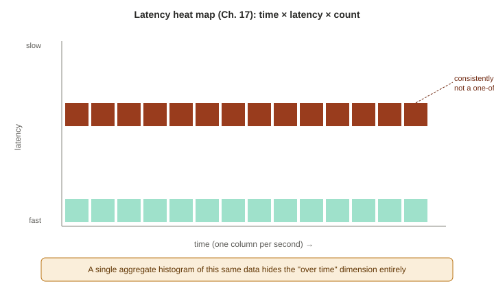
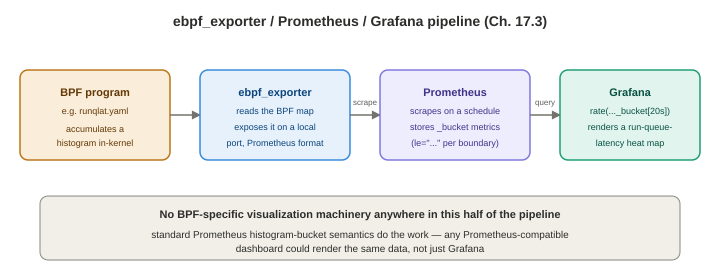

# Chapter 17 — Other BPF Performance Tools

*Study notes on Chapter 17 of BPF Performance Tools (Brendan Gregg, 2019). Original notes, not book text — see `00-index.md` for how these notes are written.*

> A change of register from every chapter so far: this one is a tour of **GUIs and orchestration tools** built on top of BCC/bpftrace, not a new set of command-line tools to master line by line. The book's own framing is worth taking seriously as a real prediction, not just a chapter-opener: *"it is expected that most people will end up using BPF tracing via GUIs"* — especially at cloud scale, where thousands of instances can't realistically be administered one SSH session at a time. Specific install commands and plugin names here were explicitly flagged by the book as likely to change — the durable value is the **concepts** (how a latency heat map works, how PCP/Prometheus architectures are shaped, what `kubectl-trace` had to solve) rather than the exact commands, which are worth verifying against current documentation before use.

## 17.1 Vector and Performance Co-Pilot (PCP)

**Netflix Vector** is a browser-based, near-real-time host metrics dashboard, built on top of **Performance Co-Pilot (PCP)** — a mature, general-purpose metrics collection/archiving framework that ships **over 1,000 metrics by default** and is itself extensible via plugins.

### Two visualization types genuinely worth understanding on their own merits

**Latency heat maps** — the single most conceptually important idea in this chapter, and a general performance-visualization technique worth knowing regardless of whether you ever touch Vector specifically. A heat map plots a **histogram over time**, with three axes: **x = time** (one column per second/interval), **y = latency**, and **z (color saturation) = count** of events falling in that time-and-latency cell. **The book gives a precise, important reason heat maps beat a scatter plot for this data**: with thousands or millions of I/O events, a scatter plot's individual points simply bleed together into an undifferentiated mass — a heat map instead scales its own color range as needed, keeping detail visible regardless of event volume. **The book's own side-by-side comparison is worth remembering as the concrete payoff**: an aggregate `biolatency(8)` histogram and a Vector heat map of the *same* underlying data show the same overall latency distribution — but only the heat map makes it obvious at a glance that a specific slow mode (128–256 ms) was **consistently present over time**, rather than a single short-lived burst that happened to get averaged into the aggregate view. This is a general lesson worth generalizing beyond BPF specifically: **any time you're tempted to summarize a distribution as a single histogram, ask whether its shape is actually stable over the measurement window, or whether a time-based view would reveal something the aggregate hides.**

**Tabular views** are the natural fit for **per-event** BCC tool output (rather than histogram-producing tools) — the book's own examples are `execsnoop(8)` (watching a Tomcat process start, live, in a browser) and `tcplife(8)` (watching live TCP sessions, immediately spotting an `amazon-ssm-agent` connection long-polling for 20 seconds, and a `wget` transferring 2 GB over 41.6 seconds) — the same event-stream data you'd otherwise read scrolling past in a terminal, now organized as a live, sortable table.

### Architecture — PCP's stateless model, worth understanding as a design choice

- **PMCD (Performance Metrics Collector Daemon)** — the central, host-resident coordinator.
- **PMDA (Performance Metrics Domain Agent)** — a plugin exposing a specific metric domain; the **BCC PMDA** specifically is what exposes BPF-tool output as PCP metrics — without it installed and configured, the relevant BCC modules simply appear grayed out in Vector's UI.
- **`pmwebd`** — a REST gateway in front of `pmcd`, which Vector (a pure client-side single-page web app) actually connects to.

**A genuinely important architectural point worth remembering, since it explains PCP's low host overhead directly**: PCP is **stateless** — clients (like Vector) are themselves responsible for tracking sampling rate and state, and **metrics are not aggregated across hosts or persisted anywhere beyond the browser session**. This keeps the framework lightweight, at the direct cost of no built-in long-term history — a real, deliberate tradeoff, not an oversight (and exactly the gap Grafana's *archived*-data option in §17.2 exists to fill).

**A practical, standing gotcha worth remembering rather than being surprised by later**: the BCC PMDA doesn't expose every BCC tool by default — each module (`biolatency`, `tcplife`, `runqlat`, ...) has to be explicitly listed in the PMDA's own config file (`bcc.conf`) and the PMDA reinstalled/restarted before it becomes available in the UI at all. Vector ships pre-configured charts for a specific, named subset: `biolatency`/`biotop`, the `ext4dist`/`xfsdist`/`zfsdist` family, `tcplife`/`tcptop`/`tcpretrans`, `runqlat`, and `execsnoop` — with the book noting custom charts, tables, or heat maps, plus custom tracepoint/uprobe/USDT event metrics, can all be added beyond this default set.

## 17.2 Grafana and Performance Co-Pilot (PCP)

Grafana is a general-purpose, backend-agnostic charting tool; pointed at PCP as a data source, it can visualize any PCP-exposed metric, including BCC/BPF ones. **Two genuinely different configuration modes worth distinguishing, since they serve different use cases**:
- **`grafana-pcp-live`** — polls PCP directly, keeps only a short (few-minute) rolling history **in the browser**, no server-side persistence at all. Zero ongoing load on the monitored system when nobody's actively watching — ideal for deep, live, ad hoc investigation of one host at a time.
- **`grafana-pcp-redis`** — pulls from PCP's own `pmseries` long-term storage into Redis, enabling genuine historical, **multi-host** time-series analysis, at the cost of PCP now continuously polling and storing data whether or not anyone's watching.

This mirrors a real, general tradeoff worth recognizing beyond just this specific tool pairing: **live-only, stateless monitoring is cheap but has no memory; persistent, stored monitoring has real ongoing cost but lets you look backward and across hosts.** The book flags both plugins as under heavy development at the time of writing, and (like Vector) notes that a heat map visualization can be configured directly for a BCC-sourced metric like `bcc.runq.latency`.

## 17.3 Cloudflare eBPF Prometheus Exporter (with Grafana)

**Prometheus** is a widely-adopted metrics collection/storage/query system, popular specifically for its simple, well-known scrape protocol (easy to implement a client for in any language) and strong integration with dynamic environments like Kubernetes. In Prometheus's own vocabulary, an **exporter** is the component that collects and exposes metrics in Prometheus's format — official and third-party exporters exist for host stats, JMX/Java, web servers, storage, databases, and more. **Cloudflare's `ebpf_exporter`** is exactly this pattern applied to BPF: it runs a small set of configured BPF programs (via a YAML config file naming which ones — the book's own example uses a ready-made `runqlat.yaml`) and exposes their output as ordinary Prometheus metrics on a local port, from which Prometheus scrapes it on a schedule, and Grafana in turn queries Prometheus.

> **How to read this:** every arrow after the first is generic Prometheus/Grafana machinery — the only BPF-specific step in the whole pipeline is the leftmost one, which is why this architecture generalizes to any Prometheus-compatible dashboard, not just Grafana.

**A real example query is worth understanding for the *shape* of the technique, not just its exact syntax**: `rate(ebpf_exporter_run_queue_latency_seconds_bucket[20s])`, graphed with a `{{le}}` legend format, reproduces a run-queue-latency heat map — this time built entirely out of standard Prometheus histogram-bucket semantics (`_bucket` metrics with a `le`, "less than or equal," label per bucket boundary) rather than any BPF-specific visualization machinery at all. **This is worth noting as a genuinely different, more standardized architectural approach than Vector/PCP's**: instead of a purpose-built BPF-aware GUI and metrics daemon, this pattern reuses Prometheus's own already-general histogram model, meaning any Prometheus-compatible dashboard tool (not just Grafana specifically) could in principle render the same data.

## 17.4 `kubectl-trace` — running bpftrace across a Kubernetes cluster

Created by Lorenzo Fontana, hosted at the IO Visor project — a `kubectl` plugin letting you launch a bpftrace program against a cluster **node** or a specific **pod**, without needing to manually SSH to the right node yourself.

**Tracing a whole node** (`kubectl trace run node/<name> -f script.bt`) is the simplest mode, but comes with a real, explicitly-stated caveat worth taking seriously: **because bpftrace genuinely runs on the host, it traces every application on that node, and any overhead it adds affects the entire node**, not just whatever workload you actually meant to investigate — the book's own example (`vfsstat.bt` on a node) shows VFS activity from the *whole machine*, not any one pod.

**Tracing a specific pod or container is where the real, interesting engineering problem lives, and it's worth understanding precisely.** bpftrace has no native concept of "a container" (the exact same gap Chapter 15 §15.1.2 already covered in depth: no unified kernel-level container identifier exists) — so `kubectl-trace` solves this **indirectly**, in two parts: first, given a pod name, it automatically locates and deploys the bpftrace program on the **correct node** for you; second, it injects a special variable, **`$container_pid`**, set to the container's root process's PID **in the host's own PID namespace** — letting your own script filter on it directly (`/pid == $container_pid/`, exactly matching the ordinary bpftrace positional-parameter mechanism from Chapter 5 §5.12.4, just pre-populated by `kubectl-trace` itself rather than passed by hand on the command line). **The book's own honestly-stated limitation here directly echoes Chapter 13's own service-thread-pool caveat**: this simple, single-PID filter only cleanly identifies the container's traffic when that root process really is the *only* process running inside it — for an init process managing children, or a forking server, you'd need to build additional PID-to-parent-PID mapping logic on top of this same foundation, which `kubectl-trace` itself doesn't provide out of the box. The book's own worked example (a minimal single-process Node.js container) is deliberately chosen to sidestep exactly this complication, and shows the pod-scoped `vfsstat` trace revealing dramatically less VFS activity than the earlier node-wide trace — exactly the expected, confirming result for a mostly-idle single web server isolated from the rest of the node's traffic.

## 17.5 Other tools worth knowing exist

**Cilium** (container/application network security policy via BPF — introduced already in Chapters 2 and 11), **Sysdig** (extends container observability using BPF), **Android eBPF** (device-level network usage monitoring/management), **osquery** (exposes OS state for analytics/monitoring; gained BPF-based kprobe monitoring support), and **`ply`** (Tobias Waldekranz's minimal-dependency BPF CLI tracer, already mentioned back in Chapters 1 and 5 as an embedded-Linux-oriented alternative to bpftrace).

## 17.6 Summary

This chapter's own framing is worth taking as its real, lasting lesson rather than any specific tool's setup steps: the BPF tooling space was, at the time of writing, still rapidly growing, and the four tools covered here (Vector/PCP, Grafana/PCP, Cloudflare's `ebpf_exporter`/Prometheus, `kubectl-trace`) are examples of the **shape** that GUI and fleet-scale BPF tooling takes — histogram-aware visualization (heat maps, whether built PCP-natively or via Prometheus's own bucket semantics), and cluster-aware orchestration that has to solve the same "there's no real container ID" problem Chapter 15 already identified. Everything you learned about the underlying BCC/bpftrace tools in Chapters 4–16 transfers directly here — these GUIs are front ends to the *same* tools, not a separate toolkit to relearn from scratch.

---

## Quick-reference glossary (this chapter's terms)

- **Latency heat map** — time on the x-axis, latency on the y-axis, count as color saturation; reveals whether a latency distribution is stable over time or driven by a short burst, which a single aggregate histogram cannot show.
- **PMCD / PMDA** — PCP's central collector daemon, and the pluggable agents (like the BCC PMDA) that feed it specific metric domains.
- **Exporter** (Prometheus terminology) — the component that collects and exposes metrics in Prometheus's scrape format; `ebpf_exporter` is this pattern applied to BPF programs.
- **`$container_pid`** — the variable `kubectl-trace` injects into a bpftrace script, giving it the container's root process PID (in the host PID namespace) as a ready-made filtering key.

## Check your understanding

1. Why does the book prefer a heat map over a scatter plot for visualizing per-second latency histograms at scale, and what specific example from `biolatency(8)` output illustrates the advantage?
2. What real, structural tradeoff separates `grafana-pcp-live` from `grafana-pcp-redis`, and what kind of monitoring task would make you pick one over the other?
3. Why doesn't `kubectl-trace` need any special new BPF technology to filter tracing down to a single container — what existing bpftrace mechanism does it reuse, and what does it supply automatically to make that work?
4. What real, explicitly-acknowledged limitation does `kubectl-trace`'s pod-tracing approach have for a container running more than one process (e.g., an init process managing children)?
5. In what specific way does Cloudflare's `ebpf_exporter`/Prometheus/Grafana architecture differ from Vector/PCP's, beyond just "it's a different vendor's tool"?

Answers

1. A scatter plot of thousands or millions of individual I/O events causes points to bleed together into an undifferentiated mass, losing detail — a heat map avoids this by scaling its color-saturation range as needed, keeping variation visible regardless of event volume. The book's own `biolatency(8)` comparison shows that while an aggregate histogram and a heat map of the same data reveal the same overall latency shape, only the heat map makes it clear that a slow (128–256 ms) mode was consistently present *throughout* the measurement window, rather than being a single short-lived spike that happened to get folded into the aggregate total.
2. `grafana-pcp-live` polls PCP directly with no server-side storage, keeping only a short in-browser history — no ongoing cost to the monitored system when nobody's watching, but no historical record either. `grafana-pcp-redis` instead continuously stores data via PCP's `pmseries` mechanism into Redis, enabling real historical and multi-host analysis, at the cost of PCP continuously polling and storing data regardless of whether anyone is actively viewing it. You'd pick the live option for ad hoc, deep-dive investigation of one host right now, and the archived option for longer-term or cross-host historical analysis.
3. It reuses bpftrace's existing positional-parameter mechanism (Chapter 5) — an ordinary bpftrace script can already filter on a variable like `$1` supplied on the command line. `kubectl-trace` doesn't invent a new filtering capability; it simply automatically determines the target container's root process PID (in the host's PID namespace) and supplies it to the script as a pre-populated variable, `$container_pid`, which the script's own filter expressions use exactly as they would any other bpftrace parameter.
4. Because `$container_pid` only identifies a single process ID — if the container runs more than one process (for example, an init process that spawns children, or a forking server), that single PID filter won't capture activity from the container's other, child processes. Handling that case would require building additional logic on top of `kubectl-trace`'s foundation to map those child PIDs back to the container, which the tool doesn't provide automatically.
5. Vector/PCP uses a purpose-built architecture specifically designed around PCP's own metric model and a dedicated BCC PMDA plugin, with Vector itself as a bespoke, BPF/PCP-aware browser front end. The Cloudflare/Prometheus/Grafana stack instead expresses BPF histogram data using Prometheus's own already-general, vendor-neutral histogram-bucket metric format (`_bucket` metrics with `le` labels) — meaning the visualization (a heat map, built from a `rate()` query over those buckets) is produced using standard, generic Prometheus/Grafana querying rather than any BPF-specific visualization component, so in principle any Prometheus-compatible dashboard tool could render the same data, not just Grafana.

