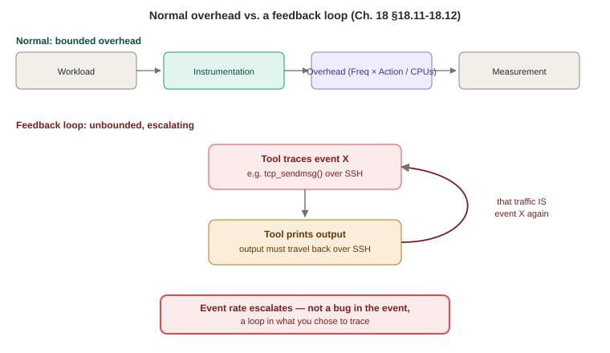

# Chapter 18 — Tips, Tricks, and Common Problems

*Study notes on Chapter 18 of BPF Performance Tools (Brendan Gregg, 2019). Original notes, not book text — see `00-index.md` for how these notes are written.*

> This is the chapter `00-index.md` flagged as worth reading right after Part I, not in its actual page order — and having now gone through every subsystem chapter, it's clear why: almost every "tip" here is a name for a pattern you've already seen play out in a real example somewhere in Chapters 6–17 (frame pointers, feedback loops, `tcpsnoop`'s over-scoping). This chapter is the condensed, reusable version of all of that — genuinely worth keeping open as a reference the next time you write your own tool.

## 18.1 Typical Event Frequency and Overhead — the book's own overhead formula, made precise

**Three factors determine a tracing program's CPU overhead**, combined into one genuinely useful formula worth memorizing:

```
Overhead = (Frequency × Action performed) / CPUs
```

**Event frequency is explicitly named as the biggest wildcard** — CPU count and per-event action cost each vary by roughly one order of magnitude across real systems, but event frequency alone can vary by **several** orders of magnitude, making it the dominant term to get right when estimating whether a tool is safe to run.

### A calibrated frequency table worth having memorized as a mental reference

The book gives real numbers, plus a genuinely clever framing device: scaling each event's maximum realistic rate down to "if this were a mailing list, how often would you get an email" — turning an abstract rate into something intuitively graspable:

| Event | Typical rate | Scaled to "mailing list" | Estimated overhead |
|---|---|---|---|
| Thread sleeps | 1/sec | Yearly | Negligible |
| Process execution | 10/sec | Monthly | Negligible |
| File opens | 10–50/sec | Weekly | Negligible |
| Profiling at 100 Hz | 100/sec | Twice a week | Negligible |
| New TCP sessions | 10–500/sec | Daily | Negligible |
| Disk I/O | 10–1000/sec | Every 8 hours | Negligible |
| VFS calls | 1,000–10,000/sec | Hourly | Measurable |
| Syscalls | 1,000–50,000/sec | Every 10 minutes | Significant |
| Network packets | 1,000–100,000/sec | Every 5 minutes | Significant |
| Memory allocations | 10,000–1,000,000/sec | Every 30 seconds | Expensive |
| Locking events | 50,000–5,000,000/sec | Every 5 seconds | Expensive |
| Function calls | up to 100,000,000/sec | 3 times/second | Extreme |
| CPU instructions | up to 1,000,000,000+/sec | 30/sec (audible as a musical pitch) | Extreme (needs a CPU simulator) |

**The five overhead-category thresholds behind every "negligible"/"significant"/"expensive" label used throughout this entire book, worth having as hard numbers rather than vague adjectives**:

| Term | Threshold |
|---|---|
| Negligible | < 0.1% |
| Measurable | ~1% |
| Significant | > 5% |
| Expensive | > 30% |
| Extreme | > 300% |

**This table is, in effect, the answer key behind every overhead caveat you've read in Chapters 6–17** — the reason `execsnoop`/`opensnoop`/`biolatency` are described as safe for continuous production use, while `memleak -p`'s uprobe-based allocation tracing and `offcputime`'s context-switch tracing are repeatedly flagged as short-duration-only, is exactly this table's frequency-to-overhead mapping, now made explicit and quantified rather than left as scattered individual warnings.

### Real, measured per-event costs — worth treating as a genuine reference table

The book measured real per-event nanosecond costs directly, tracing `vfs_read()` during a `dd(1)` workload doing over a million reads/second (on Linux 4.15, JIT enabled, one pinned CPU, fastest of 10 runs):

| Technique | Cost (ns/event) |
|---|---|
| Kprobe (bare) | 76 |
| Kretprobe (bare) | 212 |
| Tracepoint (entry or exit) | ~93–96 |
| Uprobe (bare) | 1,287 |
| Uretprobe (bare) | 1,931 |
| Kprobe + filter | 124 |
| Kprobe + map (`count()`) | 190 |
| Kprobe + map keyed by PID | 207 |
| Kprobe + map keyed by string (`comm`) | 225 |
| Kprobe + map keyed by two fields | 229 |
| Kprobe + kernel stack as key | 336 |
| Kprobe + user stack as key | 652 |
| Kprobe + histogram | 233 |
| Full timing (kprobe + kretprobe pair) | 636 (for the pair — ~318/probe) |
| Kprobe + both kernel and user stack, histogrammed | 836 |
| Kprobe + `printf()` to a file | 850 |

**Three concrete, quantified lessons worth pulling directly out of this table, since they've been asserted throughout the book and are finally backed by real numbers here**: (1) **kretprobes cost roughly 3x a bare kprobe** — directly, numerically confirming Chapter 2's explanation that a kretprobe needs an extra trampoline-handler mechanism for the return, not just a simple breakpoint; (2) **uprobes/uretprobes cost roughly 15–25x their kernel-side equivalents** — a precise number behind Chapter 2's repeated "uprobes trap into the kernel on every hit" overhead warning, and explicitly named here as "a known problem" the kernel community wants to improve; (3) **user-level stack traces cost roughly 2x kernel-level ones** (652 ns vs. 336 ns) — worth remembering the next time you're deciding whether `kstack` alone would answer your question instead of the more expensive `ustack`.

### 18.1.3 Test yourself

The book's own practical validation advice, worth adopting directly: measure the target application's real performance **with and without** your tracing tool running. On a CPU-saturated system, BPF overhead shows up as a **measurable drop in request rate** (since it's competing for the same fully-used CPU); on an idle system, it shows up instead as **reduced CPU idle time** (since there's slack to absorb the cost without affecting throughput) — two different, valid signals depending on which regime you're actually operating in.

## 18.2 Sample at 49 or 99 Hertz — the precise reasoning behind a rule you've now seen stated flatly several times

This chapter finally gives the **full, precise mechanism** behind the "use 99 Hz, not 100 Hz" advice repeated throughout Chapters 6, 8, and 10 — worth understanding exactly, not just following as folklore. Consider a thread that wakes every 10 ms to do exactly 2 ms of work (20% of one CPU). Sampling at a clean **100 Hz** (once every 10 ms) risks **lockstep**: if your sampling happens to always land inside that 2 ms work window, the profile shows the thread on-CPU **100% of the time**; if it always lands outside that window instead, the profile shows it **0% of the time** — both results are called **aliasing errors**, and both are completely wrong, purely because the sampling interval and the work's own period happen to divide evenly into each other.

**Using 99 Hz instead breaks this exact coincidence**: the sample offset relative to the periodic work drifts continuously over time, so over enough samples the profile converges on the true, correct 20% figure. **The reasoning for specifically 99 (not some other nearby odd number like 73) is worth remembering precisely**: it's close enough to 100 that you can still do quick mental arithmetic with it (*"eight CPUs for one second? Roughly 800 samples"*) while still being far enough off a round number to avoid lockstep with the round-number intervals application developers overwhelmingly tend to pick (every second, 10 times a second, every 20 ms, ...). **The book's own explicit, memorable label for this number is worth keeping**: call 99 "the profiler number," and — only half-jokingly — never use it for anything *other* than profiling, precisely because the whole trick depends on 99 staying unusual enough that no application timer ever coincidentally matches it.

## 18.3 Yellow Pigs and Gray Rats — the "23 trick" for discovering unknown events, in full

A genuinely reusable, general investigative technique, already used once in this book (Chapter 12 §12.4's bash function-count discovery) without being named — here it gets its own full explanation. **The core idea**: when you don't know which of many candidate events relate to a workload you care about, **inject a workload of a distinctive, easily-recognized size**, then frequency-count broadly and look for whatever count matches. The book's own worked example: running `dd` to perform exactly **230,000** writes, then `funccount -d 10 'ext4_*'` across all 509 matching kernel functions — 15 of them land at "a little over 230,000" calls, immediately narrowing 509 candidates down to 15 real candidates worth investigating further, with no prior knowledge of ext4 internals required at all.

**Why specifically 23 (and its multiples, 230/2,300/23,000...), rather than some other convenient round number, is worth understanding precisely, not just as a personal quirk**: the book explicitly prefers **23** over the more famous "yellow pig" number 17 (both are prime, which the book notes tend to occur less naturally in ordinary computing than powers of 2 or 10) specifically because **23 sits further away from nearby powers of two and ten** than 17 does — minimizing the chance some *other*, unrelated background activity coincidentally also happens to occur near-exactly 230,000 times during the same window, which would otherwise produce a false match. The book's own nickname for this, worth remembering alongside "the profiler number" from §18.2: **the "gray rat" number**.

## 18.4 Write Target Software — build the load generator before the tracer

A genuinely practical, low-cost habit worth adopting: **before writing a tracing tool for something unfamiliar, first write a small program that deliberately triggers the event you want to trace.** The book's own example (tracing DNS latency) shows writing a minimal `getaddrinfo(3)` client — largely just adapted from example code already given in that function's own man page — which, in the course of writing it, directly teaches you which functions are actually called, how request details are laid out in structs, and what the return values look like, all *before* you've written a single line of tracing code. **This combines cleanly with §18.3's technique**: making your own test program issue exactly 23 (or 230) requests turns it into ground truth you can validate a new tool against, the same known-workload discipline recommended throughout Chapters 9 and 12.

## 18.5 Learn Syscalls — the best-documented, most tracepoint-friendly target class

Syscalls are highlighted as an unusually good default target for a new investigation, for three concrete reasons worth remembering together: they're **documented in man pages** (real, authoritative descriptions of what a function does and what its arguments/return value mean); they already have **stable tracepoints** (`syscalls:sys_enter_*`/`sys_exit_*`) for nearly all of them; and they directly reflect **resource usage requested by an application**. The book's own example: noticing an unexpectedly high `setitimer(2)` rate via `syscount(8)`, then simply reading `man setitimer` to learn exactly what it does (arming/disarming an interval timer) and which tracepoints would expose its arguments — no source-code archaeology required at all, just the man page.

## 18.6 Keep It Simple — the `tcpsnoop` lesson, restated as an explicit design rule

**This section is the chapter's own explicit generalization of the `tcpsnoop` cautionary tale you already read in full in Chapter 10 §10.3.15** — worth reading here as the book's own final, distilled statement of that lesson's real content, now framed as general advice rather than one specific story.

Two concrete costs of an overly broad tracing tool, worth naming precisely: **unnecessary overhead** (tracing far more events than the actual problem needs, imposing that cost on every future user of the tool, most of whom only needed the narrow, common case); and **maintenance burden** — specifically severe for kprobes/uprobes, since they're unstable interfaces that can (and, the book notes, *have*, repeatedly, across the Linux 4.x series) break BCC tools across kernel versions. **The real fixes the book names for exactly this recurring breakage**: version-specific code branches (often keyed on checking whether a function *exists*, since raw kernel version numbers are unreliable due to backporting), maintaining separate old-kernel tool copies in a `tools/old` directory, or — described as the actual best outcome — a **tracepoint eventually being added**, permanently ending the breakage (the book's own named example: `sock:inet_sock_set_state`, which is exactly what let Chapter 10's TCP tools stop depending on unstable kprobes for state tracking).

**The book's own closing self-assessment is worth remembering as a real, first-person data point about why this design discipline matters**: it states directly that its own BCC tools have been comparatively easy to fix precisely *because* each one was deliberately scoped to trace only a few events — and that tracing dozens of events per tool (as `tcpsnoop` once did) would have multiplied both the breakage frequency and the testing burden (every event type, across every kernel version with special-case code) proportionally. **The whole book's own tool-design philosophy is stated in one sentence here, worth keeping as the single best summary of "how do I write a tool that will still work in five years"**: *"solving the specific problem and no more."*

## Common Problems (18.7–18.12) — a troubleshooting playbook

### 18.7 Missing events — is it your tool, or the event itself?

The general diagnostic move, worth remembering as the default first step: **cross-check with `perf(1)`** before assuming your BPF tool is broken. `perf stat -e <tracepoint> -a` for a fixed duration tells you definitively whether the underlying event is actually occurring at all — if `perf` also shows zero, **the event genuinely isn't happening**, and the bug isn't in your tracing tool; if `perf` shows a nonzero count while your BPF tool shows nothing, the problem is specifically in your tool. The same cross-check works for kprobes via `perf probe <function>` (with its own separate add/remove-probe commands, a bit more manual than BCC/bpftrace's integrated model). **A real, concrete, named cause of "events go missing after an update" worth remembering**: an application that switches from **dynamic to static linking** (or the reverse) can silently relocate a function you're targeting via uprobe from a shared library into the main binary (or vice versa) — the uprobe's configured path simply no longer matches where the function actually lives.

### 18.8 Missing stack traces — the frame-pointer lesson, given its final, precise mechanical explanation

**Given how many times this exact symptom has appeared throughout this book (Chapters 2, 6, 8, 9, 12, 13), this section is worth reading as the definitive, final statement of the underlying mechanism, in full.** The book's own worked example shows **both** BCC's `trace(8)` *and* `perf(1)` independently producing broken, near-empty stacks for the same `execve()`-tracing scenario — and identifies **three distinct problems** worth being able to recognize separately: stacks that are suspiciously **short** (one or two frames, not ending in a recognizable root like `main` or `start_thread` — a strong signal of truncation); a final frame that's **`[unknown]`** (even `perf`, using its own more thorough symbol resolution, couldn't identify it — suggesting either a genuine symbol-table problem, or that a frame pointer has already been corrupted/repurposed by the time the walk reaches it); and — a subtler, tool-specific bug the book flags candidly rather than glossing over — one frame appearing in `perf`'s output but **not** in BCC's, for the *same* underlying event, which the book guesses is because `perf` may have used debuginfo to recover a frame BCC's simpler, frame-pointer-only approach couldn't.

**The precise mechanical explanation, stated as cleanly here as anywhere in the book**: broken stacks are "usually caused by a confluence of two factors" — (1) the tracer uses frame-pointer-based walking, and (2) the target binary doesn't reserve a register (RBP on x86_64) for the frame pointer, reusing it as an ordinary general-purpose register instead (a compiler optimization). The tracer reads that register expecting a frame-pointer value, but instead finds **whatever arbitrary data happens to be there** — a number, an object address, a pointer into a string. If that garbage value happens not to resolve to any real symbol, you get a relatively harmless `[unknown]`; but if it **coincidentally** resolves to some real, unrelated symbol in the symbol table, **the printed stack shows a wrong function name that looks entirely plausible** — a genuinely worse failure mode than an honest `[unknown]`, since nothing about the output signals that anything went wrong at all.

**18.8.1 The fix, stated as concretely as anywhere in this book**: recompile with `-fno-omit-frame-pointer` (C/C++/other `gcc`/LLVM-compiled software) or run the JVM with `-XX:+PreserveFramePointer` (Java) — both **measured at under 1% overhead** in the book's own experience, a cost it says is consistently worth paying for working stack traces. The alternative — switching to a non-frame-pointer-based walking technique entirely (DWARF, ORC, LBR, all covered in Chapter 2 §2.4) — is noted here, once more, as **not yet available from BPF for user-level software** as of this writing (DWARF/LBR unavailable to BPF at all; ORC available only for kernel stacks, not user-level ones).

### 18.9 Missing symbols — the two different fixes, by category, restated as a quick playbook

Three named causes: broken stacks (§18.8, just covered); a **short-lived process that exits before the tracer can read its address space** and resolve symbols (a real, timing-dependent race, distinct from any actual configuration problem); or symbol table information simply not being present at all. **The fix differs by runtime category, directly recapping Chapter 12's two main worked examples as a quick-reference pair**: for **JIT runtimes** (Java, Node.js), use a supplemental symbol file (`/tmp/perf-PID.map`, as generated by `perf-map-agent`/`jmaps` for Java) — necessary because the JIT's own symbol table is dynamic and isn't part of any pre-compiled binary; for **ELF binaries** (C, C++), the usual culprit is `strip(1)` having removed the symbol table from a packaged/distributed binary — fixed either by adjusting the build to skip stripping, or falling back to an external symbol source (debuginfo, or eventually BTF), both directly supported by BCC and bpftrace.

### 18.10 Missing functions when tracing — three real causes beyond just missing symbols

Three named, distinct causes for "a function I know exists can't be instrumented at all," worth distinguishing since each has a different real fix:

- **Inlining** — the function's instructions have been folded directly into its caller (common for short functions, avoiding call/return/prologue overhead); its symbol may be entirely gone, or may exist but simply never actually get invoked as a separate call for the code path you're watching. Chapter 12's Go `add()` example and Chapter 6's `tick_nohz_start_idle()` disappearance are both real, concrete instances of exactly this.
- **Tail-call optimization** — when `A() → B() → C()`, and `C()` is the *last* thing `B()` does, the compiler can have `C()` return **directly to `A()`**, skipping back through `B()` entirely — meaning a `kretprobe`/`uretprobe` placed on `C()` to catch its return **never fires**, since `C()`'s return path no longer passes back through the point the probe expected.
- **Static vs. dynamic linking changes** — a uprobe targeting a function inside a shared library breaks if the target software has since switched to **static** linking (the function moved into the main binary), and the reverse is equally possible.

**The general fallback strategy, worth remembering as the standing default**: instrument a different, nearby event instead — a parent function, a child function, or a neighboring one — or use kprobe/uprobe **instruction-offset tracing** (Chapter 12 §12.2.4) to reach directly into the specific offset where an inlined function's code now lives, if you know that offset. (The book notes bpftrace itself didn't yet expose offset-based tracing at the time of writing, though BCC's lower-level API did.)

### 18.11 Feedback loops — the exact mechanism, made unmistakably concrete


> **How to read this:** the failure mode isn't "overhead is too high" — it's that the overhead itself becomes a new instance of the event being measured, so it never converges.

Three real, named examples of a tracer accidentally tracing **its own** activity, creating a runaway loop: tracing `sys_enter_write`/`sys_write_enter` while your own tool's `printf()` output itself performs writes; tracing `tcp_sendmsg()` on a **remote host you're SSH'd into**, where your own SSH session's traffic (carrying the tracer's own output back to you) gets traced, generating more output, more traffic, and so on; and tracing `ext4_file_write_iter()` while redirecting your own tool's output **to a file on that same ext4 file system**, where each write of trace output itself triggers a new ext4 write event to be traced. **The event rate in all three cases doesn't just get elevated — it can explode, becoming a real performance problem in its own right until you manually kill the tracer.** The fix in every case is the same, general principle: **filter out your own tool's own activity** (by PID, or by process name), or scope the trace specifically to the target process you actually care about rather than tracing system-wide when your own tool's output could plausibly re-trigger the same event class it's watching.

### 18.12 Dropped events — silent incompleteness, and how to actually detect it

**A tool's output can be silently incomplete** if events arrive faster than a fixed-size buffer or map can hold them — the perf output ring buffer can overflow, or (the book's own concrete example) a fixed-size stack-ID map (`profile(8)`'s default 16,384-entry stack storage) can fill up under a workload with an unusually large number of *distinct* stack shapes. **The book's own stated expectation, worth holding tools to as a standard**: *"the tools should tell you when events have been dropped"* — its own example shows `profile(8)` printing an explicit `WARNING: 5 stack traces could not be displayed` rather than silently under-reporting. **The fix is usually a tunable**: `profile(8)`'s own `--stack-storage-size` option exists specifically to raise this ceiling when you hit it — and the book adds a nice, small piece of tool-design philosophy worth remembering on its own: *"If tuning becomes commonplace, the tool defaults should be updated"* — i.e., a limit that real users routinely have to raise by hand is really a signal the default itself should simply be higher.

---

## Quick-reference glossary (this chapter's terms)

- **Overhead formula** — `Overhead = (Frequency × Action performed) / CPUs`; the single equation behind every overhead caveat in this book.
- **Negligible / Measurable / Significant / Expensive / Extreme** — this book's standard overhead vocabulary, corresponding to <0.1% / ~1% / >5% / >30% / >300%.
- **Lockstep sampling / aliasing error** — a sampling interval that coincidentally divides evenly into a periodic workload's own period, producing a systematically wrong (0% or 100%) profile; the reason for sampling at 99 Hz rather than 100.
- **The "profiler number" (99) / the "gray rat" number (23)** — this chapter's own memorable names for two deliberately-chosen, "unusual enough to avoid coincidence" numbers used for sampling and for workload-identification, respectively.
- **Tail-call optimization** — a compiler technique where a function's last call returns directly to its original caller's caller, silently defeating a `kretprobe`/`uretprobe` placed on the tail-called function.

## Check your understanding

1. Using the overhead formula, explain why tracing the same event at the same absolute frequency could be "negligible" on one system and "expensive" on another.
2. Why does the book specifically recommend 99 Hz rather than a more "reasonable-sounding" number like 100 or 95 for CPU sampling, and what would go wrong at exactly 100 Hz for a thread doing 2ms of work every 10ms?
3. In the "gray rat" (23) technique, why does the book prefer 23 specifically over the more famous "yellow pig" number 17?
4. A stack trace ends in `[unknown]`, and the function name just before it turns out, on closer inspection, to be a real but completely unrelated and implausible function for that code path. What does this chapter say is actually happening, and why is this outcome described as worse than a plain `[unknown]`?
5. You write a bpftrace one-liner that traces `tcp_sendmsg()` and prints its output, then SSH into a remote server and run it there while connected over that same SSH session. What specific problem does this chapter warn you're about to cause, and why?

<details>
<summary>Answers</summary>

1. Because the formula divides frequency-times-action-cost by the number of CPUs — the same absolute event frequency spread across a single-CPU system concentrates all of that overhead onto one core, while the identical frequency on a 128-CPU system dilutes the same total cost across many more cores, making the per-core impact proportionally much smaller. The event rate itself hasn't changed; only the number of CPUs available to absorb its cost has.
2. At exactly 100 Hz, sampling once every 10 ms can fall into lockstep with a periodic workload that also operates on a 10ms-aligned schedule (like a thread doing 2ms of work every 10ms) — if the sample timing happens to always coincide with that work window, the tool reports the thread as on-CPU 100% of the time; if it happens to always miss it, the tool reports 0%. Both are aliasing errors, arising purely from the coincidence between the sampling interval and the workload's own period. 99 Hz avoids this because it doesn't share that same round-number relationship with typical application timers, so the sample offset drifts over time and eventually captures a representative, accurate picture instead.
3. Both 17 and 23 are prime numbers, which the book notes are less likely to naturally coincide with other unrelated background event counts than round numbers like powers of two or ten. The book specifically prefers 23 because it sits further away from nearby powers of two and ten than 17 does, further reducing the chance that some other, unrelated activity on the system also happens to occur close to the same count purely by coincidence, which would produce a false match when frequency-counting for a known workload.
4. This chapter explains that a corrupted or repurposed frame-pointer register can contain arbitrary leftover data (a number, an address, a string pointer) rather than a genuine stack address — if that arbitrary value happens, by pure coincidence, to match a real address in the symbol table, the tool will confidently print a real-looking but entirely wrong function name. This is considered worse than an honest `[unknown]` because nothing in the output signals that anything went wrong — a plausible-looking but incorrect stack frame can mislead an investigation in a way a visibly missing or unknown frame cannot.
5. This creates a feedback loop: your own bpftrace tool's printed output has to travel back to you over the same SSH connection, and since you're tracing `tcp_sendmsg()` on that remote host, the TCP traffic carrying your tool's own output gets captured and traced too — generating more trace output, which generates more TCP traffic to send it back, which gets traced again, and so on. The event rate can explode rapidly, becoming a real performance problem on the remote host until you manually kill the tracer.

</details>
