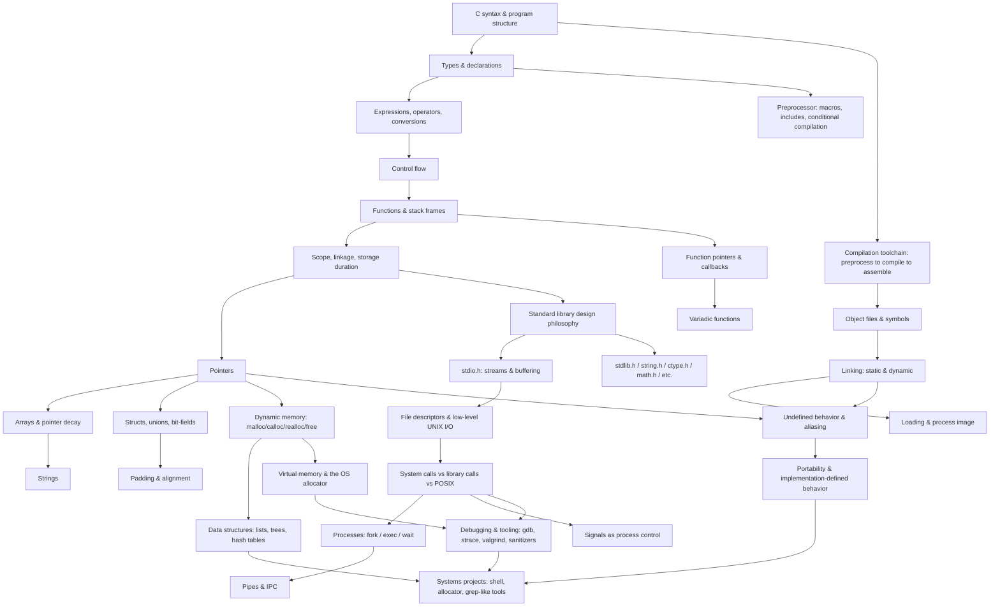

# 01 — Book Analysis

> Part of the **C Programming + Systems Programming Master Notes**.
> This file is the foundation for everything else in this vault: it identifies the source
> material, shows what each source is (and isn't) good for, and lays out the dependency
> graph that the rest of the notes are organized around.

---

## 0. Source discipline used throughout this vault

Every non-trivial claim in these notes is tagged so you always know where it came from:

| Tag | Meaning |
|---|---|
| `[Book-derived]` | Directly supported by one of the three source books below. |
| `[External]` | From an external, authoritative source (cppreference, POSIX, man-pages, GNU docs, CERT C, etc.), clearly cited. |
| `[Synthesis]` | My own combination/explanation built from book-derived + external material — not a direct claim from any single source. |
| `[Needs verification]` | Plausible but not confidently sourced; flagged so you can check it yourself before relying on it. |

Throughout the vault the three books are referred to by short codes:

- **Book A** — *C Programming* (Wikibooks)
- **Book B** — *The C Programming Language*, 2nd ed. (K&R)
- **Book C** — *The Standard C Library* (Plauger)

**Methodology note `[Synthesis]`:** this analysis is based on each book's full table of
contents plus close reading of representative chapters from each (front matter, a beginner
chapter, a pointers/memory chapter, a standard-library chapter, and the systems-facing
chapter where one exists) — not a page-by-page read of all ~1,000 combined pages. That
full read happens incrementally, per topic, as each topic file in this vault is written during
the "PART" generation phases (see `02_LEARNING_ROADMAP.md`). Treat the *structural*
claims below (what each book covers, how it's organized) as solid; treat any specific
*numeric or word-for-word* claim about content I haven't yet quoted here as something to
re-check against the source PDF when that topic's file is written.

---

## 1. Books identified

### ⚠️ Important discrepancy — three books, not four

The task brief refers to **four** uploaded books. Only **three PDFs** were actually
provided:

1. `C_Programming.pdf`
2. `c.pdf`
3. `clib.pdf`

(A fourth item, `C-CPP-notes.zip`, is a *folder* to deliver notes into, not a book — it
also contains an unrelated existing project, `Papyrus-C++/`, about a C++ load-testing
tool, which is left untouched by this handbook.)

I'm proceeding with the three real books as the primary sources, exactly as instructed,
and filling the gaps that all three leave (mainly: processes, pipes, POSIX beyond file
descriptors, and modern debugging tooling) with clearly labeled `[External]` material, as
the brief itself anticipates. If a fourth book exists on your machine, add it to the uploads
folder and I'll fold it into this analysis before we go further.

---

### Book A — *C Programming* (Wikibooks)

| Field | Value |
|---|---|
| Title | *C Programming* |
| Author | Collaborative — Wikibooks contributors (en.wikibooks.org), no single named author |
| Edition | PDF export dated 24 November 2013 |
| License | CC BY-SA 3.0 (stated on the copyright page) `[Book-derived]` |
| Length | 285 pages |
| Format | LaTeX-generated PDF (pdfTeX), clean text layer, extracts cleanly |

**Main purpose:** a broad, practical, beginner-to-intermediate walkthrough of C — from
"why learn C" through syntax, the standard library, file I/O, and a surprising amount of
UNIX-adjacent material (networking sockets, mixing C with other languages, compiler
usage).

**Intended audience:** newcomers to C who may already know some programming; also
useful as a practical companion/cookbook for people who know the language but want
idiomatic patterns and compiler-flag-level detail.

**Major topics:** compiler usage and the `gcc`/preprocessor/object-file/link pipeline;
code style and structure; error handling (`setjmp`, signals); variables and the four basic
types; I/O with `printf`/`scanf`; math library; control flow; functions and the standard
library; the preprocessor; standard libraries and POSIX; **file I/O treated in unusual
depth for an intro book** (streams, `FILE*`, buffering, file-position functions); pointers
and arrays including function pointers; dynamic memory (`malloc`/`calloc`/`realloc`/`free`);
strings and `<string.h>`; structs/unions; **UNIX socket networking** (unique among the
three books); "common practices" (dynamic multidimensional arrays, macro conventions,
nulling freed pointers); mixing C with assembly/Java/Perl/Python; a full keyword/operator/
type reference; compiler list.

**Strengths:**
- Widest *breadth* of the three books — the only one that touches sockets, compiler
  automation (`make`), and cross-language interop.
- Its **File I/O chapter (21) is the most exhaustive walkthrough of the three books** of
  `fopen`/`fclose`/`fread`/`fwrite`/positioning functions with worked examples.
- Practical, example-driven, low barrier to entry.
- Explicit "Further reading" links per chapter (useful pointers to expand on, though as
  external Wikipedia/Wikibooks links they are not treated as authoritative here).

**Limitations:**
- Wiki provenance means uneven depth and voice across chapters (many different
  contributors) — some sections are excellent, others thin (e.g. "Complex types" is only
  three pages).
- Not grounded in the ISO/ANSI standard the way Book B and Book C are; occasionally
  states things imprecisely. Example caught during sampling: it describes an array as
  something that "can be termed as a constant pointer" — a common and *incorrect*
  simplification (an array and a pointer are different object types with different `sizeof`
  and different storage; see `memory/03_arrays.md` when written, and the ⚠️
  misconception box this will get).
- No struct-padding/alignment depth, no discussion of the standard's undefined vs.
  implementation-defined distinction, no ABI or linker internals.
- Predates C11/C17/C23 entirely; written from a C89/C99-ish practitioner viewpoint
  without saying so explicitly.

**How it differs from the other two:** it is the *practitioner's tour* — broadest surface
area, most "how do I actually do X" content, weakest on formal precision.

---

### Book B — *The C Programming Language*, 2nd Edition (K&R)

| Field | Value |
|---|---|
| Title | *The C Programming Language*, 2nd Edition |
| Authors | Brian W. Kernighan and Dennis M. Ritchie |
| Edition | 2nd ed. (describes ANSI C / C89); this scan converted 2002; original publication 1988 |
| Length | 217 pages (reflowed; the original print edition is ~272 pages) |
| Format | Scanned/converted `.doc` → PDF, clean enough text layer |

**Main purpose:** the canonical tutorial-plus-reference for the C language as formalized
by ANSI. Written by the language's co-designer (Ritchie) and one of the field's clearest
technical writers (Kernighan).

**Intended audience:** programmers who already know the basics of programming
(variables, loops, functions) and want to learn C specifically, precisely, and idiomatically.

**Major topics:** a full tutorial (ch. 1); types/operators/expressions with exact conversion
and promotion rules (ch. 2); control flow (ch. 3); functions, scope, storage classes,
recursion, the preprocessor (ch. 4); **pointers and arrays in real depth**, including address
arithmetic, pointer/array duality, multi-dimensional arrays, command-line arguments,
function pointers, and the famous "complicated declarations" section (ch. 5); structures,
self-referential structures, `typedef`, unions, bit-fields (ch. 6); standard I/O (ch. 7);
**the UNIX system interface** — file descriptors, `read`/`write`/`open`/`creat`/`close`/`unlink`,
`lseek`, and two worked implementations (a `stdio`-from-scratch built on file descriptors,
and a storage allocator) (ch. 8); **Appendix A**, a full but compact reference manual for
the grammar and semantics; **Appendix B**, a summary of the standard library.

**Strengths:**
- The **authoritative** source on C semantics among the three — written by people who
  literally designed the standard's antecedents.
- Appendix A is effectively a miniature, readable version of the standard's grammar —
  excellent ground truth for "what does the language actually guarantee."
- Chapter 8 is the best of the three books for the crucial
  **`FILE*` → file descriptor → kernel** distinction: it shows both layers and *builds one
  on top of the other in code*, which is exactly the mental model this handbook needs to
  teach.
- Extremely economical prose; nothing is padded.

**Limitations:**
- Describes ANSI C (C89) only — no `<stdint.h>`, no `_Bool`, no `restrict`, no
  designated initializers, no VLAs, no `inline`, no `//` comments as standard. Every
  "modern C" callout in this handbook has to come from outside this book.
- Assumes the reader already knows how to program — not a first exposure to
  programming.
- Its "UNIX system interface" chapter predates and does not use POSIX terminology or
  cover `fork`/`exec`/`wait`/pipes/signals as process-control tools at all — only the file-I/O
  slice of the UNIX interface.
- Minimal coverage of debugging tools, build systems, or memory-safety tooling (none
  existed in their modern form in 1988).

**How it differs from the other two:** it is the *precision and mental-model* source —
narrowest scope, deepest and most trustworthy treatment of what it does cover.

---

### Book C — *The Standard C Library* (Plauger)

| Field | Value |
|---|---|
| Title | *The Standard C Library* |
| Author | P.J. Plauger — chaired the Library Subcommittee of X3J11 (the ANSI C
  standards committee) and was Secretary/Convenor of the ISO C committee `[Book-derived]` |
| Publisher / Year | Prentice Hall PTR, 1992 |
| Length | 514 pages |
| Format | Scanned (Adobe Acrobat "Paper Capture"/OCR). **OCR quality is noticeably
  degraded** — confirmed during sampling: frequent character-level corruption (e.g. `st&rg.h`
  for `stdarg.h`, `1f` for `If`, `va-list` for `va_list`, ligature breakage throughout). Any
  quoted fragment from this book must be treated as approximate until cross-checked. |

**Main purpose:** explain, header by header, how to **use** and how to **implement** every
function in the ANSI/ISO C89 standard library — around 9,000 lines of real, portable,
tested implementation code are presented and discussed.

**Intended audience:** programmers who already know C and want to understand the
library at the level of a library *implementor* — precisely the "understand the design, not
just the API" outcome this handbook is aiming for.

**Major topics:** one chapter per standard header — `<assert.h>`, `<ctype.h>`,
`<errno.h>`, `<float.h>`, `<limits.h>`, `<locale.h>`, `<math.h>`, `<setjmp.h>`,
`<signal.h>`, `<stdarg.h>`, `<stddef.h>`, `<stdio.h>`, `<stdlib.h>`, `<string.h>`,
`<time.h>` — **15 headers, 15 chapters**, each following the same structure: Background →
What the C Standard Says → Using `<header>` → Implementing `<header>` → Testing
`<header>` → References → Exercises.

**Strengths:**
- Unmatched **design rationale**. Example found during sampling: it discusses exactly
  why `getchar` cannot safely be a naive macro, and shows the real (much uglier, buffer-
  aware) macro glibc-style implementations actually use — precisely the "why does the
  library look the way it does" understanding the task brief asks for.
- Direct excerpts from the ISO C90 standard text accompany each function, so it doubles
  as a (dated) standard reference.
- Includes a real `malloc`/`free`/`realloc` implementation with bookkeeping — the best of
  the three books for connecting `malloc()` conceptually down to an allocator strategy.
- A dedicated "Testing" section per chapter models how to actually validate a library
  implementation — useful for the debugging/tooling goals in the brief.

**Limitations:**
- **Only** the C89 standard library. Zero POSIX, zero file descriptors, zero processes —
  it explicitly is not trying to cover the OS interface at all.
- Pre-C99: no `<stdint.h>`, no `<stdbool.h>`, no `snprintf` (added in C99), no restrict-
  qualified library prototypes, no complex-number support.
- OCR corruption (noted above) means exact code listings and quoted standard text need
  re-derivation/cross-checking against cppreference or the real standard rather than
  trusted verbatim from the extracted text.
- ~9,000 lines of implementation code are **copyrighted** (explicit notice in the front
  matter restricting redistribution of the source). This handbook will **explain the design
  and reproduce short, illustrative fragments at most** — not transcribe Plauger's
  implementation wholesale — and will write original example code for the "how would
  you implement this" discussions.

**How it differs from the other two:** it is the *design-and-implementation* source —
narrowest scope (library only, not the language, not the OS), deepest treatment of *why*
the library's API looks the way it does.

---

## 2. Topic coverage matrix

Legend: blank = not covered · ✓ = covered · ✓✓ = solid depth · ✓✓✓ = authoritative/deep
treatment · **[Ext]** = not in any of the three books, needs external material.

| Topic | A (Wikibooks) | B (K&R) | C (Plauger) | Importance |
|---|:---:|:---:|:---:|---|
| Compiler pipeline / `gcc` usage | ✓✓ | ✓ | — | High |
| Preprocessor & macros | ✓✓ | ✓✓ | ✓ (stddef.h only) | Medium–High |
| Types, sizes, conversions | ✓✓ | ✓✓✓ | ✓ (limits.h/float.h) | Critical |
| Operators & expressions | ✓ | ✓✓✓ | — | High |
| Control flow | ✓✓ | ✓✓✓ | — | High |
| Functions, scope, storage classes | ✓✓ | ✓✓✓ | — | Critical |
| Recursion | ✓ | ✓✓ | — | Medium–High |
| Pointers (incl. complicated declarations) | ✓✓ | ✓✓✓ | — | Critical |
| Arrays & pointer decay | ✓✓ | ✓✓✓ | — | Critical |
| Strings | ✓✓ | ✓ | ✓✓✓ (`<string.h>`) | Critical |
| Structs / unions / bit-fields | ✓ | ✓✓✓ | — | Critical |
| Struct padding & alignment (deep) | — | (light) | (`<stddef.h>` offsetof) | Critical — mostly **[Ext]/[Synthesis]** |
| Dynamic memory (`malloc` family) | ✓✓ | ✓✓ (incl. 8.7 allocator) | ✓✓✓ (`<stdlib.h>`) | Critical |
| Standard-library *design philosophy* | — | — | ✓✓✓ | High |
| `<stdio.h>` incl. buffering internals | ✓✓ | ✓✓ | ✓✓✓ | Critical |
| `<string.h>` | ✓✓ | ✓ | ✓✓✓ | High |
| `<ctype.h>` | — | ✓ | ✓✓✓ | Medium |
| `<math.h>` | ✓✓ | ✓ | ✓✓✓ | Medium |
| `<stdlib.h>` (qsort/bsearch/exit/…) | — | ✓✓ | ✓✓✓ | High |
| `<assert.h>` | — | ✓ | ✓✓✓ | Low–Medium |
| `<errno.h>` | — | (via `perror`) | ✓✓✓ | Medium |
| `<setjmp.h>` | ✓ | ✓ | ✓✓✓ | Medium |
| `<signal.h>` | ✓ | ✓ | ✓✓✓ | Medium |
| `<stdarg.h>` / variadic functions | ✓ | ✓✓ | ✓✓✓ | Medium–High |
| `<stddef.h>`, `<limits.h>`, `<float.h>`, `<locale.h>` | — | ✓ | ✓✓✓ | Low–Medium |
| `<time.h>` | — | ✓ | ✓✓✓ | Low |
| File I/O at `stdio` level | ✓✓✓ | ✓✓ | ✓✓✓ | Critical |
| File descriptors / low-level UNIX I/O | — | ✓✓✓ (only source!) | — | Critical |
| `dup`/`dup2` | — | — | — | Medium–High — **[Ext]** |
| Implementing `FILE*`/`getc` from an fd | — | ✓✓✓ | — | High |
| Directory listing | — | ✓✓ (pre-POSIX `ndir`-style) | — | Medium |
| Custom allocator implementation | — | ✓✓✓ | ✓✓ (different angle) | High |
| Processes: `fork`/`exec`/`wait` | — | — | — | Critical — **[Ext]** |
| Pipes / IPC | — | — | — | High — **[Ext]** |
| Signals as IPC / process control | ✓ (language-level only) | (via `<signal.h>`) | ✓✓ (language-level) | Medium — process-control angle is **[Ext]** |
| Environment & `argc`/`argv` | ✓ | ✓✓ | — | Medium |
| Sockets / networking | ✓✓✓ (unique) | — | — | Bonus/Medium |
| Complicated declaration parsing | ✓ | ✓✓✓ | — | High |
| Undefined vs. implementation-defined (as a *dedicated topic*) | — | (implicit in App. A) | (implicit in "What the Standard Says") | Critical — **[Synthesis]** required |
| Debugging tools (gdb/valgrind/sanitizers/objdump/etc.) | — | — | — | Critical — **[Ext]** |
| ABI / calling conventions | — | — | — | Medium–High — **[Ext]** |
| Modern C (C99/C11/C17/C23 features) | — | — | — | Medium–High — **[Ext]** |

---

## 3. Concept dependency graph

This is the backbone the whole vault's file order follows. An arrow means "needs a solid
grip on the source before the target makes real sense" — not a strict chapter order, since
several branches can be learned in parallel.

**Reading it:** the top half (A → O) is language-level and is where Book B dominates.
The middle band (P → W) is compilation + the standard library, where Book A gives
breadth and Book C gives depth. The bottom half (X → AG) is the OS/systems band,
where Book B contributes the file-descriptor foundation but everything below "System
calls vs library calls vs POSIX" is largely external material synthesized on top of that
foundation.

---

## 4. Recommended learning order (summary)

Full phase-by-phase detail — prerequisites, exercises, projects, interview questions, and
difficulty per phase — lives in `02_LEARNING_ROADMAP.md`. In brief, the order this vault
follows is **not** "Book A → Book B → Book C". It's:

1. **Fundamentals** (syntax, types, expressions, control flow) — mainly Book B, breadth
   from Book A.
2. **Functions & the preprocessor** — Book B primary, Book A for practical macro
   patterns.
3. **Pointers & memory** — Book B primary (esp. §5.12 complicated declarations),
   Book A for extra worked examples.
4. **Arrays, strings, structs/unions** — Book B primary, Book C's `<string.h>` chapter
   for the implementation angle.
5. **Compilation & linking** — Book A primary (this is its strength), `[External]` for
   object-file/linker internals depth.
6. **The standard library, by design** — Book C primary, Book B's Appendix B as the
   quick-reference companion.
7. **File I/O, both layers** — Book A (`stdio` breadth) + Book C (`stdio` internals) +
   Book B ch. 8 (the fd layer *and* the fd→`stdio` bridge implementation).
8. **UNIX/POSIX system interface** — Book B ch. 8 as the only in-book source, then
   `[External]` (man-pages, POSIX) for `fork`/`exec`/`wait`/pipes/`dup2`.
9. **Debugging & tooling** — entirely `[External]`.
10. **Undefined behavior, portability, modern C** — `[Synthesis]` from all three books'
    implicit standard-compliance discussions, plus `[External]` for C99/C11/C17/C23.
11. **Projects & interview preparation** — cuts across everything above.

---

## 5. Overlapping topics across the books

Where more than one book covers the same ground, the vault will give a **cross-book
synthesis** (per the task brief) rather than three separate summaries. The main overlaps:

- **Pointers/arrays** — A and B both cover this; B is authoritative, A supplies extra
  worked examples and the "common misconception" material worth explicitly correcting.
- **Dynamic memory** — A, B (ch. 8.7 allocator), and C (`<stdlib.h>`) all implement or
  discuss `malloc`-family behavior from three different angles (practical use, a from-
  scratch allocator, and the standard's official contract) — an excellent case for a three-
  way synthesis box.
- **`stdio.h` / file I/O** — all three books cover this, at three different layers (A: broad
  API tour; B: builds `stdio` on top of file descriptors; C: standard-mandated behavior +
  a portable implementation). This is the single richest cross-book synthesis opportunity
  in the whole corpus and will anchor the `systems/` file-I/O material.
- **`setjmp`/`signal`** — A gives a beginner-level "what/why", B a terse reference, C the
  full standard contract + implementation. Good candidate for a short synthesis box
  rather than a long one (the topic itself is medium-importance).
- **Preprocessor** — A and B overlap significantly; B is more precise about what the
  standard actually guarantees (§4.11, Appendix A.12), A has more "here's a debugging
  macro pattern" content.

## 6. Gaps requiring external sources

Flagged already in the matrix; the topics with **no book coverage at all** that the brief
explicitly asks for are:

- Process creation and control: `fork`, `exec` family, `wait`/`waitpid`
- Pipes and other IPC beyond in-language `signal.h`
- `dup`/`dup2`
- Debugging/tooling workflows: `gdb`, `valgrind`, sanitizers (ASan/UBSan), `strace`,
  `objdump`/`readelf`/`nm`
- ABI and calling-convention detail
- A dedicated, systematic undefined-behavior catalogue (the standard-compliance
  discussions in B and C are the right *raw material*, but none of the three books
  organizes it as a standalone "here are 15 UB traps" chapter the way this handbook will)
- Modern C (C99 → C23) — all three books predate or ignore these entirely

These will be written as `[External]` or `[Synthesis]` and cited against the sources listed
in the "Recommended external references" section of `02_LEARNING_ROADMAP.md`
(cppreference, POSIX/Open Group, man7.org, GNU/glibc docs, GCC/Clang docs, CERT C).
