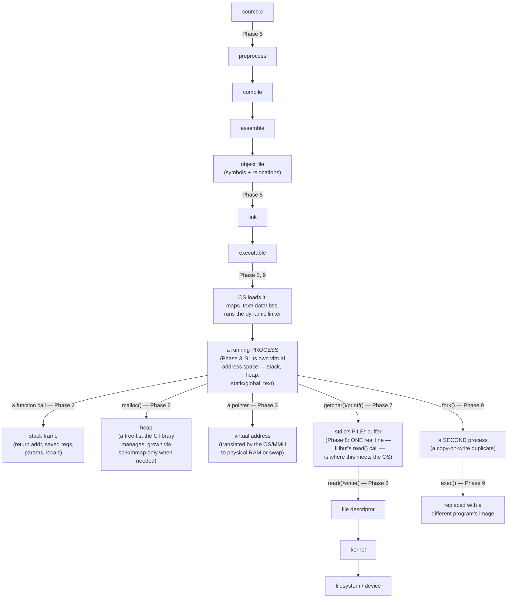

# The C Mental Model

> This is the vault's capstone — not new material, but the picture that should remain
> once the details of any one file have faded. If you remember nothing else from these 73
> files, remember this one. It directly answers the task brief's own final objective: not
> to memorize C, but to understand what the machine, compiler, runtime, library, and
> operating system are actually doing.

---

## 1. The one-paragraph thesis

C is not a large language with many rules to memorize. It is a **small** language that
deliberately exposes the machine underneath it, and declines to protect you from that
machine's realities — no bounds checking, no null checking, no automatic memory
management, no guaranteed overflow behavior. Nearly everything that feels arbitrary or
surprising about C — a pointer bug, a struct's size, a linker error, a program that
behaves differently at a different optimization level — stops being arbitrary the instant
you have the right picture of what's actually happening in memory, in the compiler, or in
the kernel at that moment. This vault's entire structure was one long argument for that
single claim.

---

## 2. The five chains, assembled into one picture

`[Synthesis]` Separately, each phase of this vault built one chain connecting a piece of C
syntax down to the machine. Put together, they overlap into a single, connected map:

**Every arrow in this diagram is a file in this vault.** If any single arrow feels like a
gap in your own understanding, that's a precise pointer to exactly which file to re-read —
this diagram is this vault's own index, reduced to one picture.

---

## 3. Five recurring patterns that explain almost everything "confusing" about C

`[Synthesis]` Across eleven phases, the specific bugs and surprises kept resolving to the
same handful of underlying patterns. Recognizing *which* pattern you're looking at is more
valuable than recalling any one specific fact.

### Pattern 1: The compiler trusts you, completely
No array bounds check, no `NULL` check, no overflow check, no use-after-free detection —
`memory/02_pointers.md` through `advanced/01_undefined_behavior.md`'s entire catalogue is
one long consequence of this single design choice. The payoff is speed and hardware
portability (`advanced/01_undefined_behavior.md` §2); the cost is that *you* are the
safety net the language declined to provide.

### Pattern 2: Everything has a lifetime, and the standard doesn't save you from using something outside it
A dangling pointer, a use-after-free, a modified string literal, a `jmp_buf`-reverted local
— all different names for the same underlying mistake: accessing something after (or
before) the window in which it's valid. `memory/01_memory_model.md`'s region picture is
what makes "lifetime" concrete enough to reason about instead of abstract.

### Pattern 3: A declaration mirrors use
From `int *p;` reading as "`*p` is an `int`" (`memory/02_pointers.md` §1) up through
`char (*(*x())[])()` (`memory/03_pointer_declarations_parsing.md` §4), one principle,
applied recursively, is the entire declaration grammar. This is the single best example in
the vault of a seemingly arbitrary piece of syntax turning out to have one clean,
teachable rule underneath it.

### Pattern 4: The standard is explicit about what it does *not* promise — learn to notice the gap
Undefined, unspecified, implementation-defined, locale-specific — four different kinds of
"not pinned down," each with different safety implications
(`advanced/01_undefined_behavior.md` §1). Most "it works on my machine" bugs are a failure
to notice which of these four categories a piece of code was quietly relying on.

### Pattern 5: Layers exist for real reasons, and conflating them is the single most common source of confusion in this entire vault
C language vs. C standard library vs. POSIX vs. kernel syscalls
(`systems/04_system_calls_vs_libc_vs_posix.md`). `FILE*` vs. file descriptor
(`systems/03_file_descriptors_and_unix_io.md`). Sanitizer vs. Valgrind
(`debugging/02_sanitizers_and_valgrind.md`). Crash site vs. bug site
(`debugging/04_debugging_workflows_labs.md`). Every one of these pairs looks like a single
concept from a distance and turns out to be two genuinely different things the moment you
need to reason precisely — and in every case, this vault found that naming the two things
separately was what actually dissolved the confusion.

---

## 4. How to read unfamiliar C code now

`[Synthesis, a practical checklist assembled from the whole vault]`

1. **Parse any complicated declaration right-to-left-then-right**, from the identifier
   outward (`memory/03_pointer_declarations_parsing.md` §3) — don't guess.
2. **Ask which layer each function call belongs to** — ISO C, POSIX, or a specific
   platform's extension (`systems/04_system_calls_vs_libc_vs_posix.md` §1) — before
   assuming it's portable.
3. **Ask where each object lives** — stack, heap, static/global, or text — and therefore
   how long it's actually valid for (`memory/01_memory_model.md` §2).
4. **Watch for the five UB patterns** from `advanced/01_undefined_behavior.md` §3 by
   category, not by trying to recall a flat list.
5. **When something "shouldn't" compile cleanly but does, or "shouldn't" work but does**,
   suspect you've found an implementation-defined choice this specific compiler happens to
   make favorably (`advanced/02_implementation_defined_and_portability.md` §1) — not a
   guarantee.

## 5. How to debug unfamiliar C code now

`[Cross-reference]` `debugging/04_debugging_workflows_labs.md` §8's symptom-to-tool table
is this vault's direct answer, condensed to one line: **segfault → `gdb`/ASan; leak →
LeakSanitizer/Valgrind; corruption in unrelated code → ASan; link failure → `nm`; hang →
attach a debugger and check what it's blocked in; behavior changes with optimization level
→ UBSan.** Every one of those tool recommendations was demonstrated in this vault with
real, captured output from programs actually run during its construction — not just
described.

---

## 6. What this vault deliberately left out

`[Synthesis, an honest scope statement]` A few genuinely important topics are not
covered. Most were judged outside this vault's core scope, because the three source books
don't touch them or because each is large enough to deserve its own dedicated treatment
rather than a rushed aside. **One of them — concurrency — is a real gap against the
original brief, not just a scoping choice** (see the first bullet):

- **Concurrency: threads, mutexes, semaphores, condition variables, C11 atomics and the
  memory model, data races, deadlock, ThreadSanitizer.** **Not covered at all** — the vault
  mentions threads only in passing (`<threads.h>` in `advanced/04_modern_c_vs_historical_c.md`
  §2's table, `-lpthread` in `systems/04_system_calls_vs_libc_vs_posix.md`, and the
  thread-unsafety of `strtok`/`gethostbyname`). An earlier draft of this section said the
  brief's priority list didn't name concurrency; that was wrong — the brief's closing list
  of intended uses includes "concurrent programming", and its debugging section mentions
  "race-like symptoms where relevant". Treat this as an omission to fill, not a deliberate
  exclusion.
- **OS-development topics:** inline assembly, linker scripts, interrupt/context-switch
  mechanics, bootloaders, and hardware-register access patterns. The vault's only nearby
  material is the freestanding-vs-hosted distinction (`libraries/10_limits_float_stddef.md`
  §1), `volatile` (`fundamentals/02_types.md` §6), and the bit-field portability warning
  (`memory/06_struct_union_layout.md` §8).
- **Full regular expressions** (`<regex.h>`) — named once, in
  `projects/03_systems_projects.md` §7, as a natural extension to the grep-like project.
- **Networking beyond basic TCP sockets** — `systems/07_sockets_and_networking.md` is
  explicitly a bonus chapter covering fundamentals only; UDP, non-blocking I/O,
  `select`/`poll`/`epoll` event loops are named but not built.
- **Build systems beyond a minimal `make` example** — `systems/01_compilation_toolchain.md`
  §6 gives the concept; real build-system depth (CMake, Meson, Ninja) is a different,
  large topic.
- **C++ comparison** — this vault is C-only throughout, by design.

If any of these becomes the next thing worth understanding deeply, the same habits this
vault tried to build — ask what the machine is actually doing, distinguish what's
guaranteed from what isn't, read the primary source before trusting a summary — transfer
directly.

---

## 7. Closing

Eleven phases, 66 topic files, three source books (two of them decades old, one of them
missing OCR-garbled pages), and a considerable amount of material those books simply never
covered at all — assembled, cross-referenced, and in several places verified against real,
live-executed code rather than taken on faith. The goal stated at the very start of this
project was not to produce something you read once, but a reference you can return to
months from now while actually building something — in systems programming, in a kernel,
in a network service, in a debugger session at 2 a.m. That's what the cross-references
throughout this vault, and this file's own summary of them, are ultimately for.
