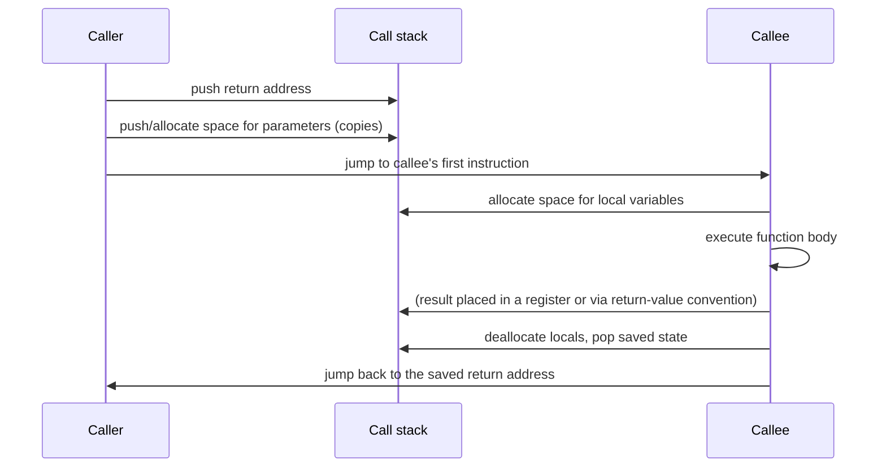

# Functions, Storage Classes & Stack Frames

> **Phase 2 · Functions, Scope & the Preprocessor.** Depends on: `fundamentals/01_program_structure.md`
> (declarations vs. definitions), `04_control_flow.md`.
> Feeds into: `02_recursion.md` (this file, Phase 2), `memory/02_pointers.md` (Phase 3 —
> the `swap` example below is the canonical motivation for pointers), `functions/03_function_pointers_and_variadics.md`.
> Sources: **Book B** ch.4 (primary — this chapter is the definitive treatment of storage
> classes and scope), **Book A** ch.17 (beginner framing). The stack-frame memory model in
> §6 is **not** in either book — it's `[External]`/`[Synthesis]`, included because
> understanding *what a function call actually costs and does in memory* is essential and
> neither source book goes below the language-abstraction level.

---

## 1. Anatomy of a function

`[Book-derived, B]` A function definition has the form:

```c
return-type function-name(argument declarations)
{
    declarations and statements
}
```

Any part may be minimal — `dummy() {}` is a legal function that does nothing and returns
nothing, occasionally useful as a placeholder during development. **If the return type is
omitted, `int` is assumed** — this is a historical-C convenience that modern style avoids
(see the ⚠️ box below).

A C program is fundamentally a set of function and variable definitions. Functions
communicate via **arguments and return values**, and via **external variables**
(§3). Functions can appear in any order in a source file, and a program can span multiple
files, as long as no single function is split across files.

`return expression;` hands `expression` (converted to the function's return type if
necessary) back to the caller. A bare `return;` (or falling off the closing `}`) returns no
useful value — if the function's return type isn't `void`, that "value" is garbage, and a
function that returns a value from one code path but not another is legal but almost
certainly a bug.

### ⚠️ Historical vs. modern style
`[Synthesis]` Classic K&R-style C permits `f()` (no return type → `int` assumed) and
old-style parameter lists (`f(a, b) int a; char b; { ... }`). Both compile under most
compilers today for backward compatibility, but **neither should appear in code you write**:
always state the return type explicitly, always use ANSI/prototype-style parameter lists
(`int f(int a, char b)`), and always write `void` explicitly for "no arguments" or "no
return value" rather than leaving it implicit.

---

## 2. Call by value — the single most important fact about C function calls

`[Book-derived, B]`

| Question | Answer |
|---|---|
| What is it? | Every argument to a C function is passed as a **copy** — the called function receives the *value* of each argument in its own local (temporary) variable, never the original variable itself. |
| Why does it exist? | It keeps functions self-contained: a function can freely use and modify its parameters as ordinary local variables without any risk of corrupting the caller's state — no aliasing surprises purely from the call mechanism itself. |
| What problem does it solve? | Predictability. In a call-by-reference language, *any* function call can silently change *any* variable passed to it; call-by-value confines a function's direct effects to its own locals and its actual return value. |
| What happens in memory? | The callee gets fresh storage (typically stack-allocated, see §6) for each parameter, initialized with a **copy** of the argument's value at the call site. |
| Common mistake | Writing a function intending to modify a caller's variable directly, e.g. a naive `swap`. |

### Worked example — why naive `swap` can't work

```c
void swap(int x, int y)          /* WRONG */
{
    int temp;
    temp = x;
    x = y;
    y = temp;
}
```

Calling `swap(a, b)` swaps the *copies* `x` and `y` — `a` and `b` in the caller are
completely untouched, because `x` and `y` are distinct storage from `a` and `b` by the very
definition of call-by-value. This is not a bug in this particular implementation; **no**
function taking plain `int x, int y` can ever modify the caller's variables, for any
implementation.

**The fix — pass a pointer (address) instead of a value:**

```c
void swap(int *px, int *py)
{
    int temp;
    temp = *px;
    *px = *py;
    *py = temp;
}
/* called as: swap(&a, &b); */
```

`[Synthesis]` This doesn't contradict call-by-value — it *works within* call-by-value: the
*pointer itself* (an address) is still passed by value (copied), but what it points to is
shared with the caller, so dereferencing it (`*px`) reaches the original variable. This
single example is the entire reason pointers exist as a *language necessity*, not just a
convenience — full treatment in `memory/02_pointers.md` (Phase 3).

### 🎯 Interview point
"Is C pass-by-value or pass-by-reference?" — **Always pass-by-value.** There is no
call-by-reference in C. What *looks* like pass-by-reference (passing a pointer so a
function can modify the caller's data) is call-by-value of a pointer — an important enough
distinction that interviewers ask it specifically to check you understand the mechanism,
not just the observable effect.

---

## 3. External variables — declaration vs. definition, precisely

`[Book-derived, B]` A variable defined **outside any function** is an **external
variable**, with (by default) **external linkage**: every reference to that name, even
from separately-compiled files, refers to the same object. This is C's mechanism for
sharing data between functions without passing it as arguments — useful, but risky if
overused (too many external variables creates hidden coupling between functions, exactly
the "spooky action at a distance" problem large-program design tries to avoid).

The **declaration vs. definition** distinction (introduced in `01_program_structure.md`
§4) becomes concrete here:

```c
int sp;                  /* DEFINITION — allocates storage for sp */
double val[MAXVAL];      /* DEFINITION — allocates storage for val */

extern int sp;            /* DECLARATION only — no storage allocated */
extern double val[];      /* DECLARATION only — array size is optional here */
```

`[Book-derived, B]` **There must be exactly one definition** of any given external
variable among all files making up a program; any other file that needs to use it supplies
an `extern` declaration instead. Array sizes are required at the definition but optional
in an `extern` declaration. Initialization only ever happens at the definition.

### 🧠 Mental model — why this split exists
`[Synthesis]` This is the variable-level version of the same problem headers solve for
functions (`01_program_structure.md` §2): a translation unit needs to *know a variable's
type and that it exists somewhere* to generate correct code referencing it, without needing
to *own* that variable's storage. The linker (not the compiler) is what ultimately matches
every `extern` declaration to its one definition, exactly as it matches function calls to
function bodies.

---

## 4. Scope rules

`[Book-derived, B]`
- **Automatic variables** (ordinary locals, including parameters): scope is the function
  (or block, see §7) they're declared in. Same-named locals in different functions are
  completely unrelated.
- **External variables and functions**: scope runs **from the point of declaration to the
  end of the file being compiled** — a variable used *before* its definition in the same
  file, or used in a *different* file from where it's defined, needs an explicit `extern`
  declaration first.

---

## 5. Storage classes: `static` and `register`

`[Book-derived, B]`

### `static`
`static` has **two different jobs** depending on where it's applied, and conflating them is
a common point of confusion:

1. **On an external variable or function:** limits its scope (linkage) to the rest of the
   *current source file only* — this is how you hide file-private helper state (a classic
   pattern: a `getch`/`ungetch` character-pushback pair sharing a private buffer and index
   that no other file should touch) from every other translation unit, avoiding both
   accidental use and name collisions across files.
2. **On a variable local to a function:** the variable behaves like an automatic variable
   for scoping purposes (only visible inside that function), but **persists between calls**
   instead of being recreated each time — giving a function private, permanent storage.
   This is genuinely different from an automatic variable, not just a performance detail:
   an internal `static` retains whatever value it had at the end of the previous call.

### `register`
`[Book-derived, B]` A hint to the compiler that a variable is heavily used and should, if
possible, live in a machine register rather than ordinary memory — compilers are free to
ignore this hint entirely (and modern optimizing compilers routinely do, making their own
better-informed register-allocation decisions — `register` is largely a historical
artifact today `[Synthesis]`). Two hard restrictions: it only applies to automatic
variables and function parameters, and **you cannot take the address of a `register`
variable** (`&`) — which makes sense once you know a register has no memory address at all.

---

## 6. 🔬 Under the hood — what a function call actually does in memory

`[External]/[Synthesis] — this entire section is outside all three source books.` Neither
Book A nor Book B describes what happens physically when a function is called; this is the
gap this handbook's brief specifically asks to fill.

### 🧠 Mental model: the call stack

Each active function call owns a contiguous region of memory called its **stack frame** (or
*activation record*), holding (roughly, with real layouts varying by ABI/platform):

```
                     Higher addresses
        ┌────────────────────────────────┐
        │  caller's frame                │
        ├────────────────────────────────┤
        │  return address                │  ← where execution resumes in the caller
        │  saved caller registers        │     (pushed by the call instruction / prologue)
        │  function parameters           │  ← copies of the arguments (call by value, §2)
        │  local variables               │  ← automatic variables, uninitialized garbage
        │  (space for the next call's    │     unless explicitly initialized
        │   arguments, if this function  │
        │   calls another)               │
        └────────────────────────────────┘
                  Lower addresses           ← stack typically grows this direction (x86, ARM)
```



- **What the CPU roughly does:** a `call` instruction pushes the return address and jumps
  to the function's entry point; the function's **prologue** typically saves any registers
  it will overwrite and reserves stack space for its locals; the **epilogue** restores
  those registers and deallocates that space; a `ret` instruction pops the return address
  and jumps back.
- **What the compiler does:** decides the exact frame layout, which values live in
  registers vs. on the stack, and generates the prologue/epilogue — this is the *calling
  convention*, and it's platform/ABI-specific (x86-64 System V, ARM AAPCS, etc. each define
  their own rules for which registers hold arguments, which are caller- vs. callee-saved,
  and how the return value is communicated). `[External]`
- **Why this matters for call-by-value (§2):** the copy that call-by-value makes is
  *exactly* this parameter-copying step — the caller's argument value gets written into
  the callee's frame, physically separate storage from the original.
- **Why recursion works at all (preview of `02_recursion.md`):** each recursive call gets
  its **own, fresh stack frame**, so each level's local variables and parameters are
  genuinely independent storage — this is precisely why a function calling itself doesn't
  overwrite its own in-progress locals.
- **Why deep/unbounded recursion crashes:** each call consumes stack space; a recursion
  with no (or a broken) base case keeps allocating frames until the stack's reserved region
  is exhausted — a **stack overflow**, distinct from a heap-related crash (`memory/05_dynamic_memory.md`,
  Phase 3, covers the heap side of the memory model).

### 🎯 Interview point
"What's in a stack frame, and why does a stack overflow happen?" — Return address, saved
registers, parameters, and locals; it happens when nested calls (very often unbounded
recursion) exhaust the stack's reserved memory faster than frames are popped.

---

## 7. Block structure

`[Book-derived, B]` C is not fully block-structured (functions cannot nest inside other
functions), but **variables** can be scoped to any block, not just a function's top level:

```c
if (n > 0) {
    int i;              /* scope: just this block */
    for (i = 0; i < n; i++)
        /* ... */
}
```

A block-local declaration **hides** any identically-named variable from an outer scope for
the block's duration; this includes a function's own parameters hiding same-named external
variables. Relying on this shadowing is legal but bad style — Book B's own advice: avoid
names that conceal an outer scope's names, the potential for confusion is too high.

---

## 8. Initialization rules

`[Book-derived, B]`

| Storage class | Default (no explicit initializer) | Initializer must be |
|---|---|---|
| external, static | zero | a **constant** expression, evaluated once, conceptually before `main` starts |
| automatic, register | **undefined (garbage)** | any expression, including function calls — evaluated fresh on every entry to the block |

Array initializers use brace lists (`int days[] = {31,28,31,...};` — an omitted array size
is inferred from the initializer count); a `char` array may instead be initialized from a
string literal (`char pattern[] = "ould";`, equivalent to listing each character plus a
trailing `'\0'` — the array's inferred size is the string's length **plus one** for that
terminator, a fact that resurfaces constantly in `memory/04_arrays_and_strings.md`,
Phase 4). Too few initializers zero-fill the rest; too many is an error; there's no way to
initialize a middle element without supplying everything before it.

### ⚠️ Common bug
Relying on an automatic variable's initial value without explicitly initializing it. It is
**not** zero, **not** predictable, and reading it before assignment is itself in the
territory of undefined behavior for some categories of use (`advanced/01_undefined_behavior.md`,
Phase 11, covers "uninitialized values" as a dedicated UB trap) — the *only* types the
language guarantees a default value for are external/`static` storage.

---

## 9. 🎯 Interview questions

**Easy**
- Is C pass-by-value or pass-by-reference? → Always pass-by-value; there is no
  pass-by-reference (§2).
- What's the default initial value of an automatic (local, non-`static`) variable? →
  Undefined/garbage — only external and `static` variables are zero-initialized by default (§8).

**Medium**
- `static` means two different things depending on where it's used — what are they? → File-
  scope linkage restriction (on externals/functions) vs. persistent storage across calls
  (on function-local variables) (§5).
- Why can't you take the address of a `register` variable? → It may not have a memory
  address at all — it may live entirely in a CPU register (§5).

**Hard**
- Explain precisely why the naive `swap(int x, int y)` cannot work in C, and why
  `swap(int *px, int *py)` does — without contradicting call-by-value. → Every argument,
  including a pointer, is passed as a copy; but a pointer's *copy* still refers to the same
  underlying object, so dereferencing it reaches the caller's original storage — the
  pointer is passed by value, the *pointee* is effectively shared (§2).

**Systems-level**
- What actually lives in a function's stack frame, and what specifically runs out during a
  stack overflow from unbounded recursion? → Return address, saved registers, parameters,
  locals; the stack overflows when frame after frame is pushed (each recursive call
  allocating its own frame) faster than any are popped, exhausting the stack's reserved
  virtual-memory region (§6; the *virtual memory* side of "reserved region" is covered in
  `memory/05_dynamic_memory.md` and `systems/`, Phases 3 and 8–9).

---

## 10. External references

- [cppreference — Storage duration](https://en.cppreference.com/w/c) `[External]` — precise,
  current rules for automatic/static/allocated/thread storage duration.
- [x86-64 System V ABI (via GCC/Clang documentation)](https://gcc.gnu.org/onlinedocs/) `[External]`
  — for readers who want the *exact* calling-convention rules behind §6's generic model on
  the most common desktop/server platform.

## 11. 🛠 Practice

1. `[Book-derived, B]` Write `power(base, n)` using the call-by-value idiom shown in §2
   (using the parameter itself as a countdown variable) — then write a version that instead
   takes `int *result` and writes through it, to feel the difference directly.
2. Reproduce the broken `swap(int, int)` example, print the caller's variables before and
   after the call, and confirm they're unchanged — then fix it with pointers and confirm
   they now do swap.
3. Write a function with a `static` local counter that increments and prints its value on
   every call; call it five times in a loop and confirm the count persists across calls
   rather than resetting.
4. Compile a small recursive function with no base case (or a deliberately broken one) and
   observe the stack overflow crash — then use `ulimit -s` (`[External]`, shell-specific)
   to see and change your stack size limit.
