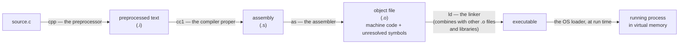

# Program Structure & the Compilation Model

> **Phase 1 · Fundamentals.** Depends on: nothing (this is the entry point).
> Feeds into: `preprocessing/`, `systems/01_compilation_toolchain.md` (this file gives the
> mental model; that one goes deep on the toolchain mechanics).
> Sources: mostly **Book A** ch.4/8/9 (practical compiler walkthrough), **Book B** ch.1
> (the canonical hello-world), `[External]`/`[Synthesis]` for the assembly stage and exact
> `gcc` flags, which neither book documents.

---

## 1. What a C program actually *is*

`[Book-derived, B]` A C program, whatever its size, is built from two kinds of things:
**functions**, which contain the statements that do the computing, and **variables**, which
hold the values the computation works on. Every program has exactly one function named
`main` — not because `main` is syntactically special, but because the C runtime start-up
code is written to call a function with that exact name to begin execution. `main` typically
calls other functions: some you write, some supplied by libraries.

`[Book-derived, A]` Structurally, a source file is a sequence of **statements** (text the
compiler turns into instructions) grouped into **blocks** — a block begins with `{` and
ends with `}`, and blocks nest inside blocks. C is "free-format": whitespace (spaces, tabs,
newlines) separates tokens but is otherwise ignored by the compiler, so

```c
printf("Hello world"); return 0;
```

and

```c
printf(
    "Hello world");
return 0;
```

are identical to the compiler. Indentation exists purely for human readers.

### 🧠 Mental model: the smallest possible program

```c
#include <stdio.h>          /* preprocessor directive: paste in stdio.h's declarations */

int main(void)               /* main: the function the OS/runtime calls to start you off */
{
    printf("hello, world\n"); /* a statement: call printf with one string argument */
    return 0;                 /* return an exit status to whatever ran this program */
}
```

**Line by line:**
- `#include <stdio.h>` — not a C statement at all; it's consumed entirely by the
  preprocessor *before* the compiler proper ever sees the file (§3 below). It textually
  pastes in the standard I/O library's declarations, most importantly the prototype for
  `printf`, so the compiler can check your call against it.
- `int main(void)` — a function definition. `int` is `main`'s return type; `(void)` says it
  takes no arguments (as opposed to `()` in old-style C, which said nothing about the
  argument list at all — see the ⚠️ box below).
- `{ ... }` — the block that is `main`'s body.
- `printf("hello, world\n");` — an expression (`printf(...)`, a function call) turned into
  a statement by the trailing `;`. `\n` is a single character (newline) written with two
  source characters — an *escape sequence*, resolved by the compiler, not the preprocessor.
- `return 0;` — hands 0 back as `main`'s result, which the shell/OS sees as the process's
  **exit status** (0 conventionally means success).

**What happens in memory / at each stage, concretely:**

| Stage | What exists | Where |
|---|---|---|
| Source | your `.c` text | disk |
| After preprocessing | expanded text (headers pasted in, macros expanded, comments stripped) | compiler's memory, or a `.i` file if you ask for it |
| After compiling | target-machine assembly instructions for `main` | compiler's memory, or a `.s` file |
| After assembling | machine code + a symbol table entry `main`, *not yet linked to `printf`* | a `.o` object file on disk |
| After linking | a complete executable, with `main`'s call to `printf` resolved to an address (or a stub for the dynamic linker to resolve at load time) | an executable file on disk |
| At load time | the executable's code/data are mapped into a fresh process's address space; the dynamic linker resolves any remaining shared-library references (e.g. `printf` in `libc.so`) | virtual memory of the new process |
| At run time | the CPU starts executing at the program's entry point, which itself calls `main` | CPU + RAM |

`[Synthesis]` This table is the single most important mental model in this whole vault:
**a C program passes through several genuinely different representations before it runs,
and "the compiler" is really several distinct tools chained together.** Everything in
`systems/01_compilation_toolchain.md` and `02_linking_and_loading.md` (Phase 5) is this
table, expanded.

---

## 2. The compilation pipeline

`[Book-derived, A]` A naive compiler could read every source file, translate everything to
machine code, and emit one executable in one pass. Real compilers don't work that way, for
two practical reasons stated directly in Book A: a large project's source may not fit in
memory all at once, and — more importantly day to day — if you change **one** source file
you don't want to recompile the **entire** program. So the job is split into independently
re-runnable stages, one **object file** per source file, joined at the end by a **linker**.



`[External]` The stage names (`cpp`, `cc1`, `as`, `ld`) are GCC/Clang's internal component
names — you rarely invoke them directly, but `gcc`/`clang` orchestrates exactly this chain
for you. You can stop the pipeline early and inspect each artifact yourself:

```sh
gcc -E file.c -o file.i     # stop after preprocessing — read file.i, it's still C-like text
gcc -S file.c -o file.s     # stop after compiling — read file.s, it's human-readable assembly
gcc -c file.c -o file.o     # stop after assembling — file.o is machine code, not yet linked
gcc file.c -o program       # run the whole pipeline and link into an executable
```

### 🛠 Debugging technique
`gcc -E` is the fastest way to answer "what does my macro actually expand to?" or "did my
`#include` guard work?" — it shows you exactly what the compiler proper receives, with
every macro expanded and every header pasted in verbatim. `gcc -S` is the fastest way to
answer "did the compiler actually do what I expect?" for a small, suspicious function.

### Why does a linker exist at all? (a "WHY" question from the brief)

`[Synthesis]` Because compilation is **per translation unit** (per `.c` file, after the
preprocessor has pasted its headers in), a single object file cannot know the final address
of a function or variable defined in a *different* file — it can only record "I need
something called `printf`, fill in the address later." The linker's whole job is to collect
every object file (and every library) a program needs, match up each such placeholder
against a real definition, and patch in the real addresses. This is also *why headers
exist*: a header lets file A declare "here is `printf`'s name and argument types" without
file A needing `printf`'s actual code — the compiler can check your call is well-formed at
compile time, and the linker fills in the address later. Declaration and definition are
deliberately separate steps for exactly this reason (see `functions/01_functions_and_stack_frames.md`,
Phase 2, for declarations vs. definitions in depth).

### Why can't the compiler just compile the whole program at once?

`[Book-derived, A] + [Synthesis]` It technically could (this is roughly what "whole-program"
or "link-time" optimization does) — but doing so by default would mean *every* source
file's compilation depends on the current state of *every other* source file, so touching
one line anywhere would force recompiling everything. Splitting compilation per translation
unit, and only re-linking at the end, means changing one `.c` file only requires
recompiling that one file and re-running the (much cheaper) link step.

---

## 3. The preprocessor is not the C language

`[Book-derived, A]` `#`-prefixed directives (`#include`, `#define`, `#if`, …) are processed
by a distinct, dumber tool — the preprocessor — that runs *before* any C syntax or
semantics are checked. Think of it as a non-interactive text editor: it does textual
substitution ("replace this token with that text", "paste this file's contents in right
here") and knows nothing about C's grammar, types, or scoping. This is precisely why a
macro like `#define SQUARE(x) x*x` can silently misbehave in ways a real C function never
would — the preprocessor doesn't know `x` is supposed to be one expression; it just pastes
text. Full treatment (including that exact trap) is in `preprocessing/01_macros.md`, Phase 2.

### ⚠️ Common misconception
"The preprocessor is part of the compiler, and `#define` constants are variables." Neither
is true. The preprocessor's output is *plain text*, handed to a completely separate program
(the compiler proper) that has never seen your `#define`s — by the time the compiler runs,
every macro is already gone, replaced by its expansion. A `#define`d name is not a variable;
it has no type, no address, and no scope in the C sense — it's a textual find-and-replace
rule that stops applying at the end of the file (or at `#undef`).

---

## 4. Translation units, declarations, and definitions — the short version

`[Synthesis]` (Full treatment lives in Phase 2/5; this is the vocabulary you need now.)

- A **translation unit** is one `.c` file *after* preprocessing — i.e., after every
  `#include`d header has been textually pasted in and every macro expanded. This is the
  actual unit the compiler proper operates on.
- A **declaration** introduces a name and its type without necessarily allocating storage
  or providing a function body — it's a promise: "this exists somewhere, here's its type."
- A **definition** is a declaration that also provides the thing itself — a function body,
  or storage for a variable.
- `int main(void);` alone is a declaration. `int main(void) { ... }` is a definition (and
  also counts as a declaration).

This distinction is what lets separate compilation work at all: a translation unit only
needs *declarations* for anything it calls but doesn't define, because the linker's job is
precisely to match each declaration used against the one definition that provides it,
across all the object files being linked (see §2's linker discussion above).

---

## 5. ⚠️ Common misconceptions & historical vs. modern C

- **"An empty argument list `()` means a function takes no arguments."** `[Book-derived, B]`
  Not in C! In both historical K&R-style C and in modern C, `f()` declares a function whose
  argument types are *unspecified* (old-style) or, in a *definition*, means "takes no
  arguments" only in some contexts — the unambiguous, portable way to say "takes no
  arguments" is `f(void)`. Using bare `()` in a declaration disables the compiler's argument
  checking. Always write `main(void)`, never bare `main()`, in new code.
- **Falling off the end of `main` without a `return` statement.** `[Synthesis]`
  *Historical C / C89:* the returned status is unspecified — effectively garbage.
  *Modern C (C99 onward):* falling off the end of `main` is defined to return `0` (success),
  as a special-case rule that applies to `main` only, no other function — `[External,
  verified]` the standard's own text (§5.1.2.2.3, paragraph 1) states it plainly:
  "reaching the `}` that terminates the `main` function returns a value of 0." Because
  Book B predates this rule and Book A doesn't discuss it, **write an explicit
  `return 0;` anyway** — it's correct under every C standard and makes your intent
  unambiguous to a reader.
- **"`void main()` is fine."** It's extremely common in tutorials and it compiles on many
  systems, but it is not standard C — `main` must return `int`. Treat this as a portability
  bug, not a style choice.

---

## 6. 🎯 Interview questions

**Easy**
- What are the distinct stages a `.c` file passes through before it becomes a running
  process? → preprocess → compile → assemble → link → load → execute (§1–2 table above).
- What does `#include <stdio.h>` actually do, mechanically? → textually pastes the header
  file's contents in at that point, before compilation proper begins.

**Medium**
- Why does changing one line in a 50-file C project not require recompiling all 50 files?
  → Because compilation is per translation unit; only the changed `.c` file (and anything
  that `#include`s a header it exports changes to) needs recompiling, then only the
  (cheap) link step needs re-running.
- What's the difference between a declaration and a definition, and why does that
  distinction need to exist? → §4 above; it's what makes separate compilation possible.

**Hard**
- A colleague says "the preprocessor is just part of the compiler." What's wrong with that
  statement, and what bug pattern does that misunderstanding tend to cause? → The
  preprocessor is a distinct, syntax-blind text-substitution pass; the bug pattern is
  macro-argument mishaps (`preprocessing/01_macros.md` covers this — e.g. `SQUARE(x)`
  expanding to `x*x`, which breaks for `SQUARE(a+b)`).

**Systems-level**
- You have a 30-file project and change a single `.c` file. Trace exactly what a build
  system needs to re-run, and why re-running `ld` alone isn't enough if the change added a
  new function call to a library that wasn't linked before. → Recompile the changed `.c` to
  a new `.o` (preprocess→compile→assemble); re-run the link step against all `.o` files and
  the now-required library; if the new library isn't on the link line, `ld` will fail with
  an undefined-reference error even though every `.c` file compiled fine — a classic
  "compiles but doesn't link" failure mode, because compiling only checks each translation
  unit is internally consistent, while linking is what actually verifies every symbol used
  anywhere has exactly one definition somewhere.

---

## 7. External references

- [cppreference — Translation phases](https://en.cppreference.com/w/c) `[External]` — for
  the ISO standard's precise 8-phase breakdown of translation (this file simplifies it to
  the practically useful 4–5 stages).
- [GCC Online Documentation — Invoking GCC](https://gcc.gnu.org/onlinedocs/) `[External]` —
  authoritative detail on `-E`/`-S`/`-c` and every other compiler flag referenced above.

## 8. 🛠 Practice

1. Take the hello-world program above, and run all four `gcc` invocations from §2 on it.
   Open `file.i` and count how many lines came from `<stdio.h>` alone versus your own code.
2. Deliberately misspell `printf` as `pintf`. Run `gcc -c` (compile+assemble only, no link)
   — does it fail? Now compile correctly but link against a second file that calls an
   undefined function — which stage fails this time, and how does the error message differ?
3. Write a two-file program (`main.c` calling a function declared in `util.h` and defined
   in `util.c`). Build it with three separate `gcc -c` + one link command, by hand, to feel
   the declaration/definition/link relationship directly.
