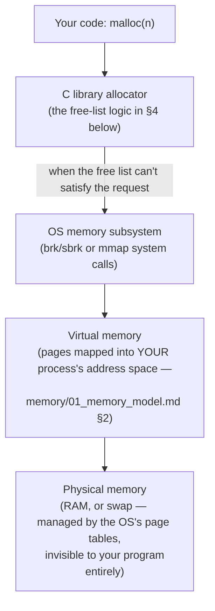

# Dynamic Memory

> **Phase 6 · Dynamic Memory.** Depends on: `memory/01_memory_model.md` §2 (stack vs.
> heap), `06_struct_union_layout.md` §5 (self-referential structs — the `talloc` stub is
> made real here), `02_pointers.md` §7 (`void *`).
> Feeds into: `advanced/01_undefined_behavior.md` (Phase 11 — leaks/double-free/use-after-
> free as UB categories), `debugging/02_sanitizers_and_valgrind.md` (Phase 10 — the tools
> that actually catch the bugs this file describes), `systems/03_file_descriptors_and_unix_io.md`
> (Phase 8 — `sbrk`/`brk` as real system calls).
> Sources: **Book C** ch.13 `<stdlib.h>`, "Implementing" section (primary — a complete,
> real free-list allocator design; the source PDF's OCR is heavily degraded here, so code
> is described conceptually rather than quoted), **Book B** §8.7 (a second, independently
> designed free-list allocator — an excellent cross-book comparison), **Book A** ch.26
> (practical usage, error handling, and the `free`-isn't-recursive leak trap).

---

## 1. The full chain, from your code to physical memory

`[Synthesis, directly building the diagram the task brief explicitly asks for]`



**Reading this chain both ways matters.** Going down: `malloc` is not itself a system
call — it's an ordinary C library function that manages a pool of memory it already has,
and only talks to the OS (via `sbrk`/`brk`, or `mmap` for very large requests —
`[External]`, both covered properly in `systems/`, Phase 8) when it genuinely needs more.
Going up: the "heap" region from `memory/01_memory_model.md` §2 is not a single OS-level
concept — it's the *library's own bookkeeping* over memory the OS has granted it, which is
exactly why the next several sections are about the **library's** data structures, not the
OS's.

---

## 2. The four functions — exact contracts

`[Book-derived, A]`

| Function | Contract |
|---|---|
| `void *malloc(size_t size)` | Allocates `size` bytes, **uninitialized** (contains whatever garbage was already there) — a real, common bug source if you assume zeroed memory. Returns `NULL` on failure. |
| `void *calloc(size_t nmemb, size_t size)` | Allocates space for `nmemb` objects of `size` bytes each, **zero-initialized**. Returns `NULL` on failure. |
| `void *realloc(void *ptr, size_t size)` | Resizes the allocation `ptr` points to. Contents up to the smaller of the old/new size are preserved; newly-added space (if growing) is uninitialized. `realloc(NULL, size)` behaves exactly like `malloc(size)`. If `size` is 0 and `ptr` isn't `NULL`, behaves like `free(ptr)`. **On failure, returns `NULL` and leaves the original block untouched** (§6 covers why this makes a specific coding pattern mandatory). |
| `void free(void *ptr)` | Releases a block previously returned by `malloc`/`calloc`/`realloc`. `free(NULL)` is explicitly a safe no-op. Freeing anything else (a pointer never returned by these functions, or one already freed) is undefined behavior. |

### 💡 Why `malloc` returns `void *`
`[Cross-reference, answering one of the brief's explicit "WHY" questions]` `memory/02_pointers.md`
§7 already covered `void *` as the generic pointer type; this is its motivating use case.
`malloc` cannot know, and must not care, what type of object you intend to store in the
memory it hands back — a single allocator implementation serves every type in the program.
The caller assigns (implicitly convertible in C, without a cast — `[External]`, unlike
C++) the returned `void *` into whatever typed pointer variable they actually need.

---

## 3. Practical usage — the idioms that matter

`[Book-derived, A]`

```c
int *array = malloc(10 * sizeof(int));    /* preferred: sizeof(*array), not sizeof(int) —
                                              see the idiom note below */
if (array == NULL) {
    fprintf(stderr, "out of memory\n");
    exit(1);                               /* or another appropriate failure response —
                                               NOT always the right call; see below */
}
```

### 💡 `sizeof(*ptr)` over `sizeof(type)`
`[Synthesis]` `malloc(10 * sizeof(*array))` is more robust than
`malloc(10 * sizeof(int))`: if `array`'s declared type ever changes, the `sizeof(*array)`
version automatically tracks it — the `sizeof(int)` version silently keeps computing the
*old* type's size, a real (if quiet) bug source after a refactor.

### ⚠️ Always check for `NULL` — but "check" doesn't always mean "exit"
`[Book-derived, A]` Whether running out of memory should abort the program, retry, or
degrade gracefully depends entirely on context: a small desktop utility exiting outright is
reasonable; an editor with unsaved user work should try to let the user save first; an
embedded system might reset entirely. **Never skip the `NULL` check** — dereferencing a
`NULL` return from a failed allocation is itself undefined behavior (typically a hard
crash) — but the *response* to failure is a design decision, not a fixed rule.

### 💡 Why `calloc` isn't just `malloc` + zeroing
`[External]` Beyond the zero-initialization convenience, `calloc(nmemb, size)` is required
to detect **multiplication overflow** in `nmemb * size` and fail (returning `NULL`) rather
than silently allocating too little memory — a real safety property `malloc(nmemb * size)`
does not give you for free, since that multiplication is ordinary (and, for large enough
values, overflow-prone — `fundamentals/02_types.md` §9) arithmetic computed *before*
`malloc` ever sees the result. For allocating an array whose element count comes from
outside your program's control, `calloc` is the safer default specifically for this reason,
not just for the zeroing.

---

## 4. `realloc`'s pointer-assignment trap — a mandatory idiom

`[Synthesis, directly following from §2's contract]` Because `realloc` returns `NULL` on
failure **without freeing or moving the original block**, this is a genuine, common bug:

```c
ptr = realloc(ptr, new_size);   /* WRONG if realloc fails */
```

If `realloc` fails, this **overwrites `ptr` with `NULL`**, losing the only reference to the
still-valid original block — a guaranteed memory leak, and one that's easy to miss because
the *failure path* is rarely exercised in testing. The mandatory-in-practice idiom:

```c
void *tmp = realloc(ptr, new_size);
if (tmp == NULL) {
    /* handle failure — ptr is still valid and must still be freed eventually */
} else {
    ptr = tmp;
}
```

### 🎯 Interview point
Being asked "what's wrong with `p = realloc(p, n);`?" is testing exactly this — the answer
is specifically about the *failure path*, not about `realloc`'s normal-case behavior, which
this exact line handles correctly.

---

## 5. How a real allocator actually works — the free-list model

`[Book-derived, B + C — cross-book synthesis]` Both source books independently arrive at
essentially the same design, which is itself informative: this is evidently *the* natural
solution to the problem, not one author's idiosyncratic choice.

### The shared core idea
The heap is managed as a **linked list of blocks**, each with a small **header** recording
at least the block's size and a pointer to the next block. `malloc` searches this list for
a big-enough block; `free` inserts a block back into the list, merging ("coalescing") it
with any adjacent free neighbors to fight fragmentation.

### Cross-book comparison: the alignment trick

**Book B's version:** a `union` combining the header fields with an unused field of the
most restrictive type the platform needs to support (`long`, conventionally) — because a
union's size and alignment accommodate its largest/strictest member
(`memory/06_struct_union_layout.md` §7, `07_alignment_padding_aliasing.md` §4), this
guarantees every block — header included — starts on a boundary valid for *any* type,
without the programmer needing to reason about alignment by hand:

```c
typedef long Align;              /* the platform's most restrictive ordinary type */
union header {
    struct {
        union header *next;       /* next free block */
        unsigned size;             /* this block's size, in header-sized units */
    } s;
    Align x;                        /* never used directly — forces alignment */
};
```

**Book C's version:** a comparable "worst-case storage boundary" macro (this vault calls
it `_MEMBND` in Plauger's own naming) plays the identical structural role, computed
explicitly as a bitmask rather than via a union — a different mechanism reaching the
*same* guarantee. `[Synthesis]` Both designs are direct, concrete applications of
`07_alignment_padding_aliasing.md`'s abstract point that "`malloc` guarantees alignment
suitable for any type" — here is exactly *how* that guarantee gets implemented.

### Cross-book comparison: search strategy

- **Book B:** explicitly names and contrasts **first fit** (take the first big-enough
  block found) against **best fit** (search for the *smallest* block that still satisfies
  the request) — and chooses first fit, scanning starting from wherever the previous
  search left off (so repeated searches don't always restart at the list's head).
- **Book C:** describes essentially the same "resume where the last call left off"
  strategy (this vault calls it **next fit**), explicitly justified as spreading usage
  across the whole list rather than clustering it at the start — reducing fragmentation
  at the head of the list specifically.

`[Synthesis]` The shared insight: **where** you resume scanning matters as much as
**which** matching strategy (first vs. best fit) you use — both books independently favor
"resume from last position" over "always restart from the beginning," for the same
fragmentation-avoiding reason.

### Getting more memory from the OS

`[Book-derived, B + C]` When no free block is big enough, both allocators request a fresh
chunk from the operating system — Book B calls its request helper `morecore`; Book C calls
its `_Getmem` — and **both implementations, on UNIX, are built on the same underlying
system call: `sbrk`** (`systems/`, Phase 8, covers `sbrk`/`brk` as real system calls in
full). Both also **request more than the immediate need** (Book B: at least `NALLOC` units;
Book C: at least `SIZE_BLOCK` bytes, halving the request and retrying if the OS can't
satisfy it) — because asking the OS for memory is comparatively expensive, so both designs
amortize that cost across many future `malloc` calls rather than paying it on every one.

### Freeing: finding the right spot, and coalescing

`[Book-derived, B + C]` `free` isn't just "mark this block available" — it has to find the
*correct position* in the address-ordered list, and check both neighbors for adjacency.
If the freed block is physically adjacent to a free neighbor (on either side), the two are
merged into one larger block — this is the direct mechanism that keeps small freed pieces
from permanently fragmenting the heap into many unusably-small pieces.

### 🧠 A minimal, original illustration (not copied from either book)

```c
typedef struct block {
    size_t size;
    struct block *next;
} Block;

static Block *free_list = NULL;    /* address-ordered list of free blocks */

void *my_malloc(size_t n) {
    Block **cursor = &free_list;
    while (*cursor != NULL) {
        if ((*cursor)->size >= n) {
            Block *found = *cursor;
            *cursor = found->next;      /* unlink from the free list */
            return (void *)(found + 1);  /* hand back the space AFTER the header */
        }
        cursor = &(*cursor)->next;
    }
    return NULL;    /* a real implementation would request more from the OS here */
}
```

**Line-by-line intent, tying back to both books' designs:** `found + 1` (pointer
arithmetic on a `Block *`, `memory/02_pointers.md` §4) skips exactly one header's worth of
bytes, landing precisely at the usable space — the same "pointer returned is header-plus-
one" idea both K&R and Plauger use. `my_free` (left as this file's practice exercise, §12)
would do the reverse: step *backward* one `Block` from the given pointer to recover the
header, then walk the list to find and possibly coalesce with neighbors.

---

## 6. ⚠️ Heap corruption: why one bug can crash unrelated code later

`[Synthesis, directly connecting `memory/04_arrays_and_strings.md` §8's buffer-overflow
warning to the allocator internals just described]` Because block headers live
**immediately adjacent** to the usable space `malloc` hands you, writing even one byte past
the end of an allocated block overwrites the *next* block's header — corrupting the
allocator's own bookkeeping. The consequences are often bizarrely delayed and hard to
trace: the actual crash (or corrupted-looking data) frequently shows up during some
**later, unrelated** `malloc`/`free` call, once the allocator tries to use the now-garbled
header — nowhere near the line that actually caused the corruption. `[Book-derived, C]`
This is exactly why Plauger's `free` implementation performs the defensive sanity checks it
does (verifying a freed block's size field is a plausible multiple of the alignment
boundary, checking for overlap with existing free-list entries) — imperfect, but a direct
attempt to catch exactly this class of corruption before it propagates further.

---

## 7. Memory leaks

`[Book-derived, A]` A **leak** is allocated memory that becomes unreachable — no pointer
anywhere in the program still references it — before it's freed. C has no garbage
collector; **the programmer is responsible for exactly one `free` per `malloc`/`calloc`**.

### ⚠️ The classic trap: `free` is not recursive

`[Book-derived, A, directly connecting to `memory/06_struct_union_layout.md` §5's binary
tree]`

```c
typedef struct BSTNode {
    int value;
    struct BSTNode *left, *right;
} BSTNode;

BSTNode *temp = calloc(1, sizeof(BSTNode));
temp->left = calloc(1, sizeof(BSTNode));
/* ... */
free(temp);   /* WRONG — only frees temp itself; temp->left (and ->right,
                 and everything below them) leak, silently */
```

`free` knows nothing about a struct's members — it only knows the size of the single block
it was handed. **Freeing a tree (or any linked structure) built one node at a time must
itself walk the structure one node at a time**, typically via a recursive post-order
traversal (free both children, *then* free the node itself) — the direct, necessary
counterpart to `addtree`'s construction in `memory/06_struct_union_layout.md` §5.

---

## 8. Double-free and use-after-free

`[Cross-reference, applying `memory/02_pointers.md` §8's dangling-pointer vocabulary
specifically to heap memory]` A pointer to memory that has already been `free`d is exactly
a **dangling pointer** — freeing it *again* (double-free) or dereferencing it
(use-after-free) is undefined behavior, and both are common, serious real-world bug classes
(historically a major source of security vulnerabilities, since a corrupted or hijacked
allocator free-list can sometimes be manipulated into returning attacker-influenced memory
— `[External]`, full security framing is out of this vault's scope, but worth knowing the
stakes are not purely theoretical).

### 🛠 Debugging technique — the defensive idiom
`[Synthesis]` A cheap, partial mitigation: **set a pointer to `NULL` immediately after
freeing it.**

```c
free(p);
p = NULL;
```

`free(NULL)` is explicitly a safe no-op (§2), so an accidental *second* `free(p)` after
this becomes harmless instead of undefined behavior — this doesn't fix a logic bug (you
still shouldn't be trying to free twice), but it converts a silent, dangerous UB path into
a harmless one. It does **not** protect against a *different* pointer still aliasing the
same now-freed memory (`memory/02_pointers.md` §9's aliasing preview) — only the specific
variable you explicitly nulled out.

---

## 9. Fragmentation

`[Synthesis, grounded directly in §5's coalescing discussion]` **External fragmentation**:
enough total free memory exists, but no single free block is big enough for a given
request, because free space is scattered in small, non-adjacent pieces — exactly what §5's
coalescing exists to fight. **Internal fragmentation**: a block is *larger* than what was
requested (because the allocator rounds up to some minimum unit — Book B's header-sized
units, Book C's alignment-boundary rounding), wasting the difference inside an otherwise-
"used" block. Both are real, inherent costs of any general-purpose allocator design — no
allocation strategy eliminates both simultaneously, only trades off how much of each you
get.

---

## 10. Ownership — a practical discipline, not a language rule

`[Synthesis]` C enforces none of this — it's a discipline you (and your codebase's
conventions) must maintain by hand:
- Every allocation should have a **clear, single owner** responsible for eventually
  freeing it.
- If ownership *transfers* (a function that allocates and returns a pointer the caller must
  later free), **document it explicitly** — a function's name or comment should make clear
  whether the caller now owns the returned memory.
- Prefer designs where allocation and freeing are visibly paired (even in different
  functions) over designs where it's unclear, from reading the code, who's ultimately
  responsible.

---

## 11. ⚠️ Misconceptions to unlearn now

- **"`malloc`'d memory is zero-initialized."** Only `calloc` guarantees this; `malloc`
  hands back whatever garbage was already there (§2).
- **"If `realloc` fails, the original pointer is gone."** It's not — the original block is
  explicitly left untouched on failure; the bug is losing your *own* only reference to it
  by overwriting the pointer variable directly (§4).
- **"`free(node)` on a tree/list node frees the whole structure."** It frees exactly the
  one block it was given — nothing about its members (§7).
- **"A memory bug will crash exactly where it happened."** Heap corruption from an
  overflow often crashes later, in unrelated code, once the corrupted header is finally
  used (§6) — "where the crash happens" and "where the bug is" are frequently different
  places for this specific bug class.

---

## 12. 🎯 Interview questions

**Easy**
- What's the key difference between `malloc` and `calloc`? → `calloc` zero-initializes and
  overflow-checks the `count * size` multiplication; `malloc` does neither (§2–3).
- Is `free(NULL)` legal? → Yes, explicitly specified as a safe no-op (§2).

**Medium**
- What's wrong with `p = realloc(p, n);`? → On failure, `realloc` returns `NULL` without
  freeing the original block — this overwrites `p`, losing the only reference to still-
  valid memory and leaking it (§4).
- Why does a real allocator's header often use a `union` with a "never used" field of a
  wide type like `long`? → To force every block onto an alignment boundary valid for any
  type, exploiting the rule that a union's alignment matches its strictest member (§5).

**Hard**
- Why does freeing the root of a linked structure like a tree not free the whole
  structure, and what's the correct fix? → `free` only knows the size of the single block
  it's given, nothing about struct members pointing elsewhere; the fix is an explicit
  recursive (or iterative, stack-based) traversal that frees every node individually,
  children before parent (§7).
- Explain why a buffer overflow can cause a crash that appears to happen in completely
  unrelated code, much later in the program's execution. → Block headers sit adjacent to
  allocated space; overflowing past the end of a block corrupts the *next* block's header,
  and the corruption typically isn't "noticed" until the allocator later tries to use that
  now-garbled header during some unrelated `malloc`/`free` call (§6).

**Systems-level**
- Both K&R's and Plauger's allocators favor "resume scanning where the last call left off"
  over "always restart from the beginning." Why, and what would go wrong with always
  restarting? → Always restarting from the head clusters allocation activity (and
  therefore fragmentation) near the start of the list; resuming spreads usage — and the
  resulting fragmentation — across the whole list more evenly (§5).
- A program calls `malloc` in a tight loop without ever calling `free`, and its memory
  usage grows without bound. Trace what's happening at each level of the diagram in §1. →
  Each `malloc` call either finds a free block (fast, no OS involvement) or, once the free
  list is exhausted, triggers a `sbrk`/`brk` (or `mmap`) system call to request more
  virtual memory from the OS, which the OS backs with physical memory (or swap) as pages
  are actually touched — with no `free` calls, the free list never regains blocks to reuse,
  so essentially every allocation eventually forces another OS-level request, growing the
  process's memory footprint monotonically.

---

## 13. External references

- [man7.org — `malloc(3)`](https://man7.org/linux/man-pages/) `[External]` — the current
  glibc `malloc` family's exact documented contract and implementation notes.
- [man7.org — `brk(2)`/`sbrk(2)`](https://man7.org/linux/man-pages/) `[External]` — the
  real system calls behind both books' `morecore`/`_Getmem` — full context in `systems/`,
  Phase 8.
- [CERT C — `MEM` (memory management) rules](https://wiki.sei.cmu.edu/confluence/display/c) `[External]`
  — a systematic catalogue of allocation pitfalls beyond this file's core set.

## 14. 🛠 Practice — the phase project

1. Complete `my_malloc` from §5 into a full fixed-block allocator: implement `my_free`
   (recover the header via pointer arithmetic, re-insert into the address-ordered free
   list, coalesce with adjacent neighbors), backed by one large static array standing in
   for OS-provided memory (deferring real `sbrk` calls to Phase 8).
2. Deliberately trigger, one at a time, a memory leak (allocate in a loop, never free), a
   double-free, and a use-after-free against your own allocator — observe how each
   manifests (or doesn't) without tooling, to set up a concrete "before" for Phase 10's
   sanitizer coverage, which will catch all three precisely and immediately.
3. Free the binary tree from `memory/06_struct_union_layout.md` §5's practice exercise
   correctly (a recursive, children-before-parent traversal) — then deliberately introduce
   the `free(temp);`-only bug from §7 and confirm (by tracking allocation counts, or later,
   a sanitizer) that it genuinely leaks every node but the root.
4. Reproduce the `realloc` pointer-assignment trap from §4 by forcing an allocation failure
   (a platform-appropriate way to simulate this, or by reasoning through the code path
   without literally exhausting memory) and confirm the "wrong" version loses the original
   pointer while the corrected version doesn't.
