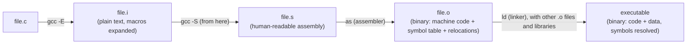

# The Compilation Toolchain, In Depth

> **Phase 5 · Compilation & Linking Toolchain.** Depends on:
> `fundamentals/01_program_structure.md` §1–2 (the high-level pipeline overview this file
> goes one level deeper than), `preprocessing/02_includes_and_header_design.md` (why
> headers exist — assumed, not re-derived, here).
> Feeds into: `02_linking_and_loading.md` (this phase), `debugging/03_static_and_binary_inspection.md`
> (Phase 10 — `nm`/`objdump`/`readelf` on the artifacts this file introduces).
> Sources: **Book A** ch.9 (primary, though brief — this is genuinely A's strongest,
> tightest chapter). **Object-file internals, symbol tables, and static/shared library
> mechanics are almost entirely `[External]`** — none of the three books goes below "the
> compiler produces object code, the linker combines it," which this file exists to unpack.

---

## 1. The pipeline, recapped and extended

`[Book-derived, A]` `fundamentals/01_program_structure.md` §2 already introduced the
five-stage pipeline (preprocess → compile → assemble → link → load) and the `gcc -E/-S/-c`
inspection commands. This file goes one level deeper into **what each artifact actually
contains** and **why the split exists the way it does** — Book A's own framing is worth
repeating precisely: compiling C into machine code is comparatively easy; *decompiling*
(reconstructing C source from machine code) is not — decompilers exist but rarely produce
genuinely useful output. This asymmetry is a big part of *why* the pipeline is organized
around keeping several intermediate, still-inspectable artifacts (`.i`, `.s`, `.o`) rather
than collapsing straight from source to executable: each stage is individually simple and
reversible in the sense that you can read its output, even though the whole chain,
end to end, effectively is not reversible.



---

## 2. What "compiling" actually does (between `.i` and `.s`)

`[External]/[Synthesis]` The compiler proper (`cc1` in GCC's own internal naming) turns
preprocessed text into assembly through several internal phases, none of which either
source book describes, but which are worth having names for:

1. **Lexical analysis** — the raw text is broken into tokens (identifiers, keywords,
   literals, operators).
2. **Parsing** — tokens are assembled into a syntax tree according to C's grammar; this is
   where a genuine syntax error (mismatched braces, a missing semicolon) is caught.
3. **Semantic analysis** — type checking, scope resolution, and the constraint-checking
   `fundamentals`/`memory` files have been implicitly assuming throughout this vault (e.g.
   catching a `const`-violation, per `memory/02_pointers.md` §6).
4. **Optimization** (if requested, `-O1`/`-O2`/`-O3`, …) — the compiler transforms the
   internal representation to run faster/smaller while preserving observable behavior *as
   the standard defines it* — which is exactly why undefined behavior is dangerous
   specifically at this stage: the optimizer is free to assume UB never happens, and can
   transform code in ways that look wrong if you assumed a more literal translation
   (`advanced/01_undefined_behavior.md`, Phase 11, is built entirely around this fact).
5. **Code generation** — the internal representation becomes actual target-architecture
   assembly instructions.

### 🛠 Debugging technique — reading `gcc -S` output on purpose
`fundamentals/01_program_structure.md` §2 already mentioned `-S` for inspection; a
concrete use here: compiling the *same* small function at `-O0` versus `-O2` and diffing
the resulting `.s` files is one of the fastest ways to build real intuition for what an
optimizer actually does — far more concrete than reading about optimization in the
abstract.

---

## 3. What an object file actually contains

`[External]` An object file (`.o`) is not "almost a program" in some vague sense — it has
concrete internal structure (the details below describe the ELF format, standard on
Linux; other platforms use different but conceptually similar formats — Mach-O on macOS,
COFF/PE-derivatives on Windows):

| Section | Contents |
|---|---|
| `.text` | the actual machine instructions (conventionally read-only + executable at load time) |
| `.data` | initialized global/`static` variables (`functions/01_functions_and_stack_frames.md` §8's "Data" region, from `memory/01_memory_model.md` §2) |
| `.bss` | **space reserved for**, but not literally storing, zero-initialized global/`static` variables — the file doesn't need to store actual zero bytes for these, just a size, which is why an all-zero-initialized array costs (almost) nothing in file size |
| `.rodata` | read-only data — string literals live here (`memory/04_arrays_and_strings.md` §4's "commonly read-only" claim about string literals, now grounded in a concrete section) |
| Symbol table | every name (function/variable) this file **defines**, and every name it **references but doesn't define** (an *undefined symbol* — a placeholder the linker must resolve, per `fundamentals/01_program_structure.md` §2's "linker fills in the address later") |
| Relocation entries | a list of places in `.text`/`.data` whose final address isn't known yet, with instructions for how to patch them in once the real address is known (§2 of `02_linking_and_loading.md`, this phase, covers this fully) |

### 🔬 Under the hood — the BSS trick
`[Synthesis]` `.bss` (historically "Block Started by Symbol") is worth dwelling on
precisely because it's a small, elegant answer to a real question: why doesn't
`static int big_buffer[1000000];` (all zero-initialized) bloat the compiled binary by 4MB?
Because the object/executable file only records *"reserve 4MB of zeroed memory here at
load time,"* not 4MB of literal zero bytes — the OS loader (§ below, and
`02_linking_and_loading.md` §6) is what actually zeroes out that memory region when the
process starts, typically via cheap, lazily-faulted-in pages rather than an explicit write.

---

## 4. Static libraries: bundling object files for reuse

`[External]` A **static library** (`.a` on Unix-like systems, "archive") is just a
collection of `.o` files bundled together with an index, created with `ar`:

```sh
gcc -c mymath.c -o mymath.o
ar rcs libmymath.a mymath.o        # r: insert/replace, c: create, s: build a symbol index
gcc main.c -L. -lmymath -o program  # -L. : look in the current dir; -lmymath : link libmymath.a
```

**What actually happens at link time:** the linker pulls in *only* the `.o` members of the
archive that are actually needed to resolve currently-undefined symbols — an archive isn't
copied wholesale into the executable, only the pieces the program actually references. The
result is a **self-contained executable**: everything the program needs is baked in at
build time, so it runs without depending on that library being present on the machine it's
eventually deployed to — at the cost of a larger binary, and of needing a full rebuild any
time the library changes.

---

## 5. Shared libraries: linking (mostly) deferred to load/run time

`[External]` A **shared library** (`.so` — "shared object" — on Linux; `.dylib` on macOS;
`.dll` on Windows) is *not* copied into the executable at all — the executable just records
that it depends on the library, and the actual code is loaded and linked in **when the
program starts running** (or, with `dlopen`, even later, on demand — `[External]`, beyond
this vault's core scope).

```sh
gcc -c -fPIC mymath.c -o mymath.o     # -fPIC: generate Position-Independent Code (§ below)
gcc -shared -o libmymath.so mymath.o
gcc main.c -L. -lmymath -o program     # links against libmymath.so instead of a .a
```

**`-fPIC` (Position-Independent Code), briefly:** a shared library may end up loaded at a
*different* address in every process that uses it (deliberately, for security —
`[External]`, Address Space Layout Randomization) — so its own code can't hard-code
absolute addresses for its functions/data the way a statically-linked program safely can.
`-fPIC` generates code that computes addresses *relative* to wherever the library actually
ends up, at the (small) cost of an extra layer of indirection on some accesses. Full
mechanics belong to `02_linking_and_loading.md` §5, this phase.

### 💡 Static vs. shared — the real tradeoff, not just "which command do I run"

| | Static (`.a`) | Shared (`.so`) |
|---|---|---|
| When linked | Fully, at build time | Symbol *stubs* at build time; actual resolution at load/run time |
| Executable size | Larger (library code is copied in) | Smaller (library lives externally) |
| Runtime dependency | None — fully self-contained | Must locate the library at load time (`02_linking_and_loading.md` §5) |
| Updating the library | Requires rebuilding every executable that uses it | Replace the `.so` file; every program picks up the change on next run, with no rebuild |
| Memory across processes | Each process has its own copy of the library's code | Multiple processes running the same shared library can share one physical copy of its code pages (`[External]` — an OS-level optimization, not a C-language guarantee) |

---

## 6. `make` — automating the pipeline, briefly

`[Book-derived, A]` For anything beyond a toy program, driving `gcc` by hand for every
file, every time, doesn't scale — Book A's own framing: automation exists both to reduce
manual effort *and*, crucially, to **recompile only what actually changed**. On Unix-like
systems this is conventionally `make`, reading a `Makefile` of *targets*, their
*dependencies*, and the *commands* to bring a target up to date:

```makefile
program: main.o mymath.o
	gcc main.o mymath.o -o program

main.o: main.c mymath.h
	gcc -c main.c

mymath.o: mymath.c mymath.h
	gcc -c mymath.c
```

`[Synthesis]` `make` compares each target's modification time against its listed
dependencies' — if `main.c` hasn't changed since `main.o` was last built, that compile step
is skipped entirely, and only the (cheap) final link re-runs if anything else changed. This
is a direct, practical answer to the exact question `fundamentals/01_program_structure.md`
§2 raised in the abstract ("why doesn't changing one file force recompiling everything") —
`make`, or a modern equivalent, is the tool that actually implements that answer for a real
project. Full build-system depth is outside this vault's scope (the brief's focus is the
language and OS interface, not build tooling specifically) — this section exists only so
the *concept* — dependency-aware, incremental rebuilding — has a concrete name attached to
it.

---

## 7. ⚠️ Misconceptions to unlearn now

- **"An object file is basically a mini-executable."** It's an intermediate artifact with
  unresolved symbols and pending relocations — it cannot run on its own; the "missing
  functions" linker error Book A flags (§9.4) is exactly what happens when those symbols
  never get resolved (full treatment in `02_linking_and_loading.md`).
- **"Static and shared libraries are just two file-extension conventions for the same
  thing."** They're linked at fundamentally different times (build time vs. load/run time,
  §4–5), with different size, deployment, and update tradeoffs — not interchangeable
  choices, a real engineering tradeoff.
- **"`-O2` optimization just makes code run in the same way, only faster."** It's free to
  transform code in any way that preserves *standard-defined* behavior — which is exactly
  why code relying on undefined behavior can behave differently (or "break") specifically
  when optimization is turned on (§2; full treatment `advanced/01_undefined_behavior.md`,
  Phase 11).

---

## 8. 🎯 Interview questions

**Easy**
- What does `.bss` store, and why doesn't it bloat the binary's file size? → Reserved space
  for zero-initialized static/global data; the file only records a size, not literal zero
  bytes (§3).
- What's the practical difference between a static and a shared library, from a deployed
  program's point of view? → A static library is fully baked into the executable at build
  time; a shared library is a separate file the program depends on locating at load/run
  time (§4–5).

**Medium**
- Why does an object file need a symbol table and relocation entries at all? → Because
  compilation happens per translation unit, an object file can't know final addresses for
  names defined elsewhere — the symbol table records what it needs and what it provides,
  and relocations mark exactly where those addresses need to be patched in later (§3).
- What does `-fPIC` actually change about generated code, and why does it matter for
  shared libraries specifically? → It generates address-relative (not absolute) code, since
  a shared library may load at a different address in every process that uses it (§5).

**Hard**
- Explain precisely why optimization level can change whether a program "appears correct,"
  using the UB-assumption argument. → The optimizer is only obligated to preserve
  standard-defined behavior; code that relies on behavior the standard leaves undefined has
  no guaranteed behavior to preserve, so a more aggressive optimizer is free to transform
  it in ways that expose the UB's consequences differently (or not at all) compared to a
  less aggressive one (§2).
- Why can multiple running processes share one physical copy of a shared library's code,
  but not (generally) of a statically-linked program's code? → A shared library's code is
  loaded once into memory and mapped, read-only and position-independent, into every
  process using it; a statically-linked program has its own private copy of that code
  baked directly into its own executable, with no OS-level sharing mechanism in play (§5).

**Systems-level**
- A colleague replaces a static library dependency with the equivalent shared library in a
  production deployment. What operational changes does this actually introduce, beyond
  binary size? → The program now has a runtime dependency on locating the correct `.so` at
  startup (a missing/incompatible library becomes a *runtime* failure instead of a
  *build-time* one); the library can now be updated/patched independently of rebuilding the
  program (a real operational win, but also a real risk if an incompatible update is
  deployed); multiple running instances can share the library's code pages in memory,
  reducing aggregate memory footprint on a busy machine (§5).

---

## 9. External references

- [GCC documentation — Options for linking](https://gcc.gnu.org/onlinedocs/) `[External]`
  — the authoritative, current reference for `-c`/`-shared`/`-fPIC`/`-L`/`-l` and every
  other flag used in this file.
- [man7.org — `ld(1)`](https://man7.org/linux/man-pages/) `[External]` — the GNU linker's
  own manual page, for the mechanics `02_linking_and_loading.md` (this phase) goes into.
- [GNU `make` manual](https://www.gnu.org/software/libc/manual/) `[External, verify the
  live gnu.org/software/make/manual URL before relying on it]` — the authoritative
  reference for `make`/`Makefile` syntax beyond §6's minimal example.

## 10. 🛠 Practice — the phase project

1. Build a genuine 3-file program (`main.c`, plus a `.c`/`.h` pair for a small helper
   module) and drive **every** toolchain stage by hand: `gcc -E`, `gcc -S`, `gcc -c` for
   each `.c` file, then a final link step — inspect `.i`, `.s`, and `.o` at each stage
   (`.o` isn't human-readable directly, but `nm` or `objdump -t` — previewed here, fully
   covered in `debugging/03_static_and_binary_inspection.md`, Phase 10 — will show you its
   symbol table).
2. Build the same helper module as both a static (`.a`) and a shared (`.so`) library, link
   your `main.c` against each in turn, and compare the resulting executable's file size.
3. Write a minimal `Makefile` for the 3-file program from exercise 1, touch only one source
   file, run `make`, and confirm (from the printed commands) that only the necessary steps
   re-ran.
