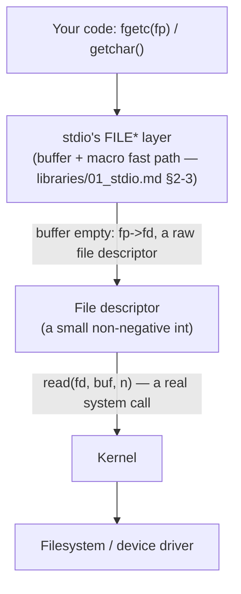

# File Descriptors & UNIX I/O: The Other Half of `stdio`

> **Phase 8 · File I/O, Both Layers.** Depends on: `libraries/01_stdio.md` §1–2 (the
> `stdio`-vs-POSIX design split, and `FILE`'s member list), `libraries/08_stdarg.md`
> (variadic functions — reused directly in this file's `error` example).
> Feeds into: `systems/04_system_calls_vs_libc_vs_posix.md` (Phase 9 — this file is where
> that distinction stops being abstract), `debugging/03_static_and_binary_inspection.md`
> (Phase 10 — `strace` watches exactly the calls this file introduces).
> Sources: **Book B** §8.1–8.5, in full (primary — the only one of the three books that
> actually builds `stdio` on top of raw file descriptors in code), **Book A** ch.21
> (`stdio`-level breadth, already covered from that side in `libraries/01_stdio.md`).

---

## 1. Two layers, one job — recap and complete the picture

`[Cross-reference]` `libraries/01_stdio.md` §1 already established that ISO C's `FILE*`
streams and UNIX's raw file descriptors are **deliberately separate layers**, with only
the latter excluded from the C standard. This file completes that picture from the other
side: what file descriptors actually are, the five system calls that operate on them, and
— concretely, in code — exactly how a `FILE*` is built **on top of** one.



**This diagram is the "Application → stdio → file descriptor → kernel → filesystem" chain**
this vault has referenced since Phase 1 — now with every link concretely explained.

---

## 2. File descriptors: UNIX's uniform interface

`[Book-derived, B]` UNIX's foundational I/O idea: **everything is a file** — keyboard,
screen, a pipe, a real disk file — so one interface handles all of them. Opening a file
returns a **file descriptor**: a small, non-negative integer the kernel uses internally to
track everything about that open file (position, mode, buffering state at the kernel
level) — your program only ever holds this small integer, never the underlying state
itself. Three descriptors are conventionally already open when any program starts,
courtesy of the shell: `0` (standard input), `1` (standard output), `2` (standard error).
Shell redirection (`prog <infile >outfile`) works by the **shell** rearranging which real
files descriptors 0/1 refer to *before* your program even starts — your program never
needs to know or care whether its output is going to a terminal, a file, or another
program's input.

---

## 3. The five system calls

`[Book-derived, B]`

```c
int fd = open(char *name, int flags, int perms);   /* flags: O_RDONLY / O_WRONLY / O_RDWR */
int fd = creat(char *name, int perms);              /* create, or truncate if it exists */
int n  = read(int fd, char *buf, int n);              /* returns bytes read; 0 = EOF; -1 = error */
int n  = write(int fd, char *buf, int n);              /* returns bytes written */
int    = close(int fd);                                 /* also happens automatically at exit/return from main */
long   = lseek(int fd, long offset, int origin);          /* origin: 0=start, 1=current, 2=end */
```

`[Book-derived, B]` `read`/`write` do **not** guarantee transferring the full amount
requested in one call — `read` may return fewer bytes than asked for (not an error, just
"that's all that was available/ready right now"); robust code loops until it gets what it
needs or hits `0`/`-1`. `creat` is a genuine historical wart worth knowing by name (it
truncates or creates — a job `open` with the right flags handles in modern code, but
`creat` still appears throughout older real-world C).

### Worked example — `cp`, built entirely from these five calls

`[Book-derived, B]`

```c
#define PERMS 0666   /* rw for owner, group, others */

int main(int argc, char *argv[]) {
    int f1, f2, n;
    char buf[BUFSIZ];
    if (argc != 3) error("Usage: cp from to");
    if ((f1 = open(argv[1], O_RDONLY, 0)) == -1) error("cp: can't open %s", argv[1]);
    if ((f2 = creat(argv[2], PERMS)) == -1) error("cp: can't create %s", argv[2]);
    while ((n = read(f1, buf, BUFSIZ)) > 0)
        if (write(f2, buf, n) != n) error("cp: write error");
    return 0;
}
```

`[Book-derived, B]` This is also, incidentally, K&R's own worked example of a genuinely
useful variadic function: `error(fmt, ...)`, implemented via `vfprintf` — the "single
argument that's already had `va_start` called on it" sibling of `printf` previewed in
`libraries/08_stdarg.md` — is exactly what lets `error` forward its own variable argument
list on to `printf`'s machinery without re-implementing formatting itself.

### Random access: `lseek`

`[Book-derived, B]` I/O is normally sequential — each `read`/`write` continues right where
the last one left off. `lseek(fd, offset, origin)` repositions that "current position"
arbitrarily, letting a file be treated somewhat like an array (at a real performance cost
versus pure sequential access). Appending is `lseek(fd, 0L, 2)` (seek to the end before
writing); rewinding is `lseek(fd, 0L, 0)`.

---

## 4. Building `getchar` directly from `read` — two versions, one clear lesson

`[Book-derived, B]` A minimal, genuinely unbuffered `getchar`:

```c
int getchar(void) {
    char c;
    return (read(0, &c, 1) == 1) ? (unsigned char) c : EOF;
}
```

`[Book-derived, B]` **Why the cast to `unsigned char` in the return matters:** `c` must be
a plain `char` (`read` needs a character pointer), but casting it to `unsigned char` before
the implicit widening to `int` eliminates any sign-extension problem — directly the same
plain-`char`-signedness hazard from `fundamentals/02_types.md` §2, resurfacing here in a
real implementation rather than as an abstract warning.

`[Book-derived, B]` A **buffered** version, reading in large chunks and handing out
characters one at a time:

```c
int getchar(void) {
    static char buf[BUFSIZ];
    static char *bufp = buf;
    static int n = 0;
    if (n == 0) {                        /* buffer is empty */
        n = read(0, buf, sizeof buf);
        bufp = buf;
    }
    return (--n >= 0) ? (unsigned char) *bufp++ : EOF;
}
```

### 🎯 Interview point — this is the whole "why buffering exists" argument, made concrete
`[Synthesis]` Compare these two directly: the first calls the **real `read` system call
every single character** — exactly the "disastrously slow" scenario
`libraries/01_stdio.md` §3 warned about in the abstract. The second calls `read` only once
per `BUFSIZ` characters, using `static` local variables (`functions/01_functions_and_stack_frames.md`
§5) to remember its position between calls — the *exact same idea* as the real `getc`/
`getchar` macro's fast-path/fallback structure, just written as an ordinary function
instead of a macro. Seeing both versions side by side is worth more than any amount of
abstract "buffering is faster" explanation.

---

## 5. The `FILE*`-on-fd bridge, in real detail

`[Book-derived, B]` This is the phase's centerpiece: a real, working sketch of how
`fopen`/`getc` are actually built **on top of** the five system calls from §3 — not a
black box, but a concrete data structure and two functions.

### The `FILE` structure itself

`[Book-derived, B, member names paraphrased]` A `FILE` is a struct holding: a count of
characters left in the buffer, a pointer to the next character position, a pointer to the
buffer's base, a flags field (read/write mode, EOF/error status), and — the crucial link to
this file's material — **the underlying file descriptor itself**. `stdin`/`stdout`/`stderr`
are simply pointers to three pre-initialized `FILE` structs, with their `fd` fields already
set to `0`/`1`/`2`.

### The macro, once more — now on the fd side of the bridge

`[Book-derived, B, cross-referencing `libraries/01_stdio.md` §3]` Book B's `getc` macro is
structurally identical in spirit to Plauger's (Book C's) version already covered in Phase
7, independently reaching the same "cheap pointer check, fall back to a real function"
design:

```c
#define getc(p)  (--(p)->cnt >= 0 ? (unsigned char) *(p)->ptr++ : _fillbuf(p))
```

Decrement the remaining-character count; if it's still non-negative, a character is ready
— dereference and advance the buffer pointer, cheaply. If the count just went negative, the
buffer is empty — call the real function, `_fillbuf`, to refill it.

### `_fillbuf` — the moment the bridge actually crosses to a system call

`[Book-derived, B]`

```c
int _fillbuf(FILE *fp) {
    int bufsize = /* BUFSIZ, or 1 if this stream is unbuffered */;
    if (fp->base == NULL)                              /* first use: allocate the buffer */
        if ((fp->base = malloc(bufsize)) == NULL)
            return EOF;
    fp->ptr = fp->base;
    fp->cnt = read(fp->fd, fp->ptr, bufsize);            /* <-- THE system call, right here */
    if (--fp->cnt < 0) {
        /* fp->cnt == -1 means EOF; otherwise a real error — set the flag accordingly */
        fp->cnt = 0;
        return EOF;
    }
    return (unsigned char) *fp->ptr++;
}
```

**This is the exact line where the two layers meet:** `read(fp->fd, fp->ptr, bufsize)` —
an ordinary call to §3's raw system call, using the file descriptor `fopen` originally
obtained via `open`/`creat`, filling the very buffer `getc`'s macro fast-path reads from on
every subsequent call. Everything above this line (the macro, the struct) is pure `stdio`
machinery; this one line is where it reaches down into the OS.

### `fopen`, briefly

`[Book-derived, B]` `fopen` itself does comparatively little: find an unused `FILE` slot,
call `open` or `creat` depending on the requested mode (`"r"`/`"w"`/`"a"`), set the flags
field accordingly, and — notably — **does not allocate a buffer at all**; that's deferred
to `_fillbuf`'s first real call, exactly the same "don't pay for it until you actually need
it" laziness pattern that shows up elsewhere in real systems code (e.g. the heap only
growing via `sbrk` when actually needed, `memory/05_dynamic_memory.md` §5).

### 💡 Why this matters more than "here's an implementation detail"
`[Synthesis]` Seeing this bridge in full removes the last bit of mystery from
`libraries/01_stdio.md`'s claim that `FILE*` and file descriptors are two genuinely
different layers: they're not just *conceptually* different, they are **literally, in a
real implementation, two data structures connected by exactly one function call**
(`_fillbuf`'s `read`, or its `_flushbuf` write-side mirror). Once you can point to that one
line, "streams vs. file descriptors" stops being an abstraction to memorize and becomes a
fact you've watched happen.

---

## 6. ⚠️ Misconceptions to unlearn now

- **"`read`/`write` always transfer exactly as many bytes as requested."** `read` in
  particular may return fewer bytes than asked for, with no error — this isn't a failure to
  handle, it's normal, expected behavior that robust code must loop around (§3).
- **"`FILE*` and file descriptors are just two names for the same thing."** A `FILE*` is a
  buffering layer built *on top of* a file descriptor — one `FILE` struct contains a real
  fd as one of its members, not the other way around (§5).
- **"Buffering is just an optimization detail you can ignore."** Comparing the unbuffered
  and buffered `getchar` implementations in §4 directly shows buffering is the difference
  between a system call per character and a system call per `BUFSIZ` characters — a
  difference real programs cannot ignore at scale.

---

## 7. 🎯 Interview questions

**Easy**
- What does `open` return on success, and what does it return on failure? → A small
  non-negative file descriptor; `-1` on failure (§3).
- What are file descriptors 0, 1, and 2, by convention? → Standard input, standard output,
  standard error (§2).

**Medium**
- Why might `read(fd, buf, 1024)` return fewer than 1024 bytes, without that being an
  error? → `read` is only guaranteed to return *some* available data, not necessarily the
  full amount requested — normal behavior, not a failure signal (§3).
- Why does a `FILE` struct need to store a file descriptor as one of its own members? →
  Because `stdio`'s buffering layer is built *on top of* raw fd-based I/O — whenever the
  buffer needs refilling/flushing, the implementation needs the real fd to call `read`/
  `write` against (§5).

**Hard**
- Walk through exactly what happens, layer by layer, on a `getc(stdin)` call when the
  buffer is empty. → The macro's pointer-count check fails, so it calls `_fillbuf`;
  `_fillbuf` (allocating a buffer on first use) calls `read` on `stdin`'s stored file
  descriptor to refill that buffer, updates the count/pointer, and returns the first
  character — only this one `read` call touches the kernel; every other character in the
  refilled buffer comes from the cheap macro path (§5).
- Why does casting to `unsigned char` in a raw `read`-based `getchar` implementation matter,
  specifically? → Without it, a plain (possibly signed) `char` with its high bit set would
  sign-extend to a negative `int` when returned, potentially colliding with `EOF`'s value or
  otherwise misrepresenting the byte — exactly `fundamentals/02_types.md` §2's plain-`char`-
  signedness hazard, showing up in a real implementation (§4).

**Systems-level**
- A program using unbuffered, one-byte-at-a-time `read` calls to process a large file is
  dramatically slower than the equivalent `stdio`-based version. Explain precisely why, in
  terms of what each version actually does per character. → The unbuffered version makes
  one real system call (with its associated kernel-transition overhead) per character; the
  `stdio` version makes one system call per `BUFSIZ` characters, amortizing that overhead
  across potentially thousands of characters via the buffer/macro mechanism in §4–5 — the
  *number of system calls*, not the total bytes moved, is the dominant cost difference.

---

## 8. External references

- [man7.org — `open(2)`, `read(2)`, `write(2)`, `close(2)`, `lseek(2)`](https://man7.org/linux/man-pages/)
  `[External]` — the current, authoritative, platform-specific documentation for every
  system call in this file.
- [man7.org — `strace(1)`](https://man7.org/linux/man-pages/) `[External]` — previewed
  here, covered fully in `debugging/03_static_and_binary_inspection.md` (Phase 10): watch
  these exact system calls fire in real time against a real program.

## 9. 🛠 Practice — the phase project

1. `[Book-derived, B, Exercise 8-1]` Rewrite a `cat`-like program **twice** — once using
   `stdio` (`fopen`/`fgetc`/`fclose`), once using only `open`/`read`/`write`/`close` — and
   measure the relative speed of each on a large file, to make §4's buffering argument
   empirical rather than theoretical.
2. Implement both `getchar` versions from §4 verbatim, and use `strace` (previewed in §8,
   or simple call-counting if unavailable) to confirm the unbuffered version makes vastly
   more `read` system calls than the buffered one, for the same input.
3. `[Book-derived, B, Exercise 8-3, extended]` Sketch (pseudocode is fine) what
   `_flushbuf` and `fclose` would need to do, as the write-side and cleanup-side mirrors of
   `_fillbuf` — you don't need a full implementation to internalize the symmetry.
