# Pattern Recognition & Computer Vision (ML-411T) — Unit 1 & Unit 2 Revision Notes

> **Exam format (from your syllabus handbook):** 75 marks. **Q1 is compulsory** and covers the *whole* syllabus (short answers, 15 marks). Each unit then has two questions and you attempt **one** (15 marks per unit, up to 5 sub-parts). So for Units 1 and 2 you need *breadth* (Q1) and *depth on at least one full question per unit*.
>
> **Sources:** your Unit-1 and Unit-2 PDFs, plus the extra notes in `unit_1_2.pdf` / `PRCV_End_Sem.pdf`.
> **[+]** = my addition from standard textbooks (Duda–Hart–Stork, Bishop, Mitchell).
> **⚠ Fix** = the source notes contain an error here; don't copy it into an exam answer.
>
> **How to read the maths:** formulas are written in LaTeX (`$…$` inline, `$$…$$` on its own line). They render in Typora, Obsidian, VS Code (Markdown Preview), GitHub, Jupyter and Notion. If you open the file in a plain text editor you will see the raw LaTeX instead.

---

## Table of contents

**UNIT 1 — Induction Algorithms**
1. Induction: the big picture
2. Rule induction
3. Decision trees
4. Bayesian methods → Naïve Bayes
5. Naïve Bayes for numeric attributes
6. Correction to probability estimation: Laplace, No-Match, log trick
7. Other Bayesian methods (Bayesian decision theory, networks …)
8. Other induction methods: Neural networks · Genetic algorithms · Instance-based learning · SVM

**UNIT 2 — Statistical Pattern Recognition**
9. Statistical pattern recognition, classification vs regression
10. Features, feature vectors, classifiers
11. Pre-processing & feature extraction
12. Curse of dimensionality
13. Polynomial curve fitting
14. Model complexity (bias–variance, regularisation, cross-validation)
15. Multivariate non-linear functions
16. Bayes' theorem
17. Decision boundaries
18. Parametric methods
19. Sequential parameter estimation
20. Linear discriminant functions
21. Fisher's linear discriminant
22. Feed-forward network mappings

**Revision aids:** formula sheet · comparison tables · likely exam questions · checklist

---

# UNIT 1

## 1. Induction: the big picture

- **Induction** = inferring a general rule/pattern from a limited set of observations, then applying it to unseen cases. It is *always a leap beyond the data*, so it can never be proved — only supported by further evidence or disproved by a counter-example.
- **Induction algorithm (in ML)** = takes labelled training instances and outputs a *classifier/model* that predicts the class of new instances.
- **Two assumptions behind scientific induction:**
  1. **Representative sampling** — the sample behaves like the population.
  2. **Uniformity of nature** — the unseen data behaves like the seen data.
- **Typical steps:** data preparation → learn model (rules / tree / probabilities / weights) → evaluate → prune/select → apply to new data.
- **Families in this unit:** rule induction, decision trees, Bayesian classifiers, neural networks, genetic algorithms, instance-based learning, SVM.

---

## 2. Rule induction

**Definition:** learning explicit **IF–THEN rules** from data that relate attribute values to class labels.
Example: `IF time = 8 a.m. AND day = weekday THEN traffic = heavy`.

| Step | What happens |
|---|---|
| 1. Data preparation | Table: rows = instances, columns = attributes |
| 2. Rule generation | Find patterns as if-then rules (from a decision tree, *sequential covering*, association mining such as Apriori, or ILP) |
| 3. Rule evaluation | Accuracy, **coverage**, **support**, **confidence**, **lift** |
| 4. Selection & pruning | Remove redundant / irrelevant / overlapping rules |
| 5. Rule application | Match a new instance to the rules; use the rule with highest confidence/support |

- **Easiest way to get rules:** build a decision tree, then trace each **root → leaf path**. The conjunction of split conditions is the IF-part; the leaf is the THEN-part (see Figure 3).
- **Sequential covering [+]:** learn one good rule → remove the instances it covers → repeat on the rest.
- **Algorithms:** C4.5 (rules from trees), **RIPPER**, **RULES** family, **Apriori**, CN2.

**Rule-quality metrics** (rule $A \Rightarrow B$):

$$\text{support}=P(A\cap B)\qquad \text{confidence}=P(B\mid A)\qquad \text{lift}=\frac{P(B\mid A)}{P(B)}$$

**Pros:** human-readable and explainable (healthcare, finance, law), good for knowledge discovery, automatable.
**Cons:** struggles with complex/non-linear relations; the rule search space explodes in high dimensions; sensitive to noise; needs parameter tuning.

---

## 3. Decision trees

**Definition:** a supervised model (classification *and* regression) that recursively splits data using attribute tests into a tree of **root node → decision (internal) nodes → leaf nodes**. Leaves give the class/decision. Building it is called **recursive partitioning**.

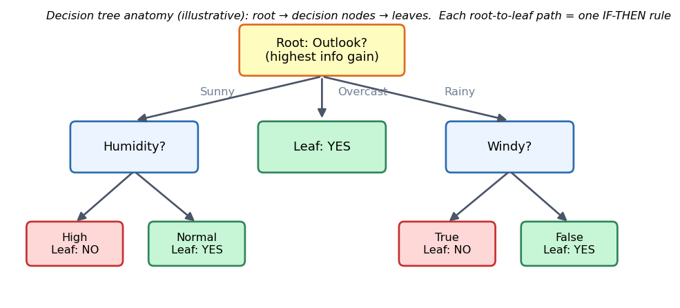
*Figure 3 — Root, decision nodes and leaves. Each root-to-leaf path is one IF–THEN rule.*

### Entropy and information gain

**Entropy** measures impurity/randomness of a set $S$ whose class proportions are $p_i$:

$$H(S) = -\sum_{i=1}^{c} p_i \log_2 p_i$$

- Pure set → $H=0$.  Two classes, 50/50 → $H=1$ (maximum).

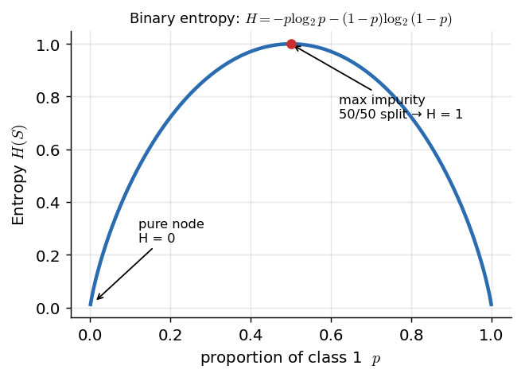
*Figure 2 — Binary entropy is 0 for a pure node and 1 for a 50/50 node.*

**Information gain** = reduction in entropy after splitting on attribute $A$:

$$\text{Gain}(S,A) = H(S) - \sum_{v\in \text{values}(A)} \frac{|S_v|}{|S|}\, H(S_v)$$

At every node choose the attribute with the **highest gain**.

**[+] Gini impurity (CART):**
$$\text{Gini}(S)=1-\sum_i p_i^{2}$$

**[+] Gain ratio (C4.5)** — fixes information gain's bias toward many-valued attributes:
$$\text{GainRatio}(S,A)=\frac{\text{Gain}(S,A)}{\text{SplitInfo}(S,A)},\qquad \text{SplitInfo}(S,A)=-\sum_v \frac{|S_v|}{|S|}\log_2\frac{|S_v|}{|S|}$$

### Generic algorithm (3 inputs)
`Generate_tree(D, attribute_list, Attribute_selection_method)`
- **D** — data partition (initially all training tuples with class labels)
- **attribute_list** — candidate attributes
- **Attribute_selection_method** — heuristic (info gain / gain ratio / Gini) that picks the "best" splitting attribute

Split → recurse on each subset → stop when all tuples in a node share a class (or no attributes remain).

| Algorithm | Split criterion | Handles | Used for |
|---|---|---|---|
| **ID3** | Entropy / information gain | Categorical | Classification |
| **C4.5** | Gain ratio | Continuous + discrete, missing values, pruning | Classification |
| **CART** | Gini (classification) / variance reduction (regression) | Both | Binary trees |

**Pros:** interpretable, handles mixed data, models non-linearity.
**Cons:** **overfits** if grown deep (fix: **pruning**), **unstable** (small data change → different tree), usually less accurate than ensembles.
**Applications:** medical diagnosis, credit scoring/fraud, customer segmentation.

### Decision-analysis example from your notes (factory expansion)

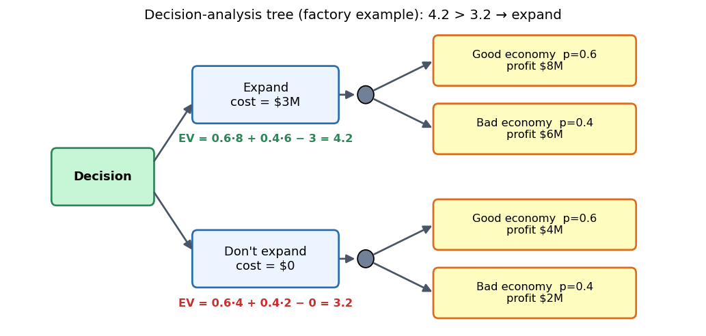
*Figure 4 — Expected value of each option.*

$$\text{EV(expand)}=(0.6\times 8+0.4\times 6)-3=4.2\ \text{M}$$
$$\text{EV(don't expand)}=(0.6\times 4+0.4\times 2)-0=3.2\ \text{M}$$

Since $4.2>3.2$ → **expand**.
> ⚠ **Fix:** the source says "Net Not Expand = 3M" (3 million). The correct value is $2.4+0.8=3.2$ million. The decision does not change.

---

## 4. Bayesian methods → Naïve Bayes classifier

**Why Bayesian methods?** Flexible, resilient to noise, solid probability theory, competitive accuracy, incremental (can update with new data). Long used in pattern recognition; recently popular in ML.

### Bayes' theorem (memorise)

$$P(A\mid B)=\frac{P(B\mid A)\,P(A)}{P(B)}$$

| Term | Name |
|---|---|
| $P(A\mid B)$ | **Posterior** |
| $P(B\mid A)$ | **Likelihood** |
| $P(A)$ | **Prior** |
| $P(B)$ | **Evidence** (marginal probability, normaliser) |

### Naïve Bayes (NB)

For class $y$ and feature vector $X=(x_1,\dots,x_n)$:

$$P(y\mid X)=\frac{P(X\mid y)\,P(y)}{P(X)}$$

**Naïve assumption** — features are **conditionally independent given the class**:

$$P(x_1,\dots,x_n\mid y)=\prod_{i=1}^{n}P(x_i\mid y)$$

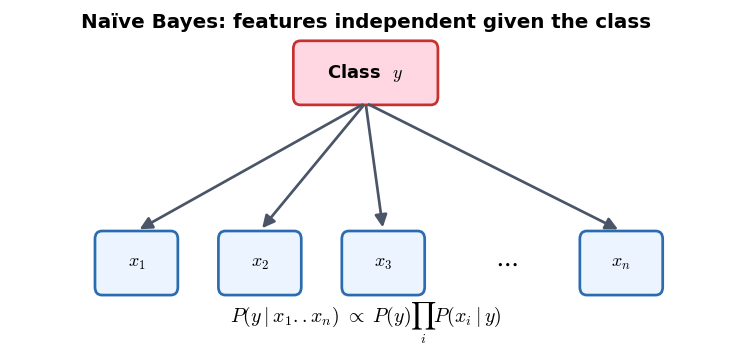
*Figure 5 — The class "causes" every feature; features do not interact once the class is known.*

$P(X)$ is the same for every class, so drop it:

$$P(y\mid X)\;\propto\;P(y)\prod_{i=1}^{n}P(x_i\mid y)\qquad\Longrightarrow\qquad \hat y=\arg\max_{y}\;P(y)\prod_{i=1}^{n}P(x_i\mid y)$$

**What is stored per class:** the prior $P(C_k)$ and, for each attribute, a conditional distribution — a discrete table for nominal attributes, or a (mean, variance) pair for numeric ones.

**Learning is trivial (counting):**
- one counter per class → priors,
- one counter per (class, attribute-value) pair → $P(v_j\mid C_k)$,
- for numeric attributes keep the **sum** and **sum of squares** → mean and variance,
- an extra count for missing values.

No search through hypothesis space; the result does not depend on training order (incremental = non-incremental).

**Assumptions:** conditional independence; continuous features ~ Gaussian per class; discrete features ~ multinomial per class; features equally important; no missing data. *The independence assumption is almost never true, yet NB often works well.*

**Types:** Gaussian NB (continuous) · Multinomial NB (counts, text) · Bernoulli NB (binary features).
**Pros:** very fast, scales to high dimensions, works with little data, great for text (spam, sentiment). **Cons:** independence assumption, zero-probability problem, poorly calibrated probabilities.

### Worked example: "Play golf?"
Priors (from the 14-row table): $P(\text{Yes})=\tfrac{9}{14}$, $P(\text{No})=\tfrac{5}{14}$.
Query: `today = (Sunny, Hot, Normal, Windy=False)`

**Counts read from the 14-row table printed in your PDF** (Yes: 9 rows, No: 5 rows):

| Attribute value | Count in Yes | Count in No |
|---|---|---|
| Outlook = Sunny | 3 | 2 |
| Temperature = Hot | 2 | 2 |
| Humidity = Normal | 6 | 1 |
| Windy = False | 6 | 2 |

$$P(\text{Yes}\mid \text{today})\propto \frac{3}{9}\cdot\frac{2}{9}\cdot\frac{6}{9}\cdot\frac{6}{9}\cdot\frac{9}{14}\approx 0.02116$$

$$P(\text{No}\mid \text{today})\propto \frac{2}{5}\cdot\frac{2}{5}\cdot\frac{1}{5}\cdot\frac{2}{5}\cdot\frac{5}{14}\approx 0.00457$$

Normalise (divide by the sum $\approx 0.02573$):

$$P(\text{Yes}\mid\text{today})\approx 0.822,\qquad P(\text{No}\mid\text{today})\approx 0.178\;\Rightarrow\;\textbf{predict Yes}$$

> ⚠ **Fix — the source mixes two versions of this dataset.**
> - The 14-row table printed in the PDF has *Sunny = 3 Yes / 2 No*, but the PDF's probability tables (and its "No" product, which uses $3/5$) follow the **standard textbook version of the data, where Sunny = 2 Yes / 3 No**. Its "Yes" product uses $3/9$, so the two products come from *different* tables.
> - Its final normalised numbers ("0.0237" and "0.33") don't sum to 1 either.
> - **If your teacher/exam uses the standard textbook table** (Sunny: 2 Yes, 3 No), the answer is
>   $P(\text{Yes})\propto\frac29\cdot\frac29\cdot\frac69\cdot\frac69\cdot\frac9{14}\approx0.0141$ and $P(\text{No})\propto\frac35\cdot\frac25\cdot\frac15\cdot\frac25\cdot\frac5{14}\approx0.0069$, i.e. **$P(\text{Yes})\approx0.67,\ P(\text{No})\approx0.33$** (this is where the source's "0.0141", "0.0068" and "0.33" come from).
> - **Either way the prediction is "Yes".** In an exam, state which table you counted from, and always count from the table you are given.

**Exam recipe for an NB numerical:** (1) write priors; (2) read each $P(x_i\mid\text{class})$ from the tables; (3) multiply; (4) compare (optionally normalise); (5) state the class.

---

## 5. Naïve Bayes induction for numeric attributes

You can't store a table for a continuous attribute. **Assume a distribution per class** — usually **Normal (Gaussian)** — and estimate its parameters from the training data of that class:

$$\mu_c=\frac{1}{N_c}\sum_{i\in c}x_i,\qquad \sigma_c^{2}=\frac{1}{N_c}\sum_{i\in c}(x_i-\mu_c)^2$$

$$P(x\mid c)=\frac{1}{\sqrt{2\pi\sigma_c^{2}}}\exp\!\left(-\frac{(x-\mu_c)^2}{2\sigma_c^{2}}\right)$$

Then use these densities in the same product $P(c)\prod_j P(x_j\mid c)$.

- **Incremental update:** keep $\sum x$ and $\sum x^2$, then $\sigma^2=\dfrac{\sum x^2}{N}-\mu^2$.
- **Alternatives [+]:** kernel density estimation, or **discretise** into bins and treat as nominal.
- **Caveat:** the Gaussian assumption may be wrong. A density can exceed 1 (it is a density, not a probability) — that is fine when only comparing classes.

---

## 6. Correction to the probability estimation

### 6.1 The zero-probability problem
If an attribute value never occurs with a class in training, then $P(v\mid C)=0$ and the **whole product becomes 0**, no matter what the other evidence says. (Text example: a query word $w'$ that is not in the training vocabulary.)
Bad fixes: *ignore the term* (equivalent to $P=1$ — logically wrong), or *leave it at 0* (kills the class).

### 6.2 Laplace correction (additive smoothing)

$$P(v\mid C)=\frac{\text{count}(v,C)+\alpha}{N_C+\alpha K}$$

- $\alpha$ = smoothing parameter ($\alpha=1$ is "add-one", the default)
- $N_C$ = number of training instances of class $C$
- $K$ = number of possible values of the feature (so the probabilities still sum to 1)

**Effect of $\alpha$** (count = 3, $K=2$, $N=100$):

| $\alpha$ | $P$ |
|---|---|
| 1 | $3/102$ |
| 100 | $103/300$ |
| 1000 | $1003/2100$ |

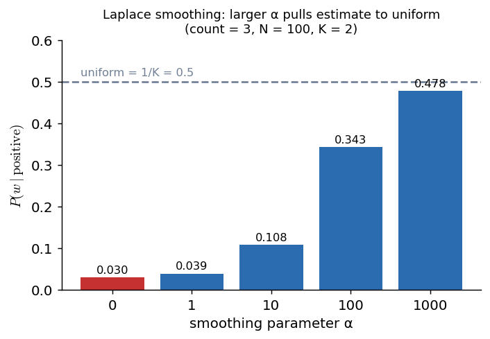
*Figure 6 — As α grows the estimate moves toward the uniform value $1/K$: the data counts matter less.*

**Worked example (binary bag-of-words sentiment):**
Training: R1 = (w1, w2, w3) → 0; R2 = (w1, w3) → 1; R3 = (w1, w2) → 0. Query r4 contains only w1.
Without smoothing, $P(+\mid r4)=\tfrac23\cdot1\cdot1\cdot0=0$, and the negative class also contains a zero factor. With $\alpha=1$ every factor is non-zero, so both classes receive a usable score.

**Why add $\alpha$ in the numerator and $\alpha K$ in the denominator (not just a tiny constant like $10^{-6}$)?**
1. It guarantees probabilities are never 0 **and** still sum to 1.
2. $\alpha$ is a **hyper-parameter controlling the bias–variance trade-off**: small $\alpha$ → low bias / high variance (may overfit); large $\alpha$ → high bias / low variance (may underfit).

**Limitations:** adds bias; a too-large $\alpha$ washes out the evidence; not ideal for continuous data.

### 6.3 "No Match" (Naïve Bayes sense)
"No match" = no training instance of a class has a particular attribute value → zero count → zero probability. It occurs for categorical *and* numeric attributes (e.g., a value far in the tail of the fitted Gaussian). **Solutions:** Laplace/additive smoothing; replace the zero by a small value (e.g., a fraction such as $\tfrac{1}{2n}$ [+, Kohavi-style no-match correction]); use a smoother density estimate for numeric data.

### 6.4 Numerical stability — underflow and the log trick
Multiplying many probabilities (each $<1$) makes the product underflow to 0. **Fix:** work in log space, since $\log(AB)=\log A+\log B$:

$$\log P(y\mid X)\;\propto\;\log P(y)+\sum_{i=1}^{n}\log P(x_i\mid y)\qquad\Rightarrow\;\text{choose the class with the largest value}$$

(scikit-learn: `predict_log_proba`.)

### 6.5 Aside — the "Matching problem" (appears in your Unit-1 PDF)
Not needed for NB itself. *n letters are randomly placed into n envelopes.* A **fixed point** = a letter in its own envelope.

$$P(\text{match at position } i)=\frac1n,\qquad P(\text{matches at } i \text{ and } j)=\frac{1}{n(n-1)}$$

**No match (derangement)**, by inclusion–exclusion:

$$P(\text{no match})=1-1+\frac1{2!}-\frac1{3!}+\cdots+\frac{(-1)^n}{n!}\;\longrightarrow\;e^{-1}\approx0.368\ \ (n\text{ large})$$

$$P(\text{exactly }k\text{ matches})\approx\frac{e^{-1}}{k!}\qquad(\text{Poisson with mean }1)$$

---

## 7. Other Bayesian methods

### 7.1 Bayesian decision theory (Duda & Hart)
Known: priors $P(\omega_j)$ and class-conditional densities $p(x\mid\omega_j)$. After measuring $x$:

$$P(\omega_j\mid x)=\frac{p(x\mid\omega_j)\,P(\omega_j)}{p(x)},\qquad p(x)=\sum_{j=1}^{c}p(x\mid\omega_j)\,P(\omega_j)$$

**Two-category rule (minimum probability of error):** decide $\omega_1$ if $P(\omega_1\mid x)>P(\omega_2\mid x)$, else $\omega_2$.
Equivalent form (since $p(x)$ is only a scale factor):

$$\text{decide }\omega_1\ \text{ if }\ p(x\mid\omega_1)P(\omega_1)>p(x\mid\omega_2)P(\omega_2)$$

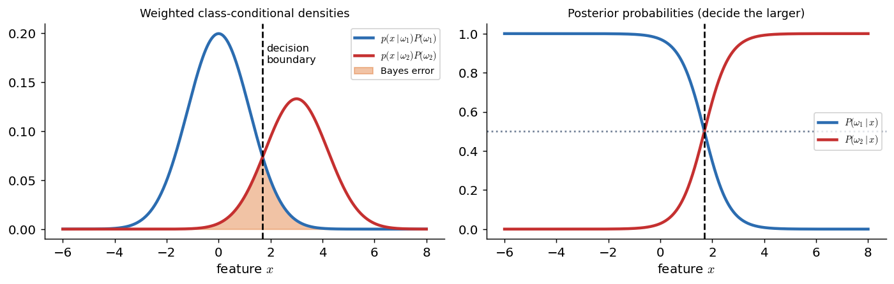
*Figure 21 — Left: weighted densities; the boundary is where they cross, the shaded area is the unavoidable Bayes error. Right: posteriors — pick the larger one.*

**Discriminant functions:** assign $x$ to $\omega_i$ if $g_i(x)>g_j(x)$ for all $j\ne i$. For minimum error rate, all of these give *identical* decisions:

$$g_i(x)=P(\omega_i\mid x)\qquad g_i(x)=p(x\mid\omega_i)P(\omega_i)\qquad g_i(x)=\ln p(x\mid\omega_i)+\ln P(\omega_i)$$

(Any monotonically increasing function of $g$ leaves the classification unchanged.)

**Dichotomizer (2 classes):** use one function $g(x)=g_1(x)-g_2(x)$; decide $\omega_1$ if $g(x)>0$.

$$g(x)=P(\omega_1\mid x)-P(\omega_2\mid x)\qquad\qquad g(x)=\ln\frac{p(x\mid\omega_1)}{p(x\mid\omega_2)}+\ln\frac{P(\omega_1)}{P(\omega_2)}$$

### 7.2 Other Bayesian approaches (from the extra notes)

| Method | Idea | Use |
|---|---|---|
| **Bayesian network** | DAG of random variables; edges = conditional dependencies; a node is independent of its non-descendants given its parents. Relaxes NB's independence assumption | Medical diagnosis, fault detection |
| **Gaussian NB** | NB with a Gaussian likelihood per feature | Continuous features |
| **Bayesian linear regression** | Prior on weights $w$; posterior $P(w\mid X,y)\propto P(y\mid X,w)P(w)$; gives uncertainty; Gaussian prior ≈ ridge | Predictions with uncertainty |
| **Bayesian hierarchical models** | Parameters are random variables with priors at several levels | Regional marketing, sports stats |
| **Bayesian optimisation** | Surrogate model (Gaussian process) + acquisition function; balances exploration/exploitation | Hyper-parameter tuning |
| **Empirical Bayes** | Estimate the prior from the data | A/B testing, genomics |
| **Bayesian model averaging** | Average many models' predictions weighted by posterior | Robust prediction |
| **Kalman filter / state-space** | Recursive Bayesian updates over time | Tracking, forecasting |

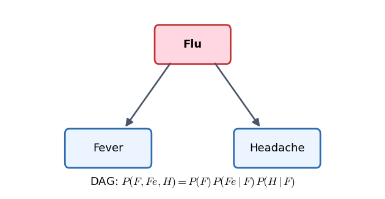
*Figure 27 — A tiny Bayesian network: the joint distribution factorises along the edges.*

---

## 8. Other induction methods

### 8.1 Neural networks

- **Neuron:** inputs × weights + bias → sum $z$ → **activation** $f(z)$ → output.

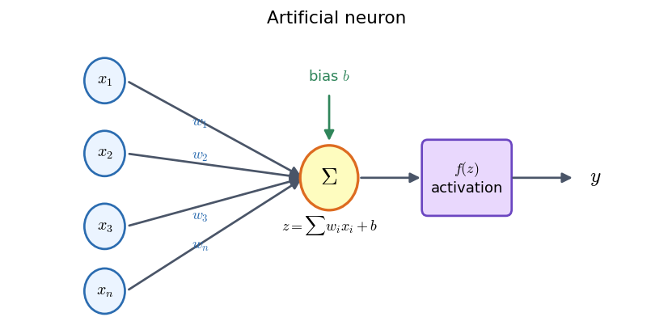
*Figure 7*

$$z=\sum_{i=1}^{n}w_i x_i+b,\qquad a=f(z)$$

- **Layers:** input → hidden (≥ 1) → output.

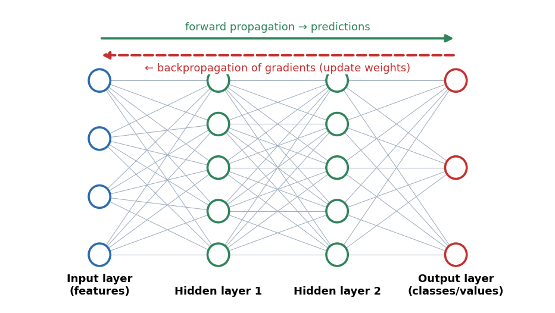
*Figure 8 — Forward pass computes predictions; backward pass sends gradients to update the weights.*

- **Training = forward propagation + backpropagation:**
  1. *Forward pass:* compute outputs layer by layer.
  2. *Loss:* MSE (regression) or cross-entropy (classification).
  3. *Backward pass:* gradients via the chain rule.
  4. *Update:* $w\leftarrow w-\eta\,\dfrac{\partial L}{\partial w}$ (gradient descent / SGD). Repeat over many samples.

- **Activations** (they add non-linearity — without them the whole network collapses to a linear model):

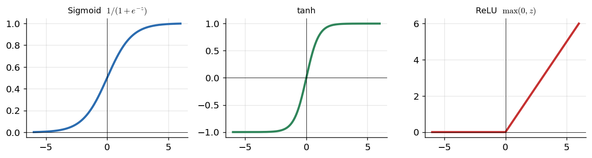
*Figure 9*

$$\sigma(z)=\frac{1}{1+e^{-z}}\qquad \tanh(z)=\frac{e^{z}-e^{-z}}{e^{z}+e^{-z}}\qquad \text{ReLU}(z)=\max(0,z)$$

- **Learning paradigms:** **supervised** (teacher gives target outputs → error signal), **unsupervised** (find structure: clustering/association), **reinforcement** (rewards/penalties from the environment).
- **Types:** Feedforward, MLP, CNN (images), RNN (sequences), LSTM (memory cells + gates, solves the vanishing-gradient problem).
- **Pros:** learns complex non-linear patterns, adaptive. **Cons:** needs lots of data/compute, black box, overfits.

### 8.2 Genetic algorithms (GA)

Search/optimisation inspired by **natural selection ("survival of the fittest")**; a subset of evolutionary computation (Holland, Goldberg).

**Why GAs?** Gradient methods get stuck in **local optima** on multi-peaked landscapes; many problems are NP-hard; a GA gives a *good-enough solution fast* (e.g., TSP).

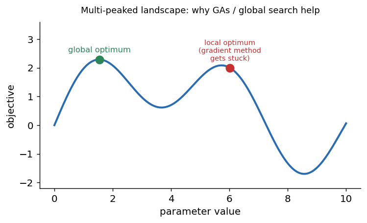
*Figure 28*

**Terminology (high-yield!):**

| Term | Meaning |
|---|---|
| Population | Set of candidate solutions |
| Chromosome | One candidate solution |
| Gene | One position in a chromosome |
| Allele | The value a gene takes |
| Genotype | Representation in computation space (e.g., a bit string) |
| Phenotype | The solution as it appears in the real problem space |
| Encoding / decoding | Phenotype → genotype / genotype → phenotype |
| Fitness function | Scores how good a solution is |
| Genetic operators | Selection, crossover, mutation |

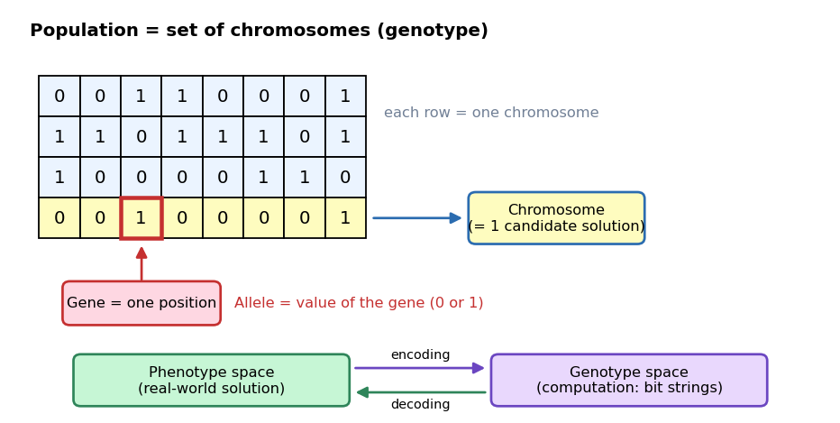
*Figure 11*

**Basic loop:**

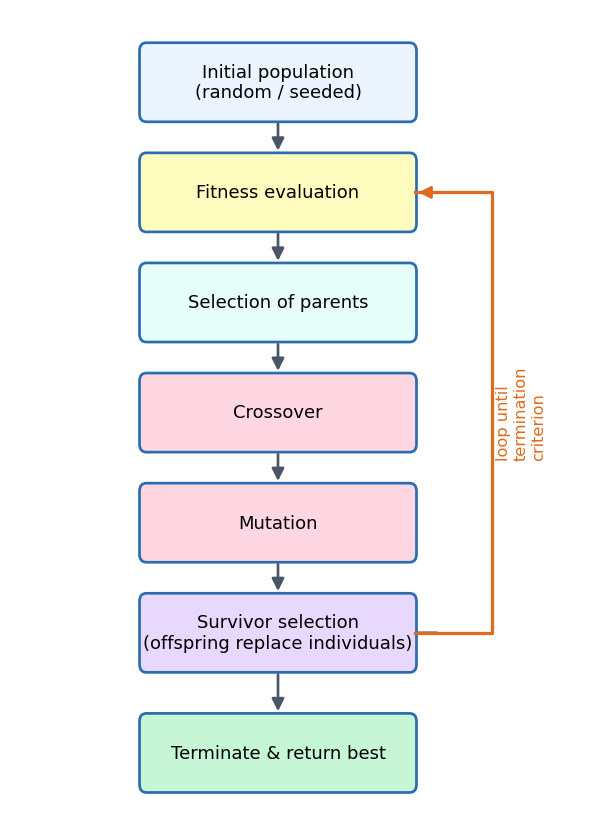
*Figure 10*

**Advantages:** needs no derivatives; parallel; works for continuous/discrete/multi-objective problems; returns a set of good solutions; good for huge search spaces.
**Limitations:** repeated fitness evaluation is costly; stochastic (no optimality guarantee); may not converge if badly designed; overkill for simple problems.
*(Knapsack example: a binary string of length $n$, one bit per item. The source says "0 = picked"; the usual convention is **1 = item picked**.)*

### 8.3 Instance-based learning (IBL) / lazy / memory-based learning

- **Store the training examples; delay all processing until a query arrives**, then generalise using a **similarity/distance measure**. It builds a *local* approximation of the target function for each query.
- **Time:** worst case $O(n)$ per query ($n$ = number of training instances). **Memory:** stores all data.
- **Algorithms:** k-NN, Self-Organizing Map, LVQ, Locally Weighted Learning, Case-Based Reasoning, RBF networks.

**k-Nearest Neighbour**
- $k=1$: copy the label of the nearest training example.
- **Discrete target:** majority vote among the $k$ neighbours.
- **Real-valued target:** $\displaystyle f(x_q)=\frac{1}{k}\sum_{i=1}^{k}f(x_i)$
- *When to use:* instances in $\mathbb{R}^n$, **fewer than ~20 attributes**, lots of training data.
- **Pros:** instant training, learns complex functions, tolerates noise, loses no information. **Cons:** slow at query time, **fooled by irrelevant attributes**, high memory, hurt by the curse of dimensionality.

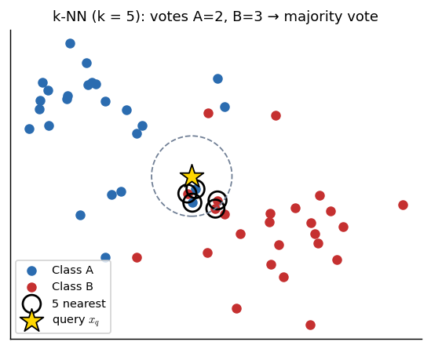
*Figure 12 — The query takes the majority label of its 5 nearest neighbours.*

**Locally Weighted Regression (LWR):** fit a simple model only around the query point, weighting each training example by a **kernel** $K(d(x_q,x))$ that decays with distance. *Local* = nearby data only; *weighted* = by distance; *regression* = real-valued output.

$$\hat f(x)=w_0+w_1a_1(x)+\cdots+w_na_n(x)$$

$$E(x_q)=\frac12\sum_{x\in k\text{-NN of }x_q}\big(f(x)-\hat f(x)\big)^2\,K\big(d(x_q,x)\big)$$

$$\Delta w_j=\eta\sum_{x\in k\text{-NN of }x_q}K\big(d(x_q,x)\big)\,\big(f(x)-\hat f(x)\big)\,a_j(x)$$

**Radial Basis Function (RBF) networks:** a global approximation built from localised Gaussian kernels:

$$\hat f(x)=w_0+\sum_{u=1}^{k}w_u\,K_u\big(d(x_u,x)\big),\qquad K_u=\exp\!\left(-\frac{d^{2}(x_u,x)}{2\sigma_u^{2}}\right)$$

Each hidden unit is a Gaussian centred at $x_u$ (≈ 0 unless $x$ is near $x_u$); the output is a linear combination of hidden activations. Related both to distance-weighted regression and to neural networks.

**Case-based reasoning (CBR):** like k-NN (lazy, similarity-based), but instances are in **symbolic form** (not points in $\mathbb{R}^n$), so it needs **new distance metrics**.

### 8.4 Support Vector Machines (SVM)

**Goal:** find the **optimal separating hyperplane** that **maximises the margin** between the classes.

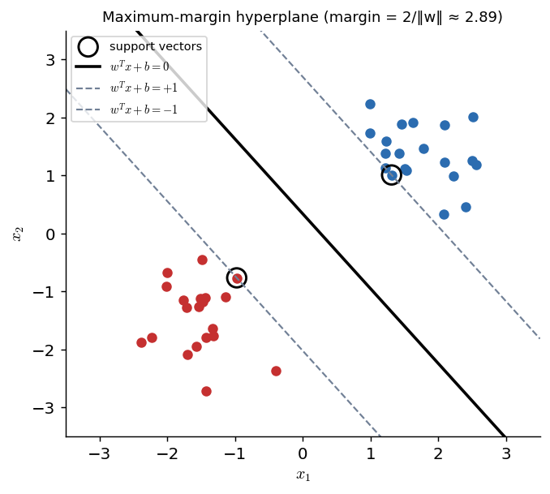
*Figure 13 — Only the circled support vectors determine the hyperplane. Margin $=2/\lVert w\rVert$.*

| Term | Meaning |
|---|---|
| **Hyperplane** | Decision boundary $w^{T}x+b=0$ (line in 2-D, plane in 3-D, hyperplane beyond) |
| **Support vectors** | Training points closest to the hyperplane; they alone define it |
| **Margin** | Gap between the hyperplane and the nearest points; wider = better generalisation |
| **Hard margin** | Perfect separation, no violations (needs linearly separable data) |
| **Soft margin** | Allows violations via **slack variables** $\zeta_i\ge0$; handles outliers/noise |
| **C** | Regularisation parameter: large $C$ → heavy penalty → *narrow margin, fewer misclassifications*; small $C$ → wide margin, more tolerance |
| **Hinge loss** | $\max\big(0,\,1-t_i(w^Tx_i+b)\big)$ — zero with no violation, grows with distance of violation |
| **Kernel** | Function that implicitly maps data to a higher dimension where it becomes linearly separable |
| **Dual problem** | Optimise Lagrange multipliers $\alpha_i$; enables the kernel trick |

**Distance of a point to the hyperplane, and the margin:**

$$d_i=\frac{w^{T}x_i+b}{\lVert w\rVert},\qquad \text{margin}=\frac{2}{\lVert w\rVert}$$

**Linear classifier:** $\hat y=+1$ if $w^Tx+b\ge0$, else $-1$ (labels $t_i\in\{+1,-1\}$).

**Optimisation**

*Hard margin:*
$$\min_{w,b}\ \frac12\lVert w\rVert^{2}\qquad\text{s.t.}\quad t_i\,(w^{T}x_i+b)\ge1\ \ \ \forall i$$

*Soft margin:*
$$\min_{w,b,\zeta}\ \frac12\lVert w\rVert^{2}+C\sum_{i=1}^{m}\zeta_i\qquad\text{s.t.}\quad t_i\,(w^{T}x_i+b)\ge1-\zeta_i,\ \ \zeta_i\ge0$$

*Dual:*
$$\max_{\alpha}\ \sum_{i}\alpha_i-\frac12\sum_{i}\sum_{j}\alpha_i\alpha_j\,t_i t_j\,K(x_i,x_j)\qquad\text{s.t.}\quad \alpha_i\ge0,\ \ \sum_i\alpha_i t_i=0$$

Points with $\alpha_i>0$ are the **support vectors**. **[+] Prediction:**

$$f(x)=\operatorname{sign}\Big(\sum_i\alpha_i t_i\,K(x_i,x)+b\Big)$$

**Common kernels:**

| Kernel | Formula |
|---|---|
| Linear | $K(x,z)=x^{T}z$ |
| Polynomial | $K(x,z)=(\gamma\,x^{T}z+r)^{d}$ |
| Gaussian RBF | $K(x,z)=\exp\!\big(-\gamma\,\lVert x-z\rVert^{2}\big)$ *(the source's "$\lVert\cdot\rVert^{n}$" is a typo — it is squared)* |
| Sigmoid | $K(x,z)=\tanh(\alpha\,x^{T}z+c)$ |

**Kernel intuition:** points on a line that are not separable become separable after the map $x\mapsto(x,x^{2})$.

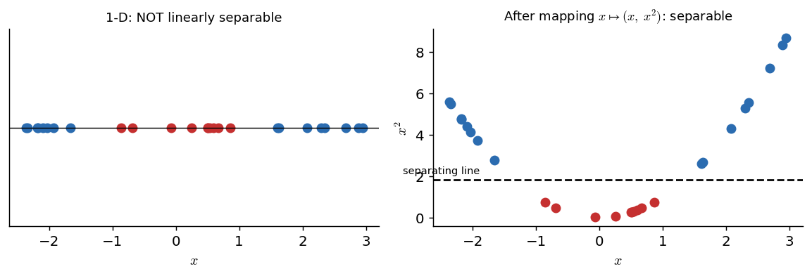
*Figure 14*

**Types:** Linear SVM (linearly separable data) vs non-linear SVM (via kernels).
**Pros:** effective in high dimensions; memory-efficient (only support vectors); flexible kernels; robust to outliers with a soft margin. **Cons:** kernel/$C$/$\gamma$ must be tuned; slow on very large data; no direct probabilities.

---

# UNIT 2

## 9. Statistical pattern recognition (SPR)

**Definition:** using statistical methods to find patterns/regularities in data and assign them to categories.

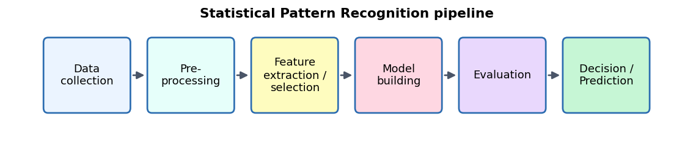
*Figure 1*

**Applications:** image recognition, speech recognition, NLP, medical diagnosis.
**Challenges:** overfitting, scalability, interpretability, ethics/bias.
**Advanced:** ensembles (Random Forest, boosting), deep learning, Bayesian methods.

### Classification vs regression

| | Classification | Regression |
|---|---|---|
| Output | **Categorical** label | **Continuous** value |
| Examples | Spam / not spam, cat/dog/bird, diagnosis | House price, stock price, temperature |
| Algorithms | Decision trees, SVM, NN, logistic regression | Linear/polynomial, ridge/lasso, SVR, NN |
| Metrics | Accuracy, precision, recall, F1 | MSE, RMSE, $R^2$ |
| Variants | Binary (2 classes) vs multiclass (> 2) | — |

$$\text{Precision}=\frac{TP}{TP+FP}\qquad \text{Recall}=\frac{TP}{TP+FN}\qquad F_1=\frac{2\cdot\text{Precision}\cdot\text{Recall}}{\text{Precision}+\text{Recall}}$$

$$\text{MSE}=\frac1N\sum_{i}(y_i-\hat y_i)^2\qquad \text{RMSE}=\sqrt{\text{MSE}}\qquad R^{2}=1-\frac{\sum(y_i-\hat y_i)^2}{\sum(y_i-\bar y)^2}$$

*Note:* logistic regression is used for **classification** despite its name.

---

## 10. Features, feature vectors, classifiers

- **Feature:** an individual measurable property of the data (bedrooms, area, pixel value).
- **Feature vector:** the array of features describing **one data point**, e.g. $\mathbf{x}=[3,\ 2000,\ \text{Suburban}]$; a point in $d$-dimensional **feature space**.
- **Classifier:** an algorithm/function mapping a feature vector to a class label (decision tree, SVM, NN, Bayes classifier …).
- **Feature types:** numerical, categorical, text (BoW, TF-IDF), image (HOG, CNN features).

---

## 11. Pre-processing and feature extraction

### Pre-processing (clean & prepare raw data)

| Step | Techniques |
|---|---|
| **Cleaning** | Missing values (**imputation** by mean/median/mode, or deletion), remove duplicates, fix errors/noise |
| **Normalisation (min–max)** | $x'=\dfrac{x-x_{\min}}{x_{\max}-x_{\min}}$ → range $[0,1]$ |
| **Standardisation (z-score)** | $x'=\dfrac{x-\mu}{\sigma}$ → mean 0, std 1 |
| **Encoding** | **One-hot** (nominal categories), **label encoding** (ordinal) |
| **Dimensionality reduction** | PCA, LDA |
| **Feature engineering** | Create new features from existing ones |

*Why scale?* Distance-based and gradient-based methods (k-NN, k-means, NN, SVM) are sensitive to feature ranges.

### Feature extraction vs feature selection
- **Feature extraction:** *transform* raw data into new, informative features (PCA components, HOG, TF-IDF).
- **Feature selection:** *choose a subset* of existing features (statistical tests, correlation, domain knowledge).

**Techniques:** statistical summaries (mean, variance) · domain-specific features (moving averages in finance) · **Text:** Bag-of-Words and TF-IDF · **Images:** HOG, CNN-learned features · **PCA.**

$$\text{TF-IDF}(t,d)=\text{TF}(t,d)\cdot\log\frac{N}{\text{DF}(t)}$$

($N$ = number of documents, $\text{DF}(t)$ = number of documents containing the term $t$.)

**PCA:** project onto the eigenvectors of the covariance matrix with the largest eigenvalues (directions of maximum variance):

$$X'=XW,\qquad W=[\text{top eigenvectors}]$$

**Importance:** better accuracy, less overfitting, more interpretability, faster training.

---

## 12. The curse of dimensionality

**Coined by Richard Bellman (1961):** problems that appear when data live in high-dimensional spaces — the volume of the space grows **exponentially** with the number of dimensions.

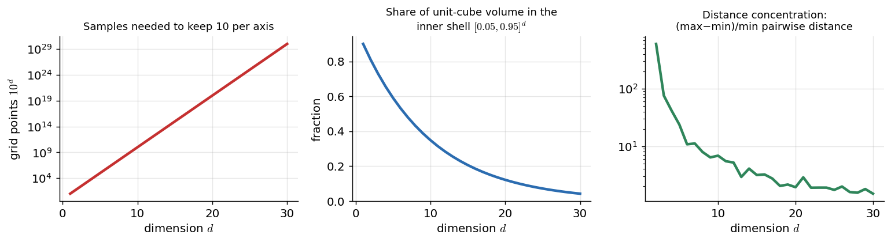
*Figure 15 — Left: the number of samples needed explodes. Middle: most of a cube's volume lies near its surface. Right: distances between random points become nearly equal as $d$ grows.*

### Effects
1. **Data sparsity** — points become isolated; you need exponentially more data to cover the space.
2. **Computational cost** — e.g., nearest-neighbour search becomes expensive.
3. **Distance concentration** — distances between points become almost equal, so Euclidean distance loses discriminative power.
4. **Overfitting** — more parameters than the data can support; the model fits noise.
5. **Visualisation difficulty** — we can only see up to 3-D.

### Mitigation

| Strategy | Examples |
|---|---|
| **Dimensionality reduction** | **PCA** (max variance), **LDA** (max class separation), **t-SNE** (non-linear, for visualisation) |
| **Feature selection** | Statistical tests, correlation analysis, domain knowledge |
| **Regularisation** | Lasso (L1), Ridge (L2) |
| **Ensembles** | Random forests, gradient boosting |
| **Better data** | More data, stratified sampling |

**Where it matters:** images (each pixel is a dimension; CNNs help), text (word vectors; PCA/t-SNE), genomics (thousands of genes).
**Link to curve fitting:** a degree-$M$ polynomial in $D$ variables has on the order of $D^{M}$ coefficients — it grows very fast with $D$.

---

## 13. Polynomial curve fitting

**Model:**

$$y=a_0+a_1x+a_2x^{2}+\cdots+a_nx^{n}+\epsilon=\sum_{j=0}^{n}a_jx^{j}+\epsilon$$

($y$ dependent, $x$ independent, $a_j$ coefficients, $n$ the degree, $\epsilon$ error.) It is **linear in the coefficients** even though non-linear in $x$.

### Least squares
Minimise the sum-of-squares error:

$$E(\mathbf a)=\sum_{i=1}^{N}\big(y_i-\hat y_i\big)^{2}\qquad\Big(\text{Bishop: } \tfrac12\sum_i\big(y(x_i,\mathbf w)-t_i\big)^2\Big)$$

Setting $\partial E/\partial a_j=0$ gives the **normal equations**:

$$
\begin{bmatrix}
N & \sum x_i & \cdots & \sum x_i^{n}\\
\sum x_i & \sum x_i^{2} & \cdots & \sum x_i^{n+1}\\
\vdots & \vdots & \ddots & \vdots\\
\sum x_i^{n} & \sum x_i^{n+1} & \cdots & \sum x_i^{2n}
\end{bmatrix}
\begin{bmatrix}a_0\\a_1\\\vdots\\a_n\end{bmatrix}
=
\begin{bmatrix}\sum y_i\\\sum x_iy_i\\\vdots\\\sum x_i^{n}y_i\end{bmatrix}
$$

In matrix form with the design matrix $\Phi$ (row $i$ = $[1,x_i,x_i^2,\dots,x_i^n]$):

$$\mathbf a=(\Phi^{T}\Phi)^{-1}\Phi^{T}\mathbf y\qquad\qquad E_{\text{RMS}}=\sqrt{\frac{E}{N}}$$

### Choosing the degree $n$ (the central issue)

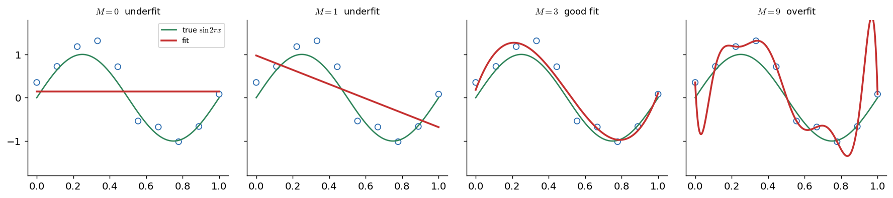
*Figure 16 — Data from $\sin(2\pi x)$ plus noise. $M=0,1$ underfit; $M=3$ fits well; $M=9$ passes through every point but oscillates wildly (overfit).*

- Low degree → **underfits** (high bias).
- High degree → hits every training point but wiggles → **overfits** (high variance). With $N$ points, degree $N-1$ fits them *exactly* (zero training error, terrible generalisation).
- Tools: **cross-validation**, **regularisation**, more data, choosing $n$ by validation error.

```python
import numpy as np
x = np.linspace(0, 1, 10)
y = np.sin(2*np.pi*x) + np.random.normal(0, 0.1, x.shape)
coef = np.polyfit(x, y, deg=3)      # least-squares polynomial fit
```

**Applications:** physics (experimental data), economics (trends), engineering (system modelling), biology (growth).
**Pros:** simple, flexible. **Cons:** overfitting, poor extrapolation, explodes in high dimensions.

---

## 14. Model complexity

**Model complexity** = capacity of a model to capture intricate patterns — roughly the number of free parameters/flexibility (polynomial degree, tree depth, number of hidden units).

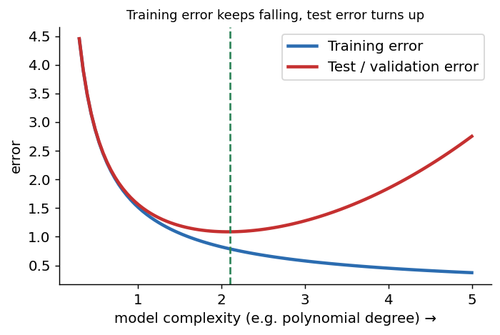
*Figure 18 — Training error always falls with complexity; test error falls and then rises. Choose the complexity at the minimum of the test/validation error.*

| | Underfitting | Overfitting |
|---|---|---|
| Model | Too simple | Too complex |
| Training error | High | Very low |
| Test error | High | High |
| Bias / variance | **High bias**, low variance | Low bias, **high variance** |
| Cure | More complex model / more features | Regularise, more data, simpler model, cross-validation |

### Bias–variance trade-off
- **Bias:** error from simplifying assumptions (misses relevant relations).
- **Variance:** sensitivity to fluctuations in the training set (models the noise).

$$\mathbb{E}[\text{error}]=\text{Bias}^{2}+\text{Variance}+\text{Irreducible noise}$$

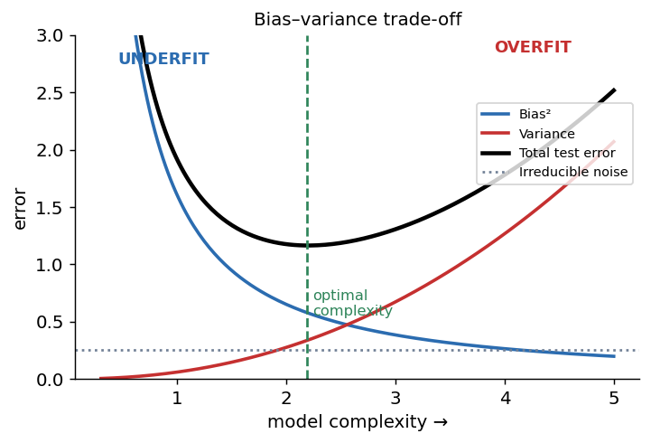
*Figure 17*

### Regularisation (penalise complexity)

$$\text{Ridge (L2):}\quad E(\mathbf w)+\frac{\lambda}{2}\sum_j w_j^{2}\qquad\qquad \text{Lasso (L1):}\quad E(\mathbf w)+\lambda\sum_j|w_j|$$

- **Ridge:** shrinks coefficients, discourages large weights.
- **Lasso:** drives some weights to exactly 0 → sparse model / built-in feature selection.
- **Elastic Net:** combines L1 + L2 (sparsity + handles collinear features).
- Larger $\lambda$ → simpler model.

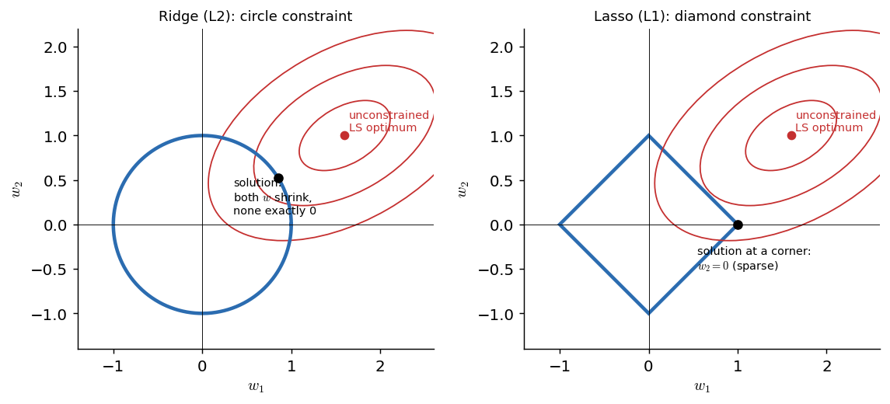
*Figure 20 — The L1 "diamond" has corners on the axes, so the solution often lands where a weight is exactly 0; the L2 circle only shrinks.*

### Cross-validation (estimates generalisation)
- **Hold-out:** train/validation/test split.
- **k-fold:** split into $k$ folds; train on $k-1$, validate on 1; repeat $k$ times; average the scores (common $k=5$ or $10$).
- **Leave-one-out (LOOCV):** $k=N$.

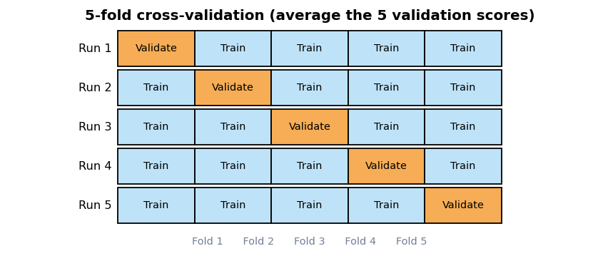
*Figure 19*

Use it to choose the polynomial degree, $\lambda$, etc.

---

## 15. Multivariate non-linear functions

**Definition:** functions of **several variables** whose relationship to the output is **not a linear combination** of the inputs — they can capture interactions between features.

**Examples**
1. **Polynomial regression with interaction terms:** $y=a_0+a_1x_1+a_2x_2+a_3x_1^{2}+a_4x_1x_2+a_5x_2^{2}$
2. **Neural networks:** layers with non-linear activations; approximate very complex functions.
3. **SVM with non-linear kernels** (polynomial, RBF, sigmoid): implicitly map to a space where data is linearly separable.
4. (Also decision trees, k-NN, kernel methods.)

| Challenge | Solution |
|---|---|
| Overfitting | Regularisation, cross-validation, pruning |
| Computational cost | Efficient algorithms, parallelism, dimensionality reduction |
| Poor interpretability | Simpler models when possible; SHAP, LIME |
| Curse of dimensionality | Feature selection / reduction |

---

## 16. Bayes' theorem

$$P(A\mid B)=\frac{P(B\mid A)\,P(A)}{P(B)}\qquad\Longleftrightarrow\qquad \text{Posterior}=\frac{\text{Likelihood}\times\text{Prior}}{\text{Evidence}}$$

Introduced in Rev. Thomas Bayes' essay (published posthumously in 1763, edited by Richard Price). It gives the probability of **causes given observed effects** (inverse probability).

**Pattern-recognition form** (class $\omega_j$, observation $x$):

$$P(\omega_j\mid x)=\frac{p(x\mid\omega_j)\,P(\omega_j)}{\sum_{k}p(x\mid\omega_k)\,P(\omega_k)}$$

### Worked example — medical test
Sensitivity = 0.99, specificity = 0.99, prevalence = 0.1 %:
$P(D)=0.001,\ P(\neg D)=0.999,\ P(+\mid D)=0.99,\ P(+\mid\neg D)=0.01.$

$$P(+)=0.99\cdot0.001+0.01\cdot0.999=0.01098$$

$$P(D\mid +)=\frac{0.99\times0.001}{0.01098}\approx0.0902\ \ (\approx 9\%)$$

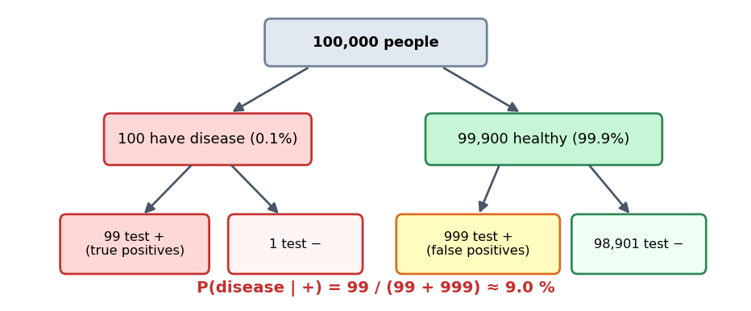
*Figure 22 — The same calculation as natural frequencies: 99 true positives are swamped by 999 false positives.*

**Lesson:** even an accurate test gives a low posterior when the disease is rare — **the prior (base rate) matters**.

**Applications:** medical diagnosis, spam filtering, Naïve Bayes / Bayesian inference, finance.
**Bayesian inference:** prior (belief before data) × likelihood (probability of data given parameters) → **posterior** (updated belief). Contrasts with *frequentist* inference (long-run frequencies).
**Advantages:** flexible, intuitive, uses prior knowledge. **Limitations:** computationally heavy, subjective prior.

---

## 17. Decision boundaries

**Definition:** a **hypersurface** in feature space that partitions it into regions, each assigned to one class — a line (2-D), plane (3-D) or hyperplane (higher-D). It is where the discriminants tie: $g_i(x)=g_j(x)$.

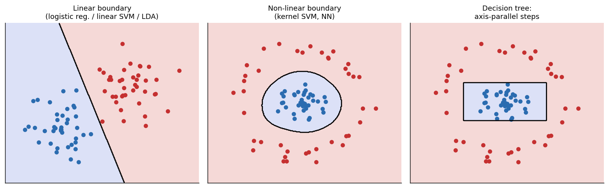
*Figure 23 — Linear boundary vs curved boundary vs the axis-parallel steps of a decision tree.*

| | Linear | Non-linear |
|---|---|---|
| Shape | Straight line/plane/hyperplane | Curved, complex |
| Models | Logistic regression, linear SVM, LDA/Fisher, perceptron | Decision trees, random forests, NNs, kernel SVM, k-NN |
| Risk | Underfitting if classes aren't linearly separable | Overfitting; hard to interpret |

**Importance:** determines accuracy and generalisation. **Visualising** boundaries helps model selection (linear vs non-linear), evaluation (uncertain/error-prone regions) and improvement (collect more data where the boundary is uncertain).
**Applications:** image classification, fraud detection, voice recognition, medical imaging.

**[+] Bayes boundary for Gaussians:** equal covariances → **linear** boundary; unequal covariances → **quadratic** boundary.

---

## 18. Parametric methods

**Definition:** assume the data follow a distribution of **known form with a finite set of parameters** $\theta$ (e.g., $\mathcal N(\mu,\sigma^2)$); learning = estimating $\theta$. The number of parameters does not grow with the data.

**Assumptions:** the chosen family (normal, binomial, Poisson …) is correct. If it is, estimates are accurate even with few samples; if not, they are biased.

### Common estimation methods
1. **Maximum Likelihood Estimation (MLE):** pick $\theta$ that maximises the likelihood of the data.

$$\hat\theta_{\text{ML}}=\arg\max_{\theta}\ p(\mathcal D\mid\theta)=\arg\max_\theta\sum_{n}\ln p(x_n\mid\theta)$$

   For a Gaussian:
$$\hat\mu=\frac1N\sum_{n=1}^{N}x_n,\qquad \hat\sigma^{2}=\frac1N\sum_{n=1}^{N}(x_n-\hat\mu)^2\quad(\text{unbiased version divides by }N-1)$$

2. **Least-squares estimation:** minimise squared error (regression); equals MLE under Gaussian noise.
3. **Bayesian estimation:** combine a **prior over parameters** with the data to get a **posterior**:

$$p(\theta\mid\mathcal D)\;\propto\;p(\mathcal D\mid\theta)\,p(\theta)$$

| | Parametric | Non-parametric |
|---|---|---|
| Parameters | Fixed number | Grow with the data |
| Examples | Linear/logistic regression, Gaussian classifiers, NB | k-NN, Parzen windows, kernel methods |
| Strength | Simple, interpretable, data-efficient | Flexible, fewer assumptions |

---

## 19. Sequential parameter estimation

**Definition:** update the parameter estimate **one observation at a time** as new data arrive, without re-processing old data. Also called **online learning** / recursive estimation; used for streaming data and real-time systems.
**Sequential analysis:** evaluate data as it is collected and decide at each step (no fixed sample size).

### Simple derivation (the mean) [+]

$$\mu_N=\frac1N\sum_{n=1}^{N}x_n=\mu_{N-1}+\frac1N\big(x_N-\mu_{N-1}\big)$$

New estimate = old estimate + (1/N) × error. This "old + step × error" form generalises to the **Robbins–Monro** procedure and to **stochastic gradient descent**: $\theta\leftarrow\theta-\eta\nabla L$.

### Techniques

| Technique | Use |
|---|---|
| **Recursive Least Squares (RLS)** | Update least-squares parameters as each point arrives |
| **Kalman filter** | Estimate the state of a dynamic system by combining model predictions with noisy measurements |
| **Stochastic Gradient Descent (SGD)** | Update weights from the gradient on one sample / mini-batch |

### Kalman filter
Components: state $x_k$, process model $A$, control $Bu_k$, measurement model $H$, process noise $Q$, measurement noise $R$.

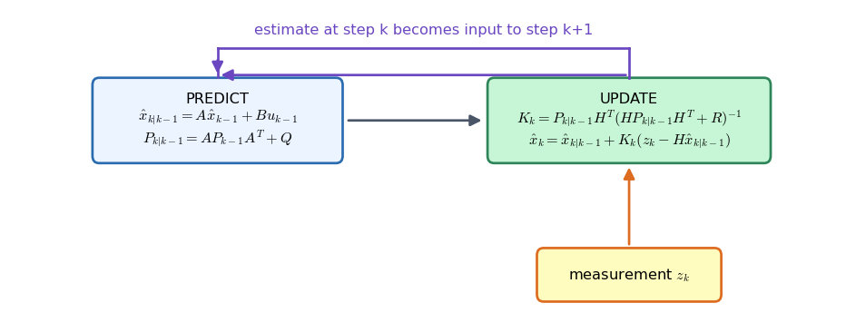
*Figure 26*

**Predict:**
$$\hat x_{k|k-1}=A\,\hat x_{k-1|k-1}+B\,u_{k-1}$$
$$P_{k|k-1}=A\,P_{k-1|k-1}\,A^{T}+Q$$

**Update:**
$$K_k=P_{k|k-1}H^{T}\big(HP_{k|k-1}H^{T}+R\big)^{-1}\qquad(\text{Kalman gain})$$
$$\hat x_{k|k}=\hat x_{k|k-1}+K_k\big(z_k-H\hat x_{k|k-1}\big)\qquad(z_k=\text{measurement})$$
$$P_{k|k}=(I-K_kH)\,P_{k|k-1}$$

**Advantages:** real-time, memory-efficient, adaptive. **Limitations:** tuning is complex, sensitive to noise, relies on model/noise assumptions.
**Applications:** algorithmic trading, robotics, patient monitoring.

---

## 20. Linear discriminant functions

**Definition:** a classifier built from a **linear function of the features**:

$$g(\mathbf x)=\mathbf w^{T}\mathbf x+w_0=w_0+w_1x_1+\cdots+w_dx_d$$

($\mathbf w$ = weight vector, $w_0$ = bias/threshold.)

**Two classes:** decide $\omega_1$ if $g(\mathbf x)>0$, $\omega_2$ if $g(\mathbf x)<0$; $g(\mathbf x)=0$ is the decision boundary (a hyperplane). $\mathbf w$ is **normal (perpendicular)** to the hyperplane, and the signed distance of $\mathbf x$ from it is

$$r=\frac{g(\mathbf x)}{\lVert\mathbf w\rVert}$$

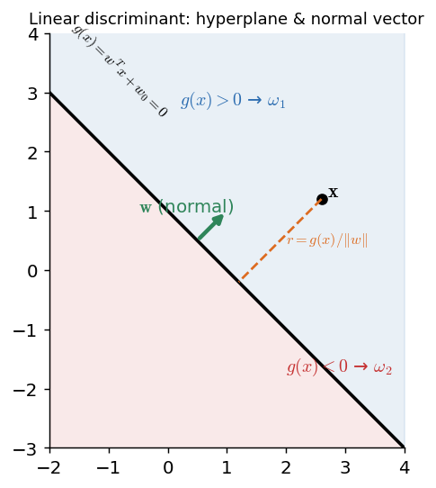
*Figure 24*

**C classes [+]:** $g_i(\mathbf x)=\mathbf w_i^{T}\mathbf x+w_{i0}$; assign $\mathbf x$ to the class with the largest $g_i$ (decision regions are convex).
**Learning $\mathbf w$:** perceptron rule, least squares, logistic regression, linear SVM, Fisher's criterion.
**Limits:** only linear boundaries → cannot solve XOR-type problems without feature transforms.

### Linear Discriminant Analysis (LDA) — Fisher, 1936
- Projects high-dimensional data to a lower-dimensional space that **maximises class separation** (distance between class means) while **minimising within-class scatter**.
- As a *generative classifier*: assumes each class is **Gaussian with a shared covariance matrix** and applies Bayes' theorem → linear boundary.
- **Advantages:** simple, efficient, interpretable. **Limitations:** assumes normality and equal covariances; linear boundaries only; sensitive to outliers.
- **Applications:** face recognition, medical diagnosis, customer segmentation.

---

## 21. Fisher's linear discriminant (FLD)

**Idea:** project the $d$-dimensional data onto a line $y=\mathbf w^{T}\mathbf x$ so that the projected classes are **as far apart as possible relative to their spread** — maximise the ratio of **between-class variance** to **within-class variance**.

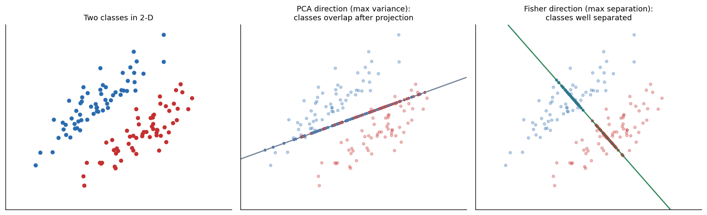
*Figure 25 — PCA picks the direction of largest variance and the classes overlap; Fisher picks the direction that separates them.*

### Steps (multi-class form from your notes)

1. **Class means:** $\displaystyle \boldsymbol\mu_k=\frac1{N_k}\sum_{i\in k}\mathbf x_i$
2. **Within-class scatter:** $\displaystyle S_W=\sum_{k=1}^{K}\sum_{i\in k}(\mathbf x_i-\boldsymbol\mu_k)(\mathbf x_i-\boldsymbol\mu_k)^{T}$
3. **Between-class scatter:** $\displaystyle S_B=\sum_{k=1}^{K}N_k(\boldsymbol\mu_k-\boldsymbol\mu)(\boldsymbol\mu_k-\boldsymbol\mu)^{T}$  ($\boldsymbol\mu$ = overall mean)
4. **Solve** the generalised eigenproblem: $S_W^{-1}S_B\,\mathbf w=\lambda\,\mathbf w$
5. **Select** the eigenvectors with the largest eigenvalues → matrix $W$
6. **Project:** $\mathbf y=W^{T}\mathbf x$

### Two-class special case (exam favourite)
Fisher criterion:

$$J(\mathbf w)=\frac{(\tilde m_2-\tilde m_1)^2}{\tilde s_1^{2}+\tilde s_2^{2}}=\frac{\mathbf w^{T}S_B\,\mathbf w}{\mathbf w^{T}S_W\,\mathbf w},\qquad S_B=(\mathbf m_2-\mathbf m_1)(\mathbf m_2-\mathbf m_1)^{T},\quad S_W=S_1+S_2$$

Maximising $J$ gives the closed-form direction (only the direction matters):

$$\boxed{\ \mathbf w\;\propto\;S_W^{-1}(\mathbf m_2-\mathbf m_1)\ }$$

Then classify by thresholding $\mathbf w^{T}\mathbf x$ (e.g., the midpoint of the projected class means).
**Number of useful projection dimensions:** at most $C-1$ for $C$ classes (rank of $S_B$).

### Worked numeric example [+]
Class 1: (4,1), (2,4), (2,3), (3,6), (4,4) → $\mathbf m_1=(3,\ 3.6)$
Class 2: (9,10), (6,8), (9,5), (8,7), (10,8) → $\mathbf m_2=(8.4,\ 7.6)$

$$S_1=\begin{bmatrix}4&-2\\-2&13.2\end{bmatrix},\quad S_2=\begin{bmatrix}9.2&-0.2\\-0.2&13.2\end{bmatrix},\quad S_W=S_1+S_2=\begin{bmatrix}13.2&-2.2\\-2.2&26.4\end{bmatrix}$$

$$\mathbf w\propto S_W^{-1}(\mathbf m_1-\mathbf m_2)\approx(-0.44,\ -0.19)\ \ \to\ \ \text{normalised}\ \approx(-0.92,\ -0.39)$$

(With $\mathbf m_2-\mathbf m_1$ the sign flips; the line is the same.) The projected class means (using the un-normalised $\mathbf w$) are ≈ −2.0 and ≈ −5.1 — well separated.

**FLD vs PCA:** PCA is *unsupervised* (max variance, ignores labels); FLD is *supervised* (max class separability). **FLD vs LDA:** the terms are often used interchangeably (strictly, LDA adds the Gaussian/equal-covariance assumptions for classification).
**Pros:** simple, efficient, interpretable. **Cons:** needs roughly normal classes with similar covariances; linear only; $S_W$ can be singular when features > samples; sensitive to outliers.
**Applications:** face recognition (Fisherfaces), medical diagnosis, marketing segmentation.

---

## 22. Feed-forward network mappings

**Feed-forward neural network (FNN) / multilayer perceptron (MLP):** connections go **only forward** (no cycles). Maps inputs to outputs through layers; used for classification, regression and function approximation. (See Figure 8.)

### Structure
- **Input layer:** one neuron per feature.
- **Hidden layers:** weighted sums + non-linear activations (sigmoid, tanh, ReLU).
- **Output layer:** one neuron per class (classification) or per output value (regression).

### Mathematics

$$z_j=\sum_{i=1}^{n}w_{ij}\,x_i+b_j\qquad\qquad a_j=\sigma(z_j)\qquad\qquad \mathbf y=f(\mathbf x;\boldsymbol\theta)$$

($\boldsymbol\theta$ = all weights and biases.) For a two-layer network:

$$y_k=\sigma\!\Big(\sum_{j=1}^{M}w^{(2)}_{kj}\;h\Big(\sum_{i=1}^{D}w^{(1)}_{ji}x_i+w^{(1)}_{j0}\Big)+w^{(2)}_{k0}\Big)$$

- With **linear** activations everywhere, the whole network is just one linear map. The **non-linear** hidden units give non-linear mappings.
- **[+] Universal approximation:** one hidden layer with enough non-linear units can approximate any continuous function on a compact domain arbitrarily well.

### Training (backpropagation + gradient descent)
1. **Forward pass** → outputs.
2. **Loss:** MSE (regression) / cross-entropy (classification).
3. **Backward pass:** gradient of the loss w.r.t. every weight via the chain rule.
4. **Update** ($\eta$ = learning rate):

$$\boldsymbol\theta\leftarrow\boldsymbol\theta-\eta\,\nabla_{\boldsymbol\theta}L$$

**Pros:** versatile, models complex non-linear relations, scalable. **Cons:** expensive training, **overfits** (use regularisation, dropout, early stopping), black box.
**Applications:** image recognition, NLP (sentiment, translation, classification), financial forecasting.

---

# REVISION AIDS

## A. One-page formula sheet

| Topic | Formula |
|---|---|
| Entropy | $H=-\sum p_i\log_2 p_i$ |
| Information gain | $H(S)-\sum_v\frac{\lvert S_v\rvert}{\lvert S\rvert}H(S_v)$ |
| Gini | $1-\sum p_i^2$ |
| Bayes | $P(A\mid B)=\dfrac{P(B\mid A)P(A)}{P(B)}$ |
| Naïve Bayes | $\hat y=\arg\max_y P(y)\prod_i P(x_i\mid y)$ |
| Gaussian likelihood | $\dfrac{1}{\sqrt{2\pi\sigma^2}}e^{-(x-\mu)^2/2\sigma^2}$ |
| Laplace smoothing | $\dfrac{\text{count}+\alpha}{N+\alpha K}$ |
| Log trick | $\log P(y)+\sum_i\log P(x_i\mid y)$ |
| Dichotomizer | $g(x)=\ln\frac{p(x\mid\omega_1)}{p(x\mid\omega_2)}+\ln\frac{P(\omega_1)}{P(\omega_2)}$ |
| k-NN (regression) | $f(x_q)=\frac1k\sum f(x_i)$ |
| RBF kernel | $e^{-d^2/2\sigma^2}$ or $e^{-\gamma\lVert x-z\rVert^2}$ |
| SVM hard margin | $\min\frac12\lVert w\rVert^2\ \text{s.t.}\ t_i(w^Tx_i+b)\ge1$ |
| SVM soft margin | $\min\frac12\lVert w\rVert^2+C\sum\zeta_i$ |
| SVM margin | $2/\lVert w\rVert$ |
| Min–max normalisation | $\frac{x-x_{\min}}{x_{\max}-x_{\min}}$ |
| Standardisation | $\frac{x-\mu}{\sigma}$ |
| Sum-of-squares error | $E=\sum(y_i-\hat y_i)^2$ |
| Normal equation | $\mathbf a=(\Phi^T\Phi)^{-1}\Phi^T\mathbf y$ |
| Ridge / Lasso | $E+\frac\lambda2\sum w^2$ / $E+\lambda\sum\lvert w\rvert$ |
| Expected error | $\text{Bias}^2+\text{Variance}+\text{Noise}$ |
| MLE (Gaussian) | $\hat\mu=\bar x,\ \hat\sigma^2=\frac1N\sum(x-\hat\mu)^2$ |
| Sequential mean | $\mu_N=\mu_{N-1}+\frac1N(x_N-\mu_{N-1})$ |
| Linear discriminant | $g(\mathbf x)=\mathbf w^T\mathbf x+w_0$ |
| Fisher criterion | $J=\frac{\mathbf w^TS_B\mathbf w}{\mathbf w^TS_W\mathbf w}$,  $\mathbf w\propto S_W^{-1}(\mathbf m_2-\mathbf m_1)$ |
| Neuron | $a=\sigma(\sum w_ix_i+b)$ |
| Gradient descent | $\theta\leftarrow\theta-\eta\nabla L$ |

## B. Quick comparison tables

**Decision tree vs rule induction vs Naïve Bayes**

| | Decision tree | Rule induction | Naïve Bayes |
|---|---|---|---|
| Output | Tree | IF-THEN rules | Class probabilities |
| Search | Greedy recursive splitting | Sequential covering | None (counting) |
| Interpretable | Yes | Yes (very) | Moderate |
| Weakness | Overfits, unstable | Large rule space | Independence assumption, zero probabilities |

**Eager vs lazy learners**

| | Eager (tree, NN, SVM, NB) | Lazy / instance-based (k-NN, CBR, LWR) |
|---|---|---|
| Training | Builds a model up-front | Just stores data |
| Query | Fast | Slow, $O(n)$ |
| Generalisation | Global model | Local approximation |

**PCA vs LDA/FLD**

| | PCA | LDA / FLD |
|---|---|---|
| Supervised? | No | Yes |
| Objective | Maximise variance | Maximise between/within class variance ratio |
| Max components | $\min(d,N)$ | $C-1$ |

**Underfit / good fit / overfit** — training error: high / low / very low. Test error: high / low / high.

## C. Likely exam questions (answer outlines)

### Q1 (compulsory, short answers) — be ready to write 2–3 lines on:
Rule induction · entropy & information gain · why "naïve" in Naïve Bayes · Laplace correction · log-probability trick · lazy learning · kernel trick · hard vs soft margin · role of $C$ · GA terminology · supervised vs unsupervised learning · curse of dimensionality · overfitting vs underfitting · bias–variance · L1 vs L2 regularisation · k-fold CV · Bayes' theorem terms · linear vs non-linear decision boundary · MLE · Kalman filter · Fisher criterion · activation functions · backpropagation.

### Unit 1 long questions (15 marks)
1. **Explain rule induction. How are rules extracted from decision trees? Benefits and limitations.** → §2
2. **Decision-tree induction (ID3/C4.5/CART); entropy and information gain; pros/cons.** (Add a small entropy/gain calculation.) → §3
3. **Derive the Naïve Bayes classifier; state the assumptions; solve a numerical.** → §4
4. **NB for numeric attributes; zero-probability / no-match problem; Laplace correction with example; effect of $\alpha$; underflow and the log trick.** → §5–6
5. **Bayesian decision theory: two-category rule, discriminant functions, dichotomizer.** → §7.1
6. **Neural networks (forward/backprop, learning types) or Genetic algorithms (terminology, operators, flow, pros/cons).** → §8.1–8.2
7. **Instance-based learning: k-NN, locally weighted regression, RBF networks, CBR.** → §8.3
8. **SVM: margin, support vectors, hard/soft margin, kernels, primal and dual formulation.** → §8.4

### Unit 2 long questions (15 marks)
1. **Statistical pattern recognition: pipeline; classification vs regression; features, feature vectors, classifiers.** → §9–10
2. **Pre-processing and feature extraction** (cleaning, normalisation vs standardisation, encoding, PCA). → §11
3. **Curse of dimensionality: effects and mitigation.** → §12
4. **Polynomial curve fitting: model, least squares, normal equations, degree, overfitting, regularisation.** → §13–14
5. **Bias–variance trade-off, regularisation, cross-validation.** → §14
6. **State Bayes' theorem; medical-test numerical; Bayesian inference.** → §16
7. **Decision boundaries (linear vs non-linear) with examples/applications.** → §17
8. **Parametric methods (MLE, Bayesian estimation) and sequential parameter estimation (RLS, Kalman, SGD).** → §18–19
9. **Linear discriminant functions and Fisher's linear discriminant — derive the criterion, steps, pros/cons.** → §20–21
10. **Feed-forward networks: structure, equations, backpropagation, applications.** → §22

## D. Last-minute checklist

- [ ] Can I write Bayes' theorem and name all four terms?
- [ ] Can I do a Naïve Bayes numerical end-to-end (and normalise correctly)?
- [ ] Do I know *why* and *how* Laplace smoothing fixes zero probability, and what $\alpha$ does?
- [ ] Can I compute entropy and information gain for a small table?
- [ ] Can I list the GA terms (population → allele, genotype/phenotype) and draw the GA flowchart?
- [ ] Can I explain hard vs soft margin, $C$, support vectors and kernels?
- [ ] Do I know the 5 effects of the curse of dimensionality and 5 remedies?
- [ ] Can I explain overfitting using polynomial degree + bias–variance + regularisation?
- [ ] Can I define $S_W$, $S_B$ and write Fisher's criterion and the two-class solution?
- [ ] Can I write the forward and backward passes of a feed-forward network?

*Good luck with the exam!*
