# Pattern Recognition & Computer Vision (ML-411T) — Unit 3 & Unit 4 Revision Notes

> **Exam format (from your syllabus handbook):** 75 marks. **Q1 is compulsory** and covers the *whole* syllabus (15 marks of short answers). Each unit has two questions and you attempt **one** (15 marks per unit, up to 5 sub-parts).
>
> **Sources:** the Unit 3 and Unit 4 chapters inside your `PRCV_End_Sem.pdf` (many of its formulas and tables were images that did not extract, so I rebuilt them from the standard textbooks: Davies *Computer & Machine Vision*, Gonzalez & Woods, Baggio *Mastering OpenCV*).
> **[+]** = my addition from standard textbooks. **⚠ Fix** = your source has an error here — don't copy it into an exam answer.
>
> **Maths:** formulas are LaTeX (`$…$` inline, `$$…$$` display). They render in Typora, Obsidian, VS Code (Markdown Preview), GitHub, Jupyter, Notion. All diagrams are **generated by running the real algorithms** (filters, Canny, Harris, SIFT, thinning, snakes …) so the pictures show genuine behaviour. Every numerical example below was recomputed with code.

---

## Table of contents

**UNIT 3 — Image processing, features, morphology, texture**
1. Review of image processing techniques
2. Classical filtering operations
3. Thresholding techniques
4. Edge detection techniques
5. Corner and interest point detection
6. Mathematical morphology
7. Texture

**UNIT 4 — Shape analysis**
8. Binary shape analysis
9. Connectedness
10. Object labelling and counting
11. Size filtering
12. Distance functions
13. Skeletons and thinning
14. Deformable shape analysis
15. Boundary tracking procedures
16. Active contours (snakes)
17. Shape models and shape recognition
18. Centroidal profiles
19. Handling occlusion
20. Boundary length measures
21. Boundary descriptors
22. Chain codes
23. Fourier descriptors
24. Region descriptors
25. Moments

**Revision aids:** formula sheet · comparison tables · likely exam questions · checklist

---

# UNIT 3

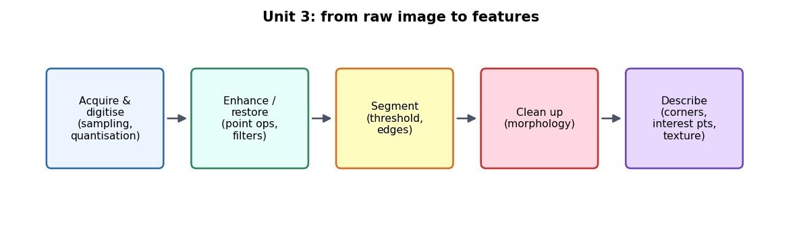
*Figure 3.0 — How the Unit 3 topics fit together.*

## 1. Review of image processing techniques

### 1.1 Basic concepts
- **Image:** a 2-D function $f(x,y)$; $x,y$ are spatial coordinates and $f$ is the intensity (gray level) at that point.
- **Digital image:** $f$ sampled on an $M\times N$ grid with finite gray levels. Each element is a **pixel**.
- **Sampling** = discretising the image in *space* (how many pixels). **Quantisation** = discretising *intensity* into $L=2^k$ levels ($k$ bits per pixel).

$$\text{storage}=M\times N\times k\ \text{bits}$$

- **Image formation model [+]:** $f(x,y)=i(x,y)\,r(x,y)$, illumination × reflectance, with $0<i<\infty$, $0<r<1$.

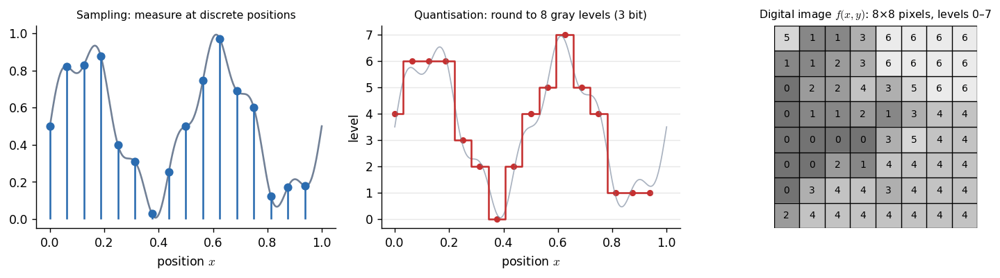
*Figure 3.1 — Sampling picks positions, quantisation rounds values to $L$ levels; the result is a matrix of integers.*

### 1.2 Image enhancement (improve quality for analysis)

**Spatial-domain methods** operate directly on pixels: $g(x,y)=T[f(x,y)]$.

| Point operation | Formula | Effect |
|---|---|---|
| Negative | $s=(L-1)-r$ | Inverts intensities |
| Log transform | $s=c\log(1+r)$ | Expands dark values |
| Power-law (gamma) | $s=c\,r^{\gamma}$ | $\gamma<1$ brightens, $\gamma>1$ darkens |
| Contrast stretching | $s=\dfrac{r-r_{\min}}{r_{\max}-r_{\min}}(L-1)$ | Uses full dynamic range |
| **Histogram equalisation** | $s_k=(L-1)\sum_{j=0}^{k}p_r(r_j)$ | Flattens the histogram → better contrast |

with $p_r(r_j)=n_j/(MN)$ (normalised histogram).

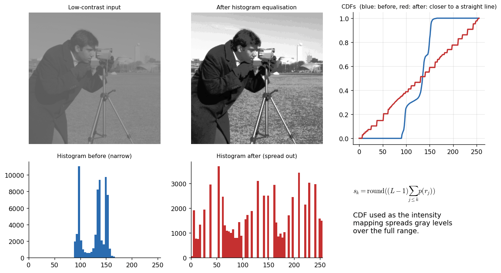
*Figure 3.2 — A low-contrast image (narrow histogram) is spread over the whole range; the CDF becomes close to a straight line.*

**Worked example — histogram equalisation (3-bit image, $L=8$, 4×4 pixels)**

$$\begin{bmatrix}1&2&3&4\\4&3&2&1\\1&1&2&5\\7&6&5&3\end{bmatrix}$$

| gray level $r_k$ | 0 | 1 | 2 | 3 | 4 | 5 | 6 | 7 |
|---|---|---|---|---|---|---|---|---|
| count $n_k$ | 0 | 4 | 3 | 3 | 2 | 2 | 1 | 1 |
| $p_r$ | 0 | 0.25 | 0.1875 | 0.1875 | 0.125 | 0.125 | 0.0625 | 0.0625 |
| CDF | 0 | 0.25 | 0.4375 | 0.625 | 0.75 | 0.875 | 0.9375 | 1 |
| $s_k=\text{round}(7\cdot\text{CDF})$ | 0 | 2 | 3 | 4 | 5 | 6 | 7 | 7 |

Mapping $1\to2,\ 2\to3,\ 3\to4,\ 4\to5,\ 5\to6,\ 6\to7,\ 7\to7$ gives

$$\begin{bmatrix}2&3&4&5\\5&4&3&2\\2&2&3&6\\7&7&6&4\end{bmatrix}$$

**Frequency-domain methods** operate on the Fourier spectrum (low-pass, high-pass, band-pass; see §2).

### 1.3 Image restoration (recover the original from a degraded image)
Degradation model: $g(x,y)=h(x,y)*f(x,y)+\eta(x,y)$, i.e. in frequency $G=HF+N$.
- **Noise models:** Gaussian, salt-and-pepper (impulse), uniform, Rayleigh, … (periodic noise → notch filter).
- **Inverse filtering:** $\hat F(u,v)=\dfrac{G(u,v)}{H(u,v)}$ — amplifies noise where $H\approx0$.
- **Wiener filtering** (minimum mean-square error, balances deblurring and noise):

$$\hat F(u,v)=\left[\frac{1}{H(u,v)}\cdot\frac{|H(u,v)|^{2}}{|H(u,v)|^{2}+K}\right]G(u,v),\qquad K=\frac{S_\eta}{S_f}$$

### 1.4 Colour image processing
- **RGB:** additive model used by screens/cameras (cube). **HSV/HSI:** Hue, Saturation, Value/Intensity — separates colour from brightness, closer to human perception (good for colour segmentation).
- **CMY(K):** subtractive model for printing.
- **Gray conversion [+]:** $Y=0.299R+0.587G+0.114B$.
- **Applications:** colour-based segmentation/object detection, enhancing a colour range.

### 1.5 Other building blocks
- **Segmentation:** thresholding, edge-based (Sobel/Prewitt/Canny), region-based (region growing, split-and-merge, watershed).
- **Morphology:** erosion, dilation, opening, closing (§6).
- **Feature extraction:** texture (GLCM), shape (contours, area, perimeter, circularity), edge (gradient).
- **Compression:** $C_R=n_1/n_2$ (original/compressed size). *Lossless:* Huffman, run-length encoding. *Lossy:* JPEG (block DCT + quantisation), wavelet (JPEG-2000).
- **Applications:** medical imaging (MRI/CT), remote sensing, face recognition, surveillance.

---

## 2. Classical filtering operations

Filtering enhances images, removes noise, or extracts features. Two domains: **spatial** (neighbourhood operations) and **frequency** (Fourier).

### 2.1 Spatial-domain filtering
A mask $w$ of size $(2a+1)\times(2b+1)$ slides over the image.

$$\text{Correlation: } g(x,y)=\sum_{s=-a}^{a}\sum_{t=-b}^{b}w(s,t)\,f(x+s,\,y+t)$$

**Convolution** is the same with the mask flipped, $w(-s,-t)$ (identical for symmetric masks).

**Linear filters**

| Filter | Mask / formula | Purpose |
|---|---|---|
| **Mean (box)** | $\dfrac19\begin{bmatrix}1&1&1\\1&1&1\\1&1&1\end{bmatrix}$ | Smoothing, noise reduction (blurs edges) |
| **Gaussian** | $G(x,y)=\dfrac{1}{2\pi\sigma^2}e^{-\frac{x^2+y^2}{2\sigma^2}}$ | Smoothing with less blur/ringing; separable |
| **Laplacian** | $\begin{bmatrix}0&1&0\\1&-4&1\\0&1&0\end{bmatrix}$ | Second derivative → sharpening/edges |
| **Unsharp masking** | $g=f+k\,(f-\bar f)$, $k=1$ (unsharp), $k>1$ (high-boost) | Sharpening using the blurred copy $\bar f$ |

**Non-linear filters** (order-statistics)
- **Median:** replace by the median of the neighbourhood — kills **salt-and-pepper** noise and preserves edges.
- **Max filter** (brightens/dilates bright regions), **Min filter** (darkens/erodes), mode filter.

**Worked example — median vs mean** on the 3×3 window $\begin{bmatrix}10&12&11\\13&255&12\\11&10&13\end{bmatrix}$ (centre is an impulse):
mean = 38.6 (the outlier contaminates the result), **median = 12** (outlier ignored).

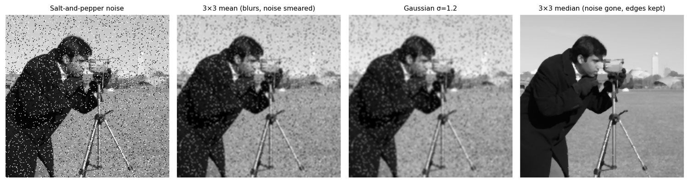
*Figure 3.3 — Mean and Gaussian smear the impulse noise; the median filter removes it and keeps edges sharp.*

| | Mean | Gaussian | Median |
|---|---|---|---|
| Type | linear | linear | non-linear |
| Best for | Gaussian-like noise | Gaussian noise, pre-smoothing | Salt-and-pepper noise |
| Edges | blurred | blurred less | **preserved** |

### 2.2 Frequency-domain filtering
Steps: transform $\to$ multiply by a filter $H$ $\to$ inverse transform. By the **convolution theorem**, convolution in space = multiplication in frequency.

$$F(u,v)=\sum_{x=0}^{M-1}\sum_{y=0}^{N-1}f(x,y)\,e^{-j2\pi(ux/M+vy/N)},\qquad G(u,v)=H(u,v)F(u,v),\qquad g=\mathcal F^{-1}\{G\}$$

With $D(u,v)$ the distance from the centre of the (shifted) spectrum and $D_0$ the cut-off:

| Filter | Low-pass $H_{LP}$ | High-pass |
|---|---|---|
| **Ideal** | $1$ if $D\le D_0$ else $0$ (causes **ringing**) | $H_{HP}=1-H_{LP}$ |
| **Butterworth** (order $n$) | $\dfrac{1}{1+[D/D_0]^{2n}}$ | $1-H_{LP}$ |
| **Gaussian** | $e^{-D^{2}/(2D_0^{2})}$ (no ringing) | $1-e^{-D^{2}/(2D_0^{2})}$ |

- **Low-pass:** removes high-frequency noise → smooth image (blur). **High-pass:** keeps edges/fine detail. **Band-pass:** passes a ring of frequencies (blocks others).

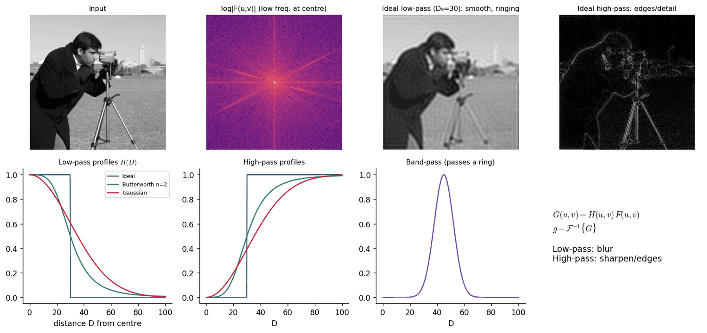
*Figure 3.4 — Spectrum (low frequencies at centre), ideal low-/high-pass results, and the radial profiles of the three filter families.*

### 2.3 Morphological filters
Erosion removes small white noise, dilation expands white regions, opening removes small objects, closing fills small holes (details in §6).

### 2.4 Applications
Noise reduction (mean/median), edge detection (Sobel, Prewitt, Laplacian), enhancement (unsharp masking), feature extraction (high-pass).

---

## 3. Thresholding techniques

**Thresholding** converts a gray image to a binary image — foreground vs background:

$$g(x,y)=\begin{cases}1 & f(x,y)>T\\ 0 & f(x,y)\le T\end{cases}$$

### 3.1 Types
| Type | Idea | When |
|---|---|---|
| **Global** | one $T$ for the whole image (manual, histogram valley, iterative, Otsu) | uniform illumination |
| **Local / adaptive** | $T(x,y)$ computed from each neighbourhood | uneven lighting |
| **Multi-level** | several thresholds $T_1<T_2<\dots$ → more than two regions | e.g. background / object / shadow |
| **Dynamic** | $T$ depends on position or local gradient | real-time, high variance |

### 3.2 Histogram-based and iterative (basic global thresholding)
- **Histogram valley:** choose $T$ at the valley between the two peaks of a bimodal histogram.
- **Iterative algorithm:** (1) initial $T$ (e.g. image mean); (2) split into $G_1$ ($>T$) and $G_2$ ($\le T$); (3) $m_1,m_2$ = mean of each group; (4) $T_{\text{new}}=\tfrac12(m_1+m_2)$; (5) repeat until $|T_{\text{new}}-T|<\varepsilon$.

### 3.3 Otsu's method (maximise between-class variance)
Let $p_i=n_i/(MN)$, $P_1(k)=\sum_{i\le k}p_i$, $P_2(k)=1-P_1(k)$, and the class means $m_1(k),m_2(k)$:

$$\sigma_B^2(k)=P_1(k)\,P_2(k)\,\big[m_1(k)-m_2(k)\big]^2,\qquad T^{*}=\arg\max_k\ \sigma_B^2(k)$$

Maximising $\sigma_B^2$ is equivalent to minimising the within-class variance $\sigma_W^2$ (total variance is fixed).
**Steps:** histogram & probabilities → compute $\sigma_B^2$ for every candidate $k$ → choose the maximum.

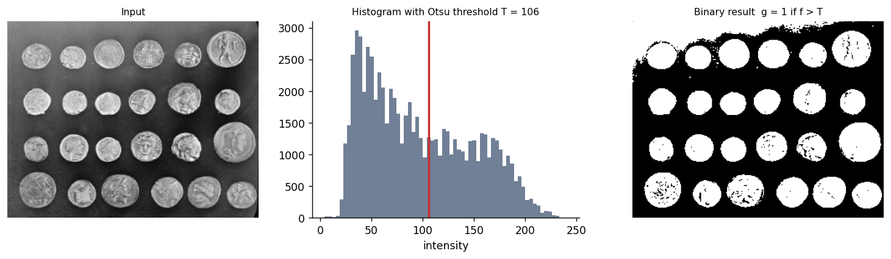
*Figure 3.5 — Otsu picks $T=106$ on the coins image; the red line splits the histogram into two classes.*

**Worked example — Otsu on a tiny histogram** (levels 0–5, counts $[8,10,2,1,9,10]$, $N=40$):

| $k$ | $P_1$ | $m_1$ | $m_2$ | $\sigma_B^2$ |
|---|---|---|---|---|
| 0 | 0.200 | 0.000 | 3.219 | 1.658 |
| 1 | 0.450 | 0.556 | 4.227 | 3.337 |
| **2** | **0.500** | **0.700** | **4.450** | **3.516** ← max |
| 3 | 0.525 | 0.810 | 4.526 | 3.445 |
| 4 | 0.750 | 1.767 | 5.000 | 1.960 |

→ **$T^*=2$** (the valley between the two modes).

### 3.4 Local (adaptive) thresholding
$$T(x,y)=\operatorname{mean}_{\mathcal N(x,y)}\big(f\big)-C\qquad(\text{or a Gaussian-weighted local mean})$$
- **Mean thresholding:** local mean; **Gaussian thresholding:** Gaussian-weighted local mean. [+] Other rules: Niblack $T=m+k\sigma$, Sauvola.
- Ideal for documents with shadows / uneven illumination.

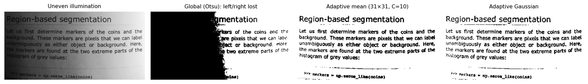
*Figure 3.6 — A global threshold loses half the page; adaptive thresholds recover the text everywhere.*

### 3.5 Other advanced methods
- **Cluster-based:** k-means on intensities → thresholds between cluster centres.
- **Edge-based:** choose $T$ using pixels with strong gradients (Sobel/Canny).
- **Applications:** document binarisation, medical ROI (tumours), object detection, preprocessing.
- **Challenges:** lighting variation, noise, complex scenes (need multi-step or adaptive methods).

---

## 4. Edge detection techniques

**Edge** = a significant local change of intensity; boundaries of objects. Edges are located by the **maximum of the first derivative** or **zero-crossing of the second derivative**.

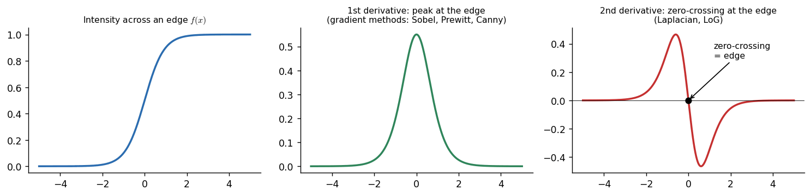
*Figure 3.7 — Intensity across an edge, its first derivative (peak) and second derivative (zero-crossing).*

**Edge models:** step (ideal), ramp (blurred step, most common), roof/line.

### 4.1 Gradient-based techniques (1st derivative)
$$\nabla f=\begin{bmatrix}G_x\\G_y\end{bmatrix},\qquad M(x,y)=\sqrt{G_x^{2}+G_y^{2}}\ \approx\ |G_x|+|G_y|,\qquad \alpha(x,y)=\tan^{-1}\!\frac{G_y}{G_x}$$

(the gradient direction $\alpha$ is perpendicular to the edge).

| Operator | $G_x$ | $G_y$ |
|---|---|---|
| **Roberts** (2×2, diagonals) | $\begin{bmatrix}1&0\\0&-1\end{bmatrix}$ | $\begin{bmatrix}0&1\\-1&0\end{bmatrix}$ |
| **Prewitt** | $\begin{bmatrix}-1&0&1\\-1&0&1\\-1&0&1\end{bmatrix}$ | $\begin{bmatrix}-1&-1&-1\\0&0&0\\1&1&1\end{bmatrix}$ |
| **Sobel** (extra weight on the centre row → smoothing) | $\begin{bmatrix}-1&0&1\\-2&0&2\\-1&0&1\end{bmatrix}$ | $\begin{bmatrix}-1&-2&-1\\0&0&0\\1&2&1\end{bmatrix}$ |

**Worked example — Sobel** on the patch $\begin{bmatrix}10&10&10\\10&10&50\\10&50&50\end{bmatrix}$:

$$G_x=(-10+10)+(-20+100)+(-10+50)=120,\qquad G_y=(-10-20-10)+0+(10+100+50)=120$$

$$M=\sqrt{120^2+120^2}\approx169.7,\qquad \alpha=\tan^{-1}(120/120)=45^\circ$$

**Kirsch compass operator:** 8 directional masks (N, NE, E, …); edge strength = maximum response over the 8 masks, direction = the mask giving the maximum. Example (North): $\begin{bmatrix}5&5&5\\-3&0&-3\\-3&-3&-3\end{bmatrix}$.

### 4.2 Laplacian-based techniques (2nd derivative)
- **Laplacian:** $\nabla^{2}f=\dfrac{\partial^2f}{\partial x^2}+\dfrac{\partial^2f}{\partial y^2}$; masks $\begin{bmatrix}0&1&0\\1&-4&1\\0&1&0\end{bmatrix}$ or $\begin{bmatrix}1&1&1\\1&-8&1\\1&1&1\end{bmatrix}$. Edge = **zero-crossing**. Very **noise sensitive**, gives no direction.
- **Laplacian of Gaussian (LoG, Marr–Hildreth):** smooth first, then Laplacian:

$$\nabla^{2}G(x,y)=-\frac{1}{\pi\sigma^{4}}\left[1-\frac{x^{2}+y^{2}}{2\sigma^{2}}\right]e^{-\frac{x^{2}+y^{2}}{2\sigma^{2}}}$$

  $\sigma$ sets the scale. **DoG** ($G_{\sigma_1}-G_{\sigma_2}$) approximates LoG cheaply.

### 4.3 Canny edge detector (optimal-edge criteria)
Criteria: **good detection**, **good localisation**, **single response** per edge.

1. **Gaussian smoothing** — removes noise.
2. **Gradient magnitude and direction** (Sobel).
3. **Non-maximum suppression (NMS)** — keep a pixel only if its magnitude is the maximum along the gradient direction (compare with the 2 neighbours; direction quantised to $0^\circ,45^\circ,90^\circ,135^\circ$) → 1-pixel-thin edges.
4. **Double thresholding** with $T_H>T_L$ (ratio about 2:1 or 3:1): strong ($>T_H$), weak ($T_L$–$T_H$), discarded ($<T_L$).
5. **Edge tracking by hysteresis** — keep a weak edge only if it is connected to a strong edge.

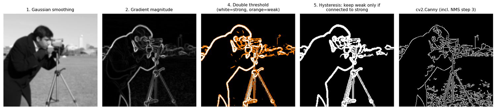
*Figure 3.9 — Smoothing → gradient → double threshold (white = strong, orange = weak) → hysteresis → final Canny output (which also includes NMS).*

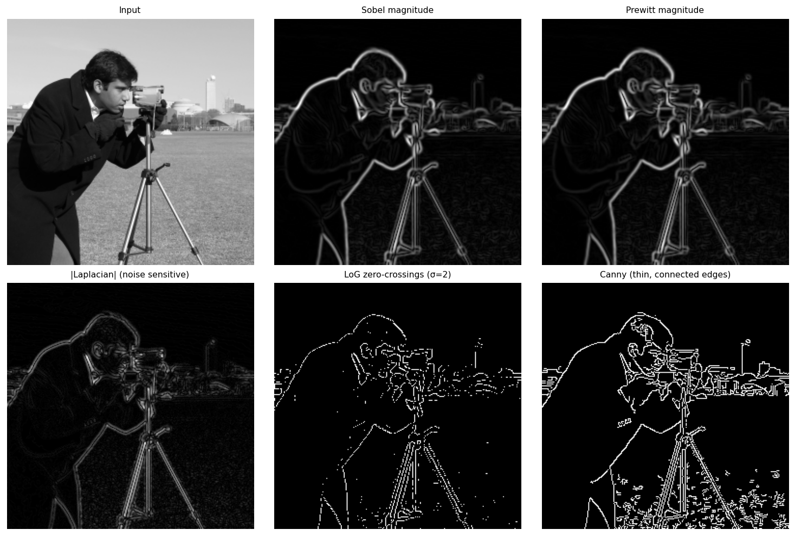
*Figure 3.8 — Same image through Sobel, Prewitt, Laplacian, LoG and Canny. Laplacian is noisy; Canny gives thin, connected edges.*

### 4.4 Other methods
- **Morphological edge detection:** $\text{Edge}=A-(A\ominus B)$ (internal gradient); also $(A\oplus B)-A$ (external) and $(A\oplus B)-(A\ominus B)$ (gradient).
- **Structured edge detection (SED):** machine-learning method (structured random forests) for complex scenes.

| Method | Order | Noise robustness | Output edge | Notes |
|---|---|---|---|---|
| Roberts | 1st | poor | thick | 2×2, fast |
| Prewitt/Sobel | 1st | moderate (Sobel better) | thick | gives direction |
| Laplacian | 2nd | very poor | zero-crossings | no direction |
| LoG | 2nd | good | closed contours | scale $\sigma$ |
| **Canny** | 1st + NMS + hysteresis | **best** | thin, connected | most used |

**Challenges:** noise (false edges → smooth first), illumination changes, blurred edges. **Applications:** medical imaging, object detection, document analysis, compression/ROI.
**Practical steps:** grayscale → denoise (Gaussian) → pick operator → threshold/visualise.

---

## 5. Corner and interest point detection

- **Corner:** a point where intensity changes strongly in **two directions** (intersection of edges).
- **Interest point (keypoint):** any distinctive, repeatable, well-localised point (corner or blob) that is stable under rotation, scale and lighting changes. Used for matching, recognition, tracking, AR.

### 5.1 Harris corner detector
Take a window $w$ and shift it by $(u,v)$. The change in intensity is

$$E(u,v)=\sum_{x,y}w(x,y)\,[I(x+u,y+v)-I(x,y)]^2\;\approx\;[u\ v]\,M\,[u\ v]^{T}$$

$$M=\sum_{x,y}w(x,y)\begin{bmatrix}I_x^{2}&I_xI_y\\I_xI_y&I_y^{2}\end{bmatrix}$$

Eigenvalues $\lambda_1,\lambda_2$ of $M$ describe the local structure; avoid computing them with the **response**:

$$R=\det M-k\,(\operatorname{tr}M)^{2}=\lambda_1\lambda_2-k(\lambda_1+\lambda_2)^{2},\qquad k\approx0.04\text{–}0.06$$

| Region | $\lambda$'s | $R$ |
|---|---|---|
| Flat | both small | $\approx0$ |
| Edge | one large, one small | $R<0$ |
| **Corner** | **both large** | $R>$ threshold (large positive) |

Steps: image gradients $I_x,I_y$ → products $I_x^2,I_y^2,I_xI_y$ → Gaussian window sum → compute $R$ → threshold → non-maximum suppression.

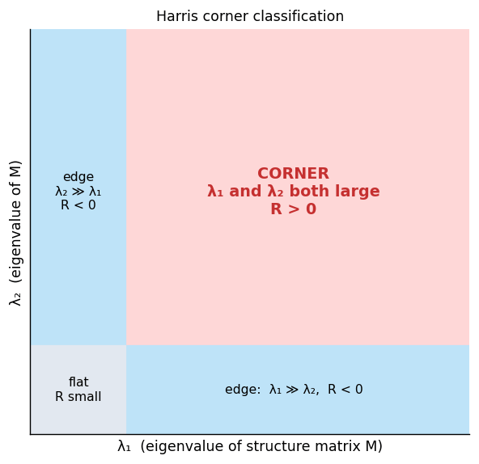
*Figure 3.10 — Classification in the $\lambda_1$–$\lambda_2$ plane.*

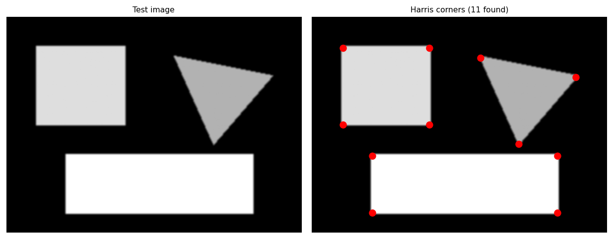
*Figure 3.11 — Harris finds the corners of the rectangle, triangle and bar.*

- **Shi–Tomasi (good features to track) [+]:** $R=\min(\lambda_1,\lambda_2)$; corner if $R>$ threshold. Better for tracking.
- Harris is rotation invariant but **not scale invariant**.

### 5.2 FAST — Features from Accelerated Segment Test
Look at the **16 pixels on a circle of radius 3** around $p$. $p$ is a corner if $\ge n$ **contiguous** pixels (usually $n=12$, or 9 in FAST-9) are all brighter than $I_p+T$ or all darker than $I_p-T$. A quick pre-test on pixels 1, 5, 9, 13 rejects most points. **Very fast**, real-time; but noise-sensitive and **not scale/rotation invariant**.

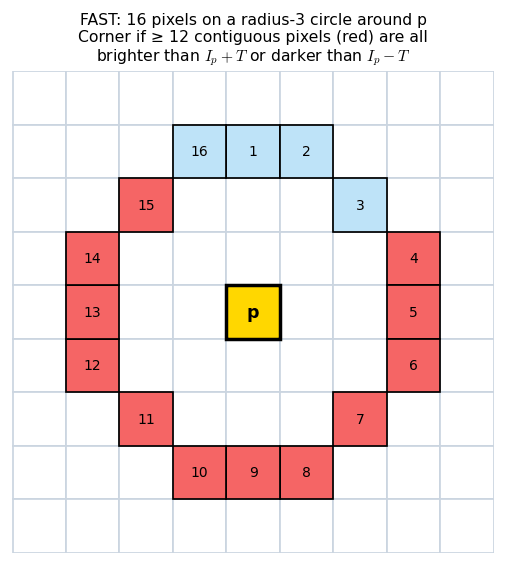
*Figure 3.12*

### 5.3 SIFT — Scale-Invariant Feature Transform
1. **Scale space:** $L(x,y,\sigma)=G(x,y,\sigma)*I(x,y)$ (Gaussian blur at increasing $\sigma$, in octaves).
2. **Difference of Gaussians:** $D(x,y,\sigma)=L(x,y,k\sigma)-L(x,y,\sigma)$ (approximates LoG).
3. **Keypoint detection:** local extrema of $D$ compared with its **26 neighbours** (8 in the same scale + 9 above + 9 below).
4. **Refinement:** sub-pixel localisation (Taylor expansion), reject **low-contrast** points and **edge-like** points (Hessian ratio $\operatorname{tr}(H)^2/\det H<(r+1)^2/r$, $r=10$).
5. **Orientation assignment:** histogram of gradient orientations (36 bins) in a neighbourhood → dominant direction ⇒ rotation invariance.
6. **Descriptor:** $4\times4$ grid of cells × 8 orientation bins = **128-D** vector (normalised) ⇒ robust to illumination.
Matching: nearest neighbour with Lowe's ratio test (≈ 0.8).

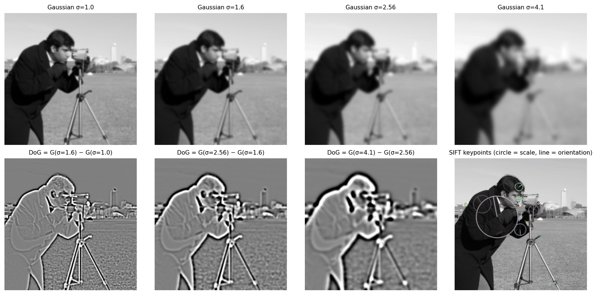
*Figure 3.13 — Gaussian images at increasing σ, their differences (DoG), and detected SIFT keypoints (circle size = scale).*

**Pros:** scale + rotation invariance, robust to noise/lighting. **Cons:** computationally expensive (and was patented until 2020).

### 5.4 Other detectors
| Method | Idea | Pros | Cons |
|---|---|---|---|
| **SURF** | Integral images + box filters; blobs by determinant of the Hessian; 64-D Haar-wavelet descriptor | Faster than SIFT | Less accurate in some cases |
| **ORB** | Oriented FAST (orientation by intensity centroid) + rotated **BRIEF** (256-bit binary descriptor, matched by Hamming distance) | Fast, free, mobile/embedded | Less accurate than SIFT/SURF |
| **Harris–Laplace** | Harris corners at many scales; the **Laplacian** picks the characteristic scale | Scale-invariant corners | Slower |
| **MSER** | Regions that stay stable over a range of thresholds | Good for blobs/text regions | Not for textureless images |
| **AGAST** | Improved FAST (decision trees) | Faster/more adaptive | — |

BRIEF test: $\tau(p;x,y)=1$ if $p(x)<p(y)$ else $0$.

### 5.5 Comparison (from your notes)
| Method | Speed | Robustness | Scale invariance | Rotation invariance |
|---|---|---|---|---|
| Harris | Medium | Moderate | No | **Yes** |
| Shi–Tomasi | Medium | Moderate | No | **Yes** |
| SIFT | Slow | High | **Yes** | **Yes** |
| SURF | Fast | High | **Yes** | **Yes** |
| FAST | Very fast | Low | No | No |
| ORB | Fast | Moderate | Yes (image pyramid) | Yes |

**Applications:** image matching/stitching, object recognition, tracking (FAST, Shi–Tomasi + KLT), augmented reality, SLAM.
**Challenges:** noise, lighting variation, real-time constraints.

---

## 6. Mathematical morphology

A set-theoretic toolbox for analysing **shape and structure** (mainly binary, also grayscale images).
- $A$ = image (set of foreground pixels), $B$ = **structuring element (SE)**: a small kernel (square, disc, line, cross) that *probes* the image. Its size and shape control the result.
- $\hat B$ = reflection of $B$; $(B)_z$ = translation of $B$ by $z$.

### 6.1 Basic operations

$$\text{Erosion: } A\ominus B=\{z\mid (B)_z\subseteq A\}\qquad\text{Dilation: } A\oplus B=\{z\mid (\hat B)_z\cap A\neq\emptyset\}$$

- **Erosion** shrinks objects, removes small white specks, breaks thin connections. **Dilation** grows objects, fills small gaps/holes, joins nearby parts.
- **Duality:** $(A\ominus B)^{c}=A^{c}\oplus\hat B$.

$$\text{Opening: } A\circ B=(A\ominus B)\oplus B\qquad\text{Closing: } A\bullet B=(A\oplus B)\ominus B$$

- **Opening** removes small objects/protrusions, smooths contours, keeps size of big objects. **Closing** fills small holes and gaps, joins narrow breaks.
- Properties: opening is **anti-extensive** ($A\circ B\subseteq A$), closing is **extensive** ($A\subseteq A\bullet B$); both are **idempotent** (applying twice = once).

**Worked example (3×3 square SE)** — input has a $4\times4$ block and one isolated pixel:

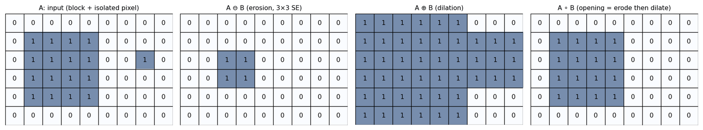
*Figure 3.14 — Erosion keeps only the interior ($2\times2$) and kills the isolated pixel; dilation grows the block; **opening restores the block but permanently removes the noise pixel**.*

### 6.2 Advanced operations
| Operation | Formula | Use |
|---|---|---|
| **Hit-or-miss** | $A\circledast B=(A\ominus B_1)\cap(A^{c}\ominus B_2)$ | Detect an exact pattern/shape |
| **Boundary extraction** | $\beta(A)=A-(A\ominus B)$ | Object contours |
| **Hole filling** | $X_k=(X_{k-1}\oplus B)\cap A^{c}$ | Fill holes from a seed |
| **Morphological gradient** | $(A\oplus B)-(A\ominus B)$ | Thick outline |
| **Top-hat / black-hat** | $f-(f\circ b)$ / $(f\bullet b)-f$ | Bright / dark small details; uneven background |
| **Thinning, skeleton** | $A\otimes B=A-(A\circledast B)$ ; $S(A)=\bigcup_k\big[(A\ominus kB)-(A\ominus kB)\circ B\big]$ | Shape simplification (§13) |
| **Grayscale** | $(f\ominus b)(x,y)=\min_{(s,t)\in b}f(x+s,y+t)$ ; $(f\oplus b)=\max$ | Min = erosion, max = dilation |

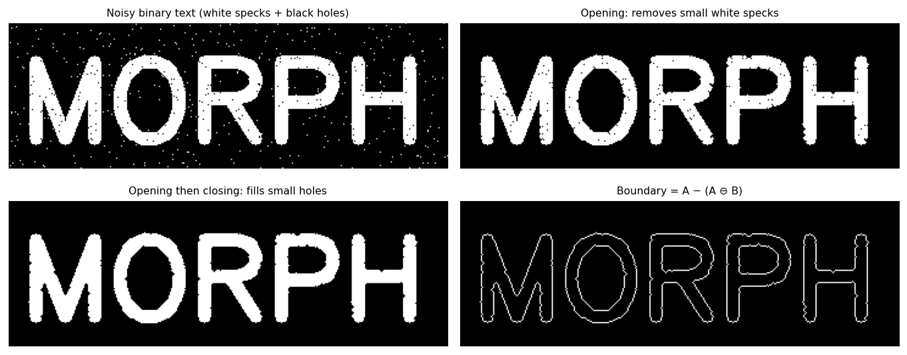
*Figure 3.15 — Opening removes white specks, closing fills black holes, and $A-(A\ominus B)$ extracts the boundary.*

**Applications:** noise removal, object segmentation, boundary detection and shape analysis, skeletonisation/thinning, feature extraction.

---

## 7. Texture

**Texture** = visual pattern formed by the spatial arrangement of pixel intensities (repetition, randomness, orientation). Used in segmentation, classification and recognition.

**Characteristics:** coarseness (granularity), contrast, directionality, regularity (also line-likeness, roughness).

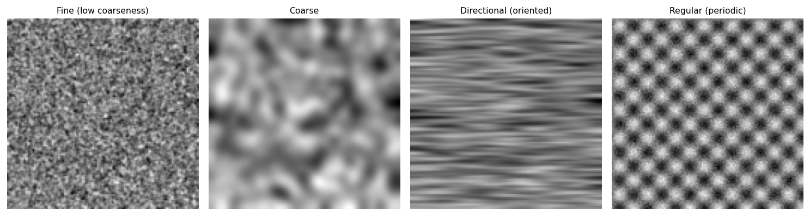
*Figure 3.16 — Fine, coarse, directional and regular textures.*

### 7.1 Texture models
| Model | Idea | Examples |
|---|---|---|
| **Statistical** | Distribution/relations of intensities | 1st order: mean, variance, histogram moments; 2nd order: **GLCM** |
| **Structural** | Texture = repeated primitives (texels) + placement rules | Brick, tiles, fabric (regular textures) |
| **Spectral** | Frequency content | Fourier, Gabor filters, wavelets |

### 7.2 First-order statistics (from the histogram)
Mean $m=\sum_i i\,p(i)$, variance $\sigma^2=\sum_i(i-m)^2p(i)$, entropy $-\sum_i p(i)\log_2 p(i)$, smoothness $R=1-\dfrac{1}{1+\sigma^2}$. They ignore pixel positions.

### 7.3 Gray Level Co-occurrence Matrix (GLCM)
$P(i,j\mid d,\theta)$ = number of pixel pairs with gray levels $(i,j)$ separated by distance $d$ in direction $\theta$ ($0^\circ,45^\circ,90^\circ,135^\circ$). Normalise: $p(i,j)=P(i,j)/\sum P$. Haralick features:

$$\text{Contrast}=\sum_{i,j}(i-j)^2p(i,j)\qquad \text{Energy (ASM)}=\sum_{i,j}p(i,j)^2\qquad \text{Homogeneity}=\sum_{i,j}\frac{p(i,j)}{1+|i-j|}$$

$$\text{Correlation}=\sum_{i,j}\frac{(i-\mu_i)(j-\mu_j)\,p(i,j)}{\sigma_i\sigma_j}\qquad \text{Entropy}=-\sum_{i,j}p(i,j)\log p(i,j)$$

**Worked example** — 4×4 image with 4 levels, $d=1$, $\theta=0^\circ$ (right neighbour):

$$\begin{bmatrix}0&0&1&1\\0&0&1&1\\0&2&2&2\\2&2&3&3\end{bmatrix}\ \Rightarrow\ P=\begin{bmatrix}2&2&1&0\\0&2&0&0\\0&0&3&1\\0&0&0&1\end{bmatrix}\quad(12\text{ pairs})$$

Contrast $=7/12=0.583$; Energy $=24/144=0.167$; Homogeneity $=9.83/12=0.819$.

### 7.4 Local Binary Patterns (LBP)
Compare each pixel $g_c$ with its 8 neighbours $g_k$; the bits form a code; the **histogram of codes** over a region is the texture descriptor (robust to monotonic illumination change, cheap):

$$\text{LBP}=\sum_{k=0}^{7}s(g_k-g_c)\,2^{k},\qquad s(x)=\begin{cases}1&x\ge0\\0&x<0\end{cases}$$

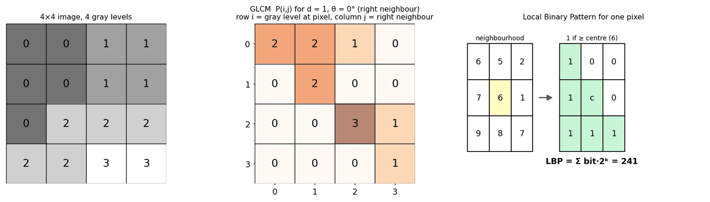
*Figure 3.17 — GLCM built from right-neighbour pairs; LBP of a pixel (centre 6): bits clockwise from top-left $1,0,0,0,1,1,1,1$ with weights $1,2,4,\dots,128$ give $1+16+32+64+128=241$.*

### 7.5 Spectral methods
- **Fourier:** peaks in the spectrum ⇒ periodicity/direction.
- **Gabor filters:** Gaussian-windowed sinusoids, tuned to a frequency and orientation; good for texture segmentation: $g(x,y)=e^{-\frac{x'^2+\gamma^2y'^2}{2\sigma^2}}\cos\!\big(\tfrac{2\pi x'}{\lambda}+\psi\big)$, $x'=x\cos\theta+y\sin\theta$.
- **Wavelets:** multi-resolution texture at several scales. **[+] Laws' texture energy:** convolve with small L5/E5/S5/R5 masks, then take local energy.

**Applications:** tumour/tissue analysis, land-cover classification (remote sensing), fabric/surface inspection, defect detection.

### 7.6 Morphology vs texture
| Aspect | Mathematical morphology | Texture analysis |
|---|---|---|
| Focus | Shape and structure of objects | Visual patterns/regularity |
| Operations | Erosion, dilation, opening, closing | Statistical, structural, frequency-based |
| Typical images | Binary / grayscale | Grayscale / colour |
| Output | Modified image / shape | Feature vector (GLCM, LBP, Gabor) |

They are **complementary**: morphology cleans and shapes, texture describes surface patterns.

---

# UNIT 4

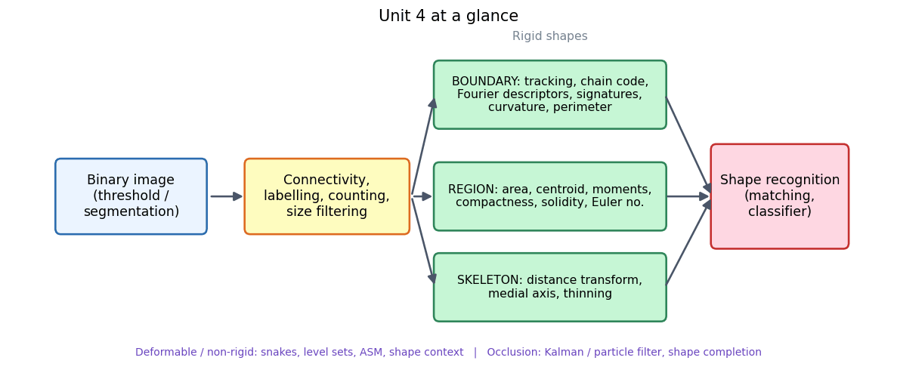
*Figure 4.0 — Unit 4 workflow: binary image → connected components → boundary / region / skeleton descriptors → shape recognition.*

## 8. Binary shape analysis

A **binary image** has pixels 0 (background) or 1 (object). Binary shape analysis studies the **geometry, topology and relationships** of objects.

**Key concepts:** *objects* (groups of 1-pixels), *connected components* (maximal sets of adjacent object pixels), *holes* (background regions enclosed by an object).

**Basic operations:** connectivity & labelling (§9–10), boundary detection/tracing (§15), measurements below.

**Geometric properties (for an object with $N$ pixels):**

$$\text{Area }A=\sum_{(x,y)}f(x,y),\qquad \text{centroid }(\bar x,\bar y)=\Big(\tfrac1A\sum x,\ \tfrac1A\sum y\Big)$$

| Property | Definition | Meaning |
|---|---|---|
| Bounding box | Smallest axis-aligned rectangle enclosing the object | alignment, tracking |
| Convex hull | Smallest convex set containing the object | approximates shape |
| Aspect ratio | $w/h$ of the bounding box | elongation |
| Solidity | $\dfrac{\text{Area}}{\text{Area of convex hull}}$ | 1 = convex; $<1$ concave/irregular |
| Extent | $\dfrac{A}{w\cdot h}$ | how much of the box is filled |

**Topological property — Euler number:** $E=C-H$ ($C$ components, $H$ holes). Circle: $E=1$; circle with a hole: $E=0$; digit "8": $E=-1$. It is unchanged by stretching/rotation (a topological invariant). **[+] Bit-quad formula** from 2×2 windows: $E_8=\dfrac{Q_1-Q_3-2Q_D}{4}$, $E_4=\dfrac{Q_1-Q_3+2Q_D}{4}$ ($Q_1$/$Q_3$ = windows with 1/3 object pixels, $Q_D$ = diagonal windows).

**Shape descriptors listed in your notes:** Fourier descriptors (§23), Hu moments (§25), shape context (§17), Zernike moments (§25).

**Applications:** object recognition, segmentation, medical imaging, industrial inspection, robotics.

---

## 9. Connectedness

Connectedness defines which pixels belong to the **same object**.

- **4-neighbourhood** $N_4(p)$: N, S, E, W — $(x\pm1,y),(x,y\pm1)$.
- **Diagonal neighbours** $N_D(p)$: the 4 corners. **8-neighbourhood** $N_8(p)=N_4(p)\cup N_D(p)$.

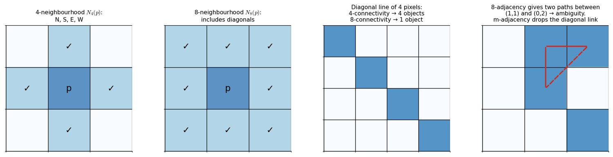
*Figure 4.1 — $N_4$, $N_8$, a diagonal line (4 objects under 4-connectivity, 1 under 8-connectivity) and the double-path ambiguity of 8-adjacency.*

| Type | Rule | Effect |
|---|---|---|
| **4-connectivity** | pixels linked via horizontal/vertical neighbours | Diagonal contacts split objects; stricter |
| **8-connectivity** | includes diagonal neighbours | An "L" or diagonal line stays **one** object; may merge objects across thin diagonal gaps |
| **m-connectivity (mixed)** | $q\in N_4(p)$, **or** $q\in N_D(p)$ **and** $N_4(p)\cap N_4(q)$ contains no object pixel | Removes the multiple-path ambiguity of 8-adjacency |

> ⚠ **Fix:** your source says "m-connectivity generalises connectivity to more than 8 directions / non-rectangular grids". That is wrong. m-connectivity is the **mixed** 4/8 rule above, defined to avoid duplicate paths between two pixels.

- A **path** is a sequence of adjacent pixels; a **connected component** is a maximal set of pixels pairwise joined by paths.
- **Duality rule [+]:** use **8-connectivity for the object with 4-connectivity for the background** (or vice versa) so that a closed curve separates inside from outside (Jordan curve property).

**Applications:** connected-component labelling, object segmentation, edge linking, morphology (dilation adds pixels adjacent to the object).
**Example 1:** two objects separated by a one-pixel diagonal gap → 4-connectivity: 2 objects; 8-connectivity: merged into 1.
**Challenges:** noise creates spurious components; image borders need special handling.

---

## 10. Object labelling and counting

**Labelling** assigns a unique integer to every connected component; **counting** = number of distinct labels.

### Algorithms
1. **Flood fill (region growing):** from an unlabelled object pixel, spread (recursion/stack/queue) through neighbours and give all the same label; repeat for the next unlabelled pixel.
2. **Two-pass algorithm with equivalence table (union–find):**
   - **Pass 1:** scan left→right, top→bottom. For object pixel $p$ look at the already-visited neighbours (4-conn: left and up; 8-conn: left, up, up-left, up-right). None labelled → new label. One label → copy. Several different labels → give the smallest and **record that they are equivalent**.
   - **Pass 2:** replace every label by its equivalence-class representative (then optionally renumber $1..n$).
3. **Contour-tracing / one-pass** methods [+] (label by tracing outer and inner contours).

**Worked example — two-pass, 4-connectivity** (a "U" shape forces an equivalence):

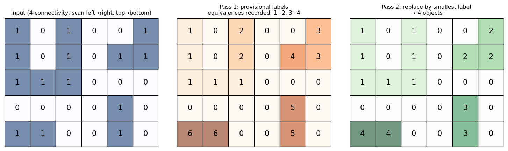
*Figure 4.2 — Provisional labels in pass 1 create the equivalences $1\equiv2$ and $3\equiv4$; pass 2 merges them. Result: 4 objects.*

**Counting steps:** label → count distinct non-zero labels → remove noise first (opening / size filtering) so specks are not counted.

> ⚠ **Fix:** in your source's example the binary image
> `0 1 0 0 0 0 / 1 1 0 0 0 0 / 0 0 0 1 1 0 / 0 0 0 1 1 0 / 0 0 0 0 0 0`
> contains only **2 objects** (labels 1 and 2), yet the text says "the total number of objects is 3".

**Challenges:** noise; **touching/overlapping objects** merge into one component (use watershed on the distance transform, see below); complex shapes.

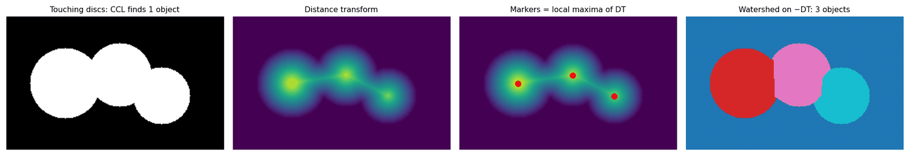
*Figure 4.20 — CCL sees one blob; distance transform + watershed splits it into three objects.*

**Complexity:** one scan per pass, $O(MN)$ plus near-constant union–find cost.
**Applications:** counting cells/cars/trees/particles, medical regions, defect counting, robot picking.

---

## 11. Size filtering

Remove or keep connected components according to their **size** (usually pixel count/area).

**Process:** (1) label components; (2) measure size; (3) apply threshold(s); (4) delete objects failing the test (set to background).

$$\text{Size}(C_i)=\sum_{(x,y)\in C_i}I(x,y)\qquad\text{keep }C_i\ \text{if}\ A_{\min}\le\text{Size}(C_i)\le A_{\max}$$

| Type | Keep | Use |
|---|---|---|
| Minimum size | $A\ge A_{\min}$ | remove noise/specks |
| Maximum size | $A\le A_{\max}$ | remove large background regions |
| Size range | $A_{\min}\le A\le A_{\max}$ | e.g. cells of a given size |

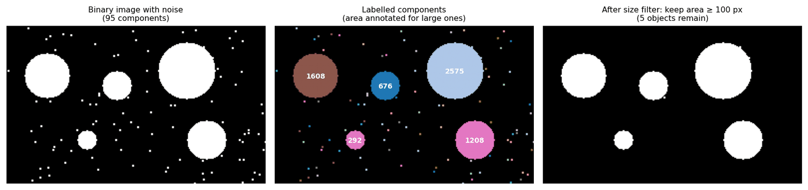
*Figure 4.3 — Many tiny noise components are removed; the 5 real objects (area ≥ 100) remain.*

> ⚠ **Fix:** your worked example (`0 1 1 … / 0 1 1 0 0 1 1 / 0 0 0 0 1 1 1`) lists "Object 2: area = 4". Counting its pixels gives **5** (`1 1` in row 3 and `1 1 1` in row 4). With a threshold of 5 pixels, **object 2 is kept** and only object 1 (area 4) is removed — not both.

[+] **Area opening** does the same thing with morphology without labelling. **Applications:** noise reduction, particle counting, defect detection, selecting objects a robot can grasp. **Challenges:** over-filtering objects near the threshold, size varies with scale (adaptive thresholds), noise remaining.

---

## 12. Distance functions

A **distance (metric)** $D$ satisfies: (i) $D(p,q)\ge0$ and $=0$ iff $p=q$; (ii) $D(p,q)=D(q,p)$; (iii) $D(p,z)\le D(p,q)+D(q,z)$. For pixels $p=(x,y)$, $q=(s,t)$:

| Metric | Formula | Unit "ball" |
|---|---|---|
| **Euclidean** $D_E$ | $\sqrt{(x-s)^2+(y-t)^2}$ | circle |
| **City-block / Manhattan** $D_4$ | $\vert x-s\vert +\vert y-t\vert $ | diamond |
| **Chessboard** $D_8$ | $\max(\vert x-s\vert ,\vert y-t\vert )$ | square |
| **Minkowski** $L_p$ [+] | $(\vert \Delta x\vert ^p+\vert \Delta y\vert ^p)^{1/p}$ | $p=1\to D_4$, $2\to D_E$, $\infty\to D_8$ |

**Mahalanobis** (point to a distribution, accounts for correlation/variance):

$$d_M(\mathbf x)=\sqrt{(\mathbf x-\boldsymbol\mu)^{T}\Sigma^{-1}(\mathbf x-\boldsymbol\mu)}$$

**[+] Hausdorff distance** between point sets (shape comparison):

$$H(A,B)=\max\{h(A,B),h(B,A)\},\qquad h(A,B)=\max_{a\in A}\min_{b\in B}\lVert a-b\rVert$$

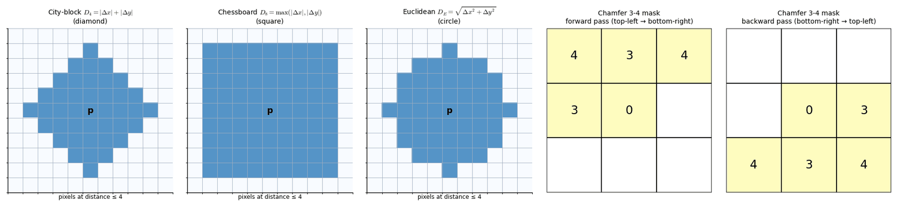
*Figure 4.4 — Pixels within distance 4 of $p$ for $D_4$, $D_8$, $D_E$, and the two chamfer 3-4 masks.*

### Distance transform (DT)
Gives every object pixel $p$ the distance to the **nearest background pixel**:
$$DT(p)=\min_{q\in\text{background}}d(p,q)$$
> Note: your source states the reverse convention (background pixel → nearest foreground). Both are used; just state which one you use.

- **Euclidean DT** (exact). **Chamfer DT** = fast two-pass approximation. With local weights $a$ (4-neighbours) and $b$ (diagonals) — chamfer **3-4**: $a=3,b=4$ (divide the result by 3 to get ≈ Euclidean):
  - **Forward pass** (top-left→bottom-right): $D(x,y)=\min\big\{D(x,y),\ D(x{-}1,y)+a,\ D(x,y{-}1)+a,\ D(x{-}1,y{-}1)+b,\ D(x{+}1,y{-}1)+b\big\}$
  - **Backward pass** (bottom-right→top-left): same with the mirrored neighbours.
- **Worked example (city-block DT, $a=1$, no diagonal term)** of a $3\times5$ block inside a $5\times7$ image:

$$\begin{bmatrix}0&0&0&0&0&0&0\\0&1&1&1&1&1&0\\0&1&2&2&2&1&0\\0&1&1&1&1&1&0\\0&0&0&0&0&0&0\end{bmatrix}$$

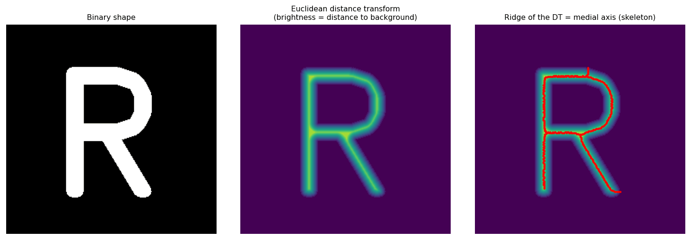
*Figure 4.5 — Brightness = distance to the background; the ridge of the DT is the medial axis.*

**Applications:** object recognition (template/shape distance), segmentation (watershed seeds), registration, shape analysis, skeletonisation, morphology. **Choosing:** Euclidean (isotropic, geometric), $D_4$ (grid moves), $D_8$ (diagonal = straight), Mahalanobis (correlated features), DT (segmentation/skeletons).

---

## 13. Skeletons and thinning

Reduce an object to a thin **stick figure** that keeps its **topology** (connectivity, holes) and general geometry.

### 13.1 Skeleton / Medial Axis Transform (MAT)
- The **medial axis** = set of centres of all **maximal inscribed discs** (points having ≥ 2 nearest boundary points). Storing each skeleton point with its disc radius ($=DT$ value) lets you **reconstruct** the shape as the union of discs.
- **Via distance transform:** compute $DT$, keep ridge pixels (local maxima).
- Drawbacks: sensitive to boundary noise (spurs) → prune short branches.
- **Algorithms:** distance-transform ridge, Zhang–Suen, Voronoi-based.

### 13.2 Thinning
Iteratively delete boundary pixels that do **not** break connectivity or shorten end points, until the shape is **1 pixel wide**.

**Zhang–Suen algorithm** (two sub-iterations per pass). For each object pixel $P_1$ with neighbours $P_2\dots P_9$ taken clockwise starting from the pixel above:

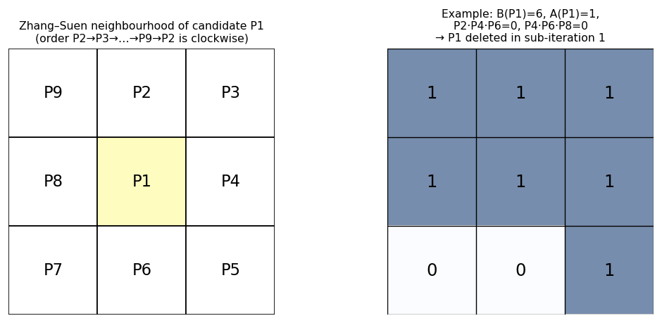
*Figure 4.7 — Neighbourhood labels and an example where $P_1$ satisfies the removal rules.*

- $B(P_1)$ = number of object neighbours; $A(P_1)$ = number of $0\to1$ transitions in the cyclic sequence $P_2,P_3,\dots,P_9,P_2$.
- **Sub-iteration 1:** delete $P_1$ if (a) $2\le B\le6$, (b) $A=1$, (c) $P_2P_4P_6=0$, (d) $P_4P_6P_8=0$.
- **Sub-iteration 2:** same (a), (b), but (c′) $P_2P_4P_8=0$, (d′) $P_2P_6P_8=0$.
- Repeat both until no pixel changes. (Conditions (a)–(b) keep end points and connectivity; (c),(d) remove south-east boundary and north-west corner pixels first, then the opposite ones, so the skeleton stays centred.)

Other thinning algorithms: **hit-or-miss thinning** $A\otimes B=A-(A\circledast B)$ with 8 rotated SEs, **Hilditch**, **Guo–Hall**.

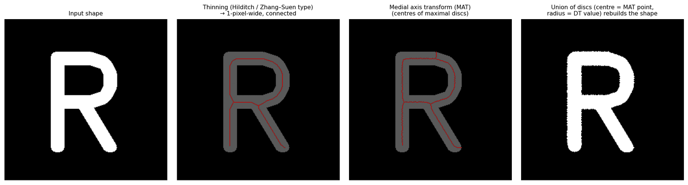
*Figure 4.6 — Thinning gives a connected 1-pixel line; the MAT keeps disc radii so the union of discs rebuilds the shape (IoU ≈ 0.96).*

| Aspect | Skeletonisation (MAT) | Thinning |
|---|---|---|
| Goal | Medial axis (+ radius information) | 1-pixel-wide connected line |
| Method | DT ridge / maximal discs | Iterative boundary-pixel deletion with rules |
| Reconstruction | **Possible** (with radii) | Not exactly |
| Cost | Higher | Simpler, faster |

**Applications:** OCR/handwriting (strokes), fingerprint ridges, blood-vessel/bone analysis, robot path planning (roadmaps), shape matching.

---

## 14. Deformable shape analysis

Study shapes that **change** (non-rigid): organs, faces, articulated bodies. Model *how* the shape deforms while preserving properties such as topology.

**Deformable model properties:** elasticity (returns to original shape), viscoelasticity (time-dependent), plasticity (permanent deformation).

| Type | Representation | Example |
|---|---|---|
| **Explicit (parametric)** | Curve $\mathbf v(s)=(x(s),y(s))$, $s\in[0,1]$ evolved by moving its points | **Active contours (snakes)**; topology fixed |
| **Implicit** | Contour = **zero level set** $\{\phi(x,y,t)=0\}$ of a function (e.g. signed distance) | **Level-set method**; handles merging/splitting |

**Level-set evolution:** $\dfrac{\partial\phi}{\partial t}+F\,|\nabla\phi|=0$, where $F$ is the speed (depends on curvature and image edges).

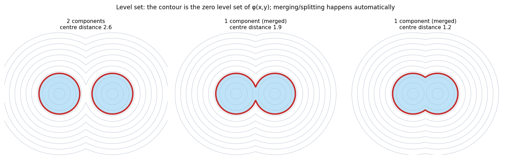
*Figure 4.22 — The zero level set of $\phi=\min(d_1,d_2)$: two circles merge into one component with no special handling.*

**Shape representation:** boundary representation (B-rep), **Point Distribution Models (PDM)** (landmarks), mesh models (vertices/edges/faces).

**Techniques**
1. **Active contours / level sets** (§16).
2. **Physics-based models:** *mass–spring* (masses linked by springs; Hooke's law $\mathbf F=-k\,\Delta\mathbf x$) and **Finite Element Method (FEM)** (object split into triangles/tetrahedra; deformation from local forces) — soft-tissue and cloth simulation.
3. **Statistical models:** **PCA / Active Shape Models** capture the main modes of variation from training shapes (§17).
4. [+] **Deformable templates:** parametric template (e.g. ellipses for eye/mouth) fitted by minimising an energy.

**Applications:** medical segmentation (organs deform with disease), tracking faces/bodies, biomechanics and animation, shape retrieval, robotic manipulation of flexible objects.
**Challenges:** large non-rigid deformations, **topology changes** (level sets handle them well), real-time cost, noise (regularisation needed).

---

## 15. Boundary tracking procedures

**Boundary tracking** detects and *follows* the contour of an object so that its outline can be measured or encoded.

### 15.1 Methods by principle
| Class | How | Examples |
|---|---|---|
| **Edge-based** | Detect intensity gradients, then link edge pixels into contours | Canny, Sobel, Prewitt (+ edge linking / hysteresis) |
| **Region-based** | Segment a region first, then trace its border | **Region growing** (seed + similar neighbours), **watershed** (flooding of the gradient/distance "topographic surface"; boundaries = watershed lines) |
| **Deformable** | Fit an evolving curve | **Snakes**, geodesic active contours (§16) |

### 15.2 Tracking algorithms
**Moore-neighbour tracing** (outer boundary of a binary object) — the basis of chain-code extraction:
1. Scan to find the first object pixel $s$ (raster order); set the *backtrack* pixel $b$ = the background pixel from which you entered (west of $s$). Set $p=s$.
2. Examine the 8 neighbours of $p$ **clockwise starting from $b$**; the first object pixel found becomes the new $p$; the pixel examined just before it becomes the new $b$.
3. Record $p$. Stop when you return to $s$ (Jacob's criterion: re-enter $s$ the same way).

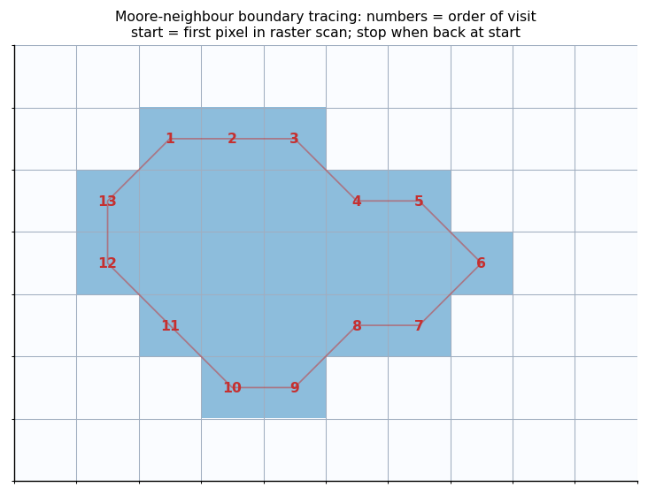
*Figure 4.10 — The traced contour of a small object: 13 boundary pixels visited in clockwise order (8-connected chain code 0,0,7,0,7,5,4,5,4,3,3,2,1 in image coordinates).*

- **Chain-code algorithm:** record the direction between consecutive boundary pixels (§22).
- **Marching squares:** for a scalar field/image thresholded at level $c$, classify each 2×2 cell by its 4 corner signs (16 cases, lookup table) and draw a line segment with **interpolated** end points; segments join into contours. Used in medical imaging and GIS.

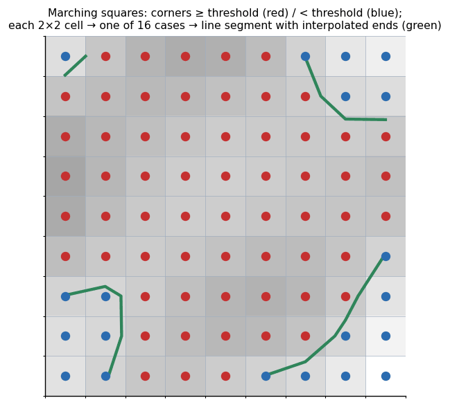
*Figure 4.21*

- **DFS/BFS boundary following:** graph traversal over boundary pixels (4- or 8-neighbours).

**Applications:** medical segmentation, object recognition, shape analysis (perimeter, eccentricity), robot navigation/motion tracking, GIS contour maps.

---

## 16. Active contours (snakes)

A **snake** (Kass, Witkin, Terzopoulos 1988) is a parametric curve $\mathbf v(s)=(x(s),y(s))$ that **moves in the image to minimise an energy**, settling on object boundaries even when edges are weak or broken.

$$E_{\text{snake}}=\int_0^{1}\Big[E_{\text{int}}(\mathbf v(s))+E_{\text{ext}}(\mathbf v(s))\Big]ds$$

**Internal energy** — smoothness of the curve itself:

$$E_{\text{int}}=\tfrac12\Big(\alpha\,|\mathbf v'(s)|^{2}+\beta\,|\mathbf v''(s)|^{2}\Big)$$
- $\alpha$ = **elasticity/tension** (penalises stretching → shrinks the curve), $\beta$ = **rigidity** (penalises bending → keeps it smooth).

**External (image) energy** — attracts the curve to features. For edges:

$$E_{\text{ext}}=-\big|\nabla\,(G_\sigma*I)(x,y)\big|^{2}$$
(sum of weighted line, edge and termination terms $w_{\text{line}}E_{\text{line}}+w_{\text{edge}}E_{\text{edge}}+w_{\text{term}}E_{\text{term}}$).

**Minimisation:** the Euler–Lagrange condition

$$\alpha\,\mathbf v''(s)-\beta\,\mathbf v''''(s)-\nabla E_{\text{ext}}(\mathbf v)=0$$

is solved iteratively (introduce time: $\gamma\,\partial\mathbf v/\partial t=\alpha\mathbf v''-\beta\mathbf v''''-\nabla E_{\text{ext}}$); discretised, each iteration solves a banded linear system. Balance of **internal forces** (smooth) and **external forces** (towards edges) gives the final contour.

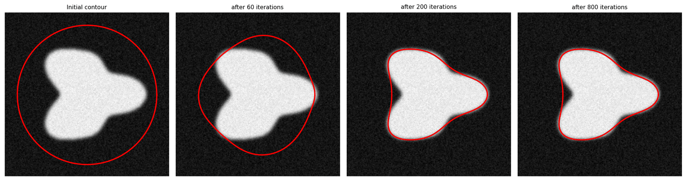
*Figure 4.8 — A snake started as a big circle shrinks and locks onto the object boundary (real `active_contour` run).*

**Variants:** *balloon force* (inflates/deflates), **GVF snake [+]** (larger capture range, enters concavities), **geodesic active contours** (level-set formulation, handles topology change).
**Weaknesses:** needs a good initialisation; stuck in local minima; difficulty entering deep concavities; fixed topology (for the parametric snake); parameter tuning ($\alpha,\beta,\gamma,\sigma$).
**Applications:** medical segmentation (organs, tumours), tracking deformable objects, shape matching, contour extraction in natural scenes.

---

## 17. Shape models and shape recognition

### 17.1 Shape models
Mathematical representations of shape used for recognition, segmentation and analysis — robust to noise, deformation and partial occlusion.

| Model | Idea |
|---|---|
| **Parametric** | Few parameters (size, orientation, curvature…) describe the shape |
| **Non-parametric** | Shape = a free collection of points/regions (flexible contours) |
| **Statistical shape models (SSM)** | **PDM / ASM**: landmark points + PCA learn how shapes vary |
| **Level-set (implicit)** | Zero level set of a signed-distance function |

**Point Distribution Model / Active Shape Model.** Align the training shapes (Procrustes), stack landmark coordinates into vectors $\mathbf x$, compute the mean and the covariance eigen-decomposition:

$$\mathbf x\approx\bar{\mathbf x}+P\,\mathbf b,\qquad |b_i|\le 3\sqrt{\lambda_i}$$

($P$ = matrix of the leading eigenvectors = **modes of variation**, $\mathbf b$ = shape parameters, $\lambda_i$ = eigenvalues; the limit keeps shapes "plausible".) **ASM** search: place the model, move each landmark to the best nearby image edge, fit $\mathbf b$, repeat. **AAM [+]** also models texture.

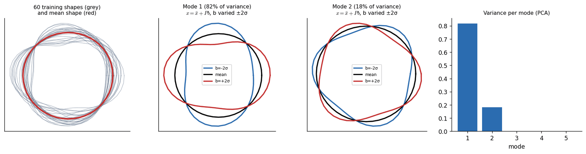
*Figure 4.9 — PCA on 60 training shapes: mode 1 (82 % of variance) and mode 2 (18 %) show the allowed deformations (±2σ).*

**Applications:** organ segmentation, face landmarking/tracking, 3-D reconstruction, retrieval, graphics/animation.

### 17.2 Shape recognition
Identify/classify objects from geometric properties, tolerant to noise, deformation and occlusion.

| Method | Idea |
|---|---|
| **Template matching** | Slide a template; best match by correlation. Normalised cross-correlation $\gamma=\dfrac{\sum[f-\bar f][w-\bar w]}{\sqrt{\sum[f-\bar f]^2\sum[w-\bar w]^2}}\in[-1,1]$ — sensitive to scale/rotation |
| **Feature-based** | Extract invariant features (edges, corners, SIFT/SURF) and compare |
| **Descriptor-based** [+] | Boundary/region descriptors: Fourier, moments, chain codes → classifier |
| **Statistical (ASM/AAM)** | Match via modes of variation; robust to deformation/partial occlusion |
| **Shape context** | Histogram of the relative positions of the other boundary points, in log-polar bins |
| **Neural networks / CNNs** | Learn hierarchical shape features from data |

**Shape context (Belongie):** for boundary point $p_i$,
$$h_i(k)=\#\{q\ne p_i:\ (q-p_i)\in\text{bin}(k)\}$$
Matching cost between points: $C_{ij}=\tfrac12\sum_k\dfrac{[h_i(k)-h_j(k)]^2}{h_i(k)+h_j(k)}$; solve the assignment (Hungarian algorithm), then align with a thin-plate spline.

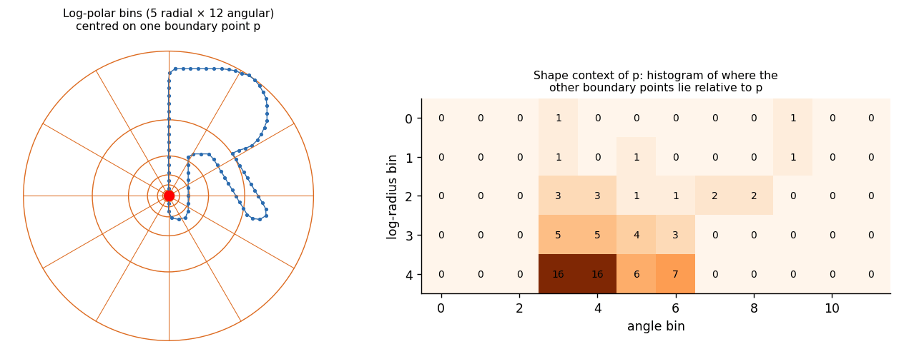
*Figure 4.18 — Log-polar bins around one boundary point and the resulting histogram.*

**Challenges:** deformation, noise and occlusion, scale/rotation/appearance variability.
**Applications:** object detection, medical imaging, robotics, quality control, face/gesture recognition.

---

## 18. Centroidal profiles

**Centroid** (balance point):
$$\bar x=\frac{m_{10}}{m_{00}}=\frac1N\sum x_i,\qquad \bar y=\frac{m_{01}}{m_{00}}=\frac1N\sum y_i$$

**Centroidal profile (radial-distance signature):** the distance from the centroid to the boundary as a function of angle (or arc length):

$$r(\theta)=\sqrt{(x(\theta)-\bar x)^2+(y(\theta)-\bar y)^2}$$

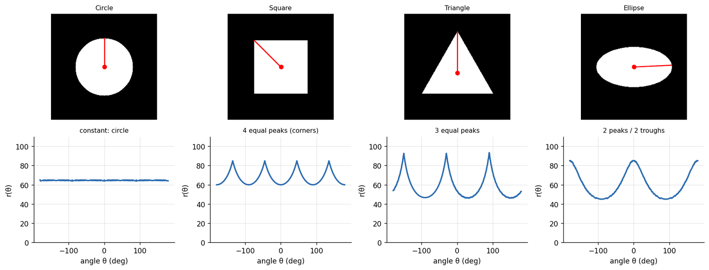
*Figure 4.12 — Circle: constant $r$; square: 4 equal peaks (corners); triangle: 3 peaks; ellipse: 2 peaks/2 troughs.*

- **Invariances:** translation — automatic (measured from the centroid); **scale** — normalise by $r_{\max}$ (or mean $r$); **rotation** — a cyclic shift of $r(\theta)$ (compare by circular correlation or use the Fourier magnitude).
- **Limitation:** each direction must meet the boundary once (star-shaped objects); sensitive to noise and to where occlusion cuts the boundary.
- **Uses:** symmetry/regularity analysis, object classification (esp. rotational symmetry), tracking the centroid over time, motion detection.

---

## 19. Handling occlusion

**Occlusion:** an object is partly/fully hidden by another. Consequences: **partial visibility**, **loss of features/boundary**, **ambiguity** about which object is in front.

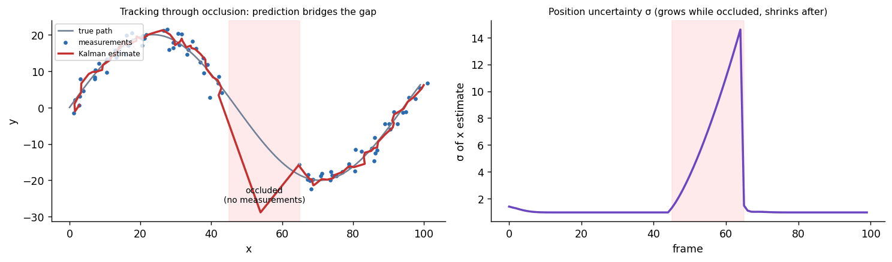
*Figure 4.13 — During the occlusion (pink) there are no measurements; the Kalman filter keeps predicting, its uncertainty grows, and it re-locks when the object reappears.*

| Technique | Idea |
|---|---|
| **Predictive modelling** | **Kalman filter** (motion model; predict + update, see Unit 2 §19 for the equations) predicts the position during occlusion; **particle filter** (sequential Monte-Carlo) keeps many hypotheses for non-linear/multi-modal cases |
| **Temporal information** | Motion estimation (optical flow, velocity), *tracking-by-detection* (re-detect when it reappears) |
| **Shape- and context-aware** | Use scene context (person walks behind a pole); **shape completion** (infer hidden parts with ASM, graph cuts) |
| **Level sets / implicit models** | Implicit curve continues to evolve and can bridge missing data |
| **Multiple hypotheses** | Keep several candidate locations/shapes, score them over time, keep the most consistent |
| **[+] Local-feature / Hough / RANSAC matching** | Match only the visible parts (local features vote), so a partially visible object is still recognised |

**Applications:** video surveillance, medical imaging (overlapping tissue), robot vision/grasping, gesture recognition, quality control on conveyor belts.

---

## 20. Boundary length measures

**Perimeter** $P$ = total length of the boundary. On a digital grid it must be *estimated*.

| Estimator | Formula | Remark |
|---|---|---|
| **Count boundary pixels** | $P\approx N_{\text{boundary}}$ | quick, crude |
| **Chain-code length** | $P=N_e+\sqrt2\,N_o$ ($N_e$ even/axis steps, $N_o$ odd/diagonal steps) | overestimates (staircase effect) |
| **[+] Corrected weights (Kulpa)** | $P\approx0.948\,N_e+1.343\,N_o$ | much closer for digitised curves |
| **[+] Pixel-edge ("crack") counting** | number of pixel edges between object and background | overestimates up to $4/\pi\approx27\%$ for a circle |

**Approximate boundary** with fewer points to cut cost: **Ramer–Douglas–Peucker (RDP)**: draw the chord between the end points; find the point farthest from it; if its distance $>\varepsilon$, keep it and recurse on both halves, else drop all in-between points.

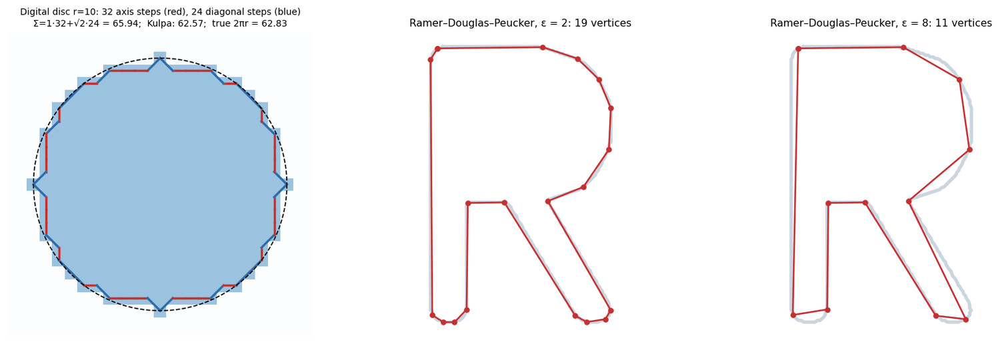
*Figure 4.17 — Digital disc of radius 10: $N_e=32$, $N_o=24$ → chain length $32+\sqrt2\cdot24=65.94$, Kulpa ≈ 62.57, true $2\pi r=62.83$. Right: RDP with $\varepsilon=2$ (19 vertices) and $\varepsilon=8$ (11 vertices).*

**Uses:** shape analysis (circularity $4\pi A/P^2$), object recognition, tumour/organ boundary quantification.

---

## 21. Boundary descriptors

Compact features computed from the **outline** only, for matching, recognition and classification.

| Descriptor | Idea | Invariance notes |
|---|---|---|
| **Chain code** (§22) | Sequence of directions between boundary pixels | first difference ⇒ rotation-invariant (in steps of 45°) |
| **Fourier descriptors** (§23) | Frequency components of the boundary | translation/scale/rotation/start-point invariance after normalisation |
| **Shape signatures** | 1-D function of the boundary: **radial distance** $r(\theta)$ (§18), tangent angle $\psi(s)$, area function | depends on normalisation |
| **Curvature** | Rate of change of tangent direction: $\kappa=\dfrac{x'y''-y'x''}{(x'^2+y'^2)^{3/2}}$ | peaks = corners/sharp bends; sign changes = inflection points |
| **Polygonal approximation / RDP** | Few vertices describing the contour | simple, compact |
| **Shape context** | Log-polar histograms of boundary points (§17) | robust to deformation |

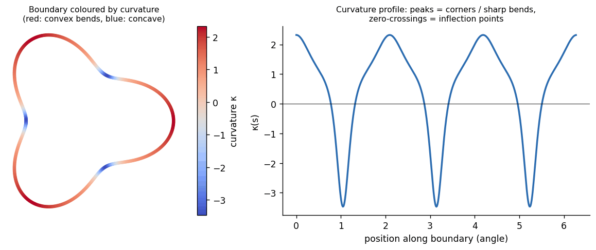
*Figure 4.19 — Curvature along a three-lobed boundary: peaks at the lobe tips (convex), negative dips in the valleys (concave).*

**Applications:** shape recognition/classification, medical analysis (organ/tumour boundaries), tracking changing shapes, robot vision, industrial inspection.

---

## 22. Chain codes

**Idea:** trace the boundary and record the **direction of each step** with a number → a compact, translation-invariant boundary representation (Freeman).

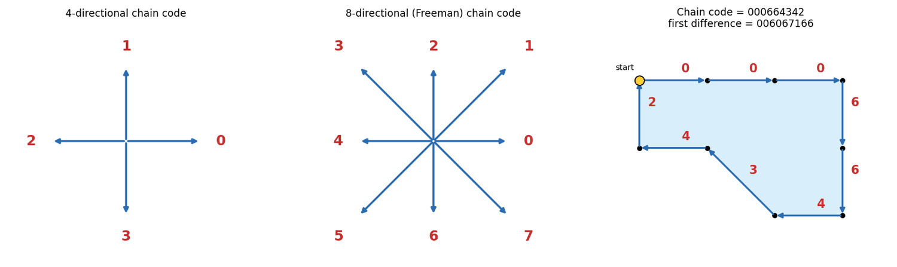
*Figure 4.11 — Direction numbering for 4- and 8-connected codes and a worked example.*

- **4-directional code:** $0=\text{East},\ 1=\text{North},\ 2=\text{West},\ 3=\text{South}$ (only horizontal/vertical steps).
- **8-directional (Freeman) code:** $0=E,\ 1=NE,\ 2=N,\ 3=NW,\ 4=W,\ 5=SW,\ 6=S,\ 7=SE$ (steps of $45^\circ$ counter-clockwise).

> ⚠ **Fix:** your source's "4-connected chain code" lists *Right, Down-Right, Down, Down-Left*. Those include **diagonals**, so they belong to an 8-connected code (and not the standard numbering). A 4-code has only the four axis directions.

**Algorithm:** choose a start pixel → trace the boundary (clockwise or counter-clockwise) → write the direction code of each move → stop when the start is reached.

**Normalisation (because the raw code depends on the start point, rotation and scale):**
1. **Start point:** rotate the sequence to give the **smallest integer** (minimum magnitude).
2. **Rotation:** use the **first difference** (number of $45^\circ$ counter-clockwise turns between consecutive codes, modulo 8) $d_i=(c_{i+1}-c_i)\bmod 8$.
3. **Scale:** resample the boundary to a fixed grid.
The minimum-magnitude circular first difference is the **shape number**.

**Worked example (8-code, start at the top-left, clockwise):** boundary passes $(0,2)\to(1,2)\to(2,2)\to(3,2)\to(3,1)\to(3,0)\to(2,0)\to(1,1)\to(0,1)\to(0,2)$.

$$\text{code}=0\,0\,0\,6\,6\,4\,3\,4\,2\qquad \text{first difference (circular)}=0\,0\,6\,0\,6\,7\,1\,6\,6$$

(already the minimum-magnitude rotation, so it is also the shape number.)
**Length** of the boundary from the code: $N_e+\sqrt2N_o$ (§20).

> ⚠ **Fix:** your source says chain codes are "rotation-invariant". The **raw** code is *not* rotation-invariant (rotating by $90^\circ$ adds 2 to every digit). Invariance comes from the **first difference** (and only for rotations by multiples of $45^\circ$/$90^\circ$).

**Pros:** compact, easy to compute, supports perimeter, area, curvature and matching. **Cons:** noise-sensitive, long codes, rotation/scale handled only by normalisation.
**Applications:** shape recognition and matching, boundary tracking, object tracking.

---

## 23. Fourier descriptors

Treat the boundary as a closed **complex signal**: $s(k)=x(k)+j\,y(k)$, $k=0,\dots,K-1$ (points equally spaced along the boundary).

$$a(u)=\sum_{k=0}^{K-1}s(k)\,e^{-j2\pi uk/K}\quad(\text{Fourier descriptors}),\qquad s(k)=\frac1K\sum_{u=0}^{K-1}a(u)\,e^{j2\pi uk/K}$$

- **Low frequencies** = overall shape; **high frequencies** = fine detail/noise. Keep only the first $M$ coefficients ($M\ll K$) for a compact approximation: $\hat s(k)=\frac1K\sum_{u\in\text{low}}a(u)e^{j2\pi uk/K}$.

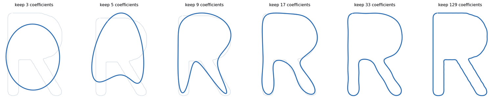
*Figure 4.14 — Reconstructing the letter "R" from 3, 5, 9, 17, 33 and 129 coefficients.*

**Invariance after normalisation**

| Change | Effect on $a(u)$ | How to remove |
|---|---|---|
| Translation | Only $a(0)$ changes (it is the centroid) | ignore $a(0)$ |
| Scaling by $\lambda$ | all $a(u)\to\lambda\,a(u)$ | divide by $\lvert a(1)\rvert$ |
| Rotation by $\varphi$ | all $a(u)\to e^{j\varphi}a(u)$ (phase) | use magnitudes $\lvert a(u)\rvert$ |
| Change of start point $k_0$ | $a(u)\to a(u)e^{j2\pi uk_0/K}$ (phase) | use magnitudes $\lvert a(u)\rvert$ |

$$\boxed{\ d(u)=\frac{|a(u)|}{|a(1)|},\quad u=2,3,\dots,M\ }$$

**Numerical check:** for the shape $r(t)=2+\cos3t$, the normalised magnitudes $|a(1..5)|/|a(1)|$ are $[1,\,0,\,0,\,0.25,\,0]$ — and **exactly the same** after scaling by 2.5, rotating by 0.7 rad and translating by $(3,4)$.
(The price of using magnitudes: the phase is lost, so the shape can't be reconstructed exactly from $d(u)$.)

**Applications:** shape matching/recognition/classification, global shape analysis. **Limitation:** global — local changes alter all coefficients; needs a closed, ordered boundary.

---

## 24. Region descriptors

Features of the **whole region** (interior included), not just the boundary.

| Descriptor | Definition |
|---|---|
| **Area** | number of pixels in the region |
| **Centroid** | $(m_{10}/m_{00},\,m_{01}/m_{00})$ |
| **Bounding box / aspect ratio** | enclosing rectangle; $w/h$ |
| **Extent** | $A/(w\,h)$ |
| **Compactness / circularity** | circularity $=\dfrac{4\pi A}{P^{2}}$ ($=1$ for a circle, smaller otherwise); *compactness* is often defined as the inverse, $P^2/(4\pi A)\ge1$. State your convention. |
| **Eccentricity** | $e=\sqrt{1-b^{2}/a^{2}}$ of the best-fit (equivalent) ellipse ($a,b$ = semi-axes); equals focal distance / major-axis length; 0 = circle |
| **Solidity** | $A/A_{\text{hull}}$ (1 = convex) |
| **Equivalent diameter [+]** | $\sqrt{4A/\pi}$ |
| **Euler number** | $C-H$ |

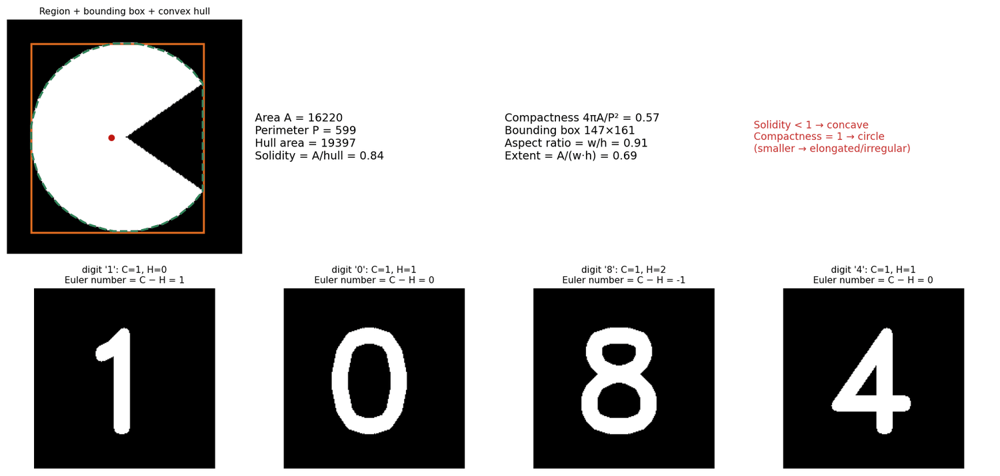
*Figure 4.15 — A concave "Pac-Man": area 16220, hull area 19397 → solidity 0.84, circularity 0.57. Digits illustrate Euler numbers 1, 0, −1.*

**Applications:** shape classification, segmentation, object detection/recognition (well-defined objects).

---

## 25. Moments

**Moments** are statistical descriptors of the distribution of pixel intensities/positions in a region — a compact summary used for recognition.

**Raw (geometric) moments:**
$$m_{pq}=\sum_x\sum_y x^{p}y^{q}f(x,y),\qquad \text{area }m_{00},\quad \bar x=\frac{m_{10}}{m_{00}},\ \bar y=\frac{m_{01}}{m_{00}}$$

**Central moments** (translation invariant): $\mu_{pq}=\sum_x\sum_y(x-\bar x)^p(y-\bar y)^q f(x,y)$, with $\mu_{10}=\mu_{01}=0$.

**Normalised central moments** (scale invariant): $\eta_{pq}=\dfrac{\mu_{pq}}{\mu_{00}^{\,\gamma}},\quad\gamma=\dfrac{p+q}{2}+1,\ p+q\ge2$.

**Orientation and equivalent ellipse:**

$$\theta=\tfrac12\tan^{-1}\!\frac{2\mu_{11}}{\mu_{20}-\mu_{02}},\qquad \lambda_{1,2}=\frac{\mu_{20}+\mu_{02}\pm\sqrt{(\mu_{20}-\mu_{02})^{2}+4\mu_{11}^{2}}}{2\mu_{00}},\qquad e=\sqrt{1-\lambda_2/\lambda_1}$$

**Hu's 7 invariant moments** (invariant to translation, scale and rotation):

$$\begin{aligned}
\phi_1&=\eta_{20}+\eta_{02}\\
\phi_2&=(\eta_{20}-\eta_{02})^2+4\eta_{11}^2\\
\phi_3&=(\eta_{30}-3\eta_{12})^2+(3\eta_{21}-\eta_{03})^2\\
\phi_4&=(\eta_{30}+\eta_{12})^2+(\eta_{21}+\eta_{03})^2\\
\phi_5&=(\eta_{30}-3\eta_{12})(\eta_{30}+\eta_{12})\big[(\eta_{30}+\eta_{12})^2-3(\eta_{21}+\eta_{03})^2\big]\\
&\quad+(3\eta_{21}-\eta_{03})(\eta_{21}+\eta_{03})\big[3(\eta_{30}+\eta_{12})^2-(\eta_{21}+\eta_{03})^2\big]\\
\phi_6&=(\eta_{20}-\eta_{02})\big[(\eta_{30}+\eta_{12})^2-(\eta_{21}+\eta_{03})^2\big]+4\eta_{11}(\eta_{30}+\eta_{12})(\eta_{21}+\eta_{03})\\
\phi_7&=(3\eta_{21}-\eta_{03})(\eta_{30}+\eta_{12})\big[(\eta_{30}+\eta_{12})^2-3(\eta_{21}+\eta_{03})^2\big]\\
&\quad-(\eta_{30}-3\eta_{12})(\eta_{21}+\eta_{03})\big[3(\eta_{30}+\eta_{12})^2-(\eta_{21}+\eta_{03})^2\big]
\end{aligned}$$

The values span many orders of magnitude, so use $-\operatorname{sign}(\phi_i)\log_{10}|\phi_i|$. $\phi_7$ is a *skew invariant*: its **sign flips under mirror reflection**, so it distinguishes mirror images.

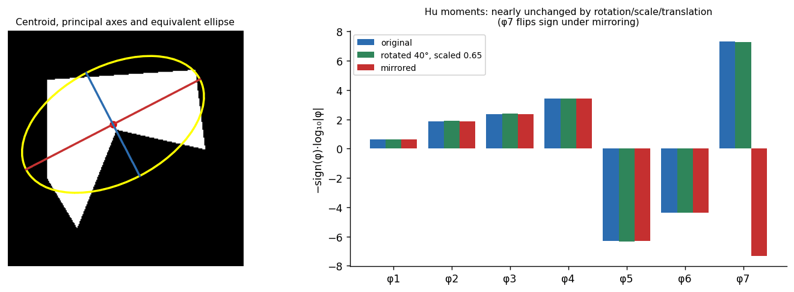
*Figure 4.16 — Left: centroid, principal axes (θ) and equivalent ellipse. Right: φ₁–φ₆ are essentially unchanged after rotating 40° and scaling 0.65; mirroring flips only φ₇.*

**Zernike moments:** projections onto orthogonal polynomials on the unit disc, $Z_{nm}=\dfrac{n+1}{\pi}\sum_x\sum_y f(x,y)\,V^{*}_{nm}(\rho,\theta)$, $V_{nm}=R_{nm}(\rho)e^{jm\theta}$. **$|Z_{nm}|$ is rotation invariant**, the basis is orthogonal (little redundancy), and higher orders add detail — good for recognition.

**Worked example** — the 7-pixel shape (object pixels at $(x,y)$):

$$\begin{bmatrix}0&0&0&0&0\\0&1&1&0&0\\0&1&1&1&0\\0&0&1&1&0\\0&0&0&0&0\end{bmatrix}$$

$m_{00}=7$, centroid $(\bar x,\bar y)=(2,2)$; $\mu_{20}=4$, $\mu_{02}=4$, $\mu_{11}=2$.
$\theta=\tfrac12\tan^{-1}\!\big(\tfrac{2\cdot2}{4-4}\big)=\tfrac12\cdot90^\circ=45^\circ$.
$\eta_{20}=\eta_{02}=4/49=0.0816$, $\eta_{11}=2/49=0.0408$ → $\phi_1=0.1633$, $\phi_2=4(0.0408)^2=0.0067$.

**Applications:** shape recognition and matching, object classification (as input features to ML), medical imaging (tracking/quantifying organ or tumour shape and orientation).

---

# REVISION AIDS

## A. One-page formula sheet

| Topic | Formula |
|---|---|
| Image storage | $M\times N\times k$ bits |
| Histogram equalisation | $s_k=(L-1)\sum_{j\le k}p_r(r_j)$ |
| Gaussian filter | $\frac{1}{2\pi\sigma^2}e^{-(x^2+y^2)/2\sigma^2}$ |
| Unsharp / high-boost | $g=f+k(f-\bar f)$ |
| Butterworth LP | $\frac{1}{1+(D/D_0)^{2n}}$ |
| Gaussian LP | $e^{-D^2/2D_0^2}$ |
| Wiener | $\hat F=\frac{\vert H\vert ^2}{H(\vert H\vert ^2+K)}G$ |
| Otsu | $\sigma_B^2=P_1P_2(m_1-m_2)^2$, $T=\arg\max$ |
| Adaptive threshold | $T(x,y)=\text{local mean}-C$ |
| Gradient | $M=\sqrt{G_x^2+G_y^2}$, $\alpha=\tan^{-1}(G_y/G_x)$ |
| LoG | $-\frac{1}{\pi\sigma^4}\big[1-\frac{x^2+y^2}{2\sigma^2}\big]e^{-\frac{x^2+y^2}{2\sigma^2}}$ |
| Harris | $R=\det M-k(\operatorname{tr}M)^2$ |
| SIFT DoG | $D=L(k\sigma)-L(\sigma)$ |
| Erosion / dilation | $A\ominus B=\{z\mid B_z\subseteq A\}$, $A\oplus B=\{z\mid\hat B_z\cap A\ne\emptyset\}$ |
| Opening / closing | $(A\ominus B)\oplus B$, $(A\oplus B)\ominus B$ |
| Boundary | $A-(A\ominus B)$ |
| GLCM contrast / energy | $\sum(i-j)^2p$, $\sum p^2$ |
| LBP | $\sum_k s(g_k-g_c)2^k$ |
| Euler number | $E=C-H$ |
| Solidity / extent | $A/A_{hull}$, $A/(wh)$ |
| Circularity | $4\pi A/P^2$ |
| $D_4$, $D_8$, $D_E$ | $\vert \Delta x\vert +\vert \Delta y\vert $, $\max$, $\sqrt{\Delta x^2+\Delta y^2}$ |
| Mahalanobis | $\sqrt{(x-\mu)^T\Sigma^{-1}(x-\mu)}$ |
| Chamfer 3-4 | forward/backward pass, weights $3$ (4-nbr), $4$ (diag) |
| Snake energy | $\int[\tfrac12(\alpha\vert v'\vert ^2+\beta\vert v''\vert ^2)+E_{ext}]ds$, $E_{ext}=-\vert \nabla(G_\sigma*I)\vert ^2$ |
| Level set | $\phi_t+F\vert \nabla\phi\vert =0$ |
| ASM | $x=\bar x+Pb$, $\vert b_i\vert \le3\sqrt{\lambda_i}$ |
| Chain-code length | $N_e+\sqrt2N_o$ |
| First difference | $d_i=(c_{i+1}-c_i)\bmod8$ |
| Fourier descriptor | $a(u)=\sum s(k)e^{-j2\pi uk/K}$, $d(u)=\vert a(u)\vert /\vert a(1)\vert $ |
| Moments | $m_{pq}=\sum x^py^qf$, $\mu_{pq}=\sum(x-\bar x)^p(y-\bar y)^qf$, $\eta_{pq}=\mu_{pq}/\mu_{00}^{(p+q)/2+1}$ |
| Orientation | $\theta=\frac12\tan^{-1}\frac{2\mu_{11}}{\mu_{20}-\mu_{02}}$ |
| Hu | $\phi_1=\eta_{20}+\eta_{02}$, $\phi_2=(\eta_{20}-\eta_{02})^2+4\eta_{11}^2$, … |

## B. Quick comparison tables

**Edge detectors:** Roberts < Prewitt < Sobel < LoG < **Canny** (noise robustness and quality).

**Corner/keypoint detectors**

| | Corner/blob | Scale-invariant | Rotation-invariant | Speed | Descriptor |
|---|---|---|---|---|---|
| Harris / Shi–Tomasi | corner | no | yes | medium | none |
| FAST | corner | no | no | very fast | none |
| SIFT | blob (DoG) | yes | yes | slow | 128-D float |
| SURF | blob (Hessian) | yes | yes | fast | 64-D float |
| ORB | corner (oriented FAST) | yes (pyramid) | yes | fast | 256-bit binary |

**Filtering:** *mean* (linear, blurs) · *Gaussian* (linear, smooth) · *median* (non-linear, impulse noise, preserves edges) · *low-pass* (blur) · *high-pass* (edges).

**Thresholding:** global (uniform light) · Otsu (automatic global) · adaptive (uneven light) · multi-level (several regions).

**Boundary vs region vs skeleton representations**

| | Boundary-based | Region-based | Skeleton-based |
|---|---|---|---|
| Examples | chain code, Fourier descriptors, signatures, curvature | area, moments, compactness, solidity, Euler number | medial axis, thinning |
| Good for | outline/contour shape | overall mass distribution | topology, strokes, elongated shapes |
| Weakness | noise on the contour | ignores fine boundary detail | spurs/noise sensitivity |

**Snakes vs level sets:** snake = explicit parametric curve, fixed topology, simple; level set = implicit, handles merging/splitting, heavier computation.

## C. Likely exam questions (answer outlines)

### Q1 (compulsory, short answers) — be ready to write 2–3 lines on:
Sampling vs quantisation · histogram equalisation · median filter (why for salt-and-pepper) · low-pass vs high-pass filter · Otsu's method · adaptive thresholding · Sobel vs Laplacian · steps of Canny (hysteresis) · Harris corner response · why SIFT is scale-invariant · FAST criterion · erosion/dilation/opening/closing · structuring element · GLCM features · LBP · 4- vs 8-connectivity · Euler number · two-pass labelling · size filtering · distance transform · Zhang–Suen conditions · skeleton vs thinning · snake energy terms · level set vs snake · ASM · shape context · centroidal profile · occlusion handling · chain code & shape number · Fourier descriptor invariance · Hu moments · solidity/compactness.

### Unit 3 long questions (15 marks)
1. **Review of image processing: enhancement (point ops, histogram equalisation with a numerical), restoration (inverse/Wiener), colour models, segmentation, compression.** → §1
2. **Classical filtering: spatial (mean, Gaussian, median, unsharp) and frequency-domain (ideal, Butterworth, Gaussian LP/HP); compare.** → §2
3. **Thresholding: global, Otsu (derivation + numerical), adaptive, multi-level; challenges.** → §3
4. **Edge detection: gradient operators with a Sobel numerical, LoG, full Canny pipeline, comparison.** → §4
5. **Corner and interest point detection: Harris (derivation of $R$), FAST, SIFT steps, SURF/ORB, comparison table.** → §5
6. **Mathematical morphology: definitions of erosion, dilation, opening, closing with an example; hit-or-miss, boundary extraction, applications.** → §6
7. **Texture: models; GLCM with computed features; LBP; Gabor/wavelets; morphology vs texture.** → §7

### Unit 4 long questions (15 marks)
1. **Binary shape analysis: geometric and topological properties, connectivity, descriptors, applications.** → §8–9
2. **Connectedness and object labelling: 4/8/m-connectivity, two-pass algorithm with an example, counting, challenges.** → §9–10
3. **Size filtering and distance functions: metrics, distance transform, chamfer algorithm with an example.** → §11–12
4. **Skeletons and thinning: MAT, Zhang–Suen algorithm with the conditions, skeleton vs thinning, applications.** → §13
5. **Deformable shape analysis and active contours: explicit vs implicit models, snake energy functional and its minimisation, level sets, ASM.** → §14, §16–17
6. **Boundary tracking procedures (edge/region/active contour, Moore tracing, marching squares) and boundary length measures.** → §15, §20
7. **Chain codes, shape number and Fourier descriptors: construction, normalisation, invariance proofs/tables.** → §22–23
8. **Region descriptors and moments: central/normalised moments, Hu's invariants, orientation; compute for a small binary image.** → §24–25
9. **Shape recognition, centroidal profiles and occlusion handling.** → §17–19

## D. Last-minute checklist

- [ ] Can I do a histogram equalisation and an Otsu numerical by hand?
- [ ] Can I apply Sobel masks to a 3×3 patch and give magnitude + direction?
- [ ] Can I list the 5 Canny steps and explain hysteresis?
- [ ] Can I write the Harris matrix, response $R$ and the flat/edge/corner rule?
- [ ] Can I list the SIFT steps and say why it is scale- and rotation-invariant?
- [ ] Can I define erosion, dilation, opening, closing and sketch an example?
- [ ] Can I compute a GLCM and contrast/energy/homogeneity for a small image?
- [ ] Do I know 4-, 8- and m-connectivity (and the labelling two-pass method)?
- [ ] Can I compute a distance transform by a two-pass algorithm?
- [ ] Can I state the Zhang–Suen conditions (a)–(d)?
- [ ] Can I write the snake energy and explain α, β and the external force?
- [ ] Can I derive a chain code, its first difference and shape number?
- [ ] Can I explain why Fourier-descriptor magnitudes are invariant (and what each normalisation removes)?
- [ ] Can I compute $m_{00}$, centroid, $\mu_{20},\mu_{02},\mu_{11}$, orientation and $\phi_1$ for a tiny shape?

*Good luck with the exam!*
