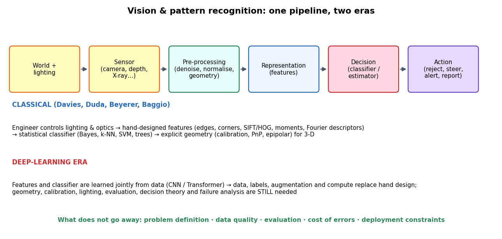
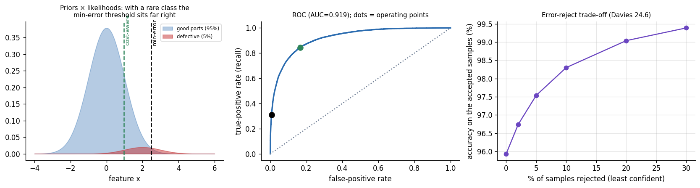
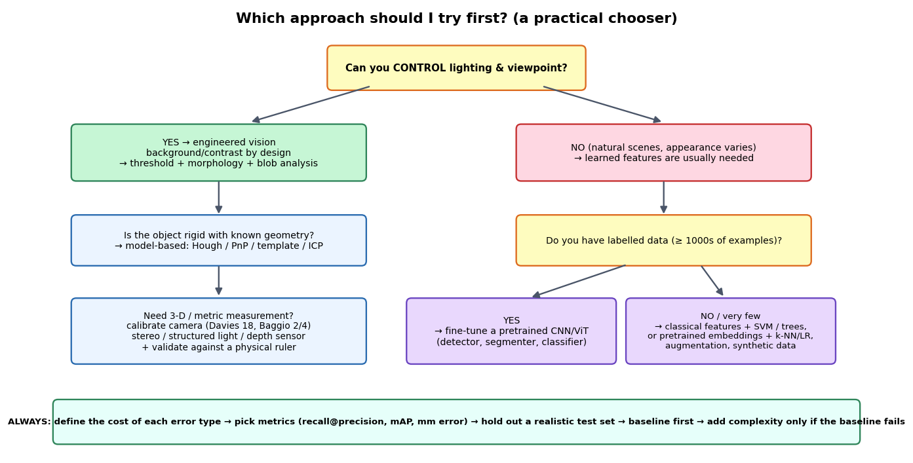

# 01 — The Big Picture and the Ten Mental Models

> If you only read one file, read this one. Everything in vision and pattern recognition is a variation on a handful of ideas. Learn the ideas and the algorithms stop looking like a zoo.

---

## 0. What the words mean (and why they get confused)

| Term | One-line meaning | Typical output |
|---|---|---|
| **Image processing** | Image in → image out (denoise, sharpen, resize, compress) | An image |
| **Computer vision** | Image(s) in → *understanding* out (what, where, how far, how fast) | Labels, boxes, 3-D, motion |
| **Machine vision** | Computer vision **inside a factory/process** with controlled light, fixed cameras and hard timing | Pass/fail, measurement, sorting signal |
| **Pattern recognition** | Measurements in → decision out (the *decision* half of vision, and of speech, signals, medicine…) | A class, a score, a decision |
| **Machine learning** | Learn the mapping from examples rather than writing it by hand | A trained model |

*Davies* (ch. 1) frames vision as the problem of getting a machine to make sense of a 3-D world from 2-D images; *DHS* (ch. 1) and *Beyerer* (ch. 1) frame recognition as the problem of mapping measurements to decisions. A real product always needs **both halves**: a vision front end that produces good measurements, and a recognition back end that turns them into decisions.

---

## 1. The ten mental models

### Model 1 — Vision is an *inverse* problem (and therefore ambiguous)
A camera performs a many-to-one projection: a whole line of 3-D points lands on the same pixel, brightness mixes illumination, material and shape, and objects hide each other. Going from image back to world is **ill-posed**; it only becomes solvable by adding **constraints**: known lighting, known object geometry, several views, motion, or *priors learned from data*.
- *Consequence:* every vision method hides assumptions. When it fails in the field, an assumption was violated. Make the assumptions explicit.
- *Example:* a single image gives no depth; two calibrated views (epipolar geometry) or a known-size marker do.
- *Where:* Davies ch. 1, ch. 15–18.

### Model 2 — Recognition is decision-making under uncertainty (Bayes is the yardstick)
Given measurements $x$, choose the action that minimises **expected cost**. With equal costs this reduces to "pick the class with the largest posterior":

$$\hat\omega=\arg\max_{\omega}\,P(\omega\mid x)=\arg\max_{\omega}\,p(x\mid\omega)\,P(\omega)$$

Every classifier — nearest neighbour, SVM, neural net, decision tree — is an *approximation* of this rule, differing in how it estimates what it needs and what shape of boundary it allows. The Bayes error is the **floor**: no classifier on these features can beat it.
- *Consequence:* when accuracy stalls, ask whether you are at the floor (features carry no more information) or above it (a better model or more data would help). Better features lower the floor; a better classifier only approaches it.
- *Where:* DHS ch. 2; Beyerer ch. 3.

### Model 3 — Representation is half the battle
The same data are easy or hard depending on the features. A good feature has **small spread within a class and large distance between classes**. Hand-designed features (edges, corners, HOG, SIFT, moments, Fourier descriptors) encode human knowledge; learned features (CNNs) encode knowledge from data.
- *Measured (my lab, 1,797 digit images):* the *same* HOG feature gave **90.9 %** accuracy with one configuration and **99.3 %** with another (upscaled image, coarser cells), while raw pixels with an RBF-SVM gave 98.1 %. A badly tuned representation can be *worse than no representation*.
- *Where:* Beyerer ch. 2; DHS ch. 1, 10; Davies ch. 6–10.

### Model 4 — Training error lies; generalisation is the only score that matters
A model flexible enough can memorise the training set. What counts is performance on **new** data from the same distribution as production. Bias (too simple) and variance (too sensitive to the particular training sample) trade off.
- *Rules of thumb:* always hold out data; look at the **learning curve** (does adding data still help?); when training and validation error are far apart you have a variance problem (more data/regularise); when both are high you have a bias problem (richer model/better features).
- *Where:* DHS ch. 9; Beyerer ch. 6, 9.1–9.2.

### Model 5 — Dimensionality is the enemy; data and structure are the medicine
Volume grows exponentially with dimension, so data become sparse, distances lose meaning, and the number of parameters outruns the number of examples ("curse of dimensionality").
- *Measured:* I appended pure-noise features to the 64 pixel features. With **400 useless extra features** the accuracy of **k-NN fell from 97.7 % to 61.5 %**, the **RBF-SVM only from 98.2 % to 91.8 %**, logistic regression from 96.9 % to 89.6 %. Distance-based methods are most exposed because every irrelevant coordinate adds to the distance.
- *Remedy ladder:* better features → feature selection → dimensionality reduction (PCA/LDA) → regularisation → more data → a model with the right inductive bias (e.g. convolution for images).
- *Where:* DHS §3.7; Beyerer ch. 6.1.

### Model 6 — Invariance versus discrimination
You want features that **ignore** nuisance variation (position, scale, rotation, lighting, pose) but **keep** class differences. Too little invariance → needs huge data; too much → classes collapse together (e.g. full rotation invariance cannot tell a "6" from a "9").
- *Tools:* normalisation, invariant descriptors (Hu moments, SIFT scale-space), augmentation (teach invariance by example), architectures (convolution = translation equivariance).
- *Where:* Davies ch. 6, 9–10, 17; Beyerer ch. 2.

### Model 7 — Two families: geometry and appearance
- **Geometric / model-based:** you know the shape, so fit it (Hough transform, template matching, pose from known points, epipolar geometry). Needs few or no training images, gives *metric* answers, fails when the object model is wrong.
- **Appearance / statistical:** you learn what it looks like from examples (classifiers on features, CNNs). Handles variety, but needs data and gives scores, not guarantees.
- Real systems **combine** them: a learned detector finds the object, geometry measures it.

### Model 8 — Errors are not symmetric; you must choose the operating point
"Accuracy" is rarely the right objective. A missed defect, a missed pedestrian, a false alarm and a wasted manual review all have different costs, and classes are usually imbalanced.
- *Measured (5 % defective parts):* the classifier that maximises accuracy (95.9 %) catches only **31 %** of defects; a plain "everything is fine" rule already scores 95.0 % accuracy and catches **none**. Setting the threshold from the actual cost (a miss costs 20× a false alarm) raised recall to **84 %** and cut the expected cost per part from **0.69 to 0.31** — at the price of a **16.5 %** false-alarm rate. Neither number is "right": the **cost ratio decides**.
- *Tools:* ROC and precision–recall curves, cost-based thresholds, calibrated probabilities, the **reject option** (see below).
- *Where:* DHS ch. 2; Beyerer ch. 3, 9.2, 9.4; Davies ch. 24.

*Figure 1 — Left: priors × likelihoods; the min-error threshold sits far to the right when the defect class is rare. Middle: the same threshold choices as operating points on the ROC curve. Right: letting the system say "I'm not sure" on the 30 % least confident samples raises accuracy on the rest from 95.9 % to 99.4 % (measured).*

### Model 9 — Robustness comes from voting, consensus and prediction
Real data contain outliers, clutter and occlusion. Three families of defence:
1. **Voting** (Hough transform): each pixel votes for the shapes it could belong to; a shape emerges where votes pile up, even if half of it is missing.
2. **Random consensus** (RANSAC): fit to minimal random subsets, keep the model most points agree with.
3. **Prediction** (Kalman/particle filters): use a motion model to bridge gaps and reject implausible measurements.
- *Measured:* Hough circle detection stayed **100 %** with 25 % of the circle hidden, **95 %** with half hidden, 80 % at 65 % hidden, 40 % at 80 % hidden. With 40 % outliers a least-squares line gave slope 0.41 / intercept 25.5, RANSAC 0.496 / 10.1 (truth 0.5 / 10). Matching SIFT points between an image and a darker, noisy, perspective-warped copy gave a homography with **0.8 px** corner error using RANSAC and **43 px** using least squares on all matches.
- *Where:* Davies ch. 11–13, 19, 22; DHS (robust estimation, state estimation); Baggio ch. 3–4.

### Model 10 — Vision is a *system*: light first, optics second, algorithm third
Davies devotes whole chapters (20, 25–27) to the point that the cheapest, most reliable "algorithm" is often **better lighting and a better viewpoint**. If you can make the object a bright blob on a dark background (back-light), a threshold replaces a research project.
- *Practical:* fix lighting, lens, exposure and trigger **before** tuning algorithms; log every image the system rejects; budget the **time**: belt speed × field of view ÷ processing time.
- *Where:* Davies ch. 20, 25, 26, 27.

*Figure 2 — A practical chooser for "what should I try first?"*

---

## 2. What changed with deep learning — and what did not

| Aspect | Classical pipeline | Deep-learning era **[Modern]** | Still true |
|---|---|---|---|
| Features | Hand-designed (edges, SIFT, HOG, moments) | Learned end-to-end (CNN / Transformer) | Representation decides difficulty |
| Data needed | Tens–thousands | Thousands–millions (less with pretrained models) | Data quality > quantity; label noise hurts |
| Strength | Transparent, fast, works with little data, precise geometry | Handles huge appearance variety; state of the art on most recognition benchmarks | — |
| Weakness | Brittle to appearance change | Data-hungry, opaque, can fail silently out of distribution | **Evaluate on production-like data** |
| Geometry (calibration, pose, SfM, SLAM) | Core | Still core; learning augments it | Camera models and epipolar geometry are unchanged |
| Decision theory | Explicit | Implicit in the loss | Costs, priors, thresholds, rejection still need thought |
| Engineering | Lighting, optics, timing | + dataset curation, training infra, deployment (quantisation, edge) | The system view |

**Practical stance:** start with the simplest baseline that could work (threshold, template, HOG+SVM, or a pretrained model), measure it on realistic data, and add complexity only where the error analysis says so. Deep learning is a powerful tool *inside* the framework above, not a replacement for it.

---

## 3. What my small experiments teach (all in `code/`, reproduce with `run_all.sh`)

| Question | Experiment (script) | Result to remember |
|---|---|---|
| Does representation matter? | digits: raw vs PCA vs two HOG settings (`01`) | 90.9 % → 99.3 % just by changing HOG settings |
| What does irrelevant data do? | add noise features (`01`) | k-NN collapses (97.7 → 61.5 %); SVM degrades gently (98.2 → 91.8 %) |
| Which model with tiny data? | 20–300 training images (`01`) | At **20** examples k-NN (60 %) beat SVM (52 %) and LDA (46 %); at **300** SVM (95.3 %) overtook k-NN (94.0 %) and LDA (92.2 %) — model rankings depend on data size |
| What does cost do to the threshold? | rare defect (`02`) | Accuracy-optimal ≠ cost-optimal (recall 31 % vs 84 %) |
| Can a system abstain usefully? | reject option (`02`) | Reject 30 % → accuracy 95.9 % → 99.4 % |
| How robust is voting / consensus? | Hough, RANSAC (`04`, `05`) | Graceful under occlusion; least squares breaks with outliers |
| Is low reprojection error proof of good calibration? | synthetic calibration with ground truth (`06`) | **No.** At the same noise level RMS error was 0.68 px in every setting, while focal-length error ranged **72 px (nearly parallel views)** to **7 px (30° tilts)** to **3.8 px (20 views)** |
| How accurate is marker pose? | ArUco, ground truth (`07`) | Depth error 0.8 mm at 0.5 m, 3.4 mm at 1 m, **23 mm at 2 m, 56 mm at 3 m** |
| Does prediction help through occlusion? | Kalman vs hold-last (`08`) | 10-frame gap: 3.3 px vs 13.5 px; 25-frame gap: 8.0 vs 28.6 px — and still 30 vs 78 px when the object accelerates unpredictably |

---

## 4. Misconceptions worth unlearning

1. **"Higher accuracy = better system."** Not with imbalanced classes or unequal costs (Model 8).
2. **"More features always help."** They help only if informative; otherwise they hurt (Model 5).
3. **"Deep learning makes classical vision obsolete."** It changed the *recognition* half most; geometry, calibration, lighting and evaluation matter as much as ever.
4. **"Low training/reprojection error means it works."** Training error and reprojection error are *optimistic by construction*; judge on held-out data or independent ground truth.
5. **"The algorithm failed."** Most field failures are lighting, focus, motion blur, a changed camera, or a data shift — check the *images* first.
6. **"A model is finished when the paper's metric is reached."** It is finished when its **error analysis** is understood: which cases fail, how often, and what each failure costs.

---

## 5. Glossary (quick reference)

| Term | Meaning |
|---|---|
| Prior $P(\omega)$ | How common each class is before looking at the data |
| Likelihood $p(x\mid\omega)$ | How probable these measurements are *if* the class is $\omega$ |
| Posterior $P(\omega\mid x)$ | Probability of the class after seeing the data |
| Bayes error | Lowest possible error for given features |
| Discriminant function | Score per class; decide the largest |
| Decision boundary | Where two classes' scores tie |
| Overfitting | Fits noise in the training set; generalises badly |
| Regularisation | Penalty/constraint that discourages over-complex models |
| Cross-validation | Repeated train/validate splits to estimate generalisation |
| ROC curve | True-positive rate vs false-positive rate as the threshold moves |
| Precision / recall | Of predicted positives how many are right / of true positives how many were found |
| mAP, IoU | Detection metrics: mean average precision; box overlap (intersection over union) |
| Reject option | Allow "don't know" when confidence is low |
| Feature / feature vector | Measurable property / the list of them for one sample |
| PCA | Project onto directions of largest variance (unsupervised) |
| LDA / Fisher | Project onto the direction that best separates classes (supervised) |
| Kernel trick | Compute inner products in a high-dimensional space without going there |
| Convolution / correlation | Slide a small template over the image and sum products |
| Gradient, edge | Rate of intensity change; locus of large change |
| Corner / keypoint | Point with strong change in two directions / distinctive repeatable point |
| Descriptor | Vector summarising the neighbourhood of a keypoint (e.g. 128-D SIFT) |
| Hough transform | Voting in parameter space to find lines/circles |
| RANSAC | Fit to random minimal subsets, keep the largest consensus |
| Homography | 3×3 matrix mapping one plane's image to another's |
| Intrinsics $K$ / extrinsics $[R\mid t]$ | Camera's internal geometry / its pose in the world |
| Epipolar geometry | Constraint relating matching points in two views |
| Fundamental / essential matrix | $F$ (uncalibrated) and $E=K'^{T}FK$ (calibrated) encoding that constraint |
| Triangulation | Recover a 3-D point from its images in two or more views |
| Bundle adjustment | Jointly refine cameras and 3-D points to minimise reprojection error |
| PnP | Estimate camera pose from known 3-D points and their images |
| Optical flow | Apparent pixel motion between frames |
| Kalman / particle filter | Recursive state estimators (Gaussian-linear / general) |
| Morphology | Shape-based operations (erode, dilate, open, close) |
| Distance transform | For each pixel, distance to the nearest background pixel |
| Skeleton / medial axis | Thin line through the middle of a shape |
| Active contour (snake) | Curve that moves to minimise an energy and snaps onto boundaries |
| Fourier descriptor | Boundary as a complex signal; low-frequency coefficients describe shape |
| ROI / region proposal | Region of interest / candidate location for a detector |
| Domain shift | Production data differ from training data |
