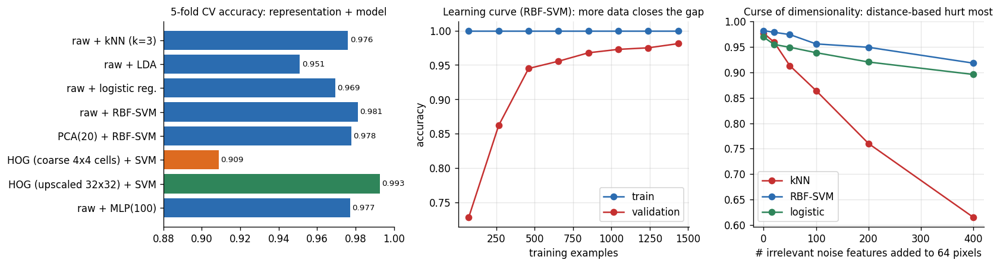
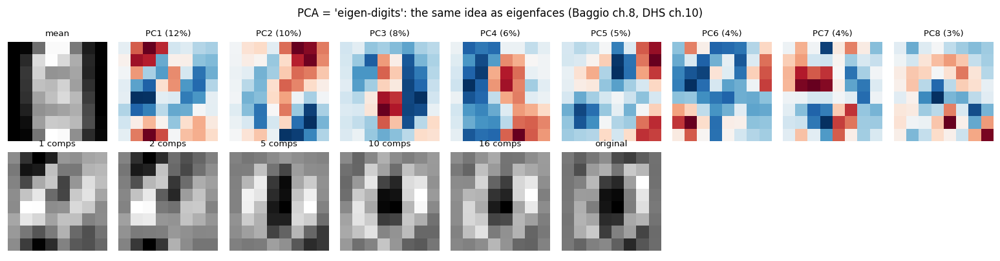
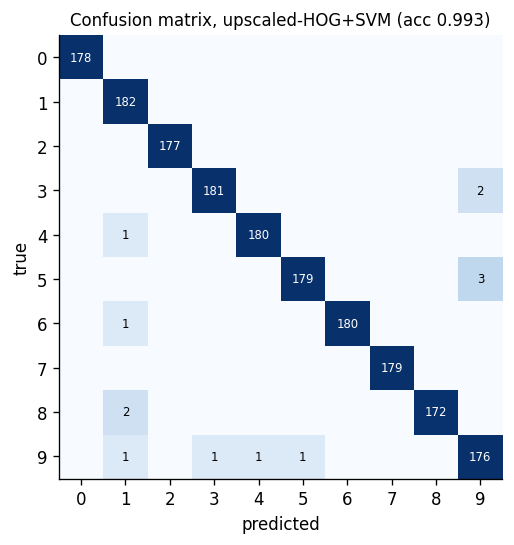

# 02 — Pattern Recognition: Deep Understanding

> Sources: **DHS** (Duda–Hart–Stork) for the theory, **Beyerer** for features, evaluation and a modern view, **Davies ch. 24** for the vision-practitioner's view. **[Modern]** = from general professional knowledge, not the books.
> Companion lab: `code/01_pr_digits_pipeline.py` (all measured numbers below), `code/02_bayes_roc_cost.py`.

---

## 1. Bayes decision theory — the one idea everything else approximates
*(DHS ch. 2 · Beyerer ch. 3)*

**Setting.** Classes $\omega_1..\omega_c$ with priors $P(\omega_j)$; class-conditional densities $p(x\mid\omega_j)$; an action $\alpha_i$ (e.g. "say class $i$", or "reject") with loss $\lambda(\alpha_i\mid\omega_j)$.

$$\text{Posterior: }P(\omega_j\mid x)=\frac{p(x\mid\omega_j)P(\omega_j)}{\sum_k p(x\mid\omega_k)P(\omega_k)}\qquad
\text{Conditional risk: }R(\alpha_i\mid x)=\sum_{j}\lambda(\alpha_i\mid\omega_j)\,P(\omega_j\mid x)$$

**Decide the action with the least conditional risk.** With 0/1 loss this is "pick the largest posterior" (minimum error rate). For two classes it becomes a **likelihood-ratio test**:

$$\text{decide }\omega_1\iff\frac{p(x\mid\omega_1)}{p(x\mid\omega_2)}>\frac{\lambda_{12}-\lambda_{22}}{\lambda_{21}-\lambda_{11}}\cdot\frac{P(\omega_2)}{P(\omega_1)}$$

**Reading the formula:** the threshold moves with the *priors* (rare class → harder to say "rare") and with the *costs* (expensive miss → easier to say "defect"). That is exactly what the rare-defect experiment showed: moving the threshold from posterior $0.5$ to $1/21$ (cost ratio 20:1) changed recall from 31 % to 84 %.

**Gaussian classes** (the case where everything is explicit). With discriminant $g_i(x)=\ln p(x\mid\omega_i)+\ln P(\omega_i)$:

$$g_i(x)=-\tfrac12(x-\mu_i)^{T}\Sigma_i^{-1}(x-\mu_i)-\tfrac12\ln|\Sigma_i|+\ln P(\omega_i)$$

| Covariances | Decision boundary | Named method |
|---|---|---|
| $\Sigma_i=\sigma^2I$ (equal, spherical) | Hyperplane, perpendicular bisector (shifted by priors) | minimum-distance (nearest-mean) classifier |
| $\Sigma_i=\Sigma$ (equal, general) | Hyperplane | **LDA** (Fisher-equivalent) |
| $\Sigma_i$ different | Quadric (curved) | **QDA** |

The quantity $(x-\mu)^{T}\Sigma^{-1}(x-\mu)$ is the squared **Mahalanobis distance**: distance measured in units of the class's own spread, so correlated features are handled properly.

**Why this matters in practice**
- It tells you what the *ideal* answer looks like; ML methods are different ways to estimate it.
- **Naïve Bayes** = assume features independent given the class: $p(x\mid\omega)=\prod_ip(x_i\mid\omega)$. Wrong but often effective, especially in high dimensions with little data, because it needs only 1-D densities.
- The **reject option** (DHS 2.3, Beyerer 9.4, Davies 24.6): refusing to decide when $\max_jP(\omega_j\mid x)$ is low trades coverage for accuracy — *measured:* reject the 30 % least confident → accuracy on the rest 95.9 % → 99.4 %. In inspection, rejected items go to a human or a second stage.

---

## 2. Estimating what the theory needs
*(DHS ch. 3 · Beyerer ch. 4)*

You rarely know $p(x\mid\omega)$; you estimate it from samples.

| Approach | Idea | Gaussian example | Remarks |
|---|---|---|---|
| **Maximum likelihood (MLE)** | Choose parameters that make the data most probable | $\hat\mu=\bar x$, $\hat\Sigma=\frac1N\sum(x-\bar x)(x-\bar x)^T$ | Simple; $\hat\Sigma$ is biased low (use $N-1$ for the unbiased version) |
| **MAP / Bayesian** | Put a prior on the parameters; use the posterior | Prior pulls $\hat\mu$ toward a belief; vanishes as $N$ grows | Helps when $N$ is small |
| **EM algorithm** | MLE with hidden variables (e.g. which mixture component) | Gaussian mixtures | Iterate E-step (soft assignments) and M-step (re-estimate) |

**Practical traps**
- If the number of samples $N$ is not much larger than the dimension $d$, the sample covariance is **noisy or singular** (rank $\le N-1$). Fixes: shrinkage toward a diagonal/identity matrix, PCA first, or assume diagonal covariance (naïve Bayes).
- Wrong model + lots of data can lose to a flexible model; right model + little data beats a flexible one. This is the bias–variance trade-off in disguise.

---

## 3. Dimensionality, overfitting, and why "more features" can hurt
*(DHS §3.7 · Beyerer ch. 6)*

With a finite training set, adding features first raises accuracy and then **lowers** it (the Hughes phenomenon): the extra dimensions bring more parameters than the data can pin down. High dimensions also make distances concentrate (all points look equally far).

*Figure 1 — Left: representation + model (5-fold CV). Middle: learning curve of an RBF-SVM; the gap between training and validation shrinks with data. Right: appending irrelevant noise features.*

**Measured on 1,797 8×8 digit images** (5-fold CV unless stated):

| Pipeline | Accuracy |
|---|---|
| Raw pixels + LDA | 95.1 % |
| Raw + logistic regression | 96.9 % |
| Raw + k-NN (k=3) | 97.6 % |
| Raw + MLP (100 hidden) | 97.7 % |
| PCA(20) + RBF-SVM | 97.8 % |
| Raw + RBF-SVM | 98.1 % |
| HOG, coarse 4×4 cells + SVM | 90.9 % |
| HOG on upscaled image + SVM | **99.3 %** |

**Learning from the table**
1. The best model is not the fanciest: a well-tuned SVM on good features beats the small neural net.
2. **Compressing 64 pixels to 20 PCA components cost almost nothing** (98.1 → 97.8 %): most of the information lives in a few directions.
3. A **mis-configured feature extractor** (coarse HOG) is the *worst* entry — representation is a design decision, not a default.

**Rule-of-thumb (heuristic, not a theorem):** want at least ~5–10 training samples per feature *per class* for linear models, and much more for flexible ones. If you can't, reduce dimension or regularise.

*Figure 2 — PCA = "eigen-images". The first components capture broad stroke patterns; 10–16 components already reconstruct a digit. This is exactly the eigenface idea in Baggio ch. 8.*

---

## 4. Non-parametric methods: Parzen windows and k-NN
*(DHS ch. 4 · Beyerer ch. 5)*

**Idea:** let the data speak — estimate the density near $x$ from the nearby samples instead of assuming a formula.
- **Parzen window:** $\hat p(x)=\frac1N\sum_i\frac1{h^d}\varphi\!\big(\frac{x-x_i}{h}\big)$; window width $h$ is the smoothing (too small → spiky/variance, too large → blurry/bias).
- **k-NN:** take the $k$ nearest training samples and vote; the volume adapts to the local density.
- **Cover–Hart result:** the asymptotic error of the 1-NN rule is at most **twice the Bayes error** — a strong guarantee for such a simple rule, *if* you have enough data and a meaningful distance.

**Practical rules for k-NN**
- **Scale/standardise** features (otherwise one large-range feature dominates).
- Choose $k$ by cross-validation (small $k$ = low bias/high variance; odd $k$ for two classes avoids ties); distance-weighting helps.
- **Keep dimension low** and remove irrelevant features (measured: with 400 noise features k-NN dropped from 97.7 % to 61.5 % while the SVM only fell to 91.8 %).
- Query time is $O(N)$ unless you use an index (k-d tree for low dimension; approximate nearest-neighbour search for large embeddings **[Modern]**).
- **It shines in the tiny-data regime** (measured with 20 training digits: k-NN 60 % vs SVM 52 % vs LDA 46 %; by 300 samples the SVM led, 95.3 % vs 94.0 % vs 92.2 %), and with good **embeddings** from a pretrained network **[Modern]**.

---

## 5. Linear discriminants, the perceptron, and the SVM
*(DHS ch. 5 · Beyerer §7.1–7.3, 7.7)*

**Linear discriminant:** $g(x)=w^Tx+w_0$; boundary $g(x)=0$ is a hyperplane, $w$ is its normal and $g(x)/\lVert w\rVert$ is the signed distance.

| Learning rule | Objective | Behaviour |
|---|---|---|
| **Perceptron** | Fix misclassified samples | Converges only if the data are linearly separable |
| **Least squares / LMS** | Minimise $\sum(g(x_i)-t_i)^2$ | Always converges, but sensitive to outliers and not tied to classification error |
| **Logistic regression** | Maximise class likelihood with $\sigma(w^Tx)$ | Gives calibrated-ish probabilities; the default linear baseline |
| **Fisher / LDA** | Maximise $\frac{w^TS_Bw}{w^TS_Ww}$ | Optimal for equal-covariance Gaussians; also a dimension reducer |
| **SVM** | Maximise the margin $2/\lVert w\rVert$ | Robust; solution depends only on support vectors |

**SVM in plain words.** Among all separating hyperplanes choose the one **farthest from the closest samples**. Allow some violations with slack ($C$ controls how much you pay). A **kernel** lets the same machinery build a curved boundary by working with inner products in a high-dimensional space.

**Tuning the RBF-SVM** (the standard recipe): standardise inputs; search $C$ and $\gamma$ on a **log grid** (e.g. $C\in2^{-5..15}$, $\gamma\in2^{-15..3}$) with cross-validation. *Big $C$ = narrow margin, fits training data hard; big $\gamma$ = very local influence of each support vector, risk of overfit.*
**When it's the right tool:** small-to-medium data, high-dimensional features, you want a strong non-deep baseline. **When not:** millions of samples (training scales roughly quadratically or worse), or raw images without good features.

---

## 6. Neural networks and deep learning
*(DHS ch. 6–7 · Beyerer §7.4–7.6)*

**Backpropagation** is the chain rule applied to a layered function, computing $\partial L/\partial w$ for every weight so gradient descent can reduce the loss. DHS §6.8 lists practical tricks that are **still the standard advice**: scale/standardise inputs, initialise weights small and random (not zero), pick the learning rate carefully (or adapt it), use momentum/adaptive optimisers, add **weight decay**, and **stop early** based on validation error.

**Why convolution for images (Beyerer 7.6 [Modern] extension).** A fully connected layer on a 1-megapixel image needs millions of weights per neuron and ignores that a cat is a cat anywhere in the frame. A **convolutional layer** reuses one small filter everywhere (weight sharing ⇒ translation equivariance, far fewer parameters), pooling adds some local invariance, and stacking layers builds features from edges → parts → objects. **Autoencoders** (Beyerer 7.5) learn compressed codes by reconstructing the input — nonlinear cousins of PCA.

**[Modern] How these are used today:** pretrained CNNs/Transformers fine-tuned on a few thousand labelled images (transfer learning); detection heads (boxes), segmentation heads (masks), embeddings for retrieval; data augmentation as the way to teach invariance. The theory in this file (priors, costs, overfitting, evaluation, rejection) applies unchanged.

---

## 7. Decision trees, forests and boosting
*(DHS ch. 8, §9.5 · Beyerer ch. 8, §9.3)*

- **Tree:** recursively split on the feature/threshold that most reduces impurity (entropy/Gini). Interpretable; handles mixed data; **overfits** unless pruned.
- **Bagging / random forest:** train many trees on bootstrap samples (and random feature subsets) and **average** → variance drops sharply. A very strong, low-tuning baseline on **tabular** data; gives feature importances.
- **Boosting (AdaBoost; gradient boosting [Modern]):** build a weighted committee where each new weak learner focuses on the previous mistakes → reduces bias. The Viola–Jones face detector (used in Baggio ch. 8 via Haar cascades) is boosting plus a cascade for speed.

---

## 8. Algorithm-independent lessons
*(DHS ch. 9)*

- **No free lunch:** averaged over *all* possible problems no classifier beats any other; what wins is a good match between the method's assumptions (**inductive bias**) and your problem. Hence: understand the assumptions of each method.
- **Ugly-duckling theorem:** there is no feature-independent notion of similarity; *which features you choose defines which things look alike.* Feature design is not optional.
- **Resampling:** *cross-validation, bootstrap, jackknife* estimate performance and variability when data are scarce.
- **Combining classifiers** (voting, stacking, bagging, boosting) often beats the best single member when the members make *different* mistakes.
- **Occam / MDL:** prefer the simplest model consistent with the data.

---

## 9. Unsupervised learning and clustering
*(DHS ch. 10)*

| Method | Idea | Watch out |
|---|---|---|
| **k-means** | Alternate: assign points to nearest centre; recompute centres | Needs $k$; assumes round equal-sized clusters; sensitive to scale and initialisation (run several restarts) |
| **Gaussian mixture + EM** | Soft assignment to Gaussian components | Local optima; singular covariances |
| **Hierarchical** | Merge/split clusters to build a tree (dendrogram) | $O(N^2)$ memory/time; choice of linkage |
| **PCA** | Directions of maximum variance | Variance ≠ class information |

Clustering has **no ground truth** — validate by usefulness (does it help a downstream task?) or stability, not by a single score.

---

## 10. Features and dimensionality reduction (Beyerer ch. 2)

- **Normalisation:** z-score (mean 0, std 1), min–max, robust scaling (median/IQR) when outliers exist. Fit the scaler on **training data only**.
- **PCA** = SVD of the centred data matrix; keep the top components until ~90–99 % of the variance (or choose by validation performance).
- **LDA / Fisher:** supervised; at most (classes − 1) useful dimensions; the Baggio ch. 8 *Fisherfaces* use it after PCA to avoid a singular within-class scatter.
- **Feature selection:** *filter* (score features independently), *wrapper* (search with the classifier in the loop), *embedded* (L1 penalty, tree importances).
- **Distances:** Euclidean (default), Mahalanobis (correlated features), cosine (direction/embeddings), chi-square or histogram intersection for histograms.

---

## 11. Evaluating a classifier properly
*(Beyerer §9.2, 9.4 · Davies ch. 24)*

**Confusion matrix → metrics.** Accuracy $=\frac{TP+TN}{N}$; precision $=\frac{TP}{TP+FP}$; recall (sensitivity) $=\frac{TP}{TP+FN}$; specificity $=\frac{TN}{TN+FP}$; $F_1$ is the harmonic mean of precision and recall.

*Figure 3 — Where errors concentrate matters more than the overall accuracy: look for the off-diagonal clusters and ask why those classes look alike.*

**Do these every time**
1. **Hold out a test set that looks like production.** Split by *group* (same patient/object/session must not appear in both train and test) and by *time* if the world drifts. Leakage (near-duplicate images, normalisation fitted on all data, tuning on the test set) is the most common source of fantasy results.
2. **Report uncertainty.** The standard error of an accuracy estimate is $\approx\sqrt{p(1-p)/n}$: to claim 99 % ± 0.5 % (95 % interval, ±1.96 standard errors) you need roughly $n\approx1{,}500$ test samples.
3. **Use the right metric:** ROC/AUC (ranking quality, threshold-free); precision–recall for rare positives; per-class recall; **cost-weighted error**; for detectors IoU and mAP.
4. **Choose the operating point deliberately** from costs (§1) and **check calibration** (do "80 % confident" predictions turn out right 80 % of the time?).
5. **Error analysis:** view the failures. Group them (blur, lighting, new background, label noise). Fix data/lighting before changing the model.
6. **Baselines:** majority class, a single threshold, a linear model. If a baseline is close, the complex model is not paying its way.

---

## 12. Playbook: which method, when?

| Situation | First try | Why |
|---|---|---|
| Tabular features, little tuning time | Random forest / gradient boosting | Strong defaults, handles mixed types and non-linearity |
| Small data, vector features, want strong baseline | Standardise + RBF-SVM (or logistic regression) | Good generalisation, few knobs |
| Very few labelled examples + good embeddings | k-NN or logistic regression on pretrained embeddings **[Modern]** | Needs almost no training |
| Images, thousands of labelled examples | Fine-tune a pretrained CNN **[Modern]** | Learned features dominate |
| Need interpretability / regulatory trace | Linear model, decision tree, rules | Inspectable |
| Severe class imbalance, costly misses | Any model + **cost-based threshold**, class weights, PR curve | Optimise the real objective |
| Real-time on tiny hardware | Hand features + linear model / small tree ensemble, or a quantised small CNN | Latency and memory budgets |
| No labels | Clustering/PCA to explore; self-supervised embeddings **[Modern]** | Find structure first, label later |

**Debugging checklist**
| Symptom | Likely cause | Try |
|---|---|---|
| High training *and* validation error | High bias: weak features/model | Better features, richer model, reduce regularisation |
| Low training, high validation error | High variance: overfitting | More data/augmentation, regularise, simplify, reduce dimension |
| Great CV, poor in production | Leakage or domain shift | Re-split by group/time; collect production-like data |
| Accuracy high but useless | Imbalance / wrong costs | PR curve, cost-based threshold |
| Unstable results run to run | Small data/high variance | Repeated CV, bagging, more data |
| One class always confused | Features don't separate them | Look at examples; add a feature; merge or split classes |

---

## 13. Derivations worth being able to do from memory
1. Minimum-error rule = largest posterior; two-class likelihood-ratio threshold with costs.
2. Gaussian discriminant → linear (equal Σ) / quadratic (unequal Σ).
3. MLE of a Gaussian's mean and covariance.
4. Fisher's criterion and $w\propto S_W^{-1}(m_2-m_1)$.
5. SVM margin $=2/\lVert w\rVert$ and the hard-/soft-margin problems.
6. Backprop for one hidden layer.
7. PCA as the top eigenvectors of the covariance (or SVD of centred data).
8. Bias–variance decomposition of expected squared error.
(Worked numerical versions of 1–5 are in your college practice-problem files; the from-scratch code in `code/10_snippets_from_scratch.py` checks PCA, Fisher/LDA, k-means and more against reference libraries.)
