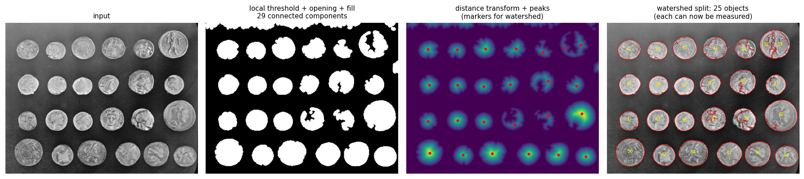
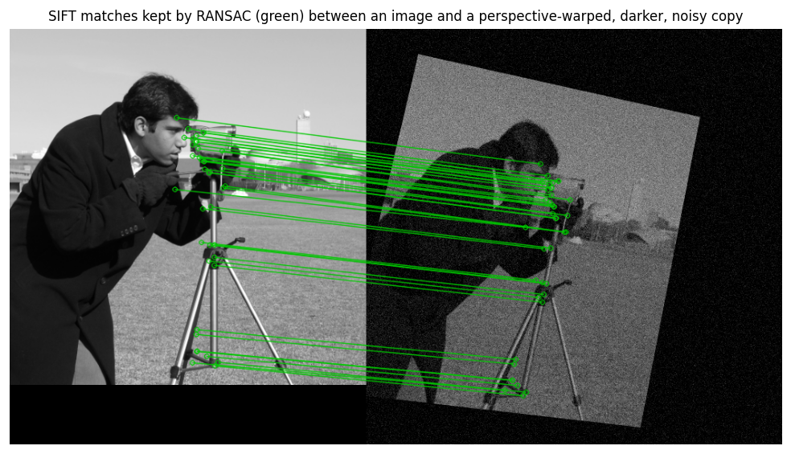
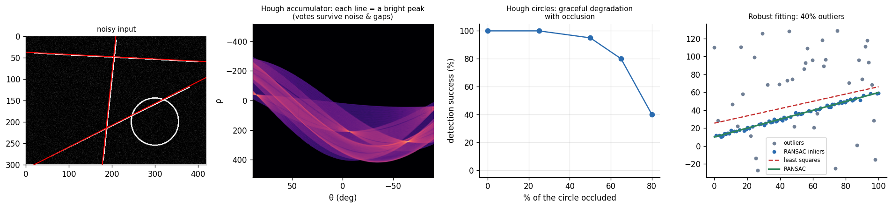
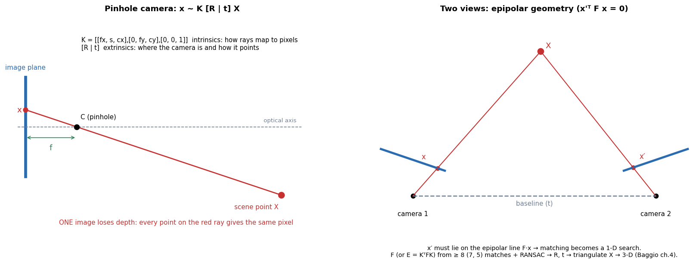
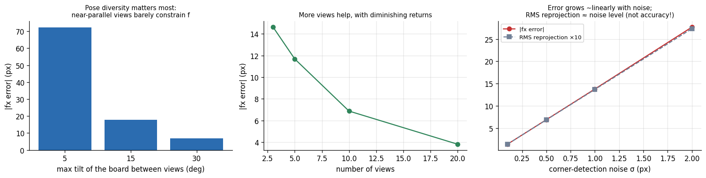
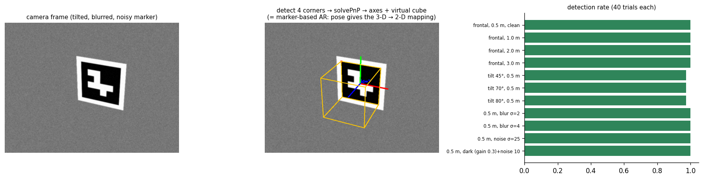
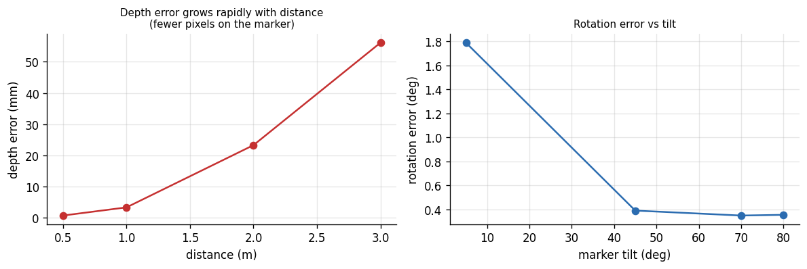
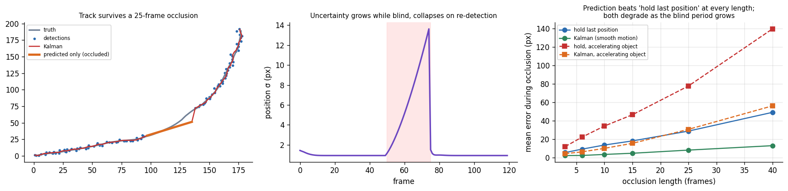
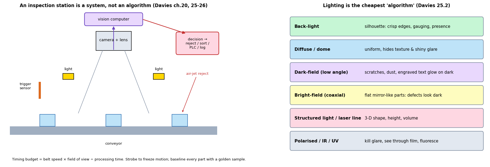

# 03 — Classical Computer Vision: Deep Understanding

> Sources: **Davies** (all four parts), **Baggio** (practice), **Beyerer ch. 2** (features). **[Modern]** = general professional knowledge, not from the books.
> Labs (numbers below are measured): `code/03_segment_and_measure.py`, `04_hough_ransac.py`, `05_feature_match_homography.py`, `06_calibration_synthetic.py`, `07_aruco_pose_lab.py`, `08_tracking_occlusion_lab.py`, `10_snippets_from_scratch.py`.

Davies organises vision into **low-level** (pixels → pixels/edges/corners), **intermediate** (shapes, lines, circles, matching), **3-D and motion**, and **real-time systems**. This file follows that order.

---

# PART 1 — LOW-LEVEL VISION (Davies ch. 2–8)

## 1.1 What an image is, and what limits it  *(ch. 2)*
- A digital image is a sampled, quantised measurement: $f(x,y)$ on a grid with $2^b$ levels. Three things are lost at capture: **depth** (projection), **spectrum** (only 1–3 channels), and **detail below the pixel/noise floor**.
- **Sampling rule:** to resolve a feature you need at least ~2 pixels across it in theory (Nyquist); in practice **3–5 pixels across the smallest thing you must detect/measure**. Decide this *before* buying the camera.
- **Colour:** RGB for devices, **HSV/Lab** when you want brightness separated from colour (robust colour segmentation). **[Modern]** For learning-based models, feed RGB and let the network cope.

## 1.2 Filtering — the workhorse  *(ch. 3)*

**Linear filtering** = replace each pixel by a weighted sum of its neighbourhood: $g=w\star f$. Different weights, different jobs:

| Filter | Weights | Job | Cost/side-effect |
|---|---|---|---|
| Box/mean | all equal | cheap smoothing | blurs edges, ringing in frequency |
| **Gaussian** | $\propto e^{-(x^2+y^2)/2\sigma^2}$ | smoothing with no ringing; scale-space | $\sigma$ sets the scale |
| Derivative (Sobel, Prewitt) | antisymmetric | edge strength/direction | amplifies noise |
| Laplacian / LoG / DoG | second derivative | blobs, zero-crossing edges | very noise-sensitive without smoothing |
| **Median** (non-linear) | rank order | kills salt-and-pepper noise, keeps edges | slower, can erase thin lines |
| Bilateral (non-linear) | spatial × intensity weights | edge-preserving smoothing (used in Baggio ch. 1 *cartoonifier*) | 10–100× slower than Gaussian |

**Why Gaussian is special (and fast).** It is **separable**: a 2-D Gaussian = a 1-D filter along rows then along columns. *Verified in code:* for σ=2 the 13×13 kernel costs 169 multiplications per pixel directly but only **26** separably, with identical output. **Integral images** (summed-area tables) give *any* box sum in four lookups regardless of size — the trick behind Haar cascades and fast local thresholds. Both are checked against OpenCV in `10_snippets_from_scratch.py`.

**Frequency view.** Convolution in space = multiplication in frequency, so filters are low-pass (smooth), high-pass (edges), or band-pass. Ideal frequency cut-offs ring; Gaussian and Butterworth don't. **Practical:** for kernels larger than ~15×15 an FFT implementation can be faster **[Modern: libraries choose automatically]**.

**Choosing a denoiser:** impulse noise → median; Gaussian-like sensor noise → Gaussian (or non-local means/learning-based denoisers **[Modern]**); you need to keep edges → bilateral/median; *always denoise before differentiating*.

## 1.3 Thresholding — separating object from background  *(ch. 4)*
Thresholding is the cheapest segmentation and, with controlled lighting, often *sufficient*.

| Method | Idea | Fails when |
|---|---|---|
| Fixed | pick $T$ by eye | lighting drifts |
| **Otsu** | choose $T$ maximising between-class variance $\sigma_B^2=P_1P_2(\mu_1-\mu_2)^2$ | histogram not bimodal; classes of very different size |
| Local/adaptive | threshold = local mean/Gaussian − C | block size wrong; flat regions produce noise |
| Hysteresis | two thresholds, keep weak if connected to strong | — |
| Colour/multi-channel | threshold in HSV/Lab, or distance to a reference colour | colour constancy lost |

**Lesson from the lab (24 coins, uneven light):** a *global* Otsu threshold gave 28 components that became **27 objects** after watershed (std of equivalent diameter 11.1 px, largest object 83 px = merged/shadowed regions); a **local** threshold (block 101) gave 29 components and **25 objects** with std 7.0 px. Neither is perfect; both are far better than a person could fix by eye, and **the real fix is lighting** (see Part 4).

*Figure 1 — threshold → clean (opening, hole fill) → **distance transform + watershed to split touching objects** → measure each object (equivalent diameter, solidity, circularity).*

## 1.4 Edges — where intensity changes  *(ch. 5)*
- **Gradient:** $\nabla f=(f_x,f_y)$; magnitude $\sqrt{f_x^2+f_y^2}$, direction ⟂ the edge. Sobel = a derivative combined with smoothing across the other axis.
- **Canny** (the default): Gaussian smoothing → gradient → **non-maximum suppression** (1-pixel thin) → **hysteresis** (two thresholds, weak edges kept only if connected to strong). Its parameters: $\sigma$ (scale), $T_H$, $T_L$ (ratio about 2:1–3:1).
- **Scale is the central issue:** small $\sigma$ finds fine detail and noise; large $\sigma$ finds only coarse boundaries and moves edges. Often run at several scales.
- **Sub-pixel edge location** (fit a parabola to the gradient peak) is what makes *measurement* to 0.1 pixel possible — the foundation of precision gauging.
- **Edges are not boundaries.** Edge maps are broken, with gaps and clutter; turning them into object outlines needs grouping (Hough, contour following, active contours — Part 2).
- **[Modern]** Learned edge/contour detectors and segmentation networks replace hand-tuned thresholds in cluttered scenes, but Canny + sub-pixel fitting remain the tool for **controlled-lighting metrology**.

## 1.5 Corners and interest points  *(ch. 6)*
**Why corners:** an edge only constrains position in one direction (the *aperture problem*); a corner constrains both. Corners/blobs are the **anchors** for matching, tracking, stitching and 3-D.

**Harris:** form the structure matrix $M=\sum_w\begin{bmatrix}I_x^2&I_xI_y\\I_xI_y&I_y^2\end{bmatrix}$ and score $R=\det M-k\,(\operatorname{tr}M)^2$. Both eigenvalues large ⇒ corner; one large ⇒ edge; both small ⇒ flat.
> **Connection to remember:** the Lucas–Kanade optical-flow system (§3.5) solves with the *same* matrix $M$. A good corner is exactly a place where motion is well-determined — that is why "good features to track" use $\min(\lambda_1,\lambda_2)$.

| Detector/descriptor | Idea | Invariance | Speed | Use |
|---|---|---|---|---|
| Harris / Shi–Tomasi | structure-matrix eigenvalues | rotation | fast | tracking, calibration |
| FAST | 16-pixel circle test | none | very fast | real-time keypoints |
| **SIFT** | DoG scale-space extrema + 128-D gradient histograms | scale, rotation, partial illumination | slow | accurate matching, SfM |
| SURF | integral-image box filters | scale, rotation | medium | historical alternative |
| **ORB** | FAST + orientation + binary BRIEF, Hamming distance | rotation (+ pyramid for scale) | very fast | mobile, SLAM, AR |
| Learned (SuperPoint, etc.) **[Modern]** | CNN keypoints/descriptors | learned | GPU | hard conditions |

**Matching recipe (used in Baggio ch. 3–4):** detect → describe → brute-force/FLANN match → **Lowe's ratio test** (accept if best distance < 0.75 × second-best) → **geometric verification with RANSAC** (fundamental matrix or homography).
**Measured:** between an image and a perspective-warped copy, SIFT found 394 matches (382 inliers) with **0.10 px** corner error; with darkening (gain 0.6) and noise (σ=15) 118 matches / 102 inliers, **0.83 px** error. The cheaper binary ORB descriptor gave 3–10.7 px errors across the same conditions (worst, 10.7 px, with strong noise plus darkening) — faster, but less accurate. **Fitting a homography to all matches by least squares instead of RANSAC gave 43 px error** — the ratio test removes most, not all, wrong matches, and a few gross outliers ruin a least-squares fit.

*Figure 2 — SIFT matches surviving RANSAC (green) between an image and a darker, noisy, perspective-warped copy.*

## 1.6 Mathematical morphology  *(ch. 7)*
Shape-based operations with a **structuring element** $B$: erosion $A\ominus B$ (shrink), dilation $A\oplus B$ (grow), opening (erode→dilate: removes specks, keeps big shapes), closing (dilate→erode: fills pores/gaps).
- **Cleaning recipe for a threshold result:** opening to remove specks → closing to fill holes → fill remaining holes.
- **Top-hat** ($f-$opening) removes uneven background (finds small bright things); **black-hat** finds small dark things — both are key in inspection.
- **Geodesic reconstruction** and **hit-or-miss** extend this to restoring objects and finding patterns.
- **Rule:** make $B$ slightly smaller than the smallest feature you want to keep and slightly larger than the noise you want to remove.

## 1.7 Texture  *(ch. 8)*
Texture = repeated local statistics. Classical descriptors: co-occurrence (GLCM) features, Local Binary Patterns, Gabor/wavelet energies, Laws' masks. Use when the *surface*, not the shape, differentiates classes (fabric, wood, tissue, steel grain). **[Modern]** CNN features have largely replaced hand descriptors for natural textures, but LBP and GLCM remain cheap, interpretable baselines (Baggio ch. 8 uses LBP histograms for face recognition).

---

# PART 2 — INTERMEDIATE-LEVEL VISION (Davies ch. 9–14)

## 2.1 Binary shape analysis  *(ch. 9)*
After segmentation, objects become connected components that you **measure**:
- **Connectivity:** 4 vs 8 neighbours; use the *dual* pair (8 for objects ↔ 4 for background) so that a closed curve separates inside and outside. Two-pass labelling with union–find is $O(\text{pixels})$.
- **Measurements:** area, perimeter, centroid, bounding box, **moments** ($m_{pq}=\sum x^py^qf$; central moments give translation invariance; normalised give scale invariance; **Hu's 7** add rotation invariance), orientation $\tfrac12\tan^{-1}\!\frac{2\mu_{11}}{\mu_{20}-\mu_{02}}$, eccentricity, **circularity** $4\pi A/P^2$, **solidity** (area/convex-hull area), Euler number $C-H$.
- **Distance transform** (distance to nearest background): gives the thickness of shapes, seeds for watershed, and the **medial axis/skeleton** (ridge of the DT). Thinning (e.g. Zhang–Suen) gives a 1-pixel skeleton preserving topology.
- **Perimeter is a trap:** on a digital grid, counting pixels or even chain-code length **over-estimates** a smooth curve. *Measured:* a digital disc of radius 10 has chain-code length $32+\sqrt2\cdot24=65.9$ vs true $2\pi r=62.8$; corrected weights ($0.948,\,1.343$) give 62.6. For metrology fit curves in sub-pixel edge points instead.

## 2.2 Boundary pattern analysis  *(ch. 10)*
Describe an outline compactly and invariantly:
- **Chain code** (direction per step; use the *first difference* for rotation invariance; *shape number* = minimal first difference).
- **Centroidal profile** $r(\theta)$ (distance to centroid vs angle).
- **Fourier descriptors:** treat boundary as complex sequence $z_k=x_k+jy_k$, FFT; **drop** $a_0$ (translation), **divide by** $|a_1|$ (scale), **use magnitudes** (rotation, start point). Low harmonics = coarse shape.
- **Curvature** peaks mark corners; polygonal approximation (Ramer–Douglas–Peucker) compresses outlines.
- **Occlusion** breaks global descriptors (all Fourier coefficients change); use *local* features or voting methods (Hough, §2.3).

## 2.3 Lines, circles and the Hough transform  *(ch. 11–13)*
**The idea (voting):** every edge point *votes* for all the shapes that could pass through it; real shapes are the accumulator peaks. Missing pieces, noise and clutter just fail to vote — hence the **robustness to occlusion**.
- **Lines:** $\rho=x\cos\theta+y\sin\theta$. A point becomes a sinusoid in $(\rho,\theta)$ space; collinear points' sinusoids meet at one point.
- **Circles:** with known radius a 2-D accumulator of candidate centres; using the **gradient direction** lets each edge point vote along a single line instead of a full circle (cheaper, sharper) — Davies ch. 12 develops this and ellipse detection; ch. 13 examines the nature of the Hough transform, including its relation to template matching.
- **Generalised Hough transform:** any shape described by a table of edge-direction → offset-to-reference-point.
- **Practical limits:** accumulator resolution trades speed vs precision; quantisation spreads peaks (smooth the accumulator, use non-maximum suppression); many parameters (ellipse: 5) need decomposition tricks.

*Figure 3 — Left: three lines recovered from a noisy image. Next: the accumulator (bright peaks = lines). Next: **circle detection success vs occlusion** (100 % → 95 % at 50 % hidden → 40 % at 80 % hidden). Right: with 40 % outliers, least squares is badly wrong; RANSAC recovers the line.*

**RANSAC** (random sample consensus): repeat — pick a *minimal* sample, fit a model, count points within a tolerance — keep the model with the largest consensus, then refit on inliers. Iterations needed for success probability $p$ with inlier ratio $w$ and sample size $s$:

$$N\ge\frac{\ln(1-p)}{\ln(1-w^{s})}$$

e.g. $p=0.99$, $w=0.5$: **$s=2$ (line): 16 iterations; $s=4$ (homography): 72; $s=8$ (fundamental matrix): 1,177.** Hence the push for *minimal solvers* (5-point essential matrix, P3P) and for high-quality matches (ratio test) that raise $w$.

## 2.4 Pattern matching  *(ch. 14)*
- **Template matching** with normalised cross-correlation (NCC): $\gamma=\frac{\sum(f-\bar f)(t-\bar t)}{\sqrt{\sum(f-\bar f)^2\sum(t-\bar t)^2}}$, invariant to brightness/contrast but **not** to rotation/scale/perspective. Speed-ups: image pyramid (coarse-to-fine), FFT, early termination.
- **Where it's still the right tool:** fixed-pose parts, fiducials, fine alignment (pre-registration for inspection).
- **Robust variants:** matching edges (chamfer matching: sum of distance-transform values along the template) tolerates clutter.
- **Feature-based object recognition:** keypoints + descriptor matching + RANSAC verification (as in Baggio ch. 3 marker-less AR) handles rotation/scale/perspective for **textured, rigid** objects; it fails on textureless or deformable objects.

---

# PART 3 — 3-D VISION AND MOTION (Davies ch. 15–19)

## 3.1 The camera as a mathematical object  *(ch. 15, 18)*
**Pinhole model:** a 3-D point $X$ maps to pixel $x$ by

$$\lambda\begin{bmatrix}u\\v\\1\end{bmatrix}=K\,[R\mid t]\begin{bmatrix}X\\1\end{bmatrix},\qquad K=\begin{bmatrix}f_x&s&c_x\\0&f_y&c_y\\0&0&1\end{bmatrix}$$

$K$ = **intrinsics** (focal length in pixels, principal point, skew); $[R\mid t]$ = **extrinsics** (pose). Real lenses add **distortion** (radial $k_1,k_2,k_3$, tangential $p_1,p_2$) which must be modelled for any metric work.

*Figure 4 — One view loses depth; two views constrain it (epipolar geometry).*

**Calibration** (Zhang's method, what `cv2.calibrateCamera` does; Baggio ch. 2–3 use it): photograph a planar pattern (checkerboard) from many poses → detect corners → solve for $K$, distortion, and per-view pose by minimising **reprojection error**.

*Figure 5 — Synthetic calibration with known truth (focal length 800 px).*

**What the lab proves (very practical):**
| Setting (noise 0.5 px unless stated) | Focal-length error |
|---|---|
| 10 views, boards nearly parallel (tilt ≤ 5°) | **72 px** |
| 10 views, tilt ≤ 15° | 17.7 px |
| 10 views, tilt ≤ 30° | 6.9 px |
| 3 / 5 / 10 / 20 views at tilt ≤ 30° | 14.6 / 11.7 / 6.9 / **3.8** px |
| 10 views, noise 0.1 / 1.0 / 2.0 px | **1.4 / 13.8 / 27.7** px |
- **Pose diversity is the single biggest lever**: near-parallel views barely constrain the focal length (it trades off against distance).
- **Error scales roughly linearly with corner noise.**
- **At a given noise level the RMS reprojection error was the same (≈0.68 px at σ=0.5 px) whatever the configuration — even when the focal length was 72 px wrong; it simply tracked the noise (0.14 / 1.37 / 2.74 px at σ=0.1 / 1 / 2).** Reprojection error certifies that the model fits the *given* points; it does not certify that the parameters are right. Validate with an independent measurement (a known ruler, a held-out board).
- *Practice:* 15–25 views, large tilts (±30–45°), pattern filling the frame including corners, rigid focus (don't refocus), good lighting, sub-pixel corner refinement.

## 3.2 Planes, homographies and PnP  *(ch. 16–18)*
- **Homography $H$** (3×3, 8 DoF) maps a plane between two views; estimated from ≥4 correspondences via the **DLT** (SVD of a $2N\times9$ system — implemented and checked in `10_snippets_from_scratch.py`) then refined; wrap with RANSAC. Uses: document scanning, panoramas (pure rotation), bird's-eye views, marker pose, sports-field mapping.
- **PnP (Perspective-n-Point, Davies ch. 16):** given $n\ge3$ 3-D points and their images (and $K$), recover the pose. P3P gives up to 4 solutions; use P4P/EPnP/iterative refinement, RANSAC for outliers. **This is the maths of marker-based AR** (Baggio ch. 2–3).
- **Planar-pose ambiguity:** a planar target seen nearly head-on has **two** nearly-equally-good pose solutions, so rotation estimates jump.

*Figure 6 — Detect a square marker → solve PnP → draw axes and a virtual cube (the essence of marker-based AR, Baggio ch. 2).*

*Figure 7 — Pose accuracy against distance and tilt (ground truth known).*

**Measured (40 trials per row, 10 cm marker, 640×480, f=900 px):**
| Condition | Detect | Position err | Rotation err | Depth err |
|---|---|---|---|---|
| frontal, 0.5 m | 100 % | 0.8 mm | 1.8° | 0.8 mm |
| frontal, 1 m | 100 % | 3.4 mm | 4.6° | 3.4 mm |
| frontal, 2 m | 100 % | 23 mm | 7.8° | 23 mm |
| frontal, 3 m | 100 % | **56 mm** | 9.2° | 56 mm |
| tilted 45° / 70° / 80°, 0.5 m | 97 % | 0.9 / 0.8 / 1.6 mm | **0.4° / 0.35° / 0.35°** | — |
| blur σ=4 px, 0.5 m | 100 % | 1.2 mm | 3.5° | — |
| noise σ=25, 0.5 m | 100 % | 1.4 mm | 2.8° | — |
- **Depth error grows roughly with distance squared** (fewer pixels on the target): the same law as stereo, $\Delta Z\approx\dfrac{Z^2\,\Delta d}{fB}$ (e.g. $f=800$ px, $B=0.12$ m, $Z=2$ m, $\Delta d=0.5$ px → ≈21 mm).
- **Rotation is *worse* face-on (1.8–9°) than tilted (0.4°)** — the planar ambiguity. If you control the setup, view markers at 30–60° tilt; if you can't, use several markers or a 3-D target.
- Detection and position were robust to blur and noise; rotation estimates degraded gracefully.

## 3.3 Two views: epipolar geometry and stereo  *(ch. 15, 17; Baggio ch. 4)*
- For matching points $x\leftrightarrow x'$: $x'^{T}Fx=0$. $F$ (rank 2, 7 DoF) needs no calibration; with calibration use the **essential matrix** $E=K'^{T}FK$ (5 DoF) which decomposes into $R$ and $t$ (translation only up to scale — **monocular reconstruction has no absolute scale**).
- **Estimating $F$:** normalised 8-point algorithm (always normalise coordinates), 7-point minimal, within RANSAC.
- **Stereo:** rectify so epipolar lines are image rows; then depth $Z=fB/d$ ($d$ = disparity). Hard parts: textureless regions, repetitive patterns, occlusions, calibration drift. **[Modern]** Learned stereo/monocular-depth networks beat block matching on difficult scenes; active sensors (structured light, time-of-flight, LiDAR) solve texture-less cases.
- **Triangulation:** given two projection matrices and matching points, solve a small SVD problem for $X$ (verified round-trip in `10_snippets_from_scratch.py`).

## 3.4 Structure from motion pipeline  *(Baggio ch. 4)*
1. Features + descriptors in each image → matches (ratio test).
2. **Fundamental matrix with RANSAC** → inlier matches; with $K$ → **essential matrix** → $R,t$ (four candidates; keep the one putting points *in front of both cameras* — the **cheirality** check).
3. **Triangulate** → sparse **point cloud** (Baggio shows it visualised with PCL).
4. Add each new image: match to existing 3-D points → **PnP** → triangulate new points.
5. **Bundle adjustment** (Baggio uses the SSBA library): jointly refine all poses and points to minimise total reprojection error — essential to stop drift.
6. Densify (multi-view stereo), mesh, texture **[Modern: COLMAP, learned MVS, NeRF/Gaussian splatting]**.
**Common failure modes:** pure rotation (no baseline ⇒ no depth), planar scenes (degenerate for $F$), too-small baseline (noisy depth), moving objects (outliers), repetitive texture, scale ambiguity.

## 3.5 Motion  *(ch. 19; Baggio ch. 4 for optical flow)*
- **Brightness constancy:** $I_xu+I_yv+I_t=0$ — one equation, two unknowns (aperture problem). **Lucas–Kanade** assumes constant flow in a small window and solves a 2×2 least-squares system — **the same matrix $M$ as Harris**. Use a **pyramid** for large motions.
- **Background subtraction** (fixed camera): model each pixel's usual value (running average, mixture of Gaussians); foreground = what deviates. Failure modes: lighting change, shadows, camera shake, waving trees, objects that stop moving.
- **Tracking:** detect → associate → **predict** (Kalman / particle filters; Davies ch. 22). Use the prediction both to *search less* and to *survive gaps*.

*Figure 8 — A constant-velocity Kalman filter bridges a 25-frame occlusion; uncertainty grows while blind and collapses when the object reappears.*

**Measured (40 trials; mean position error *during* the occlusion):**
| Occlusion length | "Hold last position" | Kalman prediction | Same, **accelerating** object (hold / Kalman) |
|---|---|---|---|
| 3 frames | 5.3 px | 2.1 px | 11.8 / 4.1 |
| 10 frames | 13.5 px | 3.3 px | 34.1 / 9.9 |
| 25 frames | 28.6 px | 8.0 px | 77.5 / 30.5 |
| 40 frames | 48.9 px | 12.8 px | 139.4 / 55.9 |
- The filter's own uncertainty ($\sigma$ at reappearance 1.7→25 px) tells you how wide a **search gate** to use when the object returns.
- A wrong motion model costs a lot (accelerating case) — **motion model quality sets the longest gap you can survive.**

---

# PART 4 — REAL SYSTEMS (Davies ch. 20–27)

*Figure 9 — An inspection station is a system: trigger, lighting, optics, camera, compute, decision/reject, with a timing budget.*

## 4.1 Automated visual inspection  *(ch. 20–21)*
Typical tasks: **presence/absence, dimensional gauging, surface defects, label/print verification, sorting/grading, assembly verification**. Davies' cereal-grain chapter (21) is a worked example of an entire sorting/inspection design.
**Design questions in order:**
1. *What is a defect, and how costly is each error type?* (sets metrics; DHS ch. 2)
2. *Can lighting make it trivial?* (back-light for silhouettes; dark-field for scratches; diffuse for shiny parts)
3. *What resolution do I need?* Pixel size on object $=\text{FOV}/N_{\text{pixels}}$; **smallest defect ≥ 3–5 px**.
4. *How fast does it move?* **Motion blur (px) $=v\,t_{\exp}/\text{pixel size}$.** Example: FOV 500 mm over 2,000 px = 0.25 mm/px; belt 1 m/s; exposure 100 µs → 0.1 mm = **0.4 px**; for ≤0.5 px blur you need ≤125 µs. Use short exposure + strobed light, not a slow shutter.
5. *Time budget:* parts per second sets the budget per part (e.g. 100 mm pitch at 1 m/s ⇒ 10 parts/s ⇒ ≤100 ms for capture + transfer + processing + I/O).
6. *Algorithm:* threshold/blob → measure → compare to tolerance; template/golden-image difference; classifier for ambiguous defects; **[Modern]** anomaly detection or segmentation networks trained mostly on *good* parts.
7. *Reject logic & traceability:* store every rejected image; periodically audit accepted ones.

## 4.2 Illumination and optics  *(ch. 25)*
| Scheme | Use | Notes |
|---|---|---|
| **Back-light** | silhouettes, gauging, hole presence | sharpest edges; no surface info |
| **Diffuse / dome** | uniform illumination of curved or shiny parts | hides texture & glare |
| **Dark-field** (low angle) | scratches, dust, embossed/engraved text | defects glow on dark |
| **Bright-field / coaxial** | flat reflective surfaces | defects look dark |
| **Structured light / laser line** | 3-D height, volume, flatness | needs calibration |
| Polarised / IR / UV | remove glare / see through film / fluorescence | wavelength-matched filters |
- **Telecentric lenses** give constant magnification with distance — vital for gauging (no perspective error).
- **Depth of field** shrinks with large aperture and short working distance; stop down (and add light) for depth.
- **Fix lighting, lens, exposure and trigger first.** Every hour spent there saves days of algorithm tuning.

## 4.3 Surveillance, in-vehicle vision, face analysis  *(ch. 22–23; face methods also in Baggio ch. 6–8)*
- **Surveillance:** background modelling, shadow handling, tracking (Kalman/particle filters), crowd and behaviour analysis, re-identification. Dominated by **lighting change, occlusion and false alarms** — the product metric is *false alarms per camera per day*.
- **In-vehicle vision:** lane/road detection, traffic sign recognition, pedestrian & vehicle detection, free-space. Hard constraints: real-time, all weather/lighting, safety-critical error costs (Davies ch. 23 covers the vehicle-vision tasks). **[Modern]** Today dominated by deep detection/segmentation + radar/LiDAR fusion, but the geometry (calibration, ground-plane homography, tracking) is classical.
- **Face detection/recognition:** Viola–Jones (Haar + AdaBoost cascade) for detection; eigenfaces/Fisherfaces/LBP for recognition (Baggio ch. 8); **[Modern]** deep embeddings (metric learning) now dominate — with serious accuracy/bias/privacy considerations.

## 4.4 Hardware and system design  *(ch. 26–27)*
- Choose the **processing platform** by the timing budget: CPU (flexibility), GPU (deep nets, large images), FPGA/ASIC (very low latency, fixed pipelines), embedded SoC/NPU **[Modern]**.
- **Trade-offs** (Davies ch. 27): speed vs accuracy vs robustness vs cost vs development time. There is no best algorithm — there is a *best compromise for the constraints*.
- **Keep it measurable:** log timing per stage, image statistics (brightness, focus score), and decision confidences in production. Silent drift is the usual killer.

## 4.5 Statistical pattern recognition in vision  *(ch. 24)*
The bridge to file 02: choose features, estimate class models, set thresholds from costs, handle the reject class, and *evaluate on realistic data*. Davies' chapter covers the Bayes/NN/ROC material in the vision practitioner's language.

---

## 5. A master checklist for any vision project
1. **Define:** inputs, outputs, accuracy needed in physical units, cost of each error, speed, environment.
2. **Get representative data early** (all lighting, parts, backgrounds, camera positions). Photograph the *failures* you fear.
3. **Control the scene** (lighting, background, trigger, fixture) as far as the budget allows.
4. **Calibrate** (camera, lighting uniformity, colour) and **validate with a physical standard**.
5. **Baseline:** simplest method that might work (threshold, template, small classifier). Measure.
6. **Iterate on the error analysis**, not on intuition: look at the failures, categorise, fix the cause (usually data or lighting).
7. **Evaluate on a locked test set** that mimics production; report confidence intervals and the confusion matrix.
8. **Design the failure path:** reject/review queue, confidence thresholds, logging.
9. **Monitor in production:** drift in image statistics, accuracy audits, re-calibration schedule.
10. **Document** assumptions and limits — the next engineer (or you in six months) needs them.

---

## 6. Interview-grade facts from this file (quick recall)
- Separable Gaussian: $O(k)$ vs $O(k^2)$ per pixel; integral image: $O(1)$ box sum.
- Canny: smooth → gradient → NMS → hysteresis.
- Harris $R=\det M-k\,\mathrm{tr}(M)^2$; LK uses the same $M$.
- RANSAC iterations $N=\ln(1-p)/\ln(1-w^s)$; homography needs 4 points, $F$ 8 (7), $E$ 5.
- $E=K'^TFK$; monocular SfM has unknown scale; bundle adjustment prevents drift.
- Stereo $Z=fB/d$, depth error $\propto Z^2$.
- Planar pose is ambiguous face-on; reprojection error ≠ calibration accuracy.
- Hough = voting ⇒ robust to occlusion/noise; RANSAC = random consensus ⇒ robust to outliers.
- Perimeter from pixel counts over-estimates; use sub-pixel contour fitting for metrology.
- Motion blur px $=v\,t/\text{pixel size}$; lighting before algorithms.
