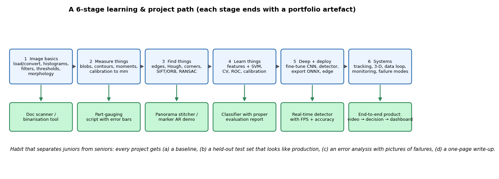

# 04 — Projects Playbook

> Part A distils the **eight complete projects in Baggio's book** (what each teaches, its pipeline, what to do differently today). Part B gives **portfolio blueprints** you can build, with metrics and the pitfalls that matter. Part C is project hygiene — the habits that make a project convincing to an employer.
> Labs that back up claims here: `code/05`–`08`.


*Figure 1 — A six-stage path; each stage ends with something you can show.*

---

# PART A — BAGGIO'S EIGHT PROJECTS, DISTILLED
*(Your PDF contains chapters 1–8; chapter 9, the Kinect "fluid wall", is not in the file.)*

Baggio's projects are written for **2012-era OpenCV** (C++, Android/iOS, SVM/ANN, Haar cascades). The *ideas* are timeless; where today's tools differ I say so **[Modern]**.

## A1. Cartoonifier and skin changer (ch. 1)
**Goal:** turn a webcam image into a cartoon, plus "evil"/alien skin-colour effects.
**Pipeline:** grayscale → median blur → Laplacian edge map → threshold into a clean black-line "sketch" mask; for colour, **repeated small bilateral filters on a *downscaled* image** (edge-preserving smoothing is expensive) → upscale and combine with the sketch. Skin recolouring: detect face (Haar) → flood-fill skin region (colour thresholds) → change hue.
**What it teaches:** filter composition; *noise before edges*; **bilateral cost → work at low resolution then upsample**; mobile performance budgeting; colour spaces for skin.
**Today [Modern]:** style-transfer / segmentation networks give better results, but the *performance-engineering mindset* (profile → reduce resolution → cache) is the same.
**Extension:** add a quantitative "edge cleanliness" metric (e.g. proportion of isolated edge pixels) and tune for speed vs quality; measure FPS on a phone/embedded board.

## A2. Marker-based augmented reality (ch. 2)
**Goal:** detect a printed square marker and render a 3-D object on it.
**Pipeline:** grayscale → threshold → **contours → polygon approximation → keep convex quadrilaterals** → perspective-rectify each to a canonical square → decode the **marker ID** from its inner grid → **pose with PnP** (needs *camera calibration*) → render with OpenGL using the pose.
**What it teaches:** calibration, homography vs PnP, why markers have a border and a code (robust detection + identity + error detection), camera-to-render pipelines.
**Today [Modern]:** `cv2.aruco`/AprilTag libraries do detection and decoding; ARKit/ARCore do markerless tracking natively.
**My measurements (code/07):** 100 % detection up to 3 m at 640×480; depth error 0.8 mm at 0.5 m → **56 mm at 3 m**; rotation error is **larger face-on (1.8–9°) than at 45–80° tilt (0.4°)** because planar pose is ambiguous face-on. *Design implication:* make markers bigger, view them off-axis, and use several.

## A3. Marker-less augmented reality (ch. 3)
**Goal:** anchor virtual content on a *natural image* (poster, book cover) with no marker.
**Pipeline:** **reference image** → keypoints + descriptors (SURF/ORB/FREAK in Baggio) → each frame: detect, **match**, **ratio test**, **RANSAC homography** → pose → render; track between frames (optical flow) to save time; recover when lost.
**What it teaches:** feature matching robustness, **why the reference must be textured**, tracking vs re-detection, latency.
**Failure modes to test:** low texture, motion blur, large viewpoint change, repeated patterns, lighting change.
**My measurements (code/05):** with SIFT, 102 of 118 matches survived RANSAC and the recovered homography moved the image corners by only **0.83 px** even with darkening and noise; fitting *all* matches by least squares gave **43 px** error. RANSAC is not optional.
**Today:** same recipe with learned features (SuperPoint/LightGlue) **[Modern]** or SLAM for large scenes.

## A4. Exploring structure from motion (ch. 4)
**Goal:** reconstruct a 3-D point cloud from two (or more) images taken by a moving camera.
**Pipeline:** features + matching → **fundamental matrix + RANSAC** → essential matrix (with calibrated $K$) → decompose to $R,t$ and pick the valid one (points in front of both cameras) → **triangulate** → add views via **PnP** → **bundle adjustment** (the book uses the SSBA library) → visualise (PCL); optional **Lucas–Kanade optical flow** for dense-ish correspondences.
**What it teaches:** epipolar geometry end-to-end, *why scale is unknown*, drift and why BA is essential, degeneracies (pure rotation, planar scenes).
**Do it today:** take a 30-second phone video around an object, run **COLMAP** **[Modern]**, then reproduce the first two-view step *yourself* in OpenCV (steps in file 03 §3.4) and compare your poses with COLMAP's. The comparison is the learning.
**Metric:** mean reprojection error, number of triangulated points, and (if you measure the real object) metric error after fixing scale from one known length.

## A5. Number plate recognition with SVM and neural networks (ch. 5)
**Goal:** locate and read licence plates.
**Pipeline:** *Detection:* grayscale → blur → **Sobel (vertical edges)** → threshold → **morphological close with a wide rectangle** (joins the dense character edges into one blob) → contours → **filter by aspect ratio and area** → flood-fill/rotate-crop → **SVM classifier "plate / not plate"** to reject false candidates. *Recognition:* segment characters (connected components of the binarised plate) → feature vector per character → **neural-network classifier** → string.
**What it teaches:** the *generate-candidates-then-verify* pattern (cheap detector with many false positives followed by a strong classifier), morphology as a grouping tool, character segmentation, training/evaluating SVM/ANN, the full detect→classify→read chain.
**My own quick test (honest note):** I built a hand-tuned detector of this type on *synthetic* plates pasted onto natural photographs and it was **brittle** — heavily dependent on kernel sizes and on background edge density, and a plain OCR step confused look-alike glyphs. That is the real lesson: hand-tuned localisation is fragile in cluttered, variable scenes, which is exactly why modern ALPR uses a **learned detector** for the plate and a **sequence recogniser** for the text **[Modern]**. Treat Baggio's pipeline as the *first baseline* to beat, not the final system.
**Do it today:** (1) classical baseline as above; (2) fine-tune a small object detector for plates; (3) text recognition with a CRNN/transformer OCR **[Modern]**; compare with an honest test set split by *camera/location* and report plate-level and character-level accuracy plus failure gallery.

## A6. Non-rigid face tracking (ch. 6)
**Goal:** track facial landmarks (eyes, brows, mouth, jaw) as the face moves and changes expression.
**Pipeline:** a **shape model** (point distribution model: landmark coordinates → mean shape + PCA modes of variation, aligned by **Procrustes**) + **patch models** (a small linear template per landmark, learned from annotated faces) + a **fitting loop** (search around each landmark with its patch model, then project the result back onto the shape model so the shape stays plausible) + face detector for initialisation.
**What it teaches:** the *statistical shape model* idea (same PCA you used in pattern recognition), **local evidence + global constraint** (a template for each point, a shape prior for the ensemble), annotation workflows, initialisation sensitivity.
**Today [Modern]:** landmark networks (heatmap regression) are the default; keep the shape-model thinking for constraints and for understanding failures.

## A7. 3-D head pose estimation with AAM and POSIT (ch. 7)
**Goal:** estimate the head's 3-D orientation (and position) from a video.
**Pipeline:** an **Active Appearance Model** (shape *and* texture PCA models, fitted to the image by minimising texture error) gives 2-D landmarks → a rough **3-D head model** → **POSIT** (iterative pose-from-points, a PnP-type solver) → rotation (yaw/pitch/roll).
**What it teaches:** from 2-D landmarks to 3-D pose = *PnP with a generic model* (the same maths as marker AR, file 03 §3.2), model-based vision's strengths (few training images) and limits (generic head model ≠ your head; accuracy limited by landmark noise).
**Today:** `solvePnP` with a generic 3-D landmark model **[Modern]**, or networks that regress pose directly; compare both on a dataset with ground-truth pose.

## A8. Face recognition with Fisherfaces (ch. 8)
**Goal:** identify people from face images.
**Pipeline:** *Detect* (Haar cascade) → *pre-process* (align eyes, equalise histogram, mask background, bilateral smoothing) → *represent* with **Eigenfaces (PCA)**, **Fisherfaces (PCA then LDA)** or **LBP histograms** → *classify* (nearest neighbour) → *reject unknown* by a distance threshold.
**What it teaches:** PCA vs LDA in a real task (PCA keeps variance, including lighting; LDA keeps class separation — better for varying light), **pre-processing dominates accuracy** (alignment, lighting), the **open-set problem** (an unknown face is not in the database — you need a threshold/reject option, DHS §2.3), and honest evaluation (train/test split by *session*, not by random image).
**My analogue (code/01):** PCA on digit images — 16 components reconstruct a digit and the first components are broad stroke patterns ("eigen-digits", Fig. 2 of file 02): the eigenface idea in miniature.
**Today [Modern]:** deep face embeddings + a distance threshold; the same *enrol → embed → compare → threshold* flow, but with serious fairness/privacy questions (see file 05).

## A9. Cross-cutting lessons from all eight
1. **Pre-processing and viewpoint control decide success** more than the classifier.
2. **Cheap candidate generation + strong verification** (plates, faces, AR markers) is the recurring architecture.
3. **Geometry is reused everywhere:** homography, PnP, epipolar geometry, calibration.
4. **Statistical shape/appearance models (PCA)** show up in faces, tracking and recognition.
5. Real-time constraints shape every design (downscale, ROI, tracking between detections).
6. Projects only become *engineering* when you measure error on held-out, realistic data.

---

# PART B — PORTFOLIO BLUEPRINTS

Each blueprint: **goal → pipeline → data → metrics → pitfalls → stretch**. Difficulty: ● easy, ●● medium, ●●● hard. Estimated effort is for a focused learner.

| # | Project | Level | Core skills | Headline metric |
|---|---|---|---|---|
| 1 | **Document scanner** | ● | edges/contours, homography, adaptive threshold | corner error (px), OCR accuracy gain |
| 2 | **Calibrated measurement gauge** | ●● | calibration, sub-pixel edges, error analysis | error vs calipers (mm), repeatability |
| 3 | **Coin/part counter and sizer** | ● | threshold, morphology, watershed, blobs | count accuracy, diameter std |
| 4 | **Marker-based AR / pose demo** | ●● | PnP, calibration, rendering | position/rotation error vs distance |
| 5 | **Panorama / mosaic stitcher** | ●● | features, RANSAC homography, blending | reprojection error on synthetic warps |
| 6 | **Classical vs learned classifier study** | ●● | features, SVM, CV, learning curves, ROC | accuracy, ROC/PR, data-efficiency curve |
| 7 | **Licence-plate / text reader** | ●●● | detection, OCR, evaluation by site | plate-level & char-level accuracy |
| 8 | **Multi-object tracker** | ●●● | detector + Kalman + association | MOTA/IDF1, ID switches |
| 9 | **3-D reconstruction from video** | ●●● | SfM/COLMAP, epipolar geometry | reprojection error, scale-checked length error |
| 10 | **Industrial anomaly detector** | ●●● | few-shot / unsupervised anomaly detection | AUROC (image/pixel), false-alarm rate |
| 11 | **Edge-deployed detector** | ●●● | model optimisation, latency profiling | mAP vs FPS vs memory |
| 12 | **People/vehicle counter with analytics** | ●● | detection, tracking, line-crossing | count error %, false alarms/day |

### 1. Document scanner ●
**Pipeline:** find the page quadrilateral (edges → contours → polygon approximation → largest convex 4-gon, or normalise lighting then threshold the bright paper region) → **order the corners** → homography to a fixed rectangle → adaptive threshold or illumination normalisation.
**Data:** your own photos at different angles, light and backgrounds; also *synthetic* photos with known ground-truth corners (you can generate them by warping a page onto a desk image).
**Metrics:** corner localisation error; success rate; OCR character accuracy before/after.
**Pitfalls (real):** the page and desk have similar brightness; cluttered edges merge with the border; polygon approximation tolerances; page curl; shadows. *Hint from my own attempt:* the choice of **cue** (edge vs region contrast) mattered a lot and depended on the scene — good scanners combine cues and add a *manual corner adjustment* fallback.
**Stretch:** de-curl, auto-rotate by text orientation, multi-page PDF, run on a phone.

### 2. Calibrated measurement gauge ●●   — **starter code included: `projects/01_gauge_starter/`** (tested; runs with no hardware, then with your own camera)
**Pipeline:** calibrate with a checkerboard (15–25 poses, tilts ±30–45°) → undistort → measure objects on a plane via homography to metric coordinates → sub-pixel edge fitting for width/diameter.
**Metrics:** absolute error versus callipers over ≥30 parts; **repeatability** (std of repeated measurements of the same part); report with uncertainty.
**Pitfalls:** don't judge calibration by RMS reprojection error alone (my lab: it equalled the noise level even when focal length was 72 px wrong); refocusing changes intrinsics; perspective error if the part is not at the calibration plane height (use telecentric optics or correct for height).
**Stretch:** temperature drift test, Gauge R&R study.
**What the starter project measured (synthetic scene with known truth, 160 measurements per method):** naive single-scale measurement 2.10 mm mean error (worst 9.8 mm) → calibrated 0.103 mm, equal to the oracle with the true camera model (0.105 mm); a deliberately poor calibration (8 near-parallel views) had a focal length 8 % wrong and a **held-out** reprojection error 3.7× the good one's although its *training* error looked fine; and a **systematic bias of up to +0.23 mm on a thin bar remained 5–6× larger than the repeatability (0.03–0.04 mm)** — repeatability is not accuracy. See that project's README for the protocol to use with real hardware and 8 exercises.

### 3. Coin/part counter and sizer ●
Pipeline in `code/03` (threshold → clean → distance transform + watershed → regionprops). **Metrics:** count accuracy against manual count; diameter distribution. **Pitfall:** touching objects merge — watershed splits but can over-segment; uneven lighting breaks global thresholds (my lab: 27 vs 25 objects for 24 coins with global vs local threshold).

### 4. Marker-based AR / pose demo ●●
Use `cv2.aruco`, calibrate your webcam, draw a cube; then **measure** pose error against a ruler/printed grid at several distances and tilts. Report the depth-error-vs-distance curve (it grows roughly with distance squared) and the face-on rotation ambiguity.

### 5. Panorama stitcher ●●
SIFT/ORB → ratio test → RANSAC homography → warp → seam/blend (multi-band or feathering). **Metric:** generate synthetic image pairs from a big image with known homographies and compute corner error; stress-test rotation-only vs translating camera (parallax breaks homography). **Pitfalls:** exposure differences, lens distortion, drift in chains (bundle-adjust).

### 6. Classical vs learned classifier study ●●
Pick a dataset, build (a) hand features + SVM/RF, (b) pretrained-CNN embeddings + logistic regression, (c) fine-tuned CNN. Produce: learning curves (accuracy vs #training images), confusion matrices, ROC/PR, per-class failure galleries, inference time. **What you'll find (typical, and consistent with my digits lab):** model ranking changes with data size, and *representation* often matters more than the classifier.

### 7. Licence-plate / text reader ●●●
Classical baseline (Part A5) → learned plate detector → OCR (CRNN/transformer) **[Modern]**. **Data:** split by camera/site; include night, rain, motion blur. **Metrics:** plate-detection recall at fixed precision, exact-plate-match rate, character error rate; **latency**. **Pitfalls:** privacy/legal constraints; label noise; leakage by near-duplicate frames from the same video.

### 8. Multi-object tracker ●●●
Detector → Kalman filter per object (constant velocity) → association with Hungarian algorithm on IoU/appearance → track management (birth/death, occlusion). **Metrics:** MOTA, IDF1, ID switches, fragmentation. **Pitfalls:** occlusion handling (my lab: prediction cut error from 28.6 to 8.0 px over a 25-frame gap), crowded scenes, camera motion. **Stretch:** appearance embeddings for re-identification.

### 9. 3-D reconstruction from video ●●●
Phone video → frame selection (enough baseline, not blurred) → COLMAP **[Modern]**; then re-implement the two-view core. **Metrics:** mean reprojection error, number of registered images, scale-corrected length error on a known dimension. **Pitfalls:** texture-less/shiny/transparent objects, rolling shutter, rotation-only motion, scale ambiguity.

### 10. Industrial anomaly detector ●●●
Train mostly on **good** images (public industrial-surface datasets exist, e.g. MVTec-style benchmarks — check licence), using patch-feature memory banks or reconstruction models **[Modern]**. **Metrics:** image-level and pixel-level AUROC *and* the **false-alarm rate at 99 % recall** — what a factory actually cares about. **Pitfall:** threshold choice from too few "good" samples; domain shift between batches.

### 11. Edge-deployed detector ●●●
Take a small detector, optimise (resolution, pruning/quantisation, export to ONNX/TensorRT/TFLite) **[Modern]**, benchmark on a Raspberry Pi/Jetson-class board. **Report the trade-off curve** mAP vs FPS vs memory vs power, not one point; include end-to-end latency (capture + pre-process + inference + post-process), not just the model.

### 12. People/vehicle counter with analytics ●●
Detector + tracker + virtual line crossing; metrics: counting error %, false counts per hour, dependence on camera angle/crowding/lighting; dashboard with daily trends. **Pitfall:** double counting by ID switches; define the ground truth protocol (manual count of a sampled video).

---

# PART C — PROJECT HYGIENE (what makes a project convincing)

1. **Start with a problem statement and a success metric in the README** (units, tolerance, error costs).
2. **Baseline first** (a threshold, a template, a linear model) and keep its numbers in a table next to your final model.
3. **Dataset section:** source, size, how it was split (by group/time, **never** by random frame from the same video), class balance, known biases.
4. **Evaluation section:** confusion matrix, ROC/PR, error bars, per-condition breakdown (lighting, distance, tilt).
5. **A "failure gallery"** of 10–20 images where the system fails, with your explanation. Employers read this part.
6. **Ablation table:** what each component adds (e.g. + pre-processing, + RANSAC, + tracking).
7. **Reproducibility:** pinned requirements, one command to run, fixed random seeds, tiny sample data included.
8. **Performance section:** latency per stage, memory, hardware.
9. **Demo:** a short GIF/video of the real system, not just curated stills.
10. **Honest limitations** and next steps.
11. **Repo structure:**
```
project/
├─ README.md            # problem, metric, results table, failure gallery, how to run
├─ data/                # sample or download script, DATA.md (provenance, licence, splits)
├─ src/                 # library code (no notebook-only logic)
├─ notebooks/           # exploration only
├─ tests/               # at least: geometry/maths sanity checks, metric functions
├─ configs/             # thresholds, hyper-parameters
└─ results/             # figures, metrics.json, logs
```

## Datasets to know (verify licences and current availability before use)
| Task | Common datasets |
|---|---|
| Digits / small classification | MNIST, Fashion-MNIST, CIFAR-10/100, scikit-learn digits |
| Large-scale recognition | ImageNet |
| Detection / segmentation | COCO, Pascal VOC, Cityscapes, ADE20K |
| Faces | LFW (verification), CelebA (attributes) |
| Driving | KITTI, nuScenes, Waymo Open, BDD100K |
| Industrial | MVTec AD, VisA |
| Stereo / SfM / SLAM | Middlebury, KITTI, EuRoC, TUM RGB-D, ETH3D |
| Tracking | MOTChallenge, DanceTrack |
| Texture | DTD, KTH-TIPS |
| Text / documents | ICDAR competitions, IAM handwriting |
| Medical | public challenge sets (check each licence/ethics terms) |
