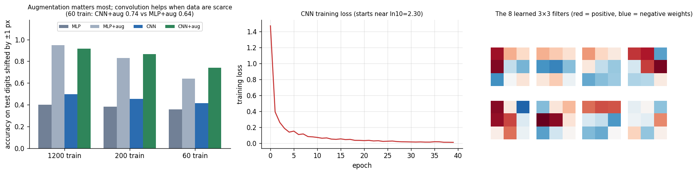
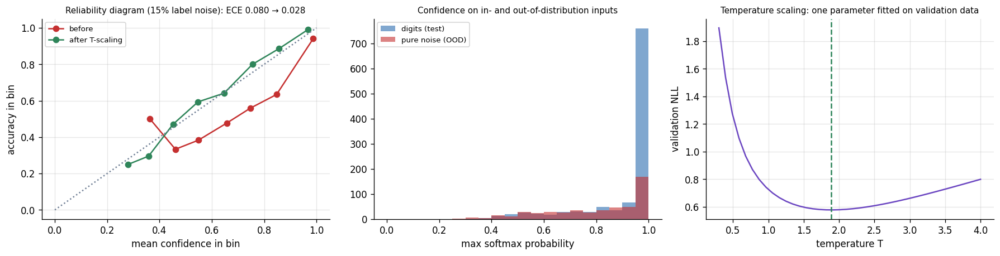

# 08 — Deep Learning for Vision: The Bridge

> **Why this file exists:** your four books are mostly classical. Beyerer §7.6 (PDF p. 250) gives a short introduction to deep learning and DHS ch. 6 gives the neural-network foundations (backprop, practical training tricks); neither covers modern vision architectures, detection/segmentation heads, transfer learning or deployment.
> **Everything here is [Modern]** — general professional knowledge, not from your books. The *measured* numbers come from small experiments I ran (`code/12`, `13`, `14`); the *qualitative* claims about the field are well-established but **tools, model names and best practice move quickly — check current documentation before relying on specifics.**
> **Limit of my experiments:** no deep-learning framework was available in my environment, so I could not train real modern networks. Instead I (a) wrote and **gradient-checked a tiny CNN from scratch in NumPy**, (b) built calculators for parameters / compute / receptive field and **verified them against a published number**, and (c) ran detection-metric and calibration demos. They teach the *mechanics and trade-offs*; they do **not** benchmark real architectures.

---

## 1. Where deep learning slots into what you already know

| Classical building block (files 02–03) | What deep learning does to it | What stays the same |
|---|---|---|
| Hand-designed filters (Gaussian, Sobel, Gabor) | **Learned** convolution kernels, stacked in layers | Convolution is still the operation; edges/blobs still emerge in the first layers |
| Feature design (HOG, SIFT, moments, LBP) | Features **learned end-to-end** with the task | *Representation decides difficulty* (file 01, Model 3) |
| Classifier (SVM, RF) on features | A final linear/softmax layer (or a head) trained jointly | Bayes decision theory, costs, thresholds, reject option |
| PCA / LDA embeddings | **Learned embeddings** (metric learning, self-supervision) | Nearest-neighbour search, distance thresholds |
| Template matching / Hough / generalised Hough | Learned detectors (box/keypoint/segmentation heads) | Voting ideas reappear (e.g. heat-map peaks, centre voting) |
| RANSAC, homography, PnP, epipolar geometry, calibration | Often **kept as-is**, fed by learned matches/depth | Geometry is not replaced; learned parts supply better inputs |
| Kalman / particle filter tracking | Learned detectors + learned appearance; **filters and assignment kept** | Prediction through occlusion, association |
| Lighting, optics, acquisition (Davies ch. 25) | Reduce *but never remove* the need | Garbage images in → garbage out |
| Cross-validation, ROC, error analysis | Even more important (flexible models memorise) | Everything in file 02 §11 |

**The honest summary:** deep learning replaces *hand-designed features and some hand-tuned thresholds*; it does **not** replace problem definition, data discipline, geometry, evaluation or systems thinking.

---

## 2. Convolution arithmetic and the calculators every engineer should own
*(code: `12_dl_calculators.py` — verified: VGG-16 total parameters = **138,357,544**, the published value)*

**Output size** of a convolution (input $n$, kernel $k$, stride $s$, padding $p$, dilation $d$):
$$n_{out}=\Big\lfloor\frac{n+2p-d(k-1)-1}{s}\Big\rfloor+1$$
e.g. a 7×7 stride-2 pad-3 conv on 224 gives 112; a 3×3 stride-1 pad-1 conv keeps the size.

**Parameters:** $C_{in}\cdot C_{out}\cdot k^2+C_{out}$ (conv); $n_{in}n_{out}+n_{out}$ (fully connected).
**Compute:** multiply-accumulates (MACs) of a conv $=C_{in}C_{out}k^2H_{out}W_{out}$. (1 MAC ≈ 2 FLOPs; papers and vendors differ on which they quote — always check.)
**Receptive field** (the input region a unit can "see"): grows by $(k-1)\times$jump per layer; jump multiplies by each stride.

**What the numbers teach (VGG-16 on a 224×224 image)**
| Quantity | Value | Lesson |
|---|---|---|
| Parameters | 138.4 M total; **89.4 % are in the 3 fully connected layers** | Parameters ≠ compute: the FC layers hold the weights, the convs do the work |
| Compute | **15.5 GMACs (≈31 GFLOPs)**; 99.2 % in the conv layers | Latency is dominated by early, high-resolution convs |
| Activation memory | 13.5 M values ≈ 54 MB (float32) per image | Memory (not just FLOPs) limits batch size and edge deployment |
| Receptive field at the last pooling | 212 px | Deep stacks of small kernels see large context |
| Stacked 3×3 convs (N = 1, 2, 3, 5, 10) | receptive field 3, 5, 7, 11, 21 | Two 3×3 convs cover a 5×5 area with **28 % fewer parameters** (18 vs 25 per channel pair) and an extra non-linearity |
| Depthwise-separable vs standard (128→128, 3×3, 56×56) | 55 vs 462 MMACs (**÷8.4**) | Why mobile/edge networks use depthwise + pointwise convolutions |

**Idealised compute-bound time for VGG-16** (just FLOPs ÷ throughput): ≈ 620 ms on a ~50 GFLOP/s CPU core, ≈ 15 ms on a ~2 TOP/s embedded accelerator, ≈ 2 ms on a ~15 TFLOP/s GPU. Real systems are usually **memory-bound or overhead-bound and slower** — measure, don't assume.

---

## 3. What convolution buys you — a measured experiment
*(code: `13_numpy_cnn_digits.py`: conv3×3 (8 filters) → ReLU → 2×2 max-pool → fully connected → softmax, written in NumPy. **Gradient check: worst relative error 1.0×10⁻⁸ — PASS.** Parameters: **1,370 for the CNN vs 4,810 for a 64-unit MLP.**)*

*Figure 1 — Left: accuracy on test digits randomly shifted by ±1 px. Middle: training loss. Right: the learned 3×3 filters.*

**Properties verified numerically**
- **Equivariance:** shifting the input by 1 px shifts the convolution feature maps by exactly 1 px (interior difference 0.0). Weight sharing gives this *for free*.
- **Initial-loss sanity check:** a 10-class model that predicts uniformly has loss $\ln 10=2.303$; with my standard (not tiny) initialisation I measured 3.29. Rule of thumb: initial loss near $\ln C$ is fine; wildly larger or NaN means a bug or bad scaling.

**Results (mean over seeds; test accuracy / accuracy on ±1-pixel-shifted test images)**
| Training size | MLP | MLP + shift-augmentation | CNN | CNN + shift-augmentation |
|---|---|---|---|---|
| 1,200 | 0.972 / **0.399** | 0.978 / 0.948 | 0.973 / **0.499** | 0.960 / 0.918 |
| 200 | 0.929 / 0.382 | 0.920 / 0.829 | 0.929 / 0.454 | 0.931 / 0.865 |
| 60 | 0.860 / 0.356 | 0.848 / 0.640 | 0.863 / 0.416 | 0.864 / **0.742** |

**What to conclude (and not to conclude)**
1. **Without augmentation, both models collapsed on shifted digits** (97 % → 40–50 %). *Equivariant features do not make the final decision shift-invariant* — the fully connected layer after pooling still cares about exact positions. Invariance comes from **pooling, global pooling, and above all training on shifted examples**.
2. **Augmentation was the biggest lever** in every row (0.40 → 0.95 for the MLP at 1,200 samples).
3. **Convolution helped most when data were scarce:** with 60 training digits CNN + augmentation reached 0.742 vs 0.640 for MLP + augmentation, with **3.5× fewer parameters**. With 1,200 samples the *MLP* with augmentation was slightly better (0.948 vs 0.918): **convolution's built-in assumption pays off when data are limited, not always.** (This tiny 8×8, one-layer CNN is not representative of real networks; the pattern — inductive bias matters most when data are scarce — is the general lesson, echoing the no-free-lunch discussion in DHS ch. 9.)
4. Clean-data accuracy was almost identical (≈97 %) for MLP and CNN at 1,200 samples — **never judge a model only on the test set that resembles the training set.**

---

## 4. Training: the parts that matter in practice

### 4.1 Ingredients
| Part | Typical choices | Notes |
|---|---|---|
| **Loss** | Softmax cross-entropy (classification); L1/L2/smooth-L1 and IoU-type losses (box regression); focal loss for extreme imbalance; Dice/CE for segmentation; contrastive/triplet losses for embeddings | The loss encodes what you reward; mismatch with the business metric is a classic trap |
| **Optimiser** | SGD with momentum (strong, needs tuning); Adam/AdamW (robust default) | Heuristics: AdamW lr ≈ 1e-3 from scratch, 1e-4–1e-5 for fine-tuning; SGD lr ≈ 0.1 (batch 256) with BN — **always tune** |
| **Learning-rate schedule** | Warm-up, then cosine or step decay | Often matters as much as the architecture |
| **Initialisation** | He/Kaiming for ReLU nets; Xavier/Glorot for tanh | Bad init → exploding/vanishing signals |
| **Normalisation** | BatchNorm (conv nets), LayerNorm/GroupNorm (small batches, transformers) | Stabilises training; behaves differently at train vs inference (BN statistics!) |
| **Regularisation** | Weight decay, dropout, **data augmentation**, early stopping, label smoothing | Augmentation is usually the strongest (see §3) |
| **Mixed precision** | float16/bfloat16 compute with float32 master weights | Faster/cheaper; watch numerics |

### 4.2 The "overfit one batch" ritual (debugging a new training pipeline)
1. **Check the data first:** visualise augmented samples *with their labels*; verify train/val/test splits do not overlap (by group!).
2. **Initial loss ≈ $\ln C$** (see §3).
3. **Overfit a tiny set (e.g. 10–50 images) to ~zero loss.** If you can't, there is a bug (labels, loss, learning rate, shape/ordering mix-ups).
4. Add the full data, watch **train vs validation curves**: large gap → variance/overfit; both high → bias/capacity/optimisation.
5. Change **one thing at a time**; keep a log (git commit + config + metrics).
6. Evaluate on a locked test set **once**, at the end.

### 4.3 Common failure signatures
| Symptom | Likely cause | Check/fix |
|---|---|---|
| Loss is NaN/∞ | Learning rate too high, bad input scaling, divide-by-zero in loss | Lower lr, gradient clipping, check input range |
| Loss does not go down | lr too low/high, wrong labels, frozen weights, no shuffling | Overfit-one-batch test |
| Train accuracy 100 %, val 70 % | Overfitting or leakage mismatch | Augmentation, regularisation, more data, check splits |
| Val accuracy fluctuates wildly | Small val set, BN with tiny batches, high lr | Larger val, GroupNorm, lower lr |
| Works in notebook, fails in production | Preprocessing mismatch (resize/colour order/normalisation), domain shift | Share one preprocessing function; test on production images |
| Great metrics, useless predictions | Metric/label bug or leakage | Inspect predictions visually |

---

## 5. Architectures: ideas, not names
| Idea | What it does | Why it matters |
|---|---|---|
| **Stacked small convolutions** (VGG-style) | Large receptive field with few parameters | Basis of everything that follows |
| **Residual (skip) connections** | $y=F(x)+x$ | Lets very deep networks train; gradients flow through the identity path |
| **Bottleneck blocks** (1×1 → 3×3 → 1×1) | Reduce channels before the expensive conv | Cheaper depth |
| **Depthwise-separable convolution** | Spatial and channel mixing separated | Large compute savings (÷8 in §2) → mobile/edge nets |
| **Multi-scale / feature pyramids** | Combine fine and coarse feature maps | Needed to detect small *and* large objects |
| **Encoder–decoder with skips** (U-Net style) | Downsample for context, upsample for detail, skip links keep boundaries | Segmentation, denoising, depth |
| **Attention / Transformers** | Every position can attend to every other | Global context; scales well with data/pretraining; less built-in locality than CNNs |
| **Hybrid designs** | Convolutional stem + attention stages | Balance data-efficiency and global modelling |

**Choosing (practical):** start from a **pretrained** backbone sized to your latency budget — a small efficient network for edge, a mid-size one for server, a larger or transformer-based model if accuracy matters and you have compute/data. Prefer *well-supported, widely used* models over the newest paper; reproducibility and tooling save weeks.

---

## 6. Task heads: from recognition to understanding

### 6.1 Classification
Backbone → global pooling → linear layer → softmax. For multi-label problems use independent sigmoids.

### 6.2 Object detection — metrics worked by hand
**Families:** *two-stage* (propose regions, then classify/refine — typically more accurate), *one-stage* (dense predictions in one pass — typically faster), *transformer-based* (set prediction, fewer hand-crafted components). All end with **non-maximum suppression** (or a learned equivalent) to remove duplicates, and are scored with **IoU** and **AP**.

*(code: `14_detection_metrics_calibration.py`)*
**Toy example:** 3 ground-truth boxes, 6 predictions sorted by score. At IoU ≥ 0.5 the outcomes are: TP (IoU 0.85), TP (0.86), **FP — duplicate** of an already matched box (IoU 0.92), **FP — no overlap**, TP (0.70), **FP — poor localisation** (IoU 0.21).
| After prediction | 1 | 2 | 3 | 4 | 5 | 6 |
|---|---|---|---|---|---|---|
| Precision | 1 | 1 | 0.667 | 0.5 | 0.6 | 0.5 |
| Recall | 0.333 | 0.667 | 0.667 | 0.667 | 1 | 1 |
Precision envelope → $AP@0.5=\tfrac13(1)+\tfrac13(1)+\tfrac13(0.6)=\mathbf{0.867}$ (verified in code).
**Stricter localisation lowers AP:** AP at IoU 0.50–0.65 = 0.867; 0.70–0.85 = 0.667; 0.90 = 0.111; 0.95 = 0. **COCO-style AP** (mean over thresholds 0.50–0.95) = **0.624** for this toy. *Lesson:* "mAP@0.5" and "mAP@[.5:.95]" tell different stories — choose the one matching your application (a conveyor-belt gauge needs tight boxes; a "is there a person" alarm does not).
IoU examples: identical boxes 1.0; shifted by half a width 0.333; a box covering a quarter of the other's area 0.25.

### 6.3 Segmentation
*Semantic* (class per pixel), *instance* (a mask per object), *panoptic* (both). Metrics: IoU/Dice per class, boundary metrics where edges matter (metrology, medical). Watch class imbalance (Dice loss, weighting), and **annotation noise at boundaries**.

### 6.4 Keypoints, pose, depth, flow
Heat-map regression for landmarks/pose (the learned successor to Baggio ch. 6–7's shape models); monocular depth networks (relative depth good; **absolute scale is ambiguous** without extra cues — cf. file 03 §3.4); learned optical flow and matching (replace Lucas–Kanade/SIFT in hard cases but feed the same geometry).

### 6.5 Tracking
Detector + motion model (Kalman) + association (Hungarian algorithm on IoU/appearance embeddings). Learned re-identification embeddings reduce ID switches. Occlusion handling still relies on prediction (file 03 §3.5: Kalman cut error from 28.6 to 8.0 px over a 25-frame gap).

### 6.6 Text and documents
Text detection + sequence recognition (CRNN/transformer OCR), layout models for structure (file 05 §5).

### 6.7 Embeddings, retrieval, few-shot
Train so that same-class items are close and different-class far; then recognition = nearest neighbour in embedding space with a distance threshold (open-set!). This is the learned version of Eigenfaces/Fisherfaces (Baggio ch. 8) and of k-NN with a reject threshold.

### 6.8 Large pretrained ("foundation") models
General-purpose image encoders, image–text models and promptable segmentation models can be used **zero-shot or with light adaptation**, drastically cutting labelling needs for prototypes. Treat them as strong *components* — still evaluate on your data, watch for bias and failure on specialised imagery (medical, industrial, thermal), and mind licences and compute cost.

---

## 7. Data, transfer learning and labels

### 7.1 Fine-tuning recipe
1. Pick a pretrained backbone appropriate to size/latency.
2. **Match the preprocessing** the model was trained with (resize, crop, colour order, mean/std).
3. Replace the head for your classes; **train the head first** (backbone frozen), then **unfreeze with a small learning rate** (often 10–100× smaller than from-scratch).
4. Use **strong augmentation** that reflects real variation (and no label-breaking augmentation: don't flip text or left/right-sensitive medical images).
5. Monitor validation per class; early-stop; keep the best checkpoint.
6. Heuristic (not a rule): with a good pretrained model, **hundreds of examples per class** can already give a useful baseline; training from scratch usually needs far more — try the pretrained route first.

### 7.2 Augmentation — design it physically
Match augmentations to nuisance variation you actually expect (position, scale, rotation, brightness, blur, noise, occlusion). My experiment (§3) showed augmentation was the largest single gain for shift robustness. Over-aggressive or unrealistic augmentation hurts; validate on *real* variation.

### 7.3 Labels and imbalance
- **Label noise caps accuracy** and encourages overconfidence (§8.2: 15 % label noise → mean confidence 91 % vs accuracy 84 %).
- Write labelling guidelines with examples; measure inter-annotator agreement; audit.
- Imbalance: weighted/focal loss, balanced sampling, **appropriate metrics** (file 02 §11); beware that resampling changes the *prior* — recalibrate thresholds afterward.
- **Active learning:** label the examples the model is least sure about; **human-in-the-loop** review of low-confidence outputs (the reject option).
- **Self-/semi-supervised and synthetic data:** use unlabelled data for pretraining; synthetic data (rendered or generated) for rare cases — always validate on real data.

---

## 8. Evaluation and trust

### 8.1 What to report (beyond a single number)
Per-class and per-condition metrics (lighting, distance, camera, site), confidence intervals, confusion matrix, failure gallery, **performance on the tail**, calibration, and latency. For detection state the IoU threshold(s).

### 8.2 Calibration — measured
*(code: `14`; over-parameterised MLP on 300 digits, 5 seeds; labels corrupted at the stated rate.)*

*Figure 2 — Left: reliability diagram before and after temperature scaling. Middle: confidence on real digits vs pure-noise images. Right: validation loss as a function of the temperature.*

| Label noise | Accuracy | Mean confidence | ECE before → after temperature scaling | NLL before → after | Fitted T |
|---|---|---|---|---|---|
| 0 % | 0.948 | 0.961 | 0.018 → 0.012 | 0.178 → 0.171 | 1.19 |
| 15 % | 0.840 | **0.912** | **0.073 → 0.022** | 0.597 → 0.500 | 1.70 |
| 30 % | 0.747 | **0.878** | **0.133 → 0.030** | 1.067 → 0.804 | 2.07 |
- A network that has **memorised noisy labels is over-confident** (confidence 91 % vs accuracy 84 %). **Temperature scaling** (divide the logits by one fitted constant $T$, fit on a *separate validation set*) repaired calibration without changing a single prediction.
- With clean labels my small network was already well calibrated — **measure, don't assume** (published work finds that large modern networks are often over-confident, but your model may differ).
- **Out-of-distribution inputs:** on 500 pure-noise images the same network was on average **81 % confident, and 43 % of them scored above 0.9**. *Softmax confidence is not an "I don't know" detector.* Calibration fixes in-distribution reliability only. For OOD you need dedicated tools: distance in embedding space, ensembles, explicit "unknown/background" training, input-quality checks, or **gating by the classical pipeline** (e.g. blur/brightness/size sanity checks).

### 8.3 Failure modes specific to learned models
| Failure | Example | Defence |
|---|---|---|
| **Shortcut learning** | A classifier detects "hospital X scanner tag" or "grass background" instead of the object | Diverse data, error analysis with saliency/occlusion tests, group-wise splits |
| **Dataset bias** | Faces/skin tones or weather under-represented | Stratified evaluation, targeted data collection |
| **Distribution shift** | New camera, season, packaging | Monitoring (file 05 §13.3), periodic re-validation |
| **Adversarial / spoofing** | Printed patterns fooling a detector; photo replay on face-ID | Liveness checks, input validation, multi-sensor, red-teaming |
| **Silent degradation** | Lens dirt, lighting aging | Input-quality metrics + alarms |
| **Over-confidence** | See §8.2 | Calibration, abstention, human review |

---

## 9. Deployment arithmetic
- **Latency budget:** capture + transfer + pre-processing + inference + post-processing + output. The *model* is often only part of it; measure end-to-end.
- **Throughput vs latency:** batching raises throughput but increases per-item latency; real-time systems often use batch size 1.
- **Memory:** weights (4 bytes/param in float32 → **VGG-16 ≈ 553 MB**; INT8 ≈ 4× smaller) plus activations (§2: ≈54 MB per image for VGG-16's convolutional activations).
- **Shrinking models:** lower input resolution (compute scales with pixels), smaller backbone, **pruning**, **quantisation** (post-training with calibration data, or quantisation-aware training), **distillation** (train a small student to mimic a large teacher), operator fusion, optimised runtimes/exports (e.g. ONNX and vendor inference engines). **Re-measure accuracy and latency after every change.**
- **Edge vs server:** edge cuts bandwidth, latency and privacy exposure (file 06 example B); server eases updating and uses bigger models.
- **Profile before optimising:** find the actual bottleneck (often pre/post-processing, memory copies, or image decoding).
- **Version everything:** data, code, model, preprocessing, thresholds.

---

## 10. Hybrid patterns — classical + deep, the practical sweet spot
| Pattern | How | Example |
|---|---|---|
| **Learned detector → classical measurement** | DL finds the part; sub-pixel edges/calibration measure it | Gauging with a segmentation mask used only to locate the ROI |
| **Classical candidate generation → learned verification** | Cheap detector with many false positives, CNN rejects them | Baggio's plate/SVM idea with a CNN verifier |
| **Learned features → geometric verification** | Learned keypoints/matches + RANSAC homography/F | Stitching/SfM in difficult scenes |
| **Learned depth/segmentation → classical planning/measurement** | | Robot grasp ROI + point-cloud ICP refinement |
| **Learned model + classical sanity gates** | Blur, brightness, size, position checks before/after the net | Cuts OOD failures in production |
| **Learned detector + Kalman tracker** | | Counting, MOT |
| **Classical lighting + learned anomaly detection** | Engineered illumination, model trained on good parts | Surface inspection |

### Upgrade path for your 12 blueprints (file 04)
1 Document scanner → learned corner/segmentation of the page + classical homography. 2 Gauge → keep classical; DL only for locating ROIs. 3 Counter → instance segmentation vs watershed comparison. 4 Marker AR → compare with a learned pose model. 5 Stitcher → learned matcher vs SIFT. 6 Classifier study → add fine-tuned CNN (**§7.1**). 7 Plate reader → learned detector + learned OCR. 8 Tracker → detector + Kalman + embeddings. 9 3-D → learned depth vs SfM. 10 Anomaly → pretrained-feature memory-bank methods. 11 Edge → §9. 12 Counter → detector + tracker + line crossing.

---

## 11. Debugging playbook for learned vision systems
1. **Look at the data and predictions** — the first, second and third step.
2. **Reproduce the failure** on a saved image; check preprocessing parity between training and serving.
3. **Slice errors** by condition; find the cluster (night, blur, small objects, a specific camera).
4. **Decide the cause class:** data (missing condition, label noise), model (capacity, resolution too low for small objects), training (augmentation mismatch), system (preprocessing, compression, timing), or *requirement* (the task is ambiguous).
5. **Fix the cheapest cause first:** more/better data in the failing slice → resolution/augmentation → architecture.
6. **Add a regression test** (the failing images join a permanent test set).

---

## 12. Interview extras (deep-learning-for-vision)
1. **Why does adding a skip connection help?** Gradients can flow through the identity path, easing optimisation of deep nets; layers learn residuals relative to the identity.
2. **Receptive field and why it matters?** Region of input affecting a unit; must cover the object (and context) at that scale; grows with depth/stride/dilation.
3. **Convolution vs fully connected for images?** Weight sharing + locality → far fewer parameters and translation equivariance; FC ignores spatial structure. *(My test: 1,370 vs 4,810 parameters, similar accuracy; better with scarce data.)*
4. **Equivariance vs invariance?** Equivariant: output shifts with the input. Invariant: output unchanged. Convolution is equivariant; invariance needs pooling/augmentation.
5. **How do you know your training pipeline works before tuning?** Initial loss ≈ ln C; overfit a tiny batch; verify labels visually; gradient check for custom layers.
6. **What is IoU/AP/mAP, and how does the IoU threshold change the story?** See §6.2 (AP fell from 0.867 to 0.111 between IoU 0.5 and 0.9 on the toy).
7. **Why is accuracy on a held-out test set from the same source not enough?** Shift, shortcuts, leakage; need production-like and per-slice evaluation.
8. **Explain temperature scaling.** One scalar $T$ dividing logits fitted by minimising validation NLL; preserves ranking/accuracy, improves calibration.
9. **Why can't softmax confidence detect out-of-distribution inputs?** Softmax must sum to one over *known* classes; even noise gets a confident class (81 % mean confidence in my test).
10. **How would you fine-tune with 500 labelled images?** Pretrained backbone, train head then unfreeze with small lr, strong realistic augmentation, class-balanced sampling, per-class validation, early stopping.
11. **Depthwise-separable convs?** Per-channel spatial filtering + 1×1 channel mixing; ≈8× fewer MACs in the example (3×3, 128→128).
12. **FLOPs vs latency?** FLOPs ignore memory traffic and hardware support; always profile on the target device.
13. **How do you make a model smaller/faster for edge?** Resolution, backbone, pruning, quantisation (+calibration/QAT), distillation, fused ops, optimised runtime; re-measure accuracy.
14. **One-stage vs two-stage detectors?** Speed vs accuracy trade-off; modern variants narrow the gap.
15. **Dataset has 1 % positives — what do you do?** Right metrics (PR, recall at precision), weighted/focal loss or balanced sampling, recalibrate thresholds, error analysis, more positives (active learning), cost-based operating point.

---

## 13. How to learn this efficiently (and honestly)
1. **Code a tiny network by hand once** (my `13_numpy_cnn_digits.py` is a template: forward, backward, gradient check). It removes the mystery.
2. **Then use a framework** and reproduce the same experiment (conv vs MLP, with/without augmentation) — you should see the same *patterns*.
3. **Fine-tune a pretrained model** on a small dataset of your own images; do the full error analysis (file 02 §11).
4. **Build one end-to-end system** (file 04 #6, #8 or #11) and deploy it to real hardware with a latency/accuracy report.
5. Read **current** course notes, framework documentation and a few recent papers on the specific task you pick — the field moves faster than any book.

---

## 14. Take-aways (numbers to remember — patterns from small experiments, not universal constants)
- VGG-16: 138.4 M parameters (89 % in FC), 15.5 GMACs (99 % in conv); stacked 3×3 convs: receptive field 3, 5, 7, 11, 21.
- Depthwise-separable conv: ÷8.4 MACs in the 128→128, 56×56 example.
- NumPy CNN: gradient check 1×10⁻⁸; 1,370 vs 4,810 parameters; shifts: **0.40–0.50 → 0.92–0.95** with augmentation; scarce data (60): CNN+aug 0.742 vs MLP+aug 0.640.
- Detection toy: AP@0.5 = 0.867; AP@0.9 = 0.111; COCO-style 0.624.
- Over-confidence with 15 % label noise: confidence 91 % vs accuracy 84 %, ECE 0.073 → 0.022 after temperature scaling; noise images scored >0.9 in 43 % of cases.
