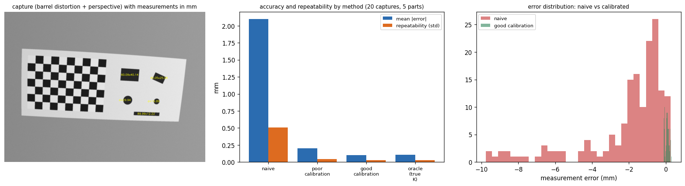

# gauge — a calibrated camera measurement starter project

**Goal:** measure the size of flat parts in **millimetres** from a camera image, and *know how good the measurement is*.
This is blueprint **#2 ("Calibrated measurement gauge")** of the handbook's `04_Projects_Playbook.md`, built so that it runs **today with no hardware** (a synthetic scene with *known ground truth*) and then works with **your own camera** and a printed checkerboard.

> **What you get:** a tested pipeline — calibrate → find the measurement plane → segment parts → sub-pixel contours → rays intersected with the plane → fit/measure — plus an evaluation that separates **accuracy** (bias against truth) from **repeatability** (spread), compares against a **naive baseline**, and shows why **reprojection error alone is not proof** of a good calibration.

---

## 1. Quick start (about 3 minutes)

```bash
pip install -r requirements.txt            # numpy, opencv-python, scikit-image, matplotlib
python tests/test_gauge.py                 # 7 tests, all should print PASS (pytest also works)
python run_demo.py                         # ~1 min: full experiment, writes results/
python make_sample_data.py                 # writes synthetic "photos" to data/sample/ (5 MB)
python -m gauge.cli calibrate "data/sample/cal/*.png" --out results/sample_calibration.json
python -m gauge.cli measure data/sample/part.png --calibration results/sample_calibration.json --annotate results/annotated.png
```

## 2. What the demo shows (my run; synthetic scene with known truth)

**Scene:** a 10×7-square checkerboard (25 mm squares) and five parts lying on the same sheet — two rectangles, one rotated rectangle, one thin bar, two circles. The camera has **barrel distortion** ($k_1=-0.20$), sits ~0.76 m away (≈ **0.63 mm per pixel** on the plane) and is tilted ≈ 10°; every image has blur and noise.



### Calibration (true focal length 1200 px)
| Calibration protocol | $f_x$ estimate | Training RMS | **Held-out RMS** |
|---|---|---|---|
| **Good:** 18 views, tilts up to 35° | **1199.6** (−0.03 %) | 0.059 px | 0.075 px |
| **Poor:** 8 near-parallel views (tilts ≤ 4°) | 1101.8 (**−8.2 %**) | 0.102 px | **0.278 px** |

The poor calibration looks fine on its own training data (0.10 px) but its focal length is 8 % wrong, and **images it has not seen reveal it (held-out RMS 3.7× worse than the good one's)**. That is why `calibrate` is always followed by `validate` on **held-out** board images, and why the CLI prints a warning when held-out error ≫ training error.

### Measurement (20 captures × 5 parts = 160 dimension measurements per method)
| Method | Mean \|error\| | Worst \|error\| | Bias (mean signed) | Repeatability (std) |
|---|---|---|---|---|
| **Naive** (one mm/pixel scale from the board squares; no undistortion, no perspective) | **2.10 mm** | 9.77 mm | −2.09 mm | 0.51 mm |
| Poor calibration | 0.20 mm | 0.59 mm | +0.19 mm | 0.043 mm |
| **Good calibration** | **0.103 mm** | 0.31 mm | +0.062 mm | 0.027 mm |
| Oracle (true $K$, true distortion) | 0.105 mm | 0.31 mm | +0.064 mm | 0.027 mm |

**Reading the table**
1. **Calibration cut the error 20×** (2.10 → 0.10 mm) — distortion and perspective are not small corrections.
2. **The good calibration matches the oracle.** The remaining 0.1 mm is *not* a calibration problem; it comes from the image (blur, edge definition, threshold), i.e. the **measurement method**.
3. **The poor calibration still measured fairly well (0.20 mm)** here because the plane pose is re-estimated from the board *in every image*, and (the likely explanation) a wrong focal length is largely compensated by a wrong distance. *Do not conclude poor calibration is harmless:* the error would be larger off the board plane, with different geometry, or for any metric use of the intrinsics. (Try it: raise the camera tilt or move parts out of the board plane.)
4. **Repeatability (std ≈ 0.03 mm) is not accuracy.** Per-part errors (good calibration, mean ± std over 20 captures):

| Part | Dimension | Truth | Error |
|---|---|---|---|
| bar 90×12 | length | 90.0 | +0.038 ± 0.026 |
| bar 90×12 | **width** | 12.0 | **+0.226 ± 0.040** |
| circle Ø20 | diameter | 20.0 | −0.099 ± 0.012 |
| circle Ø30 | diameter | 30.0 | −0.064 ± 0.008 |
| rect 40×25 (rotated 20°) | length / width | 40.0 / 25.0 | +0.073 ± 0.030 / +0.079 ± 0.025 |
| rect 60×40 | length / width | 60.0 / 40.0 | +0.099 ± 0.033 / +0.147 ± 0.040 |

The **thin bar's width is consistently 0.23 mm too large — 5–6× its repeatability** — while circles are slightly too small. Averaging more captures cannot remove a **systematic bias**; only a better edge model or **calibrating against a reference part (a gauge block / known-size standard)** can. *(My unverified guess: the edge-position rule — iso-contour at half contrast under blur — depends on feature size; testing this is Exercise 3.)*

---

## 3. How it works (and where each idea is explained in the handbook)

| Step | Code | Idea | Handbook |
|---|---|---|---|
| Synthetic ground truth | `gauge/synth.py` | Ray-trace a plane through a *distorting pinhole camera* with blur/noise | 03 §3.1 |
| Corner detection | `calibrate.find_corners` | Sub-pixel checkerboard corners (sector-based detector) | 03 §3.1 |
| Calibration | `calibrate.calibrate` | Zhang's method: minimise reprojection error over many poses | 03 §3.1, Fig. 5 |
| Validation | `calibrate.validate` | **Held-out** reprojection error (independent check) | 03 §3.1, 06 Q39 |
| Plane pose | `measure.plane_pose` | PnP on the board corners → pose of the measurement plane | 03 §3.2 |
| Segmentation | `measure.measure_parts` | 3-class Otsu → dark parts; mask the board; components | 03 §1.3, §2.1 |
| Sub-pixel edges | `skimage.measure.find_contours` | Iso-contour at half-contrast between part and local background | 03 §1.4 |
| Pixels → millimetres | `measure.pixels_to_plane` | Undistort, cast rays, **intersect with the plane Z=0** | 03 §3.1 |
| Dimensions | `fit_circle`, `cv2.minAreaRect`, `polygon_area` | Geometric circle fit (Gauss–Newton), oriented rectangle, shoelace area | 03 §2.1 |
| Baseline | `measure_parts(naive=True)` | The "just scale by the board squares" approach | — |

## 4. Using your own camera (the real project)

**Equipment:** a fixed camera (lock **focus, exposure, white balance and zoom**), a **printed checkerboard** (10×7 squares ⇒ 9×6 inner corners, as in `synth.PATTERN`; change `PATTERN`/`SQ` to match yours), a **flat rigid backing** (foam board / glass), a ruler or calipers, and a few parts you can measure independently.

**Calibration capture protocol**
1. Print at 100 % scale; **measure a printed square with calipers** and set `SQ` to the *measured* value (printers scale by a few %).
2. Take **15–25 photos** of the board, **tilting it ±30–45°** in different directions, filling the frame including the corners; sharp, no motion blur.
3. Keep the last 3–5 images as the **held-out** set (the CLI does this with `--holdout`).
4. Run `python -m gauge.cli calibrate "photos/cal/*.png" --out calibration.json`. Accept it only if the **held-out RMS is small (well under a pixel) and close to the training RMS**.

**Measurement capture:** place the board **in the same plane as the parts** (parts on the board's sheet or the board lying beside them at the same height), keep the camera set-up as in calibration, then
`python -m gauge.cli measure photo.png --calibration calibration.json --annotate out.png`.

**Validate against the real world:** measure ≥ 20 parts with calipers, run the pipeline, and report **bias** and **repeatability** exactly as `run_demo.py` does (repeat each part ≥ 10 times with re-positioning).

**Real-world error budget (things the synthetic demo does *not* contain):** printing scale error, board warp, parts with thickness (their top edge is above the plane ⇒ perspective error), lens focus changes, lighting/shadows/glare, rolling shutter, edge fuzziness of real materials, temperature.

## 5. Exercises (in increasing difficulty)
1. **Pose diversity:** vary the tilt range (2°, 10°, 20°, 35°, 45°) and the number of views; plot focal-length error vs each (compare with handbook file 03, Fig. 5).
2. **Off-plane error:** give the parts a height (e.g. 10 mm) in `synth._texture`/projection and measure how the error grows; then try a telecentric-lens model (constant magnification) as the "fix".
3. **Edge bias:** test whether the thin bar's +0.23 mm bias depends on blur σ and feature width; replace the half-contrast iso-contour by a gradient-maximum edge or a fitted blurred-edge model; calibrate the residual with a reference part.
4. **Add a distortion model choice:** compare `CALIB_FIX_K3`, rational model, and fewer parameters when only 8 views exist.
5. **Uncertainty:** propagate corner noise (Monte-Carlo) to give each measurement a confidence interval.
6. **Real data:** capture your own images, run the full protocol, and write up bias, repeatability and failure cases.
7. **Robustness:** add lighting gradients, shadows, dust specks; make segmentation adaptive.
8. **Deep-learning variant:** use a segmentation model to find part masks, keep the geometric measurement unchanged (handbook file 08 §10, "learned detector → classical measurement").

## 6. Project hygiene checklist (from the handbook, file 04 Part C)
- [x] Problem statement and metric (mm error, bias, repeatability) — this README
- [x] Baseline (naive scale) and oracle (true calibration) next to the final method
- [x] Tests for the geometry (round-trip projection, circle fit, area) and for the calibration claim
- [x] Reproducible: seeds fixed, one command per result
- [ ] **Your job:** real-camera data, a failure gallery, and an error-budget table for *your* setup

## 7. Files
```
gauge_starter/
├─ README.md
├─ requirements.txt
├─ run_demo.py              # the full experiment (writes results/)
├─ make_sample_data.py      # synthetic photos for trying the CLI
├─ gauge/
│  ├─ synth.py              # ground-truth scene generator (distortion, perspective, blur, noise)
│  ├─ calibrate.py          # corners, calibration, held-out validation, save/load
│  ├─ measure.py            # plane pose, segmentation, sub-pixel contour, mm conversion, fits
│  └─ cli.py                # command-line interface for real photos
├─ tests/test_gauge.py      # 7 tests (PASS at time of writing)
└─ results/                 # summary.json, measurements.csv, figure.png, calibration.json
```

## 8. Limits (be honest in your write-up)
Synthetic images are cleaner than real ones; the demo uses a single plane, flat parts, controlled blur/noise and perfect board geometry. The numbers (0.1 mm, 20× improvement) show *how the method behaves*, **not** what you will achieve on real hardware — measure that yourself.
