# 📘 Web Mining (CIE-431T) — Stage 1: College End-Sem Notes

> Built from your syllabus, the Dec 2024 end-term paper, and your books (Han & Kamber, Brin & Page, Markov & Larose review, Bonfring Apriori/FP-Growth paper, IJCET clustering paper).
> Diagrams are **Mermaid** (render in most `.md` viewers: VS Code with the Mermaid extension, Obsidian, Notion, GitHub) plus **ASCII** fallbacks.

---

## 0. How to attack this paper (75 marks, 3 hrs)

| Section | Rule | Marks |
|---|---|---|
| Q1 | Attempt **any 5 of 8** (a–h), ~5 marks each | 25 |
| Q2–Q9 | 4 pairs; **one question from each pair (OR choice)**, 2 parts each (6.5 + 6) | 50 |

**Strategy:** Q1 → pick the 5 you know best (a, b, c, e, f, g, h are all *very* standard). For Q2–Q9 pick one of each pair, answer in this shape:

1. **Definition** (1–2 lines)
2. **Diagram / flow / table** (the marks-winner)
3. **Steps or types** (numbered)
4. **Example**
5. **Advantages / limitations / applications** (2–3 lines)

### Dec 2024 paper — topic map (what examiners ask → where in these notes)

| Q | Topic | Section |
|---|---|---|
| 1a | Association rules in web usage mining | §1.2, §3.4 |
| 1b | PageRank on a given web graph | §1.7 |
| 1c | SNA: Centrality & Prestige | §2.6 |
| 1d | Web spamming techniques | §2.5 |
| 1e | Web usage data pre-processing, why cleaning | §3.2 |
| 1f | Query log mining | §3.8 |
| 1g | Web personalization techniques | §4.2 |
| 1h | Web mining tools | §4.5 |
| 2a/2b | Web graph, hyperlinks / content extraction & analysis | §1.5, §2.1 |
| 3a/3b | DM vs WM, three types / ML in data mining | §1.1, §1.3 |
| 4a/4b | LSI + limits / Opinion mining & sentiment | §2.4, §2.8 |
| 5a/5b | Crawler architecture, duplicates / Inverted index | §2.7, §2.3 |
| 6a/6b | Classification in usage mining / Ethics | §3.5, §3.9 |
| 7a/7b | Recommender, user-based vs item-based CF / Data cleaning | §3.6, §3.2 |
| 8a/8b | Web data warehouse & OLAP / Meta-data in content mining | §4.3, §2.1 |
| 9a/9b | E-commerce engagement & fraud / Data integration & ETL | §4.1, §4.4 |

> 🔁 **Highest-probability repeats:** PageRank numerical, Apriori/association rules, crawler architecture, LSI, inverted index, CF (user vs item), data cleaning, web mining types, SNA, spamming.

---

# 🟦 UNIT 1 — Foundations & Web Structure Mining

## 1.1 World Wide Web, Data Mining vs Web Mining

**WWW:** a huge, distributed, hyperlinked collection of heterogeneous documents (HTML, images, PDFs…) accessed via HTTP/URLs. It is **semi-structured, dynamic, noisy, and enormous** — which is why classical DM needs adaptation.

**Data Mining (DM):** extraction of interesting (non-trivial, implicit, previously unknown, useful) patterns from large data repositories. It is one step in **KDD**.

**Web Mining (WM):** application of DM techniques to discover patterns from web **content, structure, and usage** data.

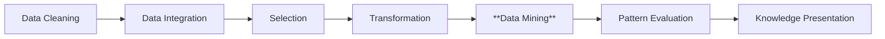
*(KDD process — Han & Kamber Fig 1.4. Data mining is one essential step.)*

| Basis | Data Mining | Web Mining |
|---|---|---|
| Data source | Databases, warehouses, flat files | World Wide Web |
| Data type | Mostly structured (tables) | Unstructured / semi-structured (HTML, text, links, logs) |
| Data size & change | Large, relatively static | Huge, dynamic, constantly changing |
| Data quality | Cleaner | Noisy, duplicated, spam |
| Extra info used | Attributes/tuples | Hyperlinks + content + clickstreams |
| Preprocessing | Cleaning, integration | + crawling, parsing HTML, sessionization, de-spidering |
| Scope | General | Subset of DM tailored to the web |
| Examples | Market-basket, credit scoring | PageRank, recommender systems, search ranking |

## 1.2 Association Rules & Sequential Patterns

### Association rules
A rule **X ⇒ Y** (X, Y itemsets, X∩Y = ∅) means "transactions containing X tend to contain Y".

- **Support**(X⇒Y) = P(X ∪ Y) = count(X∪Y) / N
- **Confidence**(X⇒Y) = P(Y | X) = support(X∪Y) / support(X)
- **Lift** = confidence / support(Y)  (>1 → positive correlation)
- A rule is *strong* if it meets **min_sup** and **min_conf**.

### Apriori algorithm
**Key property (anti-monotone / downward closure):** *every subset of a frequent itemset must be frequent.* So any candidate with an infrequent subset is pruned.

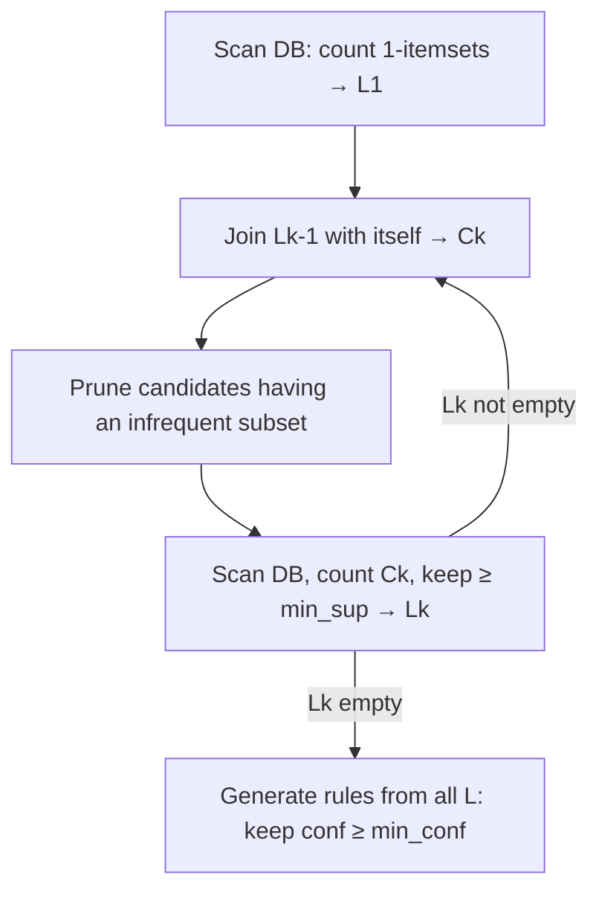

**Worked example (min_sup = 2 of 4 transactions)**

| TID | Items |
|---|---|
| T1 | 1, 3, 4 |
| T2 | 2, 3, 5 |
| T3 | 1, 2, 3, 5 |
| T4 | 2, 5 |

- **C1 → L1:** {1}:2, {2}:3, {3}:3, {4}:1 ✗, {5}:3 → L1 = {1},{2},{3},{5}
- **C2:** {1,2}:1 ✗, {1,3}:2, {1,5}:1 ✗, {2,3}:2, {2,5}:3, {3,5}:2 → L2 = {1,3},{2,3},{2,5},{3,5}
- **C3:** join gives {2,3,5} (all 2-subsets are in L2 ✓) → count = 2 → L3 = {2,3,5}
- **Rule:** {2,3} ⇒ 5 → conf = sup(2,3,5)/sup(2,3) = 2/2 = **100%**

| | Apriori | FP-Growth |
|---|---|---|
| Idea | Candidate generate-and-test (BFS) | Compress DB into **FP-tree**, mine by pattern growth |
| DB scans | Many (= max itemset length) | **Two** |
| Candidates | Huge number | **None** |
| Memory | Low | Higher (tree) |
| Speed | Slower | Faster |

*(From Skaria et al., Bonfring 2016.)*

**In Web Usage Mining:** association rules find pages visited together in a session, e.g. `/laptops ∧ /bags ⇒ /mouse [sup 4%, conf 62%]` → used for site restructuring, cross-selling, prefetching.

### Sequential patterns
Order matters. A **sequence** is an ordered list of itemsets, e.g. ⟨(home) (product) (cart) (checkout)⟩. A pattern is frequent if its support (fraction of sequences containing it as a subsequence) ≥ min_sup.
- Algorithms: **GSP** (Apriori-style, level-wise), **PrefixSpan** (pattern-growth, projects DB), **SPADE** (vertical format).
- Web use: next-page prediction, navigation path analysis.

## 1.3 Machine Learning in Data Mining

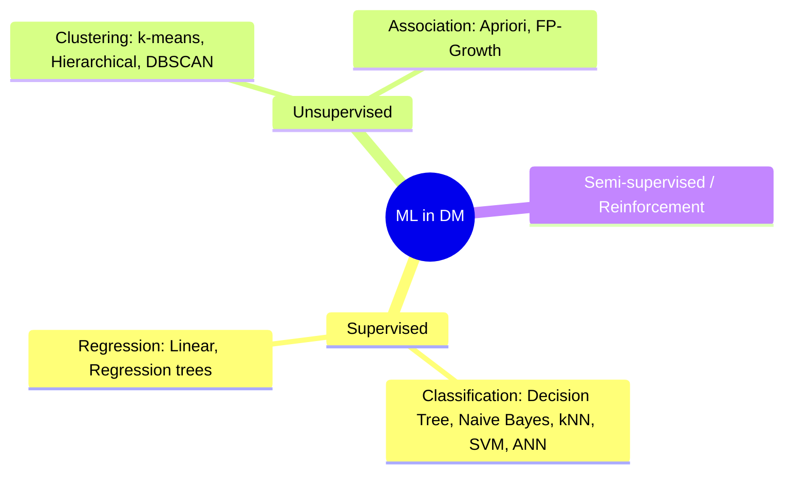

| Type | Labels? | Goal | Examples |
|---|---|---|---|
| Supervised | Yes | Learn mapping to predict class/value | Decision tree, Naive Bayes, SVM, kNN |
| Unsupervised | No | Find structure | k-means, hierarchical clustering |
| Association | No | Find co-occurrence | Apriori |

- **Decision tree:** flow-chart tree; internal node = test, branch = outcome, leaf = class.
- **k-means:** pick k centroids → assign points to nearest → recompute centroids → repeat to convergence (minimises sum of squared Euclidean distances).
- **Naive Bayes:** P(C|X) ∝ P(C)·∏P(xᵢ|C), assumes feature independence.
- **kNN:** classify by majority of k nearest neighbours (lazy learner).
- Web examples: spam filtering (NB), page classification (SVM), user clustering (k-means), churn/fraud detection.

## 1.4 The three kinds of Web Mining

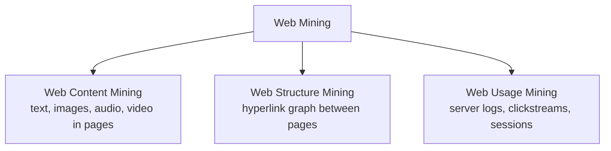

| | Content | Structure | Usage |
|---|---|---|---|
| Data mined | Page text, multimedia, meta-data | Hyperlinks, DOM tree | Web server/proxy/client logs, queries |
| View of data | Unstructured / semi-structured | Graph | Relational / transactional |
| Main methods | Text mining, clustering, classification, IR | PageRank, HITS, graph mining | Association rules, sequential patterns, clustering |
| Goal | Understand what pages say | Understand how pages connect | Understand how users behave |
| Applications | Search, topic directories, opinion mining | Ranking, community discovery, crawling | Personalization, recommendations, site design |

## 1.5 Web Structure Mining — Web Graph & Hyperlinks

**Web graph:** directed graph **G = (V, E)**; V = web pages, E = hyperlinks (u → v if page u links to v).
- **In-links (backlinks)** to a page → measure of popularity/authority
- **Out-links** → "hubness"; anchor text describes the target

**Significance of hyperlinks:** (i) act like citations/votes of quality, (ii) anchor text gives description of target, (iii) allow crawlers to discover pages, (iv) reveal communities, (v) basis for PageRank/HITS, (vi) help detect link spam.

**Bow-tie structure of the web** (Broder et al.):
```
        ┌─────────┐      ┌─────────────┐      ┌─────────┐
        │   IN    │ ───► │  SCC (core) │ ───► │   OUT   │
        └─────────┘      └─────────────┘      └─────────┘
            │   tendrils / tubes / disconnected components
```
- SCC = strongly connected core; IN reaches the core; OUT is reachable from the core.

**Extracting patterns from hyperlinks:** co-citation (two pages cited by the same page → related), bibliographic coupling (two pages citing the same page → related), community discovery, link-based classification, authority/hub detection.

## 1.6 Mining Document Structure
HTML/XML documents are **tree-structured** (DOM). Mining the tag tree helps to:
- Locate data regions (lists/tables), main content vs ads/navigation
- Weight terms by tag (text in `<title>`, `<h1>` > `<p>`)
- Segment pages into blocks (VIPS — visual page segmentation)
- Build wrappers for data extraction

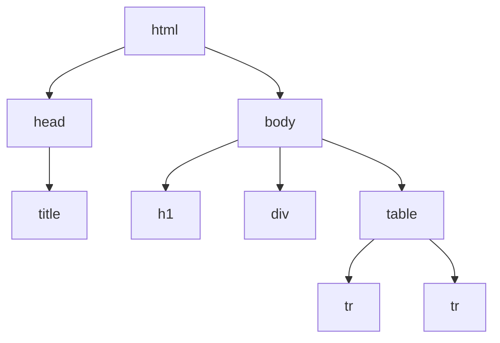

## 1.7 PageRank ⭐ (almost always asked)

**Idea:** a page is important if important pages link to it. Models a **random surfer** who follows links with probability *d* and jumps to a random page with probability (1−d).

**Formula (Brin & Page):**

> **PR(A) = (1 − d) + d · [ PR(T₁)/C(T₁) + … + PR(Tₙ)/C(Tₙ) ]**

- T₁…Tₙ = pages linking to A; C(T) = number of out-links of T; **d = damping factor (usually 0.85)**
- (Normalised version: PR(A) = (1−d)/N + d·Σ … so all PRs sum to 1.)
- Computed iteratively; equals the **principal eigenvector** of the normalised link matrix.

**Procedure for the numerical:**
1. Write each page's in-links and each source's out-degree.
2. Initialise PR = 1 (or 1/N) for all pages.
3. Apply the formula for every page using the *previous* iteration values.
4. Repeat until values stop changing (difference < ε).
5. State the ranking.

**Worked example** — A→B, A→C, B→C, C→A; d = 0.85, start PR = 1

| Iter | PR(A) | PR(B) | PR(C) |
|---|---|---|---|
| 0 | 1 | 1 | 1 |
| 1 | 1.000 | 0.575 | 1.425 |
| 2 | 1.361 | 0.575 | 1.064 |
| 3 | 1.054 | 0.729 | 1.217 |
| … converged | **1.163** | **0.644** | **1.192** |

Formulas used: PR(A)=0.15+0.85·PR(C); PR(B)=0.15+0.85·PR(A)/2; PR(C)=0.15+0.85·(PR(A)/2+PR(B)).
Ranking: **C (1.192) > A (1.163) > B (0.644)**. *(Check: sum = 3 = N ✓.)*

**Problems solved by d:** *dangling nodes* (no out-links) and *rank sinks / spider traps* — the random jump lets the surfer escape.

**Features:** query-independent, global, hard to spam (needs many good in-links), expensive for huge graphs. **Applications:** search ranking, crawl prioritisation, spam detection, citation analysis.

> 📝 For the paper's graph (nodes 1–4): write the link table, then do 2–3 iterations as above. If you send me a clear photo of that graph I'll solve it exactly.

### HITS (bonus — Kleinberg)
Each page has **hub** score (points to good authorities) and **authority** score (pointed to by good hubs). Iterate: `a(p)=Σ h(q) for q→p`, `h(p)=Σ a(q) for p→q`, normalise. Query-dependent (works on a root set + base set), unlike PageRank.

---

# 🟩 UNIT 2 — Web Content Mining

## 2.1 Text & Web page pre-processing; meta-data

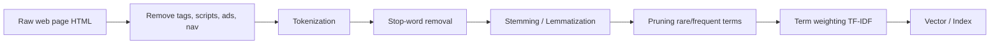

| Step | What | Example |
|---|---|---|
| HTML clean-up | strip tags, scripts, boilerplate | `<b>Sale</b>` → Sale |
| Tokenization | split into words | "web mining rocks" → web / mining / rocks |
| Stop-word removal | drop *a, the, of, is…* | |
| Stemming | reduce to root (Porter) | connected, connection → connect |
| Pruning | drop very rare/very common terms | |
| Weighting | **TF-IDF = tf × log(N/df)** | |

**Vector Space Model:** doc = vector of term weights; similarity = **cosine** = (d·q)/(|d||q|).
**Challenges of web content pre-processing:** noisy HTML, boilerplate, multiple languages, duplicates, dynamic content, huge scale, spam.

**Importance of meta-data (Q8b):** title, keywords, description, Dublin Core, schema.org/RDF/XML give semantic hints → better indexing, classification, snippet generation, semantic search, integration of heterogeneous sources.
**Challenges when mining large-scale content:** volume & velocity, heterogeneity of formats, noise/duplicates, spam/untrusted meta-data (meta-tag abuse), multilingual text, scalability of algorithms, dynamic/deep-web content, privacy & copyright.

**Techniques to extract & analyse content (Q2b):** HTML parsing/DOM, wrapper induction, tree matching, text preprocessing + TF-IDF, clustering (k-means, HAC), classification (NB, SVM), NER/information extraction, topic models (LDA/LSI), sentiment analysis, image/video feature extraction.

## 2.2 Clustering of documents (from IJCET paper)
Group similar pages: k-means (Euclidean), spherical k-means (cosine), HAC; graph methods — **cliques** (all pairs ≥ threshold), **single-link** (any link; fewest clusters), **star** (seed + neighbours), **string**.

## 2.3 Inverted Index ⭐

**Definition:** a data structure mapping each **term → list of documents (postings) where it occurs** (with frequency and positions). It is the heart of every search engine.

**Example**
```
D1: web mining uses data      D2: data mining tools      D3: web crawler for web

Term      →  Postings (docID : tf [positions])
web       →  D1:1[1], D3:2[1,4]
mining    →  D1:1[2], D2:1[2]
data      →  D1:1[4], D2:1[1]
crawler   →  D3:1[2]
```
Query *web AND mining* → intersect postings {D1,D3} ∩ {D1,D2} = **{D1}**.

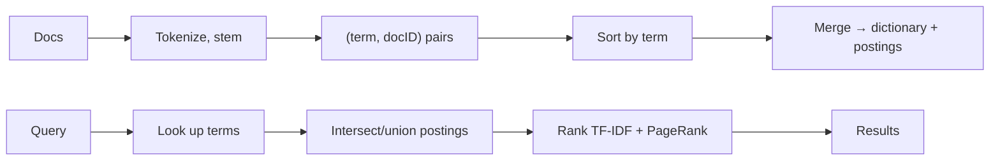

**How it improves query performance:** no scanning of all documents; only postings of query terms are touched; sorted docID lists merge fast (skip pointers); can store positions for phrase/proximity queries; compression (gap/γ-coding) shrinks it; short vs full barrels (Google) answer most queries from a small index.
**Forward vs inverted:** forward = doc → words; inverted = word → docs (built by sorting forward index).
**Types:** record-level (docIDs), word-level (docIDs + positions); also compressed, distributed (sharded), positional indexes.

## 2.4 Latent Semantic Indexing (LSI) ⭐

**Problem:** keyword matching suffers from **synonymy** (car/automobile) and **polysemy** (bank). LSI finds hidden "concepts".

**How it works**
1. Build **term–document matrix A** (m terms × n docs, TF-IDF weights).
2. Apply **SVD:** A = U Σ Vᵀ (U: term–concept, Σ: singular values, V: doc–concept).
3. Keep top **k** singular values → **Aₖ = Uₖ Σₖ Vᵀₖ** (low-rank approximation; noise removed).
4. Map queries/docs to k-dim concept space (q̂ = Σₖ⁻¹ Uₖᵀ q).
5. Compare with cosine similarity → documents match even without sharing words.

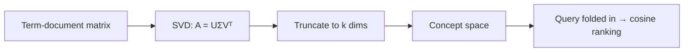

**Applications:** semantic search, document clustering, cross-language retrieval, recommender systems, essay grading.
**Limitations in web content mining:** SVD is **computationally expensive** for web-scale matrices; hard to update incrementally; choosing k is ad-hoc; resulting dimensions are not interpretable; bag-of-words ignores word order; poor handling of polysemy; dense matrices need much memory; probabilistic LSA/LDA or word embeddings do better.

## 2.5 Web Spamming ⭐

**Definition:** deliberate manipulation of pages/links to get a **higher ranking than deserved**, i.e., fooling search engines (also *spamdexing*).

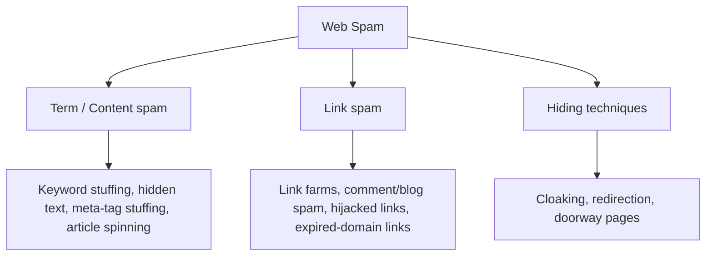

| Technique | How | Counter |
|---|---|---|
| **Keyword stuffing** (term spam) | Repeat popular words, hide them in tiny/white text | Statistical analysis of term frequency, content-quality classifiers |
| **Link farms / link spam** | Create many pages interlinking to boost PageRank | TrustRank, SpamRank, link-graph analysis |
| **Cloaking / redirection** | Show crawler different page than user | Crawl as user, compare versions |

**Impact on search engines:** low-quality/irrelevant results, loss of user trust, wasted crawl/index resources, unfair competition, ranking becomes unreliable. **Combating:** TrustRank, spam classifiers, penalties/blacklists, nofollow, personalised damping in PageRank, manual review.

## 2.6 Social Network Analysis (SNA) ⭐ Q1c

**SNA:** study of social structures as **graphs** — **actors (nodes)** and **relations (edges)**. Web = a social network of pages; basis of PageRank & HITS.

### Centrality (how *central/important* an actor is — undirected or directed)
| Measure | Meaning | Formula |
|---|---|---|
| **Degree centrality** | Number of direct ties | C_D(i) = deg(i)/(n−1) |
| **Closeness** | Short average distance to everybody | C_C(i) = (n−1)/Σ d(i,j) |
| **Betweenness** | Lies on many shortest paths (broker) | C_B(i)=Σ σ_jk(i)/σ_jk |
| **Eigenvector** | Connected to well-connected nodes | PageRank is a variant |

### Prestige (for **directed** graphs — *received* choices)
- **Degree prestige:** in-degree / (n−1)
- **Proximity prestige:** how close others are *to* the actor (via in-links)
- **Rank prestige:** weights prestige of those who link to you → **PageRank is a rank-prestige measure**.

> Centrality = focuses on **out + in** (activity/involvement); Prestige = focuses only on **received** links.

Also: **co-citation** & **bibliographic coupling**, community detection, structural equivalence. Applications: web communities, influencer detection, terror/fraud networks, recommendation.

## 2.7 Web Crawlers ⭐ Q5a

**Crawler/spider/robot:** program that automatically traverses the web by following hyperlinks to download pages for indexing.

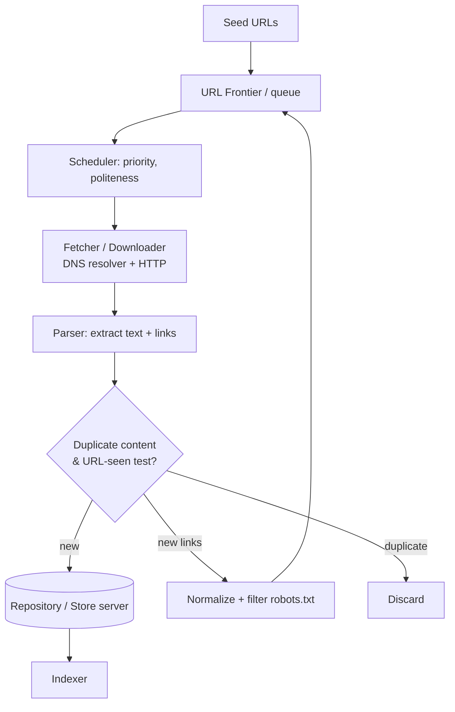

**Google architecture (Brin & Page):** URLserver → distributed crawlers (~300 open connections each, own DNS cache) → storeserver (zlib compresses) → repository (docID, length, URL) → indexer (hits → barrels) + anchors file → URLresolver → sorter → inverted index; PageRank from links DB.

**Components:** frontier, DNS resolver, fetcher, parser, duplicate eliminator, URL filter (**robots.txt**), repository.
**Types:** general, focused/topical, incremental, deep-web, distributed/parallel.
**Crawl strategies:** BFS, DFS, best-first (by PageRank/relevance). **Politeness:** delay per host, obey robots.txt.

**Dealing with duplicate content**
1. **URL normalisation** (lowercase host, remove fragments/default ports, resolve `../`, canonical tag) + **URL-seen test** with hash/Bloom filter.
2. **Exact duplicates:** checksum/hash (MD5) of page content.
3. **Near duplicates:** **shingling** (w-grams) + **Jaccard similarity**, **MinHash**, **SimHash** (fingerprints within small Hamming distance).
4. **Mirror detection** and canonical URLs; keep one copy.

**Challenges:** scale, freshness, spider traps, dynamic pages, duplicates, politeness, robots rules, DNS bottleneck, spam.

## 2.8 Structured Data Extraction
Pull records (products, prices, listings) from **template-generated pages** into tables.
- **Wrapper induction** (supervised: learn extraction rules from labelled pages; e.g., STALKER)
- **Automatic extraction** (unsupervised): **tree matching** (partial tree alignment, **DEPTA**), **MDR**, string matching; find repeating *data regions*.
- Steps: locate data region → segment records → align fields → output table.
- Challenges: template changes (wrapper maintenance), nested records, JavaScript-rendered content, noise.

## 2.9 Opinion Mining & Sentiment Analysis ⭐ Q4b

**Opinion mining:** extracting **opinions** from text — *(entity/aspect, sentiment, opinion holder, time)*. **Sentiment analysis:** classifying the **polarity** (positive / negative / neutral) or emotion.

Levels: **document-level**, **sentence-level**, **aspect (feature)-level** ("battery great, screen poor").

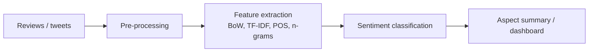

**Sentiment classification techniques**
1. **Lexicon / rule-based:** sentiment word lists (SentiWordNet, VADER) + negation/intensifier rules; sum word scores.
2. **Machine learning (supervised):** Naive Bayes, SVM, Max-Entropy, Decision trees on BoW/TF-IDF features.
3. **Unsupervised:** PMI-IR (orientation by association with "excellent"/"poor").
4. **Deep learning / transformers:** LSTM, CNN, BERT.
5. **Hybrid.**
**Challenges:** sarcasm, negation, domain dependence, spam/fake reviews, slang/emoji, multilingual.
**Applications:** product reviews, brand monitoring, politics, recommenders, stock prediction.

---

# 🟨 UNIT 3 — Web Usage Mining

## 3.1 Data collection (sources of usage data)

| Level | Source | Notes |
|---|---|---|
| **Server-side** | Web server logs (Common/Extended Log Format), app-server logs | Most common; misses cached pages |
| **Proxy-side** | ISP / proxy server logs | Aggregates many users |
| **Client-side** | JavaScript tags, cookies, browser plug-ins | Captures real activity, scrolling, mouse |

**Common Log Format record:**
`122.4.5.6 - - [10/Oct/2024:13:55:36 +0530] "GET /products/laptop.html HTTP/1.1" 200 2326 "http://google.com" "Mozilla/5.0"`
Fields: IP · identity · user · timestamp · request (method, URL, protocol) · status code · bytes · referrer · user-agent.

## 3.2 Pre-processing ⭐ (Q1e, Q7b)

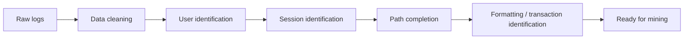

1. **Data cleaning & filtering:** remove entries for images/CSS/JS, failed requests (status 4xx/5xx), **crawler/robot ("de-spidering") requests** via user-agent/robots.txt, duplicates, irrelevant fields.
2. **User identification:** IP + user-agent, cookies, login IDs (problems: proxies, NAT, shared machines).
3. **Session identification:** split a user's clicks into visits — **timeout heuristic (e.g., 30 min)** or maximum page-stay time, or referrer-based.
4. **Path completion:** add pages missing due to browser caching/"back" button using site topology.
5. **Transaction identification & formatting:** convert sessions into transactions/vectors for mining.

**Why data cleaning is crucial (6-mark point list):**
- Logs are **noisy** (images, bots, errors) — garbage in, garbage out
- Bots/crawlers distort user behaviour statistics
- Reduces data volume → faster, scalable mining
- Improves accuracy of patterns, sessions and recommendations
- Removes duplicates/inconsistencies; ensures reliable decisions

**Common cleaning techniques:** filtering by file extension and status code, bot detection (user-agent lists, speed of requests), duplicate removal, handling missing values, normalising URLs (strip query noise/session IDs), outlier removal.

## 3.3 Data modelling
Represent sessions as: **user–page matrix** (rows users, cols pages, values = visits/time), **transactions** (sets of pages), **sequences** (ordered pages), **graphs** (navigation paths/Markov chains).

## 3.4 Discovery & analysis of usage patterns ⭐ Q6a, Q1a

| Technique | What it finds | Example |
|---|---|---|
| **Statistical / OLAP analysis** | page views, visit length, bounce rate, entry/exit pages | Top 10 pages |
| **Association rules** | pages co-visited | `/phone ⇒ /case` |
| **Sequential patterns** | ordered navigation | home→search→product→cart |
| **Clustering** | similar users / similar pages | segment customers |
| **Classification** | assign user to class | buyer vs browser |
| **Dependency modelling** | Markov models, HMM | next-page prediction |

**Classification in web usage mining (Q6a):** *supervised* learning — build model from labelled user sessions (e.g., "will purchase" / "won't"; gold vs regular member) using Decision tree, Naive Bayes, SVM, kNN; features = pages viewed, time on site, referrer, demographics. Uses: customer targeting, predicting churn, personalising content, anomaly/fraud detection.

**Methods of analysing usage patterns (Q6a second part):** statistical analysis, association rules, sequential pattern mining, clustering, classification, path analysis, Markov models, visualisation.

## 3.5 Challenges & analysis tools
Caching hides requests, dynamic URLs, shared IPs, privacy, huge logs. Output goes to **pattern analysis** (filtering interesting patterns, OLAP, visualisation).

## 3.6 Recommender systems & Collaborative Filtering ⭐ Q7a

**Recommender system:** predicts and suggests items a user is likely to like (Amazon, Netflix, YouTube).

**Building process:**
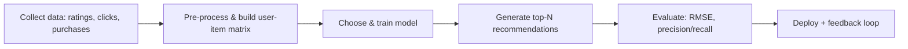

**Types:** (1) **Content-based** (similar to items you liked), (2) **Collaborative filtering**, (3) **Knowledge-based**, (4) **Hybrid**.

### Collaborative Filtering (CF)
"People who agreed in the past will agree in future." Uses the **user–item rating matrix**.

| | **User-based CF** | **Item-based CF** |
|---|---|---|
| Idea | Find users similar to target user; recommend what they liked | Find items similar to items the user liked |
| Similarity | Pearson / cosine between **user** rating vectors | Cosine / adjusted-cosine between **item** vectors |
| Prediction | r̂(u,i) = r̄ᵤ + Σ sim(u,v)(r_vi − r̄_v) / Σ|sim| | weighted average of user's ratings on similar items |
| Strengths | Simple, serendipitous, finds niche tastes | **More scalable & stable**; item similarities precomputed offline; explainable |
| Weaknesses | Poor scalability (many users), sparsity, user tastes change; cold start | Fewer surprises; needs item co-rating; cold-start for new items |

**Common CF problems:** cold start, sparsity, scalability, grey/black sheep users, shilling (fake rating) attacks, popularity bias.
**Cosine similarity:** sim(a,b) = (a·b)/(|a||b|). **Pearson:** correlation over co-rated items.

## 3.7 Association-rule-based and clustering-based recommendation
Mine page sets from sessions; when current session matches a rule's antecedent, recommend its consequent. Cluster users then recommend most popular items in the cluster.

## 3.8 Query Log Mining ⭐ Q1f

**Query log:** record of user search queries (query text, timestamp, user/session ID, clicked results, rank).
**Query log mining:** applying DM to these logs to learn **user intent and information needs**.

Techniques & uses:
- **Query clustering / session analysis** → find related queries, query reformulation patterns
- **Query suggestion & auto-completion** (frequent queries, co-occurrence)
- **Spelling correction** ("did you mean")
- **Click-through analysis** → implicit relevance feedback to improve ranking (clicked results ≈ relevant)
- **Query intent classification:** navigational / informational / transactional
- **Trends & seasonality** (Google Trends), personalisation, ad targeting
**Relation to web usage mining:** both analyse user behaviour logs; query logs are the *search-engine side* of web usage mining (search engine logs ≈ server logs). Issues: **privacy** (AOL 2006 leak), anonymisation.

## 3.9 Ethics & privacy in web usage data ⭐ Q6b
- **Privacy & consent:** tracking via cookies, IPs, fingerprints without informed consent
- **Personal/identifiable data:** profiling, re-identification from "anonymous" logs
- **Data security & breaches; data retention limits**
- **Transparency & purpose limitation** (use data only for stated purposes)
- **Discrimination / bias** from profiling, filter bubbles, manipulation
- **Legal compliance:** GDPR, India's **DPDP Act 2023**, CCPA; right to access/erase
- **Good practice:** anonymisation, aggregation, opt-in/opt-out, privacy policy, minimal collection, secure storage, P3P/Do-Not-Track.

---

# 🟥 UNIT 4 — Applications & Other Topics

## 4.1 E-commerce, engagement & fraud ⭐ Q9a

**Using web mining to enhance customer engagement:**
- **Personalised recommendations** (CF/association rules) → higher cart value
- **Clickstream/segmentation** → targeted offers, emails, dynamic pricing
- **Search improvements** (query log mining, product-search ranking)
- **Opinion mining** on reviews → product improvement, trust
- **Site optimisation** (funnels, abandonment analysis)
- **Churn prediction & loyalty**, market-basket analysis

**Fraud detection techniques:** anomaly/outlier detection on transactions; classification (decision tree, NB, ANN) trained on known fraud; clustering to isolate odd behaviour; association/sequence rules for suspicious patterns; velocity checks; link analysis of fraud rings; fake-review/click-fraud detection; real-time scoring.

## 4.2 Web personalization ⭐ Q1g
Tailoring content/layout/recommendations to each user.

Techniques (≥3):
1. **Content-based filtering** – match item content to user profile
2. **Collaborative filtering** – similar users' preferences
3. **Rule-based / association-rule personalisation**
4. **Clustering/segmentation** of users, plus **Markov models** for next-page prediction & prefetching
5. **Hybrid** approaches; context-aware personalisation

**How it enhances e-commerce UX:** relevant products, faster navigation, higher conversions & retention, personalised search/offers/emails, reduced information overload. **Issues:** cold start, privacy, filter bubble.

## 4.3 Web data warehousing & OLAP ⭐ Q8a
**Data warehouse (Inmon):** *subject-oriented, integrated, time-variant, non-volatile* collection of data for decision support. **Web data warehouse:** stores web logs, clickstream, content & e-commerce data integrated from many sources (a "**webhouse**").

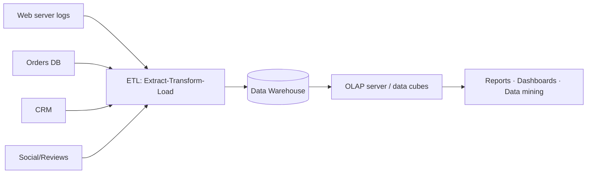

**OLAP (On-Line Analytical Processing):** multidimensional analysis on **data cubes** (dimensions: time, page, user, location, product; measure: hits, sales).
Operations: **roll-up** (aggregate up, day → month), **drill-down**, **slice**, **dice**, **pivot**.
**Role in web warehousing:** fast interactive aggregation of clickstream, trends/seasonality, KPI reporting, feeds data mining. Han & Kamber Fig 1.8: Q1→months (drill-down), city→region (roll-up).

## 4.4 Data integration for e-commerce & ETL ⭐ Q9b
**Data integration:** combining data from heterogeneous sources (catalogues, supplier feeds, orders, CRM, logs, social) into a **unified view**.
**Why:** single customer view, consistent product data, accurate analytics, personalisation, inventory & order sync, price comparison.
**Challenges:** schema/semantic heterogeneity, duplicate entities (entity resolution), format differences, real-time needs, data quality, privacy.

**ETL**
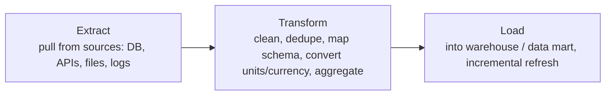
Tools: Informatica, Talend, SSIS, Apache NiFi, Airflow. (ELT in modern cloud DWs.)

## 4.5 Web mining tools ⭐ Q1h (mention any three)

| Tool | Features | Application |
|---|---|---|
| **Weka** | Open-source ML suite: preprocessing, classification, clustering, association, visualisation | Teaching, text classification, usage mining |
| **RapidMiner** | Drag-and-drop workflow, text/web mining extensions, ETL | Churn, sentiment, e-commerce analytics |
| **Orange** | Visual programming, text-mining add-on | Exploratory analysis |
| **KNIME** | Workflow platform, integration with Python/R | Data pipelines, mining |
| **Scrapy / BeautifulSoup / Selenium** | Crawling & scraping HTML | Price monitoring, data collection |
| **Google Analytics / Webalizer / AWStats** | Log & clickstream analysis, funnels | Traffic & user behaviour |
| **NLTK / spaCy** | NLP: tokenise, POS, sentiment | Content/opinion mining |
| **Gephi / NetworkX** | Graph & SNA analysis | Link & community analysis |
| **SPSS Clementine / SAS EM** | Commercial DM suites | Enterprise mining |

## 4.6 Other topics in the syllabus
- **Web content & structure mining applications:** search engines, topic directories, community detection, focused crawling, plagiarism/duplicate detection.
- **Systems/architectures:** Google architecture (Brin & Page), recommender platforms, clickstream warehouses.

---

# 📝 Last-day revision cheat sheet

**Formulas:** Support = count(X∪Y)/N · Confidence = sup(X∪Y)/sup(X) · Lift = conf/sup(Y) · PR(A)=(1−d)+d·ΣPR(T)/C(T), d=0.85 · TF-IDF = tf·log(N/df) · Cosine = d·q/|d||q| · Degree centrality = deg/(n−1)

**One-liners:**
- Web mining = DM on web content + structure + usage
- Apriori = BFS + prune by downward closure; FP-Growth = tree, no candidates
- Inverted index = term → postings
- LSI = SVD of term-doc matrix → concept space
- Crawler = seeds → frontier → fetch → parse → dedupe → store
- Spam types = term, link, hiding
- Usage preprocessing = clean → user → session → path completion
- CF = user-based vs item-based; cold start & sparsity
- OLAP ops = roll-up, drill-down, slice, dice, pivot

**Don't forget:** draw a labelled diagram in every 6-mark answer; underline keywords; write the formula before substituting numbers.

---
*Stage 2 (deeper knowledge-base notes) is the next set — see the end of my message.*
