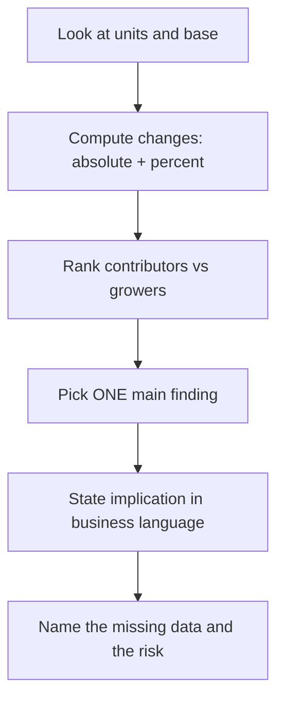
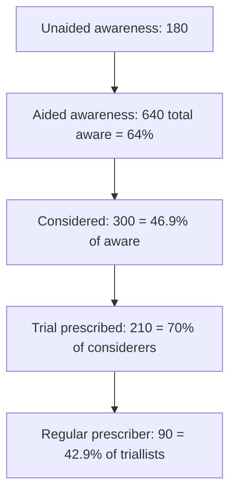

# 03 — Data Interpretation, Graphs and Business Insights

**Purpose:** read any table or chart quickly, compute correctly, and — the part most candidates miss — state the **business implication** and the **missing information**.
**Prerequisites:** [01-quantitative-aptitude.md](01-quantitative-aptitude.md) (percentage change, weighted averages).
**Suggested study time:** 3–4 hours.
**Data provenance:** all datasets below are **original and fictional (PRACTICE INFERENCE)**, built to exercise the skills Trinity's JD lists: trend identification, survey analysis, insight generation. Charts are written as Markdown tables and ASCII bars so they render offline. Answers are at the end — do not scroll ahead.

---

## 3.1 The 60-second chart-reading routine

For every dataset, answer in this order:

1. **What is the unit?** ₹ Cr vs $M, TRx vs NRx, volume vs revenue, calendar vs fiscal year.
2. **What is the base?** Is this a share of total market, or share of a segment?
3. **What is the direction and size of change?** Absolute change first, then % change.
4. **Who contributes the most?** Largest absolute contributor vs fastest grower are often different.
5. **So what?** One sentence a business leader could act on.
6. **What is missing?** One sentence naming the data you would need before acting.

**The five standard follow-up questions** (use these verbatim when a case or interviewer asks "what do you observe?"):

| Question | Why interviewers ask it |
|---|---|
| What is the main finding? | Tests prioritisation, not arithmetic |
| What changed the most? | Tests absolute vs relative thinking |
| Which segment contributes most? | Tests contribution vs growth confusion |
| What is the business implication? | Tests commercial judgement |
| What additional information is needed? | Tests intellectual honesty |



---

## 3.2 Tables and bar charts

### Dataset A — CardioX therapy market by region (₹ crore)

| Region | 2023 | 2024 | 2025 |
|---|---:|---:|---:|
| North | 480 | 528 | 581 |
| South | 620 | 682 | 764 |
| East | 210 | 214 | 220 |
| West | 390 | 447 | 510 |
| Central | 300 | 315 | 340 |
| **Total** | **2,000** | **2,186** | **2,415** |

Same data as a bar chart (2025 values, bar length proportional):

```
North    ████████████████████████████▏ 581
South    ██████████████████████████████████████ 764
East     ███████████ 220
West     █████████████████████████▌ 510
Central  █████████████████ 340
```

**Questions (A1–A6)**
1. What was the total market CAGR from 2023 to 2025?
2. Which region grew fastest 2023→2025, and by how much?
3. Which region added the most absolute revenue 2023→2025?
4. What is South's share of the 2025 market?
5. The 2025 growth rate (vs 2024) is higher than the 2024 growth rate (vs 2023). True or false?
6. A colleague says: "East is a declining region." Is that a fair statement? What would you check?

---

## 3.3 Line charts, trends and seasonality

### Dataset B — Allergy product prescriptions by quarter ('000 units)

| Quarter | Year 1 | Year 2 |
|---|---:|---:|
| Q1 | 120 | 150 |
| Q2 | 300 | 360 |
| Q3 | 260 | 300 |
| Q4 | 90 | 110 |
| **Total** | **770** | **920** |

```
Year 2:  Q1 ██████ 150   Q2 ██████████████ 360   Q3 ████████████ 300   Q4 ████▍ 110
Year 1:  Q1 █████ 120    Q2 ████████████ 300     Q3 ██████████▍ 260     Q4 ███▌ 90
```

**Questions (B1–B5)**
1. What is Year 2's growth over Year 1?
2. Which quarter contributes most to Year 2, and what is its share?
3. Q2 is 2.4× Q1 in Year 2. Why might that be, and what would you NOT conclude from it?
4. Q3 falls 16.7% versus Q2 in Year 2. Is the product in trouble?
5. If Q1 next year follows the same Year1→Year2 uplift, what would Q1 Year 3 be?

---

## 3.4 Pie charts and share decomposition

### Dataset C — Brand share of preventive-treatment prescriptions (%)

| Brand | 2023 | 2024 | 2025 |
|---|---:|---:|---:|
| Brand A | 38 | 36 | 33 |
| Brand B | 22 | 24 | 27 |
| Brand C | 16 | 17 | 19 |
| Brand D | 12 | 11 | 10 |
| Others | 12 | 12 | 11 |

**Questions (C1–C5)**
1. Which brand gained the most share 2023→2025, in percentage points?
2. Which brand lost the most share, and is the loss accelerating?
3. If Brand A's 2025 revenue was ₹1,320 Cr, what was the total market value?
4. A colleague says "Others lost 1 point, so the long tail is collapsing." Evaluate.
5. In a pie chart of 2025, what angle would Brand B occupy?

---

## 3.5 Funnels and stacked structures

### Dataset D — Physician awareness and adoption funnel (n = 1,000 surveyed physicians)

| Stage | Physicians |
|---|---:|
| Unaided awareness | 180 |
| Aided awareness only | 460 |
| Considered prescribing | 300 |
| Ever prescribed (trial) | 210 |
| Regular prescriber (≥1 Rx/month) | 90 |



**Questions (D1–D6)**
1. What percentage of physicians is aware of the brand (aided or better)?
2. What is consideration as a percentage of aware physicians?
3. What is trial as a percentage of considerers?
4. Where is the biggest leak in the funnel, and what does that imply?
5. What is regular prescribers as a percentage of triallists?
6. If the campaign raises aided awareness from 64% to 75% with the same downstream conversion rates, how many regular prescribers would you expect? What assumption does that forecast make?

---

## 3.6 Histograms and distributions

### Dataset E — Days to fill a vacant sales territory (57 territories)

| Days | Territories | Cumulative |
|---|---:|---:|
| 0–30 | 8 | 8 |
| 31–60 | 14 | 22 |
| 61–90 | 18 | 40 |
| 91–120 | 9 | 49 |
| 121–150 | 5 | 54 |
| 151–180 | 3 | 57 |

```
 0–30   ████████ 8
31–60   ██████████████ 14
61–90   ██████████████████ 18
91–120  █████████ 9
121–150 █████ 5
151–180 ███ 3
```

**Questions (E1–E4)**
1. Which bin contains the median? Explain your reasoning.
2. What share of territories takes longer than 120 days?
3. Is the distribution symmetric? What does the shape tell you operationally?
4. Should you report the mean or the median for "typical" time-to-fill here? Why?

---

## 3.7 Scatter plots and correlation

### Dataset F — Territory marketing spend (₹ lakh) vs TRx

| Territory | Spend | TRx |
|---|---:|---:|
| T1 | 12 | 420 |
| T2 | 18 | 520 |
| T3 | 25 | 610 |
| T4 | 30 | 640 |
| T5 | 9 | 380 |
| T6 | 22 | 700 |
| T7 | 35 | 720 |
| T8 | 28 | 660 |
| T9 | 15 | 470 |
| T10 | 40 | 780 |

```
TRx
800 |                                        ● T10
750 |
700 |                       ● T6      ● T7
650 |                          ● T4   ● T8
600 |                    ● T3
550 |
500 |              ● T2
450 |        ● T9
400 |     ● T1
350 |  ● T5
    +--------------------------------------------
      9  12  15  18  22  25  28  30  35  40   Spend
```

The Pearson correlation here is **r ≈ 0.94** (r² ≈ 0.88), with T6 sitting well above the trend line.

**Questions (F1–F5)**
1. Describe the relationship in one sentence.
2. What does r² ≈ 0.88 mean in plain language (careful with the framing)?
3. Which territory is the outlier on the upside, and what could explain it?
4. Recommend one action for the sales leadership team. What is the obvious risk in acting on this chart?
5. What additional data would you request before reallocating spend?

---

## 3.8 Mixed charts: market size + growth

### Dataset G — Market size (₹ Cr) with YoY growth (%)

| Year | Market size | YoY growth |
|---|---:|---:|
| 2021 | 1,600 | — |
| 2022 | 1,680 | 5.0% |
| 2023 | 1,764 | 5.0% |
| 2024 | 2,117 | 20.0% |
| 2025 | 2,435 | 15.0% |

**Questions (G1–G4)**
1. What is the CAGR 2021→2025?
2. The growth rate doubled in 2024. What are two plausible (fictional) explanations, and what data would distinguish them?
3. If 2026 growth is 12%, what is the 2026 market size?
4. A slide shows only bars for 2024 and 2025 with the title "growth is slowing". Is the claim defensible? What is the better title?

---

## 3.9 Percentage points vs percentage change

This distinction is tested constantly and is the single most common analytical error in pharma analytics.

| Statement | Interpretation |
|---|---|
| Share rose from 18% to 21% | **+3 percentage points** (absolute gap) |
| Share rose from 18% to 21% | **+16.7% relative** (3/18) |
| Awareness 30% → 33% | +3 pp, i.e. 10% relative |

**Rules**
- Use **pp** when the base is a percentage (shares, awareness, penetration, response rates).
- Use **%** when the base is a quantity (revenue, patients, TRx).
- Never say "share grew 3%" when you mean "3 pp" — in a 15%-share market, 3 pp is a *20% relative* gain.

**Practice (H1–H2)**
1. A brand's share went 18% → 21% while the market grew 10%. Did brand revenue grow faster or slower than 10%? By how much?
2. Penetration moved from 4.0% to 4.2%. Express this in both pp and relative terms, and explain which one the local team will prefer.

---

## 3.10 Misleading visualisations — the six you must recognise

| # | Pattern | Why it misleads | Correct practice |
|---|---|---|---|
| 1 | **Truncated y-axis** starting at 90 instead of 0 | A 2% change looks like a doubling | Start at zero for bars; if truncated, label clearly |
| 2 | **Dual axes** rescaled to manufacture a crossover | Implies a relationship that may not exist | Use one axis or state both scales explicitly |
| 3 | **Inconsistent time intervals** (2019, 2023, 2025 with equal spacing) | Distorts the slope of growth | Space points proportionally to time |
| 4 | **3-D pies / exploded pies** | Area distortion; unreadable multiple slices | Use a bar chart for >3 categories |
| 5 | **Cumulative vs period values mixed** | Period decline looks like a plateau | Label cumulative explicitly |
| 6 | **Cherry-picked base year** | Trend reverses if the base changes | Show ≥3 years and mark the base |

**Practice (I1–I3)**
1. A chart shows Brand A declining from 38% to 33% share with the y-axis from 32% to 40%. Is the decline real? Is the chart fair?
2. A dual-axis chart shows marketing spend (left axis) and TRx (right axis) moving together. What must you verify before claiming a relationship?
3. A bar chart compares "average Rx per rep" for two teams, but Team A has 12 reps and Team B has 60. What is the likely issue?

---

## 3.11 Weighted average in charts

When two series have different bases, a chart fights you. Compare:

| Team | Reps | Rx per rep | Total Rx |
|---|---:|---:|---:|
| DigiA | 10 | 300 | 3,000 |
| DigiB | 40 | 150 | 6,000 |

- Simple average of Rx/rep = 225 → **wrong** for the organisation.
- Weighted average = (3,000 + 6,000)/50 = **180 Rx/rep**.

**Practice (J1–J2)**
1. Compute the organisation-level Rx/rep and explain why it differs from 225.
2. Team DigiA asks for extra reps because "we have the highest productivity". What single question do you ask first?

---
---

# Answer key with explanations

### Dataset A

**A1 — 9.9% CAGR.** (2,415/2,000)^(1/2) − 1 = √1.2075 − 1 = 1.0989 − 1 ≈ **9.89%** (over 2 intervals). *(Common mistake: dividing 20.75% by 2 = 10.4% — that is simple growth, not CAGR.)*

**A2 — West, +30.8%.** West: 390 → 510 = +120 = +30.77%. (South +23.2%, North +21.0%, Central +13.3%, East +4.8%.)

**A3 — South, +₹144 Cr.** South 620 → 764 = +144. (West +120, North +101, Central +40, East +10.) *Fastest grower ≠ largest contributor.*

**A4 — 31.6%.** 764/2,415.

**A5 — True.** 2023→2024: +9.3% (2,000 → 2,186). 2024→2025: +10.5% (2,186 → 2,415).

**A6 — No, it is not fair.** East grew +4.8% over two years; it is the slowest-growing region, not declining. *Better phrasing:* "East is the slowest-growing and smallest region, contributing only 9.1% of 2025 revenue (220/2,415)." Check: absolute contribution, market mix, pricing/reimbursement differences, and whether East contains a high-potential sub-segment before acting.

### Dataset B

**B1 — +19.5%.** 920/770 − 1 = 19.48%.

**B2 — Q2, 39.1%.** 360/920.

**B3 — Likely seasonality** (allergy season peaking in Q2). You should **not** conclude that underlying demand grew 2.4× permanently, or that a Q1 marketing campaign caused it. Check historical seasons and weather/pollen-driven demand patterns.

**B4 — Not necessarily.** Q2→Q3 seasonal decline is normal in this dataset; compare Q3 Year 2 (300) with Q3 Year 1 (260) → still +15.4% YoY. *Always compare like-for-like periods.*

**B5 — ≈187.5 ('000).** Q1 uplift = 150/120 = 1.25; 150 × 1.25 = 187.5.

### Dataset C

**C1 — Brand B, +5.0 pp.** B: 22 → 27. (C +3 pp, Others −1 pp, A −5 pp.)

**C2 — Brand A, −5 pp, and yes the loss is roughly steady:** −2 pp then −3 pp.

**C3 — ₹4,000 Cr.** 1,320/0.33 = 4,000.

**C4 — Not supported.** Others fell 12 → 11 = −1 pp, and the *absolute* fall is 1 pp × market size; other categories may still be growing in revenue. It is also worth noting Others is the smallest mover — noise, not collapse.

**C5 — 97.2°.** 27% × 360° = 97.2°.

### Dataset D

**D1 — 64%.** (180 + 460)/1,000.

**D2 — 46.9%.** 300/640.

**D3 — 70%.** 210/300.

**D4 — The awareness → consideration leak (53.1% do not progress) is the biggest leak in absolute terms; the trial → regular leak (57.1% drop-off) is the biggest *proportional* leak.** Collectively the funnel converts 64% → 9%, i.e. ~14% of aware physicians become regular prescribers (90/640 = 14.1%). First fix: find out *why* unaware/aware physicians don't consider — likely clinical data, access, or formulary issues, not awareness.

**D5 — 42.9%.** 90/210.

**D6 — ≈147 regular prescribers.** 750 aware × (300/640) × (210/300) × (90/210) = 750 × 0.1957 ≈ 146.6 → ~147. **Assumption: downstream conversion rates stay constant.** If the new awareness comes from a less-qualified physician pool, conversion will likely be *lower*, so this is an upper bound.

### Dataset E

**E1 — The 61–90 bin.** Cumulative counts reach 22 at 60 days and 40 at 90 days; the 28.5th territory lies in 61–90.

**E2 — 14.0%.** (5 + 3)/57 = 8/57.

**E3 — Not symmetric; it is right-skewed** (mode 61–90, long tail to 180). Operationally: most territories fill in about two months, but a minority drag on far longer, and those slow fills probably hurt the most (large/quota-heavy territories often fill slowest).

**E4 — Median.** The long right tail pulls the mean upward (approximate mean ≈ 74 days vs median bin 61–90). The median better represents "typical", and you should report the tail separately.

### Dataset F

**F1 —** Strong positive association: territories with higher marketing spend tend to have higher TRx, with one clear above-trend outlier (T6).

**F2 —** About 88% of the variation in TRx is statistically associated with variation in spend **in this sample of 10 territories**. It does **not** mean "spend explains 88% of TRx", nor that spend *causes* TRx. (r² is a measure of linear association.)

**F3 — T6 (spend 22, TRx 700).** Plausible explanations: a strong KOL presence, high baseline productivity, better territory mix (physician specialty/payer access), or a recent launch effect. Weak explanation to avoid: "T6 got lucky".

**F4 — Suggested action:** investigate T6's practices and test them in one comparable territory (a pilot) before reallocating budget at scale. **Risk:** endogeneity — high-performing territories may attract more spend, or both may be driven by unobserved physician mix; reallocating spend to weak territories may not reproduce T6's results.

**F5 —** Physician counts and specialty mix, payer/formulary status, competitor rep activity, TRx baseline history, and calls made (spend ≠ coverage). Also request multiple years to see if spend changes *precede* performance.

### Dataset G

**G1 — 11.1% CAGR.** (2,435/1,600)^(1/4) − 1 = (1.5219)^0.25 − 1 = 1.1107 − 1 ≈ 11.07%.

**G2 —** Explanations: (i) a new entrant/patent-cliff dynamic or new indication expanded demand; (ii) reimbursement/formulary change or a category-wide guideline update; (iii) one-time stocking. Distinguish with: unit (TRx) vs value data, launch dates, policy changes, and whether the rise is in one product or spread across the category.

**G3 — ₹2,727 Cr.** 2,435 × 1.12 = 2,727.2.

**G4 — Defensible but misleading.** Growth fell 20.0% → 15.0%, so "slowing" is technically true, but 15% is far above the 5% baseline of 2022–23. Better title: **"Growth normalises to 15% after a 20% spike — still ~3× the pre-2024 baseline."**

### Percentage points (H)

**H1 — Faster than the market.** Share 18% → 21% means brand revenue grew 1.21 × market growth (21/18 = 1.1667; exactly: brand multiplier = 1.10 × 1.1667 = 1.283). Brand grew ≈ **28.3%**, i.e. ≈18 pp faster than the market's 10%.

**H2 — +0.2 pp; +5% relative.** Both are correct statements of the same movement. Local teams typically prefer "up 5%" (relative) while central teams and payers use pp — always state which you mean, and use pp in a slide that also shows shares.

### Misleading charts (I)

**I1 — The decline is real (38 → 33 = −5 pp), but the truncated axis exaggerates its visual magnitude.** With a 0–40% or 0–100% axis, the erosion looks gradual. Fair fix: keep the data, change the axis, and annotate the pp change.

**I2 —** Verify: (a) whether the axes were rescaled arbitrarily; (b) lag structure (spend may affect TRx months later); (c) confounders (physician mix, competitor activity); (d) whether both series were normalised to look similar. A visual co-movement is not evidence of causation.

**I3 —** Comparing averages across very different team sizes invites a weighted-average error; the organisation-level figure is the weighted one. Also check whether the teams have different territory potentials (Rx per rep alone ignores territory size).

### Weighted average (J)

**J1 — 180 Rx/rep.** 9,000/50. It is lower than 225 because DigiB (the larger team) is less productive; a simple average over-weights the small team.

**J2 —** "How many physicians does DigiA cover, and what is DigiA's Rx *per physician*?" High Rx per rep may simply reflect a small physician list. Ask for territory size, coverage, and target potential before approving headcount.

---

## 3.12 Common mistakes summary

| Mistake | Example here | Fix |
|---|---|---|
| Simple growth instead of CAGR | A1 (10.4% vs 9.89%) | Use the power formula over intervals |
| Fastest grower treated as biggest contributor | A2 vs A3 (West vs South) | Report both, name both |
| YoY comparison across different quarters | B4 | Compare like periods |
| Reporting share changes in % | C1, H | Use percentage points |
| Reading a funnel as "awareness problem" | D4 | Find the largest *leak*, then diagnose |
| Claiming causation from a scatter | F2/F4 | Use association language; design a test |
| Judging a chart without checking the axis | I1 | Check axis start and scale first |
| Simple average over unequal groups | J1 | Weighted average |

**Next:** [04-excel-formulas-cheatsheet.md](04-excel-formulas-cheatsheet.md) → [06-statistics-and-survey-analytics.md](06-statistics-and-survey-analytics.md)
