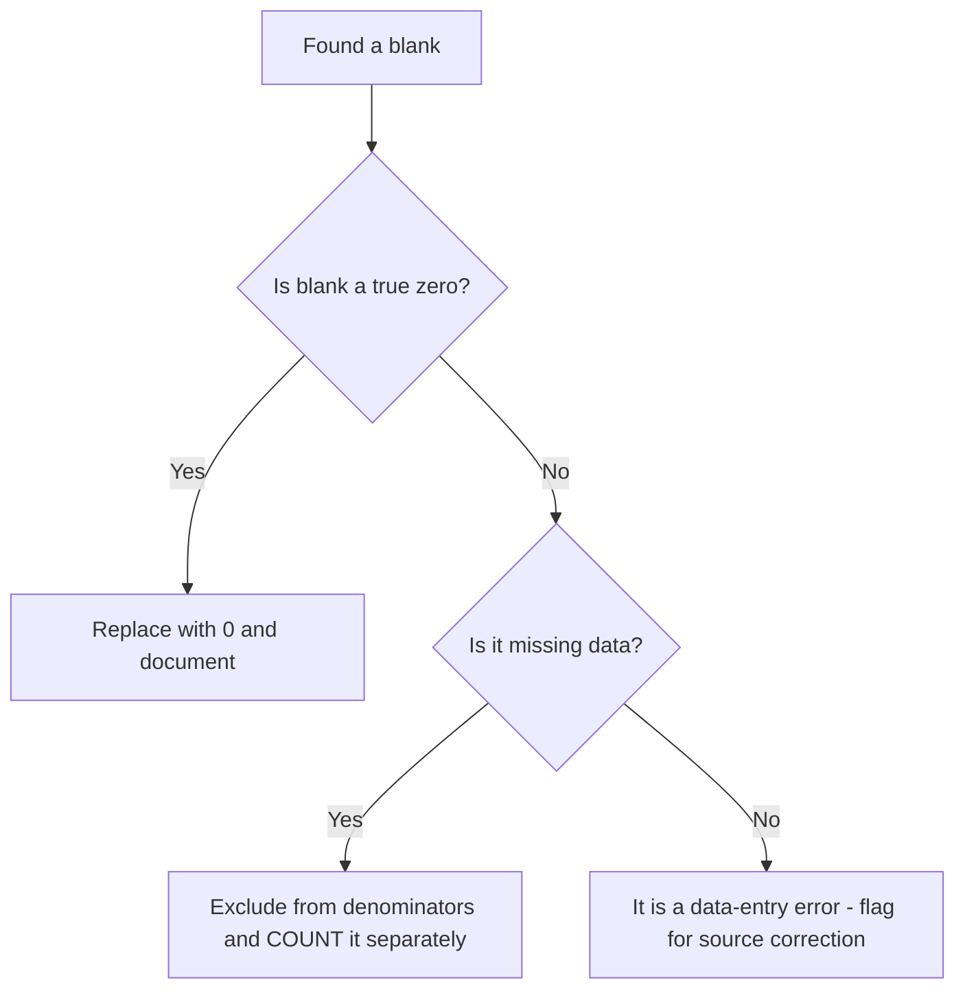

# 05 — Excel Practical Workbook Guide

**Purpose:** teach the *workflows* (not just the formulas) that a 30–45 minute Excel assessment and Trinity's survey-analysis work require: cleaning, filtering, tables, PivotTables, validation and reconciliation.
**Prerequisites:** [04-excel-formulas-cheatsheet.md](04-excel-formulas-cheatsheet.md) (at least SUMIFS, COUNTIFS, IF, lookups).
**Suggested study time:** 3–4 hours (all exercises are hands-on in Excel).
**Data files:** CSV files live in [`data/`](data/). Every dataset is **original and fictional (PRACTICE INFERENCE)**.

> **Workflow reminder:** in a timed assessment, do cleaning → validation → aggregation → chart → conclusion, in that order. Never build a PivotTable on dirty data, because it will silently give the wrong answer.

---

## 5.1 Sorting and filtering

| Task | Steps |
|---|---|
| Sort a single column | Click any cell in the column → **Data → Sort A→Z / Z→A** |
| Multi-level sort | **Data → Sort** → add levels (e.g., Region A→Z, then TRx Largest to Smallest) |
| Custom order sort | Sort → Order → Custom List → type `North,South,East,West` → OK |
| Filter | **Data → Filter** (or Ctrl+Shift+L) → use dropdowns; use "Number Filters → Top 10" or "Custom Filter" for ranges |
| Filter with criteria | `Text Filters → Contains` for partial matches; `Number Filters → Greater Than` for thresholds |
| Keep filters when copying | Copy only visible rows using **Alt+;** (Windows) / **Cmd+Shift+Z** depending on version — or use SUBTOTAL which respects filters |

**Traps:** sorting only one column of a table scrambles rows (always sort the whole table or convert to an Excel Table first); hidden rows are still returned by SUM/AVERAGE unless you use SUBTOTAL/AGGREGATE.

---

## 5.2 Removing duplicates and handling blanks

**Remove duplicates (Method 1 — destructive copy)**
1. Select the table → **Data → Remove Duplicates**.
2. Tick only the columns that define a duplicate (for the rep file: **all** columns → removes exact duplicate rows only).
3. Output: Excel reports how many duplicates were removed.

**Remove duplicates (Method 2 — auditable, preferred in assessments)**
1. Add a helper column: `=COUNTIFS($A$2:$A$31,A2,$F$2:$F$31,F2)` (RepID + Month).
2. Filter for values > 1 → inspect before deleting anything.
3. Add a flag: `=IF(COUNTIFS($A$2:A2,A2)>1,"DUPLICATE","")` — this marks only the *second and later* occurrences.

**Blank handling decision tree**



**Never** silently treat blanks as zero: in the mock dataset, one rep has a blank TRx and one has a blank target. Including the blank-TRx row as 0 is defensible for "total TRx"; treating a blank *target* as 0 would corrupt every achievement calculation (division by zero or a fake 100%+ result).

---

## 5.3 Cleaning inconsistent text

| Problem | Detection formula | Fix |
|---|---|---|
| Leading/trailing spaces | `=LEN(A2)<>LEN(TRIM(A2))` | `=TRIM(A2)` into a helper column, then paste-values back |
| Double spaces inside | `=ISNUMBER(SEARCH("  ",A2))` | `=TRIM(A2)` (Excel collapses interior repeats) |
| Case inconsistency (`north`) | `=EXACT(A2,LOWER(A2))` | `=PROPER(TRIM(A2))` |
| Region coded differently (`N`, `N.`) | `=COUNTIF(list,A2)=0` against a master list | `=IF(OR(A2="N",A2="north"),"North",…)` or a mapping lookup |
| Numbers stored as text (`"1,510"`) | Left-aligned; `=ISNUMBER(A2)` = FALSE | `=VALUE(SUBSTITUTE(A2,",",""))` or **Data → Text to Columns → Finish** |
| Non-breaking spaces | `=CODE(MID(A2,1,1))=160` | `=SUBSTITUTE(A2,CHAR(160)," ")` then TRIM |

**Master-list validation formula:** `=IF(COUNTIF($Master$A$2:$A$50,TRIM(B2))=0,"UNMAPPED","")`

---

## 5.4 Data validation

**Purpose:** prevent bad input at the source (respondent IDs, Likert scales 1–5, regions from a list, dates in range).

**Steps:** select the input range → **Data → Data Validation → Allow:**
- **List** → Source: `North,South,East,West` (or a named range). Tick *In-cell dropdown*.
- **Whole number** → between 1 and 5 (for Likert).
- **Date** → between two dates (fielding window).
- **Custom** → `=ISNUMBER(A2)` (blocks text in a numeric column).

**Error checking tools**
- **Data → Text to Columns** for text-numbers.
- **Formulas → Error Checking** for formula errors.
- **Trace Precedents/Dependents** to audit someone else's workbook.
- Circle invalid data: **Data → Data Validation → Circle Invalid Data** (highlights entries violating current rules — perfect for the Likert exercise with `7` and `N/A`).

---

## 5.5 Conditional formatting

| Goal | Rule type | Example |
|---|---|---|
| Highlight achievement < 90% | Format only cells that contain → less than 0.9 | Applies to achievement column |
| Colour scale on TRx | Colour Scales | 3-colour scale for quick scanning |
| Data bars for share | Data Bars | Nice in bar-free dashboards |
| Highlight duplicates | Highlight Cells Rules → Duplicate Values | Rep IDs, response IDs |
| Highlight blanks | Highlight Cells Rules → Blanks | Medium priority only (misleading for legitimate missing data) |
| Top/bottom performers | Top/Bottom Rules → Top 10 items | 10% variation |

**Rule hygiene:** use **Manage Rules** to inspect scope and stop-if-true setting; rules copied down can conflict and produce misleading colours.

---

## 5.6 Excel Tables

**Create:** select the range → **Insert → Table** (Ctrl+T), tick "My data has headers".

**Why they matter in an assessment:**
- References stay correct when rows are added: `=SUMIFS(Table1[TRx],Table1[Region],"North")`.
- **Structured references are readable** — `Table1[Target]` instead of `$E$2:$E$31`.
- Add a **Total Row**: Table Design → Total Row → choose SUM/AVERAGE/COUNT.
- Slicers: Table Design → Insert Slicer → clickable filters (region, month).

**Trap:** structured references do not work in older Excel on Mac or if the table is converted back to a range. If compatibility matters, use absolute references.

---

## 5.7 PivotTables

**When:** you need group-by summaries in under 2 minutes (region × product, stage × specialty, month × brand).

**Procedure**
1. Click inside the table → **Insert → PivotTable** → New Worksheet.
2. Drag fields: **Rows** = Region and Product; **Columns** = Month; **Values** = Sum of TRx (and Count of Rep ID).
3. Rename Value fields: right-click → Value Field Settings → *Sum of TRx*, custom name "TRx".
4. Add a **% of Grand Total**: Value Field Settings → Show Values As → % of Grand Total.
5. Group dates: right-click a date field → Group → Months/Quarters/Years.
6. Sort within the pivot: right-click a row label → Sort → Largest to Smallest.
7. Show the underlying detail: double-click a value cell → new sheet with contributing rows (great for "validate this number").

**Traps:** (1) pivot caches go stale — **Refresh** after source changes; (2) blank fields collapse into "(blank)" — investigate rather than ignore; (3) counts vs sums mix-ups; (4) column headers renaming themselves when fields overlap.

---

## 5.8 Charts

| Question type | Best chart |
|---|---|
| Comparison across categories | Bar / column (sort descending) |
| Trend over time | Line (proportional time spacing) |
| Market share / composition of a whole | Pie only if ≤3–4 slices, else 100% stacked bar |
| Composition + trend | 100% stacked column |
| Distribution of a metric | Histogram |
| Relationship between two metrics | Scatter (add trendline + r²) |
| Two metrics with different units | Avoid dual axes; use two small charts or index both series to 100 |

**Chart hygiene checklist:** axis starts at 0 for bars; units in the axis title ("TRx '000", "₹ Cr"); delete chart junk; one message per chart; put the message in the title (see [10](10-powerpoint-and-business-communication.md)).

---

## 5.9 Reconciliation and error checks (always do this before answering)

| Check | Formula / tool | What it catches |
|---|---|---|
| Cross-foot | `=SUM(parts)-SUM(total)` = 0 | Transcription and pivot errors |
| Row count | `=COUNTA(A2:A31)` vs expected | Missing rows after filter/sort |
| Duplicate keys | `=SUMPRODUCT(--(COUNTIF(A2:A31,A2:A31)>1))` | Double counting |
| Blank audit | `=COUNTBLANK(D2:D31)` | Silent zeros |
| Text-numbers | `=SUMPRODUCT(--NOT(ISNUMBER(D2:D31)))` | Numbers excluded from SUM |
| Lookup integrity | `=COUNTIF(F2:F31,"#N/A")` or IFNA labels | Master-list mismatches |
| Range sanity | `=COUNTIF(D2:D31,"<0")` | Sign errors |

---

# Exercises

## Exercise 1 — Clean and reconcile the rep dataset (core assessment skill)

**Input data:** `data/trinity_excel_mock.csv` (30 rows, deliberate issues). Copy the CSV contents into cell A1 of a new sheet (**Data → From Text/CSV** or paste and then **Data → Text to Columns** with comma delimiter).

Columns: `RepID, RepName, Region, Specialty, Product, Month, TRx, TargetTRx, Calls`

**Known issues to find (do not read this list as the answer — verify each in Excel):**
1. One exactly duplicated row.
2. Region values `north ` (lowercase, trailing space) and `N` that must map to **North**.
3. A product name with a leading space.
4. A rep name with a trailing space.
5. One TRx stored as text: `1,510`.
6. One blank TRx and one blank TargetTRx.

**Required tasks**
1. Produce a cleaned table (new sheet) where Region contains only `North/South/East/West`, Product is trimmed, TRx is numeric, and the duplicate row is removed.
2. Report: total TRx, TRx by region, TRx by product, TRx by month.
3. Report: number of reps at/above 100% achievement (using TRx/Target), average achievement %.
4. Report: average Calls by specialty.
5. State which single row you excluded from achievement maths and why.

**Expected outputs (verified)**

| Metric | Value |
|---|---|
| Rows before / after cleaning | 30 → **29** (1 exact duplicate removed) |
| Total TRx | **23,113** |
| TRx — North / South / West / East | **7,615 / 5,413 / 5,175 / 4,910** |
| TRx — CardioX / NeuroY / OncoZ | **13,990 / 6,455 / 2,668** |
| TRx — Jan-26 / Feb-26 | **11,688 / 11,425** |
| Reps at/above 100% (of 27 with valid target+TRx) | **16** (11 below) |
| Average achievement | **101.1%** |
| Average calls — Cardiologist / Neurologist / Oncologist | **42.25 / 33.67 / 25.50** |
| Top rep by TRx | **R-015 Omkar, 1,510** |
| Excluded from achievement | **R-029** (blank TargetTRx) and **R-012** (blank TRx) |

**Steps**
1. Copy the CSV → paste to `Raw!A1` → **Data → Text to Columns → Delimited → Comma**.
2. `Clean!A1:I1` = headers; `Clean!A2` = `=TRIM(Raw!A2)` … copy across and down (or use a single TRIM formula per text column).
3. Region normalisation: `=IF(OR(TRIM(B2)="N",LOWER(TRIM(B2))="north"),"North",PROPER(TRIM(B2)))`.
4. Product: `=TRIM(E2)`; RepName: `=TRIM(C2)`.
5. TRx numeric: `=IF(TRIM(G2)="","",VALUE(SUBSTITUTE(TRIM(G2),",","")))`.
6. Duplicate flag: `=IF(COUNTIFS(Raw!$A$2:A2,A2,Raw!$F$2:F2,F2)>1,"REMOVE","")` → filter and delete flagged rows (or use Remove Duplicates on the Clean sheet).
7. Aggregates: `=SUM(TRxCol)`, `=SUMIFS(TRxCol,RegionCol,"North")`, `=SUMIFS(TRxCol,ProductCol,"CardioX")`, `=SUMIFS(TRxCol,MonthCol,"Feb-26")`.
8. Achievement helper: `=IF(OR(TRxCell="",TargetCell=""),"",TRxCell/TargetCell)` then `=COUNTIF(AchCol,">=1")`, `=AVERAGEIF(AchCol,"<>")` (or `=AVERAGE(AchCol)` — AVERAGE ignores text).
9. Average calls: `=AVERAGEIFS(CallsCol,SpecialtyCol,"Cardiologist")`.

**Validation checks:** TRx by region sums to 23,113; TRx by product sums to 23,113; Jan + Feb = 23,113; COUNTIFS duplicate flags = 1; `=COUNTA` of IDs on the clean sheet = 29.

---

## Exercise 2 — Sorting, filtering and conditional formatting

**Input data (paste into `Sales!A1`):**

```csv
Product,Region,Segment,Revenue_Cr,Target_Cr
CardioX,North,Branded,480,450
CardioX,South,Branded,620,600
CardioX,East,Branded,210,260
CardioX,West,Branded,390,380
NeuroY,North,Branded,150,140
NeuroY,South,Branded,205,190
NeuroY,East,Branded,60,75
NeuroY,West,Branded,120,130
OncoZ,North,Branded,95,120
OncoZ,South,Branded,140,110
OncoZ,East,Branded,35,40
OncoZ,West,Branded,80,85
```

**Tasks**
1. Sort by Revenue (largest → smallest) and report the top 3 product-region cells.
2. Add an achievement column: `=Revenue/Target` and format as %.
3. Conditional-format achievement below 90% in red, 90–100% amber, above 100% green.
4. Filter to Branded + achievement < 90% and count the rows.
5. Sort Region in the custom order North, South, East, West (not alphabetical).

**Expected outputs:** top 3 = **CardioX-South 620, CardioX-North 480, CardioX-West 390**. Achievement < 90%: compute each ratio yourself — the failing rows are CardioX-East (210/260 = 80.8%), NeuroY-East (60/75 = 80.0%), OncoZ-North (95/120 = 79.2%) and OncoZ-East (35/40 = 87.5%). **Count = 4 rows below 90%.** (NeuroY-West 92.3% and OncoZ-West 94.1% pass; the 90–100% amber band is empty in this dataset — an opportunity to note that the bands are not all populated.)

**Validation:** sum of Revenue = 2,585 (480+620+210+390+150+205+60+120+95+140+35+80).

---

## Exercise 3 — Data validation and Likert cleaning

**Input data:** `data/survey_likert.csv` (20 respondents × 3 Likert items; includes `N/A` and an out-of-range `7`).

**Tasks**
1. Identify invalid entries (outside 1–5, or non-numeric) using formulas, not eyeballing.
2. Build a cleaned numeric column and count invalid entries.
3. Compute mean, median, mode, standard deviation and the top-2-box % (4 or 5) for `Q1_LikelihoodToPrescribe`.
4. Add Data Validation (whole number 1–5) on a fresh entry column and test with 7 and with 3.5.

**Expected outputs (verified for Q1)**

| Metric | Value |
|---|---|
| Invalid entries | **2** (`RS-019` = "N/A", `RS-020` = 7) |
| Valid responses | **18** |
| Mean | **3.83** |
| Median | **4** |
| Mode | **4** |
| Population sd | **0.957** (sample sd 0.985) |
| Top-2-box (4 or 5) | **66.7%** (12 of 18) |

**Formula set**
- Invalid flag: `=IF(OR(NOT(ISNUMBER(B2)),B2<1,B2>5),"INVALID","")`
- Count invalid: `=COUNTIF(flagCol,"INVALID")`
- Mean of valid: `=AVERAGEIFS(B2:B21,flagCol,"")` (or `=AVERAGE(range)` since AVERAGE skips text, but **7 would still be included** — that is why validation matters: a plausible-looking 7 silently inflates the mean).
- Median/mode: `=MEDIAN(range)`, `=MODE.SNGL(range)`
- sd: `=STDEV.P(range)` (population) vs `=STDEV.S(range)` (sample)
- Top-2-box: `=COUNTIFS(range,">=4",range,"<=5")/COUNT(range)`

**Validation checks:** mean with the invalid 7 included = 3.95 vs 3.83 — state explicitly which you report and why the 7 is excluded. Document all exclusions in one cell note ("2 of 20 responses excluded, 10% of sample").

---

## Exercise 4 — PivotTable on physician awareness and adoption

**Input data:** `data/physician_awareness_adoption.csv` (24 physicians; columns `PhysicianID, Specialty, AwarenessStage, TRxLast3M, Region`).

**Tasks**
1. Build a PivotTable: Rows = `AwarenessStage`, Values = Count of PhysicianID and Sum of TRxLast3M.
2. Add Specialty as a second row field; show % of grand total of counts.
3. Sort stages in funnel order (unaided → regular). *(Pivot sorts alphabetically by default: use a custom sort or a helper rank column in the source data.)*
4. Compute stages' conversion using explicit formulas outside the pivot.
5. Answer: what share of total TRx comes from regular prescribers?

**Expected outputs (verified)**

| Stage | Count | Avg TRx (3 months) |
|---|---:|---:|
| Unaided awareness | 5 | 0 |
| Aided awareness | 5 | 0 |
| Consideration | 5 | 0 |
| Trial prescribed | 5 | 12 |
| Regular prescriber | 4 | 31 |
| **Total** | **24** | **Total TRx = 184** |

Regular prescribers are **4/24 = 16.7%** of physicians but produce **124/184 = 67.4%** of TRx.

**Validation:** count sum = 24; TRx sum = 184 (5×12 + 4×31 = 60 + 124).

---

## Exercise 5 — Charts and interpretation

Using the Exercise 4 pivot and the Exercise 1 clean sheet:

1. Chart the stage counts as a **funnel-style bar chart** sorted by funnel order.
2. Chart **TRx by region** (from Exercise 1) as a column chart.
3. Chart the **Jan-26 vs Feb-26 TRx by region** (build it in a pivot) as a clustered column chart.
4. Chart the **region share of total TRx** as a 100% stacked bar or a pie (justify your choice).
5. Write one insight-led title for each chart (see [10](10-powerpoint-and-business-communication.md)).

**Sample insight-led titles**
- "Only 37.5% of surveyed physicians have trialled the product; regular prescribers are 16.7% of the sample but 67% of TRx"
- "North contributes 33.0% of TRx and holds the largest share of under-target reps (2 of its 9 rows)"
- "TRx fell 2.3% from Jan-26 to Feb-26, driven by North and East"

**Validation:** the sum of the region series must equal 23,113; pie slices must sum to 100%.

---

## Exercise 6 — Reconciliation and error-check drill

Take the raw file again and answer without fixing anything first:

1. How many rows would a naive SUM of TRx miss? *(1 — the text-stored 1,510; SUM ignores it, giving 21,603 instead of 23,113)*
2. Which key should you use for Remove Duplicates, and what does the wrong key break? *(Use **all columns** to catch exact duplicate records, or **RepID + Month** if a rep legitimately appears in several months. Tick **RepID only** and you delete valid monthly rows for any rep who appears twice in the file — here it happens to remove exactly 1 row, but in a real multi-month file it would destroy data.)*
3. What happens to average achievement if the blank TargetTRx is treated as 0? *(Division by zero → `#DIV/0!`. Wrapping it in `IFERROR(...,0)` is worse: it records that rep as 0% achievement and drags the average from **101.1% down to ≈97.5%** without any visible error.)*
4. Which single check would have caught the text-number before you answered? *(Text-numbers: `=SUMPRODUCT(--NOT(ISNUMBER(G2:G31)))` > 0, or a quick `=SUM` vs manual audit.)*
5. Report the three numbers you would put on a slide about this dataset, each with a validation check.

**Model answer (example):** "Total TRx 23,113 (cross-checked: region sum = product sum = month sum); 16 of 27 reps at/above target, average achievement 101.1% (2 rows excluded and stated); North is the largest region at 33.0% of TRx, while CardioX is 60.5% of TRx — so product concentration, not regional spread, is the headline."

---

## 5.10 Cheat sequence for the 45-minute Excel assessment

| Minutes | Do |
|---|---|
| 0–4 | Read all tasks. Identify which need cleaning, aggregation, lookup, pivot, chart, conclusion. |
| 4–10 | Clean: TRIM, duplicates, text-numbers, blanks. Freeze the clean sheet. |
| 10–20 | Aggregations: SUMIFS/COUNTIFS/AVERAGEIFS; add achievement column. |
| 20–28 | Lookups: VLOOKUP/XLOOKUP/INDEX-MATCH with IFNA + error count. |
| 28–36 | PivotTable + sorting + % of total. |
| 36–42 | Chart(s) with proper labels; one insight-led title. |
| 42–45 | Reconciliation checks + write the 2–3 conclusion lines. Answer blanks rather than leaving them empty. |

**Next:** [15-mock-excel-assessment-45-min.md](15-mock-excel-assessment-45-min.md) → [06-statistics-and-survey-analytics.md](06-statistics-and-survey-analytics.md)
