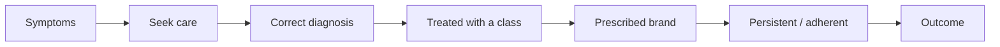

# 07 — Business Analytics and Market Research

**Purpose:** the commercial toolkit — sizing, segmentation, forecasting, share analysis, adoption and positioning — plus a reusable 10-step framework you can run in any case interview.
**Prerequisites:** [01](01-quantitative-aptitude.md), [03](03-data-interpretation-and-graphs.md), [06](06-statistics-and-survey-analytics.md).
**Suggested study time:** 2–3 hours, then practise on [09](09-market-entry-and-business-case-interviews.md) and [16](16-mock-case-study-with-dataset.md).
**Context:** the current JD lists market research, survey analysis, trend identification and recommendations as core duties (CONFIRMED). The frameworks here are **standard industry practice (PRACTICE INFERENCE)**, not Trinity IP.

---

## 7.1 Market sizing

**The three sizes**
- **TAM** (Total Addressable Market): everyone who could conceivably use the product.
- **SAM** (Serviceable Available Market): the part you can realistically reach with your label, price and channel.
- **SOM** (Serviceable Obtainable Market): the realistic capture in the planning horizon, given competition and execution.

**Two directions to size a market**

| Method | How | Use when | Weakness |
|---|---|---|---|
| Top-down | Population → prevalence → diagnosis rate → treatment rate → eligible share → price | Data exists at population level | Compounds assumptions; errors multiply |
| Bottom-up | Units × price, or physicians × patients per physician × share × price | You have physician/account data | Needs field-level data you may not have |

**Patient-flow chain (memorise this):** population → prevalent cases → diagnosed → treated → brand-eligible → on therapy → **persistent** → revenue per patient per year.

**Worked example 1 (top-down).** Fictional chronic-insomnia drug in urban India:
- Urban adults 300M → chronic insomnia prevalence 6% → **18M**
- Diagnosed 25% → **4.5M**
- On prescription therapy 40% → **1.8M**
- Eligible for the new therapy 60% → **1.08M**
- Net price ₹3,000/month → ₹36,000/year
- **SAM value = 1.08M × ₹36,000 = ₹3,888 Cr**
- If the brand captures 8% of eligible patients by year 3 → 86,400 patients × ₹36,000 = **₹311 Cr**

**Worked example 2 (bottom-up).** 4,000 target physicians; each treats 25 eligible patients; expected share 12%; annual price ₹36,000.
- 4,000 × 25 × 0.12 = 12,000 patients → **₹43.2 Cr**

**Sanity checks:** does your per-physician patient count exceed plausible patient loads? Does the total value exceed the whole category's revenue? Cross-check top-down and bottom-up and explain gaps rather than hiding them.

---

## 7.2 Market segmentation

**Usual bases in life sciences**

| Base | Typical segments | Why it matters commercially |
|---|---|---|
| Specialty | Cardiologists, neurologists, endocrinologists | Prescribing authority and patient volume |
| Setting | Academic / hospital / community | Access, influence, trial participation |
| Patient severity | Mild / moderate / severe, chronic vs episodic | Eligibility, price tolerance, unmet need |
| Prescriber behaviour | Decile by volume (top 10% writers) | Targeting and sales-force allocation |
| Payer/access | Commercial, Medicare/Medicaid, cash | Net price and channel |
| Geography | Region, urban/rural, state formulary | Launch sequencing |

**Good segments are:** measurable, big enough to matter, reachable by your channel, and *different* in behaviour or economics. If two segments respond identically, merge them.

**Worked example.** Physician sample of 1,000: 340 high-volume (≥30 eligible patients/quarter) and 660 lower-volume.
- Simple average awareness = 64%
- But high-volume awareness = 78%, lower-volume = 57%
- Weighted average = (340 × 78 + 660 × 57)/1,000 = **64.1%** — same overall number, completely different action: the gap is in lower-volume physicians, while high-volume ones need conversion, not awareness.

---

## 7.3 Revenue forecasting

**Build-up formula**
`Revenue = Patients on therapy × Persistence × Net price`
with `Patients on therapy = Eligible population × Diagnosis rate × Treatment rate × Brand share × Access rate`

**Scenario planning (always present three)**

| Scenario | Assumption driver | Revenue |
|---|---|---|
| Bear | Slower access, competitor price war | X |
| Base | Plan assumptions | Y |
| Bull | Faster access, label expansion | Z |

**Worked example.** Base ₹500 Cr; bear = 0.90×; bull = 1.25×; probabilities 25% / 50% / 25%.
- Expected value = 0.25 × 450 + 0.50 × 500 + 0.25 × 625 = **₹518.75 Cr**
- Present the range (₹450–625 Cr) **and** the expected value; the range communicates uncertainty, and the expected value supports the decision.

**Sanity checks:** implied share ≤ 100% of the treatable segment; growth consistent with category growth unless a share gain is explicitly argued; net price, not list price, for revenue.

---

## 7.4 Market share and competitive analysis

**Metrics**

| Metric | Formula | Note |
|---|---|---|
| Value share | Brand revenue / Market revenue | Feels like "money" |
| Volume share | Brand units (TRx) / Market units | Feels like "patients" |
| Share change | Current − prior (report as **pp**) | Always pp for shares |
| Share drift | Old share × (1 + brand growth)/(1 + market growth) | Fast share math |
| SOV | Brand promotion ÷ category promotion | A leading indicator of share |
| Relative share | Brand share ÷ largest competitor share | Position vs leader |

**Share-of-voice (SOV) vs share-of-market (SOM)**

| Company | SOV | Share | Ratio (share ÷ SOV) | Read |
|---|---:|---:|---:|---|
| A | 40% | 35% | 1.14 | Slightly over-performing |
| B | 25% | 22% | 1.14 | Slightly over-performing |
| C | 20% | 28% | 0.71 | Out-performing its promotion (efficient or strong access) |
| D | 15% | 15% | 1.00 | At parity |

**Interpretation rules:** a ratio well above 1 signals unaccounted equity (access, formulary, KOLs, legacy loyalty) or measurement lag; well below 1 signals wasted or mis-targeted promotion. Rule-of-thumb (ESOV-style): sustained share tends to track sustained SOV — plan SOV above target share growth.

**Competitive response questions to always ask:** pricing moves, formulary contracts, launch of a next-generation product, direct-to-consumer campaigns, supply constraints, and indication expansions.

---

## 7.5 Opportunity assessment framework

Score each dimension High / Medium / Low and state the implication:

| Dimension | Key questions | Data needed |
|---|---|---|
| Size | How many patients, what value? | Epidemiology, pricing |
| Growth | Category CAGR and drivers? | Historical revenue, guidelines |
| Accessibility | Formulary/PA/step-therapy friction? | Payer research, claims |
| Unmet need | What do current options fail at? | Clinical data, KOL interviews |
| Competition | How many players, how concentrated? | Share, pipeline, SOV |
| Capability fit | Can *we* win (sales force, relationships, supply)? | Internal capability review |
| Economics | Margin, payback, break-even | Price, COGS, launch investment |

**Output format:** "Attractive on size/growth/unmet need; **risk concentrated in access** (prior authorisation required in X% of covered lives) — recommend a pilot in commercial plans before scaling."

---

## 7.6 Demand estimation and adoption

**Adoption funnel:** awareness → consideration (or "interest") → trial → repeat/regular use. Multiply the conversions; state the base of each percentage (of all, or of the previous stage — clients will ask).

**Worked example.** 50,000 eligible physicians; 64% aware; 46.9% of aware consider; 70% of considerers trial; 42.9% of triallists become regular prescribers.
- 0.64 × 0.46875 × 0.70 × 0.4286 = **0.09** → 50,000 × 0.09 = **4,500 regular prescribers**
- The elegant check: 0.64 → consider 30% of all → trial 21% of all → regular 9% of all (these are the funnel numbers from [03](03-data-interpretation-and-graphs.md), and they reconcile exactly).

**Switching vs naive adoption:** new-patient starts ≠ total brand patients. Track **new**, **switching** and **continuing** patients separately; switching is zero-sum against competitors and often the largest early source.

**Persistence and adherence**
- **Persistence:** still on therapy after X months.
- **PDC/MPR:** proportion of days covered / medication possession ratio; >80% is the common "adherent" threshold.
- Revenue models that ignore persistence overstate revenue — e.g., 12-month persistence of 65% cuts year-1 revenue by ~35% on a monthly-price model.

---

## 7.7 Positioning and drivers/barriers

**Positioning statement template:** "For [segment] with [unmet need], [product] provides [benefit] versus [competitor], supported by [evidence]."

**Drivers and barriers to adoption**

| Driver | Barrier |
|---|---|
| Superior efficacy/safety data | Prior authorisation and step therapy |
| Dosing convenience (monthly vs daily) | Patient out-of-pocket cost |
| Guideline inclusion | Lack of head-to-head data |
| KOL endorsement | Rep coverage gaps |
| Reimbursement coverage | Supply or cold-chain issues |
| Peer prescribing (social proof) | Inertia among high prescribers |

**Survey link:** importance/satisfaction batteries rank drivers; barriers surface as "reason not to prescribe" questions. Always ask "what would make you switch?" — behaviour change questions are far more predictive than satisfaction questions.

---

## 7.8 Patient journey

**Key metrics:** symptom prevalence, care-seeking rate, diagnosis accuracy/rate, treatment rate, class penetration, brand share within class, persistence, adherence, outcome rate.
**Leak questions:** where is the largest *absolute* patient loss? Where is the *fixable* loss (education, access, cost)?

**Worked example.** 100,000 symptomatic → 55,000 seek care → 33,000 correctly diagnosed → 23,100 prescribed → 15,015 still on therapy at 6 months (65%).
- Biggest absolute leak: symptom → care-seeking (45,000). Biggest *commercial* leak for a brand: prescribed → persistent (8,085), which is usually addressable through cost support, side-effect management and follow-up.

---

## 7.9 Marketing and sales analytics

| Metric | Definition | Notes |
|---|---|---|
| Reach | Unique physicians detailed in period | Coverage |
| Frequency | Calls per targeted physician | Diminishing returns after ~6–8 quality calls |
| Call quality | Rep-evaluated quality or share of voice achieved | Quality > count |
| Promo response | ΔTRx per incremental call/₹ | Estimate using control territories |
| ROI | (Gross profit − spend)/spend | Requires incremental, not total, sales |
| First-line share | % of new starts as first-line therapy | Leading indicator |
| Decile performance | TRx by physician volume decile | Classic targeting analysis |
| Persistency funnel | Starts → 3-month → 6-month persistent | Revenue quality |

**Worked example.** Campaign spend ₹2 Cr; incremental TRx 40,000; gross margin ₹450/TRx.
- Gross profit = 40,000 × 450 = ₹1.8 Cr → ROI = (1.8 − 2.0)/2.0 = **−10%** (unprofitable at that margin).
- Insight: either lift volume (would need ~44,445 TRx to break even), raise margin, or cut spend.

**Break-even TRx:** 2 Cr/₹450 = 44,444 TRx (verify: 44,444 × 450 = ₹1.99998 Cr).

---

## 7.10 Survey-based insights (Trinity's bread and butter)

1. State the objective and the decision the survey informs.
2. Define the population, frame and sampling approach.
3. Design questions mapped to the analysis plan (no "nice to know" items).
4. Field, monitor quotas and response rates.
5. Clean and validate (see [05](05-excel-practical-workbook-guide.md)).
6. Weight to the known population where relevant.
7. Analyse: distributions, cross-tabs, segment differences, drivers/barriers.
8. Test differences (significance + effect size) and report CIs.
9. Translate to implications: what changes in the decision?
10. State limitations: response rate, bias, sample size per segment.

**Reporting template:** "Among 300 surveyed neurologists (response rate 18%), 52% (95% CI 46–58%) report being likely to prescribe. Likelihood is significantly higher among those who attended the launch webinar (63% vs 44%, p < 0.01). Caveat: stated intent overstates behaviour; we apply a 50% intent-to-behaviour discount for forecasting."

---

## 7.11 The reusable 10-step framework

Use this in every case, in this order:

1. **Define the business problem** in one sentence.
2. **Clarify the decision** to be made and by when.
3. **Identify relevant metrics** (revenue, share, patients, access, margin).
4. **Break the problem into components** (a simple MECE tree).
5. **Examine the data and its quality** (units, base, completeness, bias).
6. **Calculate and compare** (baseline vs current, segment vs segment).
7. **Identify key findings** (max three; quantify each).
8. **Explain the business implications** ("so what").
9. **Recommend an action** with priority and owner.
10. **Identify risks and missing information.**

**Self-check before answering:** Did I name the base of every percentage? Did I separate volume from value? Did I state an assumption explicitly rather than hiding it? Did I give one clear recommendation?

---

## 7.12 Exercises (answers below)

1. Diagnosed patients 10M; treated 60%; eligible for the new drug 35%; net price $12,000/year. Compute SAM in dollars.
2. Brand revenue $180M in a $1.2B market. Brand grows 8%, market grows 12%. New share? Did the brand gain or lose?
3. Base case ₹500 Cr; bear 0.90×; bull 1.25×; probabilities 25/50/25. Compute expected value and the range.
4. Funnel: 64% aware; consideration = 46.875% of aware; trial = 70% of considerers; regular = 42.857% of triallists. Target population 50,000 physicians. Compute regular prescribers.
5. Using the SOV table in §7.4, compute the ratio for each company and name the most promotion-efficient player.
6. Patient journey: 100,000 symptomatic; 55% seek care; 60% of those diagnosed; 70% of those prescribed; 65% persistent at 6 months. Compute each stage and name the largest absolute leak.
7. Spend ₹2 Cr generates 40,000 incremental TRx at ₹450 gross margin each. ROI? Break-even TRx?
8. Sales-force sizing: 4,000 target physicians, 6 calls/year each, rep capacity 750 calls/year. How many reps?
9. Weighted awareness: 340 high-volume physicians (78% aware) and 660 lower-volume (57% aware). Weighted awareness? Which group needs which action?
10. A survey reports "62% of respondents intend to prescribe". What three questions do you ask before using it in a forecast?

---

# Answers

**1 — $25.2B.** 10M × 0.60 × 0.35 = 2.1M patients × $12,000 = $25.2B.

**2 — 19.3%; share fell.** 20% × 1.08/1.12 = 19.29%. Losing share while growing is a common and important nuance.

**3 — Expected ₹518.75 Cr; range ₹450–625 Cr.** 0.25 × 450 + 0.50 × 500 + 0.25 × 625.

**4 — 4,500 physicians.** Product of conversions = exactly 0.09 (i.e., 9% of the target population).

**5 —** A 1.14, B 1.14, C 0.71, D 1.00. **C** is the most promotion-efficient (share substantially exceeds SOV) — investigate what enables it (access, KOLs, legacy, or a measurement lag) before assuming it can be replicated.

**6 —** 55,000 seek care; 33,000 diagnosed; 23,100 prescribed; 15,015 persistent. Largest absolute leak = **symptom → care-seeking (45,000)**; largest commercially actionable leak for a brand = **prescribed → persistent (8,085)**.

**7 — ROI −10%.** Gross profit ₹1.8 Cr vs ₹2 Cr spend. Break-even = 2 Cr/450 = **44,444 TRx** (≈11% above current volume).

**8 — 32 reps.** 4,000 × 6 = 24,000 calls ÷ 750.

**9 — 64.1%.** (340 × 78 + 660 × 57)/1,000 = (26,520 + 37,620)/1,000 = 64.14%. High-volume: convert consideration and trial; lower-volume: build awareness first.

**10 —** (i) What is the base and the response rate? (ii) Is "intend to prescribe" a stated or behavioural measure, and how does stated intent historically translate into prescriptions (apply a discount)? (iii) Which segments drive the 62%, and is the sample weighted to the prescriber population? Also ask about access constraints — intent does not overcome prior authorisation.

---

## 7.13 Quick reference card

| Task | Chain |
|---|---|
| Size a market | population → prevalence → diagnosis → treatment → eligibility → price |
| Forecast revenue | patients × share × persistence × net price |
| Share maths | old share × (1 + brand growth)/(1 + market growth) |
| Adoption | awareness → consideration → trial → repeat |
| Efficiency | share ÷ SOV, ROI = (GP − spend)/spend |
| Journey | symptoms → care → diagnosis → treatment → brand → persistence |

**Next:** [08-life-sciences-industry-fundamentals.md](08-life-sciences-industry-fundamentals.md) → [09-market-entry-and-business-case-interviews.md](09-market-entry-and-business-case-interviews.md)
