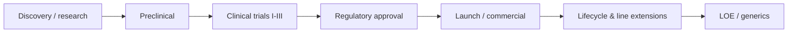
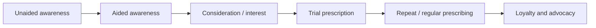

# 08 — Life Sciences Industry Fundamentals (Analyst Level)

**Purpose:** just enough industry knowledge for an entry-level analyst to follow a case, ask sensible questions and talk credibly for 60 minutes. The current JD says pharma industry knowledge is *preferred* (CONFIRMED) — not required — so treat this as vocabulary plus mental models, not a clinical course.
**Prerequisites:** none.
**Suggested study time:** 1.5–2 hours, then self-test on §8.12.
**Content note:** all figures in this file are **industry-typical ranges (PRACTICE INFERENCE)** for orientation, not statements about Trinity or any specific product. Nothing here is medical advice.

---

## 8.1 What the industry values

Pharma economics: high fixed costs (R&D, trials, launch), low marginal cost (pills are cheap to make), and time-limited exclusivity that must repay years of investment. Nearly every commercial behaviour follows from three facts:

1. **Patents expire.** After loss of exclusivity (LOE), generic/biosimilar competition can cut net price by 70–90% within 1–2 years.
2. **Access decides revenue.** A drug with great data and no formulary coverage earns little — net price is often 30–60% below list after rebates and discounts in the US.
3. **Behaviour changes slowly.** Physicians adopt through evidence, peers and experience; surveys of stated intent overstate real prescribing.

---

## 8.2 The value chain

| Stage | Typical duration | Analyst relevance |
|---|---|---|
| Discovery + preclinical | 3–6 years | Pipeline value, probability of success |
| Phase I (safety, small n) | ~1–2 years | ~50–60% success |
| Phase II (efficacy signal) | ~2 years | ~30% success; frequent failure point |
| Phase III (confirmatory, large n) | ~3 years | ~50–60% success; drives forecasts |
| Regulatory review | 6–18 months | Submission → approval; label breadth matters |
| Launch & growth | years | Access, adoption, share |
| LOE / generics | — | Price erosion, share collapse |

*Approximate, widely cited industry success rates: overall probability of a Phase I asset reaching approval is roughly 10%.* Use the concept (most assets fail) rather than the exact number.

---

## 8.3 Clinical trials, conceptually

| Term | Meaning |
|---|---|
| Phase I | Safety and dosing in a small group (often healthy volunteers or patients) |
| Phase II | Does it work? Efficacy signal and dose selection |
| Phase III | Large confirmatory trial to support approval |
| Phase IV | Post-marketing studies, safety surveillance |
| Randomised controlled trial (RCT) | Participants randomly assigned to treatment vs control |
| Blinding (single/double) | Patients/investigators don't know the assignment — reduces bias |
| Endpoint | The measured outcome (e.g., reduction in monthly migraine days) |
| Primary vs secondary endpoints | The pre-specified main measure vs supporting measures |
| Statistical power | Probability of detecting a real effect of a given size |
| p-value | Probability of data this extreme if there were no true effect |
| Non-inferiority | Showing "not worse than" the comparator, not necessarily better |
| Real-world evidence (RWE) | Data from routine care (registries, claims, EHRs) |
| HEOR | Health economics and outcomes research; cost-effectiveness for payers |

**What an analyst does with trial news:** assess who it affects (line of therapy, patient subset), whether the endpoint matches what payers value (hospitalisations, quality of life, not just biomarkers), and adjust adoption forecasts.

---

## 8.4 Branded drugs, generics and biosimilars

| Type | Character | Commercial dynamic |
|---|---|---|
| **Branded (patented)** | Exclusive marketing rights; promotional investment | Price set above marginal cost; growth via adoption and access |
| **Generic (small molecule)** | Chemically identical, cheaper (often 80–90% cheaper) | Price-driven; multiple manufacturers; auto-substitution at pharmacy |
| **Biosimilar (complex biologics)** | Highly similar to a reference biologic; not chemically identical | Slower uptake; payer policy and physician comfort matter |
| **OTC/consumer** | No prescription required | Retail channel and consumer marketing |
| **Specialty drug** | Complex administration, cold chain, high price, often payer-managed | Hub services, prior authorisation, patient support programs |

India context (useful background, not exam-critical): NPPA price controls on scheduled formulations, the Jan Aushadhi generic push, and a large out-of-pocket market that changes the price/access conversation versus the US.

---

## 8.5 The stakeholders: who decides what

| Stakeholder | What they control | What they care about |
|---|---|---|
| **Physician (prescriber)** | Brand choice within class | Evidence, experience, guidelines, patient cost, habit |
| **Patient** | Adherence, care-seeking, switching | Efficacy, side effects, convenience, out-of-pocket cost |
| **Payer (insurer, PBM, government)** | Formulary, prior auth, rebates | Cost per outcome, budget impact, comparative data |
| **Provider (hospital, clinic, IDN)** | Protocol, pathway, site of care | Budgets, bundles, throughput, quality metrics |
| **Distributor/wholesaler** | Physical supply | Inventory, terms, chargebacks |
| **Pharmacy** | Substitution, counselling, fill/refill | Stock, reimbursement speed, generic incentives |
| **Regulator (FDA/EMA/CDSCO)** | Approval, label, safety actions | Evidence, safety signals, compliance |

**Analyst rule:** every commercial question resolves to one of these seven actors resisting or accelerating the change.

---

## 8.6 Market access and reimbursement

| Term | Meaning |
|---|---|
| Formulary | The payer's list of covered drugs, often tiered |
| Tier 1/2/3 | Increasing patient cost-sharing |
| Prior authorisation (PA) | Payer must approve before dispensing |
| Step therapy (fail-first) | Must try a cheaper drug before the new one |
| Co-pay/co-insurance | Patient's share of the cost |
| Rebates | Payments from manufacturer to payer, post-sale |
| Gross-to-net (GTN) | Gap between list price and what the company actually keeps; often 30–60% in US brand drugs |
| Outcomes-based contract | Payment tied to measured results |
| Patient assistance / co-pay card | Manufacturer support to reduce patient cost |
| HTA (NICE, ICER) | Body assessing cost-effectiveness for reimbursement recommendations |

**Why this matters numerically:** a $12,000 list price with a 40% GTN is $7,200 net. Forecasts on list price are almost always wrong — always ask for **net price**. Access friction is the most common reason adoption forecasts fail.

---

## 8.7 Adoption, prescribing behaviour and the funnel

**Pharma adoption funnel**

**Behavioural facts that show up in every dataset:**
- A small share of physicians writes a large share of prescriptions (typically the top 10–20% of prescribers account for ~50–70% of volume).
- Awareness ≠ trial; trial ≠ repeat. The leaks differ by specialty and setting.
- Academic/KOL physicians drive guidelines and peer influence; community physicians drive volume.
- Switching is common early; persistency determines revenue quality.
- Stated intent (survey) overstates behaviour; apply a discount and re-anchor on behavioural questions ("how many patients in the last month?", not "would you prescribe?").

**Prescribing deciles:** rank physicians by volume; the top decile is the focus of targeting, but the second and third deciles usually provide the largest *incremental* opportunity because they are reachable and not yet saturated.

---

## 8.8 Patient journey and treatment rates

| Stage | Metric | Typical analytic use |
|---|---|---|
| Symptoms | Prevalence | TAM |
| Care-seeking | Care-seeking rate | Awareness/education opportunity |
| Diagnosis | Diagnosis rate | Misdiagnosis gap |
| Treatment | Treatment rate; class penetration | Untreated population |
| Initiation | New starts; time-to-first-Rx | Launch tracking |
| Persistence | % still on therapy at 6/12 months | Revenue quality |
| Adherence | PDC/MPR > 80% | Outcome and refill models |
| Outcomes | Response rate, hospitalisations | Payer value story |

**"Treatment rate"** = % of diagnosed patients receiving any therapy; **"class penetration"** = % of treated patients on the relevant drug class. These two numbers, plus brand share within class, usually determine the market.

---

## 8.9 Commercial analytics vocabulary

| Term | Meaning |
|---|---|
| Rx data (TRx, NRx) | Prescription counts: total vs new; leading indicators of revenue |
| Patient-level data | Anonymised longitudinal patient journeys; shows switching and persistence |
| Chart audit | Retrospective physician-record review for real-world usage |
| Syndicated research | Standardised, sold to many clients |
| Custom research | Commissioned for one client's question |
| Market sizing / opportunity assessment | How big, how attractive, how winnable |
| Forecasting | Revenue projection with scenarios |
| Performance tracking | Actual vs target vs last year, by segment |
| Sales force effectiveness (SFE) | Targeting, sizing, call planning, incentive design |
| Marketing mix / promo response | Which promotion (rep, digital, samples) drives TRx |
| Dashboards | Power BI/Tableau live reporting |
| Qual vs quant research | Interviews/focus groups vs surveys/analytics |

**TRx vs NRx:** NRx = new prescriptions (starts), TRx = total prescriptions (includes refills). TRx reflects the patient base; NRx reflects new demand. A brand can have rising NRx and falling TRx if persistency is weak.

---

## 8.10 Competitive landscape basics

- **Class dynamics:** within a therapeutic class, differentiation may be minimal → competition shifts to price, access and convenience.
- **First-mover vs fast-follower:** first entrants build relationships and formulary position; followers compete on data and price.
- **Pipeline overhang:** a competitor's Phase III asset changes forecast risk today.
- **Supply and capacity:** biologics and cold-chain products cap short-term launch ability.
- **Generics entry:** expect price erosion and channel substitution — model it explicitly rather than assuming a plateau.

---

## 8.11 How industry knowledge converts into case performance

| Case fact | What an analyst should say |
|---|---|
| "Only 45% of diagnosed patients are treated" | Large untreated pool; identify whether the barrier is diagnosis, cost, or physician inertia |
| "Prior authorisation required in 70% of covered lives" | Expect slow uptake and high abandonment; recommend patient-support program and payer negotiations |
| "Top-10% prescribers account for 60% of volume" | Build targeting around deciles; measure incremental opportunity in deciles 2–4 |
| "Net price is 40% below list" | Forecast on net; GTN is a first-class metric |
| "12-month persistence is 55%" | Reduce year-1 revenue estimates materially vs naive models |
| "Competitor cuts price 20%" | Model share loss and price response; check GTN impact and payer behaviour |

---

## 8.12 Self-test (answers below)

1. What is the difference between TRx and NRx, and which better indicates new demand?
2. Define gross-to-net and explain why a forecast on list price is misleading.
3. What is step therapy and which stakeholder imposes it?
4. You have awareness 64% and trial 21%. Which leak would you investigate first and why?
5. What is the difference between efficacy (clinical trial) and effectiveness (real world)?
6. Why is the top decile of prescribers not always the best incremental target?
7. What does "LOE" mean and what happens to net price afterwards?
8. What is a biosimilar, and why does it take up more slowly than a small-molecule generic?
9. Define persistence and adherence, and explain how each affects revenue.
10. A client says: "Our Phase III endpoint was a biomarker improvement." Why might payers still balk?

---

# Answers

**1 —** TRx counts all prescriptions (new + refills) and approximates the patient base; NRx counts only new prescriptions and better indicates new demand/launch momentum.

**2 —** Gross-to-net is the gap between list price and realised net price after rebates, discounts and returns (often 30–60% in US brands). Revenue equals net price × volume, so list-price forecasts systematically overstate revenue.

**3 —** Step therapy ("fail-first") requires trying a cheaper/preferred therapy before covering the newer one; imposed by payers/PBMs, often embedded in formulary policy or PA criteria.

**4 —** The awareness → trial leak (64% → 21% is a 43-point drop in absolute terms; in the funnel example, consideration is the first big leak). Investigate the largest **absolute** leak first, then the one you can fix — typically access/cost or evidence gaps, not awareness, once awareness is already high.

**5 —** Efficacy is performance under controlled trial conditions; effectiveness is performance in routine care, typically lower because of adherence, patient selection and access.

**6 —** The top decile is usually already saturated and heavily detailed; incremental share gain per call is often higher in deciles 2–4, which are reachable and less locked in.

**7 —** Loss of exclusivity (patent/regulatory exclusivity expiry). Generics/biosimilars enter, volume share shifts and net price can fall 70–90% over 1–2 years.

**8 —** A biosimilar is highly similar but not identical to a reference biologic (manufacturing complexity). Uptake is slower because of physician comfort, payer policy, and limited substitution rights at pharmacy level.

**9 —** Persistence = staying on therapy over time; adherence = taking it as prescribed (e.g., PDC > 80%). Weak persistence reduces refills and future revenue; weak adherence reduces outcomes and long-run reimbursement support.

**10 —** Payers fund outcomes they care about (hospitalisations, mortality, quality of life, cost offsets). A biomarker improvement may not translate into a payer-relevant benefit, so coverage may be restricted or cost-effectiveness contested.

---

## 8.13 Glossary quick-scan

Adherence · Adverse event · Biosimilar · Chart audit · Class penetration · Co-pay · Decile targeting · Diagnosis rate · Effectiveness vs efficacy · Formulary · Generic · Gross-to-net · HEOR · HTA · KOL · Launch · LOE · NRx · Outcomes-based contract · Patient journey · Payer · PDC/MPR · Persistence · PBM · Phase I–IV · Pipeline · Prior authorisation · Promo response · RWE · Rx · SFE · Share of voice · Step therapy · Syndicated research · TAM/SAM/SOM · Treatment rate · TRx

**Next:** [09-market-entry-and-business-case-interviews.md](09-market-entry-and-business-case-interviews.md)
