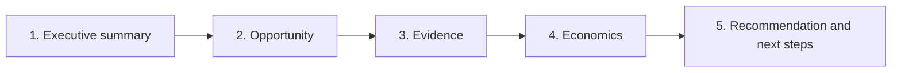

# 10 — PowerPoint and Business Communication

**Purpose:** build the deliverable skills the JD names explicitly — "present information in an easy-to-understand format", "articulate findings and the so-what in compelling and visually appealing reports" (CONFIRMED, current JD). Practising this makes you better in interviews even if you never open PowerPoint.
**Prerequisites:** [03](03-data-interpretation-and-graphs.md), [07](07-business-analytics-and-market-research.md).
**Suggested study time:** 1.5–2 hours (build the 5-slide example once, by hand).
**Context:** an example five-slide report is built on a fictional survey dataset (**PRACTICE INFERENCE**).

---

## 10.1 The one rule: insight-led titles

A slide title should state the **finding**, not the topic. The reader should get the message from the titles alone.

| Weak (topic) | Strong (insight) |
|---|---|
| "Market Overview" | "Category growth is normalising to 15% after a 20% spike — still 3× pre-2024 baseline" |
| "Survey Results" | "52% of neurologists intend to prescribe, but only after prior-authorisation friction is resolved" |
| "Regional Performance" | "North and South carry the plan; East misses by ₹50 Cr on both coverage and productivity" |
| "Competitive Landscape" | "Brand B gained 5 pp of share without discounting — access, not price, is deciding share" |
| "Recommendations" | "Stage the launch in 3 metro clusters and fund payer access before national scale-up" |

**The "so what" test:** read only your titles top to bottom. If the story is not clear, rewrite them. If a title contains no verb and no number, it is probably a topic, not an insight.

**Title formula:** *Finding (number) + implication (so what)*. Example: "Only 9% of aware physicians become regular prescribers — the leak is consideration, not awareness."

---

## 10.2 Slide hierarchy

| Element | Role | Length guide |
|---|---|---|
| Title | The insight | ≤ 15 words, one line |
| Sub-title / kicker | Scope, source, period | ≤ 12 words, grey |
| Body | One exhibit (chart/table) or 3–4 bullets | One idea per slide |
| Bullets | Support the title, not repeat it | ≤ 12 words each; max 4 bullets |
| Annotation | Points at the insight on the chart | 1–2 callouts with numbers |
| Source line | Credibility | "Source: fictional survey, n = 300, Oct 2026" |
| Footer | Page number, confidentiality | Standard |

**Golden rules:** one message per slide; no paragraph text; numbers on the exhibit, words in the title; if you cannot summarise the slide in one sentence, split it.

---

## 10.3 Chart selection (same rules as [05](05-excel-practical-workbook-guide.md), restated for decks)

| Message | Chart | Avoid |
|---|---|---|
| Compare categories | Sorted bar | 3-D bars, unsorted bars |
| Trend over time | Line (proportional spacing) | Bar charts for 10+ periods |
| Composition (≤4 parts) | Pie or 100% stacked bar | Pies with 6+ slices |
| Composition over time | 100% stacked column | Multiple pies |
| Distribution | Histogram | Averages only |
| Relationship | Scatter + trendline | Dual-axis co-movement claims |
| Drivers/barriers ranking | Horizontal bar (top-5 only) | Long unranked tables |
| Funnel | Funnel chart or staged bars | Pie of funnel stages |

**Annotation is the differentiator:** circle or label the point you are making ("PA requirement added in Q3", "T6 outlier") so the audience reads the chart the way you intend.

---

## 10.4 Concise writing

**Rules**
1. Lead with the number: "Revenue grew 12% to ₹2,435 Cr", not "The market has been growing".
2. One idea per sentence; ≤ 20 words.
3. Active voice and verbs: "North contributed 33% of TRx" beats "There was a contribution of 33% by North".
4. Quantify every claim; delete adjectives like "significantly" without a number.
5. Define abbreviations on first use — including "TRx", "GTN", "PA" — even if the audience knows them.
6. Put the caveat in the sentence, not in a footnote: "52% intend to prescribe (n = 300, ±5.7 pp)".

**Before / after**

| Before | After |
|---|---|
| "Based on our analysis of the survey data, it can be seen that a large number of physicians are likely to prescribe the product in question." | "52% of surveyed neurologists intend to prescribe (n = 300, ±5.7 pp)." |
| "There may be some access-related challenges going forward." | "38% cite prior authorisation as a major barrier; expect slower ramp and 10–15% script abandonment." |

---

## 10.5 Evidence-based recommendations

Structure each recommendation as: **Action → Evidence → Expected impact → Owner/timing → Risk.**

| Weak | Strong |
|---|---|
| "Improve access." | "Enrol in PA support for the top 5 commercial plans by 31 Dec (evidence: 38% cite PA; those plans cover 55% of lives). Expected impact: +2–3 pp conversion. Risk: payer negotiation may extend timelines." |
| "Focus on high-prescribing doctors." | "Shift 7 of the next 10 reps into the community mid-volume segment (evidence: highest absolute uplift, +312 patients/month per 5 pp conversion gain)." |
| "The market looks attractive." | "Enter, but stage it: SAM ₹2,160 Cr, break-even at 9.9% share of eligible patients; pilot in 3 metros to confirm diagnosis and access assumptions." |

---

## 10.6 Explaining uncertainty

| Technique | Example |
|---|---|
| Ranges, not points | "Y3 revenue ₹365–445 Cr (base ₹445 Cr)" |
| Name the driver of uncertainty | "The range is driven mainly by the 40% diagnosis-rate assumption" |
| Confidence intervals for survey data | "52% ± 5.7 pp" |
| Trade-off language | "Faster launch accepts higher capital risk; staged entry trades ~2 quarters of share for validated access" |
| Missing-data statement | "We lack payer-level data; the next test is a 20-interview access study" |
| Scenario table | Bear / Base / Bull with triggers |

**Do not:** hide uncertainty behind a single number, or bury it in an appendix nobody reads.

---

## 10.7 The five-slide structure (default for any analytical story)

| Slide | Purpose | Content | Chart |
|---|---|---|---|
| 1 | Executive summary | 3 findings + 1 recommendation | None (or a simple status bar) |
| 2 | The opportunity / problem | Size, growth, why now | Bar or line |
| 3 | The evidence | Survey or data finding with CI | Ranked bar or funnel |
| 4 | The economics / comparison | Revenue, ROI, scenarios | Waterfall or table |
| 5 | Recommendation & next steps | Action, owner, timing, risks | Timeline or 2×2 |

---

## 10.8 Worked example — five slides from a fictional survey dataset

**Setting:** Aurelia Pharma's launch team surveyed 300 neurologists about Relivax (fictional injectable for chronic migraine). Facts: aided awareness 64%; top-2-box intent 52% (±5.7 pp); academic 63% vs community 47%; 38% cite prior authorisation; actual starts last month mean 4.1 patients per physician.

**Slide 1 — Executive summary**
- *Title:* "Relivax has demand signal (52% intent) but an access problem, not an awareness problem"
- Bullets: awareness 64% (sufficient); intent 52% ± 5.7 pp; behavioural proxy 4.1 starts/month; 38% cite PA.
- Recommendation line: "Fund payer access and PA support in the top 5 plans before scaling promotion."

**Slide 2 — Opportunity**
- *Title:* "2.0M untreated chronic-migraine patients represent a $19B preventive-therapy pool growing at 8%"
- Chart: bar chart of market revenue 2026 → 2031 ($11.4B → $16.8B).
- Callout: "Untreated chronic population: 2.03M."

**Slide 3 — Evidence**
- *Title:* "Intent is 16 pp higher among academic neurologists, but community physicians offer the larger absolute opportunity"
- Chart: two bars (academic 63%, community 47%) with CI whiskers.
- Callout: "n = 300; academic n = 90 → ±10 pp."

**Slide 4 — Economics**
- *Title:* "Break-even at $2.15B cumulative revenue — reached mid-Year 3 on base-case adoption"
- Chart: cumulative revenue vs break-even line (Y1 389 + Y2 973 + Y3 1,558 = $2.92B).
- Callout: "Contribution margin 65% ($6,240 per patient)."

**Slide 5 — Recommendation and next steps**
- *Title:* "Proceed with a staged launch: fund access in the top 5 plans, scale promotion after 3-month access audit"
- Content: action table (Action | Owner | Timing | Success metric).
- Risks: competitor price response; diagnosis-rate uncertainty; survey intent overstatement.

**Narrative arc:** demand exists → but the constraint is access → economics still work → staged plan de-risks it.

---

## 10.9 Communicating with non-technical stakeholders

1. **Start with the decision**, not the method: "You need to decide X by Y; here is what the data says."
2. **Translate statistics into behaviour:** "The difference is statistically significant" → "This gap is real, not sampling noise; it will show up in actual prescribing."
3. **Use analogies for mechanisms:** "Prior authorisation is a toll booth on the road to a prescription."
4. **Pre-empt the obvious objection** in one line: "This assumes 70% persistence; if it's 55%, Y1 revenue falls by about 20%."
5. **End with the ask**: budget, headcount, data access, or a decision date.

---

## 10.10 Practice tasks

1. Rewrite these weak titles into insight-led ones: (a) "Seasonality Analysis" (b) "Physician Survey – Segmentation" (c) "Excel Workbook – Data Cleaning Summary".
2. Take Dataset A from [03](03-data-interpretation-and-graphs.md) and build slides 2–4 (opportunity, evidence, economics) with titles containing a number and a "so what".
3. Write a 60-word executive summary of the Relivax survey above that a CEO could read in 15 seconds.
4. Turn "we should improve coverage" into an evidence-based recommendation with evidence, impact, owner, timing and risk.
5. Build a one-slide bear/base/bull scenario table for Case 2 in [09](09-market-entry-and-business-case-interviews.md).

**Model answers (sketch)**

1. (a) "Q2 sales run 2.4× Q1 — seasonal peak, not trend; plan inventory and reps around Q2"; (b) "Community physicians drive 55% of treated volume despite lower intent — segment the field force accordingly"; (c) "Cleaning 30 rows changed total TRx by 7% — text-stored numbers and duplicates are the main error sources".
3. *Example:* "Among 300 surveyed neurologists, 52% intend to prescribe Relivax, with a ±6 pp margin of error. Intent is higher among academic physicians (63% vs 47%), but community physicians represent the larger patient opportunity. The dominant barrier is access: 38% cite prior authorisation. Recommendation: fund payer-access support in the top five plans before scaling promotion; treat the 52% as a ceiling, not a forecast."

---

## 10.11 Checklist

- [ ] Every slide title contains a number or a clear finding
- [ ] Titles alone tell the full story
- [ ] One chart per slide, annotated at the insight
- [ ] Recommendations have action + evidence + impact + owner + risk
- [ ] Uncertainty is expressed as a range with the key driver named
- [ ] Source line on every exhibit
- [ ] No jargon without first-use expansion

**Next:** [11-technical-interview-question-bank.md](11-technical-interview-question-bank.md)
