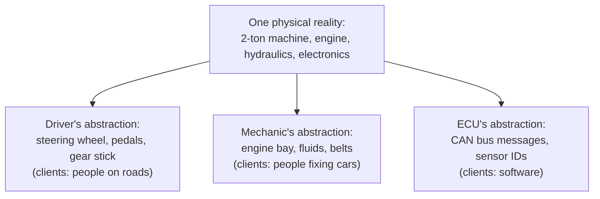
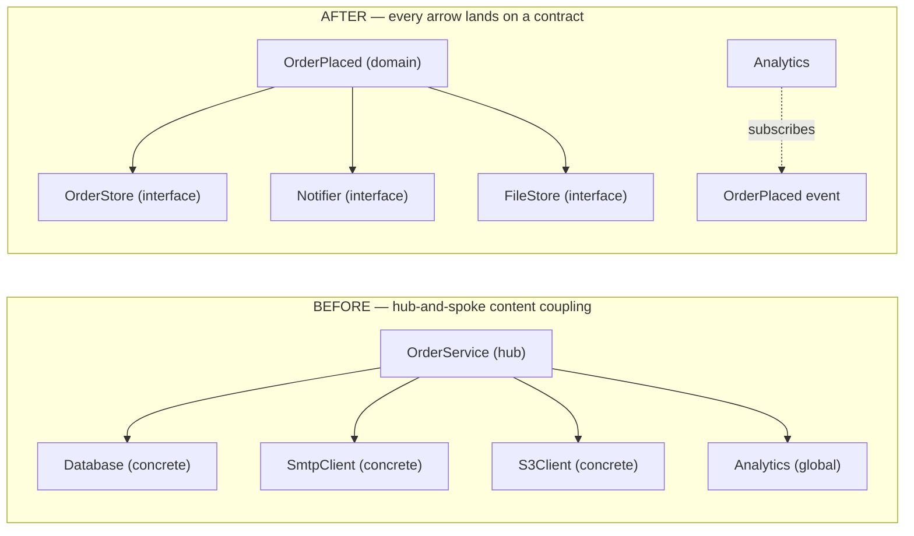
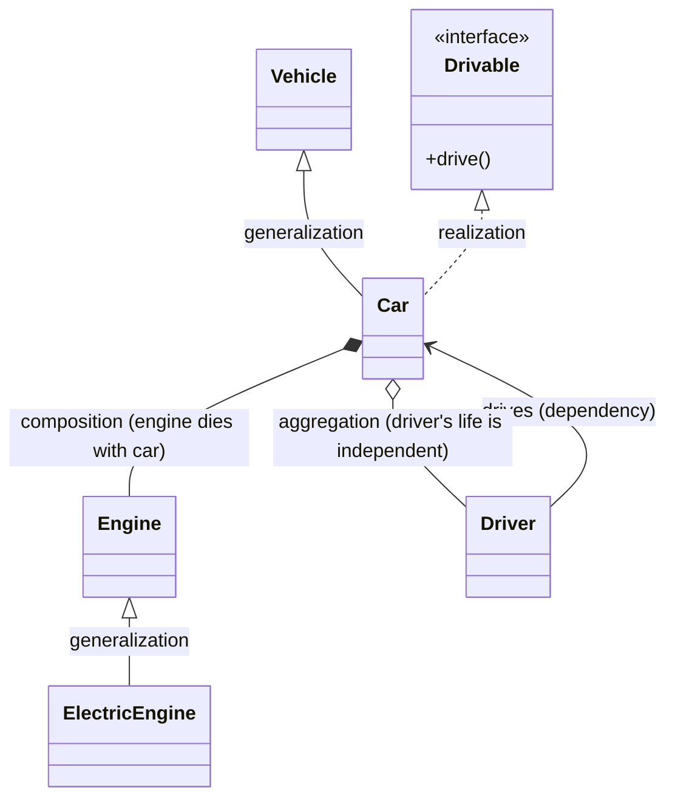

# 01 — Objects and the Metal: OOP from First Principles

> **Why this file starts at the machine.** Every OOP argument that matters at senior level — inheritance vs composition, virtual dispatch, why fields are not polymorphic, why Java has no multiple inheritance — is ultimately an argument about **memory layout, lifetime, and dispatch**. Engineers who learned OOP as a syntax (pillars, diagrams, UML) cannot defend design decisions under follow-up questioning; engineers who learned it as a memory-and-cost model can. So this file starts below the language, builds up through the vocabulary, and only then puts names on the pillars. Nothing is assumed, and nothing is skipped.

---

## 1. The Machine Underneath

### 1.1 Memory: one enormous array of bytes

Physical reality, stripped of metaphor: a running program sees **memory as a flat, numbered sequence of bytes**. Each byte has an **address** — its index in that sequence. A 64-bit machine numbers addresses from 0 up to 2⁶⁴−1 (in practice, only a prefix of that range is mapped and usable).

```
  A tiny slice of memory as the machine sees it:

  address        byte at that address
  -----------    --------------------
  0x7ffd0010         0x2A           ← one byte, value 42
  0x7ffd0011         0x00
  0x7ffd0012         0x61          ← ASCII 'a'
  0x7ffd0013         ...
  -----------    --------------------
```

There is no "variable" and no "object" at this level — those are **interpretations**. A variable is a name the compiler/VM binds to an address range; an object is a **convention**: a contiguous block of bytes whose first part means one thing (metadata) and whose later parts mean another (fields), plus a set of functions that agree on how to read that block. Every sentence in this file about objects ultimately reduces to "a block of bytes plus an agreement about its layout."

**Word by word — *memory*:** from Latin **memoria** (memory, remembrance; from *memor*, "mindful"). In computing: the storage the running program reads and writes through addresses.

**Word by word — *address*:** from Latin **ad-** (to, toward) + **directus** (straight, directed). "Directed toward" — an address is a *pointer to where something is*, not the thing itself. That distinction — address vs value — is the seed of the pointer/reference confusion that runs through every language.

**Word by word — *byte*:** coined in 1956 by Werner Buchholz at IBM, from **bite** (a mouthful), respelled *byte* to avoid confusion with *bit*. A byte = 8 bits = the smallest individually addressable unit on virtually all modern hardware.

### 1.2 The two places values live: stack and heap

A process's address space is divided into regions. Two dominate object-thinking:

| Region | What lives there | Lifetime | Grows | Managed by |
|---|---|---|---|---|
| **Stack** | Every function call's local variables and bookkeeping ("stack frame"); the call chain itself | Automatic — a frame is created when the function is entered and destroyed when it returns | Usually downward (toward lower addresses) | The CPU + calling convention; the compiler lays it out |
| **Heap** | Long-lived, dynamically sized data — the memory you *ask for* | Manual: `malloc`/`free`, `new`/`delete`; or automatic: garbage collection | Usually upward | Language runtime: allocator, GC |

```
  Process address space (typical 64-bit Linux layout; exact addresses vary):

  high addr   +----------------------------+
              |         STACK              |   ← local variables, call frames
              |            |               |      grows DOWN
              |            v               |
              |                            |
              |        (unmapped /         |
              |         shared libs)       |
              |                            |
              |            ^               |
              |            |               |      grows UP
              |          HEAP              |   ← objects, dynamic buffers
              +----------------------------+
              |     BSS (zero-init data)   |
              +----------------------------+
              |     DATA (init globals)    |
              +----------------------------+
  low addr    |     TEXT (code)            |   ← the machine instructions
              +----------------------------+
```

**Word by word — *stack*:** Old Norse **stakkr** (haystack); a pile you can only remove from the top. The call stack is exactly that: a pile of frames, last-in-first-out. You cannot remove frame #3 while frame #5 is on top — which is why local objects die in strict reverse creation order.

**Word by word — *heap*:** Old English **hēap** (a heap/pile, without order). No ordering discipline — the allocator hands out any free block in any order; you must track when to give memory back. The name is the honest description: an unordered pile that the runtime manages.

**Why this pairing matters for design:** "Where does this object live, and who frees it?" is the question that becomes RAII in C++, GC pressure in Java, and ownership discipline in C. When a senior engineer says "this design has lifetime problems," they mean: some object's **lifetime** (when it dies) cannot be expressed in the region it lives in — e.g., a heap object referenced by a stack-only handle that outlives the frame.

### 1.3 Values, pointers, references — the three ways to talk about "the thing"

Every language gives you some subset of these mechanisms for accessing data indirectly:

| Mechanism | What it is | Can be reassigned? | Can be null? | Arithmetic? | Example |
|---|---|---|---|---|---|
| **Value** | The data itself, in place | N/A (it *is* the bytes) | No | N/A | `int x = 42;` |
| **Pointer** | A variable holding an **address** | Yes | Yes (usually) | Yes (in C/C++) | `int* p = &x;` |
| **Reference** | An **alias** — another name for an existing object | C++: no (bound once at birth); Java: the variable can be reassigned to another object, but *dereferencing* is automatic | C++: no (must bind); Java: yes | No | C++: `int& r = x;` Java: `Person p = new Person();` |

The load-bearing distinctions:

```
  VALUE semantics — assignment copies the bytes:

    int a = 42;          a:[42]     b:[42]        Two independent boxes.
    int b = a;                                       Mutating b never touches a.

  REFERENCE/POINTER semantics — assignment copies the address:

    Person a = new Person("Ada");      stack           heap
                                       +--------+      +--------------------+
    Person b = a;                      | a: ptr | ---> | { name: "Ada" }    |
                                       | b: ptr | ---/ +--------------------+
                                       +--------+

    b.name = "Grace"    →  a.name is ALSO "Grace". One object, two names. (Aliasing.)
```

> **[MISCONCEPTION]** *"Java is pass-by-reference."* Java is **pass-by-value — of references**. When you pass an object to a method, the *reference* is copied by value; the callee can mutate the shared object (through either copy of the address) but **cannot rebind the caller's variable** to a different object. This exact sentence is a standard SDE3 phone-screen question, and the correct answer is the one above — not "pass-by-reference."

*Note for the C++ reader:* C++ genuinely has pass-by-reference (`void f(Person& p)`) where the callee *can* rebind what the caller sees through the alias — the distinction from Java is real, not pedantic.

### 1.4 What a "method call" actually is

Before objects, start with the C-level truth of a function call:

1. The caller places arguments where the calling convention says (registers on x86-64, then the stack for the rest).
2. The caller executes `call`, which **pushes the return address** — the address of the next instruction — onto the stack.
3. The callee runs; its local variables live in a new **frame** (stack pointer moves).
4. On return, the frame is discarded, the return value placed where the convention says, and execution resumes at the saved return address.

An OOP method call is this same machinery plus one question: **where does `this` come from?** The answer differs by dispatch kind:

- **Non-virtual call (C++ non-virtual member, Java `private`/`final`/`static`)**: the compiler passes the object's address as a hidden first argument (`this`). The target function is known at compile time — the call is direct, like C.
- **Virtual call (C++ `virtual`, Java by default for instance methods)**: the function is **not known at the call site**. The runtime must look it up on the object — the mechanism is examined in §5.3 (vtables) and §5.4 (Java dispatch). This lookup is what people mean by *dynamic dispatch*, and it is the single mechanical difference between "method call" and "polymorphic method call."

> **[DEEP DIVE] Register truth:** on x86-64 System V (Linux/macOS), a member function compiles to a plain function taking `this` in `rdi`, first real argument in `rsi`, and so on. There is no "method magic" at the ABI level — only the calling convention plus the compiler's agreement about which argument is the object.

### 1.5 The toolchain reality check

Everything in this file is observable. If you want to *see* the layouts rather than trust the diagrams:

```bash
# C/C++: dump the layout and the vtable of a type
clang -Xclang -fdump-record-layouts  -fsyntax-only file.cpp   # field offsets, padding
clang -Xclang -fdump-vtable-layouts   -fsyntax-only file.cpp   # vtable slots per class
g++ -fdump-lang-class file.cpp                                  # GCC equivalent

# See the actual assembly of a dispatch site (look for the indirect call):
g++ -O2 -S file.cpp && less file.s      # search for "call *" — that's a virtual call
javac -c file.java                      # JVM bytecode: look for invokevirtual / invokeinterface
```

A senior engineer debugs dispatch bugs (wrong override fired, template method calling a pure virtual) with exactly these tools. The diagrams later in this file are their human-readable summary.

---

## 2. Vocabulary from Zero — Every Term, Word by Word

OOP's vocabulary is old, mostly borrowed from Latin and Greek by people describing something new with the words they had. Knowing what each word *literally* says prevents a specific class of misunderstandings: engineers argue for hours because one means "the object as a thing" and the other means "the object as a role," and the arguing words never get resolved. So: every core term, its roots, its literal meaning, then the precise technical meaning as used in these notes.

**Word by word — *program*:** from Greek **programma** = "a public written notice," itself from **pro-** (before) + **graphein** (to write). Literally: *that which is written beforehand*. A program is instructions written in advance of execution. Contrast with the next word — this distinction ("written beforehand" vs "currently running") is the first thing interviewers use to separate people who have debugged live systems from people who haven't.

**Word by word — *process*:** from Latin **procedere** = *pro-* (forward) + *cedere* (to go) — "to go forward." A process is a program *in motion*: the code plus its current memory, open files, threads, and privileges. One program file can back many processes; a process is the unit the OS schedules and isolates. (In Linux, processes and threads are both `task_struct` — different sharing, same machinery — but that is file 05's problem, not this one.)

**Word by word — *data*:** from Latin **datum** = "something given" (past participle of *dare*, to give). *Data* is the plural; *datum* the singular — a pedantry that even this file will not enforce past this line. Data = the facts the program operates on — the givens.

**Word by word — *state*:** from Latin **status** = "a standing, a position" (from *stare*, to stand). The state of a system = **the standing condition it currently occupies**. The engineering test for "is this part of the state?": *if this value were lost or changed, would future behavior differ?* If yes, it is state. Stored in memory → this is why "state" and "memory" arguments are the same arguments.

**Word by word — *behavior*:** from Old English **behabban** — "to hold or bear oneself." Behavior = what the system *does* — the rules that map current state + input to next state + output. State without behavior is a database; behavior without state is a pure function. Objects bundle the two; deciding which parts go where is design.

**Word by word — *object*:** from Latin **objectum** = "something thrown before (the mind)" — *ob-* (against, before) + *jacere* (to throw). Originally philosophical: whatever a mind faces as a thing. In OOP: **a thing that faces you** — a bundle of state (data) and behavior (methods) that a program treats as one unit. Crucially, an object is a *runtime* entity: it occupies memory, has an identity, and exists in time.

**Word by word — *class*:** from Latin **classis** — originally a *census grouping* of Roman citizens by property rank; then any division or group. In OOP: the **definition, the template, the grouping** — the compile-time entity that says "objects of this kind have these fields and these methods." Class = plan; object = building. One class, zero or many live objects.

**Word by word — *instance*:** from Latin **instantia** = "a standing upon, presence" (*in-* + *stare*). An instance is *the concretely present one*. "Instantiate" literally means "bring into presence" — create one. Usage distinction that matters in review: *the class declares the field*; *the instance holds a value in it*.

**Word by word — *method*:** from Greek **methodos** = *meta-* (after, along) + *hodos* (road, way) — "a way of proceeding." A method is *the way* something is done — a function that belongs to a type, whose body implicitly operates on one instance (the *receiver*, `this`). Note the ancient flavor: *the road to the result*, i.e. the procedure — which is why some languages call them "procedures" and old texts say "methods are the procedures of objects."

**Word by word — *field*:** from Old English **feld** = "open land, a plain." The metaphor survives only in German-influenced compiler talk: a **designated area** belonging to the object where one value lives. Synonyms you will meet, with their own flavors: *attribute* (Latin *attribuere* — "to assign to": what has been assigned to the thing), *property* (Latin *proprietas* — "one's own": what the thing owns), *member* (Latin *membrum* — "limb": one part of the class-body). In these notes: **field** = the raw stored slot; **property** = the field as exposed through accessors; **member** = either fields or methods, unqualified.

**Word by word — *message*:** from Latin **mittere** (to send), through Old French *message* — "that which is sent." The original OOP vision (Alan Kay, Smalltalk) was not "objects with methods" but **objects that communicate by sending messages**: the sender names an intention, the receiver decides how to satisfy it. That framing matters at senior level because it is the honest description of what happens in distributed systems (network calls, actor systems, event buses) — see file 05's Observer and file 09's system-level case studies. In-process, "message send" collapsed into "method call," but the mental model — *ask, don't command the internals* — survives as encapsulation's real purpose.

**Word by word — *interface*:** from Latin **inter** (between) + **facies** (face, appearance) → the *face between two parties* — originally the front of a building toward the street, then any shared boundary. An interface is **a boundary plus a set of promises**: what callers may ask, and what the implementor guarantees. Note *promise* — an interface with no promises (mirror of one implementation, no behavioral contract) is not an abstraction; it is a re-export (file 06, premature abstraction).

**Word by word — *abstract*:** from Latin **abstrahere** = *abs-* (away) + *trahere* (to draw) — "to draw away." To abstract = to draw away the shared essence and leave the incidentals. The sooner you internalize that abstraction always *loses* detail (it is a subtraction, not an addition), the sooner design arguments get shorter: every abstraction must be paid for by what it hides being worth hiding.

---

## 3. The Same Object, Rendered Three Times

A minimal, complete domain — a `BankAccount` that must never allow an overdraft — implemented the way each language actually does it, followed by what is *literally in memory* in each case. Read the three implementations side by side; the differences you see here are the differences that drive every later design decision.

### 3.1 Java

```java
public final class BankAccount {
    private final String owner;
    private long balanceCents;                  // invariant: >= 0

    public BankAccount(String owner, long openingCents) {
        if (openingCents < 0) throw new IllegalArgumentException("negative opening");
        this.owner = owner;
        this.balanceCents = openingCents;
    }

    public void deposit(long cents) {
        if (cents <= 0) throw new IllegalArgumentException("deposit must be positive");
        balanceCents += cents;                  // class invariant maintained HERE
    }

    public void withdraw(long cents) {
        if (cents <= 0) throw new IllegalArgumentException("withdraw must be positive");
        if (cents > balanceCents) throw new IllegalStateException("insufficient funds");
        balanceCents -= cents;                  // ...and HERE — nowhere else can mutate
    }

    public long balanceCents() { return balanceCents; }   // read-only accessor
}
```

### 3.2 C++

```cpp
class BankAccount {
public:
    BankAccount(std::string owner, long opening_cents)
        : owner_(std::move(owner)), balance_cents_(opening_cents) {
        if (opening_cents < 0) throw std::invalid_argument("negative opening");
    }

    void deposit(long cents) {
        if (cents <= 0) throw std::invalid_argument("deposit must be positive");
        balance_cents_ += cents;
    }

    void withdraw(long cents) {
        if (cents <= 0) throw std::invalid_argument("withdraw must be positive");
        if (cents > balance_cents_) throw std::runtime_error("insufficient funds");
        balance_cents_ -= cents;
    }

    [[nodiscard]] long balance_cents() const noexcept { return balance_cents_; }

private:                                        // the compiler ENFORCES the wall
    std::string owner_;
    long balance_cents_;
};
```

### 3.3 C — objects by convention

C has no classes. It has structs (layout) and functions (behavior), and a *discipline* connecting them. This is not a degraded version — it is the same object model with the enforcement moved from the compiler to the programmer (and reviewers), and it is exactly how the Linux kernel writes objects:

```c
/* bank_account.h — the "class definition": layout + contract */
#ifndef BANK_ACCOUNT_H
#define BANK_ACCOUNT_H

#include <stddef.h>

struct bank_account {                 /* the object's memory layout */
    char  owner[64];
    long  balance_cents;
};

/* Constructors return 0 on success, negative errno-style code on failure. */
int  bank_account_init(struct bank_account *acct, const char *owner, long opening_cents);

/* Behavior: functions that agree to maintain the invariant. */
int  bank_account_deposit(struct bank_account *acct, long cents);
int  bank_account_withdraw(struct bank_account *acct, long cents);

/* Read-only accessor. */
long bank_account_balance(const struct bank_account *acct);

#endif
```

```c
/* bank_account.c — enforcing the same invariant Java/C++ got from the language */
#include "bank_account.h"
#include <errno.h>
#include <string.h>

int bank_account_init(struct bank_account *acct, const char *owner, long opening_cents)
{
    if (opening_cents < 0) return -EINVAL;
    strncpy(acct->owner, owner, sizeof acct->owner - 1);
    acct->owner[sizeof acct->owner - 1] = '\0';
    acct->balance_cents = opening_cents;
    return 0;
}

int bank_account_deposit(struct bank_account *acct, long cents)
{
    if (cents <= 0) return -EINVAL;
    acct->balance_cents += cents;
    return 0;
}

int bank_account_withdraw(struct bank_account *acct, long cents)
{
    if (cents <= 0) return -EINVAL;
    if (cents > acct->balance_cents) return -ENOSPC;   /* insufficient funds */
    acct->balance_cents -= cents;
    return 0;
}

long bank_account_balance(const struct bank_account *acct)
{
    return acct->balance_cents;
}
```

**What is enforced, where — the honest comparison:**

| Concern | Java | C++ | C |
|---|---|---|---|
| Data hiding | `private` — compiler-enforced | `private` — compiler-enforced | Convention + header hygiene; nothing stops `acct->balance_cents = -1` in another file that sees the struct |
| Invariant rule ("never negative") | Enforced inside methods; fields unreachable | Same | Same *if* everyone uses the functions; compiler cannot help |
| Lifetime | GC: object lives while reachable | You: stack value, `unique_ptr`, or manual | You: caller owns storage (`struct` by value, `malloc`, arena) — the header only defines layout |
| Failure signaling | Exceptions | Exceptions (or `std::expected` style) | **Return codes** — there is no exception in C; every call site decides |
| Cost of a call | Virtual-capable; JIT may inline | Non-virtual here: exactly like C | Exactly like C |

> **[KERNEL & SYSTEMS]** The C version is not a teaching crutch. Linux's `struct file`, `struct inode`, `struct net_device` are precisely this shape, and the kernel's *strength* is the convention holding: reviewers enforce "nobody touches fields without the owning subsystem's API." When the convention breaks — a driver writing another subsystem's fields — that is a bug with a CVE-shaped future. The enforcement apparatus Java gets from `private`, the kernel gets from `MAINTAINERS` + review discipline.

### 3.4 What is actually in memory — byte-level

**Java object (HotSpot, 64-bit, compressed oops on):**

```
  BankAccount instance on the heap:

  offset 0   +----------------------------+
             | mark word (8 bytes)        |  identity hash, GC age bits, lock state
  offset 8   +----------------------------+
             | klass pointer (4 bytes,    |  → the BankAccount.class metadata
             |  compressed)               |     (this is how dispatch finds methods)
  offset 12  +----------------------------+
             | owner ref (4 bytes)        |  → String object elsewhere on heap
  offset 16  +----------------------------+
             | balanceCents (8 bytes)     |  the actual long
  offset 24  +----------------------------+
             | (padding to 8-byte align)  |
             +----------------------------+
```

Two things to notice: every Java object carries a **header** you did not write (≈12–16 bytes before your first field — this is part of why "a million small objects" is a design smell in Java), and dispatch metadata (the klass pointer) lives *in the object*.

**C++ object (no virtual functions):**

```
  BankAccount instance on the stack (or wherever you place it):

  offset 0   +----------------------------+
             | std::string owner_         |  typically 24–32 bytes (SSO buffer + size + capacity)
  offset 24  +----------------------------+   ← actual offset is ABI-dependent; use -fdump-record-layouts
             | long balance_cents_        |
             +----------------------------+
```

Zero hidden bytes. No header, no klass — this is why C++ objects can be embedded in arrays and packed into cache lines, and why "C++ is fast" is usually "C++ lets you not pay for what you don't use."

**C object:**

```
  struct bank_account (exactly as declared):

  offset 0   +----------------------------+
             | char owner[64]             |
  offset 64  +----------------------------+
             | long balance_cents         |
             +----------------------------+
  sizeof == 72 bytes, no header, no metadata.
```

The C struct is the *floor* — both other runtimes are this plus metadata. Keep this trio of layouts in mind: they recur in §5.3 (vtables add one pointer to the C++ layout) and in file 04 (proxy/decorator wrappers add a pointer per layer, and "layer count" starts to have a byte-cost).

### 3.5 Where "the object" lives in each language — the placement decision

The same account can live in three places, and the choice is a *first-class design decision*, not an implementation detail:

| Placement | Java | C++ | C | Meaning |
|---|---|---|---|---|
| **Stack / automatic** | Not possible for objects (refs can point only to heap) — except escape analysis/JIT tricks | `BankAccount a{"Ada", 100};` — automatic, dies at scope end | `struct bank_account a;` — automatic | Lifetime = lexical scope; no allocator cost, no ownership question |
| **Heap, owned** | `new BankAccount(...)` — GC owns | `auto p = std::make_unique<BankAccount>(...)` — RAII owns | `malloc` + `free` — you own, by discipline | Lifetime = reachability (GC) or the owner's scope (RAII) or your memory of `free` |
| **Heap, shared** | The default case everywhere | `std::shared_ptr` (explicit opt-in) | Refcount manually, or arena + conventions | Lifetime = longest of all sharers; the hardest to reason about |

> **[PRODUCTION]** The most common senior-level design bug in managed languages is *unintentional sharing*: Java/C# place **every** object on the heap, so "who else holds this reference?" is invisible unless you enforce discipline (`final` fields, no leaking `this`, defensive copies at boundaries). The same bug in C++ is nearly impossible by accident — sharing requires writing `shared_ptr` or a raw pointer, an act you notice. This asymmetry — "Java made sharing the default, C++ made it a decision" — explains a large part of why performance-sensitive teams accept C++'s ceremony, and why Java teams adopt immutability as a *sharing protocol*.

---

## 4. Pillar One: Encapsulation

### 4.1 Word by word

> **Word by word — *encapsulation*:** Latin **en-** (in) + **capsula** (a small box — itself a diminutive of *capsa*, "box, case") → *to enclose in a box*. The word promises exactly one thing: **a boundary with a controlled opening**. Nothing in the word says "getters and setters"; the box metaphor says the opposite — whatever is inside stays inside unless the box deliberately provides a door.

### 4.2 The precise definition, and the problem it kills

**Definition:** encapsulation is the practice of **bundling an object's state with the operations that maintain that state's rules, and exposing only a deliberate, minimal surface to the outside world.**

The problem it kills is *scattered state mutation* — the failure mode of every codebase that skipped this pillar. Concretely:

```java
// BEFORE — the "anemic" style: public data, logic scattered
public class Account {
    public long balanceCents;      // anyone, anywhere, can write this
}

// In BillingService:
if (account.balanceCents >= fee) account.balanceCents -= fee;
// In RefundService (written 6 months later by someone else):
account.balanceCents = account.balanceCents + refund;   // forgot the cap!
// In a test helper:
account.balanceCents = -9999;   // "just for setup" — and now the invariant is a rumor
```

No single place can answer *"what are the rules about balance?"* — because the rules are spread across every writer, and each writer only knows their piece. Bugs born this way are the most expensive class in production: the state becomes inconsistent, and **no stack trace points at the offending write** — the corruption surfaces hours later, in a different subsystem.

**Word by word — *invariant*:** Latin **in-** (not) + **variantem** (changing) → *that which does not change*. An invariant is a statement about state that must remain true **across every operation** (before, between, and after). For `BankAccount`: `balance_cents >= 0`. For a queue: `size == number of elements`. For a cache: `entries <= capacity`. Encapsulation is what gives invariants teeth: **if every mutation goes through methods, every method can enforce the invariant; if mutation is free, the invariant is unenforceable — it degrades from a property to a hope.**

### 4.3 The same box, enforced three ways

**Java — compiler-enforced privacy:**

```java
public final class Account {
    private long balanceCents;                      // no path to this from outside

    public void withdraw(long cents) {
        // ← the ONLY place balance decreases; the invariant lives right here
        if (cents <= 0) throw new IllegalArgumentException();
        if (cents > balanceCents) throw new IllegalStateException("insufficient");
        balanceCents -= cents;
    }
    public long balanceCents() { return balanceCents; }   // a question the type answers
}
```

**C++ — compiler-enforced privacy, plus a distinction Java lacks:**

```cpp
class Account {
public:
    long balance_cents() const noexcept { return balance_cents_; }
    void withdraw(long cents);                       // defined in the .cpp
private:
    long balance_cents_ = 0;
    // C++ extra: `protected` — visible to subclasses. Java also has it; the
    // difference worth knowing: protected fields are the #1 encapsulation
    // loophole in both languages (subclass authors mutate them directly, and
    // invariants lose their single enforcement point). Prefer protected METHODS.
};
```

**C — the opaque-type pattern: encapsulation by *incomplete type*.** This is the strongest form C offers, and it is worth internalizing because it is how the kernel and every serious C library do it: the struct's **layout is not in the header at all**, so callers *cannot* touch fields — not because a compiler keyword forbids it, but because **the compiler literally does not know the size or shape of the thing**:

```c
/* account.h — PUBLIC: the type exists, but its innards do not */
#ifndef ACCOUNT_H
#define ACCOUNT_H

typedef struct account account;      /* incomplete type: callers can only hold POINTERS */

account *account_create(const char *owner, long opening_cents);
void     account_destroy(account *a);

void     account_deposit(account *a, long cents);      /* 0 on success, -errno otherwise */
int      account_withdraw(account *a, long cents);
long     account_balance(const account *a);

#endif
```

```c
/* account.c — PRIVATE: the layout lives only here */
#include "account.h"
#include <stdlib.h>
#include <string.h>

struct account {                     /* ← callers never see this; they can't sizeof() it */
    char owner[64];
    long balance_cents;
};

account *account_create(const char *owner, long opening_cents)
{
    if (opening_cents < 0) return NULL;
    account *a = calloc(1, sizeof *a);
    if (!a) return NULL;
    strncpy(a->owner, owner, sizeof a->owner - 1);
    a->balance_cents = opening_cents;
    return a;
}
/* deposit/withdraw/destroy as before — the ONLY code that touches the fields */
```

> **[KERNEL & SYSTEMS]** This opaque-type discipline is everywhere in systems code: `FILE *` in C stdio (you have never seen `struct _IO_FILE`'s fields — by design), `struct kmem_cache` in the kernel, CUDA handles, OpenSSL's `SSL *`. The pattern's payoff: **the library can change the struct's layout in the next release without recompiling any caller** — ABI stability comes free. Java's `private` gives you encapsulation but *not* this: reflection and serialization frameworks can still reach in, and the class file's shape is fixed at compile time anyway. Different mechanisms, same principle, different guarantees.

### 4.4 What encapsulation is NOT: the accessor factory

> **[MISCONCEPTION]** *"Encapsulation = private fields + a getter and setter for each."* This is not encapsulation; it is **public data with extra steps** — a paper wall in front of an open door. A `getBalance()`/`setBalance()` pair lets any caller implement any rule anywhere, violating the exact failure mode encapsulation exists to prevent (the setter cannot know whether the caller checked the invariant first). The engineering test for any accessor:

| Accessor | Verdict | Why |
|---|---|---|
| `balanceCents()` — returns a copy of the value | ✅ **Question** | The type answers a fact; no mutation authority transferred |
| `setBalance(v)` — writes the field | ❌ **Door** | The type surrenders its invariant to every caller |
| `withdraw(v)` — behavior method | ✅ **Command** | The type performs the rule and keeps the invariant |
| `getItems()` — returns the **internal mutable list** | ❌ **Leak** | Callers can now mutate the collection with no method involved (file 02, §2.2 Feature Envy's sibling: Inappropriate Intimacy) |

The rule of thumb that replaces the getter/setter reflex:

**Word by word — *tell, don't ask*:** the principle that you should *tell an object what to do*, not *ask it for data so you can do it yourself*. In code review terms: if you can see the phrase `getX()` followed *in the same expression* by a decision based on that value and then a `setX(...)`, the logic belongs inside the object — as a method.

The classic example, and the reason this matters beyond style:

```java
// ASK — check-then-act. Looks harmless. Is a race condition.
if (account.balanceCents() >= amount) {
    account.setBalanceCents(account.balanceCents() - amount);   // ← another thread
}                                                               //    can run between
                                                                //    the check and the act

// TELL — one atomic operation inside the object, where the invariant is enforced
account.withdraw(amount);          // the object decides, once, with all it knows
```

> **[KERNEL & SYSTEMS]** The ask-style bug has a name you should use in interviews: **TOCTOU — time-of-check to time-of-use**. It is the same class of bug as a kernel `access()`-then-`open()` race, same as a filesystem `stat()`-then-`rename`. The structural fix is always the same: **collapse check and act into one operation that the owner of the state controls** — for kernel paths, an atomic syscall (`openat2`); for objects, a behavior method. Naming this class elevates an OOP answer to a systems answer.

### 4.5 Encapsulation under concurrency — the senior payoff

Single-threaded reasoning is a luxury. The moment two threads share an object, encapsulation stops being cleanliness and becomes **correctness infrastructure**:

- **Encapsulation is the precondition for thread safety.** You cannot prove "no other thread is mid-invariant" if threads can mutate fields directly. With all mutation behind methods, there is a *finite, auditable set of places* where synchronization must be considered — usually a handful of methods instead of hundreds of field writes.
- **Method-level locking scales; field-level reasoning doesn't.** `synchronized` (Java), mutex-guarded methods (C++), or a big lock in the C struct's functions — all reduce to "the invariant has a single enforcement point, so it has a single place to protect."
- **The strongest wrapper is immutability.** If every field is `final`/`const` and every method returns new values, there is nothing to race on and no lock to take — that is why Java's `record`/`String`/`LocalDate` and C++'s value-typed classes are the concurrency defaults teams reach for. (`String` you already know; `LocalDate` you may not have connected to this reasoning — now you have.)

> **[INTERVIEW]** The SDE3 version of the encapsulation question is not *"what is encapsulation"* — it is *"here is a class; where can its invariants break?"* The model answer structure: (1) name the invariant; (2) enumerate every writer of the underlying state (fields, leaked collections, callbacks that capture references); (3) check each writer's enforcement; (4) identify the concurrency story between steps. Practicing that four-step scan on your own classes once a week builds the reflex that interviews (and incidents) reward.

**[DRILL]** A `ShoppingCart` class exposes: `List<Item> getItems()`, `void setItems(...)`, `long totalCents()`. Five bugs are latent here. Find them and rewrite the surface. *(Model: (1) leaked internal list — callers mutate the cart with no invariant check; (2) `setItems` transfers full mutation authority — no rule enforcement; (3) `totalCents` computed by callers in a check-then-act pattern in checkout, racing with concurrent `getItems()` mutation; (4) no invariant stating "items all belong to one customer" is enforced anywhere; (5) the list is mutable across threads with no visibility guarantee (`final` field holding an `ArrayList` ≠ thread safety). Rewrite: `addItem(Item)`, `removeItem(ItemId)`, `totalCents()`, items returned as an unmodifiable snapshot — with add/remove enforcing per-cart rules and the checkout flow calling a `checkoutQuote()` behavior method instead of summing externally.)*

---

## 5. Pillar Two: Abstraction

### 5.1 Word by word, and the precise definition

> **Word by word — *abstraction*:** Latin **ab-** (away) + **trahere** (to draw) → *to draw away*. Note the direction: abstraction is **subtraction**, never addition. When you abstract a payment processor, you are *removing* every detail not needed by your callers — currency quirks, retry policies, provider APIs — leaving the one thing all clients need: "charge this much." The word is often taught as "making things general," but mechanically it is always **the act of deciding what to leave out**.

**Definition:** abstraction is **representing a complex reality by the minimal model that a given set of clients needs — and committing to that model as the boundary through which those clients interact.**

The qualifying phrase is the whole game: **"a given set of clients."** There is no such thing as *the* abstraction of a system — there are only abstractions *for someone*. The same car, abstracted three ways:



Each abstraction is minimal *for its consumers* and useless to the others. This is why "make it general!" is not design advice — the design question is always **"for whom?"** and the follow-up **"and what does that client NOT need to see?"** (the subtraction — §5.1's etymology doing real work).

### 5.2 Abstraction vs encapsulation — the classic confusion, settled

These two get flattened into each other in most tutorials. The distinction, stated once and concretely:

| | **Abstraction** | **Encapsulation** |
|---|---|---|
| What it is | A **design decision**: which model to present to which clients | A **mechanism**: enforcing the boundary between model and reality |
| Direction of travel | Draws **away** detail (subtraction) | Draws **around** state (enclosure) |
| Question it answers | *"What does the client need to know?"* | *"Who is allowed to touch what?"* |
| Fails as | The wrong model — clients need something you hid | A leaky or absent boundary — the model is bypassable |
| In code | Interface, abstract class, ops table, function signature | `private`, incomplete types, module boundaries, immutability |

**You can have one without the other, and seeing how is the fastest way to lock the distinction in:**

- **Abstraction without encapsulation:** a `public interface Matrix { double[][] data; }` — the model (a matrix) is named, but the reality (the array) is fully exposed; any client can violate the model.
- **Encapsulation without abstraction:** a class with perfect `private` fields and a method-per-field zoo (`getA/setA/getB/setB/...`) that exposes its internals one accessor at a time — the boundary exists, but there is no *model* being maintained; the class is a database table wearing a trench coat.

### 5.3 The same boundary in three languages

The abstraction "an export target produces bytes from report data, for whoever asks":

```java
public interface ExportTarget {                  // the model: one verb, one promise
    byte[] export(ReportData data) throws ExportException;
}
// Implementations: PdfExport, CsvExport, S3Upload, EmailAttachment, ...
// Clients: whatever code must "get bytes out" — knows nothing else.
```

```cpp
class ExportTarget {                             // same model in C++ terms
public:
    virtual ~ExportTarget() = default;
    virtual std::vector<std::byte> exportData(const ReportData& data) = 0;
};
```

```c
/* C — the ops table IS the interface: a name for "these two functions together" */
struct export_target_ops {
    /* returns bytes into out_buf (NUL not implied); negative errno on failure */
    int (*export_data)(void *ctx, const struct report_data *data,
                       unsigned char **out_buf, size_t *out_len);
    void (*free_buf)(void *ctx, unsigned char *buf);   /* ownership contract! */
};

struct export_target {                  /* the object: state + the ops it obeys */
    const struct export_target_ops *ops;
    void *ctx;                          /* implementation-private state */
};
```

Two senior details visible in the C version that the Java/C++ versions hide, and that interviewers love to probe:

1. **Ownership is part of the interface, not an afterthought.** `free_buf` exists because C interfaces must state *who frees what*, explicitly. In Java, GC hides this question; in C++, the `std::vector` return transfers ownership implicitly by value. **An interface that does not specify ownership is underspecified** — a genuine source of production bugs in every language (Java: who closes the InputStream? C++: does the caller own the raw pointer?).
2. **`ctx` is the implementation's privacy.** The ops table has no fields of its own; each implementation smuggles its state through the opaque `ctx`. That is how C gets *per-implementation state* without inheritance — the same slot a Java object's fields occupy, held indirectly.

### 5.4 Leaky abstractions — the law that keeps seniors humble

**Word by word — *leak*:** Old Norse **leka** — to drip. The engineer's meaning (Joel Spolsky's *Law of Leaky Abstractions*): **all non-trivial abstractions leak** — some detail the model intended to hide shows through under enough stress, and clients end up needing to know it anyway.

The three leaks every senior learns by payroll:

| Abstraction | What it promises | Where it leaks | What clients end up doing |
|---|---|---|---|
| **TCP** | "A reliable stream of bytes" | Packet loss → multi-second stalls; retransmits; head-of-line blocking | Tuning keepalives, timeouts, switching to QUIC, reasoning about RTT |
| **An ORM** | "Objects, not SQL" | N+1 queries; lazy-loading in loops; transaction semantics | Hand-written SQL, query plans, indexes — the DB shows through |
| **A cache API** | "Just a fast map" | Invalidation races; stampedes; memory pressure evictions | Thundering-herd locks, TTL jitter, cache-warmer — the distributed reality shows through |
| **Distributed object call (RMI-style)** | "Calling a method" | Network partitions, partial failure, latency | Timeouts, retries, idempotency — the network shows through, always |

Design consequences — this is where the judgment layer begins:

1. **Budget the leak, don't deny it.** A good abstraction provides *sanctioned escape hatches* for when the leak surfaces: ORMs expose raw SQL access; HTTP clients expose connection pools; storage layers expose `sync()`/`fsync()`. An interface that cannot be escaped will be escaped *around* — callers will reach for the underlying type, and your abstraction becomes a formality.
2. **Leak-aware signatures.** If a wrapper must eventually expose latency, partial failure, or cost, say so in its model from day one (e.g., `CompletionStage` vs blocking calls) — retrofitting asynchrony into a synchronous interface is a rewrite, not a refactor.
3. **The escape hatch is a design artifact.** Document it. *"The cache abstraction is strict; for bulk exports, bypass it via `CacheControl#bypass` because the leak is real at that scale."* A named, documented escape hatch is an engineering asset; an undocumented one discovered during an incident is a liability.

### 5.5 Choosing abstraction boundaries — the three questions

When deciding *what* to abstract (and, equally often, what **not** to), run the three questions from file 06 §1.2 — here in their home context:

1. **Who is the client?** (If the answer is "one caller, this file," the abstraction is not a boundary; it is indirection — write the direct call.)
2. **What will the client need to promise or ask — and nothing else?** (The interface is the client's *needs*, not the implementation's *features*. Every method beyond that is surface area that will bind you.)
3. **What will change independently on either side?** (An abstraction is justified when its two sides have **independent reasons to change** — provider swaps, test doubles, team boundaries. If they always change together, the abstraction only adds a synchronization chore: edit two files instead of one.)

> **[INTERVIEW]** A strong answer to *"why is this an interface?"* is never *"for flexibility."* It is a sentence with a client and a change in it: *"`PaymentProcessor` is an interface because the checkout flow must not recompile when a provider integration changes — and the test suite supplies a fake, which is the second implementation today."* Client + change + (ideally) the existing second implementation. That sentence, delivered in ten seconds, is the whole difference between pattern vocabulary and design judgment (see file 06 §7 for the anti-pattern this prevents: interfaces with one implementation and no story).

> **[MISCONCEPTION]** *"An interface is an abstraction."* A statement with a direction error. An interface is a *mechanism*; the abstraction is the **model you chose** to put behind it. `interface Manager { void process(Object anything); }` is an interface with **no abstraction** — it hides nothing specific, promises nothing checkable, and clients must know implementations anyway. Conversely, a single concrete method `Money priceFor(Basket b)` can be an excellent abstraction: its name and types commit to a model. Abstractness is measured by **what the boundary promises and hides**, not by whether the keyword `interface` appears.

**[DRILL]** You are designing a `FileStorage` abstraction over S3, GCS, and local disk. (a) What is the minimal model — name the methods. (b) Enumerate the leaks you should expect and design one escape hatch *before* shipping. (c) A reviewer says "add `getUnderlyingClient()` so tests can assert bucket policies — it's just for tests." Respond. *(Model: (a) `put/get/delete/exists` on opaque keys + maybe `list(prefix)`; no metadata, no ACLs, no multipart — those are leaks, not model. (b) Leaks: latency variance, partial multi-object consistency, eventual "list" freshness, size limits (multipart), cost. Escape hatch: an `AdminOps` or `StorageDiagnostics` interface exposing provider-native operations, clearly marked non-portable, plus documented consistency semantics. (c) Reject as stated: `getUnderlyingClient()` publishes the leak to every caller, making the abstraction decorative; if tests truly need provider-native assertions, put them behind the sanctioned diagnostics hatch — `StorageDiagnostics.nativeHandle()` — so the non-portable dependency is named, greppable, and countable. "Just for tests" is how abstractions die; the diagnostics interface is how they survive.)*

---

## 6. Pillar Three: Inheritance

### 6.1 Word by word

> **Word by word — *inheritance*:** through Old French **enheriter** ("to make heir") from Latin **in-** (into) + **hereditare** (to inherit), from **heres** (heir). The biological/legal word — *receiving property and traits from an ancestor*. The metaphor is exact and worth taking literally: a child inherits the *estate* (state) and the *family practices* (behavior), and — this is the part the metaphor gets right and most tutorials get wrong — **inherits the obligations too**: the heir is bound by the ancestor's contracts.

### 6.2 The precise definition — and the two things `extends` secretly bundles

**Definition:** inheritance is a mechanism where a **subtype** receives the **layout and behavior** of a supertype, may extend or override that behavior, and — critically — instances of the subtype become **usable wherever the supertype is expected**.

That last clause hides the entire discipline. Look at what a single `extends` bundles together:

| What you get | What it actually is | What can go wrong |
|---|---|---|
| **Implementation reuse** | The subtype's objects contain the base's fields; the subtype inherits method bodies | You wanted two methods of reuse and got the rest as baggage |
| **Subtyping (substitutability)** | The subtype may be used *as* the base everywhere — a **promise about behavior**, not just types | The promise is easy to break silently (that is LSP, file 02 §3) |

Most languages' `extends` gives you **both at once, and you cannot decline either one**. This bundling is why "is inheritance bad?" debates never end: **reuse and substitutability are different questions with different answers.** The clean decompositions:

- Want **reuse only**? → **composition/delegation** (a field holding the collaborator). No substitutability claim made.
- Want **substitutability only**? → **interface** (or abstract type). No implementation shared.
- Want **both, and the relationship is genuinely stable and domain-true**? → inheritance is the right tool (§6.7 gives the three-condition test).

Languages later split the bundle explicitly: Go embeds (reuse) and interfaces (subtyping) as separate mechanisms; Rust has traits + no class inheritance; TypeScript/Go give structural subtyping (an object qualifies by *shape*, no declaration needed). All of that is the same lesson arriving late: **the bundle was the design mistake, not either half.**

### 6.3 What inheritance does to memory — layout is the reality

Underneath, single inheritance is **layout composition**: the base subobject sits at the start, the derived fields follow.

```
  C++ single inheritance — Circle : public Shape { int radius_; }

  A Circle object in memory:                Dispatch (once virtual is involved):
  +-----------------------------+
  | vptr                        | ---+      +--> [ vtable for Circle ]
  +-----------------------------+    |      |    [0] &Shape::draw   (or Circle::draw)
  | Shape fields: x_, y_        |    |      |    [1] &Circle::area   ...
  +-----------------------------+    |      |
  | Circle field: radius_       |  the vptr lives at offset 0 of the BASE subobject
  +-----------------------------+

  "Upcast" (Circle* → Shape*) = zero work: the address IS the Shape subobject.
  The derived pointer and the base pointer hold the SAME address (single inheritance).
```

That "same address" fact has direct consequences you will use later: `static_cast` up the chain costs nothing; containers of `Shape*` can hold `Circle*` unchanged; and the C version of the same thing is simply *the base struct embedded as the first member*.

**C — inheritance as embedding (the kernel's actual technique):**

```c
struct shape {
    const struct shape_ops *ops;      /* "virtual" behavior table */
    int x, y;                         /* "protected" state */
};

struct circle {
    struct shape base;                /* MUST be first to be layout-compatible */
    int radius;
};

/* Upcast: same address; C guarantees a pointer to a struct and a pointer to
 * its first member have the same address (C11 §6.7.2.1p15). */
struct shape *upcast(struct circle *c) { return &c->base; }
```

**Downcasting without RTTI — `container_of`, the C world's answer:** going *back* from a base pointer to the containing object is done by arithmetic, not type inspection:

```c
#include <stddef.h>
#define container_of(ptr, type, member) \
    ((type *)((char *)(ptr) - offsetof(type, member)))

/* Given a struct shape* known to belong to a circle: */
static int circle_area(const struct shape *s)
{
    const struct circle *c = container_of(s, struct circle, base);
    return 3 * c->radius * c->radius;    /* integer-ish π; kernel does not do floats */
}
```

> **[KERNEL & SYSTEMS]** `container_of` is one of the most used macros in the Linux kernel — it is how `list_for_each_entry` walks lists, how workqueues recover their submitter, how `net_device` recovers driver state. The senior lesson is not "here is a macro": it is that **C replaced downcasting with address arithmetic plus a proof obligation**. The kernel's review process verifies "this `shape*` really is inside a `circle`"; Java lets you `instanceof`-check at runtime; C++ gives `dynamic_cast` (which needs RTTI and a vtable). Three points on a cost/risk curve — pick knowingly.

### 6.4 The diamond problem — why multiple inheritance of *state* is the hard one

```
        A { int a; void f() }
       / \
      /   \
   B{int b}  C{int c}          B and C both inherit from A
      \   /
       \ /
        D          D extends both B and C

  Questions the compiler cannot answer without rules:
    1. Does D contain ONE copy of A's field `a`, or TWO?
       - C++ default: TWO copies (one via B, one via C) → ambiguous access: d.a is an error.
       - C++ virtual inheritance (`class B : virtual A`): ONE shared copy,
         paid for with an extra indirection pointer per object and more complex ctors.
    2. Which f() does D get when B and C override it differently?
       - C++: ambiguity error; must disambiguate or override in D.
    3. In what order do constructors run when there are virtual bases?
       - Virtual bases first, then in declaration order — a rulebook most engineers
         only read once, under a crashing program.
```

Concretely:

```cpp
struct A { int a = 1; };
struct B : virtual A {};            // virtual inheritance: A is shared
struct C : virtual A {};
struct D : B, C {};                 // D has exactly ONE A

D d; d.a = 5;                       // fine: single instance of a
// without `virtual`, D would contain two A subobjects and `d.a` would not compile.
```

The real-world tell: **almost no serious C++ uses virtual inheritance** — the most common genuine case in decades of C++ is the standard iostream hierarchy (`basic_iostream` inherits `basic_istream` and `basic_ostream` which both virtually inherit `basic_ios`). When a feature's canonical example is its own standard library's most criticized hierarchy, you have the engineering verdict.

**Java's resolution: forbid the risky half.** Multiple inheritance of **state** is disallowed (one `extends`), multiple inheritance of **type/contract** is unrestricted (many `implements`) — because interfaces historically carried no state, the diamond collapses into type-merging with zero layout questions. Java 8's *default methods* reintroduced multiple inheritance of **behavior** (not state), with explicit conflict rules:

```java
interface A { default String hello() { return "A"; } }
interface B { default String hello() { return "B"; } }

interface C extends A, B { }          // ❌ compile error: inherits unrelated defaults for hello()

interface D extends A, B {
    @Override default String hello() { return A.super.hello() + B.super.hello(); }  // ✅ must resolve
}

interface E extends A { }             // ✅ no conflict: A is more specific than... wait, check:
// Rule: if one interface's default is inherited through a chain, the MOST SPECIFIC wins.
interface F extends A { @Override default String hello() { return "F"; } }
interface G extends A, F { }          // ✅ G.hello() is F's — F overrides A
```

**The two rules to quote exactly:** (1) *class wins* — a concrete method in a superclass beats any default; (2) *most specific interface wins* — if one of the conflicting interfaces extends the other, the subtype's default takes precedence; otherwise the class must override.

### 6.5 Why Java chose single inheritance — the one-sentence version

**The problem with multiple inheritance is not behavior — it is duplicated state and constructor sequencing.** Interfaces carry contracts (and now defaults, which carry behavior); classes carry fields. Ban the state diamond, keep the contract diamond, and every instance-layout question disappears. C++ kept the power, kept the complexity (virtual bases, pointer adjustments, thunks when a `this`-pointer must be adjusted across multiple vtables), and a generation of style books concluded: pay for it only when you must.

### 6.6 The fragile base class problem — inheritance's real tax

> **Word by word — *fragile*:** Latin **fragilis** — *breakable* (from *frangere*, to break). The fragile base class problem: **changes to a base class that are perfectly reasonable in isolation can break subclasses written long ago, in ways neither party can see.** This is the tax no tutorial mentions and every maintenance engineer has paid.

Three concrete failure modes, from subtle to notorious:

**Failure 1 — the method-addition collision.** The base adds a method with a signature a subclass already happens to have. Now the subclass method has *accidentally become an override*; the base's new internal uses of that name call the subclass's code — or vice versa. (In Java, a weaker access modifier or incompatible return type turns this into a compile error for every consumer overnight. Compile errors are the *lucky* outcome.)

**Failure 2 — the self-call trap.** The real killer. A base class's method `m()` internally calls another method `n()`. A subclass overrides `n()`. When the base later changes `m()` to *also* call `n()` (or to call `n()` fewer times), the subclass's behavior changes without one line of subclass code being touched:

```java
// INHERITED FROM JDK HISTORY — this is the real, documented shape of the bug
// (see Effective Java, Item 18: "Design and document for inheritance — or else prohibit it")

public class CountingSet<E> extends HashSet<E> {
    private int addCount = 0;

    @Override public boolean add(E e)  { addCount++; return super.add(e); }
    @Override public boolean addAll(Collection<? extends E> c) {
        addCount += c.size();
        return super.addAll(c);
    }
}
// The bug: HashSet.addAll() historically calls this.add() internally.
// So CountingSet.addAll counts each element TWICE. The subclass author
// read the interface, not the implementation — and the implementation
// is entitled to change. That entitlement IS the fragility.
```

The subclass's contract ("addCount tracks additions") depends on an implementation detail of the base ("addAll does not call add") — a detail the base never promised and may change at any time. **This is why the effective rule is: inherit only from classes designed for extension (documented self-calls, hooks), or design your classes so others can safely inherit — or `final` them.**

**Failure 3 — the cross-boundary field/format coupling.** Serialized forms, `equals`/`hashCode` contracts, and layout expectations couple subclass and base even across binaries (Java serialization is the classic wart-generator here: adding a field to a base class breaks `serialVersionUID` compatibility with old serialized blobs).

**The mitigation hierarchy** (use the strongest one that fits):

1. **`final` / closed by default.** If you are not designing for extension, forbid it. (Java `final class`; C++ no `virtual`, and modern style: `final` classes; Kotlin `open` requires intent.) *Default to closed* is the mainstream modern position.
2. **Design for extension explicitly — the template method contract.** Hooks are `protected`, documented, named to signal "override me," and the base's other methods' self-call patterns are documented as invariants (file 05 §6 makes this a full pattern).
3. **Compose instead.** The delegation escape hatch — the default answer for cross-module reuse.

> **[INTERVIEW]** *"Why is inheritance fragile?"* is an SDE3 filtering question. The strong answer names **Failure 2 specifically** — subclass correctness silently depending on the base's internal self-call structure — and cites the fix: *document self-calls and permitted overrides, or seal the class.* Candidates who answer "because you can't change the base without breaking children" are describing the symptom; the self-call mechanism is the cause.

### 6.7 The three-condition test — when inheritance is the right call

Inheritance is justified when **all three** hold. Any failure → composition/interface instead. This test replaces the summary phrase "favor composition over inheritance" with something actionable:

| Condition | Question | Fails when… |
|---|---|---|
| **1. True substitutability** | Can every subclass instance stand in for the base under *the base's behavioral contract* with no surprises? (Not "is it a kind of X" in the dictionary — in the *code base's actual promises*.) | The subclass must weaken guarantees: read-only lists deriving from mutable lists (famous JDK mistake), `Stack extends Vector` (JDK's other famous mistake), `SavingsAccount` that throws on `withdraw()` |
| **2. Genuine utilization** | Does the subclass use most of the base's behavior and state — not two helpers out of twenty? | You wanted three methods of reuse → that is composition; make the collaborator a field |
| **3. Extension is designed-for and stable** | Is the base either (a) explicitly designed for inheritance (documented hooks, closed internals) or (b) under the same ownership/module as the subclass, so coupling is contained? | Public library base classes, cross-team frameworks, anything whose self-calls you do not control → seal it, or use interfaces + delegation |

The missed condition is almost always #1, and its test is the Liskov substitution principle — which gets a full treatment with tri-language violations in **file 02 §3**. Inheritance with #1 violated is the **refused bequest** anti-pattern (file 06/07): the subclass inherits the promise and then refuses to keep it.

### 6.8 Inheritance rendered correctly — and rejected — in three languages

**The correct shape: an invariant-preserving base with explicit hooks** (this is template method's skeleton, previewing file 05 §6):

```java
public abstract class Account {
    private long balanceCents;                     // state + invariant live HERE, once

    public final void withdraw(long cents) {       // final: the invariant's gate cannot be re-opened
        if (cents <= 0 || cents > balanceCents) throw new IllegalArgumentException();
        balanceCents -= cents;
        onWithdrawn(cents);                        // explicit extension point...
    }

    protected abstract void onWithdrawn(long cents);   // ...the ONLY thing subclasses may vary
    public final long balanceCents() { return balanceCents; }
}

public final class RewardsAccount extends Account {
    @Override protected void onWithdrawn(long cents) { awardPoints(cents / 100); }
}
```

```cpp
class Account {
public:
    void withdraw(long cents) {                    // non-virtual: gate is sealed
        if (cents <= 0 || cents > balance_cents_) throw std::invalid_argument("bad amount");
        balance_cents_ -= cents;
        on_withdrawn(cents);                       // virtual hook, deliberately
    }
    virtual ~Account() = default;
    long balance_cents() const noexcept { return balance_cents_; }
protected:
    virtual void on_withdrawn(long cents) = 0;     // the documented extension point
private:
    long balance_cents_ = 0;
};
```

```c
/* C — inheritance here is: embed the base, provide a hook in the ops table.
 * "Correct" in C means: the base's public functions are the ONLY gate to state. */
struct account_ops {
    void (*on_withdrawn)(void *self, long cents);  /* the hook — may be NULL */
};

struct account {
    const struct account_ops *ops;
    void *self;                                    /* concrete type (rewards_account*) */
    long balance_cents;                            /* private by convention */
};

int account_withdraw(struct account *a, long cents)
{
    if (cents <= 0 || cents > a->balance_cents) return -EINVAL;
    a->balance_cents -= cents;
    if (a->ops && a->ops->on_withdrawn) a->ops->on_withdrawn(a->self, cents);
    return 0;
}
```

**The rejected shape: the refused bequest** (kept here as a contrast; the full anti-pattern treatment is in file 06):

```java
// ❌ WHY THIS IS WRONG: inherits the CONTRACT "withdrawable" and refuses it.
public class SavingsAccount extends Account {
    @Override public void withdraw(long cents) {
        throw new UnsupportedOperationException("Savings accounts don't support withdrawal");
    }
}
// Every caller holding an Account now needs to know which Accounts are lying.
// The compile-time type LIED. FIX: no inheritance — SavingsAccount HOLDS a policy
// (e.g., a LockedPeriodDeposit collaborator) and the models differ honestly.
```

> **[MISCONCEPTION]** *"Inheritance models the real world: a savings account IS an account."* Domain-language "is-a" is a **trap**; design-language is-a means **substitutability under contract**, and the SavingsAccount example shows the two diverging immediately. The test is never the dictionary sentence — it is *"can every operation promised on the base be honored, unchanged, by this instance?"* When the answer is no, the relationship is **"has-a policy about"**, i.e., composition. Interviewers run exactly this substitution test by reframing your class as the base and asking "now call `withdraw`."

**[DRILL]** Class `Document` (base) promises `List<Section> sections()` returning *a mutable list the caller may edit*, `void render(Formatter f)`, and it has `public` fields `title`, `author`. (`Formatter` is `render`'s strategy — assume it is fine.) You are asked to add `ReadOnlyDocument`. (a) Which of the three conditions does plain inheritance fail? (b) The refusal will appear — where exactly? Name the operation(s) that must throw or lie. (c) Rewrite the relationship. *(Model: (a) Condition 1 — substitutability — fails before the subclass is written, because the base's contract includes *mutability* of `sections()` and a `ReadOnly*` cannot honor it; condition 3 also fails (public fields make the base extension-hostile). (b) Any mutator on the returned list, plus attempts to set `title/author`; `render` itself is fine — which is the tell: only a subset of the contract is refused, so substitutability is already dead. (c) Correct shape: `Document` becomes read-only by contract (`List<Section> sections()` returns an unmodifiable view — fix the base to stop over-promising), and editing is a separate concern: an `EditableDocument` wraps/mutates via a `DocumentEditor` collaborator; or both implement a shared `Readable` interface and mutability lives in the editor's API, not the document's type. The lesson line: *when a subclass must refuse part of the base's contract, the base over-promised; fix the base's interface or split it — do not let the declared type lie.*)*

---

## 7. Pillar Four: Polymorphism

### 7.1 Word by word, and the two kinds

> **Word by word — *polymorphism*:** Greek **polys** (many) + **morphē** (form). *"Many forms."* One name, many behaviors — the call site stays constant while the code that actually runs depends on the object. The pillar's whole value: **new types can arrive without the caller changing.** That is the mechanism behind "open for extension, closed for modification" (file 02 §2) — polymorphism is how OCP is actually cashed.

Two mechanisms deliver it, and they are *different machines*:

| | **Compile-time polymorphism** | **Runtime polymorphism** |
|---|---|---|
| Also called | Static binding, early binding, overloading | Dynamic binding, late binding, overriding, dispatch |
| Who decides the target | The compiler (based on **static types**) | The runtime (based on the **object's actual class**) |
| Mechanisms | Overloading, generics/templates, operator overloading | Virtual methods: vtables (C++), method tables (Java), ops tables (C) |
| When target chosen | Compile time (fixed forever in the artifact) | Each call, at run time |
| Enables adding a new type without recompiling callers? | **No** — targets are baked in | **Yes** — the new type just ships its own table entry |

### 7.2 Compile-time polymorphism — the rules worth knowing

**Method overloading (Java)** is resolved by a precise preference order: *exact match → widening (int→long→double) → boxing → varargs*. Ambiguity is a compile error; and the classic interview trap is which overload runs when the argument's **static type** and **runtime type** differ:

```java
void handle(Object o)  { System.out.println("Object"); }
void handle(String s)  { System.out.println("String"); }

Object x = "a string";
handle(x);                    // prints "Object" — the STATIC type of x picks the overload.
handle((String) x);           // prints "String" — now the static type is String.
```

The overload was picked at compile time from `x`'s declared type; the object's actual class was never consulted. This is the cleanest demonstration of the concept — **overloading = the compiler reading your variable declarations, not your objects.**

**Generics: two opposite strategies.** Java's generics are **erased** — `List<String>` and `List<Integer>` are the same class at runtime; the compiler inserts casts:

```java
List<String> names = ...;
String first = names.get(0);
// what the JVM actually executes: String first = (String) names.get(0);
// → "unchecked" at the erasure boundary: the cast can fail at RUNTIME
//   (that is the real reason Java generics are called compile-time-only sugar).
```

C++ templates are **monomorphized** — each instantiation is a distinct compiled type, with no casts and full inlining:

```cpp
template <typename T> T first(const std::vector<T>& v) { return v[0]; }
auto a = first(std::vector<std::string>{...});   // a distinct function, strings only
auto b = first(std::vector<int>{...});           // another distinct function, ints only
// No cast, no boxing, code size grows per instantiation. That is the trade.
```

> **[INTERVIEW]** *"Why can't Java do `new T()` or `instanceof List<String>`?"* — erasure; the type parameter does not exist at runtime. *"Why is C++ template code slow to compile and can bloat binaries?"* — monomorphization; every instantiation is emitted. One sentence each, and you have described two different engineering philosophies of compile-time polymorphism: **erase for binary compatibility, specialize for speed.**

### 7.3 Runtime polymorphism — the overriding contract

**Definition:** a subclass *overrides* a supertype method when it supplies its own implementation of a method the supertype declared, keeping the signature, so that calls through the supertype's reference reach the subclass's code.

**Java's overriding rules** (each violated by exactly one classic mistake):

| Rule | Violating example | What happens |
|---|---|---|
| Same name and parameter types | `withdraw(long)` vs `withdraw(int)` | Not an override — an overload; the base version still runs through base refs (silent bug) |
| Return type may *narrow* (covariant) | Base `Shape make()`, override `Circle make()` | ✅ legal since Java 5 |
| Visibility may not narrow | `public` → `protected` | Compile error |
| `final`, `static`, `private` cannot be overridden | `static void log()` | Hidden/shadowed, not overridden — see trap #3 (§7.6) |
| Checked exceptions may narrow, not broaden | Base throws `IOException`, override throws `Exception` | Compile error — the *caller's* exception handling was compiled against the base's promise |

**C++ adds one trap Java does not have — name hiding:**

```cpp
struct Base {
    virtual void log(int level);
    void log(const std::string& msg);          // overload #2
};
struct Derived : Base {
    void log(int level) override;              // overrides slot 1...
    // ...and HIDES Base::log(string) entirely. Calls resolving against Derived
    // see only Derived's overloads. Surprise: d.log("hello") fails to compile.

    using Base::log;                           // ← the fix: re-expose the set
};
```

Every C++ style guide mentions this; every junior hits it once. Java escapes it because it has no such hiding rule for overload sets across classes (a Java "override + overload" mix keeps both).

> **[INTERVIEW]** *"What is the difference between overloading and overriding?"* answered at SDE3 level is the binding story, not the spelling: *"Overloading is compile-time — the compiler picks the function from the static types and engraves the choice into the call site. Overriding is runtime — the call site is an indirect lookup performed per call against the object's actual class. That is why adding a new subclass never recompiles callers, while adding a new overload requires callers to recompile to see it."*

### 7.4 Static binding vs dynamic binding — the complete rule table

Trap questions live in the gaps of this table. Learn it as two columns: **what the static type decides** and **what the object decides**:

| Construct | Binding | Decided by | Java example result |
|---|---|---|---|
| Instance method (overridable) | **Dynamic** | Object's runtime class | `p.getName()` → child's method |
| Instance **field** | **Static** | Reference's declared type | `p.name` → parent's field — *surprise!* |
| `static` method | **Static** (hidden) | Reference's declared type | base's static runs even on a child ref |
| `private` method | Static-ish (not overridable) | Declaring class | child's same-named method is a new, unrelated method |
| `final` method | Static-optimizable | Declaring class | child cannot override; JIT may inline freely |
| Constructor | Not inherited/virtual | Explicit class | n/a |
| C++ non-virtual member | **Static** | Declared type expression | base body runs on derived object |
| C++ `virtual` member | **Dynamic** | Object's dynamic type | derived body runs |
| C++ member **field** | Static | Declared type | same surprise as Java |

And the surprise, verified by every language's own behavior — **fields are not polymorphic**:

```java
class Parent { String label = "parent"; String who() { return "parent()"; } }
class Child extends Parent { String label = "child"; String who() { return "child()"; } }

Parent p = new Child();
System.out.println(p.who());     // "child()"  ← method: dynamic dispatch (the object decides)
System.out.println(p.label);     // "parent"   ← FIELD: static binding (the reference type decides)
```

**Why** — this is the layout sentence that makes it permanent knowledge: **a `Child` object physically contains *two* `label` slots** (one from the `Parent` subobject, one from `Child`). The compiler emits a fixed offset for `p.label` based on `p`'s declared type (`Parent`) — it cannot "dispatch" to a field, because fields have no tables, no override slots, no late binding. Only *methods* have dispatch tables. Once you see the two slots in the object diagram, you can never forget the behavior.

### 7.5 The dispatch tables — C++, Java, and C side by side

**C++ — the vtable.** One table per class (not per object); one hidden pointer (`vptr`) per *object*, stored at offset 0 of the base subobject:

```
  Circle object                    Circle's vtable (one per CLASS, shared by all instances)
  +----------------+              +-------------------------------+
  | vptr ----------|------------->| [0] &Circle::draw             |  ← slot order fixed by
  +----------------+              | [1] &Circle::area             |    declaration order in
  | Shape::x_, y_  |              | [2] &Shape::describe           |    the BASE class
  +----------------+              +-------------------------------+
  | Circle::radius_|                     ^
  +----------------+                     | derived class OVERRIDES a slot by pointing
                                         | it at its own function; UNTOUCHED slots
                                         | keep pointing at base implementations

  Virtual call  area()  compiles to:  load vptr; load vptr[1]; call with this in rdi.
  That is the entire cost: one pointer load, one indexed load, one indirect call.
```

Consequences worth stating in an interview: (1) adding a *non-overridden* method to a derived class adds no vtable slot (slots are fixed by the base); (2) the first declaration's order fixes the slot numbering — an ABI consideration for binary libraries; (3) **deleting through a base pointer requires a virtual destructor**, or the derived destructor never runs (the delete's slot lookup uses the table — no virtual dtor, no derived dtor call, undefined behavior waiting to leak or corrupt); (4) **multiple inheritance** gives an object *secondary* vptrs and pointer-adjustment **thunks** (when a `Base2*` is converted to `Derived*`, the address must shift to the full object before the call) — a real cost that single inheritance never pays.

**Java — the object header and the klass.** Every object carries a reference to its class metadata; dispatch goes through the class's method table (modern JVMs implement it as inline caches on top of it):

```
  Java object on heap (HotSpot, compressed oops):
  +---------------------+        +------------------------------------------+
  | mark word (8B)      |        | InstanceKlass (metaspace)                |
  +---------------------+        |  - vtable: [0] hash/eq..., [k] getName   |← bytecode goto:
  | klass* (4B) --------|------->|  - itable(s): interface method pointers  |  invokevirtual
  +---------------------+        |  - field layout, super chain             |  talks to THIS
  | fields...           |        +------------------------------------------+
  +---------------------+                     ^
                                             | invokeinterface does itable lookup (interface → slot),
                                             | which is why it is historically the pricier dispatch
```

**The five JVM call instructions** (worth knowing cold; `javap -c` shows them):

| Bytecode | Used for | Binding |
|---|---|---|
| `invokestatic` | static methods | Direct — compiled to a fixed jump |
| `invokespecial` | constructors, private methods, explicit `super.` calls | Direct — resolved once |
| `invokevirtual` | normal instance methods | **Dispatch**: vtable-style lookup, subject to JIT devirtualization/inlining |
| `invokeinterface` | interface-typed calls | **Dispatch**: klass's itable search — historically slower; JITs now optimize the common cases to the same machinery |
| `invokedynamic` | lambdas, method refs, dynamic languages | Bootstrap method decides call semantics once, then caches |

**The JIT's optimization story — know it well enough to answer "isn't virtual dispatch slow?":**

1. **Monomorphic call site** (only one receiver type ever observed at this site): the JIT rewrites the dispatch into a type check + **direct call**, then inlines the callee. 99% of real call sites are monomorphic — this is why "Java is slow at virtual calls" is folklore from 1998.
2. **Bimorphic** (two types — very common: `List` sites seeing `ArrayList` + `LinkedList`): two checks, still inlined.
3. **Megamorphic** (many types): falls back to real table lookups; stays un-inlined. This is where virtual dispatch actually costs. Diagnosis tool: `-XX:+PrintInlining` / JITWatch will *name the poisoned call site*.
4. **Devirtualization**: `final` methods/classes, or class-hierarchy-analysis (whole-program: "no subclass of X is loaded → this call is direct"). Korner's law of devirtualization: *everything is monomorphic except the thing you're benchmarking with two test types.*

**C — the ops table is a hand-built vtable, and this completes the trilogy.** The kernel stores the table pointer in the object exactly as C++ does; the difference is the table is written by hand, lives in `.rodata`, and is one per *implementation*:

```c
/* The vtable, by hand — compare offset-for-offset with the C++ diagram above. */
struct file_operations {
    ssize_t (*read)   (struct file *, char __user *, size_t, loff_t *);   /* slot 0 */
    ssize_t (*write)  (struct file *, const char __user *, size_t, loff_t *); /* slot 1 */
    int     (*open)   (struct inode *, struct file *);                    /* slot 2 */
    /* ... further slots, order frozen by the ABI ... */
};

/* The "object": vptr first, then per-instance state — identical shape to C++ layout. */
struct file {
    const struct file_operations *f_op;   /* ← the vptr */
    /* ... inode, path, flags, private_data ... */
};

/* The call site — dynamic dispatch, one pointer load + indirect call: */
ssize_t vfs_read(struct file *file, char __user *buf, size_t n, loff_t *pos)
{
    return file->f_op->read(file, buf, n, pos);   /* ← the whole of "polymorphism" */
}
```

> **[KERNEL & SYSTEMS]** Every concept from this section exists in this snippet: the vptr (`f_op` at the top of `struct file`), the per-class table (each filesystem's `static const struct file_operations ext4_file_operations`), late binding (the VFS never knows which filesystem it is talking to), and ABI discipline (the struct's slot order is **append-only**, because changing it silently repoints every driver in the tree). When C++ engineers argue about ABI-stable vtables, this is what they mean — the kernel ships the proof.

### 7.6 The four classic traps — with code, output, and the rule

**Trap 1 — virtual calls during construction.** The object is not finished being born; its dispatch table reflects reality only up to the current layer:

```cpp
struct Base {
    Base() { info(); }                 // ← calls a virtual from the constructor
    virtual void info() { std::puts("Base::info"); }
};
struct Derived : Base {
    void info() override { std::puts("Derived::info"); }
};
Derived d;      // prints "Base::info" — during Base's ctor the vptr points at Base.
```

In Java the same construction-time dispatch *succeeds* — into the most dangerous version of the trap:

```java
class Base {
    Base() { init(); }                          // calls an overridable method
    void init() { }
}
class Derived extends Base {
    private final List<String> items = new ArrayList<>();   // initialized AFTER super()
    @Override void init() {
        items.add("x");                          // NullPointerException — field not yet initialized!
    }
}
new Derived();     // 💥 NPE: Base's ctor runs before Derived's field initializers.
```

**The rule both languages teach:** constructors call only `final`/`private`/`static` methods — never overridable ones. (C++'s version: never call `virtual` from ctor/dtor; calling a *pure* virtual there is `pure virtual method called` → `std::terminate`.)

**Trap 2 — the field surprise** (§7.4): methods dispatch, fields bind statically. Two `label` slots physically exist in the child object; the reference's type chooses the slot.

**Trap 3 — static methods are hidden, not overridden:**

```java
class Parent { static String tag() { return "parent"; } }
class Child  extends Parent { static String tag() { return "child"; } }

Parent p = new Child();
p.tag();                      // "parent" — resolved from the DECLARED type at compile time.
                              // There is no dispatch; there is no override; there is a lie
                              // the compiler permits (and linters flag).
```

**Trap 4 — C++ slicing: polymorphic pointers, valuess lay silent.** Copying a derived object *by value* into a base-typed variable copies only the base subobject — the object is literally truncated, derived fields and vptr slice off, and virtual calls now dispatch to base implementations:

```cpp
void process(Shape s);                 // ← BAD: takes BY VALUE
Circle c(5.0);
process(c);                            // copies only the Shape part into `s`.
                                       // inside: area() calls Shape::area — the circle is gone.

void process(const Shape& s);          // ← FIX: reference (no copy, full object, dispatch intact)
```

Java cannot slice this way (objects live behind references only; assignment copies *references*, not objects) — which is why slicing is a favorite C++ interview discriminator and a *non*-question in Java interviews. If you write C++, this trap belongs in permanent memory: **polymorphic use ⇒ references or pointers, never by-value parameters.**

### 7.7 Performance reality — what a senior actually says about dispatch

| Claim | Verdict |
|---|---|
| "Virtual dispatch is slow." | Mostly obsolete. Monomorphic sites are predicted (~100% for a single type) and JIT-inlined. Write the clean design first. |
| "Megamorphic dispatch in a hot loop is slow." | True and actionable. Iterating a heterogeneous collection across *many* implementation types, calling a tiny virtual per element, can cost multiples of the direct version. Fixes: sort/group by type (batch per implementation), swap virtual calls for data-oriented processing (type tags + arrays), or make the operation a **Visitor** (file 08) to batch per type. |
| "Make everything `final` so the JIT can devirtualize." | `final` for *design* reasons (closing the class to extension is often right anyway), not as micro-optimization reflex — the JIT already devirtualizes most sites for free. |
| "Interfaces make everything slower." | `invokeinterface` was historically costlier; modern JITs normalized most of it. Measure, do not assume. |
| The actual senior rule | Profile first. The dispatch itself is rarely the problem; the **indirection's count per byte processed** and the **memory locality** of the polymorphic objects are. A tight loop over 10 million small polymorphic objects is a data-layout problem wearing a dispatch costume. |

**[DRILL]** Given this hot path — a metrics pipeline iterating `List<Metric>` of ~40 event classes calling `metric.encode(buf)` per element, throughput regression — propose two structural fixes without abandoning polymorphism. *(Model: (1) batch by type: partition into per-class buckets once per flush, then run one virtual call per BUCKET, not per element — amortizes dispatch and enables per-type tight loops; (2) replace dispatch with a type-tag + function-table lookup (the visitor approach, file 08 §8) so the code over each type is monomorphic and inlinable; optionally (3) data-oriented: for the handful of hottest types, switch to columnar storage (arrays of structs → structs of arrays) so encode loops never touch the allocator or the vtable. The non-answer is "make encode final" — it does not address the megamorphic site or locality.)*

---

## 8. Composition vs Inheritance — Settling the Debate with a Decision Method

### 8.1 Word by word

> **Word by word — *composition*:** Latin **componere** = *com-* (together) + *ponere* (to place) — "to place together." A composed object **holds** its collaborators as fields and **places** them into the whole. The relationship is *has-a*: a `PaymentService` **has a** `Gateway`; a `Car` **has an** `Engine`. The collaborator can be replaced at construction, at configuration time, or even at runtime — because a field can be reassigned or re-injected, while a superclass cannot be swapped.
>
> **Word by word — *delegation*:** Latin **de-** (from, away) + **legare** (to send as deputy, from *lex*/law — "to send with authority"). To delegate = **to hand a task to a deputy and let it answer in your name.** Composition's behavioral twin: the composed object's method forwards to the collaborator's method. "Favor composition over inheritance" means, mechanically: *hold a deputy instead of being born into the family.*

### 8.2 The engineering reasons — not taste, mechanics

If §6 gave the *conditions* where inheritance is right, this section gives the *mechanisms* that decide when it is wrong. Four mechanical differences, all consequences of things already established:

| Mechanism | Inheritance | Composition |
|---|---|---|
| **Coupling kind** | Compile-time coupling to the base's **implementation**: self-call structure, protected members, fragile-base dynamics (§6.6) | Coupling to the collaborator's **type** (interface): the weakest useful coupling |
| **Change scope** | A base change ripples to every subclass in every dependent artifact | A collaborator swap touches the wiring site only |
| **Cardinality** | Exactly one superclass (Java), a frozen family tree | *N* collaborators, mixed dynamically: one `Logger`, one `RetryPolicy`, one `Clock` |
| **Runtime flexibility** | The family is fixed at compile time | The deputy can be chosen at runtime: production gateway vs test double, region-specific tax rules, feature-flagged behavior |

The runtime row is the one that wins most design arguments: **anything that must be swappable at runtime or per-request cannot be inheritance** — it is a field. (This is why Strategy, State, and Adapter are all composition in a trench coat; inheritance only remains for the *shape* of the delegation — e.g., the strategy *interface* itself.)

### 8.3 The mechanical conversion — inheritance to composition in four moves

Refactoring recipe worth having at muscle memory, in tri-language. Target: `OrderService extends CsvExportingBase` becomes `OrderService` **has an** `Exporter`.

**Java — field + constructor injection + delegation:**

```java
public final class OrderService {
    private final Exporter exporter;                 // the former "superclass role"
    public OrderService(Exporter exporter) { this.exporter = exporter; }

    public void export(Order o) {
        exporter.export(o.toRows());                 // delegation, typed to the CONTRACT
    }
}
```

**C++ — same, with reference member (dependency cannot be null) and RAII:**

```cpp
class OrderService {
public:
    explicit OrderService(Exporter& exporter) : exporter_(exporter) {}
    void export_order(const Order& o) { exporter_.export_rows(o.to_rows()); }
private:
    Exporter& exporter_;                             // reference = constructor-injected, never null
};
```

**C — the collaborator is an ops table (as ever):**

```c
struct exporter { const struct exporter_ops *ops; void *ctx; };

struct order_service {
    struct exporter exporter;                        /* by value: the contract + its state */
};

static int order_service_export(struct order_service *svc, const struct order *o)
{
    return svc->exporter.ops->export_rows(svc->exporter.ctx, order_rows(o));
}
```

**The four moves, abstractly:** (1) name the *role* the superclass was playing (here: "a thing that turns rows into bytes") and extract it as an interface/ops table *if it is not already one*; (2) hold it as a field; (3) inject it (constructor / init function / configuration); (4) forward the call. Nothing else changes — which is the point: the conversion is mechanical, and a good engineer runs it *before* the hierarchy metastasizes, not after.

### 8.4 The honest costs of composition

"Favor composition" is not free, and a senior answer names the bill:

- **Wiring burden and null-safety:** every dependency is now somebody's job to construct and inject. Modern mitigations: DI containers (useful, but they relocate the wiring to config — debug cost moves, it does not vanish), builders for valid construction (file 03 §4), and C++'s references for compile-time non-nullness.
- **Boilerplate delegation:** a class wrapping a 20-method interface that forwards 19 untouched methods is real code to write and maintain (mitigation: expose the collaborator *by role*, not by copying its API — do not re-export what you do not enrich; the wrapper should have its own narrow surface).
- **Deeper object graphs:** `a.getB().getC().getD()` — the "train wreck" — is composition overused without LoD discipline (§12.4). Composition trades vertical coupling (hierarchy) for horizontal coupling (graphs); **both are coupling** — choose the direction that matches the change vectors.
- **Slight indirection cost:** one more hop and one more table look-up per call — noise almost everywhere, occasionally relevant in hot loops (§7.7's rule applies).

> **[MISCONCEPTION]** *"Composition is always better than inheritance."* Both are couplings; the correct statement is directional: **composition couples to contracts (weak), inheritance couples to implementations (strong). When the relationship satisfies the three conditions (§6.7) — true substitutability, genuine utilization, designed-for-and-stable extension — inheritance buys real things:** the invariant lives in one place (`withdraw`'s check written once, enforced for every subtype — §6.8 showed exactly this), polymorphic dispatch is automatic (no forwarding boilerplate), and the *family* is a compile-time-enforced contract. A framework like a state machine or an AST visitor often *is* best as a designed hierarchy. The failure mode is **undesigned** inheritance, not inheritance.

### 8.5 The decision in one table

| Question | If yes → | Mechanism in code |
|---|---|---|
| Must the behavior be swappable per instance/request/runtime? | **Composition** | Field, injected |
| Does the subclass honor *the entire base contract*, unchanged? | *Continue asking…* | — |
| Does the subclass use most of the base's behavior and state? | *Continue asking…* | — |
| Is the base designed for extension (documented hooks) or in-module? | **Inheritance** | `extends`, `final` gates, hooks |
| Any "no" above (and not pad-level reuse)? | **Composition** | Extract role → field → inject → delegate |

---

## 9. Interfaces vs Abstract Classes — the Boundary Menu

### 9.1 Word by word

> **Word by word — *abstract class*:** *abstract* (drawn away — §5.1) + *class* (a grouping — §2). A class **drawn away from completeness**: it may hold real state and real behavior, but it *withholds* at least one part (the abstract members), so it cannot be instantiated. "Abstract" announces: **this type is a partial implementation plus a commitment that others complete it.**
>
> **Word by word — *interface*:** the *face between* two parties (§2). In language terms: **a named set of promises, with no state and (traditionally) no implementation.** The implementor says "I keep these promises"; the client says "I need only these."

### 9.2 The decision rule, stated once

**Shared state or partial shared implementation → abstract class. Everything else → interface.**

That sentence compresses every table ever written on the topic, and it falls out of the mechanisms from §3 and §6: state is *layout*, layout requires exactly one chain (single inheritance of state — §6.5); behavior and contracts compose freely (multiple interfaces — no layout problem). Corollaries to quote precisely:

- An interface with **no** promises beyond a mirror of one implementation is not a boundary (§5.5) — the missing half is not "make it abstract," it is **a second client or a real contract**.
- Neo-classic hybrids muddy the rule: **Java 8+ default methods** put behavior into interfaces (fine — behavior composes), but **still no state** (any fields are implicitly `static final` constants) — that is why the state-diamond remains impossible and the one-`extends` rule survives. **C++** has the opposite historical accident: it has no `interface` keyword at all, so its "interface" is a *convention* — a class with only pure virtuals and a virtual destructor.
- **C** has no classes: the interface is the ops table, and "abstract class with partial implementation" is the ops table *plus* the shared helper functions living in a common `.c` file (inheritance by convention: implementations can embed the shared helper's struct, §6.3).

### 9.3 The same boundary, three menu entries — Java, C++, C

**Entry 1 — pure contract:**

```java
public interface RetryPolicy {                        // Java: contract only
    boolean shouldRetry(int attempt, Throwable error);
}
```

```cpp
class RetryPolicy {                                   // C++: "interface" by convention
public:
    virtual bool shouldRetry(int attempt, const std::exception& e) const = 0;
    virtual ~RetryPolicy() = default;                 // ← the rule everyone forgets once
};
```

```c
struct retry_policy_ops {                             // C: the table IS the contract
    int (*should_retry)(void *ctx, int attempt, int err);
};
```

**Entry 2 — partial implementation + state (only possible as abstract class):**

```java
public abstract class BackoffPolicy {                 // has STATE (the base delay) — must be a class
    private final long baseMillis;                    //   ...shared by every subclass
    protected BackoffPolicy(long baseMillis) { this.baseMillis = baseMillis; }

    public final long nextDelay(int attempt) {        // shared algorithm (template method preview)
        return Math.min(baseMillis * (1L << attempt), MAX_MILLIS);
    }
    public abstract boolean shouldRetry(int attempt, Throwable error);  // the varying step
}
```

```cpp
class BackoffPolicy {
public:
    explicit BackoffPolicy(long base_ms) : base_ms_(base_ms) {}
    virtual ~BackoffPolicy() = default;
    long next_delay(int attempt) const {              // non-virtual shared logic
        return std::min(base_ms_ << attempt, kMaxMillis);
    }
    virtual bool should_retry(int attempt, const std::exception&) const = 0;
protected:
    long base_ms_;
};
```

```c
/* C — "abstract base with shared implementation": a struct with shared state +
 * shared helper functions + a per-implementation ops pointer. */
struct backoff_policy {
    const struct backoff_policy_ops *ops;
    long base_ms;                                      /* shared state */
};

struct backoff_policy_ops {
    int (*should_retry)(void *ctx, int attempt, int err);
};

/* Shared, non-virtual logic — a plain function over the base struct: */
static inline long backoff_next_delay(const struct backoff_policy *p, int attempt)
{
    long d = p->base_ms << attempt;
    return d < MAX_MILLIS ? d : MAX_MILLIS;
}
```

**Entry 3 — the hybrid decision, rendered as a table of *consequences*:**

| If you need… | Interface | Abstract class | Ops table + helpers (C) |
|---|---|---|---|
| Multiple "roles" on one type (e.g., `Comparable` + `Serializable` + `DomainEvent`) | ✅ any number | ❌ one chain only | ✅ compose tables/structs, or keep one table per role |
| Evolve the contract without breaking implementors | ⚠️ adding methods breaks implementors (defaults soften this) | ✅ add concrete methods freely | ⚠️ append to the ops table = ABI break for existing implementations, unless the table is versioned or the new slot checked for NULL |
| Constructor/logic you control per implementation | ❌ (no constructors until `record` patterns etc.) | ✅ | ✅ (init function per implementation) |
| The implementor should be forced to *extend your logic* (not merely satisfy it) | ❌ | ✅ (hooks, §6.8) | ✅ (embed the base + call the helpers) |

> **[INTERVIEW]** The follow-up that sorts candidates: *"You need to add a method to a published interface with a dozen implementations across teams. What happens, and what are your options?"* Strong answer: adding an abstract method **breaks every implementor at compile time** (the loud, safe-ish failure — CS people call this *source compatibility*) and, if the interface crosses a binary boundary, breaks at link/runtime (ABI). Options, in escalating cost: (1) ship a **default method** that throws/does nothing and document the opt-in (Java 8+; C++ pure-virtual-with-body is an unusual middle; C: version the ops table or provide a fallback helper that checks `NULL`); (2) introduce a **sub-interface** (`ExtendedX`) that callers upgrade to — zero breakage, but *two* contracts now exist and someone must decide who promises what; (3) major-version the interface and provide adapters. Choose (1) for evolution within one ecosystem, (2) across organizational boundaries where you cannot coordinate deploys — and say *which and why*.

**[DRILL]** A `Storage` role needs: `read(key)`, `write(key, bytes)`, `list(prefix)`, plus every implementor currently supports `read`/`write` and exactly one supports `list`; also, `read`/`write` share caching logic you want nobody to re-implement. Design the boundary menu (interface + abstract + composition, as needed) for each of: the pure contract, the shared caching, the partial capability. *(Model: pure contract → `interface Storage { read; write; }` (the two universal promises). Shared caching → wrap, don't inherit: `CachingStorage implements Storage` holding a delegate (composition — caching is behavior *around* storage, not state of it; this is Decorator's exact shape, file 04 §2). Partial capability → a second, optional role: `interface PrefixListable { list(prefix); }` — only the one implementor implements it, and callers who need it program against that role explicitly (capability interfaces — the ISP answer, file 02 §4). Nobody gets a method that 11 of 12 implementors must stub out.)*

---

## 10. Cohesion and Coupling — the Physics Behind Every Principle

Everything in §4–§9, and every principle that follows in file 02 (SOLID) and every pattern in files 03–05, is an application of exactly **two forces** that predate OOP by decades (Constantine and Yourdon named them for structured design in the 1970s). Principles are the mnemonic names; cohesion and coupling are the quantities. Optimize the quantities and you can *derive* the principles; memorize only the principles and you will apply them where they don't belong.

### 10.1 Word by word, and the objective

> **Word by word — *cohesion*:** Latin **co-** (together) + **haerēre** (to stick/cling) → "sticking together." How strongly the parts *within* one module belong as a unit.
>
> **Word by word — *coupling*:** from Latin **copula** — a *bond, a link* (co- + *apere*, to fasten). How strongly *two* modules are tied to each other.

**The objective function — stated precisely, because the summary version ("high cohesion, low coupling") hides the mechanism:**

- **Elements that change together, for the same reason, belong together** (cohesion).
- **Elements that change independently should not be tied** (coupling).

The word doing all the work is **change**. Cohesion and coupling are *predictions about the future of the codebase* — and the data to make the prediction is history: `git log`, `git blame`, and the question "what did the last ten feature requests touch?" Senior design is the practice of turning that historical evidence into boundaries.

### 10.2 Coupling — the ladder, worst rung to best

The classic ladder (least to most harmful), with the modern reconnaissance for each:

| Rung | Kind | What it looks like today | Why it hurts | The fix |
|---|---|---|---|---|
| 💀 **6** | **Content** | Writing another struct's fields directly; `setAccessible(true)` reflection; serializing internal state; casting to a concrete type and mutating it | Any internal change can break any toucher; encapsulation exists only in theory | Make the type opaque (§4.3); expose behavior; ban linters-abusing reflection in reviews |
| 🔴 **5** | **Common** | Mutable globals, singletons-with-state, shared caches read by everyone | All writers are coupled through one state; tests can't isolate; order-of-init races; "works locally, corrupt in prod" | Injection (§8.3); make the shared thing immutable config or split the state per owner |
| 🟠 **4** | **External** | Framework/annotation and format coupling: the file format, the protocol version, `@Entity` everywhere reaching into ORM semantics | The external system's change schedule now owns yours; core logic is untestable without the framework | Isolate externals behind your own boundary (Adapter, file 04 §1); keep annotations/format code at the edges |
| 🟡 **3** | **Control** | Flag parameters steering the callee's internals: `process(order, /*validate=*/true, /*dryRun=*/false)`; enums that switch internal branches | The caller must know the callee's insides; every new mode edits every call site | Separate named methods (`preview()` vs `commit()`); or a strategy object (file 05 §1) |
| 🟢 **2** | **Stamp** | Passing a whole record when only a fragment is used: `sendNotification(user)` where only `user.email` is read | The callee accretes a dependency on a type it should not know; evolve-the-type friction | Pass the fragment (`sendNotification(EmailAddress)`) |
| ✅ **1** | **Data** | Passing exactly what is needed, nothing more | (This is the goal — plus the wrapper upgrade below) | — |
| ⭐ **0** | **Interface / message** *(the modern upgrade)* | Depending on a published contract — an interface, ops table, an event — not on any implementation or even data shape | Couples to a *promise*; the promise can have many fulfillments and evolve behind itself | Interfaces + events (files 04–05) |

**The two rungs people get wrong in review:** *control coupling* (the boolean-parameter trap — a `true`/`false` argument means one function is two functions wearing a trench coat) and the **verified-upgrade to rung 0**: data coupling passes the right *data*; interface coupling passes the right *contract*. Both are good; which is better depends on whether the shape of the data is itself volatile (then even passing the fragment couples you to it — publish a contract instead).

Tri-language samples of the two most common traps, with fixes:

```java
// CONTROL coupling (rung 3): the flag steers internals the caller shouldn't know
invoiceService.process(order, /*sendEmail=*/true, /*skipTax=*/false, /*preview=*/false);
// FIX — named intents: each method = one internal path, callers speak intentions:
invoiceService.preview(order);
invoiceService.commit(order);      // commit always sends email; preview never charges

// STAMP coupling (rung 2): callee knows User but reads one field
void sendAlert(User u) { smtp.send(u.getEmail(), "alert"); }
// FIX — data coupling:
void sendAlert(EmailAddress to) { smtp.send(to, "alert"); }
```

```cpp
// CONTROL coupling in C++ — same smell, same fix
void render(Document& d, bool html, bool compact);        // two booleans = four hidden paths
// FIX: `virtual` renders via a Renderer strategy (file 05 §1) — the mode is an object.
```

```c
/* COMMON coupling (rung 5): every translation unit reads/writes one mutable global */
extern struct stats g_stats;                 /* touched from 14 files */
void handle_request(...) { g_stats.count++; }

/* FIX: inject a stats handle; owner is explicit; tests get their own instance */
struct stats *request_handler_stats;         /* set once at wiring; ideally per-component */
```

### 10.3 Cohesion — the ladder, worst rung to best

| Rung | Kind | The tell | Example | Why it's this rank |
|---|---|---|---|---|
| 💀 **7** | **Coincidental** | The name test fails immediately | `Utils`, `Helpers`, `Common`, `Manager`, `*Handler` with an unbounded verb list | Parts share *nothing* — the module is a junk drawer; every change touches it |
| 🔴 **6** | **Logical** | A `type` parameter switches what the module does | `handle(String kind)` with a switch inside; "do everything" services | Parts share only a *category*; callers must know the switch's contents |
| 🟠 **5** | **Temporal** | Grouped by *when* they run, not *what* they do | `initApp()` opening db + logger + cache; `shutdown()`'s reverse list | Nothing binds the parts except startup order; adding one edits the god-init |
| 🟡 **4** | **Procedural** | Grouped by the order they happen to run | `prepareOrder()` doing 5 unrelated preparations because "they run first" | Same as temporal with a sequence; no shared data either |
| 🟢 **3** | **Communicational** | Everything operates on the *same data* | A class that both persists and prints the same `Report` object | Better — one data focus — but two reasons to change (SRP, file 02 §1) |
| 🟢 **2** | **Sequential** | Output of one part feeds the next | `parse → validate → transform` stages of a pipeline | Genuinely a chain — but as *functions*, not necessarily as one class; the stages usually deserve separate units (file 05 §5/§6) |
| ✅ **1** | **Functional** | Everything contributes to **one well-defined task**; the class name is a single noun describing that task | `TaxCalculator.calculate()`, `RetryPolicy.shouldRetry()` | The goal. One reason to exist; one changelog. |

**The naming test, refined:** a functionally cohesive type can be described **in one noun or a short noun phrase** — `InvoiceNumberFormatter` is a phrase, but every word in it constrains the same task. The failure signature is the **conjunction**: `ReportGeneratorAndUploader` (the name confesses); `OrderService` where "order" spans 12 nouns (the name pretends — this is the God Class, file 06 §6.1).

### 10.4 What actually gets measured inside a company

Philosophy aside, seniors steer designs with four practical instruments:

1. **Change coupling (empirical):** *"Last quarter, what's the average number of files per single logical feature?"* — and `git log --name-only` answers. A feature that consistently touches 8+ files is Shotgun Surgery with a number attached (file 06 §6.4). This metric is honest in a way diagrams are not: it reports how the code actually behaves.
2. **Fan-in / fan-out (structural):** efferent coupling **Ce** = modules this one depends on; afferent **Ca** = modules depending on it. Robert Martin's instability metric **I = Ce / (Ca + Ce)**: I=0 → nothing depends on *its* internals, but it depends on nothing either — perfectly stable; I=1 → maximally unstable (depends on many, no dependents). The **stable dependencies principle**: *depend in the direction of stability* — volatile things (recently churned, feature-adjacent) should depend on stable things (contracts, foundations), never the reverse. This is DIP (file 02 §5) with arithmetic attached.
3. **Test burden:** the number of collaborators you must mock to unit-test one class is a live coupling readout. `TaxServiceTest` needing 9 mocks is not a testing problem; it's a design report.
4. **Deployment coupling:** *can this module ship alone?* Cross-module cycles (file 06 §7.1) make the answer permanently "no" and turn release trains into negotiations.

### 10.5 The map: every principle is a coherence rule

This is the file's punchline — the moment the mnemonic names collapse into the two forces:

| Principle (file 02) | It is actually saying |
|---|---|
| **SRP** — one reason to change | Maximize **functional cohesion**; one change-driver per unit |
| **OCP** — extend without modifying | **Couple to abstractions** (rung 0), so new fulfillments add no edits to callers |
| **LSP** — substitutable subtypes | **Couple to the contract without leaks**: the promise must be fully honorable by every fulfillment |
| **ISP** — no forced dependencies | **Cohesion per client**: an interface is not cohesive if different clients need disjoint parts of it |
| **DIP** — depend on abstractions | **Couple toward stability**: your volatile code should point at contracts, not at other volatile code |
| **DRY** (§12) | **Single representation of knowledge** — a cohesion rule applied to facts |
| **Pattern selection / MVD** (file 06) | *Buy coupling only with a named requirement* — every indirection is a purchased coupling; make it earn its keep |



> **[INTERVIEW]** The compression to carry into any design discussion: *"Cohesion and coupling are predictions about change — evidence comes from what actually churned. I place boundaries where the change history says things change together or apart, and I point dependencies at the more stable side."* That sentence, said once, tells the interviewer you know why SOLID exists, not just what it spells.

---

## 11. The Relationship Vocabulary — Six Words That Decide Lifetimes

Object relationships get drawn in UML and implemented in code, and the drawings are worthless unless the **lifetime and ownership** they imply survives the translation. This section is the translation table. (If you never draw UML in an interview — fine; the six relationships still show up as *questions*: *"isn't that really aggregation?"* is code-money.)

### 11.1 The six, word by word, with their code fingerprints

| Relationship | Word by word | Lifetime / ownership | UML | Java | C++ | C |
|---|---|---|---|---|---|---|
| **Dependency** | *de-* + *pendēre* (to hang): "hangs from" — A needs B to work | **Transient** — used and released within an operation; nothing stored | dashed arrow | parameter-, local-, static-call use | same; includes `#include` in the header only if in interface | parameter use; `#include` in `.c` if not exported |
| **Association** | *as-* (to) + *sociare* (to join): "joined to" — the lasting "knows-a" | **Stored reference**, lifetime independent: A knows B, neither owns the other | plain arrow | non-owning **reference field** (Java: all references are non-owning — GC) | pointer/`reference` **field**, not owning | `struct B *` field, owner TBD by docs |
| **Aggregation** | *ad-* + *gregare* (to gather, flock): "gathered into" — the part can live outside | **Weak has-a**: part may outlive / be shared by wholes; whole merely groups | hollow diamond | collection field of references; part created elsewhere, removed without destroying | `std::vector<B*>` / `shared_ptr` — part survives the whole | array of `struct B *`, allocation managed elsewhere |
| **Composition** | *com-* + *ponere*: "placed together" — the part exists only as part of the whole | **Strong has-a**: part's lifetime **bounded by** the whole's; exclusive ownership | filled diamond | reference field with the whole *responsible for lifecycle* (create/close/dispose); truthfully, GC hides death — the responsibility is the contract | field **by value**, or owning `unique_ptr`; dies with the whole (RAII) | **embedded struct by value**, or malloc'd and freed with the whole; the `destroy` function frees the parts |
| **Generalization** | *general* — "from the kind": the subtype is a *specialization*; the base the *generalization* | **is-a**; the substitutability contract (§6) | hollow triangle | `extends` | `: public Base` | embedded base-first struct + ops (= §6.3) |
| **Realization** | *realis* (actual): making an abstract thing actual | The fulfillment of a contract | dashed + hollow triangle | `implements` | override of pure virtuals | fulfilling an ops table |

### 11.2 Lifetime is the only column that matters — the tri-language proof

The aggregation-vs-composition distinction earns its keep by resolving to concrete ownership questions — *who destroys this, and when?* — and the answers differ by language in ways interviewers test:

```java
// JAVA: ownership is invisible — GC destroys when unreachable. The relationship
// still exists in the RESPONSIBILITY sense, and this is what review checks:
class Order {                       // composition intent: OrderLines exist for this Order
    private final List<OrderLine> lines = new ArrayList<>();
    // ...and this is the part Java forces you to say OUT LOUD somewhere:
    // who closes resources, who removes listeners, who evicts the cache entry
    // when this Order is "done"? GC handles memory — the team must handle RESOURCES.
}
class Customer { }                  // aggregation intent: Orders reference a Customer
                                    // who exists independently (with their own lifecycle).

// THE JAVA FOOTNOTE to keep straight: `lines` being private+final does NOT make
// it "composition" in the C++ sense — the OBJECTS in it live on until unreachable,
// regardless of the Order. What composition genuinely means in Java is:
// (a) the memory graph means "you can't reach an OrderLine except through an Order"
//     (no external references handed out!), and
// (b) the Order is RESPONSIBLE for resource lifecycle (close, unsubscribe, invalidate).
```

```cpp
// C++: ownership is written in the type. The distinction is mechanical, not documentary.
class Order {
    std::vector<OrderLine>           lines_;     // COMPOSITION: by value — die with the Order,
                                                 //   one allocation, cache-friendly
    Customer*                        customer_;  // AGGREGATION/ASSOCIATION: non-owning pointer —
                                                 //   the Customer lives wherever it lives;
                                                 //   the Order just points. Whoever owns it
                                                 //   must outlive every Order that points here.
};
```

```c
/* C: every relationship is spelled out in the destroy function — read it as the doc. */
struct order {
    struct order_line *lines;      /* array of VALUES: composition — freed by order_destroy() */
    size_t             line_count;
    struct customer   *customer;   /* pointer: aggregation/association — order_destroy()
                                      MUST NOT free this; someone else owns the customer */
};

void order_destroy(struct order *o) {
    free(o->lines);                /* we free what we own... */
    /* ...and we deliberately do NOT touch o->customer — that lifetime is elsewhere. */
    free(o);
}
```

> **[KERNEL & SYSTEMS]** Kernel reviewers read ownership straight off the structs: `struct file` **holds a pointer to** a `struct inode` (aggregation — the inode cache owns inodes, files reference them; `file` destruction never frees the inode) and **contains** a `path`** by value** (composition — released as part of the `file`). `get`/`put` reference counting (`iget`/`iput`) is the explicit machinery replacing GC's job: the relationship's lifetime is *managed state*, visible in the struct, enforced by discipline.

### 11.3 The decision — three questions, in order

1. **Who owns the lifetime?** Does the part die with the whole (→ **composition**) or live independently / outlive it (→ **association/aggregation**)?
2. **Can the part be shared?** Shared across wholes → **aggregation** at best; unshareable-but-external → association.
3. **What must stay replaceable?** Replaceable collaborator (gateway, clock, strategy) → **association to a contract**: a reference field typed to the interface. This is, in the end, *exactly* the composition-over-inheritance machinery of §8 — arguments about "association vs aggregation" and about "strategy vs subclass" are the same conversation wearing different vocabulary.



**[DRILL]** A `Playlist` holds `Song`s; a `Song` can appear in many playlists; deleting a playlist must not delete its songs, even if nobody else references them (songs are in the music library). A `User` has a `MusicLibrary`; the library holds the `Song`s; a `Player` plays one `Song` at a time. Draw the four relationships, name each, and write the destroy semantics in C terms. *(Model: Playlist —**aggregation**→ Song (hollow diamond; the playlist stores `Song*`/references; `playlist_destroy` frees only its array of pointers). MusicLibrary —**composition**→ Song (filled diamond: songs live and die with the library; `library_destroy` frees each `Song`). User —**association**→ MusicLibrary (reference; the library may outlive the account — archival — so not composition). Player —**dependency**→ Song (transient use during playback; stores nothing). The two-question check that pins it: *can the part be shared?* (songs: yes → at most aggregation); *who survives whom?* (playlist dies, songs survive → not composition; library and songs die together → composition).)*

---

## 12. The Working Principles — DRY, KISS, YAGNI, Law of Demeter (and Their Misreadings)

Four more principles complete the working vocabulary. Each is presented the same way: **what the words literally say, what the principle actually means in engineering terms, and the specific way the naive reading fails** — because at senior level, you are expected to hold the *calibrated* version.

### 12.1 DRY — Don't Repeat Yourself

> **Word by word:** *Don't Repeat Yourself* — coined by Andy Hunt and Dave Thomas in *The Pragmatic Programmer* (1999). The precise formulation is longer than the acronym: **"Every piece of knowledge must have a single, unambiguous, authoritative representation within a system."**
>
> **What it actually means:** DRY is about **knowledge duplication**, not **code duplication**. A piece of *knowledge* is a business rule, a schema, a default, a protocol constant — a fact the system must get right. Duplicated knowledge drifts: two copies of "tax = 8.25%" become 8.25% and 8.5% after two independent edits, and now the system contains a contradiction. Duplicated *code* that encodes *different knowledge* is not a DRY violation at all — it is two facts that happen to look alike today.

**The failure modes, both directions:**

| Direction | Bug | Smell | Fix |
|---|---|---|---|
| **Under-DRY** (knowledge duplicated) | The tax rate lives in `PricingService`, the invoice PDF template, and the checkout JS; they drift; customers get charged one number and invoiced another | Search finds the same literal/branch in multiple modules; a rule change requires finding all of them | One authoritative representation — a `TaxPolicy` module everyone imports; templates read from it, never retype it |
| **Over-DRY** (false DRY) | Two features that *happen* to share today's logic are merged into one "shared" helper; next quarter one feature changes and the helper grows a flag — the classic birth of a bad abstraction | A shared module with a `mode`/`flag`/`type` parameter added "just for the other caller"; changes required by one consumer break the other | Split them; duplication here is cheaper. **"Duplication is far cheaper than the wrong abstraction."** (Sandi Metz.) The rule of three: tolerate two copies; abstract on the third occurrence — *if the knowledge is the same* |

**The cross-boundary nuance (the one seniors are hired for):** DRY applies *within a scope that shares fate*. Across **bounded contexts** — a pricing service and a billing service owned by different teams deployed on different schedules — copying a *stable* fact (e.g., a currency code list) can be the correct call: the alternative, a shared artifact, is **shared deploy fate** — a release coupling — which costs more than the duplication. The discipline is: **duplicate consciously, name it as a trade-off, and mark the copies with a comment and a link (`must stay in sync with X — see ADR-n`)**. Unconscious duplication is debt; conscious duplication with a contract is a hedge. (This is the same stability argument from §10.4's stable-dependencies principle, applied to facts instead of modules.)

### 12.2 KISS — Keep It Simple, Stupid

> **Word by word:** attributed to aircraft engineer **Kelly Johnson** at Lockheed's Skunk Works. His formulation of the *design competition* to his team: the jet must be repairable by an average mechanic, with basic training, **under combat conditions**. The modern phrasing keeps only the acronym; the origin keeps the standard: *simple enough for the actual operator, in the actual environment* — not simple enough for the author.
>
> **What it actually means:** **simplicity = the fewest moving parts that satisfy the stated requirements.** It is a *count*, not a mood: fewer concepts, fewer layers, fewer states, fewer configuration knobs. "Stupid" is not the target level — the "average mechanic under combat" is a demand for robustness under stress (on-call, 3am, half the team gone).

**The three misreadings to avoid:**

1. *Simple = familiar.* "I rewrote it with frameworks I know" is familiarity-washing. Simple is measured by what a hire must load into their head to predict the system's behavior — not by what you personally find cozy.
2. *Simple = short.* Golfed code is short and complex. A 40-line explicit state machine can out-simple a 5-line regex that nobody can maintain.
3. *Simple = no abstraction ever.* Abstraction *used well* is a simplicity tool: it removes N call-site duplications from every reader's working memory. The failure is abstraction that *adds* indirection without removing knowledge (file 06 §4's whole warning).

### 12.3 YAGNI — You Aren't Gonna Need It

> **Word by word:** from Extreme Programming (Ron Jeffries, Kent Beck). The literal reading — "you won't need that feature" — hides the actual claim: **"the cost of implementing speculative capability now, plus the cost of carrying it forever, exceeds the expected cost of adding it later when (if) it's actually needed."** It is an *economic* statement, and the second cost — *carrying* — is the part people forget.
>
> **What it actually means:** build for **stated** requirements; when extension is requested, extend. The three costs you avoid by waiting: (1) the implementation cost itself, often sunk into a design that the real requirement invalidates; (2) the **carrying cost** — unused abstraction taxes every reader, every refactor, every migration (the interface that was "for the second implementation" that never came, file 06 §7.2); (3) the **option cost** — shipping a guess can *prevent* the correct design later (compatibility promises are forever).

**The nuance that distinguishes a senior reading:** YAGNI targets **speculative features and speculative abstractions** — not **clean seams**. Adding a `PaymentProcessor` interface because a *named* requirement says three payment methods are coming is not YAGNI violation; it is scheduling. Adding a plugin architecture because "someone might want plugins someday" is. The test sentence remains: *"name the requirement this serves."* If you can name it, build the seam; if you can't, note it as a known extension point in the design discussion (file 06 §4's Phase-5 script) and move on.

### 12.4 The Law of Demeter (LoD)

> **Word by word:** from the **Demeter** project at Northeastern University (1987, Lieberherr et al.) — named for the Greek goddess of the harvest; the project studied *distributing* method-call structure (harvest metaphors were fashionable in grant season). The law: *"Only talk to your immediate friends: don't talk to strangers."* Precisely: a method may call methods of **(1)** itself, **(2)** its parameters, **(3)** objects it *creates*, **(4)** its own direct fields (and their elements — the versions differ; the spirit is: **one level of trustworthy relationship**). What it forbids: reaching *through* an object into its structure — `order.getCustomer().getAddress().getCity()`: each `.` beyond the first assumes the shape of an object you don't own.
>
> **What it actually means:** **LoD is the syntactic detector for hidden coupling.** `a.getB().getC().doThing()` couples `a`'s caller to: the existence of `B`, the *getter itself*, the existence and shape of `C`, and `C`'s method — four pieces of knowledge about strangers' anatomy. Any of the four changing breaks the caller, who "wasn't even talking to them." Tell-Don't-Ask (§4.4) and Feature Envy (file 02 §2) are the behavioral and code-smell faces of the same law.

**The train wreck, in three languages, and the fix shape (Tell, don't ask):**

```java
// VIOLATION — the caller navigates a graph it does not own
String city = order.getCustomer().getAddress().getCity();
// FIX A (behavior): ask the object that owns the knowledge
String city = order.shippingCity();
// FIX B (data, when you genuinely need the value): grant exactly the value
String city = order.shippingCity();          // the Order decides how to produce it
// Note what BOTH fixes share: the Order is now free to change its internals —
// Customer might vanish, Address might be inlined — callers do not recompile.

// C++ same shape: order().customer().address().city()  →  order().shipping_city();
// C — and note the kernel's honest counterexample below:
const char *city = order->customer->address->city;   // direct member navigation
```

> **[KERNEL & SYSTEMS]** The kernel *does* write `file->f_path.dentry->d_inode` chains — direct member navigation through structs, every day. Is the kernel violating LoD? **No — it is exercising a deliberate exception that LoD's own formulation allows: *same-ownership, same-lifetime, same-subsystem structures with frozen layouts* are not "strangers" — they are internal organs of one design, reviewed as a unit.** The kernel pays the coupling *knowingly* for zero-overhead access inside a subsystem. The lesson cuts both ways for interviews: quote LoD, then add the exception and its conditions — *"the structure being navigated must be owned by the same team/subsystem, its layout an internal contract, and the chain short."* `a.getB().getC()` across service boundaries with different owners is the violation the law is really aimed at.
>
> **The fluent-API exception:** builders, streams, and DSLs (`query.where(x).orderBy(y).limit(10)`) chain methods — but every link returns **the same fluent context**, not a stranger's internals. The law is not about dot-count; it is about **whom you have the right to know.** Fluent chains keep the knowledge inside one object's API surface; train wrecks distribute it across a graph.

### 12.5 The rest of the working vocabulary — one table, literal meanings first

| Principle | Word by word | The rule, compressed | Where the naive version fails |
|---|---|---|---|
| **Tell, Don't Ask** | (plain English — the imperative) | Send behavior commands; don't extract data to decide and mutate externally | Fails only when you genuinely need a value for a *decision the object can't make* (rendering, persistence) — then expose data, deliberately |
| **Fail Fast** | the imperative | Detect errors at the earliest point they are *knowable*; refuse to continue corrupted | Not "crash everywhere": in boundary layers, fail fast = validate inputs at the edge (before deep call stacks) |
| **Hollywood Principle** | *"Don't call us — we'll call you"* | Inversion of control: the framework calls your code (hooks, listeners, callbacks) | Unrecognized when overused: "framework calls you" hides control flow, making debugging and reasoning harder — apply where the control truly belongs to the framework |
| **Principle of Least Astonishment** | *astonish*: Lat. *extonare* — to strike with thunder | The system should behave as its name/signature/documentation leads a reasonable engineer to predict | Overlaps with "readable code"; its sharper form: *surprising behavior is a bug even when it's technically correct* — `getFoo()` that mutates state astonishes |
| **Postel's Law** | Jon Postel, RFC 793 (TCP): *"Be conservative in what you send; be liberal in what you accept"* | Robustness at protocol edges: accept variant inputs, emit strictly valid outputs | **Modern pushback to know:** liberal acceptance *hides* interoperability bugs and has produced real security classes (parser differentials — file 09 territory). Senior calibration: liberal in accepting *benign* variance, strict about anything security-relevant, and always *log* what you tolerated |
| **Principle of Least Power** | from W3C design principles (Tim Berners-Lee's "rule of least power") | Choose the least powerful tool that solves the problem (a constant over a config; a config over a script; a script over an engine) | Fails as dogma: sometimes the "powerful" tool *is* the simplest (a regex vs a hand parser) — the principle is about **irreversibility and blast radius**, not syntax size |

> **[INTERVIEW]** These five are *vocabulary*, not ceremony. The valuable move is a two-sentence calibration in the interview: state the principle, then state its **failure mode**. *"We keep the validation at the edge — fail fast — but we don't duplicate it deeper because DRY says the knowledge lives in one place; the edge calls the same validator."* One sentence, three principles load-bearing the same decision — that is what fluency sounds like.

---

## 13. The SDE3 Object-Model Interview Bank

The questions senior interviews actually run on this file's material — each with the answer skeleton and where the depth lives. Practice the *skeletons* aloud; the depth is what you fill when the interviewer pulls the thread.

**Q1. "Is Java pass-by-value or pass-by-reference?"**
*Skeleton:* Pass-by-value — of references. The reference is copied; the callee can mutate the shared object, cannot rebind the caller's variable. Contrast C++'s real pass-by-reference, where rebinding is visible to the caller. (§1.3)

**Q2. "Why doesn't Java allow multiple inheritance of classes?"**
*Skeleton:* The state diamond: multiple copies of base state, ambiguous member resolution, constructor ordering complexity (C++ virtual inheritance is the paid alternative). Java splits the bundle: single inheritance of state; multiple realization of contracts; Java 8 default methods added multiple inheritance of *behavior* with explicit rules (class wins; most specific interface wins). (§6.4–6.5)

**Q3. "Explain, mechanically, what a virtual call does."**
*Skeleton:* Object holds a table pointer (vptr / klass reference) to a per-class table; the call site loads the pointer, indexes the slot fixed by the base declaration, calls indirectly; per-class table shared by all instances; slot order frozen by the base — hence ABI discipline. Java: same shape with JIT specialization (monomorphic → direct+inline; megamorphic → real lookups). C: identical table, hand-built. (§7.5)

**Q4. "Why does a polymorphic C++ base need a virtual destructor?"**
*Skeleton:* `delete` through a base pointer must find the derived destructor — that lookup *is* dispatch; without `virtual ~Base()`, only the base destructor runs: derived resources leak, and the standard calls it undefined behavior. Rule: if a class has any virtual function, its destructor is virtual (or the class is sealed). (§7.5)

**Q5. "Why is `p.label` printing the parent's value when `p` points to a Child?"**
*Skeleton:* Fields are not polymorphic. The Child object physically contains *two* `label` slots (base subobject + child fields); the compiler emits a fixed offset chosen from the *declared* type of `p`. Only methods get dispatch tables. (§7.4)

**Q6. "What's wrong with calling an overridable method from a constructor?"**
*Skeleton:* At construction time the object is only partially what it will be. C++: the vptr during the base constructor points at the *base* table — the override silently doesn't run; a pure virtual called there is UB/`std::terminate`. Java: the override *does* run — against subclass fields that are still default-valued (`null`), the classic NPE. Rule: constructors call only final/private/static methods. (§7.6)

**Q7. "Explain the fragile base class problem — give the mechanism, not the slogan."**
*Skeleton:* A subclass can depend on the base's *internal* self-call structure, which the base is free to change. The CountingSet/HashSet example: `addAll` internally calling `add` — documented as a real JDK-class interplay; a subclass counting adds in both methods double-counts. Mitigations: design and document for extension (explicit hooks), or seal (`final`). (§6.6)

**Q8. "Overloading vs overriding — and which binds when?"**
*Skeleton:* Overloading: compile-time, chosen from static types, baked into the call site — adding overloads requires callers to recompile to even see them. Overriding: runtime, chosen from the object's class via dispatch — new subclasses need no caller recompilation. The example that proves it: `handle(Object)` vs `handle(String)` with an `Object`-typed variable holding a String → Object's overload. (§7.2–7.3)

**Q9. "When do you still choose an abstract class in modern Java, now that interfaces have default methods?"**
*Skeleton:* The rule survives defaults because defaults cannot hold *state*. Abstract class whenever there is shared per-instance state or constructor-enforced invariants (the `BackoffPolicy.baseMillis` example); interface when it is only about promises/behavior. Also: protected hooks that must be *called by your logic* (template method) need the class mechanism. (§9.2–9.3)

**Q10. "Cohesion and coupling — define them, then tell me how you'd *measure* them in our codebase."**
*Skeleton:* Definitions via "change": stick-together-ness within, tie-strength between; both are predictions about change. Measurement: (a) empirical change coupling — files per logical commit (git log); (b) fan-in/fan-out and instability I = Ce/(Ca+Ce), with depend-toward-stability as the rule; (c) mock count in unit tests as a coupling readout; (d) can-it-deploy-alone as the cycle test. (§10.4)

**Q11. "What does 'favor composition over inheritance' mean *mechanically*?"**
*Skeleton:* Hold the collaborator as a field, inject it, delegate calls — the four-move conversion; the result couples to the *type contract* instead of the *implementation*, is swappable per instance at runtime, and cannot suffer fragile-base or slice/bequest problems. Then give the honest counterweight: inheritance is right under the three conditions — true substitutability, genuine utilization, designed-for extension (§6.7) — and buys single-point invariants and dispatch without forwarding boilerplate. (§8.2–8.5)

**Q12. "Aggregation vs composition — practical difference?"**
*Skeleton:* Lifetime and ownership, not diagram geometry: does the part die with the whole, can it be shared, who destroys it? Show the tri-language expression — C++ by-value field vs non-owning pointer; C's destroy function as the readable ownership document; Java's footnote: GC hides memory lifetime, so the distinction survives as *responsibility* (who closes, who unsubscribes). (§11.2)

**Q13. "The Liskov substitution principle — what is it actually testing?"**
*Skeleton:* Behavioral substitutability under the base's *contract* — preconditions not strengthened, postconditions not weakened, invariants preserved, history respected (mutable-object rules). It is a test you could compile only if promises were checkable — so design-time discipline instead: refused bequests (throwing overrides), incomplete implementations (no-op overrides), exceptional amplification. Full tri-language treatment in file 02 §3. (§6.7)

**Q14. "Why must `equals` and `hashCode` be overridden *together*?"**
*Skeleton:* The `Object` contract: equal objects must have equal hash codes; hash-based collections (HashMap/HashSet) *find* entries by hash first, then verify by equality. Violate it and identical-looking keys land in different buckets — `map.get(key)` returns null for a key that *is* in the map. Also: mutating a field used by `hashCode` while the object is a key corrupts the map. This is the object-model version of "an invariant with no enforcement point" — the contract is behavioral, distributed across two methods, checked nowhere but in production. (§4's invariant discipline applied to the JDK's Object contract.)

> **[INTERVIEW]** The meta-pattern across all fourteen: **every answer names a mechanism, then a consequence.** "Fields aren't polymorphic *because* there are two slots and the offset comes from the static type — *so* this prints parent." Mechanism + consequence is the SDE3 register; a correct answer without the mechanism sounds memorized, and interviewers price it accordingly.

---

## 14. The Drill Pack — Say Each Answer Aloud, Two Minutes Max

Written the way a senior loop actually runs: a snippet or a scenario, then a demanding follow-up. Cover the model answer; produce yours; compare — the differences are your study list.

**D1 — Draw from memory.** Sketch the memory layout, and say where dispatch metadata lives, for: (a) C++ `class FileLogger : public Logger { virtual void write(const std::string&); int fd_; }`; (b) any two-field Java object; (c) `struct file` in the kernel VFS sense. *(Model: (a) vptr at offset 0 of the Logger subobject, Logger fields, then fd_; one vtable per class in `.rodata` shared by all instances; (b) mark word + klass pointer + fields, header ≈12–16 bytes before your data; (c) `ops` pointer first (`const struct file_operations *f_op`), then state. The through-line: **dispatch metadata lives in the object, the table lives per class** — same shape, three eras.)*

**D2 — Output prediction.**
```java
class A { String s = "A"; String f() { return "Af"; } static String g() { return "Ag"; } }
class B extends A { String s = "B"; String f() { return "Bf"; } static String g() { return "Bg"; } }
A x = new B();
System.out.println(x.s + x.f() + x.g());
```
*(Model: `"ABfAg"`. `x.s` → field: static binding on declared type `A` → `"A"`. `x.f()` → instance method: dynamic dispatch → `"Bf"`. `x.g()` → static method: resolved from declared type at compile time → `"Ag"` (and calling statics through instances is legal-but-flagged). If you got this right *and* can explain the two `s` slots inside the `B` object, §7.4 is internalized.)*

**D3 — Fragile base class hunt.** Find the three fragilities (two in the subclass's assumptions, one in the base's exposed surface):
```java
class Cache {
    protected Map<String, String> store = new HashMap<>();
    public String get(String key) {
        String v = load(key);            // ← self-call, undocumented
        if (v != null) store.put(key, v);
        return v;
    }
    protected String load(String key) { return null; }   // null = "miss" convention
}

class DiskCache extends Cache {
    private int loads = 0;
    @Override protected String load(String key) { loads++; return disk.read(key); }
}
```
*(Model: (1) `DiskCache.loads` assumes `get` calls `load` **exactly once per request** — the base may add speculative preloading or validation and silently inflate counts; the self-call is an undocumented contract (the CountingSet/HashSet shape, §6.6). (2) `load` returning null as miss-convention: if the base ever calls `load` for hits or adds a `reload` path, the subclass's counter — and its `disk.read` side effects — multiply. (3) `protected store` invites subclasses to mutate the map directly (adding entries that skip `load`), and it is exactly the kind of field the base reserves the right to replace (e.g., with an LRU cache), breaking every toucher. Fixes, in order: document the self-call contract *and* move counting out (wrap via a `CacheMetrics` collaborator injected by composition); make `store` private; state the null-convention in Javadoc or replace it with `Optional`.)*

**D4 — Design review, ranked.** An `OrderManager` (18 methods), an `Order` with public fields, an `OrderUtils` junk drawer, a static `EmailHelper` used from 6 modules, and `Config.getInstance()` read everywhere. Give the top five fixes **ranked by change-coupling impact**. *(Model: (1) `Order` public fields → private + behavior methods: today every one of the 18 manager methods plus unknown others mutates order state; this single fix gives the invariant an enforcement point (§4.5) and is the highest-leverage change because it touches the most frequent mutation paths. (2) `OrderManager` → split by change-driver (checkout vs fulfillment vs reporting) — verify the split with `git log` co-change data, not intuition (§10.4). (3) `Config.getInstance()` → inject typed config slices: rung-5 common coupling; tests cannot isolate, and config reads scatter change across all callers. (4) `EmailHelper` static → `Notifier` interface injected: same rung, but rank below config only if email changes less often — *rank by churn × blast radius, and say that rule out loud.* (5) `OrderUtils` → redistribute each helper to the owner of the data it manipulates (tell-don't-ask, §4.4); last because its blast radius is diffuse, not concentrated.)*

**D5 — The mechanical conversion.** `class ReportGenerator extends HtmlRenderer` — where `ReportGenerator` only ever calls `renderTable()` and `renderHeader()`. Convert to composition; name what improves and what it costs. *(Model: `HtmlRenderer renderer` field, constructor-injected, typed as an interface if one exists (else introduce `TableRenderer` with the two methods actually used — the narrow role). Improvements: no is-a lie (a report generator is *not* a renderer), rendering strategy becomes swappable in tests (plain-text fake), the fragile-base and slice/bequest risks vanish, and `ReportGenerator`'s contract no longer inherits 14 unused public methods. Cost: constructor wiring, one line of delegation per used method, and the two types now form a small object graph — the standard, honest bill of §8.4.)*

**D6 — Interface evolution.** A published `PaymentGateway` has 14 implementations across 3 teams. You must add `refund()`. Enumerate the options with consequences; pick one and defend it. *(Model: (a) **Abstract method** → 14 compile breaks across 3 teams in one release train — the loud failure; acceptable only if refund is genuinely universal and you control deploys. (b) **Default method that throws** → zero breakage, but every caller who needs refunds must capability-probe (`instanceof Refundable` or try/catch) — acceptable, and honestly documents the partial capability; tombstones the trap of silently no-op'ing, which hides bugs. (c) **Sub-interface `RefundableGateway`** → zero breakage, no probing-if-callers-need-it-they-typed-for-it-already; the ISP-flavored answer; cost: two contracts to maintain, and the 14 implementors that *could* refund must opt in eventually. Recommendation: (c) if refund is truly partial (usually true — PSPs differ); (b) only if universal but staged; never a silent no-op default, and say that sentence — it is the discriminator.)*

**D7 — Classify: name the relationship for each.** (1) `ReportService` calls `Clock.now()` while rendering, stores nothing. (2) `Car` constructs its `Engine` in its constructor; the engine dies with the car. (3) `Team` holds a list of `Player` references; players persist after trades. (4) `OrderService` stores a `Customer` reference. (5) `SavingsAccount extends Account`. (6) `ext4_file_operations` fills the slots of `struct file_operations`. (7) `validate(config)` reads a parameter and returns; nothing stored. (8) `Document` holds embedded images by value (C++). *(Model: 1 — **dependency** (transient use); 2 — **composition** (lifetime bound, exclusive, by-value/owned); 3 — **aggregation** (shared parts outlive the whole); 4 — **association** (stored knowledge, no ownership claimed); 5 — **generalization** (substitutable is-a — assuming the contract actually holds, i.e., no refused bequest); 6 — **realization** (the C fulfillment of a contract — the ops table *is* the interface); 7 — **dependency** (parameter-only: the weakest coupling that still counts); 8 — **composition** (by-value embedding). The classifier that never fails: *"who can outlive whom, and who frees what?"* — if you cannot answer with lifetimes, the diagram lied.)*

**D8 — The train wreck with a race inside.** Find both defects, then fix without exposing internals:
```java
long money = account.getOwner().getWallet().getBalanceCents();
if (money >= amount) account.getOwner().getWallet().debitCents(amount);
```
*(Model: Defect 1 — LoD violation: the caller navigates `account → owner → wallet`, coupling to three strangers' anatomy (§12.4); any of the three changing breaks it. Defect 2 — TOCTOU race: check and act are separate; two threads can pass the check on the same balance (§4.4, §7.6's class of bug named properly). Fix: a single behavior method on the right owner — `account.chargeIfAffordable(amount)` — which delegates *internally*: `return owner.wallet().tryDebit(amount)`; `Wallet.tryDebit` performs check-and-act under its own lock/CAS and returns `boolean`. Callers get one atomic operation; the graph is nobody's business; LoD restored because only the `Account` talks to its owner and the owner to its wallet. Bonus point for naming it: **the move that fixes both defects is the same move** — push the operation to the owner of the state. That reflex is the entire design lesson of this file.)*

**D9 — The contract bug.** `Point` overrides `equals` but not `hashCode`. A `HashMap<Point, String>` gets `put(new Point(1,2), "origin-ish")`; a later `get(new Point(1,2))` returns `null`. Explain **exactly** why, then give the second trap this code still has after the fix. *(Model: `HashMap` locates a key by bucket = `hashCode() & (n-1)` first, then compares with `equals` only *within* that bucket. Two "equal" Points with different inherited identity hash codes land in different buckets; `get` probes the wrong bucket and finds nothing — equality never gets a chance to run. The contract (equal ⇒ equal hashes) was never enforced anywhere; it *is* the contract (§13, Q14 — an invariant with no enforcement point). Second trap: if `Point` is mutable and used as a key, mutating `x`/`y` after insertion changes the hash — the entry becomes unreachable *even though the key object is the very same instance*. Fix `hashCode` with `Objects.hash(x, y)`; and for keys, prefer immutable types (Java `record`, C++ value types used as map keys with const fields, C: don't mutate a hashed struct).)*

**D10 — C ownership audit.**
```c
struct session { struct user *user; struct buffer buf; };
```
Answer: which field is aggregation vs composition; write `session_destroy`; name the bug if someone also frees `user` there; name the failure mode if two sessions share a user. *(Model: `user` — **aggregation/association**: the user's lifetime is owned elsewhere (a user table/registry); `session_destroy` must **not** free it. `buf` — **composition**: embedded by value; dies with the session (its internal allocation, if any, freed by a `buffer_release(&s->buf)` called from `session_destroy`). `session_destroy`: release buf internals; do not touch user; free the session itself. If it frees `user` anyway: when another component still holds the user pointer → **use-after-free**; when two sessions share the user → **double free** on the second destroy. Both are heap corruption — the C universe's way of billing you for a relationship the type system could not express. The prevention in code review: every destroy function is audited against its struct exactly like this — field by field, "ours or theirs?")*

### 14.1 Rapid-fire record (recall in under five seconds each)

| Prompt | Answer |
|---|---|
| Where does Java dispatch metadata live? | Object header: klass pointer → per-class method tables |
| Where does C++ dispatch metadata live? | vptr at the base subobject's start; vtable per class |
| Vtable count: per object or per class? | **Per class** — all instances share it |
| Call rules: method vs field, same object? | Method → dynamic; field → static (declared type wins) |
| Why `virtual ~Base()`? | `delete` through base must reach derived dtor: that lookup is dispatch |
| C++ polymorphism precondition, signatures? | Reference or pointer — never by value (slicing) |
| Constructor self-dispatch: C++? Java? | C++: current class's table (override skips / pure = abort). Java: override *runs* — fields still default (NPE) |
| Overload binding time / override binding time | Compile-time (static types) / runtime (object's class) |
| Java pass-by? | Pass-by-value *of references* |
| Multiple inheritance: Java's split | Class: single (state diamond banned); interfaces: many (type diamond harmless); defaults: behavior diamond, rulebook |
| Delegate vs inherit test, one line | "Swap requires runtime or per-request change ⇒ field; contract fully honorable + reuse real + extension designed ⇒ inherit" |
| Composition's directional rule | Couples to **contracts**; inheritance couples to **implementations** |
| Aggregation vs composition, one line | "Destroy the whole: does the part die (composition) or survive (aggregation)?" |
| Cohesion / coupling in one sentence each | Predictions about change: how surely parts change together inside a module / how far one change ripples between modules |
| LoD's real content | Don't reach through strangers you don't own; fluent chains returning the *same* context are exempt |
| DRY, precisely | One authoritative representation of every piece of *knowledge* — not of every repeated line |
| hashCode without equals (or the reverse)? | Unequal `hashCode`s scatter equal keys into different buckets → lookups miss; contract broken silently |
| The one-sentence encapsulation test | "Where can this invariant break?" — count the enforcement points; more than the methods owning the fields = it is already broken somewhere |

---

## 15. Closing — How This File Loads Forward

File 01 installed four things under the rest of the course:

1. **A mechanical model** — objects are layout + dispatch; every OOP argument (inheritance vs composition, virtual calls, structure of patterns) reduces to memory, lifetime, and tables. Files 03–05's patterns are *compositions of this machinery*: Strategy is a field + a table; Observer is a list + callbacks; Template Method is a vtable slot made into a seam.
2. **A boundary vocabulary** — encapsulation as invariant enforcement; abstraction as client-relative subtraction; leak-aware interfaces with sanctioned escape hatches. Files 04's wrappers (Adapter/Decorator/Facade/Proxy) are all *boundary management*; file 02's ISP/DIP are this vocabulary applied to interface design.
3. **A decision method** — the three-condition inheritance test, the four-move conversion to composition, the relationship→lifetime table. File 06's selection framework *runs on these*: "is this pattern justified?" always resolves to "which coupling does it buy, and who owns the lifetimes?"
4. **The underlying physics** — cohesion and coupling as predictions about change, measured by churn, fan-in/out, mock counts, and deploy independence. **Every SOLID letter in file 02 is a named consequence of these two forces (§10.5's table is the bridge)** — which is why file 02 opens by treating the acronym as economics, not commandments.

**Where each section recurs downstream:**

| From file 01 | Resurfaces in |
|---|---|
| §3.4 layouts, §7.5 dispatch cost | File 04 (wrapper layer costs), file 05 §7 (dispatch in hot event paths), file 08 (Visitor as batch-dispatch fix) |
| §4 encapsulation, TOCTOU | File 05 (State machines: transitions as inbox-gated methods), file 06 (anemic domain model anti-pattern) |
| §5 abstraction & leaks | Files 02 (ISP/DIP), 04 (Facade-leak discipline), 06 (premature abstraction) |
| §6 inheritance, fragile base, three conditions | File 02 §3 (LSP), file 05 §6 (template method *is* designed-for inheritance), file 06 (refused bequest) |
| §7 polymorphism rules & traps | Every behavioral pattern file; constructor-dispatch trap reappears in file 03 (Builder) and 05 (State) |
| §8 composition mechanics | Files 03 (injecting factories), 04 (wrappers delegate), 05 (Strategy/State/CoR *are* delegation shapes) |
| §10 cohesion/coupling | File 06 in full — the judgment file is this section with examples |
| §11 relationships & lifetimes | File 04 (who owns the wrapped object), file 05 (observer registration lifetime — the #1 event-system leak: handlers held strongly past their owner's death) |
| §12 DRY/KISS/YAGNI/LoD | File 06 anti-pattern names (shotgun surgery, god class, over-engineering), file 09 system designs |
| §13 question bank | Sub-questions embedded in pattern questions across files 03–05; the same skeletons, reused as interviewers pull threads |

**Next:** `02_SOLID_PRINCIPLES.md` — where file 01's physics gets its five famous names, and where the course stops asking *"what is the design?"* and starts asking *"who pays for it?"*

---