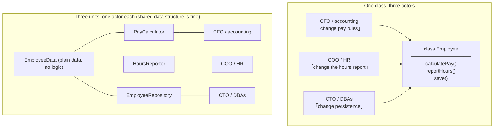
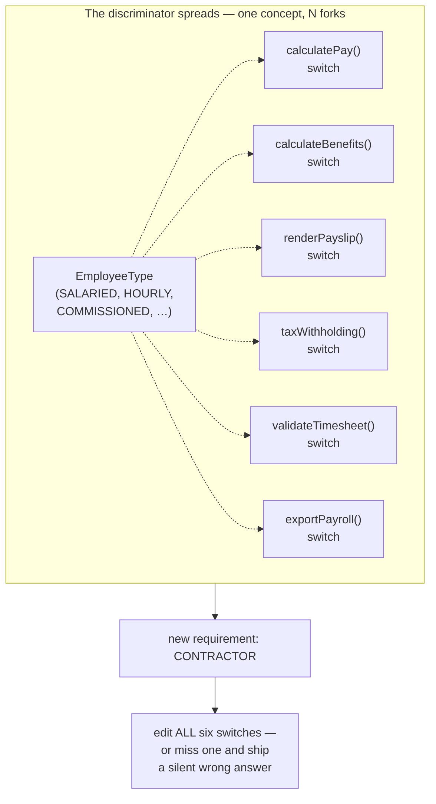
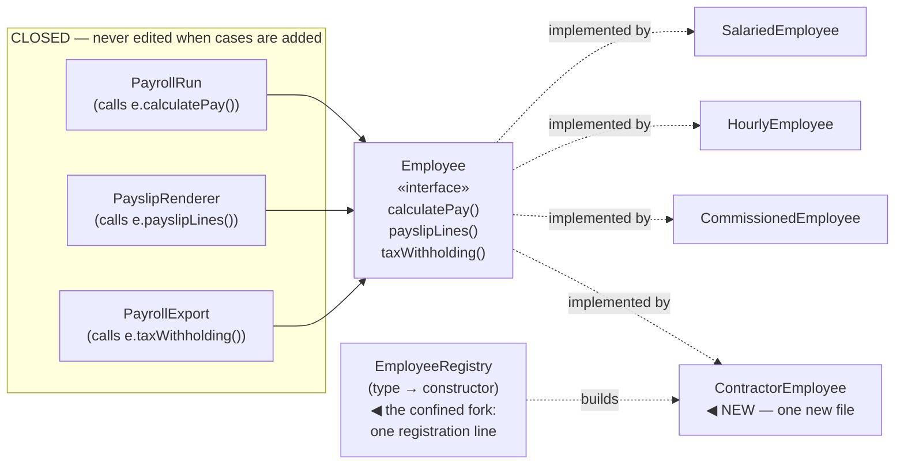
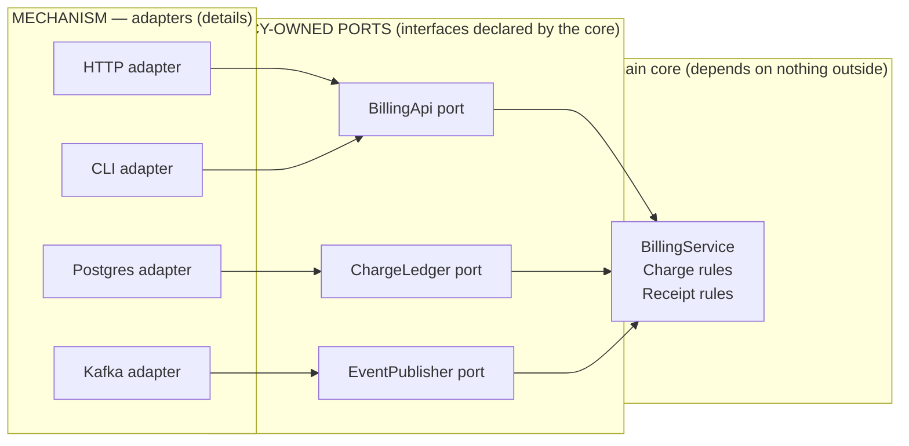

# 02 — SOLID as Change Economics

> **What SOLID actually was.** The five principles were not written as a style checklist. Robert C. Martin's original paper (*Design Principles and Design Patterns*, 2000) was about one engineering problem: **how to arrange dependencies so that a change to one part of a system does not ripple across the whole** — "software rot," as the paper called the failure. Michael Feathers later arranged the five into the mnemonic **SOLID**. The famous names are useful; the economics underneath them is what this file restores.
>
> **What this file does.** Every principle is derived the same way: from the two forces file 01 §10 established — **cohesion** (things that change together belong together) and **coupling** (things that change independently must not be tied). Then each gets the full treatment: word by word, original source, precise statement, the problem it kills, **violation detection** you can run on real code, tri-language fixes, production failure modes, and — the section most tutorials skip — **when the principle is wrong**. Because each of these five, over-applied, causes its own class of damage.

---

## 0. The Five, at a Glance — and What Each One Actually Buys

| Principle | One-line meaning (the literal version) | The file-01 force it names | The cost of applying it | The cost of ignoring it |
|---|---|---|---|---|
| **SRP** — Single Responsibility | One class answers to **one actor** (one group of people who ask for changes) | **Cohesion by change-driver**: functional cohesion, §10.5 | More, smaller types; navigation burden; wiring | Shared-file cross-actor regressions: HR's change breaks payroll (silently) |
| **OCP** — Open/Closed | Extend behavior by **adding** code, not editing working code | **Coupling rung 0**: depend on contracts so new fulfillments need no caller edits | An abstraction *before* the second case exists — speculative generality if the change never comes | Every new case edits a growing `switch`; edits risk the cases that already work |
| **LSP** — Liskov Substitution | A subtype must honor the supertype's **contract**, not just compile | **Coupling to contracts without leaks**: the promise must be fully honorable | Discipline in reviews; contract-test suites; restraint in hierarchies | Callers cannot trust declared types; `instanceof`/`try-catch` spreads through client code |
| **ISP** — Interface Segregation | No client forced to depend on methods it doesn't use | **Cohesion per client**: interfaces grouped by *who uses them* | Interface explosion if done per-method; type count grows | Fat interfaces: dummy implementations, mock explosion, recompile/ABI blast zones |
| **DIP** — Dependency Inversion | High-level policy must not depend on low-level mechanism; **both depend on the abstraction owned by policy** | **Couple toward stability**: the direction rule from §10.4 | Indirection; "where is this implemented?" navigation cost | Business logic welded to a database/vendor: untestable core, migration impossible |

**Reading convention for this file:** every principle section has the same skeleton — **§N.1 Word by word → §N.2 Original source and precise statement → §N.3 The problem it kills → §N.4 Detection (smell tables you can apply to a live codebase) → §N.5 Tri-language fix → §N.6 Production reality → §N.7 Misconceptions → §N.8 When NOT to apply it → §N.9 Drill.** The same shape for all five, so the comparisons at the end (§6) are structural, not impressionistic.

---

## 1. SRP — The Single Responsibility Principle

### 1.1 Word by word

> **Word by word — *single*:** from Latin **singulus** — *one only, separate, individual*. The same root as *singular*, *singleton* (file 03 §5), *singularity*. In the principle's name, *single* does not mean "one method" or "one field" — it means **one owner**.
>
> **Word by word — *responsibility*:** from Latin **respondēre** — *re-* (back) + *spondēre* (to promise, to pledge) → "to answer back, to answer for." In Roman law, a *responsum* was a formal answer; a responsibility is **the thing you must answer for**. A class with a responsibility is a class that must *answer to someone* when its behavior changes.
>
> **Word by word — *principle*:** Latin **principium** — *first thing* (*princeps*, "taking the first place"): a starting rule from which the rest follows. SOLID's principles are not laws; they are the first-rule stubs of decisions. A principle that cannot be argued against is dogma — §6 of this file argues against all five.

**The literal reading of SRP, taking the words seriously:** *a unit must answer to exactly one source of change.* Not "do one thing" — **answer to one owner**. Everything else in this section unpacks that sentence.

### 1.2 Original source and precise statement

Martin's early formulation (1990s, repeated in his writing and talks):

> **"A class should have only one reason to change."**

The refinement that makes it operational (Martin, *Clean Architecture*, 2017):

> **"Gather together the things that change for the same reasons. Separate those things that change for different reasons."** — and the reasons are **actors**: groups of people (roles, job titles, stakeholder groups) who request the changes.

**Precise definition used in this file:** *A module (class, package, service) should be accountable to exactly one actor — one group of users or stakeholders whose requirements are the only ones that can force it to change.*

Two implications the definition forces, both commonly skipped:

1. **The unit of SRP is "module," not "class."** The same test applies to a package, a service, a microservice: *who asks for changes to this deployable?* A service answering to billing, onboarding, and analytics teams is a distributed god-object (file 06 §6.1 at architecture scale).
2. **Actors are discovered, not invented.** You cannot census the actors of a class from its code alone — you find them by asking *"who files tickets against this file?"* and *"who has to approve changes to it?"* and — the empirical answer — by reading `git log --format=%ae` for the directory and counting the distinct request origins. SRP is as much a *sociological* principle as a structural one, and that is precisely why it prevents production bugs (the failure it kills, §1.3, is an org-chart failure made executable).

### 1.3 The problem it kills — the canonical story, told fully

The example is Martin's own and it deserves to be told as an incident, because that is what it is:



**The incident, step by step** — every step is a reasonable decision by someone:

1. `Employee` has three methods, each serving a different actor. It also has a shared private helper: `getRegularHours()` — called by **both** `calculatePay()` and `reportHours()`. (Why shared? DRY said so: the logic looked identical. It *was* identical — §1.4 shows why "was" is the whole bug.)
2. **Accounting** requests a change to overtime pay rules. A developer edits `calculatePay()` — and, being careful and DRY-respecting, also touches `getRegularHours()` to handle a new edge case (e.g., a new category of overtime-eligible hours).
3. `reportHours()` — which the developer never opened and HR never asked about — now computes different numbers, because it calls the same helper. The overnight batch report changes. **Nobody committed a bug in HR's code; HR's code changed anyway.**
4. The changed report goes to a **regulator**, or to **payroll automation** that pays people. The blast radius crossed an actor boundary — and by the time it is noticed, the stack traces point at `reportHours()`, which nobody edited, so the investigation starts in the wrong place entirely.

**The general pattern, stripped of the story:** *two actors sharing one implementation detail. An edit performed for actor A changes behavior observed by actor B, with no line of B's logic touched.* This is the SRP failure mode in production — not "ugly code," but **cross-actor regression through shared internals**. It is the class-level version of the fragile base class problem (file 01 §6.6), where the "base class" is the shared helper and the "subclass" is the other actor's method.

### 1.4 Detection — the instruments, ranked by signal quality

You can *feel* SRP violations in a 10-minute session on any real codebase. The instruments, in order of honesty:

| # | Instrument | What you run/look for | Strong signal when… |
|---|---|---|---|
| 1 | **Actor census** (the primary instrument) | Ask: *who requests changes to this file? Name job titles/teams.* Then check `git log --format='%an %ae' -- path/` | You name two or more distinct stakeholder groups, or the log shows two unrelated request streams |
| 2 | **Churn/co-change** (empirical) | `git log --name-only` over a quarter; do changes to method X's history overlap with method Y's? | One file appears in commits for two different feature areas repeatedly (file 01 §10.4's change-coupling metric, applied inside a class) |
| 3 | **The two-fixtures test** | Look at the unit tests: how many *radically different* setups does one class need? | Testing `calculatePay` needs mocked tax tables; testing `reportHours` needs mocked formatting locales; no shared fixture — two test suites wearing one class name |
| 4 | **The name test** | Read the class name. | It contains *and*, *manager*, *handler*, *service* with an unbounded verb list — the name confesses the actor-pile (file 06 §6.1's God Class is SRP at level 11) |
| 5 | **The churn-rate split** | Per-method change history | One method changes monthly (a hot requirement area), its neighbors yearly — different actors change at different rates; the clock speed of the *class* is now that of its fastest-changing actor, dragging every reviewer and every test into the fast lane |
| 6 | **The approval test** | Who must review/approve changes here? | Two teams must sign off — shared code with shared governance is *sometimes* correct (§1.7's governance nuance), but accidental sharing is the default explanation |

**The one-line interview answer for detection:** *"I census the actors — who files changes against this file — and I check it against the churn history. Two actors with different clocks means the class will deliver cross-actor regressions eventually; the shared-helper mechanism is how they arrive."*

### 1.5 Tri-language fix — the same split, three ways

**Java — before and after:**

```java
// BEFORE — three actors, one class, one shared helper (the bug's launchpad)
public class Employee {
    public Money calculatePay()  { /* CFO rules — uses regularHours() */ }
    public String reportHours()  { /* HR format  — uses regularHours() */ }
    public void save()           { /* DBA concerns */ }

    private int regularHours()   { /* shared by accident of history */ }
}
```

```java
// AFTER — three units; the data structure is shared, the LOGIC is not.
// Payroll's "regular hours" and HR's "regular hours" are now separate concepts
// that HAPPEN to agree today — if they must agree forever, one of the actors
// owns the definition and the other consumes it (see the governance note, §1.7).

public record EmployeeData(String name, List<Timesheet> sheets) {}   // inert data

public final class PayCalculator {                 // answers ONLY to accounting
    private final TaxTables taxTables;
    public Money calculatePay(EmployeeData e) { /* payroll rules, payroll hours */ }
}

public final class HoursReporter {                 // answers ONLY to HR
    public String reportHours(EmployeeData e) { /* HR rules, HR hours */ }
}

public final class EmployeeRepository {            // answers ONLY to DBAs/IT
    private final DataSource ds;
    public void save(EmployeeData e) { /* persistence */ }
}
```

**C++ — same split, and the layout consequence worth noticing:**

```cpp
// BEFORE: one class; note the private helper — the same launchpad
class Employee {
public:
    Money  calculatePay() const;
    std::string reportHours() const;
    void   save();
private:
    int regular_hours() const;            // shared by both actors' methods
};

// AFTER: the data is a value type (shared freely — it answers to nobody);
// the behaviors are per-actor types, each holding its OWN dependencies.
struct EmployeeData { std::string name; std::vector<Timesheet> sheets; };

class PayCalculator {
    const TaxTables& tax_;                // only payroll needs this
public:
    Money calculate_pay(const EmployeeData& e) const;
};

class HoursReporter {
    const Locale& locale_;                // only HR needs this
public:
    std::string report_hours(const EmployeeData& e) const;
};

class EmployeeRepository {
    DbConnection& db_;                    // only IT needs this
public:
    void save(const EmployeeData& e);
};
```

The C++ layout note: the three new classes have **disjoint dependency sets**. Before the split, the compiler forced every user of any `Employee` method to include the tax tables, the locale tables, and the DB headers — because one class owned them all. After the split, an HR-formatting TU no longer compiles against DB headers. That is compile-time coupling shrinking in a way you can *measure* (include-what-you-use audit, then `-ftime-trace`). SRP's dividend in C++ lands in the build graph, not just in the design diagram.

**C — the split is by translation unit, and it is the kernel's actual discipline:**

```c
/* BEFORE — employee.c owns three actors' logic behind one header */

/* AFTER — the header now declares the data only; behavior lives per-actor. */

/* employee_data.h — inert structure, safe to share */
struct employee_data { char name[64]; struct timesheet *sheets; size_t n_sheets; };

/* pay_calculator.h — accounting's module */
money_t pay_calculate(const struct employee_data *e, const struct tax_tables *t);

/* hours_reporter.h — HR's module */
int hours_report_format(const struct employee_data *e, const struct locale *l, char *out, size_t cap);

/* employee_store.h — IT's module */
int employee_save(const struct employee_data *e);   /* SQL lives only in employee_store.c */
```

> **[KERNEL & SYSTEMS]** This is not a refactoring fad — it is how the kernel *is organized*, at a scale where a cross-actor regression takes down a fleet: `struct task_struct` is the shared **data** (one definition, everyone reads), while the **behaviors** are segregated by their owning group — scheduler policy lives in `kernel/sched/` (one maintainer group), memory accounting in `mm/`, tracing in `kernel/trace/`. The kernel's `MAINTAINERS` file is a literal actor census, checked into version control: it maps modules to the humans/teams who must approve changes. **Linux ships SRP's organizational half as a text file.** When you hear "SRP is about actors," this is the proof at the largest codebase in active maintenance.

### 1.6 Production reality — where SRP violations actually cost money

| Placement | The SRP violation | What it costs |
|---|---|---|
| **The 2,000-line service** | Checkout rules + email templates + PDF generation + refund policy, three "actors" | Every deploy is a negotiation; a CSS fix to the receipt cannot ship without re-running checkout's test suite and vice versa (deploy coupling, file 01 §10.4) |
| **The shared private helper** (§1.3) | Two actors' logic converges on one function | The silent cross-actor regression — the most expensive class, because no stack trace points at the cause |
| **The microservice** | One service answering to 4 product teams | Every team's roadmap item becomes a cross-team change request; the release train appears (distributed god-object) |
| **The DTO-with-behavior creep** | A wire-format record grows `calculate...`, `validate...`, `toEntity...` | Format changes and business-rule changes couple; versioning the format now versions the rules (the "anemic ↔ bloated transfer object" pendulum) |

**The mitigations that actually hold, in practice:**

1. **Split by actor at the seam the churn history shows** — when the two actors' changes demonstrably stop overlapping, you have found the boundary (and the split will stick; boundaries drawn from anything else get remerged by the next refactor).
2. **Share data, not logic** (as in §1.5): the `EmployeeData` shape changes rarely and for format/domain reasons both actors own — a deliberate shared artifact, not an accidental one.
3. **Contract tests at the shared boundary:** if a shared component survives (the governance case), the shared component's tests encode *every actor's* requirements — a change that breaks any of them fails in CI, not in payroll.
4. **The approval mirror:** the module layout should match the approval graph (Conway's law working *for* you): if two teams must approve, either make the component's governance explicit (a named owning team, an API review) or split it.

### 1.7 Misconceptions, and the honest hard cases

> **[MISCONCEPTION]** *"SRP = a class should do one thing / have one method / have one reason — and a class with 20 methods is violating it."* Method count is not the metric; **actor count** is. A `Money` class with 40 methods (add, subtract, allocate, format-per-locale, parse-legacy…) can be *perfectly* cohesive if one actor — the domain's money semantics — owns all 40. Conversely, a 3-method class can violate SRP if the three methods serve three actors. Ask "who asks for changes?" — not "how many methods?"

> **[MISCONCEPTION]** *"SRP means duplication is always the fix."* No — the fix is *separation of ownership*. If two actors' logic must agree **by domain law** (e.g., tax law defines "regular hours" and both payroll and the regulator's report must use that single definition), then the correct structure is a **dedicated shared component with explicit, single ownership** — one named owner (it answers to the *law*, via the team that maintains it), and both consumers are just that: consumers. What SRP forbids is *accidental* sharing — one actor editing a helper it does not own and did not intend to change. The decision script: **"if this helper changes, who must approve? If the answer is two teams whose requests never coincide, split. If the answer is one team acting for a law/standard both parties cite, keep it and name the owner."**

**The genuinely hard cases, answered honestly:**

- **The pure DTO/record with zero behavior** — does it "have a responsibility"? It has none of the *behavioral* kind; DTOs (request/response shapes, wire formats, C structs) are data contracts. Their "actor" is the *protocol* itself — every consumer by definition. The famous "anemic domain model" critique (file 06 §6.3) is about moving *business rules* into services while data classes stay inert — a different argument. A record with no logic cannot violate SRP; a record that grows `validate()` and `calculate()` starts answering to people, and then the census applies.
- **The facade with 25 methods** — many methods, one actor? A `StorageFacade` exposing the storage subsystem's whole surface answers to one actor (callers of storage). Cohesive by the census, large by the count — fine. SRP is not a diet plan; it is an ownership rule.
- **Two actors who always change together** — if the churn history *proves* the two "actors" issue coupled requests (same sprint, same features, same approval), you have found one actor wearing two titles — splitting them adds the synchronization chore (edit two files per change) without removing any risk. Wait for the histories to diverge (the same "wait for the second case" economics as OCP, §2).

### 1.8 When NOT to apply SRP

- **Prototypes, spikes, throwaway scripts** — the actors are one person (you), the horizon is days. Splitting by actor is pure cost; the economics flip only when the code's lifetime extends past its requesters' patience.
- **Before two actors exist** — splitting on speculation fabricates the micro-class explosion: 40 classes of 15 lines, a navigation puzzle ("where does formatting happen?" — class #27), and wiring burned at every call site. The corrective pull back is §6's table: *SRP overshoot → micro-classes → measure by churn, not by vibes.*
- **Where the "actors" are actually aliases** — a service used by support, admin, and internal tooling *today* may be one operational actor (the ops team) if the requests truly originate in one planning queue. Run the census on the *request* flow, not the *caller* list: callers are many; requesters are what matter.

> **[INTERVIEW]** *"You're handed a 2,000-line `OrderService`. Split it."* The SDE3 answer is a **process, not a scissors**: (1) **census the actors** — grep `git log` for who changes it and read the commit messages for request origins; (2) **cluster the methods by caller and by churn** — the co-change data names the candidate seams better than any reading of the code; (3) **extract in dependency order** — pure computation first (leaves), orchestration last, so you never need mocks mid-refactor; (4) **verify each extraction with the churn test** — after the split, do the two units still change together in the next sprint? If yes, merge back and say so *— a split that gets remerged is data, not failure*; (5) **no new interfaces yet** — the seam is the class boundary; interfaces come when a second implementation or a test double genuinely arrives (file 06's MVD; OCP's timing rule in §2). Candidates who begin with "first I'd extract an interface" have started at step 5 and skipped the evidence.

**[DRILL]** An `AccountService` holds: `registerUser()`, `changePlan()`, `chargeMonthly()`, `generateInvoicePdf()`, `sendInvoiceEmail()`, `exportLedgerCsv()`, `applyPromoCode()`, plus a shared private `effectiveDiscount()` used by `changePlan()`, `chargeMonthly()`, and `exportLedgerCsv()`. (a) Name the actors (at least three). (b) Identify the shared-helper hazard and which pair of actors it sits between. (c) Give the split — with the governance decision for `effectiveDiscount()` stated explicitly. *(Model: (a) Actors: **growth/self-serve product** (registerUser, changePlan, applyPromoCode); **finance/billing** (chargeMonthly, generateInvoicePdf, exportLedgerCsv); **marketing/lifecycle** (sendInvoiceEmail — or fold into growth if the same request queue owns it; state the choice and its evidence requirement). (b) The hazard is the §1.3 pattern exactly: `effectiveDiscount()` is shared between **growth** (`changePlan`) and **finance** (`chargeMonthly`, `exportLedgerCsv`). A promo tweak by growth silently changes finance's ledger and charges — the regulator-facing direction of the blast radius makes this the highest-severity item in the class. (c) Split: `PlanService` (growth), `BillingEngine` (finance: charge + invoice PDF + ledger export — invoice-format and charge-calculation are one actor *today*; note the two-fixtures test will referee), `LifecycleMailer` (marketing) consuming billing *events* rather than calling into billing. For `effectiveDiscount` — governance decision: promo rules are a **domain fact owned by one team** (e.g., growth) that finance *consumes*: make it a first-class shared component (`PricingRules`) with a single named owner, a versioned contract, and contract tests encoding both consumers' cases — **or**, if the census shows finance's discount needs diverging (different legal caps), split into two rules and record the divergence. State which evidence decides which branch: the next quarter's churn log.)*

---

## 2. OCP — The Open/Closed Principle

### 2.1 Word by word

> **Word by word — *open*:** from Old English **openian** — *not shut; accessible; unobstructed*. In the principle: **extendable** — new behavior can be added, the module lets it in.
>
> **Word by word — *closed*:** from Latin **claudere** — *to shut, to close* (the root of *clause*, *claustrophobia*, *enclosure*). In the principle: **not editable by its consumers** — the module's source and contract are stable; clients can rely on them without fear of edits.
>
> **The paradox, stated plainly:** the same entity must be *both* — closed (nobody edits it) and open (anyone extends it). The resolution is not a trick; it is the single most consequential design idea in this file: **separate the part that varies from the part that doesn't; freeze the second; plug the first in.** Everything else — interfaces, strategies, plugins, ops tables, registries — is machinery for that sentence.

### 2.2 Original source and precise statement

Bertrand Meyer, *Object-Oriented Software Construction* (1988) — the first formulation, in the era of shipped class libraries:

> **"Software entities (classes, modules, functions, etc.) should be open for extension, but closed for modification."**

Meyer's mechanism was inheritance and data abstraction: a released class is **closed** — its source doesn't change, clients compiled against it stay safe; it is **open** — new subclasses add behavior without touching the base. Robert C. Martin later generalized the idea for continuously-evolving enterprise systems (1996 paper, *The Open-Closed Principle*), where the entity to keep closed is not a shipped binary but **working, tested behavior**: new requirements should arrive as *new code*, not as edits scattered through existing logic.

**Precise definition used in this file:** *A module is open-closed when behavior along its known axes of variation can be extended by adding implementations — without editing the module's existing source — and the axes are chosen on evidence, not hope.*

Three load-bearing clauses, each usually dropped by tutorials:

1. **"Known axes of variation"** — OCP is applied *per axis*. A design can be closed for one kind of change and wide open to another. There is no globally closed module; there is only *closed along the axis you prepared for*.
2. **"Without editing existing source"** — the test is mechanical and measurable: when the next case arrives, how many *existing* files does the feature commit touch? The number is OCP's scorecard (§2.8).
3. **"On evidence"** — the clause this section exists to enforce. OCP applied without evidence is **speculative generality** (file 06 §7.2), the load-bearing anti-pattern of this principle. §2.5 handles the economics, and the whole of §6's overshoot table will hold it in place.

### 2.3 The problem it kills — the switch that edits the working system

The canonical before-picture, Java flavor, in a payroll system that started honestly small:

```java
public Money calculatePay(Employee e) {
    switch (e.type) {
        case SALARIED:    return salariedPay(e);
        case HOURLY:      return hourlyPay(e);
        case COMMISSIONED:return commissionedPay(e);
        default: throw new IllegalStateException("unknown type");
    }
}
```

One switch is fine. The failure lives in the *copying*:



**The cost model, precisely — this is why OCP exists, in numbers you can argue with:**

- Adding a type in the *switch world* costs **N edits** where N = number of switches on that discriminator. The sixth switch (the one someone forgot — usually the report, the export, or the reconciliation path) fails **silently**: `default` throws, or worse, a `default` that returns a plausible-but-wrong value.
- Every edit lands **in the middle of working, proven cases**. The regression surface of the edit is *all existing behavior that flows through the switch* — every pay type, every report line — not just the new one. In "add" terms, the risk is localized to the new code path; in "edit" terms, the risk is the blast radius of the file.
- The **test surface** follows the same geometry: adding a class runs the new class's tests; editing a switch requires re-running every case downstream of it — and in practice, teams do less of that than they promise, which is how the sixth switch ships unedited.
- The **discovery cost**: nothing tells you there is a sixth switch. No compiler error, no failing build — just a wrong number later. (Contrast: the closed-set tools of §2.6 *make* the compiler tell you.)

**This shape has many costumes:** `instanceof` ladders in Java, `typeid`/`dynamic_cast` chains in C++, tag-enums in C (the honest version — see §2.7's C code, where the switch is least avoidable but most containable), and even `if (request.path.startsWith(...))` routing ladders. The smell is uniform: **one concept, discriminated in many places, extending it means editing all of them.**

### 2.4 The resolution — and its true shape

The fix is not "remove the fork" — that is impossible; *something* must map a case to its behavior. The honest statement of OCP's mechanism:

> **OCP does not eliminate the conditional; it confines it to exactly one place — and then closes every other place to edits.**

The confined place has a name: the **factory / registry / composition root**. In a properly open-closed design, adding a case touches **(a) one new implementation file** and **(b) one registration line in the confined fork**. Every other module — the callers, the reports, the exports — never recompiles, never re-tests, never re-reviews:



This diagram is worth reading twice, because it contains the whole principle: **the interface is the frozen part (closed); the implementations are the growing part (open); the registry is the only fork in the system, and it is one line wide.**

### 2.5 The economics — when to apply OCP, argued like an engineer

Applying OCP costs a real, immediate, certain price. Refusing to apply it costs a possible, future price. The decision is a bet on the future, and this subsection is how seniors price it.

**The costs of applying OCP (paid now, certain):**

| Cost | What it looks like |
|---|---|
| **The axis bet** | You must choose *what varies* before variation arrives: "payment providers will multiply" vs "the payroll *cycle* will change." Bet wrong and the abstraction covers the stable axis while the volatile one still edits N places — the worst of both worlds (indirection paid, shotgun surgery retained) |
| **Indirection tax** | The call site reads `provider.charge()` — the behavior is *nowhere in this file* (file 01 §7.5's navigational cost). New engineers trace across 4 classes to answer "what actually happens on charge?" |
| **File proliferation** | One behavior, N files; every rename/review/grep crosses more surface; the "where is X implemented?" search becomes a skill |
| **Refactor friction while the design is young** | Renaming `calculatePay` now means editing an interface + N implementations; while the module was a switch, it meant one file. **Early abstractions make the design expensive to improve while you're still learning the domain** — the exact period when you most need to improve it |

**The costs of NOT applying OCP (paid later, probable):**

| Cost | What it looks like |
|---|---|
| **N-edit features** | §2.3's arithmetic: one new case = N switch edits across N subsystems |
| **Silent misses** | The forgotten switch ships wrong behavior; discovery is downstream (a report, a regulator) |
| **Regression surface** | Each edit puts proven behavior at risk; the test burden is "everything downstream" |
| **Merge contention** | Two teams adding two cases to the same switch conflict forever; the switch becomes a serialization point in the org's merge graph |

**The decision rule, stated the way you would say it in review:**

> **Introduce the seam when a second case exists — or when there is *named* evidence a third is coming: a dated roadmap item, a vendor/protocol that inherently varies (payment providers, tax regions, carriers), or churn data showing the same switch was edited in three consecutive quarters. Otherwise, write the switch, and write a comment naming it as the known extension point.**

Three supporting arguments for the humility direction:

1. **Refactoring *to* OCP later is a mechanical, tool-assisted, well-catalogued refactor** ("Replace Conditional with Polymorphism" — Fowler's catalog; every IDE knows the shape). It is a *widening* refactor: the switch's cases become classes one at a time, tests stay green throughout. Refactoring *away* from a wrong abstraction is the opposite: callers depend on the interface; you must dissolve it across all call sites, often with behavior changes interleaved. **The asymmetry: building the seam early risks paying for speculation; building it late costs one well-understood sprint.** The cheap error is late.
2. **The second case is information; the first is a guess.** With two real implementations on the table, you see the *actual* axis — often not the one you'd have guessed (the pay types varied, but the thing that really churned was *proration rules* shared across types). Abstractions built from two real cases fit those cases; abstractions built from one case fit one case wearing a costume.
3. **The evidence sentence must be sayable out loud.** *"I introduced `PaymentProcessor` because the roadmap has two more PSP integrations committed for Q3, and the churn log shows the checkout switch edited five times this year."* If you cannot produce that sentence, the abstraction is hope. This is the same discipline as file 01 §5.5's "why is this an interface?" — one sentence with a client and a change in it.

### 2.6 Open sets vs closed sets — the distinction tutorials skip

OCP is the right answer for **open sets** and the *wrong* answer for **closed sets**, and knowing which one you hold in your hand is the actual design skill:

| | **Open set** — variants unbounded, defined by evolution/market | **Closed set** — variants fixed, defined by standard/spec |
|---|---|---|
| Examples | Payment providers, file formats, shipping carriers, employment types as the *business* evolves, plugins, per-cloud storage backends | HTTP methods, days of the week, TCP states, chess piece types, DSL grammar nodes, protobuf field types |
| What matters most | **Extensibility**: new variants must arrive as new files | **Exhaustiveness**: the compiler must catch a missing case |
| Right tool | Polymorphism + registry (OCP) | `switch` / `std::variant` + visitor / `sealed` + pattern match / Rust `enum`+`match` |
| Why | The set cannot be enumerated at design time; a closed interface would block the next vendor | The set *can* be enumerated; the danger is forgetting a case, not missing extensibility |

**The killer asymmetry:** polymorphic OCP *destroys exhaustiveness checking*. Add a method to `Employee` and the compiler cannot tell you which implementations it forgot (it cannot enumerate "all classes that implement an interface" across builds — and in Java pre-sealed, it *won't*). Add a variant to C++'s `std::variant` and `std::visit` with a non-exhaustive visitor **fails to compile**; Java's sealed interfaces + `switch` patterns (21+) error on a non-exhaustive switch; Rust's `match` demands all arms. **For closed sets, the compiler's exhaustiveness audit is worth more than extensibility** — and the set's closure means extensibility was never needed: HTTP is not going to add a new verb next quarter; if it does, that is a *standard-level* event, and editing one switch is the correct cost.

```java
// CLOSED SET done right — Java 21 sealed + exhaustive switch:
// add a variant, the compiler lists every place that must handle it. That
// compiler-provided worklist IS the feature closed sets need.
public sealed interface HttpMethod permits Get, Post, Put, Delete, Patch {}
// regular, non-fast-developing codebase traditions (switch over enum) do the same job.

// OPEN SET done right — unbounded vendor variants behind one frozen contract:
public interface PaymentProcessor {        // closed to modification
    ChargeResult charge(ChargeRequest req);
}
// new PSP = new class + one registration (open to extension) — old code untouched.
```

The double mistake, both directions, both common in real codebases:

- **Polymorphizing a closed set:** `class HttpGetMethod implements HttpMethod` with one method each — five classes doing what one 20-line switch did, *minus* the compiler's completeness audit. The reasoning ("OCP says extend, don't modify") was applied without the §2.5 evidence test: HTTP methods are not a market.
- **Switch-casing an open set:** the §2.3 payroll switch — plugging a market into a fork.

**The classifier question to ask once:** *"Is this set bounded by a standard/spec (closed) — or by product/market evolution (open)?"* Standard/spec → switch family, embrace exhaustiveness. Market/evolution → interface family, embrace registration. If you genuinely cannot tell, that itself is evidence the set is young — **write the switch, note the discriminator, revisit when the second case lands** (§2.5's cheap-error rule).

### 2.7 Tri-language fix — the same opening, three mechanisms

**Java — interface + registry (the confined fork in one line):**

```java
public interface PayPolicy {                       // CLOSED: frozen contract
    Money calculatePay(EmployeeTimesheet sheet);
}

public final class PayPolicyRegistry {             // the ONLY fork in the system
    private final Map<EmploymentType, PayPolicy> byType = new EnumMap<>(EmploymentType.class);

    public PayPolicyRegistry() {
        byType.put(EmploymentType.SALARIED,     new SalariedPayPolicy());
        byType.put(EmploymentType.HOURLY,       new HourlyPayPolicy());
        byType.put(EmploymentType.COMMISSIONED, new CommissionedPayPolicy());
        // New type lands HERE: one line. No existing policy is recompiled or re-reviewed.
    }
    public PayPolicy forType(EmploymentType t) {
        PayPolicy p = byType.get(t);
        if (p == null) throw new IllegalArgumentException("no policy for " + t);
        return p;
    }
}

// CLOSED callers — untouched forever:
Money pay = registry.forType(e.type()).calculatePay(e.timesheet());
```

Note what the registry *is*: a switch, living in one place, expressed as data. The design did not eliminate the conditional — it **quarantined** it (§2.4). Teams that later want true plugin behavior replace the hand-written registry with `ServiceLoader`/SPI discovery — same principle, more machinery, apply §2.5's economics to *that* upgrade too.

**C++ — same shape, plus the option Java lacks: compile-time opening:**

```cpp
// RUNTIME OCP — the everyday version:
class PayPolicy {                                  // closed contract
public:
    virtual ~PayPolicy() = default;
    virtual Money calculate_pay(const Timesheet&) const = 0;
};

class PayrollRun {
    std::unordered_map<EmploymentType, std::unique_ptr<PayPolicy>> policies_;
public:
    Money pay(const Employee& e) const {
        return policies_.at(e.type())->calculate_pay(e.timesheet());  // one fork, one line
    }
};

// COMPILE-TIME OCP — extension with zero runtime dispatch (file 01 §7.2's
// monomorphization): the "policy" is a type parameter. std::sort's comparator
// is the canonical example: sorting is closed; the ORDER is open — new orderings
// need no edit to std::sort and no vtable at all.
template <class PayPolicyT>
Money pay_with(const PayPolicyT& policy, const Employee& e) {
    return policy.calculate_pay(e.timesheet());    // inlined, devirtualized, direct
}
```

Compile-time OCP is the C++-specific move worth naming in interviews: **it opens the axis without paying runtime indirection** — the bill arrives as code size (one instantiation per type) and compile time (file 01 §7.2's trade). For a small closed-ish set of hot paths (compare functions, hashers, allocators), it is frequently the better engineering answer than a vtable.

**C — the ops table, which is OCP's ancestor and its purest form:**

```c
/* CLOSED: the contract. Frozen forever once shipped (append-only, if ever). */
struct pay_policy_ops {
    money_t (*calculate_pay)(void *ctx, const struct timesheet *ts);
};

struct pay_policy {
    const struct pay_policy_ops *ops;       /* the frozen half */
    void *ctx;                              /* the policy's own state */
};

/* The confined fork — a lookup table, not even code: */
static const struct pay_policy registry[EMPLOYMENT_TYPE_COUNT] = {
    [EMPLOYMENT_SALARIED]     = { &salaried_policy_ops,     NULL },
    [EMPLOYMENT_HOURLY]       = { &hourly_policy_ops,       NULL },
    [EMPLOYMENT_COMMISSIONED] = { &commissioned_policy_ops, NULL },
    /* New type: one line here + one new file of policy code. */
};
```

Read the C version as the *platonic* OCP: a frozen struct of function pointers (closed), a data-driven registry (the fork as data), new behavior as new functions + one registration line (open). No language magic — which is the proof that OCP is a design property, not a language feature. Java's interface, C++'s virtual, C's ops table: three costumes, one skeleton.

> **[KERNEL & SYSTEMS]** The kernel is OCP at industrial scale, and it is worth quoting in interviews because it is undeniable: **adding a filesystem (ext4, btrfs, NTFS) does not edit the VFS.** `struct file_operations` / `struct super_operations` are the frozen contracts; every filesystem is an implementation; the mount path is the confined fork. The same skeleton runs the driver model (`struct pci_driver` registration), and the limit case is the loadable module: `insmod` extends a *running 30-million-line kernel* without a single line of kernel source changing — OCP executed at the binary level. And the price is visible exactly where this file says it would be: the contracts are **frozen ABI** (ops tables append-only, versioned; `vermagic` checks pin module↔kernel compatibility); extending the *contract* (OCP's closed half) is a deliberate, expensive, multi-year event — which is precisely why kernel developers argue for a decade before adding a slot to an ops table. **The strongest OCP in practice comes with the strongest freeze discipline.** OCP without an explicit freeze rule (what is stable, who approves edits to the interface) is decoration.

### 2.8 Production reality — where OCP pays, and the two ways it fails

| Domain | The open set | The payoff, measured as §2.5 promised (files touched by the "new case" commit) | The freeze that makes it work |
|---|---|---|---|
| **Payments** | PSPs (Stripe, Adyen, dLocal…) | New provider: 1 new adapter class + 1 registration; checkout/refund/reconciliation untouched — **regression surface = the new class only** | `PaymentProcessor` contract change requires a versioned migration, not an edit |
| **Tax/regions** | Countries, states, regimes | New region: new `TaxPolicy` + registration; invoice math closed | The policy interface is owned by the tax team; consumers just call |
| **Shipping** | Carriers | New carrier: new `RateSource`; the pricing engine is closed | Rate-fetch contract versioned |
| **File formats** (export pipelines) | Formats (CSV, XLSX, PDF, ILM…) | New format: new exporter + registry line | The `Exporter` contract is small and stable |
| **Notifications** | Channels (email, SMS, push, webhook) | New channel: new sender + registration | Delivery contract (idempotency semantics!) frozen once |

**Failure mode 1 — speculative generality (the overshoot).** The plugin framework for a single plugin; the interface for a single implementation "because OCP"; the six extensibility points in a system whose only requirement moved on a different axis. Neither syntax nor tests catch this — only the §2.5 evidence test does, retroactively, when churn data shows the "axis" was touched twice in three years while something else churned monthly. **Recognition signature in review:** an interface whose only implementation is `XxxImpl` *and* whose commit history shows zero new implementers since creation *and* no roadmap item naming more. That is not OCP — it is indirection with a hopeful comment.

**Failure mode 2 — the partial freeze.** The interface exists, but `default` methods or a mutable config struct means the contract still changes with every case; or the registry is spread across three files; or one caller bypasses the registry with its own `switch` "just this once." The leak isn't in the design — it is in the *discipline*: OCP's closed half requires an owner who says "edit this interface and you owe every implementer a review." **Kernel lesson again:** `vermagic` and `MAINTAINERS` are not glamorous, but they are what actually enforces the freeze. In application code, the equivalents are interface-review culture, contract tests, and the codeowners file — organizational machinery for a design property.

**Feature flags — OCP's runtime cousin.** Toggling behavior without editing or deploying code is OCP at the operational level, and it deserves the same economics: buy the flag when the axis is a *decision you'll want to reverse without a deploy* (rollout, kill-switch, A/B); pay the carrying cost (dead-flag archaeology, every-condition-is-now-two, combinatorial test paths) — flag debt is this principle's own overshoot in operational clothing (file 06).

### 2.9 Misconceptions

> **[MISCONCEPTION]** *"OCP means you never modify code."* OCP constrains **extension edits to stable, proven logic**. Bug fixes, refactors, test additions, and even interface changes (with the freeze process above) are normal engineering. The precise claim: *adding a case should be an addition, not an edit* — and only along prepared axes. Confusing "don't edit" with "don't improve" produces codebases that protect their own bugs.

> **[MISCONCEPTION]** *"OCP requires interfaces/abstract classes."* OCP requires a **stable seam**. The seam can be an interface, a virtual method, a function pointer table (C), a template parameter (C++ compile-time OCP), a registry entry (data), a plugin manifest, or a feature flag (runtime). Interfaces are one mechanism — often the right one, never the only one.

> **[MISCONCEPTION]** *"The switch is the anti-pattern."* The **scattered** switch is the anti-pattern. A single switch over a closed set is often the *superior* engineering choice (§2.6's exhaustiveness audit). A single registry/switch over an open set is the confined fork — required, not shameful. The scorecard is never "is there a switch?" but "how many places must a new case edit, and does anything check that they all got edited?"

> **[MISCONCEPTION]** *"OCP and YAGNI contradict each other."* They price the same axis from two sides — YAGNI says "don't buy the seam without evidence," OCP says "when evidence arrives, buy it *as an addition, not an edit*." §2.5's decision rule is the reconciliation: **YAGNI governs the timing; OCP governs the shape of the change when the time comes.** A candidate citing the contradiction as a "gotcha" is usually revealing they never priced either side.

### 2.10 When NOT to apply OCP

- **Single case, no evidence of a second** — the switch and a comment; §2.5's asymmetry (late is the cheap error).
- **Closed sets** — exhaustiveness beats extensibility (§2.6); spend your design effort on *making the switch exhaustive* (sealed types, variants, `default: static_assert(false)`-style traps in C++ pre-C++17).
- **Throwaway code and spikes** — the actors are absent and so is the future (§1.8's economics apply unchanged).
- **Where the axis is genuinely unknown** — abstracting on a guessed axis buys indirection *and* retains shotgun surgery (the worst quadrant of §2.5). Wait; the churn log will name the axis soon enough — one quarter of real feature commits beats any amount of design-room speculation.
- **Where the cost of the seam exceeds the feature** — an internal two-function helper whose "variation" is a single boolean used by exactly one caller is a parameter, not a polymorphic hierarchy (the corrective pull: §6's overshoot table).

> **[INTERVIEW]** *"Define OCP."* is the warm-up. The filter follows: ***"When would you deliberately NOT apply it?"*** Model answer, compressed: *"When the set is closed or the axis is unevidenced. For closed sets — HTTP methods, protocols, grammar nodes — I want exhaustiveness checking more than extensibility, so I use a sealed set with a compiler-checked switch; adding a case there *should* edit one place, loudly. For unevidenced axes, the late refactor to polymorphism is mechanical and tool-assisted — 'Replace Conditional with Polymorphism' — while de-abstracting a wrong guess is expensive; so I wait for the second case or a dated roadmap item, and I say which evidence I'm waiting for."* Then the closing line that names the principle correctly: *"OCP doesn't remove the fork; it confines it to one registry — and freezes everything else."* If the interviewer asks for a real example, the kernel gives you one — filesystems plugging into a frozen VFS — **and** the price tag: append-only ABI and decade-long interface debates. Principles with visible prices are hard to argue with.

**[DRILL]** A payroll system has the six-switch sprawl from §2.3 (pay, benefits, payslip, withholding, timesheet validation, export), three employee types today, and: the Q3 roadmap lists a contractor type (staffing push, dated, committed); the churn log shows five of the six switches edited this year and the benefits switch untouched since 2023. (a) Which switches get the OCP treatment first? (b) Which one should *not*, and what do you do with it instead? (c) Write the one-line evidence sentence for the review. *(Model: (a) The five hot switches — pay, payslip, withholding, timesheet validation, export — are on the *evidenced* axis: a dated roadmap case plus three-consecutive-quarters churn. Apply §2.7: extract the frozen contract per axis. Note *per axis*, not one mega-`Employee` interface: pay's contract (`PayPolicy`), withholding's (`WithholdingPolicy`), etc. — forcing all of it onto one `Employee` interface would couple the axes (each new type recompiles for every axis anyway; each axis's implementations multiply) and violates ISP's census (§4) while wearing OCP's clothes. (b) The benefits switch: untouched since 2023, no roadmap item — leave it, add the comment marking it as the known extension point, revisit if it wakes up. This is the discipline that distinguishes §2.5's rule from interface fever, and saying it out loud is worth as much as the code. (c) Evidence sentence: *"Five of six switches were edited this year across two payroll changes and a remediation ticket; the Q3 staffing launch adds CONTRACTOR (dated, product-committed); I'm introducing per-axis policy contracts for the hot five — the benefits switch stays a switch, monitored, because its axis shows no churn."* Then the falsifiable promise: *"After the split, the CONTRACTOR feature's diff should touch zero existing policy files — one new file per axis plus five registry lines. If it doesn't, the seam was drawn on the wrong axis and I'd expect to learn that from the diff size in review."*)*

---

## 3. LSP — The Liskov Substitution Principle

### 3.1 Word by word

> **Word by word — *Liskov*:** the principle is named after a **person** — Barbara Liskov, MIT Institute Professor, Turing Award 2008 (the second woman to receive it), leader of the CLU and Argus language projects. Her 1987 OOPSLA keynote, *Data Abstraction and Hierarchy*, contained the sentence the principle is named for. Naming a design rule after a living scientist is rare — and appropriate: the rule is not obvious, it was *discovered* by formal reasoning about what subtyping must mean, and it is the one SOLID letter with a mathematical statement behind it.
>
> **Word by word — *substitution*:** from Latin **substituere** — *sub-* (in place of, under) + *statuere* (to set, to establish) → "to set one thing in the place of another." The everyday version is a substitute teacher: a stand-in who must be able to **run the class** — not merely occupy the room. The moment this word is taken literally, the principle follows: a subtype must *serve the role* the supertype serves, in every program that uses that role. Occupying the type slot is the compiler's business; **serving the role is the design contract** — and the gap between the two is this entire section.

### 3.2 Original source and precise statement

Liskov's formulation (1987 keynote):

> **"What is wanted here is something like the following substitution property: If for each object o₁ of type S there is an object o₂ of type T such that for all programs P defined in terms of T, the behavior of P is unchanged when o₁ is substituted for o₂, then S is a subtype of T."**

The formalized version (Liskov & Wing, *A Behavioral Notion of Subtyping*, 1994) — worth reading slowly once, because every word carries weight:

> **"Let Φ(x) be a property provable about objects x of type T. Then Φ(y) should be true for objects y of type S where S is a subtype of T."**

Word by word, unpacked:

- **"a property provable about objects of type T"** — the promises the *base type* makes: what callers can count on — results, side effects, invariants, what never happens. Not the interface (signatures) — *properties*, i.e., **behavior**.
- **"should be true for objects of type S"** — a subtype must satisfy **every** property the supertype promised. Subtyping is *additive*: S may promise *more*; it may never promise *less*.
- **"for all programs P defined in terms of T"** — the test is every caller written against the base, present and future, **without their knowledge of S**. This is what makes substitution *behavioral*: the caller's code is the judge, compiled before S existed.

**Precise definition used in this file:** *S is a behavioral subtype of T only if every program written against T's contract continues to behave identically when given an S — observable results, side effects, exceptions, and state transitions included. This is a property of programs and promises, not of syntax.*

**The gap the definition exposes:** every mainstream compiler verifies only **signatures** — names, parameter types, return types (with the covariant fudge). The property-based half lives in prose (documentation), tests (contract suites), and review. That is why LSP violations are the classical *"compiles fine, fails in production"* principle: **the compiler checked the part that was never going to be the problem.**

### 3.3 The contract, decomposed — the test kit

LSP becomes operational through design-by-contract (Meyer's framework, which almost every language lacks natively but every design can honor in tests). A supertype's contract is four kinds of claims; a subtype must respect all four:

| Clause | The rule | The violation is called | One-line test |
|---|---|---|---|
| **1. Preconditions** | The subtype may **not demand more** than the base demanded | *Strengthened precondition* | "Could a caller write legal-against-the-base code that the subtype rejects?" |
| **2. Postconditions** | The subtype may **not deliver less** than the base promised | *Weakened postcondition* | "Could a caller rely on the base's guarantee and get less from this object?" |
| **3. Invariants** | The base's class invariants (file 01 §4.2) must hold for the subtype, and must survive all subtype methods | *Invariant violation* | "Does any subtype method exit with a base invariant false?" |
| **4. History (mutable objects)** | The subtype may not allow state transitions the base's contract forbade — properties about the *sequence* of states, not just each state | *History-rule violation* | "Was there a base-level rule of the form 'X never follows Y' that a subtype method makes reachable?" |

Plus the two clauses that ride along in practice:

- **Exceptions are part of the contract.** A subtype may throw *narrower* exceptions (fewer, or subtypes of what the base declared). It may **not** throw new categories the base's callers were never told to handle. (Java's compiler half-enforces this for checked exceptions — the one place a compiler helps you; it does nothing for *unchecked* surprises, which are exactly the production ones.)
- **Observable side effects are contract.** Logging, counters, network calls, delivered notifications: a subtype that *adds* observable effects has changed the program's behavior for the caller — sometimes benignly, sometimes not (the "silent extra email" class of bug).

**The clause that catches real code most often is #3 combined with #4** — not the flashy refused bequest (that one is caught in review because it's loud) but the *history* rule: a subtype whose methods are individually well-behaved, whose *combination* creates state sequences the base promised could never happen.

### 3.4 The violations catalogue — tri-language, with the mechanism of each

#### V1 — The refused bequest (throwing/no-op overrides): the loud one

```java
public class Account {
    public void withdraw(long cents) { /* moves money out, updates logging */ }
    public void deposit(long cents)  { /* money in */ }
}

public class SavingsAccount extends Account {
    @Override public void withdraw(long cents) {
        throw new UnsupportedOperationException("withdrawals not allowed on savings");
    }
}
```

The callers of `Account` — the programs P — were told: *every Account can withdraw.* With `SavingsAccount` substituted, `accounts.forEach(a -> a.withdraw(payout))` throws mid-loop, possibly **after** the first accounts already withdrew: a partially-executed financial operation (the transactional blast radius, not just an exception). The declared type lied; LSP exists precisely so types don't lie.

**What the JDK did with this problem — and why it is the most instructive real case:** Java's `Collections.unmodifiableList(...)` returns a `List` whose mutators throw `UnsupportedOperationException`; every `List` in your code might be one. The JDK's fix was **not** to remove the hierarchy but to retroactively *weaken the base contract*: `List` documents a concept of **"optional operations"** — the contract itself now says mutators *may* throw `UnsupportedOperationException`. Consequences, honestly priced: (a) the hierarchy stays (decades of API compatibility preserved); (b) **every caller in the world now works with a weakened promise** — "a List you can add to" is no longer a thing you can know from the type; (c) `Iterator.remove`, `Map.put`-on-immutable-maps, etc. repeat the pattern. This is LSP violation **soldered into the standard library as a contract weakened for everyone** — and it is why senior Java engineers still ask "is this list mutable?" as a code-comment-level question in reviews. The lesson is not "the JDK was wrong" — it is *what a violation costs when you cannot fix it*: the remediation bill is distributed to every caller, forever. `Stack extends Vector` (a Stack you can `insertElementAt(0)`) and `Properties extends Hashtable` (non-String entries through inherited `put`) are the sibling exhibits.

**The fixes, in the order to try them:**

```java
// FIX 1 — split the contract by capability (the ISP shape, §4):
public interface ReadableAccount { long balanceCents(); }
public interface WithdrawableAccount extends ReadableAccount { void withdraw(long cents); }
public interface DepositableAccount extends ReadableAccount  { void deposit(long cents); }
// SavingsAccount implements DepositableAccount (+ ReadableAccount) — never claimed
// the withdraw capability, so no program was ever written expecting it.

// FIX 2 — composition: savings isn't the same role; it HOLDS a locked policy:
public final class SavingsAccount {
    private final TimeDepositPolicy policy;   // may permit/deny withdrawal by ITS OWN rules
    private final Ledger ledger;
    public WithdrawalResult requestWithdrawal(long cents) {   // honest API: a RESULT, not a void
        return policy.evaluate(cents, ledger.balance());
    }
}

// FIX 3 (weakest, for compatibility-constrained surfaces) — the JDK pattern:
// document optionality AND provide capability queries, so callers can branch
// on capability instead of catching exceptions:
boolean canWithdraw();     // capability query — the caller checks what it needs
```

The tri-language shape of V1 is identical everywhere — **the mechanism is the promise, not the language**: C++ `throw` in an override, C: an ops-table slot that returns `-ENOTSUP` where callers never checked for it (the C version is *worse*: no exception propagation to notice; the error silently poisons a count or gets dropped by an unaware caller — return codes push LSP into the caller's discipline), Java/`UnsupportedOperationException`. The C rendering is worth keeping: **in C, an LSP violation is an error code nobody agreed to handle.**

#### V2 — Strengthened preconditions: "we only accepted valid input anyway"

```java
class DocumentStore {
    /** Stores a document. Names may be any string, including empty. */
    void store(String name, byte[] content) { ... }
}
class IndexedDocumentStore extends DocumentStore {
    /** @throws IllegalArgumentException if name is empty — indexing needs a key! */
    @Override void store(String name, byte[] content) {
        if (name.isEmpty()) throw new IllegalArgumentException("empty names unsupported");
        super.store(name, content);
    }
}
```

Legal-against-the-base code — `store("", draft)` — breaks under the subtype. The subtype *wanted* a narrower domain (reasonable for indexing!) but *claimed* the base's wider one (a lie). The caller has no way to know which stores accept what: the polymorphic slot now has hidden input requirements. **Signature-compatible; contract-incompatible — the compiler is silent.** *Fix:* reflect the real domain in the base contract (`store requires non-empty name` — moving the restriction to the supertype so *all* implementations share it), or narrow the *type* (`NamedDocumentStore` with the precondition in its own contract). A precondition only belongs on a subtype that never travels in a base-typed slot with base-typed callers — which is another way of saying: **a subtype with stronger preconditions isn't a subtype; it's a sibling.**

#### V3 — Weakened postconditions: the guarantee quietly shrinks

```java
class PriceFeed {
    /** Returns prices sorted ascending by timestamp. */
    List<Quote> recentQuotes() { ... }

    // A caller binary-searches on the documented ordering.
}
class CachedPriceFeed extends PriceFeed {
    private final List<Quote> cache = ...;   // merged from two sources
    @Override List<Quote> recentQuotes() {
        return cache;                        // not sorted after a merge bug— "close enough"
    }
}
```

Two distinct weakened postconditions are lurking even in the *non*-buggy version: (a) **ordering** — the documented contract; (b) **aliasing** — the base returned a fresh list, the override returns the internal cache; a caller mutating the result corrupts the feed for everyone (the *shared-mutable-internal* leak from file 01 §4.4, now wearing an LSP costume). Both are invisible in signatures. *Fix:* keep the promise (sort on merge; return a defensive copy or an unmodifiable view — and note the fix costs of each: sort = CPU, copy = allocation, view = still-aliased-but-guarded; pick explicitly, document the choice).

#### V4 — Invariant break / history rule: the Ogden-Nash problem (Circle-Ellipse), told properly

The textbook case every tutorial cites and few explain — here is the *mechanism*:

- `Ellipse` promises: `setMajorAxis(r)` sets the major axis **and leaves the minor axis unchanged**; `setMinorAxis(r)` symmetrically. (These are *postconditions*, and the pair supports the invariant "the two axes are independent.")
- Mathematically, a circle **is an** ellipse (zero eccentricity) — so `Circle extends Ellipse` looks like domain truth.
- But a `Circle` must maintain `major == minor`. Override `setMajorAxis(r)` to also set the minor axis (to keep circle-ness) and the postcondition "minor axis unchanged" is **broken**: code written for `Ellipse` — `e.setMajorAxis(5); assert e.minorAxisIsUnchanged()` or, more realistically, `e.setMajorAxis(5); e.setMinorAxis(3);` expecting a 5×3 ellipse — gets a circle instead. Override it to *not* adjust the minor axis and the `Circle` invariant dies (it becomes a stray ellipse behind a Circle name). **Every option violates something.**

The resolution, and the sentence to carry away: **the supertype's *mutable independent setters* are the bug** — the contract promised a capability (independence of axes) that the mathematical is-a cannot deliver. Fixes, ranked:

```java
// FIX A — make the shared abstraction the truly common capability (often SCALING,
// not axis-setting). LSP was telling you the base contract was wrong:
public interface Shape2D { Shape2D scaledBy(double factor); double area(); }
// Circle and Ellipse both implement it honestly. No is-a claim beyond capability.

// FIX B — immutability removes the history rule's habitat: no setters, no
// "axis unchanged" postcondition to break; construction-time invariants only.
// (Circle is constructible only with equal axes; Ellipse with any.)
public record Ellipse(double major, double minor) { ... }
public record Circle(double radius) { ... }        // NOT extends Ellipse — records don't inherit state

// FIX C — keep CLASSICAL inheritance but give the base only construction-time
// invariants and *queries*: immutable axis readers on Ellipse; no setters anywhere.

// FIX D (only when the base contract is truly yours and mutable setters are
// required by existing callers): re-derive the base as the honest mutable type —
// an "Ellipse" whose contract EXPLICITLY says "implementations may couple the
// axes" — i.e., weaken the promise deliberately and rewrite every caller's
// expectations. This is the JDK maneuver from V1; it works, and it bills all callers.
```

> **[MISCONCEPTION]** *"LSP says circle can't be an ellipse — therefore LSP contradicts mathematics."* The opposite: LSP is *how the contradiction surfaced*. Mathematics has no setters; the moment a designer promised an *independent-setters* contract on the supertype, they created a promise no circle could keep. **The is-a relationship is relative to a contract, not to a dictionary** (file 01 §6.7's lesson, now with the canonical proof). Change the contract to something both can honor (FIX A) and the mathematical relation coexists fine with LSP — as `Shape2D.scaledBy` shows.

#### V5 — The `equals` symmetry trap: LSP in the JDK's own contract (Effective Java, Item 10)

```java
public class Point {
    protected final int x, y;
    @Override public boolean equals(Object o) {
        if (!(o instanceof Point p)) return false;
        return p.x == x && p.y == y;
    }
    // hashCode omitted for brevity; contract applies to it identically
}

public class ColorPoint extends Point {
    private final Color color;
    @Override public boolean equals(Object o) {           // Version 1: color-aware
        if (!(o instanceof ColorPoint cp)) return false;
        return super.equals(o) && cp.color == color;
    }
}
```

Now run the `equals` contract — itself a set of promises that *every* subtype inherits:

- `Point.equals(ColorPoint)` — asks "same x,y?" → **true** for `p(1,2)` vs `cp(1,2,RED)`.
- `ColorPoint.equals(Point)` — not a ColorPoint → **false**.
- **Symmetry broken**: `a.equals(b) ≠ b.equals(a)`. Any `HashSet` mixing them misbehaves *depending on insertion order* — the worst kind of bug: order-dependent correctness.

The escape attempts and their prices: include color only when `o instanceof ColorPoint` (introduces **transitivity** failures across colorings); use `getClass()` equality (symmetric — but now `new Point(1,2).equals(new Point(1,2))` fails between a base and *any future subclass*, and it silently violates the expectations of code that legitimately treats subclasses as points). **There is no correct override-based solution when the subclass adds state that participates in equality** — Effective Java's verdict — and therefore the LSP-correct fixes are structural:

```java
// FIX — composition + a base-type VIEW; no is-a claim for equality purposes:
public final class Point { ... }                       // possibly final, value semantics
public final class ColorPoint {
    private final Point point;                          // composition (file 01 §8)
    private final Color color;
    public Point asPoint() { return point; }            // explicit, honest conversion
    @Override public boolean equals(Object o) {
        return o instanceof ColorPoint cp && point.equals(cp.point) && color == cp.color;
    }
}
```

Why this case earns its place in an LSP section: `equals`/`hashCode`/`compareTo` are **inherited contracts** — supertype promises every instance makes, enforced by every collection you will ever store objects in (file 01 §13 Q14). A subclass that breaks them breaks *programs P* written against `Point` (here: every `HashSet`, `HashMap`, `List.contains`). It is the purest demonstration that LSP governs *behavioral promises*, and that some promises bind at the level of the language runtime itself.

#### V6 — The silent no-op and the side-effect surprise (the quiet ones)

```java
class AuditLog {
    /** Appends the entry to persistent storage; returns after durable write. */
    void append(Entry e) { ... }
}
class BufferedAuditLog extends AuditLog {
    @Override void append(Entry e) { buffer.add(e); }   // "flush happens later"
}
```

Postcondition "returns after durable write" → weakened to "maybe, eventually, unless we crash." The caller's compliance story (audit! SOX! forensics!) assumed durability at return. This is V3 with legal teeth. Symmetric case: the override that *adds* a network call per `append` — postconditions technically intact, but every caller's latency profile and failure modes changed (side effects are contract). And the system-scale version every senior should know:

> **[KERNEL & SYSTEMS]** **PostgreSQL's 2018 `fsync` reckoning.** `fsync`'s contract on POSIX reads, in effect: *after a successful return, the data is on stable storage; on failure, you get an error you can act on.* PostgreSQL (a program P defined in terms of that contract) built its entire durability story on both halves. The discovery: across Linux's write-back cache layers and some storage stacks, **failed flushes could go unreported** — a later successful fsync on another file could clear a pending error — so PostgreSQL could believe in durability that did not exist and lose acknowledged transactions on power loss. The storage stack had been substituting — as the "subtype" implementing POSIX's durability interface — an object that did not keep the promise. The fallout: PostgreSQL shipped belts-and-braces mitigations (error tracking, retry policies, `fsync` on the WAL's directory, later `fdatasync` choices and configuration guidance), kernel developers argued about error-reporting semantics for years, and the incident became engineering folklore. What it teaches about LSP: **the principle is not an OO nicety; it is the invariant behind every "I should be able to swap implementations" claim at every layer.** When the swap-in silently weakens a postcondition, the caller doesn't get a compile error — it gets data loss and a multi-year argument about whose contract it was.

### 3.5 How to test LSP — the mechanical answer: contract test suites

Behavioral promises can't be compiler-checked, but they *can* be test-checked, and this is the technique that turns LSP from philosophy into CI:

**The pattern: write the tests against the base contract once; run them against every implementation.** A subtype that cannot pass the base suite has failed the substitution test *in the only place where "for all programs P" can be approximated — the consumers' test suite.*

```java
// JAVA — an abstract contract suite; implementations extend it and add their own tests.
public abstract class ConnectionPoolContractTest {          // tests the PROMISES
    protected abstract ConnectionPool newPool(int capacity);

    @Test void acquireReturnsDistinctConnectionsUntilExhausted() { ... }
    @Test void releasedConnectionIsReacquirable() { ... }
    @Test void acquireBeyondCapacityBlocksOrThrowsPerContract() { ... }
    @Test void closeIsIdempotent() { ... }
    @Test void closeThenAcquireThrowsIllegalState() { ... }   // the history rule!
}

class HikariContractTest extends ConnectionPoolContractTest {
    @Override protected ConnectionPool newPool(int c) { return hikariPool(c); }
    // plus Hikari-specific tests — added, never removing base promises
}
```

```cpp
// C++ — gtest's typed tests do the same: one suite, one template, N implementations.
template <typename PoolT>
class ConnectionPoolContract : public ::testing::Test {
protected:
    PoolT make_pool(int capacity);
};
using PoolTypes = ::testing::Types<HikariPool, SimplePool, FakePool>;
TYPED_TEST_SUITE(ConnectionPoolContract, PoolTypes);

TYPED_TEST(ConnectionPoolContract, CloseIsIdempotent) { /* same promise, every type */ }
```

```c
/* C — the ops-table world's version: one test function, a table of implementations. */
typedef const struct pool_ops *pool_ops_t;
static const pool_ops_t all_pools[] = { &simple_pool, &arena_pool, &test_pool };

static void test_close_is_idempotent(void)
{
    for (size_t i = 0; i < ARRAY_SIZE(all_pools); ++i)   /* same promises, every impl */
        assert(pool_close(pool_open(all_pools[i], 8)) == 0);
}
```

**The review checklist that accompanies it** (run on every override, in order — most violations die at line 3):

1. **Signature** — the compiler's half (covariant returns fine; *parameter* narrowing = V2, caught by hand).
2. **Exceptions** — new checked exceptions? (compiler flags) — new *unchecked* categories? (you flag: the rule is fewer/narrower exceptions).
3. **Preconditions harder?** — any new rejection the base accepted = V2.
4. **Postconditions softer?** — any guarantee not kept: ordering, freshness, aliasing, durability, thread-safety (!), atomicity = V3/V6.
5. **Side effects added?** — new observable I/O, logging semantics, state changes = contract change; declare it in the base or remove it.
6. **Invariant + history** — does each method exit with base invariants true? Any new reachable state sequence the base forbade? (The circle-ellipse question, mechanically.)
7. **Concurrency clauses** — if the base promised thread-safety, the override inherits that promise; a subclass dropping to "caller must synchronize" is an LSP violation of the concurrency contract — and one of the most common in real Java/C++ code, because **thread-safety is a postcondition most interfaces forget to write down** (file 01 §4.5's theme, returning as a contract clause).

### 3.6 Production reality — how violations are born, and what they cost

| Birth mechanism | Story shape | Where it surfaces |
|---|---|---|
| **The "one exception" override** | Refactor extracts a base; one member doesn't fit; the team overrides it to throw/no-op "temporarily" | The polymorphic loop in prod: partial execution, corrupted batch |
| **The semantics drift** | Two implementations written months apart against the same interface; the second's author read the *code* of the first, not a contract (there wasn't one) | Subtle divergence under edge cases: retry semantics, idempotency, ordering |
| **Retrofitted hierarchy** | A concrete type is generalized later; the "base" was reverse-engineered from one implementation, so its contract is one implementation's quirks | The second implementation can't honor the quirks; one of them lies |
| **Distributed substitution** | A service implements a contract (schema OR semantics); the schema matches, the semantics (idempotency, ordering, at-least-once) diverge | Retries double-charge; replay reorders; the caller's assumptions were the interface |

**The cost anatomy, in file-01 terms:** a violation converts a *contract coupling* (rung 0 — callers rely on a promise) into **defensive coupling** (callers must `instanceof`/try-catch/capability-query at every site). LSP is, in the end, the principle that keeps contract coupling legal. Every violation *exported to callers* raises the coupling rung for every caller, permanently — the JDK's optional-operations design is that bill, still being paid thirty years after the decision.

**And the org version:** "the declared type lies" is a *social* debt too — new hires learn the codebase by trusting types; each lied-about type adds tribal knowledge ("careful, that withdraw can throw") and erodes the value of the type system as a communication medium. Codebases with multiple such types per module have effectively switched to dynamically-typed reasoning with static-typing compile times.

### 3.7 Misconceptions

> **[MISCONCEPTION]** *"LSP only applies to inheritance."* Substitution claims exist wherever a contract is published and implementations vary: interfaces, Go/Rust traits, duck-typed protocols, **microservice APIs** (schema + semantics), plugin systems, even function types (a comparator that isn't a strict weak ordering — see C++ `std::sort`'s precondition — is an LSP violation of `Compare`, and it corrupts memory, not just results). The mechanism is always the same: a promise, implementations, and callers who trusted the promise. Inheritance is merely the most *syntactically visible* habitat.

> **[MISCONCEPTION]** *"If it compiles and the tests pass, it's LSP-clean."* Then the tests are the contract — and if they only test each implementation in isolation, the contract is undefined. The definition is "for all programs P *defined in terms of T*": the tests must be `P`s written against T, run against S. Teams that run base-contract suites against all implementations have LSP coverage; teams that don't have a style guide.

> **[MISCONCEPTION]** *"LSP forbids subtypes from adding methods or behavior."* Subtypes may add freely — anything the base contract doesn't forbid. What they may not do: **narrow what the base promised to callers** (V1–V4) or **widen what callers must handle** (V2's preconditions, V6's surprises). Addition is the point of subtyping; subtraction is the violation.

> **[MISCONCEPTION]** *"LSP is violated only by 'bad' classes."* LSP violations happen to good engineers doing reasonable things under constraints: retrofitting a hierarchy for compatibility, one team owning the base and another owning an implementation, distributed services sharing a wire schema but not a semantics spec. The principle is not a character test; it is a **promise-keeping framework** — most violations are *undefined promises* (nobody wrote the contract down), not defiance.

### 3.8 When it matters less — and when you can't afford it

- **The hierarchy that is never used polymorphically** — an internal subclass used only through its concrete type, never through a base-typed slot, has no programs P to fool. Technically the substitution test is vacuous. *But* two disciplines still apply: (a) the moment the class crosses a module boundary or gets a second consumer, the test is live again — so record the intent ("this base exists for reuse, not substitution") rather than assume; (b) the more common trap is the *future* polymorphic use arriving silently (a `List<Base>` appears in a refactor), which is why "internal-only" hierarchies are where violations hibernate longest before detonating.
- **Compatibility-pinned hierarchies (you can't fix the base)** — the JDK case: the base's promise is published; callers exist by the million. LSP gives you the *menu* of honest moves: weaken the base contract explicitly (document optionality — cost: all callers), add capability queries (cost: callers branch), split interfaces at the *next* version boundary with adapters (cost: two contracts coexist — the classic bridge period), or deprecate the offending capability over years (cost: time, but it's the only one that *ends*). What LSP forbids is the silent option: leaving implementations that throw while the docs promise success. **A violation with a documented, dated remediation is debt; an undocumented one is a mine.**
- **When applying LSP would cost more than the substitution claim is worth** — if exactly one implementation will ever exist and the base is purely an internal seam (file 06's premature abstraction), the LSP apparatus (contract suites, clause documentation) is also overkill: **contract tests are the price of admitting a second implementer.** File 06's MVD applies: buy the discipline when the second implementation — the moment P-programs become real — arrives.

### 3.9 Interview bank and drill

> **[INTERVIEW]** *"What is LSP?"* at SDE3 level is answered with **mechanisms, not the dictionary**: the substitution property in one clause; then *the compiler checks signatures only — LSP is checked by contract suites and reviewed clauses (pre/post/invariants/history)*; then one exhibit at the right depth — refused bequest (the SavingsAccount/`List` optional-operations lineage), the circle-ellipse *postcondition* mechanism (not "circle isn't an ellipse"), or the `equals` symmetry trap. The follow-up that separates: ***"How would you catch a violation before production?"*** — "Contract tests: one suite written against the base type, executed for every implementation, plus the seven-item override checklist; if the promises aren't written down, the first job is to write them down as the suite — undefined promises are the actual bug most violations grow from." And the cost sentence: *"An exported violation converts contract coupling into defensive coupling at every call site, forever — the JDK's optional operations are the industry-scale bill for one such decision."*

**[DRILL]** Four overrides arrive in code review; name the violated clause for each, then the fix:
(a) `TimedCache.put()` — base `Cache` promises "after a successful put, get returns the value"; the override drops writes when the cache is full, returning normally.
(b) `ReadOnlyView.iterator().remove()` — throws `UnsupportedOperationException`; the base `Collection` documents `remove` as supported; callers use a generic `drainTo()` helper built on `remove`.
(c) `RedirectFollowingFetcher.fetch()` — the base `Fetcher` documents "one request per fetch"; the override follows up to five redirects (additional observable requests, rate-limit budget consumed).
(d) `MonotonicCounter.increment()` — base promises the value only ever increases; the override's `increment()` is fine, but a newly added `reset()` public method makes decreases reachable to code that only knew the base (a `List<BaseCounter>` now observes: same object, `increment` → `reset` → `increment`, value lower than previously observed).
*(Model: (a) **weakened postcondition** (put-then-get guarantee, plus a silent-failure mode — the caller can't even learn). Fix: obey (evict, then store — the base's contract implies a storable cache), or make the base contract honest (`boolean tryPut` with eviction semantics documented), or new type — but nothing that keeps the old promise vocabulary while dropping writes. (b) **refused bequest** — textbook V1, with the aggravator that the *base's own documentation* promised it, so the fix menu is the JDK one: capability model on the base (`iterator()` returning an iterator whose `remove` contract is explicit), or elimination of `ReadOnlyView` as a `Collection` subtype (a `ReadableView` role instead), or the honest last resort: weaken the base's documented promise for everyone — price it and say so. (c) **observable side effects as contract** — the base's "one request" was both a resource-budget promise (rate limits!) and a latency profile; the override changes what callers' capacity planning means. Fix: put redirect policy in the base contract (`fetch` documents redirect behavior, or a `RedirectPolicy` parameter/constructor choice — the behavior becomes visible at the type or construction site, not hidden in an override). (d) **history-rule violation** — each method is individually fine; the reachable *sequence* (decrease after increase) violates the invariant the base promised over its object's lifetime, in the true Liskov-Wing sense ("properties about objects," including transitions). Fix: `reset()` doesn't belong on a `MonotonicCounter` — it belongs on a *different* type (a `ResettableCounter` that doesn't claim monotonicity to base-typed consumers), or on the owner of the counter (recreate-instead-of-reset), preserving that callers who hold a `BaseCounter` really do hold monotonicity for the object's lifetime. The common thread to say out loud: **all four fixes are *contract design* fixes; none is a code-quality fix. LSP failures are amended at the interface, not in the method bodies.)*

---

## 4. ISP — The Interface Segregation Principle

### 4.1 Word by word

> **Word by word — *interface*:** the *face between* two parties (file 01 §2: Latin *inter* + *facies*) — a boundary plus a set of promises. In this principle's context, the thing being segregated is exactly that: **the set of promises one party shows to another**.
>
> **Word by word — *segregation*:** from Latin **segregare** — *se-* (apart) + *grex*, *gregis* (flock, herd) → "to separate from the flock." The image is precise: a herd of methods all shown to everyone gets **separated by its users** — each client sees the flock it actually works with, not the whole herd. (Same root as *congregation* — herding together — and *egregious* — "standing outside the flock.")
>
> **The literal reading:** *the faces you show to different parties should be separated according to what each party needs.* Not "make interfaces small" — **make interfaces match their consumers.** The whole principle is in *whose* flock we're talking about.

### 4.2 Original source, precise statement, and the story

Robert C. Martin's 1996 paper *The Interface Segregation Principle* — and the story behind it is a Xerox printer firmware consulting engagement, which matters because the principle was *derived from an incident*, not from theory:

**The Xerox story.** A new high-end printer's control software had accumulated a central job abstraction — the object representing a print job — that had grown methods serving **every** subsystem: printing, stapling, faxing. Each subsystem (a team, with its own release cadence) used a *disjoint subset* of those methods — but all of them depended on the **single** class. The consequence Martin described: *a change to any one subsystem's part of that class forced redeployment and regression testing of the other subsystems*, even though the other subsystems never called the changed methods. The dependency was not on the part each team used — it was on the *whole surface*, because in that codebase (and in most languages' tooling), **you depend on the interface you can see, not the methods you call.**

The paper's formal statements — both worth having verbatim:

> **"Clients should not be forced to depend upon interfaces that they do not use."**
>
> **"Many client-specific interfaces are better than one general-purpose interface."**

**Precise definition used in this file:** *An interface should be split so that each client (or group of clients with the same needs) depends only on the methods it actually uses — no client's build, deployment, test doubles, or implementation obligation is affected by methods grown for other clients. Segregation is by **consumer**, not by size.*

**The two-sided reading** — the principle has two victims when violated, and senior answers name both:

1. **The client side:** callers are coupled to a larger surface than they use. Consequences: recompiles/redeploys (language-dependent, §4.3), mock burden in tests, wider versioning surface for distributed APIs, more concepts a reader must hold.
2. **The implementor side:** implementations are required to provide methods they cannot meaningfully implement — producing **dummy implementations**: empty bodies, `UnsupportedOperationException`, `-ENOTSUP` returns. That is the **refused bequest** (LSP §3.4 V1) — meaning: **ISP is the preventive half of LSP.** Fat interfaces are LSP-violation factories: they manufacture implementations that must refuse part of what they claim.

### 4.3 The problem it kills — mechanics, per language, with prices

ISP is often taught as aesthetics ("small interfaces are pretty"). It is not aesthetics; every language's toolchain turns a fat interface into **measurable costs**. This is the table to bring to an interview when someone calls the principle academic:

| Language / layer | The mechanism | What a fat interface costs you, concretely |
|---|---|---|
| **C++** | Header inclusion: an abstract base's header `#include`s the types its *methods* reference. Any TU including it recompiles when it (or its transitive includes) change | A 40-method `IPlatform` base drags in 15 subsystem headers; **every client TU compiles the whole surface**; one method's signature change rebuilds half the tree. This is the least abstract cost of all — it is *wall-clock build time*, and it is why large C++ codebases obsess over per-role abstract bases and PIMPL |
| **Java** | Compile/link against the type: clients, mocks, and any tooling generating against the interface see the full surface; adding a method to a published interface breaks every implementor (source compat) | Test doubles must stub/implement methods the test never exercises (**mock burden** — file 01 §10.4's coupling readout); a 25-method interface means every fake implements 25 methods or leans on mocking tricks that hide the real coupling |
| **C (ops tables)** | The table *is* the ABI: a slot added to a published ops struct breaks every implementation that was compiled against the old layout | The kernel's answer is instructive both ways: it *has* big ops tables (`file_operations`), but (a) slots are **optional** — `NULL` means "not supported," call sites check, and (b) the tables are **split by role** — `file_operations` (per open file), `inode_operations` (per inode), `address_space_operations` (page cache), `super_operations` (per filesystem). One "struct filesystem_operations" with all of them would have made every driver implement page-cache plumbing; the split makes each subsystem's requirement precise |
| **Distributed (services, SDKs)** | The published API surface: versioning, code generation, client SDKs, docs, quotas | A fat service API versions as a monolith: a field added for one client's need forces SDK regeneration, compatibility testing, and release coordination for all clients; per-capability services (or per-client façades/BFF layers) let capability changes ship independently — ISP as deployability |

The common structure across all five rows: **the cost of an unused method is never zero — the toolchain charges by the visible surface, not by the called subset.** That sentence is ISP's actual claim.

### 4.4 Detection — the instruments

| Instrument | What you look at | Segregation candidate when… |
|---|---|---|
| **The client×method matrix** (primary) | For each client of the interface, mark the methods it calls. Draw the bipartite map | The matrix is *blocky*: clusters of clients using disjoint clusters of methods. (If it's a solid block — everyone uses everything — **no violation**: the surface is cohesive; see §4.7) |
| **The dummy-implementor scan** | Implementations of the interface: look for `UnsupportedOperationException`, `throw new NotImplemented`, empty bodies, `return null` stubs, `-ENOTSUP`, `NULL` ops slots | Any implementation refuses a method — either the method is not universal (split it out) or the hierarchy is lying (LSP; both fixes start with the same surgery) |
| **The mock-burden count** | A unit test for one consumer: how many collaborators/methods must it fake? | A test needs to implement/stub ≥3× the methods it verifies — the interface is showing more face than the test's client uses |
| **The change-driver split** | Which methods change for which reasons (churn per method — same instrument as SRP §1.4 #5) | Method clusters with independent churn = independent client groups; the interface is serving multiple actors (interface-level SRP violation — the trap: *fat interface* ≈ *god class* wearing abstract clothes) |
| **The implementor census** | How many implementations exist / are planned? | One implementation *and* one client: no segregation value *yet* (file 06 MVD — do not segregate for an audience of one); two+ clients with different usage: the matrix decides |

### 4.5 Tri-language fix — the Xerox job, refactored

The before: one `Job` showing everything to everyone. The after: **role interfaces** — each a *capability* an object may play, with clients depending on the roles they need.

**Java — role interfaces; one implementation may play all roles:**

```java
// BEFORE — the fat job: every subsystem depends on this whole face
public interface Job {
    void print(Document d);
    void staple(int sheets);
    void fax(String number, Document d);
    void queueForMaintenance();
    void reportTonerLevel();
    // ... 12 more grown over years
}

// AFTER — roles. Clients depend on their flock only:
public interface Printable { void print(Document d); }
public interface Stapleable { void staple(int sheets); }
public interface Faxable   { void fax(String number, Document d); }

// The multifunction printer still implements all roles — ONE class, three faces:
public final class OfficeXSeries implements Printable, Stapleable, Faxable {
    @Override public void print(Document d) { ... }
    @Override public void staple(int sheets) { ... }
    @Override public void fax(String number, Document d) { ... }
}
// But the print spooler takes `Printable`, the finisher takes `Stapleable`,
// the phone integration takes `Faxable` — and the print spooler team's
// regressions cannot reach the fax code because they cannot see it.

// And the simple printer that used to throw on staple/fax?
public final class HomePrinter implements Printable {   // plays exactly one role
    @Override public void print(Document d) { ... }
}   // No dummy methods. No refused bequest. The LSP mine never gets planted.
```

**C++ — same roles, plus the header-cost payoff made visible:**

```cpp
// BEFORE — one fat abstract base: Job.hpp includes Document, Toner, MaintenanceTicket...
struct Job {                       // every client TU pays every include
    virtual void print(Document&) = 0;
    virtual void staple(int) = 0;
    virtual void fax(const std::string&, Document&) = 0;
    virtual void report_toner(Toner&) = 0;
    virtual ~Job() = default;
};

// AFTER — role interfaces; each header includes only ITS dependencies:
// Printable.hpp — includes document.hpp ONLY
struct Printable { virtual void print(Document&) = 0; virtual ~Printable() = default; };
// Stapleable.hpp — includes nothing but <cstddef>
struct Stapleable { virtual void staple(int sheets) = 0; virtual ~Stapleable() = default; };
// Faxable.hpp — includes <string> + document.hpp
struct Faxable { virtual void fax(const std::string&, Document&) = 0; virtual ~Faxable() = default; };

// The multifunction device implements all three; the print spooler's TU
// includes Printable.hpp and never sees toner or fax types — no compile,
// no coupling, no rebuild when the fax subsystem changes.
class OfficeXSeries final : public Printable, public Stapleable, public Faxable { ... };
```

> **[KERNEL & SYSTEMS]** The kernel's split-by-role ops tables (§4.3's C row) are the same refactor performed decades ago at the ABI level, and the *optional-slot* convention is the middle-ground worth quoting: `struct file_operations` is 25+ slots — far from "small" — but no driver implements them all; unimplemented slots are `NULL`, and the VFS checks before calling (or substitutes a default behavior). This is **segmentation without fragmentation**: one table, but every entry individually optional. Contrast with an abstract interface: C++/Java demand *all* methods implemented (Java: or a default; C: or `-ENOTSUP` by convention being checked — the discipline return-code LSP from §3). When a language can't express "optional capability," the convention must — and it must be *checked at call sites*, which is exactly the call-site discipline the kernel enforces with `if (f_op->write)` patterns. **The design move is identical across all three: make the surface match the obligation.**

And the C version, being explicit about the optional-capability middle ground:

```c
/* One printer object, two role tables — the kernel pattern applied to printers: */
struct printable_ops { int (*print)(void *ctx, const struct document *d); };

struct stapleable_ops {
    /* NULL = this device cannot staple; callers MUST check before calling. */
    int (*staple)(void *ctx, int sheets);
};

struct office_x_series {
    struct printable_ops  print_role;     /* always present */
    struct stapleable_ops staple_role;    /* may have NULL slots */
    struct faxable_ops    fax_role;
};
```

### 4.6 Production reality — where ISP pays and where the discipline erodes

- **The service SDK story:** an integration platform's `Client` had every API on one surface (files, webhooks, billing, admin). Result: test doubles implementing 60 methods; SDK regeneration for any API change; a one-line fix in the webhooks module bumping the whole client version. The split into per-capability clients shrank test doubles by 80% and decoupled the release trains. **The split didn't change any implementation** — same backend, same behavior; it changed *who depends on what*, which is the entire product of ISP.
- **The god-service interface:** `UserService` with 30 methods used by four subsystems (auth, profile, notifications, admin). The clue was never the method count — it was **four teams with four churn rates** hitting one interface. Split: `CredentialOps`, `ProfileOps`, `NotificationPrefs`, `AdminOps` — each implementor (sometimes the *same class*) plays the roles it owns; each team's changes compile against their role only.
- **The library API:** a fat `Utils`-style class (file 01 §12's junk drawer) exposed as an interface "for testability" — every consumer coupled to 40 unrelated functions. The fix isn't more interfaces; it is *this section's* fix: consumers depend on the narrow role; a broad utility surface remains a class, and the *consumer-side* interface (what this caller needs) becomes the boundary. (The Go world states this as an idiom — *"accept interfaces, return structs"*: the **consumer declares the interface it needs**; the provider just provides. It is ISP with the ownership question answered: interfaces belong to clients, a point Martin made too and DIP §5 will formalize.)
- **Where it erodes:** once roles exist, the anti-pattern arrives as **interface explosion** — `IUserReader`, `IUserReaderWithCache`, `IUserReaderV2`, one per call site (not per *client*), each with 1–2 methods; combined with DIP's "wrap everything" habit, the codebase has 3 methods per type and 10 types per feature. The corrective is the same instrument that justified the split: **run the matrix** — one client per interface isn't segregation, it's stuttering; is that single client a *team/lifecycle* or one method? Segregate at client-group boundaries (build/deploy/team), not at call-site boundaries.

### 4.7 Misconceptions

> **[MISCONCEPTION]** *"ISP = make interfaces small (few methods)."* **Size is not the criterion; consumer fit is.** A 25-method `Storage` surface used *wholesale* by every one of its consumer teams is ISP-clean: the matrix is a solid block, nobody stubs anything, one team changes them together. A **5-method** interface where five different teams each use one disjoint method is an ISP violation — every team compiles, versions, and risks changes for four methods that are not theirs. The instrument is the §4.4 matrix, never the method count.

> **[MISCONCEPTION]** *"Splitting interfaces means splitting implementations."* No — **one implementation may play many roles** (`OfficeXSeries implements Printable, Stapleable, Faxable`). What splits is the *visible surface per client*, not the code. This is why the ISP refactor is often mechanically free (declare role interfaces, have the class implement them, change parameter types at call sites) — and why its absence is so hard to justify.

> **[MISCONCEPTION]** *"ISP is a Java-isms — C and C++ don't have interfaces."* Backwards: **C and C++ pay for fat surfaces in wall-clock and ABI terms most directly** (recompilation, frozen ops tables). The principle is about forced dependency on unused surface; every language has surface — headers, class files, ops tables, API SDKs, service protocols. Java merely makes the *obligation* (implement all methods) loudest.

> **[MISCONCEPTION]** *"Default methods / optional ops slots fix ISP."* They **soften the implementor's burden** (no dummy methods to write) — but the *client-side* coupling remains: every client still compiles against, versions with, and must reason about the full surface. Defaults cure the refused-bequest symptom; segregation cures the dependency itself. Do not claim the refactor was done when only the symptoms were.

### 4.8 When NOT to apply ISP

- **Solid-block surfaces** (all clients use (almost) all methods, one lifecycle) — splitting manufactures the very fragmentation the matrix exists to detect. The god-object's *opposite* is not many interfaces; it is **one cohesive surface**.
- **The audience of one** — a single client with a single implementation and no second consumer on the horizon: segregation buys nothing yet; the *seam* for testability may still be worth one interface (a testing concern, file 06's MVD prices it), but role-*plurality* is speculation. Wait for the second client — the same economy as OCP's second case (§2.5); the matrix reruns when the second consumer lands.
- **Internal-only types with trivial surfaces** — a 3-method collaborator used in one module by one team: the matrix is a dot. Refactor when the dot becomes a block or a client group.
- **Stable standards as single surfaces** — `Comparable`, `Iterator`, socket APIs: their surface is *standardized*; segmentation would fight the ecosystem (and, as §3's JDK exhibits show, the ecosystem answers with documented optionality when it must — a deliberate, priced choice, not an accident).

### 4.9 Interview bank and drill

> **[INTERVIEW]** *"What's wrong with a 30-method interface?"* — the filter question, because "it's too big" is the trap answer. The SDE3 structure: **"Size isn't the violation; *forced dependency on unused surface* is — so I ask who its clients are and what each uses (the client×method matrix). If the surface is a solid block for one cohesive client group, 30 methods are fine and splitting them is fragmentation. If four teams each use a disjoint quarter, the interface is multiple roles sharing a roof, and the costs are concrete per artifact: for C++ compiles and header coupling, for Java implementor breakage and mock burden, for C ops-table ABI, for services SDK/versioning. The giveaway detail: any implementation that throws UnsupportedOperationException or stubs methods — the interface is forcing refusals, which is LSP's refused bequest being manufactured upstream."** Then the clincher, which also positions the next principle: *"And how I'd fix it depends on who owns the interface: if the consumers are separate teams, the roles should be separate interfaces — the Go idiom 'accept interfaces, return structs' and Martin's own point that interfaces belong with their clients, not their implementors. That ownership question is exactly what DIP is about."*

**[DRILL]** A `StorageService` interface has 12 methods and four consumer groups: (A) the ingest pipeline uses `put`, `putBatch`, `checksum`; (B) the read API uses `get`, `getRange`, `exists`, `checksum`; (C) the admin console uses `setQuota`, `listBuckets`, `deleteBucket`; (D) the backup job uses `listAll`, `getRange`, `put` — and there is exactly one implementation (`S3StorageService`) using delegation internally. (a) Draw the matrix; name the roles. (b) `checksum` and `getRange` appear in multiple clusters — what does that mean for the split? (c) The team proposes full DIP: an interface per method. Respond. *(Model: (a) Matrix clusters: ingest = {put, putBatch, checksum}; read API = {get, getRange, exists, checksum}; admin = {setQuota, listBuckets, deleteBucket}; backup = {listAll, getRange, put}. Roles fall out as: `ObjectWriter` {put, putBatch}, `ObjectReader` {get, getRange, exists}, `ObjectLister`, `AdminOps`, and the shared capabilities `Checksumming` {checksum} and the range-read capability — with **shared methods being the signal of genuine cross-role capabilities**: `checksum` and `getRange` are used by multiple *different-lifecycle* consumers, so they are their own roles (capabilities in their own right), not members of one cluster by accident. Note the design law at work: shared methods across client groups want to be **capability interfaces** (like the kernel's optional ops slots) — this is also how you keep the count honest: five-ish roles, not twelve. (b) It means the split must distinguish *capability* (shared, orthogonal) from *cluster* (co-occurring). `Checksumming` as a role lets the read API and ingest both depend on it without either depending on the other's ops; the implementation plays all roles. (c) Interface-per-method is the §4.6 erosion: it segments at *call-site* granularity, producing 12 types with one method each, 12 test doubles, and a mapping burden for no coupling removed — the matrix's clusters were already the right granularity. Correct the proposal by restating the criterion: **segregate at the boundary of client groups and capabilities — the units that version, deploy, and are tested together — not at the unit of a single call.** Then verify with the honest test: after the split, "what does the ingest team need to see, compile, and fake?" should have shrunk to their roles; "how many types did we create?" should not have exploded. Both numbers matter — ISP is a trade with a bill.)*

---

## 5. DIP — The Dependency Inversion Principle

### 5.1 Word by word

> **Word by word — *dependency*:** from Latin **dependēre** — *de-* (down, from) + *pendēre* (to hang) → "to hang from, to be suspended from." A dependency is literally *something you hang from*: if it moves, you swing. In code, the `import`/`include`/link edges — what hangs from what — decide what moves you.
>
> **Word by word — *inversion*:** from Latin **invertere** — *in-* (into, against) + *vertere* (to turn) → "to turn upside down." The image is not "remove the dependency" but **turn it around**: the arrow that used to point down points up.
>
> **What exactly gets inverted** (the clause almost every summary drops): **the direction of the source-code dependency *and* the ownership of the interface.** The high-level code used to hang from the low-level module (call it, import it, name its concrete types). After inversion, the low-level module hangs from an abstraction *owned by the high-level side* — the detail now depends on the policy. Miss the ownership half and you get *fake* inversion: an interface that lives in the infra package and mirrors the database. The arrow moved; the hanging stayed. §5.4's tests catch exactly this.

### 5.2 Original source and precise statement

Robert C. Martin's 1996 paper *The Dependency Inversion Principle* — the two sentences to hold verbatim:

> **"High-level modules should not depend on low-level modules. Both should depend on abstractions."**
>
> **"Abstractions should not depend on details. Details should depend on abstractions."**

**Precise definition used in this file:** *The policy (what the system decides — rules, workflows, invariants) must contain no source-level knowledge of the mechanism (how it is carried out — databases, protocols, vendors, clocks). The policy declares the abilities it needs as abstractions in its own vocabulary; mechanisms implement those abstractions; a single composition point assembles them. Source dependencies point from volatile mechanism toward stable policy, never the reverse.*

**Decoding "high-level" and "low-level"** — the words mean *decision* versus *mechanism*, and ranking is by **volatility**, not importance:

| High-level = **policy** | Low-level = **mechanism** |
|---|---|
| The rules: "a charge is authorized before capture"; "refunds require the original charge"; tax brackets, retry-sorries, state machines | How rules are executed: Postgres, Stripe's HTTP API, SMTP, Kafka, the OS clock, a file's byte layout |
| Changes when the *business logic* changes (careful, reviewed, owned by domain teams) | Changes when vendors/platforms do (frequent, mechanical — exactly the churn file 01 §10.4 tells you to couple *away from*) |
| What you want to unit-test with zero infra | What you fake in those tests |
| **Should depend on nothing volatile** | **Should depend on policy's abstractions** |

The definition clause that does all the work in review: **"declares the abilities it needs… in its own vocabulary."** DIP is not satisfied by pointing code at *any* interface — it is satisfied when the *policy's* language is what the interface speaks (`charge`, `authorize`, `refund`) rather than the mechanism's (`insertRow`, `sendHttpPost`, `storeBlob`). An interface that speaks HTTP is HTTP with extra steps, and the domain that depends on it is coupled to HTTP — §5.4's naming test formalizes this.

### 5.3 The problem it kills — the welded core

```java
// BEFORE — the policy nails itself to three details, in its constructor and its imports
import com.acme.infra.postgres.PostgresLedger;     // ← policy imports mechanism
import com.acme.infra.smtp.SmtpMailer;

public final class BillingService {
    private final PostgresLedger ledger = new PostgresLedger(                  // ← mechanism born inside policy
        "jdbc:postgresql://prod-1.billing:5432/ledger");                       // ← connection string in policy
    private final SmtpMailer mailer = new SmtpMailer("smtp.internal:25");

    public Receipt charge(CustomerId id, Money amount) {
        ledger.insertRow("charges", id.raw(), amount.cents(), 'PENDING');      // ← SQL-vocabulary leaking into policy
        mailer.send("receipt@" + id.raw(), "...");                             // ← SMTP call inline with the rule
        return new Receipt(...);
    }
}
```

What this costs — every item is a *measurable* tax, not a style complaint:

- **Unit tests cannot run without Postgres and an SMTP server** — or a week later, "cannot run without *the deployed* Postgres and *the corporate* SMTP" — so tests get skipped, mocked by bytecode magic, or deleted. The design decided the test strategy, badly.
- **Every mechanism change edits the policy**: swapping to another DB, adding a vendor, moving mail to a queue — each touches `BillingService` and its review, its blast radius, its release.
- **The policy's source *names* the vendor**: renaming a class inside `com.acme.infra` breaks the domain module's compilation. The dependency arrow points *from* the thing that changes rarely *to* the thing that changes often — file 01 §10.4's unstable-dependency anti-pattern, in one line of imports.
- **The vocabulary corrodes**: `'PENDING'`, `insertRow` — storage illusions leak into business reasoning; six months later nobody can describe the charging rule without saying "row" and "status column," and the domain model *is* the schema now. (This is also how anemic-domain and god-service hybrids are born, file 06 §6.3.)

### 5.4 Tri-language fix — inversion in Java, C++, and C, plus the composition root

**Java — policy-owned abstraction, mechanism behind it, one wiring point:**

```java
// ── domain package: OWNS the abstraction; speaks the policy's language ──
package com.acme.billing.domain;

public interface ChargeLedger {                       // abilities the POLICY needs
    void record(Charge charge);                       // domain verbs — not insert/update
    List<Charge> chargesOf(CustomerId id);            // returns domain values, not rows
}

public interface ReceiptSender {                      // also domain vocabulary
    void send(Receipt receipt);
}

public final class BillingService {                   // depends on ITS OWN abstractions only
    private final ChargeLedger ledger;
    private final ReceiptSender receipts;
    private final Clock clock;                        // time is a dependency like any other

    public BillingService(ChargeLedger ledger, ReceiptSender receipts, Clock clock) {
        this.ledger = ledger; this.receipts = receipts; this.clock = clock;
    }

    public Receipt charge(CustomerId id, Money amount) {
        Charge charge = Charge.authorize(id, amount, clock.instant());
        ledger.record(charge);
        receipts.send(Receipt.forCharge(charge));
        return charge.receipt();
    }
}
// No import of any infra package appears anywhere above. That absence IS DIP.

// ── infra package: the MECHANISM depends on the policy's abstraction ──
package com.acme.billing.infra;

public final class PostgresChargeLedger implements ChargeLedger {   // imports domain, not vice versa
    @Override public void record(Charge c) { /* SQL lives HERE, nowhere else */ }
    @Override public List<Charge> chargesOf(CustomerId id) { /* map rows → domain values */ }
}

// ── composition root: the ONE place that knows both sides ──
public final class Main {
    public static void main(String[] args) {
        ChargeLedger ledger = new PostgresChargeLedger(dataSource());
        ReceiptSender receipts = new SmtpReceiptSender(smtpConfig());
        Clock clock = Clock.systemUTC();

        BillingService billing = new BillingService(ledger, receipts, clock);
        new BillingApi(billing, 8080).start();
    }
}
```

**C++ — reference injection (RAII, non-null by construction) and the compile-time variant:**

```cpp
// domain.hpp — includes NOTHING from infra; in fact includes nothing but std:
class ChargeLedger {
public:
    virtual ~ChargeLedger() = default;
    virtual void record(const Charge&) = 0;
    virtual std::vector<Charge> charges_of(CustomerId) = 0;
};

class BillingService {
    ChargeLedger& ledger_;                 // reference: injected, cannot be null, not owned
public:
    explicit BillingService(ChargeLedger& l) : ledger_(l) {}
    Receipt charge(CustomerId id, Money amount);       // may be defined in domain.cpp
};

// main.cpp — the composition root, the only file including both sides:
#include "domain.hpp"
#include "infra/postgres_ledger.hpp"
int main() {
    PostgresLedger ledger{connect(db_config())};
    BillingService billing{ledger};
    run_api(billing);
}

// COMPILE-TIME DIP — inversion with ZERO runtime indirection (policy-based design):
// The domain stays dependency-free in source terms: it names no infra header, ever.
template <class LedgerT>                  // LedgerT need only satisfy the required
class BillingServiceT {                   // operations — no base class at all
    LedgerT& ledger_;
public:
    explicit BillingServiceT(LedgerT& l) : ledger_(l) {}
    Receipt charge(CustomerId id, Money amount) { ... ledger_.record(c); ... }
};
// main.cpp: BillingServiceT<PostgresLedger> billing{pg};
// tests:    BillingServiceT<InMemoryLedger> billing{mem};
// Same inversion (mechanism depends on policy's expectations), no vtable, fully
// inlinable — at the price of one instantiation per mechanism and no runtime swap.
// This is the C++ answer when the hot path cannot afford dispatch (file 01 §7.7);
// the inversion is in the SOURCE GRAPH, which is what DIP actually governs.
```

> **[DEEP DIVE] Why the template version still satisfies DIP — the test that matters.** DIP is a statement about *source dependencies*, not about dynamic dispatch: the policy's header includes no mechanism header, cannot name one, and compiles without any mechanism present (the template is complete code); mechanisms are selected at the composition root. What the virtual version buys *additionally* is **runtime** substitutability — and that is worth real money exactly when the substitution decision is dynamic (per-tenant routing, feature flags, live migration between two backends), not when it is a compile-time choice. Interview-ready sentence: *"DIP governs which way source dependencies point; virtual dispatch is one implementation of substitution, over-sold by tutorials as the definition."*

**C — the inversion is the kernel's oldest pattern; the high level defines the ops table:**

```c
/* The HIGH-LEVEL module (caller) declares what it needs. Note the direction:
 * this header is the caller's; the driver's code is the implementation. */
struct charge_ledger_ops {
    int (*record)(void *ctx, const struct charge *c);
};

struct charge_ledger {                       /* the abstraction's handle */
    const struct charge_ledger_ops *ops;
    void *ctx;                               /* the mechanism's private state */
};

/* Policy code (billing.c) — knows only the abstraction: */
int billing_charge(struct billing_ctx *b, const struct charge *c)
{
    return b->ledger->ops->record(b->ledger->ctx, c);   /* no SQL, no knowledge of storage */
}

/* Mechanism (pg_ledger.c) — depends on the POLICY's header: */
#include "charge_ledger.h"                   /* policy owns the contract; mechanism includes it */
static int pg_record(void *ctx, const struct charge *c) { /* SQL here */ }
const struct charge_ledger_ops pg_ledger_ops = { .record = pg_record };

/* Composition root (main.c): the only place both sides meet. */
static struct charge_ledger ledger = { &pg_ledger_ops, &pg_conn };
int main(void) { return billing_main(&ledger); }
```

> **[KERNEL & SYSTEMS]** Now you can see what the kernel has been doing all along: **the VFS (high-level policy: "filesystems can read, write, mount, sync") defines `file_operations`/`super_operations` — and every filesystem (mechanism) includes `linux/fs.h` and fills in the table.** The dependency arrows in the include graph point *from* ext4/ntfs/btrfs *toward* `include/linux/fs.h` — the policy's header. The kernel inverts at industrial strength: subsystem headers define contracts; drivers are the details that depend on them; and the loadable-module system is the composition root writ large (mechanisms arrive at runtime to be bound in). This is also why kernel interfaces are debated for years before they freeze: DIP makes the *policy side's header* the durable asset, and the kernel treats those headers as contracts with the same seriousness a bank treats its ledger schema. **"Details depend on abstractions" is not OOP fashion — it is the include-graph shape of every survivable system.**

### 5.5 DIP vs DI vs IoC — the three-way confusion, settled

This triad is a standard senior-interview tripwire because the three terms are used interchangeably in the wild while describing different things:

| Term | What it is | The question it answers |
|---|---|---|
| **IoC — Inversion of Control** | The *general principle*: the framework/container drives your code, not vice versa ("don't call us, we'll call you" — file 01 §12.5's Hollywood Principle) | "Who's in charge of the flow?" (events, callbacks, lifecycle hooks, containers) |
| **DI — Dependency Injection** | A *mechanism* for IoC applied to dependencies: collaborators are provided from outside (constructor parameter, setter, initializer) rather than created inside | "How does the object get its collaborators?" |
| **DIP — Dependency Inversion** | A *design constraint* on the direction and ownership of source dependencies (§5.2) | "Which way do compile-time dependencies point — policy or mechanism?" |

The combinations — and this is the part to be able to produce cold:

- **DI without DIP:** `new BillingService(new PostgresLedger(...))` — the constructor takes the *concrete* type. Injection happened; the policy still names the mechanism in its signature and compile graph. **Very common in codebases that "adopted DI" without the principle** — the container is doing ceremony around couplings that never inverted.
- **DIP without DI (frameworks):** `BillingService` declares `ChargeLedger` (domain-owned) and is *assembled manually* in `main`. No container, no annotations — full inversion. **This is the default shape in well-built small services**, and worth saying in interviews: *DI containers are optional; DIP is not.*
- **DI + DIP (the standard modern pairing):** container or hand-wiring injects implementations of policy-owned interfaces at the composition root. The container earns its keep when the graph is large and configuration varies per environment — and costs the debuggability §5.8 will price.
- **IoC without either:** framework callbacks (a servlet's `doGet`, a test runner's `@Test`) — control inverted, dependencies irrelevant.

**The test battery that distinguishes them, applied in code review:**

1. **Import test:** does any policy module import a mechanism package? *(DIP)*
2. **Ownership test:** does the interface live with its *clients* (policy/domain) or with its implementors (infra)? *(DIP — the clause everyone skips)*
3. **Vocabulary test:** do the interface's method names speak the policy's verbs? (`authorize`, `record`) or the mechanism's nouns/verbs? (`insert`, `post`, `upload`) *(DIP)*
4. **Assembly test:** can a fully-fake assembly be produced by editing only the composition root — zero edits to policy or mechanism files? *(DI + DIP together)*
5. **Test-time question:** can the policy's tests run with no infra *of any kind* present on the machine/classpath? *(the payoff)*

Fail #1–#3 and you have DI at best, ceremony at worst. Pass them and the framework choice becomes irrelevant.

### 5.6 The principle at architecture scale — ports, adapters, and the arrow rule

DIP iterated across a whole application is the **ports-and-adapters (hexagonal)** architecture (Alistair Cockburn) — and once seen, it is impossible not to see everywhere:



**The arrow rule, stated once and applied everywhere (Clean Architecture's formulation): *source-code dependencies point only inward, toward the policy.*** Adapters depend on ports; ports are declared by the core; the core depends on nothing but itself and the language. The tests of the core are executable specifications of the business, runnable in milliseconds with no infrastructure — and *that property* — a fast, honest, infra-free core test suite — is DIP's actual product. Everything else (frameworks, deploys, vendor swaps) is downstream of it.

**Package-scale formalization worth naming:** Martin's *Stable Dependencies Principle* (file 01 §10.4: depend in the direction of stability) and its companion *Stable Abstractions Principle* (a package's abstractness should track its stability: the most-depended-upon packages must be the most abstract) — these are DIP's economics applied to module graphs with arrows, and they are what architecture linters (ArchUnit, import-linter, dependency-cruiser, `#include` graphs) enforce mechanically in CI.

### 5.7 Detection — the five scans

| Scan | Mechanism | Violation signature |
|---|---|---|
| **1. The import scan** (primary) | ArchUnit/import-linter/dependency-cruiser rules; C++: include graph; C: include relationships | Any edge from `domain.*`/policy into `infra.*`, vendor packages, or (with judgment) framework namespaces |
| **2. The `new` scan** | grep for constructor calls of infra types outside the composition root/DI modules | `new Postgres…`, `new Smtp…`, `http.Client{}`, `malloc` of mechanism structs inside policy code |
| **3. The ownership scan** | Where does each interface live? Who imports whom around it? | Interface lives in the infra package/module and the domain imports *that* — inversion claimed, hanging unchanged (§5.1's warning) |
| **4. The vocabulary scan** | Read interface method names | Storage/transport nouns (`insert`, `select`, `post`, `upload`, `row`, `payload`) in a domain-facing boundary — the mechanism has leaked upward through the "abstraction" |
| **5. The fake-assembly test** | Try to build the application with all mechanisms replaced by fakes, editing only the root | You cannot — some policy file names a concrete, or the graph cannot be satisfied without infra on the classpath — inversion is partial at best |

### 5.8 Costs, over-application, and when NOT to invert

DIP's bill — because every principle in this file gets priced:

| Cost | Reality |
|---|---|
| **Indirection & navigation** | "Who implements this?" becomes a question you ask the IDE; call graphs lengthen by one hop per boundary. Mitigations: parallel naming (`ChargeLedger`/`PostgresChargeLedger`), keeping ports and adapters in mirrored packages, small graphs — but the cost is real and paid by every reader |
| **Composition-root growth** | One file (or module per bounded context) accumulates all wiring; in big systems this justifies DI containers — which then relocate the wiring into configuration and annotations, trading "read main" for "know the framework" (a debugging cost, honestly paid) |
| **The mirroring trap** | A "port" that mirrors its one adapter (`OrderRepository` with 15 storage-flavored methods) inverts nothing — the policy is still coupled, just through a renamed face (§5.4's vocabulary test exists for this) |
| **Ceremony in small code** | A 300-line tool gains a `Clock`, a `FileSystem`, an `Env` interface, a container — and now a new hire reads 9 files to find the `if`. File 06's MVD governs: invert at seams with *substitution value* (tests, variance), not everywhere a `new` exists |

**The over-application disease has a precise diagnosis — wrap-itis:** interfaces created because "dependencies should be inverted," for dependencies that are **stable, universal, and counterfeit-free**: `String`, `List`, language `Math`, an immutable `Money` value type, the JDK's regex. No mechanism will substitute these; no test needs to fake them; every wrap adds a hop and a mapping for zero coupling removed. The disambiguating question — the whole of §5.8 in one line:

> **"What is the substitution story?"** If the answer names a real alternative (a fake for tests, a second vendor, per-tenant routing, a migration), invert. If the answer is a mood ("clean code says interfaces"), don't. The same evidence discipline as OCP's second case (§2.5) and ISP's second client (§4.8) — one economics, five letters.

Two more precise exceptions where *not* inverting is correct:

- **Framework-at-the-edges is fine.** Frameworks may be *adapters* all the way down: the HTTP handler class belongs to the HTTP adapter; it may be shot through with the web framework. What must stay clean is the *core it calls*, via a policy-owned port. "Keep frameworks out of the domain" does not mean "wrap the framework" — it means the domain never sees it.
- **Performance-critical cores** choose compile-time inversion (§5.4's template form) or none at all, deliberately: a hot inner loop calling through a policy-owned vtable for every element is paying DIP's runtime bill in the one place file 01 §7.7 says it actually accrues (megamorphic dispatch + poor locality). The judgment move is *scoping inversion to the boundary*: the core computes through concrete, inlined, data-oriented code; the *seams around the core* (where variance lives) are inverted.

### 5.9 Interview bank and drill

> **[INTERVIEW]** The DIP cluster, with model skeletons:
> — ***"Explain DIP vs DI vs IoC."*** (the three-way table is the answer; land the punchline: *"DI is a mechanism; DIP is a direction; a service can be dependency-injected with a concrete type and still violate DIP — and DIP can be fully satisfied with no container at all."*)
> — ***"Why should the interface live with the domain, not the infra package?"*** *"Because the dependency direction is decided by ownership: whoever owns the interface, the other side depends on it. If infra owns the interface, the domain must depend on infra's module to see its own ports — the arrow never inverted; we just renamed the coupling. Policy-owned ports are what let the domain compile with no infra present."*
> — ***"When would you NOT introduce an interface/invert a dependency?"*** *"When the substitution story is empty: stable universal dependencies (String, Math, value types) or a mechanism that will never vary and never needs faking. I'd say the one-sentence test out loud — 'what is the substitution story?' — and I'd point at the cost being paid: indirection and a reader's navigation. Over-application is wrap-itis; the corrective is the same MVD economics as the rest of SOLID."*
> — ***"How does DIP change your testing strategy?"*** *"It makes the core's tests infrastructure-free: the fake assemblies live at the composition root; policy tests are executable business specs in milliseconds. Where teams can't do that, I treat the mock count as the coupling readout — needing nine mocks is a design report, not a testing problem."* (file 01 §10.4's instrument, cashed here.)

**[DRILL]** A working `ReportService` (policy: who gets which report, what the numbers mean, when to send) currently does, in its constructor and methods: `new S3Client(...)`, `new SmtpMailer(...)`, `LocalDateTime.now()`, and `new LocalFileCache("/tmp/reports")`. Classify each dependency — invert or leave concrete — and defend each with the substitution story; then sketch the ports and the composition root, and name the one item where "it depends" is the *correct* senior answer, with the deciding fact. *(Model: **S3Client → invert** (domain-owned `ReportStore` port): the store is volatility-central — it is the infrastructure most likely to change (bucket, vendor, on-prem move), and the policy's tests need the store faked to assert "report produced" without network; vocabulary runs in policy verbs (`saveReport`, `loadReport`), not `putObject`. **SmtpMailer → invert** (`ReportNotifier` port, `notify(recipient, reportRef)`): same reasoning — plus it keeps the *delivery* decision (who is notified, when) in policy where it belongs, with the transport behind the port. **`LocalDateTime.now()` → invert** (`Clock`): the canonical case — time is the dependency that makes "send at 06:00 local, skip weekends" untestable without it; a fixed-clock fake turns a flaky integration test into a table-driven unit test. Cheap port, huge test payoff. **LocalFileCache → "it depends," and here is the deciding fact: does any *policy-visible behavior* branch on the cache** — stale-vs-fresh semantics the business states ("the report must reflect data as of send time")? If yes, it is a policy concern wearing an optimization costume: introduce a port (`ReportCache`) and honor the semantics in tests. **If no** — it is a pure performance artifact, policy behavior identical with and without it — then leaving it concrete inside the adapter (it belongs inside whatever adapter stores reports) adds no risk and saves a hop; the moment a second implementation exists (shared Redis cache), it has a substitution story and graduates to a port. And the composition root sketch: `ReportService(ReportStore store, ReportNotifier notifier, Clock clock)`; `main` wires `S3ReportStore`, `SmtpNotifier`, `systemClock` — the only file naming all three mechanisms; the policy package imports none of them.)*

---

## 6. The Five in Tension — Overshoot, Conflict, and When SOLID Itself Is Wrong

### 6.1 The letters fight each other — the conflicts, stated plainly

The acronym suggests five compatible rules to apply together. They are not compatible — they pull in opposite directions, and a senior engineer's job includes **adjudicating the pull**, not maximizing all five:

| Conflict | The pull | The counter-pull | The adjudicator |
|---|---|---|---|
| **SRP ↔ DRY** | Two actors' logic looks identical → DRY says share the helper | Sharing couples the actors → SRP says separate (§1.3's incident) | **Governance:** if one named owner can change it for both consumers (a domain law), share it as a first-class component; if two request streams must both approve, separate — even at the cost of duplication (§1.7) |
| **OCP ↔ YAGNI** | "Extend by adding — build the seam now" | "Don't build for changes that haven't arrived" | **Evidence:** §2.5 — a second case or a dated/named commitment; otherwise the switch + the comment |
| **ISP ↔ simplicity** | Split fat interfaces by consumer | Every split adds types, mappings, wiring | **The matrix:** §4.4 — split at client-group clusters, not per call site; a solid-block surface stays whole |
| **DIP ↔ performance/navigability** | Invert all volatile dependencies | Every inversion adds indirection and a "who implements this?" question | **The substitution story:** §5.8 — invert where a real alternative exists; use compile-time inversion (templates) in hot paths; keep the boundary, DOD the core |
| **LSP ↔ compatibility** | The base contract is sacred | Published contracts can't always be fixed (the JDK case) | **The honest menu:** §3.8 — weaken explicitly, add capability queries, split at version boundaries; never silently |
| **SRP/ISP ↔ OCP/DIP (structural direction)** | SRP/ISP push *separation* (more types, smaller surfaces) | OCP/DIP push *abstraction* (more indirection, published contracts) | **MVD (file 06):** buy the *minimum* structure that covers the *evidenced* change vectors; both pushes raise cost, both need receipts |

The pattern across every row: **each principle is a bid to reduce one cost, paid for from another budget.** Applying "all five, maximally" is not rigor — it is unbudgeted spending, and the invoice arrives as navigation time, ceremony, and code nobody dares change (the exact rot the original paper meant to prevent).

### 6.2 The overshoot catalogue — each principle's failure mode, and the corrective that pulls it back

| Principle | Overshoot (the anti-pattern it becomes) | Recognition signature | Corrective pull |
|---|---|---|---|
| **SRP** | **Micro-class explosion** — the 15-line class amnesia: 40 classes, behaviors scattered so thinly that "where does formatting happen?" needs a grep strategy | Navigation time exceeds edit time; classes whose entire content is a one-line delegation; names ending in `Part`, `Piece`, `Step`, `Fragment` | Measure by **churn**, not by reading: if the split classes always change in the same commit, they were one class (§1.4's instrument, run backward) |
| **OCP** | **Speculative generality** — the plugin framework with one plugin; the interface per concrete "in case" | `XxxImpl` is the *only* implementer since creation; extension points with no roadmap line and no churn evidence; "flexibility" cited as the reason for a seam | **YAGNI's second-case rule; late-refactor asymmetry** (§2.5): build the seam when the second case lands — the refactor is mechanical, the de-abstraction is not |
| **LSP** | **Contract contortion** — finalizing and immutizing everything so substitutability can never break; contract suites for types nobody substitutes; hierarchies preserved past their audience | LSP discipline applied to types *never used through a base-typed slot*; "we can't allow that field because the contract..." raised for a class with one consumer | **Contract commitments follow the second implementer** (§3.8); a single-implementation interface needs a test double, not a contract suite — and immutability for *safety of state* is justified by §1's concurrency arguments, not by LSP theater |
| **ISP** | **Interface explosion / stuttering** — `IUserReader`, `IUserReaderCached`, one interface per call site; a type count that outruns the feature count | More interfaces than client *groups*; an interface whose only implementer is the class it was extracted from, with one client; wrapping that no test double ever exercises | **The client×method matrix** (§4.4): segregate at groups/lifecycles; a solid-block surface is cohesive — leave it; the second *client group* is the trigger, not the second method |
| **DIP** | **Wrap-itis** — interfaces around `String`, `List`, `Math`, value types; "mockability" ports for things never mocked; the two-hop call to read a config value | Every dependency has an interface; the substitution story can't be said in one sentence; a `Clock` next to a `MoneyProvider` next to a `StringSanitizerPort` | **The substitution-story test** (§5.8): no named alternative → no port. Stable universals (language, value types) are *already* abstractions |
| **All five** | **Architecture astronautics** — the ceremony layer: factories for factories, ports for ports, every `new` behind a container, 9 files to trace one `if` | New hires productive in weeks, not hours; PR descriptions that are 80% plumbing; benchmarks that improved by deleting the architecture | **File 06's MVD, run honestly:** the question is never "is this pattern correct?" but "**what does this indirection cost per change, and what evidence says the change is coming?**" |

**The two-sided reading of every row, because the overshoot is not a caricature — it is the failure mode of a virtue:** micro-classes are *often* an attempted SRP fix that stopped measuring; speculative generality is *often* an OCP fix delivered a year before its case arrived; wrap-itis is *often* a DIP refactor that inverted stable things "for consistency." **The symptoms share one cause: applying the principle without the receipt.** Every corrective in the last column is the same move — *re-attach the evidence requirement to the principle.*

### 6.3 When SOLID itself is the wrong frame — the context matrix

SOLID was formulated for long-lived, evolving, multi-team, object-oriented application codebases (explicitly so — the 2000 paper was about *software rot* in maintained systems). Move outside that context and the machinery's value changes; a senior's first act on a new codebase is to ask **which regime it is in**:

| Context | What SOLID's economics become | The right frame |
|---|---|---|
| **Prototype / spike / analysis script** (lifetime: days; actor: one) | Splits and inversions buy nothing — the churn they're priced for will never arrive | Simplicity and deletion speed; YAGNI as the *whole* principle set; structure emerges *after* the experiment succeeds (and if it becomes a product, *then* the SOLID refactor begins — late is cheap by §2.5) |
| **Small single-team service** (one actor-ish, few modules) | SRP often degenerate (one actor); DIP boundaries valuable mostly at *volatility seams* (clock, network, storage); ISP often degenerate (one client) | Cohesion/coupling physics + the evidence tests; skip ceremonies whose actors don't exist; re-run the census when team #2 arrives |
| **Performance kernel / data-oriented core** (hot loops, cache-bound) | DIP/OCP's runtime bill (dispatch, indirection, pointer chasing) is real money at exactly the scale that matters (file 01 §7.7) | Keep inversion at the *boundary*; the core is concrete, inlined, columnar; compile-time polymorphism (templates) as the OS — "clean architecture" applies to the seams, not the inner loop |
| **Embedded / firmware with spec'd variance** | Variance is enumerated by a specification, not a market — the closed-set regime (§2.6) rules; OCP's open-set machinery is often wrong-sized | Exhaustive dispatch (variant/switch) + static verification; LSP discipline still applies to driver interfaces *hard* (the fsync lesson, §3.4 V6) |
| **Functional/declarative codebase** (transform pipelines, rules engines) | SOLID's *letters* are OO-shaped (classes, inheritance, interfaces); the *forces* are still live (cohesion of transformations, coupling to sources) | The physics (file 01 §10) plus FP's own tools: pure functions, explicit data, effect boundaries — map DIP onto "effects at the edge," don't bolt on OO ceremony |
| **Monolith-with-many-teams** (the regime SOLID was born in) | All five, at both class and service scale: actors = teams; interfaces = module boundaries; inversion = dependency rules in CI | The full apparatus, *with* the overshoot corrections of §6.2 in hand — this is where the letters pay the most and where "maximal" does the most damage |

And one honest caveat that cuts across the matrix — **SOLID does not compose across scales for free.** Applying SRP at service scale (service = actor) does not tell you how to apply it at class scale in the same system, and the two can conflict (a service split that's right for teams can make *class* cohesion worse: shared types copied, referential structures split). The file 06 framework — *place boundaries where the churn evidence places them, scale by scale* — is what actually carries across.

### 6.4 The synthesis — SOLID is one principle wearing five costumes

Read the five definitions side by side and notice they keep saying the same sentence in different dialects:

| The costume | The one sentence it is speaking |
|---|---|
| SRP | *Couple together what changes together; separate what changes apart* (applied to actors) |
| OCP | *Couple to what is stable (the abstraction); leave what changes (the implementations) free to grow* (applied to extension) |
| LSP | *Do not weaken the contract you claim — the coupling callers consent to is the coupling you must keep* (applied to promises) |
| ISP | *Do not couple a client to surface it will not use* (applied to interfaces) |
| DIP | *Point the coupling away from volatility* (applied to direction) |

**The synthesis sentence:** *SOLID is the OO-era catalog of places where coupling grows; its five letters are five named places to enforce the old rule — buy the minimum coupling that covers the changes you can evidence, and keep every purchase receipted.* That is why the questions in the interview bank below are almost never "define X" at senior level — **they are all actually the evidence question**: *who changes, how often, how independently, and what did the structure cost?*

---

## 7. The SOLID Interview Bank

Skeletons for the questions SDE3 loops actually ask on this file's material. Notice that from the third question on, they converge on judgment; the definitions are table stakes and finish fast.

**Q1. "Define SOLID — all five, one line each."**
*Skeleton:* SRP: one actor per module (not one method). OCP: extend by adding, along evidenced axes, closed sets excepted. LSP: substitutable under contract — pre/post/invariants/history, not signatures. ISP: no client forced onto surface it doesn't use; segregate by consumer group, not size. DIP: source dependencies point from volatile mechanism toward policy-owned abstractions. *(Then spend your time where the interviewer spends theirs.)*

**Q2. "Which principle is most important?"**
*Skeleton:* The honest answer: *they're not independent — all five are the cohesion/coupling physics with OO clothes (§6.4); and the priority is contextual: for a codebase being strangled by deploys, DIP/ISP at the boundaries first; for one hemorrhaging cross-team regressions, SRP's actor split; for one stuck in edit-fear, LSP's contract clarity.* The trap answer ranks the acronym.

**Q3. "How do you find a SRP violation in a 2,000-line class — quickly?"**
*Skeleton:* §1.4's instruments, ranked: actor census (who files changes), churn/co-change from `git log`, the two-fixtures test, the name test. Then the refactor order: pure computations out first, orchestration last; verify with the next sprint's churn; *no interfaces during the extraction* — the seam is the class boundary (§1.8's interview answer).

**Q4. "When would you deliberately NOT apply OCP?"**
*Skeleton:* §2.10: closed sets (exhaustiveness > extensibility: sealed+switch, `std::variant`, Rust enums); unevidenced axes (late refactor is mechanical — Replace Conditional with Polymorphism; de-abstraction isn't); one-off code. Then the killer compression: *"OCP confines the fork — it doesn't remove it; I buy the confinement when the churn evidence says the fork will grow."*

**Q5. "Give me a real LSP violation — not shape examples."**
*Skeleton:* One from the catalogue, told in mechanism: `List`'s optional operations (the JDK weakened the base contract for everyone — the exported-violation bill); the `equals` symmetry trap for subclasses that add state (no correct override exists — Effective Java); or the systems one — storage stacks violating `fsync`'s durability postcondition and PostgreSQL's multi-year response. Then the fix vocabulary: capability split, composition, honest contract re-derivation — *the fix is always contract design, not method bodies.*

**Q6. "How would you catch an LSP violation in CI?"**
*Skeleton:* The base-contract test suite run against every implementation (abstract test class / typed tests / table-driven C); plus the 7-item override checklist (§3.5) in review; plus the ownership trick — the suite lives with the *base*'s tests, so a new implementer must opt out loudly (they can't silently skip).

**Q7. "What's wrong with a 30-method interface — or is it fine?"**
*Skeleton:* §4.9 verbatim: size is not the violation; the client×method matrix is the instrument; solid block → cohesive, leave it; disjoint clusters → roles, with per-artifact costs (C++ headers/compiles, Java implementor breakage + mock burden, C ops-table ABI, services SDK/versioning); dummy implementations are the smoking gun (ISP manufacturing LSP's refused bequest). The fix note: role interfaces; one implementation plays many roles.

**Q8. "Explain DIP vs DI vs IoC — and show DI without DIP."**
*Skeleton:* §5.5's table + the combinations. The show-me: `BillingService(new PostgresLedger(...))` — injection happened, the policy still names and imports the mechanism; the container is ceremony around an un-inverted coupling. The punchline: *"DI is a mechanism, DIP is a direction — you can have any combination of the three, and the useful test is which way the source arrows point and who owns the interfaces."*

**Q9. "Does SOLID apply to microservices/architecture, or just classes?"**
*Skeleton:* Both scales — with the actor census as the hook: service = actor/team set (SRP: a service answering to four teams is a distributed god object); ISP: per-client APIs/BFFs; DIP: the service's ports and the published contract (its clients own the semantics); OCP: versioned, additive contracts; LSP: **API semantics are contracts too** — idempotency, ordering, error taxonomy (the double-charge retry story, §3.6). Plus the caveat: scale transitions aren't free (§6.3's last paragraph) — the evidence discipline is what carries across.

**Q10. "You've described five principles. What's the actual process you run on a real design?"**
*Skeleton:* The meta-answer, said as a process: (1) **Map the churn** — who changes what, how often (git, roadmap, teams); (2) **Place boundaries** where changes cluster (actors for splits, axes for extensions, volatility for inversions); (3) **Buy the minimum structure** that covers evidenced vectors — each seam with a receipt (substitution story, second case, second client); (4) **Protect contracts** that have multiple implementers (LSP suites); (5) **Re-measure** after a quarter — remerged splits and unexercised seams are data; the structure follows the evidence, not the reverse. *"SOLID gives me the vocabulary to say what I did in steps 2–4; the process is change-coupling management."*

> **[INTERVIEW]** The pattern behind every strong answer here: **mechanism → cost → evidence → decision.** People who lead with the definition get the warm-up nod and the follow-up that breaks them. People who lead with "who changes this, and what did we buy" are treated as peers. That shift is the entire difference this file exists to install.

---

## 8. The Drill Pack — Applied SOLID, Two Minutes Each

Each drill is a situation with a *decision* at the end, because that is the only skill the interviews grade.

**D1 — Classify the violation.** For each, name the principle(s) and the mechanism:
(a) `class OrderManager { void placeOrder(); void sendOrderEmailHtml(); void updateAnalyticsDashboard(); }` — changed by 3 teams, 3 churn rates.
(b) `interface DataStore { get<T>(...); put(...); beginTx(); flywayMigrate(); }` — the `flywayMigrate` implementation is the only one that must run at startup; the read-path mocks implement 4 methods to test 1.
(c) `SmsNotificationProvider` extends `NotificationProvider`; the base documents "durable retry for 24h"; SMS provider retries 3 times then drops.
(d) `PriceEngine` computes from `new LiveMarketFeed()` constructed in its constructor; unit tests hit the exchange's sandbox.
*(Model: (a) **SRP** — three actors (fulfillment, communications, analytics) in one class; the split follows the team boundaries; the shared-helper hazard to hunt: any private helper the three touch. (b) **ISP** — read-path clients depend on tx and migration surface; the `DataStore` blob is two roles (read/write store vs schema lifecycle) plus capability cruft; the mock burden is the readout. (c) **LSP** — weakened postcondition (durability promise) that *also* crosses a retry-semantics contract; fix menu: capability split (durable vs best-effort providers as distinct roles), or re-derive the base contract honestly, or SMS provider stops claiming the base role (composition + explicit `DeliveryClass`). (d) **DIP** — mechanism (market feed) born inside policy; substitution story exists and is currently *forced* (sandbox); invert: `PriceSource` port owned by the engine, live and replay fakes at the root. Watch for the over-correction: don't wrap `Money`, `String`, `List` in the same sweep.)*

**D2 — The second-case decision (OCP timing).** A checkout has a 6-case `switch` on payment method, edited in 2 of the last 4 quarters; the roadmap has "Apple Pay" listed as *exploratory*, no date; the team says "let's build the `PaymentProcessor` plugin architecture now." Response? *(Model: Split verdict as seniors actually give them: the two-in-four-quarters churn plus the *existing* open set (payment methods are a market, not a spec — §2.6) makes the *seam* justified now; the *plugin architecture* (discovery, registration metadata, sandboxing, third-party SDK) is not — it prices scenarios (external partners, runtime installs) with no evidence. Deliver: extract `PaymentProcessor` with the current cases as implementations + one registry line; skip the plugin machinery; set the trigger for it explicitly ("when a provider must be added without our deploy, revisit"). This drill's actual test is whether you can buy *half* the abstraction the table offers — the most common senior-versus-junior divergence in OCP conversations.)*

**D3 — Actor split with governance.** An `InvoiceService` is edited by Finance (rates, rounding) and by Compliance (mandated fields, retention) — historically in the *same* commits (co-change 80%+). A junior proposes the SRP split into `RateEngine` + `ComplianceFormatter`. Verdict? *(Model: **Hold — and instrument.** 80% co-change says the two "actors" are one change-queue today (a single review group owns both), so splitting adds edit-two-files chores with no regression isolated; the SRP case is *evidenced by divergent churn*, which does not exist yet. Instrument: per-field/method churn split, plus the question "who approves what?" — if Finance approvals never precede Compliance edits independently, one unit is honest. Trigger for revisiting: first quarter where either side's edits land without the other. This is §1.7's governance nuance used as an actual go/no-go, and articulating *the trigger* is what makes it a senior answer rather than a stall.)*

**D4 — LSP audit before merge.** A PR adds `ArchivedSubscription extends Subscription`, overriding `renew()` to throw "archived cannot renew," and `cancel()` to a no-op (already cancelled by definition). Name every violation, then the minimal fix. *(Model: `renew()` throw = **refused bequest** (V1); `cancel()` no-op = **weakened postcondition** (cancel promises state change + idempotent semantics; a no-op breaks the first half) plus a **history-rule wrinkle** (already-archived is a state the base contract may not have admitted into the `cancel` domain). Minimal fix in preference order: (1) capability split — `Renewable` role that `Subscription` doesn't claim for all instances (archived subscriptions never present as renewable); (2) model `ArchivedSubscription` as a distinct *state* of one Subscription type (state pattern, file 05 §4) so every instance honors the base contract; (3) if neither can land today, composition: `Subscription` holds a `RenewalPolicy`/`LifecyclePolicy` that encodes archived semantics — **no throwing overrides merge.** Also require: whichever fix lands, a base-contract test covering `renew` on every type — the opt-out must be loud, not silent.)*

**D5 — ISP matrix in anger.** A `Notifier` interface (9 methods: sendEmail, sendSms, sendPush, sendWebhook, getDeliveryStatus, retryFailed, updateTemplate, setRateLimit, auditLog). Clients: consumer events use email+push; ops dashboards use getDeliveryStatus+retryFailed+auditLog; marketing uses all three sends + updateTemplate; the senders themselves implement their own transport subset behind the scenes. Draw the matrix and propose roles — then answer the trap: "isn't `sendEmail`/`sendSms`/`sendPush` a violation of *one* role?" *(Model: Clusters: `ChannelSender` roles per channel? No — matrix twice: **client clusters**: events {email, push}, ops {deliveryStatus, retryFailed, auditLog}, marketing {all sends, updateTemplate} plus a cross-cutting {setRateLimit} used by ops and marketing. Proposed roles: `EventNotifier` (email+push intents — possibly one method `notify(event)` with channel config *if* intents share semantics), `DeliveryOps` (status, retry, audit), `TemplateAdmin` (updateTemplate), `RateLimiting` (capability interface). Then the trap's answer: **sendEmail/sendSms/sendPush are not one role split three ways *a priori* — check the clients**: events use email and push together while treating SMS as a different intent-class (transactional vs marketing SMS, consent rules differ) — if so, the *intent* is the role boundary, not the channel; marketing's "all three sends" then decomposes into per-intent capabilities. The drill's real lesson: **roles are discovered from the matrix and the semantics, then verified by imagining the next client; method names are evidence, not verdicts.**)*

**D6 — DIP inversion, with restraint.** `AlertingService` (policy: escalation rules, on-call schedules, dedup windows) constructs `new PagerDutyClient(...)`, `new SlackClient(...)`, `new SystemClock`, and `new HashSet<>()` for dedup, and reads `System.getenv()` in three places. Invert what, leave what, and say the one-sentence substitution story for each decision. *(Model: **Invert:** `EscalationTarget` port (PagerDuty + Slack as adapters — volatility: vendors change, tests need fakes, and the *target selection* is policy); `Clock` (dedup windows and schedules are policy-visible time — the fixed-clock test payoff is immediate); config access → a typed `AlertingConfig` value injected at the root (not an interface — a *value*: substitution story = tests and per-env configs, no port needed). **Leave concrete:** `new HashSet<>()` — a data structure, not a mechanism; inverting collections is wrap-itis's home turf (§5.8), substitution story = empty. The structure to say out loud: *"ports exist for the volatile, value types for configuration, data structures stay data structures — and the composition root is the only file naming PagerDuty or Slack."*)*

**D7 — The overshoot audit.** You inherit a service where: every class has an interface (including `IClockImpl implements IClock`); `PaymentService` was split into 6 classes that appear in 90% of the same commits; there are 3 layers of factories to construct 2 objects; a `Utils` module contains the actual business logic "temporarily." Rank the remediations by value, and name the principles being *unnaturally* applied in each item. *(Model: Rank by (blast radius × frequency), the file-01 instrument: (1) **Merge the co-changing split** — 90% co-commit says SRP was applied past its evidence (§1.7/§6.2's churn test; the merge reverses micro-class explosion and instantly halves navigation cost); (2) **Collapse the factory stack** — three layers for two objects is OCP/DIP ceremony (§6.2 wrap-itis); one composition point replaces them; (3) **Interface triage** — delete interfaces whose only implementer is their `XxxImpl` twin *and* whose substitution story is empty; keep the ones covering clock/network/storage (ISP/DIP overshoot applied mechanically); (4) **Rescue the logic from `Utils`** — the one *under*-applied principle in the audit is cohesion: logic belongs with its data (SRP/encapsulation, file 01 §4); this is the item that actually unburies bugs, which is why it might deserve rank 1 if the `Utils` module is on the hot path — *say that nuance*. The interview point of the drill: overshoot audits find both over- and under-application — the principles are a lens, not a checklist.)*

### 8.1 Rapid-fire record (under five seconds each)

| Prompt | Answer |
|---|---|
| SRP in one word? | **Actors** — who asks for the change. Never "methods." |
| The SRP failure mechanism in production? | Two actors sharing a private helper; an edit for A changes B's behavior with B untouched (§1.3) |
| OCP in one clause? | Extend along evidenced axes by adding implementations; the fork confined to one registry |
| When is the switch the right answer? | Closed sets (spec-defined): exhaustiveness beats extensibility |
| The OCP timing rule? | Second case or dated evidence; late refactor is mechanical, early speculation is not |
| LSP's four contract clauses? | Preconditions not strengthened, postconditions not weakened, invariants kept, history respected |
| How do you *test* LSP? | Base-contract suite run against every implementation |
| The JDK's LSP scar? | `List`'s optional operations — a weakened contract exported to every caller |
| ISP's single instrument? | The client×method matrix — clusters, not counts |
| ISP's smoking gun? | Implementations that throw/stub — refused bequests manufactured upstream |
| DIP's inversion, precisely? | Direction of source dependencies **and** ownership of the interface (policy owns it) |
| DI without DIP looks like? | `new BillingService(new PostgresLedger(...))` — mechanism named in the policy's signature |
| The port-approval test? | "What is the substitution story?" — name the alternative or don't invert |
| The synthesis of all five? | Coupling management: buy the minimum structure covering evidenced change vectors — every seam receipted |
| Overshoot, one per letter? | SRP→micro-classes; OCP→speculative generality; LSP→contortion; ISP→interface explosion; DIP→wrap-itis |
| The corrective for overshoot? | Re-attach the evidence requirement: churn, second case, second client, substitution story |

---

## 9. Closing — How This File Loads Forward

File 02 converted file 01's physics into the industry's five most portable words — and into their prices. What leaves this file as *operational equipment*:

1. **Five evidence tests** that turn each principle from opinion into decision — the actor census (SRP), the second case (OCP), the contract suite (LSP), the client matrix (ISP), the substitution story (DIP). These five questions are the reusable core; the definitions are scaffolding on top.
2. **The overshoot catalogue** — the recognition signatures (§6.2) for principles applied past their evidence. Half of senior design review is spotting these; the other half is spotting their *under*-application (the buried logic, the untested core).
3. **The synthesis** — SOLID as five dialects of one rule: *couple together what changes together, point coupling away from volatility, keep the promises you publish, and receipt every abstraction.* This sentence is what file 06 (judgment) and file 09 (interviews) will keep re-using.
4. **The scale note** — the same five questions apply to classes, modules, services, and teams; what does *not* transfer for free is the machinery (§6.3). "SOLID for microservices" is the same evidence discipline with different artifact costs (deploy trains, SDKs, API semantics).

**Where each section recurs downstream:**

| From file 02 | Resurfaces in |
|---|---|
| §1 actor splits | File 05 (State/Strategy boundaries mirror actor boundaries), file 06 (god-class and shotgun-surgery cures), file 09 (service decomposition case studies) |
| §2 OCP's registry/seam pattern | Files 03–04 (Factory, Abstract Factory, Adapter are OCP's construction and boundary faces), file 05 (Strategy as the runtime face) |
| §3 LSP contract vocabulary | File 04 (Decorator/Proxy must honor the wrapped contract — decorators are LSP pressure points), file 05 (Observer's promise: delivery semantics), file 08 (Composite's child-contract) |
| §4 ISP roles | File 04 (Adapter at role boundaries), file 08 (the "many small interfaces" family), file 06 §7 (the interface-explosion anti-pattern's home) |
| §5 DIP inversion & composition roots | File 03 (factories *are* DIP at construction-time: don't `new` the volatile thing, ask for it), file 09 (architecture drills) |
| §6 overshoot catalogue | File 06 in full — the judgment file is this catalogue extended beyond SOLID |
| §7 question bank | Every pattern file's [INTERVIEW] blocks — the follow-ups are these questions wearing pattern costumes |

**Next:** `03_CREATIONAL_PATTERNS.md` — where the first concrete design patterns (Factory Method, Abstract Factory, Builder, Singleton, and the registry/DI family) get the same treatment: word-by-word roots, the problem each kills, tri-language mechanics, production failure modes, and the receipts demanded by this file's economics. The bridge is already built: **every creational pattern is a DIP decision about *when, where, and by whom* objects get `new`-ed** — file 03 starts there.

---

