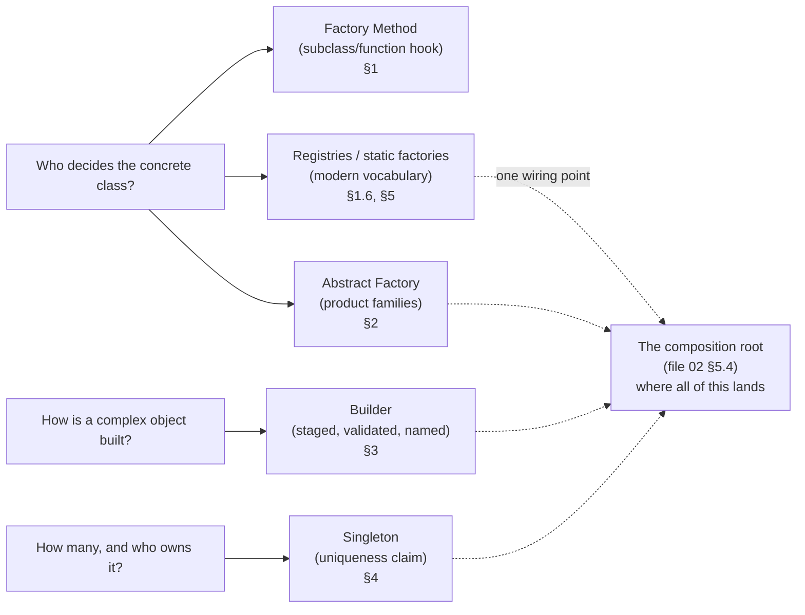
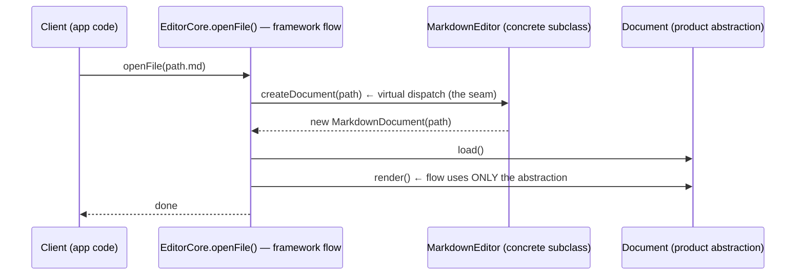
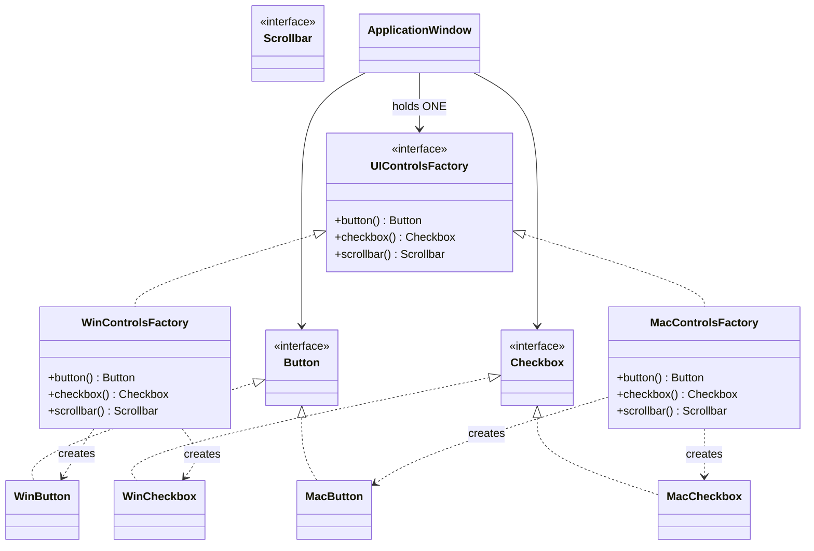
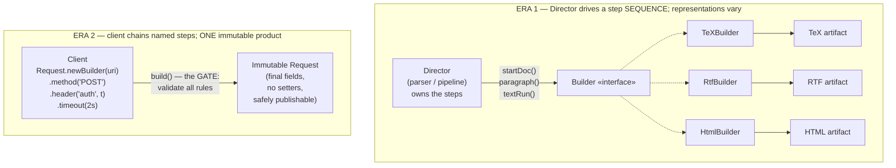
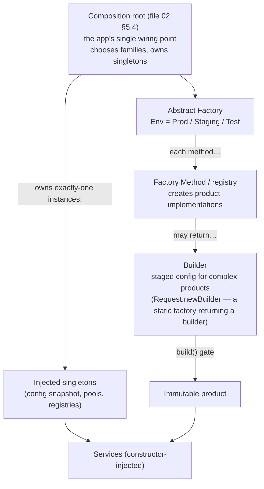

# 03 — Controlling Construction: The Creational Patterns

> **Why creation deserves its own patterns.** Every `new` (or `malloc`, or `make_unique`) is a *compiled-in decision*: the code that constructs `PostgresLedger` cannot be reused over `InMemoryLedger` without editing, cannot be tested without Postgres, and cannot be reconfigured without a deploy. File 02 §5 gave the principle (DIP: point dependencies at policy-owned abstractions); this file gives the **machinery** — the four classic ways to control *when, where, by whom, and how* objects come into existence: **Factory Method, Abstract Factory, Builder, Singleton** — plus the modern creation vocabulary they grew into (static factories, registries, DI scopes).
>
> **The one-sentence thesis of the whole file:** *creational patterns are not about making objects — they are about moving the **decision** of what to make (and how, and how many) to the place where that decision is cheapest to change.* Everything else — the factories, the builders, the singleton debates — falls out of that sentence.

---

## 0. The Four Questions Every Creation Decision Answers

Before the patterns, the map. Any time objects are constructed, four decisions are being made — silently or deliberately:

| # | The question | The silent default | The creational answer |
|---|---|---|---|
| **1** | **Who decides which concrete class?** | The constructor call site decides — compiled in forever | Deferred to a variant point: a subclass (Factory Method), a parameter/registry, a configuration choice made at assembly time (Abstract Factory, DI) |
| **2** | **When is that decision made?** | At the call site's compile time | A one-time setup (startup/registry), per-request (parameterized factory), per-instance (Builder's staged choices) |
| **3** | **How is the object configured?** | Constructor parameter list — which grows into the telescoping-constructor swamp | Staged, named, validated construction (**Builder**); named static factories for simple cases (`Money.of(...)`) |
| **4** | **How many instances exist, and who owns the lifecycle?** | However many call sites write `new` — nobody owns anything | Exactly one, deliberately (**Singleton** as *uniqueness claim*, not global-access trick), or one-per-scope with the scope owning it (DI lifetime management) |

**And the calibration note that keeps this file honest:** direct construction is not a sin. `new Money(...)`, `std::vector<int>{}`, `struct point p = {0,0}` — value types, stable local helpers, pure data — are *correct* to construct directly, everywhere, always. The patterns in this file are for construction that involves **volatility** (the mechanism may change), **policy** (business rules choose variants), **complexity** (many parameters/steps with invariants), or **uniqueness** (a genuine exactly-one requirement). File 02 §5.8's test transfers verbatim: **what is the substitution/change story? If there is one, control the creation. If not, `new` it and move on.**

### 0.1 The file's map — which pattern answers which question



---

## 1. Factory Method — The Construction Hook

### 1.1 Word by word

> **Word by word — *factory*:** from Latin **factorium** — *a place of making*, from **factor** ("maker," from *facere*, "to do, to make"). The Roman *factorium* was where things got produced — pressed (oil), woven, forged. In software: the entity whose *job is making objects*, as opposed to the objects' own job. The word matters because it names a **role separation**: makers are not the made.
>
> **Word by word — *method*:** Greek **methodos** — *the way of proceeding* (file 01 §2). "Factory method" = *the way of making* — a specifically **overridable** way, in the GoF sense: a method whose whole purpose is to be replaced by a subclass so it can make a different thing.
>
> **The two-word promise read literally:** *a designated making-step in a process.* The process (open a document, render a view, start a game) stays fixed; the making-step is what varies. That framing — a step, not a thing — is what most tutorials lose, and it is exactly why Factory Method is *Template Method applied to construction* (file 05 §6 will show the parent pattern).

### 1.2 Source and precise statement

The Gang of Four — Gamma, Helm, Johnson, Vlissides, *Design Patterns: Elements of Reusable Object-Oriented Software* (1994) — define it as:

> **"Define an interface for creating an object, but let subclasses decide which class to instantiate. Factory Method lets a class defer instantiation to subclasses."**

Their motivating case was **framework design**: a framework ships the *process* (the application loop: open documents, handle events, close), but cannot know the *products* (which concrete `Document` the application uses). The framework declares `createDocument()` (abstract); the application subclasses and returns its product. The framework's flow is written once, closed for modification, and every application plugs in its own product — this is **OCP (file 02 §2) cashed specifically at the construction step**, and the original definition of "framework": *the parts that call you*.

**Precise definition used in this file:** *Factory Method is a creation **seam**: a designated point in a process — an overridable method, an injectable function, a parameter, or a registry entry — where the decision of which concrete product to instantiate is deferred to a variant entity, while the process using the product depends only on the product's abstraction.*

**The five existing flavors, because interviews conflate them and you will not:**

| Flavor | Shape | Who decides | Where it shines |
|---|---|---|---|
| **1. Subclass-hook factory method** (GoF original) | `protected abstract Widget createWidget()` called by base-class process code | The *subclass* (compile-time choice of one variant per process instance) | Frameworks and libraries: the base owns the flow, apps own the products |
| **2. Factory function / constructor function** | `std::make_unique<T>(…)`, `Money.of(cents)`, C's `conn_create(…)` | The function's implementation (still a single choice per function, but a *named, replaceable* step) | Everyday: named construction, overload relief, the C world's only constructor |
| **3. Simple factory** (not GoF; folklore name) | `class WidgetFactory { Widget make(String kind) { switch… } }` | A parameter + an internal switch — the "confined fork" of file 02 §2.4 | When the product set is small, stable-ish, and one module owns it |
| **4. Parameterized factory / registry** | `Map<K, Supplier<Product>>`, ops-table slots, `ServiceLoader` | Data: a lookup table populated at setup/startup | Plugin systems, per-case extension without editing the factory (**ocp's endgame**) |
| **5. Injected creator** | `Function<Kind, Product> creator` passed to a service; C: ops-table slot | The *composition root*/caller — the seam itself is injected | Tests (fake products), per-request variant selection, DIP at construction time |

The flavors are not competitors; they are **the same decision deferred to different places** — subclass, function body, parameter, table, injection point. Choosing among them is §1.8's job.

### 1.3 The problem it kills — the framework that can't be shipped

The canonical incident, told the way it actually happens. A document editor starts as an application; the team later extracts a reusable **editor framework** and builds app #2 on it:

```java
// BEFORE — the framework core knows its products; the "framework" is not one
public class EditorCore {
    public void openFile(Path path) {
        Document doc;
        String ext = extensionOf(path);
        switch (ext) {                                    // ← the fork, inside the FLOW
            case "txt":  doc = new PlainTextDocument(path); break;
            case "html": doc = new HtmlDocument(path);      break;
            case "md":   doc = new MarkdownDocument(path);  break;
            default: throw new IllegalArgumentException("unsupported: " + ext);
        }
        doc.load();
        render(doc);
        recentFiles.add(path);
    }
}
```

Costs, in file-02 vocabulary, all of them cash:

- **OCP violation in its purest form:** app #3's requirement (a new document type) edits *the framework's core flow* — the highest-blast-radius file in the product. Every new product re-tests `openFile`'s flow, every app, every plugin. The §2.3 switch arithmetic applies with a multiplier: the "N switches" here are *N framework consumers*, because the framework ships as a library — adding a case is a **version boundary event**: bump, test, redeploy *every app*.
- **DIP inversion violated:** the framework (high-level, stable) imports and names `HtmlDocument`, `MarkdownDocument` (low-level, volatile products). The dependency arrow points from framework → app — file 02 §5.3's welded core, at the library scale.
- **The plugin dream dies silently:** the product set can *never* be extended by outsiders — the switch is closed by construction. What looked like "simple, honest code" precluded the entire extension story the framework exists for.

The after — the making-step extracted into a seam the *product side* owns:

```java
// AFTER — the framework owns the FLOW; the applications own the PRODUCTS.
public abstract class EditorCore {                       // framework, ships as-is
    public final void openFile(Path path) {              // the process: fixed
        Document doc = createDocument(path);             // ← the making-step: deferred
        doc.load();
        render(doc);                                     // uses the Document abstraction only
        recentFiles.add(path);
    }
    /** Factory Method — subclasses decide which class to instantiate. */
    protected abstract Document createDocument(Path path);
}

public final class PlainTextEditor extends EditorCore {  // application #1
    @Override protected Document createDocument(Path p) { return new PlainTextDocument(p); }
}
public final class MarkdownEditor extends EditorCore {   // application #2 — new file, core untouched
    @Override protected Document createDocument(Path p) { return new MarkdownDocument(p); }
}
```



Read the sequence diagram for the whole pattern: **the flow calls the seam; the seam was replaced from below; the flow never learns what it got.** And the properties that matter: adding `AsciiDocEditor` is *one new file in the app's repository*; the framework's flow is never edited; the framework's tests are never re-run for the new product (only the product's contract tests — file 02 §3.5's suite — are).

### 1.4 Tri-language mechanics

**Java — the GoF hook, plus the flavor that Java made famous (static factories):**

```java
// (a) The subclass hook from §1.3 — nothing more to add; that IS the pattern.

// (b) Static factory methods — Effective Java Item 1: "Consider static factory methods
// instead of constructors." Not the GoF pattern, but the flavor you'll use daily:
public final class Money {
    private final long cents; private final String currency;
    private Money(long cents, String currency) { this.cents = cents; this.currency = currency; }

    public static Money of(long cents, String currency) {   // NAMED construction
        if (cents < 0) throw new IllegalArgumentException("negative");
        return new Money(cents, currency);
    }
    public static Money usd(long cents) { return of(cents, "USD"); }   // ergonomic shorthand
    public static Money zero(String currency) { return new Money(0, currency); } // may CACHE
}
// The four advantages to be able to recite:
// 1. NAMES: `Money.usd(500)` reads as the domain; `new Money(500, "USD")` reads as args.
// 2. Not obligated to create: `zero()` can return a cached singleton (safe: immutable!)
//    — construction COUNT becomes an implementation detail.
// 3. May return a SUBTYPE: `Collections.unmodifiableList(...)` returns a hidden impl class.
// 4. Reduces ceremony for semantics-shared variants (usd/eur/…).
// The two costs: (a) classes without public ctors can't be subclassed (often a feature:
// Money is final!); (b) static factories don't stand out in IDE autocomplete —
// the naming convention (of / from / valueOf / newInstance / create / parse) is the fix.
```

```java
// (c) The parameterized/registry flavor — the fork as data, file 02 §2.7's endgame:
public final class DocumentFactories {
    private static final Map<String, Function<Path, Document>> BY_EXTENSION = new HashMap<>();

    static {                                              // or a Builder of the registry; or SPI-loaded
        BY_EXTENSION.put("txt",  PlainTextDocument::new);
        BY_EXTENSION.put("md",   MarkdownDocument::new);
    }
    /** Extension point: new file types register here — from ANYWHERE, including tests. */
    public static void register(String ext, Function<Path, Document> maker) {
        BY_EXTENSION.put(ext, maker);
    }
    public static Document open(Path p) {
        var maker = BY_EXTENSION.get(extensionOf(p));
        if (maker == null) throw new IllegalArgumentException("unsupported: " + p);
        return maker.apply(p);
    }
}
```

**C++ — the language fact that makes this pattern structural, plus the modern replacements:**

> **[DEEP DIVE] Why C++ needs factories where other languages "need" them less: constructors cannot be virtual.** A virtual call requires an object with a vtable (file 01 §7.5) — but the object does not exist until the constructor has run. The call order (base ctor → derived ctor, file 01 §7.6) means "which concrete class should be constructed?" can never be asked *of the object being constructed*. There is no `virtual Base::Base()`. Therefore: **whenever a decision must select among constructible types, C++ forces that decision into a function — which is a factory by any name.** This is not a style preference; it is the object model. Interview-grade sentence: *"C++ has no virtual constructors because dispatch requires a constructed object; Factory Method — a virtual function that returns a new object — is the standard workaround, and make_unique is its degenerate single-type case."*

```cpp
// (a) The subclass hook — same shape as Java; the ownership contract is the C++ twist:
class EditorCore {
public:
    virtual ~EditorCore() = default;
    void open_file(const std::filesystem::path& p) {          // fixed flow
        auto doc = create_document(p);                        // unique_ptr: the product is OWNED
        doc->load();
        render(*doc);
    }
protected:
    virtual std::unique_ptr<Document> create_document(const std::filesystem::path&) = 0;
    // ^ note the RAII contract: the factory transfers ownership to the caller — the
    //   C++ factory's signature must state WHO FREES, or leak-mines are planted (file 01 §3.3).
};

// (b) The factory FUNCTION — make_unique itself, and the pattern's most common modern costume:
auto doc = std::make_unique<MarkdownDocument>(path);   // a factory: returns a product,
                                                       // may return any derived type, named,
                                                       // exception-safe (the RAII rationale)

// (c) The injected creator — a std::function or template parameter as the seam:
class Editor {
    std::function<std::unique_ptr<Document>(const std::filesystem::path&)> maker_;
public:
    explicit Editor(decltype(maker_) maker) : maker_(std::move(maker)) {}
    void open(const std::filesystem::path& p) { auto d = maker_(p); d->load(); render(*d); }
};
// Now the DECISION lives at construction time of the Editor — composition root (file 02 §5.4),
// test doubles, per-session plugins — no inheritance anywhere. Modern C++ often prefers this
// to the subclass hook: composition over inheritance, applied to construction itself.
```

**C — constructor functions are the idiom; ops-table slots are the hook:**

```c
/* (a) The everyday factory function — C's constructors, with the C failure contract: */
/* Returns NULL on failure (OOM) — the caller checks; there are no exceptions (file 01 §3.3). */
struct document *plaintext_document_create(const char *path);
struct document *markdown_document_create(const char *path);

/* (b) The hook flavor — a creation slot in the ops table. This is how the KERNEL
 * lets a filesystem create its own inodes/files: the "factory method" as a table slot. */
struct document_ops {
    struct document *(*create)(const char *path);     /* the making-step — per implementation */
    int  (*load)(struct document *d);
    void (*render)(const struct document *d);
    void (*destroy)(struct document *d);
};

/* (c) The registry flavor — data-driven, plugin-ready: */
struct document_factory_entry {
    const char *extension;                               /* "txt", "md", … */
    struct document *(*create)(const char *path);
};
static const struct document_factory_entry document_factories[] = {
    { "txt", plaintext_document_create },
    { "md",  markdown_document_create },
    /* new type: one line + one file. */
};
```

> **[KERNEL & SYSTEMS]** The kernel's creation seam is the **`->create` family of ops slots**: `inode_operations->create` (make a new file in a directory), `file_operations->open`, and, one level up, the **module system itself**: `insmod` hands the kernel a struct full of function pointers *at runtime* — the registry flavor, executed at high noon (file 02 §2.7's OCP note). The C rendering makes a truth visible that OO costumes hide: **a factory method is fundamentally a function pointer reachable from a decision point**; subclasses, registries, and DI containers are ways of organizing who fills the slot. When the kernel calls `dir->i_op->create(dir, dentry, mode)`, it is invoking a factory method from a 1994 book on hardware, thirty years early — and the style guide for filling such slots (`-ENOSPC`, `-EEXIST`) is the refusal-to-fake discipline of file 02 §3.

### 1.5 Production reality — where this pattern really lives

| System | The seam | What it enables |
|---|---|---|
| **JDK** | `Calendar.getInstance()`, `DriverManager.getConnection(url)`, `NumberFormat.getCurrencyInstance(locale)`, `SocketImplFactory`, `URLStreamHandlerFactory` | Product varies by *environment data* (locale, URL scheme, driver JAR present) — the factory is the interpreter of that data |
| **UI toolkits** (every one since Motif) | `createWindow`, `createWidget`, `createLayout`-style hooks in base classes | Widget sets per platform/theme; the toolkit flow never names a concrete widget |
| **Serialization / codecs** | `ObjectInputStream.resolveClass`, `@JsonTypeInfo` deserialization, `readObject` factories | The wire payload *is* the parameterized factory's parameter: bytes → concrete type |
| **Networking stacks** | Protocol handler registries (http/https/ftp), gRPC codec selection, HTTP/2 vs /1.1 negotiators | The variant point sits where the variables (URL, ALPN) are known |
| **Plugin hosts** | `ServiceLoader`, OSGi, VS Code extension APIs, browser extension point registries, kernel modules | Extension *without editing the host* — the registry flavor as a product feature |
| **Test infrastructure** | Injected `Supplier`/creator in service constructors; C: ops tables swapped for `_test_ops` | The fakes: the same seam that production rotates for variants rotates in tests (file 02 §5's payoff, collected at last) |

**Failure modes to recognize in the wild:**
- **The god factory:** one `ObjectFactory.create(String type)` whose switch grew to 40 cases, each 30 lines of assembly logic — the fork was *confined* (file 02 §2.4's win) but then the factory became the new god class (file 06 §6.1); the fix is decomposing the *per-case work* behind the registry entries, not un-factoring.
- **The lying factory:** `create()` that returns invalid or half-initialized objects under error paths (`return null` on OOM being eaten upstream) — factories must keep the constructor's postcondition (a valid product) or fail loudly; file 02 §3's LSP discipline applies to the factory's output.
- **Over-factoring:** a factory per class with one product, no test-seam story, no volatility — file 02 §6.2's speculative generality wearing the creational costume; §1.8 is the antidote.
- **Perf folklore, both directions:** "factories are slow" (they aren't — one indirect call; `new` dominates object cost) and "factories optimize" (they don't, unless caching immutable products like `Money.zero`). Neither claim survives a profiler.

### 1.6 The question factory methods must answer in review

A single pass/fail list — the "receipt" from file 02 §6.4, cashed at construction time:

1. **What is the substitution story?** (second product, per-environment product, test product — name it)
2. **Who owns the decision?** (the framework's user, the composition root, the registry data — *not* "whoever wrote the switch")
3. **What happens when the story ends?** (the seam stays one function/one table — it does not become the god factory)
4. **Does the product come back valid-or-loud?** (no nulls leaking, no half-decoded docs — postcondition kept)
5. **Is the making-step named in the process's terms?** (`createDocument`, not `runDocumentFactoryPipelineV2` — the vocabulary test, file 02 §5.4)

### 1.7 Misconceptions

> **[MISCONCEPTION]** *"Factory Method, Simple Factory, and Abstract Factory are interchangeable names for the same thing."* Three different axes of endpoint: **Simple factory** = one class/function owns a switch (no inheritance; folklore, not GoF). **Factory Method** = an *inheritance hook inside a process* (GoF). **Abstract Factory** = an *interface that makes families* of related products (§2). Interviewers use the question to rank structural literacy; answer with the table from §1.2 and name the axis.

> **[MISCONCEPTION]** *"Static factory methods (`Money.of`) are the Factory Method pattern."* They are a **language idiom for named construction** (Effective Java's Item 1), not the GoF structure. The overlap: both defer the concrete choice from the caller. The difference: static factories are *not overridable* — no subclass swaps them; their variant point is the *library author* (v1 vs v2 of the library), not the app developer. Both are legitimate; conflating them costs you on question #1 in the table.

> **[MISCONCEPTION]** *"A factory must return different classes over time or it's pointless."* The seam's value ladder is: (1) *replaceable* (a test double rotates in — worth it even with one production product, if the class is volatile enough to need faking — file 02 §5.8); (2) *variant-selected* (env/config/product #2); (3) *plugin-extensible* (registry, outsiders add products). Rungs 1–2 justify most real factories; rung 3 is rare and needs rung-3 evidence.

> **[MISCONCEPTION]** *"C++ constructors can be virtual."* They cannot — dispatch needs a constructed object (the §1.4 deep-dive mechanism); factories *are* C++'s virtual constructors. Say it that way and you signal you know the object model, not just the pattern catalog.

### 1.8 Choosing among the flavors — and when to skip the pattern entirely

| Situation | The flavor | Why not the others |
|---|---|---|
| Framework/library; the *flow* is fixed, the *product* varies per consumer | **Subclass hook (GoF)** | The consumer already subclasses your base for other reasons — piggyback the making-step there; a separate factory would be an extra type with no new capability |
| The product set is small, one module owns it, maybe it'll grow | **Simple factory (+ registry when it grows)** | The switch is honest until the second extension *mechanism* (plugins, tests registering) appears; then promote to registry — mechanical, file 02 §2.5's asymmetry |
| You need named construction / caching / subtype-returning | **Static factory (language-level)** | The GoF structure buys nothing for a value type; `Money.of` is the whole answer |
| Products come in *families* that must match (§2) | **Abstract Factory** | A single-method factory cannot express "these products belong together" |
| The decision belongs at the composition root; tests need rotation | **Injected creator** (`Function`, `std::function`, ops-table) | Inheritance-based hooks lock the decision into the type hierarchy; injection keeps it in the wiring — modern default in application code |
| A single stable concrete, no fakes needed, value-ish | **No pattern — a constructor** | Every seam's receipt must name something; this one's receipt is blank (file 02 §6.2) |

---

## 2. Abstract Factory — The Product-Family Maker

### 2.1 Word by word

> **Word by word — *abstract*:** Latin **abstrahere** — *to draw away* (file 01 §5.1). In this pattern's name, *abstract factory* means the **drawn-away specification of making**: an interface that describes *what gets made* without doing any making itself. The concrete factories are the actual workshops; the abstract one is the *blueprint of the workshop's product line*.
>
> **Word by word — *factory*:** **factorium** — a place of making (§1.1). Read both words together and take them literally: *a specification of a place of making.* The subtlety all tutorials flatten is the **plural** in the pattern's real content: this is not one making-step (§1's Factory Method) — it is a **product line**: several making-steps, engineered to work together.

### 2.2 Source, precise statement — and the load-bearing word

The Gang of Four's intent, verbatim — and note which two words carry the whole pattern:

> **"Provide an interface for creating families of related or dependent objects without specifying their concrete classes."**

**"Families of related"** — that is the pattern. Not "a factory that can make several things" (any factory can have two methods), but **products that must match each other**: made by the same factory so that they *belong together by construction*. The canonical case from the book is a cross-platform **UI toolkit**: every widget (Button, Checkbox, Scrollbar) has a per-platform implementation, and they must **all** come from the same platform — a Windows button inside a macOS dialog is not a layout bug; it is a category error the type system happily permits and users immediately notice.

**Precise definition used in this file:** *An Abstract Factory is a single interface whose methods create an entire set of correlated products, such that selecting **one** factory object determines the concrete implementation of **every** product in the set — making family-mismatch impossible without bypassing the factory.*

**The correlation test — how to know you have a real family** (and this is the question that separates the pattern from its lookalike): *name the disaster that mixing products from two different families would cause.* If you can name it — theming chaos, a Vulkan pipeline bound to a D3D device, an AWS S3 handle leaked into a GCP request context, fake repositories mixed with a real transaction — you have a family and possibly a pattern. If mixing two products is harmless, you have **independent products**, and the right structure is independent factories/DI (§2.8's most common mistake).

**Three real family taxonomies worth memorizing** (each shows a different reason families exist):

| Family axis | The products | The mismatch disaster |
|---|---|---|
| **Platform** (the GoF original) | Button, Checkbox, Scrollbar per OS | A foreign widget in the native control tree: rendering, input routing, and accessibility all break |
| **Vendor/cloud** | Object store, queue, KV store, secret manager per cloud | S3 client signing requests for a GCS bucket; ops runbooks and IAM policies that describe a chimera |
| **Environment** (prod / staging / test) | DB, mailer, payment gateway per environment | Tests that charge the real card gateway; staging writing to the production bucket — the "which config am I on?" incident family |

The third row deserves emphasis because it reframes the pattern for modern code: **an environment is a product family**, and the thing you call "the composition root" (file 02 §5.4) is — structurally — an Abstract Factory whose family was chosen by a deployment flag. That identification is one of the shortest paths between the 1994 catalog and how systems are actually wired today.

### 2.3 The problem it kills — the N-decisions-that-must-agree

Without the family object, per-product selection happens **independently** — and independent decisions drift:

```java
// BEFORE — N independent decisions that must secretly agree (they won't)
public final class SettingsDialog {
    private Button button() {
        return switch (platform) {                        // decision point 1
            case WINDOWS -> new WinButton(); case MAC -> new MacButton(); ... };
    }
    private Checkbox checkbox() {
        return switch (platform) {                        // decision point 2 — must match 1
            case WINDOWS -> new WinCheckbox(); case MAC -> new MacCheckbox(); ... };
    }
    private Scrollbar scrollbar() { /* decision point 3 — must match 1 and 2 */ }

    // and in DialogFactory, ToolbarFactory, … decision points 4..N
    // with the platform read from ... three different config sources by now.
}
```

The failure modes, in order of subtlety:

1. **The mismatch bug:** someone converts decision point 2 to a Map-driven lookup, the config differs in one code path, and now a Mac scrollbar renders inside a Windows dialog *only in the settings screen* — the bug class the pattern exists to abolish. Every additional product kind multiplies the crossing pairs; every additional decision site multiplies the odds.
2. **The consistency tax:** preventing mismatches *without* the pattern needs discipline: code review checklists ("did every new site read the same platform source?"), integration tests per platform pair. The pattern replaces review discipline with **construction-by-identity**: it is impossible to get a Mac checkbox from a `WinControls` instance, because that instance has no such method to call and returns only Win products.
3. **Scattered OCP cost:** a new platform = N edits at N decision points (§2.3 arithmetic again); with the family object, a new platform is *one new factory class*, and every client keeps compiling against the interface (file 02 §2.4's confined fork, at family scale).

**The unifying abstraction is the choice, not just the makers:** the client receives **one** thing — the family object — and every product it ever makes flows through that one identity. The pattern's real product is *a single, movable decision*.

### 2.4 Mechanics — the structure, drawn once



Three structural observations, each answering a common confusion:

1. **It is not "a factory of factories."** The diagram has one level: one interface with N product-making methods, N implementations. ("Factory of factories" describes a *meta*-factory that returns factories — a rare, usually-smelly structure; more in §2.7.)
2. **The family guarantee is the *client's single reference*.** `ApplicationWindow` holds exactly one `UIControlsFactory`; the instant it is constructed with `MacControlsFactory`, every widget it will ever build is Mac. Consistency is one field's invariant — checkable, movable, testable. The client's constructor is the family decision point, and there is exactly **one** per client.
3. **The extension directions are asymmetric — memorize this:** *adding a new family* (LinuxControlsFactory) is **additive**: one new class implements the whole interface; zero edits elsewhere (OCP satisfied). *Adding a new product kind* (Tooltip) **edits every factory** — the interface grows, all N concrete factories implement the new method. Abstract Factory is thus **open along the family axis, closed along the product axis** — file 02 §2.4's "OCP along one axis at a time" rule, made vivid. Interviewers love this question; the model answer names the asymmetry and then reaches for the fix when product counts grow: capability interfaces (`SupportsTooltips`) that only some factories implement, checked explicitly — the ISP-shaped escape (file 02 §4).

### 2.5 Tri-language mechanics

**Java — the toolkit family, and the environment-family reframing:**

```java
// (a) The classic: one interface, the product set, per-platform factories.
public interface UIControlsFactory {
    Button button(String label);
    Checkbox checkbox(String label);
    Scrollbar scrollbar(Orientation orientation);
}

public final class WinControlsFactory implements UIControlsFactory {
    @Override public Button button(String label) { return new WinButton(label); }
    @Override public Checkbox checkbox(String label) { return new WinCheckbox(label); }
    @Override public Scrollbar scrollbar(Orientation o) { return new WinScrollbar(o); }
}
// MacControlsFactory — same shape. Adding LinuxControlsFactory: one new file.

public final class SettingsDialog {
    private final UIControlsFactory controls;             // THE one family reference
    public SettingsDialog(UIControlsFactory controls) { this.controls = controls; }
    public void layout() {
        var dark = controls.checkbox("Dark mode");         // every product from ONE family —
        var ok = controls.button("OK");                    // mismatch is unrepresentable
        /* … */
    }
}
// The family decision, in production code, lives at the composition root:
//   var controls = switch (detectedPlatform()) { case WINDOWS -> new WinControlsFactory(); … };
//   var dialog = new SettingsDialog(controls);
```

```java
// (b) The environment family — where this pattern is most alive TODAY:
package com.acme.app.wiring;

public interface Environment {                     // one family per deployment
    Database database();
    Mailer mailer();
    Clock clock();
    PaymentGateway payments();
}

public final class ProductionEnvironment implements Environment { /* real everything */ }
public final class StagingEnvironment implements Environment { /* real infra, fake payments */ }
public final class TestEnvironment implements Environment { /* in-memory everything */ }

// Service code depends on the products (via file 02 §5's ports), never on the family:
//   final class CheckoutService { CheckoutService(Database db, PaymentGateway pay, Clock clock) … }
// The family object is the WIRING vocabulary; the services stay per-dependency
// (the ISP-clean shape — services take what they use, not the whole environment —
//  see the caveat in §2.8).
```

**C++ — the runtime form, plus the zero-cost compile-time form:**

```cpp
// (a) Runtime abstract factory — same shape as Java; note ownership in the signatures:
class RenderDevice;  class Swapchain;  class Pipeline;
class GpuFactory {
public:
    virtual ~GpuFactory() = default;
    virtual std::unique_ptr<RenderDevice> create_device() = 0;
    virtual std::unique_ptr<Swapchain> create_swapchain(RenderDevice&, Window&) = 0;
    virtual std::unique_ptr<Pipeline>  create_pipeline(RenderDevice&, const PipelineDesc&) = 0;
};
// VulkanFactory / D3D12Factory / MetalFactory: each produces a COHERENT set —
// a Vulkan pipeline is only constructible from a Vulkan factory, so the
// "Vulkan pipeline on a D3D device" corruption class cannot be assembled by accident.

// (b) COMPILE-TIME abstract factory — policy-based design (Alexandrescu), and this
// is where C++ has a genuine advantage worth knowing cold: swap the FAMILY as a
// type parameter; zero vtables; the family guarantee is checked by the COMPILER.
template <class Family>                    // Family must provide the static maker set
class ApplicationWindow {
    typename Family::Button button_;
    typename Family::Checkbox checkbox_;
public:
    void layout() { /* uses Family::Button etc. — all from ONE family by construction */ }
};
struct WinFamily {
    using Button   = WinButton;
    using Checkbox = WinCheckbox;
    static WinButton   make_button();
    static WinCheckbox make_checkbox();
};
struct MacFamily { /* same shape */ };

// composition:   ApplicationWindow<WinFamily>  window;   // swap family = swap type
// test:          ApplicationWindow<FakeFamily> window;   // compiler enforces completeness
```

> **[DEEP DIVE] When the compile-time family is the *better* engineering:** mixed-family bugs become *compile errors* (a `Family::Button` cannot be assigned a `MacButton` value — the types differ), dispatch cost vanishes, and a template instantiation failing to compile *is* the factory-interface review. The bills: one instantiation per family (code size — file 01 §7.2), no runtime family switching (an app that must pick its renderer after GPU enumeration needs the runtime form — or a runtime *wrapper* around instantiated families, the "static initializer + runtime table" hybrid), and compile-time error messages that frighten the uninitiated. The decision rule matches file 02 §5.4's DIP note: **runtime variance → runtime factory; compile-time variance → template family.** Game engines famously use both: families chosen once at startup (runtime table over compile-time-instantiated backends).

**C — the abstract factory as a struct of function pointers, i.e., the family *as* an object:**

```c
/* A family of making-steps, bundled as one object — the kernel's own idiom (§2.6). */
struct ui_kit {
    struct button   *(*create_button)(const char *label);
    struct checkbox *(*create_checkbox)(const char *label);
    struct scrollbar *(*create_scrollbar)(enum orientation o);
    /* Ownership contract, stated the C way: the kit allocates, the caller destroys
       with button_destroy() etc. — one creator must be one destroyer discipline. */
};

/* Two families — each a const singleton object; the family IS the table: */
extern const struct ui_kit win_kit;
extern const struct ui_kit mac_kit;

/* Client: holds one kit — the family reference, exactly like the class diagram: */
struct settings_dialog {
    const struct ui_kit *kit;         /* chosen once, at construction (= the family invariant) */
    struct checkbox *dark_mode;
};

void settings_dialog_layout(struct settings_dialog *d)
{
    d->dark_mode = d->kit->create_checkbox("Dark mode");   /* family-consistent, by construction */
}
```

### 2.6 Production reality — where families are chosen, enforced, and paid for

**Where the pattern is alive and well:**

- **Multi-tenant context factories.** A `TenantFactory` per tenant creates repositories all bound to that tenant's connection pool, metrics labels, and encryption keys. Here the family guarantee has become a **correctness and security** guarantee: a repository that escaped its tenant family leaks data across tenants. The factory-as-context-carrier is abstract factory's most valuable modern use — the products must agree because they *share live resources*, not just styles. (This is the request/session-scoped flavor: the family object is created per session/request, not per deployment.)
- **Cloud/vendor abstraction layers** (when built well): one factory per provider producing a coherent {object store, queue, secrets, metrics} — the anti-corruption layer (file 04) from the vendor side.
- **The environment family at the composition root** (§2.5b) — the framing that makes today's DI wiring legible as a 1994 pattern.
- **Toolkits and engines as libraries:** the pattern's home turf — a library *cannot* know its family (platform, GPU, dialect), so it must receive the family as an object (runtime) or a type parameter (compile-time). Where you *are* writing the application (composition root under your control), see below.

**Where the pattern has been *displaced* — and the honest senior position:** in **application** code with a static composition root, dependency injection usually subsumes the runtime abstract factory: the root decides the family *once* and injects the *individual* products; services take the two or three products they use (ISP-clean) instead of the whole environment. The abstract factory object remains superior **exactly when the family must be an object** — it is created repeatedly (per request/tenant/session), it is passed to code that must make products *later* (plugins, per-session engines), or it crosses a library boundary. **Decision rule: families decided once at assembly → DI/root; families instantiated and handed around → abstract factory.** Saying this rule in an interview demonstrates you know the pattern *and* its displacement — the mature position.

**The costs, priced:**

| Cost | Detail |
|---|---|
| **Type multiplication** | N families × M products = N×M product classes, plus N factory classes. Real, but mostly mechanical; the compile-time C++ form pays it in templates (invisible-ish), the runtime form in files |
| **The product-axis rigidity** | New product kind → edit all factories (§2.4's asymmetry); mitigate with capability interfaces (ISP) — decide deliberately, because retrofitting one is a public-interface migration |
| **Leaky guarantee risk** | If concrete product constructors are reachable outside the family (public ctors, exported headers), the guarantee is discipline again. **Enforce by visibility:** package-private ctors (Java), friend factories or header-private classes (C++), file-local `static` makers (C). If the guarantee matters, make the bypass *unrepresentable*, not merely discouraged |
| **The environment-family trap** | Services that take the *whole environment* (`CheckoutService(Environment env)`) get the family guarantee *and* three unused products — the ISP violation from file 02 §4, wearing a 1994 costume. Services take products; the root holds the family |

### 2.7 Misconceptions

> **[MISCONCEPTION]** *"Abstract Factory is a factory of factories."* No — that phrase describes a meta-factory returning *factory objects* (rare; usually a smell — user code that "requests a factory" is often a sign the family decision should have been made once, higher up). Abstract Factory is **one interface, one family of products**; the §2.4 diagram is the whole structure. Precision here is a cheap way to look senior in an interview.

> **[MISCONCEPTION]** *"Two+categories of product → Abstract Factory."* Categories without *correlation* → independent factories (§2.8). Run the correlation test (§2.2): name the mixing disaster. No disaster, no family — and the pattern's whole cost structure (factory interfaces, shared family references, product-axis rigidity) buys nothing.

> **[MISCONCEPTION]** *"You must use it for cross-platform."* Cross-platform toolkits *pioneered* it, but modern platform selection often happens at compile time (build variants, `#ifdef`-free template dispatch) or in the toolkit's own plugin registries. The pattern's trigger is **runtime family identity that must be carried by an object** — deployment environments, tenants, sessions, loaded plugins.

> **[MISCONCEPTION]** *"Singleton factories are wrong, so Abstract Factories are usually wrong."* The GoF *does* describe concrete factories as often-singletons — and the modern cure is the one §4 of this file will give Singleton itself: **let the composition root own the single instance; the factory is unique by wiring, not by global access.** The pattern survives; the 1994 access trick doesn't need to.

### 2.8 When NOT to apply — and the transitions out

| Situation | Verdict | The move |
|---|---|---|
| One family exists (single platform/env), no second on any roadmap | **Skip** | Direct construction wired at the root; the family interface is speculative generality (file 02 §6.2) — the receipt is blank |
| Products vary independently (no mixing disaster) | **Skip the family; keep the makers independent** | One factory per product axis, or plain DI; forcing them behind one interface couples their change histories ("family" becomes fiction) |
| You own the composition root and assembly is static | **Prefer DI** | The root is already the family decision; inject products, not families (§2.6's displacement) |
| Services need "everything from an environment" | **Redesign the injection** | Take the used products, not the family object (ISP); the family stays at the root |
| Family must be chosen per request/session/tenant, products made later | **Green light — this is the pattern's modern home** | Factory-as-context carrier (§2.6), session-scoped instance, not a global |
| Product count will grow across the family axis | **Green light for family axis; plan the product-axis escape** | Capability interfaces for optional products (§2.4), decided up front |

**The transition that matters most in review:** the *environment family* that started as `Environment` (4 products) and now has 11 — services began taking the whole thing "since it's there." The fix is not to abandon the family; it is to **push the family back up to the root** and shrink service constructors to the products each uses. Say that out loud in a design review and watch the room relax: the pattern was never the problem; the *visibility* of the family object was.

---

## 3. Builder — Staged Construction with a Gate

### 3.1 Word by word

> **Word by word — *build*:** from Old English **byldan** — *to construct a dwelling*, kin to **būan** ("to dwell"). A builder is *one who constructs*, and the word carries the **process** sense: you do not "build" by fiat — you build **in stages**, and the house becomes habitable when the stages are done. Both halves of the GoF intent live in that etymology: *stages* (the steps) and *completion* (the result exists when — and only when — the process says so).
>
> **The pattern in one literal sentence:** *construct a complex object through a dedicated sequence of steps, and let no one hold the object until the sequence completes.*

### 3.2 Source, precise statement — and its two eras

The Gang of Four intent, verbatim:

> **"Separate the construction of a complex object from its representation so that the same construction process can create different representations."**

**Era 1 — 1994, the Director and the representations.** The book's motivating case was **document conversion**: a reader parses a document into construction *events* (start paragraph, emit text run, begin table); different builders translate those events into different **output representations** (TeX, RTF, plain text, later: a document object model). The structure: a **Director** (owns the construction *sequence* — e.g., the parser), a **Builder** interface (part-building methods: `paragraph()`, `textRun()`), **ConcreteBuilders** (one per representation), and a `build`/`result` step that hands back the finished artifact. The point of the original: **one driving process, N representations — OCP (file 02 §2) applied to the *output* axis**, which is why compilers (AST → IR variants), report pipelines (data → PDF/CSV/HTML), and importers still use it verbatim.

**Era 2 — today, the fluent builder for complex *single* objects.** The pattern's most common modern costume drops the Director (the *client* plays director through a method chain) and shines a different part of the intent: staging a complex object's configuration with **names, defaults, and a validation gate** before an **immutable** product escapes. The Director era asked "same process, different representations?"; the fluent era asks "same object, many optional parts, one valid moment of birth?" Both are the same design: *construction as a process, distinct from the constructed thing.*

**Precise definition used in this file:** *A Builder gathers the construction of a complex object into staged, named steps whose terminal `build()` step validates and produces the finished object — so that call sites read in the domain's language, invalid configurations are unrepresentable before the gate, and the product, once built, can be immutable.*

### 3.3 The problem it kills — four problems, one cure

**(1) The telescoping constructor.** The symptom progression every Java engineer has lived:

```java
new Pizza(12, true, false, true, false, false, true, false, "thin");
// What are booleans 2, 4, and 7? (cheese? pepperoni? olives?)
// The compiler counted your arguments; it cannot read your mind.
new Pizza(12); new Pizza(12, true); new Pizza(12, true, false);      // …overload ladders
new Pizza(12, Size.MEDIUM, cheese, pepperoni, mushrooms, olives, …); // parameter soup
```

And the same soup in every language: Java's overload ladders, C's ten-argument `open()`-style functions (20 flags, `O_CREAT|O_EXCL|…` — flags *are* unnamed booleans; `openat2`'s `struct open_how` is the kernel *admitting it* and moving the flags into named fields), C++'s named-parameter problem, constructor rashes in any large API. The cure's headline: **names at the call site.**

**(2) The half-built-object window.** With setters, an object is born incomplete and *fixes itself up* over several calls:

```java
var account = new Account();          // exists
account.setOwner(owner);              // still invalid: no currency
account.setCurrency("USD");           // valid — maybe? who enforces "maybe"?
account.setBalance(initial);
// Window: between `new` and the last setter, `account` is INVALID — and it is
// already reachable by anything your code leaked it to. (It is also, in Java,
// not safely publishable across threads: file 01 §4.5's sharing protocol violated.)
```

Every mutation between the first and last setter is a window where invariants (file 01 §4.2) are false, and *anything the reference touched* can observe the lie — a concurrent thread, a listener registered early, an exception path that logs the object. **The builder replaces N mutable windows with one gate**: nothing observes the product before `build()`, and `build()` re-checks everything before releasing it.

**(3) No single validation moment.** With setters, invariant checks scatter: in each setter (which can only check what it knows so far — cross-field rules are unwriteable there: "end > start", "currency matches the account's"), in a separate `validate()` the caller *must remember* to invoke, or nowhere (the real answer, usually). With a builder, **`build()` is the single, mandatory, cross-field validation point** — the one place all parts are simultaneously visible and the object does not yet exist. This is encapsulation's owner check (file 01 §4.2), moved to construction time, where it belongs for immutable things.

**(4) Representation separation (the 1994 problem, still live).** One driver process, several outputs — parsers/exporters/compilers — where the *sequence* is common and the *artifact form* varies. Adding a format = one new builder; the driver never recompiles (the OCP receipt, filed under §2.5 of file 02).

### 3.4 Mechanics — both eras, drawn



**The two era-mechanics, side by side:**

| | Director era (1994) | Fluent era (modern default) |
|---|---|---|
| Who orders the steps | A Director (parser, pipeline) — the *sequence* is the framework's asset | The client — the chain *is* the sequence; extraction into a helper function/director returns when a sequence is reused |
| What varies | The **representation** (N builders, 1 driver) | The **configuration** (1 product, many optional parts; or N representations of one config — both axes exist) |
| The gate | `getResult()` after `director.construct()` | `build()` |
| Where it lives today | Importers/exporters, code generators, report pipelines, compilers | Request/config/query objects, test-data fixtures, protobuf, SDK request builders |
| Typical product | A stream/file/artifact built progressively | An **immutable** object with all invariants checked once |

**The builder's own mechanics, stated as a contract** (all four clauses appear in every healthy builder):

1. **Required parts arrive first** — as the builder's *own* constructor parameters (`Request.newBuilder(URI)`, `Email.builder(from, to)`): the compiler now enforces "you cannot start without the compulsory parts."
2. **Optional parts are named steps with defaults** — `.timeout(Duration.ofSeconds(2))`, `.retryPolicy(none)`; each returns the builder (fluency is ergonomics, not essence) and each *records* rather than validates-cross-field (intra-part validation only: `.timeout(negative)` may throw immediately — gate the cheap checks where they're cheap).
3. **`build()` is the gate** — all cross-field invariants checked once, the product constructed via a non-public constructor, and the *only* moment an instance exists. If a validation needs I/O or "current time," it does not belong here (§3.6's first failure mode).
4. **The product is immutable** (final fields, no setters, defensive copies of collections): the builder's whole point is to make the *mutable* phase a deliberate, temporary scaffolding object, so the *shared* phase can be lock-free (file 01 §4.5's "immutability as sharing protocol," cashed here).

**Builder lifetime and thread-safety, stated once because it is a standard interview probe:** the builder is a **construction-phase scratch object** — confine it to one thread, use it, build, discard. Chains are not thread-safe by design and do not need to be. Two variants exist when confinement is undesirable: a **synchronized builder** (rarely worth it) and an **immutable functional builder** (each step returns a *new* builder — costs an allocation per step, buys shareable **base configurations**: build a `baseBuilder` once, derive per-request builders from it; the Java ecosystem uses this shape in streams/records, protobuf does not). The failure mode to name in review: **a builder stored in a field and reused across threads** — the aliasing bug (file 01 §1.3) wearing a construction costume.

### 3.5 Tri-language mechanics

**Java — the fluent builder with the gate, required-first, immutable product:**

```java
public final class MoneyTransfer {                       // IMMUTABLE product
    private final AccountId from, to;                    // required — no defaults exist
    private final Money amount;                          // required
    private final String memo;                           // optional
    private final String idempotencyKey;                 // optional, but load-bearing

    private MoneyTransfer(Builder b) {                   // private: only the builder constructs
        this.from = b.from; this.to = b.to; this.amount = b.amount;
        this.memo = b.memo; this.idempotencyKey = b.idempotencyKey;
    }

    public static Builder between(AccountId from, AccountId to, Money amount) {
        return new Builder(from, to, amount);            // REQUIRED parts are ctor args of BUILDER:
    }                                                    // the compiler forbids a missing required part

    public static final class Builder {
        private final AccountId from, to;                // final: set once, required
        private final Money amount;
        private String memo = "";                        // defaults
        private String idempotencyKey = UUID.randomUUID().toString();

        private Builder(AccountId from, AccountId to, Money amount) {
            this.from = Objects.requireNonNull(from);    // fail-fast on construction inputs
            this.to = Objects.requireNonNull(to);
            if (from.equals(to)) throw new IllegalArgumentException("same account");
            this.amount = amount;
        }
        public Builder memo(String m) { this.memo = m; return this; }
        public Builder idempotencyKey(String k) { this.idempotencyKey = k; return this; }

        public MoneyTransfer build() {                   // ← THE GATE — cross-field invariants:
            if (amount.isNegativeOrZero()) throw new IllegalStateException("amount must be positive");
            if (amount.cents() > 10_000_00) throw new IllegalStateException("exceeds single-transfer cap");
            return new MoneyTransfer(this);              // product born valid, once
        }
    }
}
// Call site reads as the domain speaks:
var transfer = MoneyTransfer.between(alice, bob, Money.usd(2_50))
                            .memo("rent — March")
                            .build();

// The immutability UPDATE idiom — the second classic use (withers via builder):
// var corrected = transfer.toBuilder().memo("rent — March (corrected)").build();
```

```java
// Also worth knowing cold (because interviews ask "what about Lombok? records?"):
// — Java records: perfect for ≤4 components with no staged config; no builder needed,
//   and none is generated. When a record grows optional parts and validation,
//   the hand-written builder above is the migration target (records keep the product side).
// — Lombok @Builder: generates the mechanics — and the common misuse is the missing GATE:
//   @Builder produces a build() that validates NOTHING. A Lombok builder without a
//   custom build method (validate-then-delegate) is a telescoping constructor
//   wearing a fluent costume. Say this in any interview that mentions Lombok.
```

**C++ — three tiers, from the modern default down to the hand-rolled idiom:**

```cpp
// TIER 1 — C++20 designated initializers: for plain aggregates with optional-ish fields,
// the builder's ergonomics NOW EXIST IN THE LANGUAGE. This kills many builders outright.
struct RequestOptions {
    std::chrono::milliseconds timeout{2000};     // defaults in the type
    int retries{0};
    std::string user_agent{"acme/1.0"};
};
RequestOptions opts{ .timeout = 500ms, .retries = 3 };   // named, defaulted, no builder class

// TIER 2 — the named-parameter builder idiom: when validation/staging is real, so the
// gate and non-public construction are needed (aggregate init can't enforce invariants).
class EmailMessage {
public:
    class Builder {                                   // nested: only it can construct
    public:
        Builder(std::string from, std::string to)     // required-first, like Java
            : from_(std::move(from)), to_(std::move(to)) {
            if (from_.empty() || to_.empty()) throw std::invalid_argument("from/to required");
        }
        Builder& subject(std::string s) & { subject_ = std::move(s); return *this; }
        Builder& body(std::string b)    & { body_ = std::move(b);    return *this; }

        EmailMessage build() && {                     // rvalue-qualified gate: the builder is
            if (body_.empty()) throw std::logic_error("body required");   // consumed — reuse impossible
            return EmailMessage{*this};
        }
    private:
        friend class EmailMessage;
        std::string from_, to_, subject_{"(no subject)"}, body_;
    };
    /* immutable accessors only — no setters */
private:
    explicit EmailMessage(const Builder& b) : from_(b.from_), to_(b.to_), subject_(b.subject_), body_(b.body_) {}
    std::string from_, to_, subject_, body_;
};

auto mail = EmailMessage::Builder{"ops@acme.com", "sre@acme.com"}
                                 .subject("Deploy #4821 done")
                                 .body("All green.")
                                 .build();          // ← gate; builder is consumed (build() &&)
```

> **[DEEP DIVE] Two C++ subtleties that make this senior-grade:** (1) **ref-qualifying the steps (`&`)** blocks building from temporaries in the wrong order and enables the **consume-on-build (`&&`) gate** — the type system now enforces "a builder is used once" without a runtime flag. (2) **Why not just `std::optional` fields on the product and validate in the ctor?** Because the builder can hold *defaults, partial state, and diagnostics* (collecting every validation error, not just the first) that must not exist on the product's surface — separating the two types is the same "process vs representation" split as 1994, applied to validation ergonomics. Also, the stdlib itself ships builders in spirit: `std::stringstream` (staged text assembly) and protobuf's generated `Builder` classes (the most-used builder code on Earth, by volume of generated lines).

**C — the pattern without syntax sugar; curl is the canonical example:**

```c
/* libcurl's easy interface IS a builder: init → staged setopt calls (named!
 * CURLOPT_* constants escape the boolean soup) → perform = the gate → cleanup.
 * The ownership contract is the C builder's extra burden: every error path must free. */
CURL *h = curl_easy_init();
if (!h) return -1;
curl_easy_setopt(h, CURLOPT_URL, url);
curl_easy_setopt(h, CURLOPT_TIMEOUT, 5L);
curl_easy_setopt(h, CURLOPT_POSTFIELDS, body);
CURLcode rc = curl_easy_perform(h);          /* ← the executing gate (I/O — see §3.6) */
curl_easy_cleanup(h);                        /* the builder's memory is its own */

/* The hand-rolled shape, when you want setopt-style staging with YOUR gate
 * (and want build() to be pure — validation only, no I/O): */
struct email_builder {
    const char *from, *to, *subject, *body;   /* staged parts; NULL = unset */
    int  error;                               /* sticky first-error, builder-style */
};
int  email_builder_subject(struct email_builder *b, const char *s);
struct email_message *email_builder_build(const struct email_builder *b);  /* validates ALL,
                                                        returns NULL on invalid — the gate */
/* Post-build ownership is explicit (file 01 §3.3): email_message_destroy(). */

/* Kernel-grade version of the DIRECTor era: alloc_netdev() stages the object
 * (allocation + private area), a setup() CALLBACK (the director's step hook)
 * configures it, and register_netdev() is the gate that publishes it —
 * construction separated from registration, so nothing sees a half-built
 * device: the half-built-object window, closed by design at 10Gbps. */
```

### 3.6 Production reality — receipts, failure modes, and the refusal cases

**Where builders measurably pay (the receipts):**

| Domain | The receipt |
|---|---|
| **SDK request objects** (AWS/GCP SDKs, OkHttp, JDK `HttpRequest`) | APIs with 50+ optional parameters *and* validation rules that span them (auth mode vs endpoint scheme, checksums vs streaming). A constructor API for these is unusable — AWS's builders are the pattern's largest deployed footprint, measured in generated lines |
| **Service configuration** | Config objects are read-mostly, shared across threads, hot-reloaded: a **builder-produced immutable config** is a lock-free snapshot swap (file 01 §4.5); setters would make config reads racy with reloads — the "immutable snapshot" is the mechanism behind every sane hot-reload |
| **Test data** | `anOrder().withElectronicsItem(3).withShipping(EXPRESS).build()` — test builders with sane defaults cut fixture noise by factors; the *test* builder variant (defaults tuned for readability, not production validity, with the gate still on) is one of the highest-leverage conventions in a large test suite |
| **Representation-varies pipelines** | Report/export/IR pipelines: the 1994 Director structure, still the right shape — one driver, N builders; adding PDF/ICML/whatever = additive (file 02 §2's receipt, cashed on the output axis) |
| **Protobuf / serialization formats** | Wire formats need immutable messages (hash/equality/serialization stability): builders give the mutable scaffold and the final immutable value; the cost is verbosity the schema compiler absorbs |

**Failure modes — the review checklist for builders:**

1. **The builder that does work at `build()`**: opens connections, calls the network, reads the clock for validation (time-dependent validation is a *behavior*, file 05's territory). `build()` must be **pure** — validate and assemble; effects belong to a factory/service that *uses* the built object. Symptom: tests of "config building" that need a network mock.
2. **The unvalidated gate**: `build()` that assembles without checking cross-field rules (Lombok's default; hand-rolled builders copied from a tutorial). The pattern's central promise — invalid states unrepresentable — is *unfunded*. If you ship one thing from this section into a code review: **every `build()` either validates or documents, explicitly, why the type has no cross-field rules.**
3. **The reused/aliased builder**: stored in a field, mutated by two call paths, `build()` called twice with different results (or races). Builders are scratch: construct, chain, consume. (C++'s `build() &&` from §3.5 makes the single-use rule *unbreakable*; Java/C rely on convention — say both in interviews, honestly.)
4. **The product with setters anyway**: the builder exists *and* the product is mutable — the half-built window reopens the moment anyone calls a setter on a built object. Pick: mutable product with constructor validation *or* immutable product with builder gate; the hybrid keeps the bill without the benefit.
5. **The two-field builder**: over-engineering's creational poster (file 02 §6.2) — a record/aggregate/designated-initializer is the honest answer; the builder arrives when optional-and-validated parts arrive.
6. **Builder and factory confused at the seams**: a `FooFactory.build(…)` that both selects *which class* and stages *how* — valid, but make the two roles legible in the API (a factory returning `Foo.Builder` is the clean composition when both are genuinely needed).

### 3.7 Misconceptions

> **[MISCONCEPTION]** *"Builders exist to avoid long constructor argument lists."* That is the *symptom they advertise*; the *goods* are (a) the single validation gate, (b) immutability with safe publication, (c) representation separation, and (d) names at call sites. A builder that only renames arguments — no gate, mutable product — was bought for the symptom and paid the full price.

> **[MISCONCEPTION]** *"The Director is part of the definition."* Directors exist where a *reusable step sequence* exists (parsers, pipelines, generators). In application code the client is the director — a method chain is a director made of syntax. Both are the pattern; the Director returns the moment the sequence is reused (extract the chain into a helper or an explicit `Director` type).

> **[MISCONCEPTION]** *"A builder makes object creation cheap."* It makes creation **safe and legible**; it adds an allocation and a copy-ish step. In hot loops constructing small value types, the builder is the wrong tool — value semantics/direct construction (C++), records (Java), aggregates (C) win; measure if in doubt (file 01 §7.7's rule).

> **[MISCONCEPTION]** *"Fluent interfaces require builders / builders require fluency."* Fluent is an ergonomics layer (return `this`; in C++, ref-qualified); the pattern is the staged gate. C's curl-style `setopt` chain is a builder with zero fluency — and it is better C than a fluent imitation would be.

### 3.8 When NOT to apply

| Situation | The right tool |
|---|---|
| ≤3–4 parts, no cross-field rules, no optionality | Constructor / record / aggregate / C++20 designated initializers |
| Pure data transfer, framework-bound | Let the framework bind (Jackson/JSON → immutable record + constructor); builders only if the wire format demands immutability scaffolds |
| The variation is *which class* (not how one instance is shaped) | Factory Method/Abstract Factory (§1–§2) — defer the class, don't stage the instance |
| Hot-path small values | Direct value construction; builders are for the cold path (config, requests, fixtures) |
| Configs that are really *data files* | Schema'd data (YAML/JSON → validated record), not programmatic builders — the file *is* the builder for operators |

### 3.9 Interview bank and drill

> **[INTERVIEW]** The builder cluster, model skeletons ready:
> — ***"Why would you use a Builder?"*** — name the four goods, not the symptom: the validation **gate** at a single moment, **immutability + safe publication**, **representation separation** (1994), and **names/defaults** at call sites. Then the honest counterweight: records/designated initializers for small cases; builders earn their class when optionality *and* cross-field rules coexist (or the representation axis is real).
> — ***"Builder vs Factory?"*** — the axis table: Factory defers **which class** (substitution, families); Builder shapes **how one instance** is configured (staging, validation, immutability). They compose (`Foo.newBuilder()` is a static factory *returning* a builder — name that, it's in every SDK).
> — ***"Is your builder thread-safe?"*** — the designer's answer: *"By design it's a single-thread scratch object — confine, chain, consume; I'd make it explicit in C++ with `build() &&` and document confinement in Java/C rather than pay for synchronization. If a shareable base config is needed, the immutable/functional builder variant is the deliberate upgrade."*
> — ***"What does `build()` do?"*** — *"Validates everything cross-field, once, then constructs via a non-public constructor; it is pure — no I/O, no clock; effects belong to whoever uses the product."* This one sentence cleanly separates candidates who've maintained builders from those who've generated them.

**[DRILL]** Design an `EmailMessage` builder for an internal notifications service. Facts: `from` and at least one `to` are required; `subject` defaults to `"(no subject)"`; `body` is required; attachments (0..n) are optional and must total < 20 MB (cross-field!); at least one of `body`/`attachments` must be non-empty (cross-field!); messages are handed to a queue producer shared across threads. (a) Which parts are builder-constructor arguments vs staged steps, and why? (b) Write the gate's rules and say where each error surfaces. (c) The product's threading story. (d) The builder-reuse story (a teammate wants a cached builder for the 9,000 identical weekly digests). (e) One thing that must NOT happen at `build()`, and where it goes instead. *(Model: (a) **Constructor args (required):** `from`, `to` list (primary recipient at least). These are the "cannot start without" parts — put them in the *builder's* constructor so the compiler forbids their absence before any chain begins (`EmailMessage.from(addr).to(list)`). **Staged steps (optional/defaulted):** `subject` (default set), `body`, `attachments` (list, appended), any future cc/bcc/tracking — each a named step; cheap intra-part checks (`attachment.size` of one file) may throw immediately at the step for fast failure. (b) The **gate rules, all cross-field**: (i) `body` non-empty **or** attachments non-empty — this rule *requires* both parts present simultaneously, so it is unwriteable in either setter and belongs only here; (ii) total attachment size < 20 MB — needs the whole list; (iii) (redundantly defensive) `to` non-empty — already enforced at the builder ctor *and* re-checked cheaply. Error surfacing: throw an exception naming the rule (Java/C++), return NULL + out-param errno-style code (C) — in all languages, **all violations are detected at the gate, none leak into a constructed message**. (c) The product is immutable (final/const fields, defensive copy of `to` and attachments lists *inside build()* — the copy is part of the gate). Therefore it is **safely publishable to the queue producer without synchronization** — the final-field/immutability guarantee (file 01 §4.5); the shared thing is safe by construction; the *builder* never crossed a thread. (d) The teammate's cached builder is the classic aliasing trap: a *shared mutable scratch object* mutated by two digest paths races and can produce a digest with the wrong recipient's attachment (the worst incident class: data leak across customers). The correct reuse is the **immutable/functional builder** variant (a frozen base producing per-build derived builders — allocation-cheap relative to queueing an email) *or* a factory function `weeklyDigest(recipient)` that internally constructs a fresh builder per call — reuse the *recipe*, never the *scratch*. (e) **No I/O at `build()`** — no size-verification call to the object store, no clock (if the message needs a `createdAt`, the *caller* passes the instant in as a staged part — the clock is a dependency, file 02 §5.8's drill — or the producer stamps it on enqueue). Attachments are validated by *declared metadata* (the size the caller asserts, verified by the producer when actually reading), not by touching storage during construction; the pattern's purity is what keeps "build a message" a unit-testable, instant, side-effect-free operation.)*

---

## 4. Singleton — The Uniqueness Claim, Separated from Global Access

### 4.1 Word by word

> **Word by word — *singleton*:** an English coinage — **single** (Latin *singulus*, "one only") + **-ton** (a nominal suffix seen in words like *simpleton*). The word is **older than software**: in card games (whist, bridge), a *singleton* is the only card of its suit in your hand — "the one of its kind." Software adopted it unchanged: the class that is the one instance of its kind.
>
> **The trouble is in the definition's second half, and you can hear it in the words:** the GoF sentence bundles **two claims** — *uniqueness* ("only one instance") and *access* ("a global point of access"). The word *singleton* names only the first. **Almost every Singleton debate is actually an argument about the second claim while the first gets blamed.** Keeping that distinction loaded is the single most valuable move in this section.

### 4.2 Source, precise statement — and the bundling defect

The Gang of Four's intent, verbatim:

> **"Ensure a class only has one instance, and provide a global point of access to it."**

The 1994 context was honest: exactly-one-ness was a **hardware/system fact** — one printer spooler per machine, one window manager, one file system. The book even hedged on the access half, describing a **registry of singletons** (lookup by name) as an alternative to per-class `getInstance()` — an escape hatch most readers skipped.

**Precise definition used in this file:** *Singleton is the decision that **exactly one instance** of a type exists **within a defined scope** (process, thread, tenant, container, device) — plus the mechanics of whoever else needs it **reaching it without illegitimate coupling**. Uniqueness is a lifecycle claim; access is a coupling claim; **they are independent decisions**, and the mature position picks them separately.*

The 2×2 that organizes everything, because most misused "singletons" are actually other cells of this grid wearing the name:

| | **Scope-unique instance** (there really is one) | **Multiple instances legitimate** |
|---|---|---|
| **Reached by injection** (owner-managed) | ✅ **“The one, injected”** — the modern default for genuine uniqueness: config snapshot, device handle, registry; owned by the composition root, injected into consumers. *This is where “singleton” should live today.* | ✅ **Ordinary objects** — the 99% case: services, value types, per-request objects. Boring is correct. |
| **Reached globally** (ambient access) | ⚠️ **The classic GoF Singleton** — uniqueness *and* ambient coupled access. Legitimate only when ambient is truly required (process-wide facades at library boundaries) — and even then kept thin and immutable. | ❌ **Global mutable state** — “singletons” with multiple legitimate instances (per-test, per-tenant) accessed through a global. This is where the pattern's bad reputation was earned: not uniqueness, but *shared mutable state with no owner*. |

Read the grid's diagonal: the worst cell (bottom-right) is what people usually build when they "need a singleton"; the best cell (top-left) is what they usually mean; the classic pattern (top-right) is a **bundling of the best and the worst**, which is why it is simultaneously indispensable and reviled. The rest of this section is the unbundling, mechanics, and rules of engagement.

### 4.3 The case FOR uniqueness — stated properly (steelman first)

Exactly-oneness is sometimes a **real invariant** of the domain or the platform — not a design conceit. The honest list:

| Domain | Why "one" is real | What "one" actually means (the scope!) |
|---|---|---|
| **Device handles** | The hardware is singular: one audio device, one serial port, one display. Opening twice fails (`EBUSY`) or corrupts state | One per **machine** — and within a process, one *owner* of the handle |
| **Process configuration snapshot** | Config is read by everything, hot-reloaded under readers' feet — two copies diverge (the two-sources-of-truth incident family, file 01 §12.1's DRY failure, at runtime) | One per **process lifetime** (with a swap point) |
| **Registries where double-registration is a bug** | A metric registered twice double-counts; a signal handler registered twice replaces the first (silently); a plugin registered twice throws or duplicates work | One per **registry scope** — often per process, sometimes per test, sometimes per tenant |
| **Singular kernel resources** | There *is* one physical memory, one boot CPU's idle task, one `init_mm` | One per **machine** — but see the kernel's nuance below: *`current` is one per **CPU**, the page allocator one per **NUMA node*** |
| **Caches whose duplication wastes and diverges** | Two copies of a warmed cache = double memory, incoherent answers | One per **process** (or per node in distributed caches) |

> **[KERNEL & SYSTEMS] The kernel's resolution — scope-aware uniqueness — is the professional gold standard.** The kernel needs "one of" things constantly, and it never says "singleton": it says **the scope**. `init_task` is one per *machine*, initialized at compile time. `current` — "the current task" — is one per **CPU**, implemented as per-CPU variable access (`this_cpu_read(current_task)`), because "the current task" *per CPU* is the true invariant, and a global would be wrong and slow. The page allocator is per **NUMA node** (locality is the reason for the scope). `init_mm` is one per machine, but its *use* is gated by well-defined interfaces. Network namespaces slice the entire network stack into per-**namespace** "singletons" (routing tables, socket registries) — and **containers are built on that generalization**: what a userland "singleton" flattens into a process, the kernel parameterizes by scope. **The lesson in one sentence: “single” is a scope decision — machine, node, CPU, thread, namespace, tenant — and the scope belongs in the type's name and the access mechanism.** `CurrentTask this_cpu`, `PerTenantCache tenantScoped`, `ProcessConfig` — the moment the scope is unnamed, someone will eventually be surprised by how many of them exist (the fork bug, §4.7; the classloader bug, §4.7).

### 4.4 The case AGAINST global access — the poison, decomposed

The classic `getInstance()` bundles five distinct costs. Senior command of the singleton question is being able to *name these five from memory* and cite the mechanism of each:

**1. Hidden dependencies (the contract problem — file 02 §5.4's vocabulary test, weaponized).**
```java
public final class InvoiceService {
    public Invoice create(Order order) {
        var cfg = Config.getInstance();           // ← a dependency the constructor never declared
        var sender = EmailSender.getInstance();   // ← and another
        ...
    }
}
```
The constructor says `()` — takes nothing. The class's *real* dependency set is discovered by reading the body, or by running it and watching what blows up. Reviews can't see ambient edges (there is no import to diff on the *behavior* level — well, there is an import, but not a *parameter*); dependency graphs drawn from constructors lie. **An ambient call is an undeclared parameter.**

**2. Test pollution (state that outlives the test).**
Global instance state *persists across tests within the same JVM/process* → **test-order coupling**: tests pass alone, fail in suite (or vice versa) depending on who mutated the singleton first. The usual band-aid — `resetForTesting()`, `setInstanceForTests(...)` hooks — is itself a smell: a production API grown for tests (and often reachable in production too). The precise diagnosis: *the singleton's lifetime (whole process) is wrong for the test's lifetime (one test) — a scope mismatch*, and the reset hook is a hand-rolled scope control. (The grid's bottom-right cell in action: multiple legitimate instances — one per test — forced through a global.)

**3. Concurrency: correctness of creation is not correctness of use.**
A perfectly thread-safe *initialization* (§4.5) says nothing about the instance's *state*: once mutable fields exist behind a globally reachable object, **every** thread's mutations are now everyone's (file 01 §4.5's sharing protocol, violated by default). The singleton becomes the system's accidental coordination point: locks cluster around it, contention scales with core count, and any missing synchronization is a heisenbug across the whole program's state space. The extra sting: because *nobody declared* the sharing (no constructor said "this is shared"), nobody bounded it.

**4. Coupling fan-in explosion (common coupling, file 01 §10.2's rung 5).**
Every module that calls `getInstance()` hangs from that one type's interface. The number on file 01 §10.4's instruments — fan-in — spikes to the whole codebase: an interface change ripples everywhere; deploy/recompile blast radius = everything; and the singleton accretes methods because it's *reachable* from anywhere ("just one more helper on the global — where it's always at hand"). The god-object's nursery.

**5. Lifecycle failures (the systems-tax): the "singleton" that isn't, was destroyed, or forked.** Each is a distinct, famous incident class, catalogued in §4.7 with mechanisms: classloader duplication (Java: two containers, two "singletons"), static-destruction-order (C++ exit-time UB), fork inheritance (C/daemons: two processes, one socket). **The pattern's uniqueness claim is only as strong as the runtime's scoping model — and every runtime has more scopes than the pattern assumes.**

### 4.5 Mechanics — the taxonomy of implementations, tri-language, each with *why it's correct*

The interview-classic content; and note the 2×2's discipline — every implementation below fixes *creation* problems and none fixes the §4.4 coupling claims: they are **mechanics**, and mechanics have correct-by-construction answers worth knowing cold.

**Java — four implementations, graded:**

```java
// (a) CLASSIC LAZY DCL — and its history, which is the point.
public final class Config {
    private static volatile Config instance;     // ← `volatile` is the FIX, not decoration
    public static Config getInstance() {
        Config local = instance;                 // local read: one volatile read, fast path
        if (local == null) {
            synchronized (Config.class) {
                local = instance;
                if (local == null) instance = local = new Config();
            }
        }
        return local;
    }
}
// WHY the volatile matters — the systems answer: `instance = new Config()` is three
// steps (allocate, run ctor, write reference). Without a happens-before edge, another
// thread can observe the REFERENCE before the constructor's writes — a partially
// constructed object escaping. Pre-Java-5 (pre-JMM, 2004), this was
// *unfixable in plain Java* — the famous "Double-Checked Locking is Broken" (Pugh).
// volatile restores the happens-before. Interviewers ask this to hear exactly that.

// (b) EAGER — simplest, correct, no lazy benefit:
public final class Config {
    private static final Config INSTANCE = new Config();
    private Config() {}
    public static Config instance() { return INSTANCE; }
}   // class initialization IS thread-safe by the JVM spec — the JVM serializes <clinit>.

// (c) INITIALIZATION-ON-DEMAND HOLDER — lazy + thread-safe with no locks in sight,
//     by borrowing the JVM's class-init serialization (the elegant one):
public final class Config {
    private Config() {}
    private static final class Holder { static final Config INSTANCE = new Config(); }
    public static Config instance() { return Holder.INSTANCE; }
}   // Holder is initialized on first ACCESS; first access triggers <clinit>, which
    // the JVM guarantees to serialize and publish safely. "Lazy via clan init."

// (d) ENUM — Effective Java's verdict ("the best way to implement a singleton"):
public enum Config {
    INSTANCE;
    public int poolSize() { ... }        // state lives here; serialization-safe;
}                                        // reflection cannot invoke the private ctor
// (the JVM enforces enum constants); deserialization returns the same constant.
// Cost: eager-ish (class init on first use of the enum), cannot extend a class,
// and — the honest asterisk — and can't be a one-off for configurability.
```
For (d): "*Serialization attacks* — deserializing a serializable singleton creates a **second** instance unless `readResolve()` intervenes; the enum gets this for free because enum serialization is by *name*."

**C++ — function-local statics (the modern default), plus the system-level folklore:**

```cpp
// (a) MEYERS SINGLETON — and *why it is correct now* (and wasn't guaranteed before):
Config& config() {
    static Config instance;          // C++11 "magic statics": initialization is GUARANTEED
    return instance;                 // thread-safe and single (compiler inserts guards).
}
// The C++11 guarantee is the whole modern answer: no DCL, no mutex, no fiasco.
// Before C++11 you wrote your own guard; now the language owns it (implemented with
// __cxa_guard_acquire/release — cheap after first call).

// (b) The STATIC-INITIALIZATION-ORDER FIASCO the function-local form exists to kill:
// Global statics in different TUs initialize in an unspecified order across TUs;
// a global `Config` used by another global's constructor = the classic crash-before-main.
// Function-local statics initialize on first use — order-safe by construction.

// (c) The DESTRUCTION-ORDER fiasco (what remains even with (a)):
// instance is destroyed at exit; if another global's destructor LATER calls config(),
// it re-enters... and in the worst case uses a destroyed object (UB).
// The honest escape hatches, each a real production choice:
//   - Intentionally leak:      static Config* instance = new Config();  // no dtor, no problem
//   - Never register teardown if process exit follows immediately
//   - Explicit lifecycle: shutdown_config() called from a controlled point
// The nifty counter idiom is the library-grade version (std::cout uses it!):
// a header-counted static ensures construction before ANY TU's first use and
// destruction after the last — that is what makes <iostream> globals safe in headers.

// (d) The struct-of-functions / dependency-rejected variant: in modern C++ the better
// shape for TESTABLE uniqueness is a reference injected from main (file 02 §5.4),
// not a global accessor — the accessor remains for compatibility/facades only.
```

**C — explicit init, once, and scope-aware access (the kernel's world offers no magic):**

```c
// (a) pthread_once / call_once — the classic correct-once init:
static struct config *g_config;
static pthread_once_t config_once = PTHREAD_ONCE_INIT;
static void config_init(void) { g_config = config_load(); }
struct config *config(void) {
    pthread_once(&config_once, config_init);     // exactly-once, thread-safe
    return g_config;                             // remains a global — see §4.6 for the fix
}

// (b) C11 <threads.h> call_once (same semantics); atomics + compare-exchange if you
//     can't use once primitives (the pattern is the same: publish via release store,
//     read via acquire — the C analog of Java's volatile, except the model is explicit).

// (c) THE KERNEL'S ACTUAL DISCIPLINE — and it is the best teaching:
// No lazy magic anywhere in the hot structure: `init_task` is a statically
// initialized struct; subsystems are initialized by ORDERED BOOT CALLS
// (initcall levels: core_initcall, subsys_initcall, device_initcall); drivers
// register into tables at well-defined times. Uniqueness per scope:
//   - one per machine:   init_task, init_mm, swapper_pg_dir
//   - one per CPU:       `current` (via this_cpu_read), idle task per CPU
//   - one per node:      allocator state, zonelists
//   - one per netns:     routing tables, socket tables (containers!)
// Access is via typed helpers that carry the scope, and lifetime is EXPLICIT
// (boot init + controlled teardown modules) — because at OS scale, "one true
// global accessor" fails the moment SMP, NUMA, namespaces, and hotplug exist.
// The kernel does not have a Singleton problem. It has a scope-naming discipline.
```

### 4.6 The modern resolution — unbundle: keep the uniqueness, drop the global access

The constructive answer, in the order a senior presents it:

1. **Own the instance at the composition root** (file 02 §5.4): `main` (or the DI container's configuration) constructs **one** instance; consumers receive it **by constructor injection**. You keep exactly-oneness; you gain visibility (the constructor declares it), testability (each test constructs its own or a fake — *scope control*, since the test's scope is the test), and no ambient coupling. **This is what DI-container "singleton scope" means** — a *lifetime managed by the container* (one per container/app-context), NOT a class with static access. Spring `@Scope("singleton")` (the default), .NET `AddSingleton<T>()`: both are top-left cell — and note the naming: *scope* language, not "Singleton pattern" language. The industry renamed it for a reason.
2. **If ambient access is genuinely required, shrink it to a thin, immutable, documented facade.** Cases: a logging facade's global entry point (SLF4J's binder), process-wide bootstrap (`curl_global_init` — *the API itself documents the "call once before threads" contract*), plugin entry points loaded before any wiring exists. Rules: the facade is a **narrow interface with no mutable state of its own** (mutability, if any, lives behind it in an owner-injected object); it is **documented as ambient** so reviewers know (§4.4 #1's cost is paid *knowingly*, not unknowingly); and it **delegates to something injectable** so tests can... at minimum, *substitute via the facade's own seam*.
3. **When several ambient things exist, prefer the GoF's own escape hatch: a registry.** One `Context.instance().lookup(Config.class)` is *one* documented ambient edge instead of N hidden ones — and a registry can be **swapped wholesale for tests** (a test registry). Still ambient (coupling cost remains), but consolidated and lockable. The kernel parallel: `register/unregister` tables at boot; modern DI containers are, precisely, registries.
4. **Ban mutable global state behind any of the above.** A singleton facade that exposes `setXxx()` for anything but boot-time wiring is the bottom-right cell (§4.2) — shared mutable state without an owner. The replacement pattern: **immutable snapshot + atomic swap** (file 01 §4.5) — readers grab the current snapshot reference, the reload path builds a new immutable instance and swaps the reference; no locked reads, no partial mutations, testable.
5. **For per-thread ambients (request context, transaction, trace ID), use explicit context passing first; thread-locals second, with a cleaning rule.** Thread-locals are scope-aware ambients — but with thread pools they *leak across logical work items* unless cleared (`try/finally`); the leak's incident shape: a request inheriting the previous request's tenant/identity on the same pooled thread — a security-flavored bug. State the rule out loud: **thread-local = ambient with a cleanup contract**, and the contract must be enforced in one place (a filter/interceptor wrapper, not per-caller discipline).

**A comparison table to keep the framework vocabulary straight:**

| Mechanism | Scope of "one" | Constructor visibility | Test substitution | Typical use |
|---|---|---|---|---|
| GoF Singleton class | Process (claimed) | Hidden | Reset hooks/smells | Legacy; facades only |
| DI container singleton scope | Container (usually one per app) | Injected — visible | Per-test container or fake | Default for genuine uniqueness |
| Registry (global or injected) | Registry's lifetime | Injected registry; ambient entries | Swap the registry | Plugin/context tables |
| Thread-local context | Thread (lifetime of work item) | Ambient, cleaned | Set in test explicitly | Request/trace context |
| Kernel-style scoped global | Machine / node / CPU / namespace | Named scope helpers | Preprocessor/test configs | OS resources |

### 4.7 The incident catalogue — every "but it's a singleton!" story, with mechanisms

Each entry is a *distinct* failure of the uniqueness claim, from a distinct runtime scope; this is the table that separates people who have operated systems from people who have read the pattern:

| Incident | Mechanism | The scope that was missed |
|---|---|---|
| **The forked connection** | A daemon opens "the" DB/queue connection (singleton), then `fork()`s workers — the child inherits the **file descriptor**: two processes, one TCP stream, interleaved protocol bytes → corruption, resets, "database connection in weird state" | The **process** is the scope, and fork *multiplies the process* while duplicating ambient state. Mitigations: open connections **after** fork (post-fork re-init), `FD_CLOEXEC`, or the standard daemonization discipline "no live sockets across fork" |
| **The classloader double-singleton** | Two webapps (or OSGi bundles, or plugin JARs) each load the "singleton" class from *their own* classloader: two distinct `Class` objects → two `INSTANCE`s; registries disagree, locks don't exclude, "but it's a singleton!" | The **classloader** is the real scope of a Java static. Wildfly/Tomcat leaks, JDBC drivers loaded twice, `ServiceLoader` duplications — the JDK's own `java.sql.DriverManager` had to be re-engineered (driver registration is classloader-sensitive) |
| **C++ exit-time crash** | Global A's destructor calls `config()` after the function-local static was already destroyed → use-after-destruction UB; shows up as flaky core dumps at shutdown, "only under load / only sometimes" | The **destruction order** is a second lifecycle the uniqueness claim never mentioned. Escapes: intentional leak, explicit teardown ordering, nifty-counter (iostream), or restrict singletons to trivially destructible state |
| **The flaky suite** | A test mutates the config singleton; another test (alphabetically later, same JVM fork) asserts defaults → fails; reordering or `-Dtest=...` "fixes" it | The **test** is the operative lifetime; the process-scope instance outlives it. The band-aid (`resetForTesting`) is a hand-rolled scope switch and a standing production foot-gun |
| **The ambient mutable god** | The metrics singleton gains `setReportingInterval()`, then `setTags(...)`, then an internal buffer with its own locking under a global… and every thread now touches it; latency under load exhibits lock convoy; a race in tag updates produces corrupt metric names | **Sharing without declaration** (§4.4 #3): nobody bounded who mutates; the object's scope grew silently from "one instance" to "one coordination point" |
| **The statically-linked duplicate** | A "singleton" defined in a header / static library gets linked into two shared objects in one process → **two instances** at runtime; N copies of the once-guard's state; "one" per *copy*, not per process | The **link/artifact graph** is the scope. Fixes: one owning artifact, hidden visibility (`-fvisibility=hidden`) for internals, or accept per-DSO uniqueness as the design *stated explicitly* |

The through-line, said once: **the pattern's uniqueness claim has no runtime enforcement beyond the language's own scoping — and every real system's scoping is richer (classloader, fork, DSO, destruction order, test, tenant, CPU) than "the process" the pattern implicitly assumed.** This, not style, is why the modern instinct is: name the scope, own the instance, inject it.

### 4.8 Detection and the fix ladder (what to actually do to a codebase)

**Detection instruments:**
- `grep -rn "getInstance\|::instance()\|Instance()"` — inventory; then **rank by fan-in** (file 01 §10.4): the singleton with 400 importing files is your top-priority coupling hub.
- Search for the tells: `resetForTesting`, `setInstance`, `*ForTests` on a global type; tests with `@FixMethodOrder`/`-Dtest=` rituals; flaky-suite bug tickets mentioning module order.
- Concurrency review of every mutable field behind a global: any `set*` reachable post-init = bottom-right cell.
- Deployment audit: fork-with-open-state, classloader topology (servlet containers!), static linking boundaries (C/C++), forking model (prefork workers: the postgres/Apache/nginx pattern — where "open after fork" is doctrine).

**The fix ladder — pragmatic, ordered by (value ÷ risk), exactly the refactor-as-migration style a staff engineer would present:**

1. **New code first**: never introduce a new ambient singleton; wire via the root. (Cheapest, no risk, and stops the bleeding.)
2. **Inject where the constructor already passes near the state**: signature changes from ambient call to parameter — mechanical, compile-checked, often a one-file-per-service diff. The churn data (which modules *edit* together) leads the queue.
3. **Facade-with-a-seam for the frozen call sites**: keep the static accessor, but have it delegate to a **swappable instance held in one place** (a registry/context owned by the app; tests swap the context). You have bought *substitutability* cheaply — the coupling remains, but it becomes *visible, single, and fake-able*. This is the honest majority-fix for large legacy codebases, and claiming "we'll inject everywhere" instead is usually how the project stalls and dies.
4. **Eliminate the hot ones entirely**: for the top-fan-in, hot-churn singletons (the config god, the metrics god), do the real refactor — immutable snapshot + injected access + explicit reload — because these are the ones whose coupling costs compound weekly. (Fix the hot, expire the cold; the 80/20 of coupling reduction.)
5. **Consider deliberate retirement**: if the type is stateless (a "singleton" with only pure functions), **delete the pattern**: it was a namespace wearing a class — file 01 §12's junk-drawer math in a three-piece suit. Stateless singletons are the most common singleton and the easiest correct deletion: static functions (C/C++), a utility class with statics (Java), no instance at all.

### 4.9 Misconceptions — the standard traps and the precise corrections

> **[MISCONCEPTION]** *"A singleton is one per JVM."* One per **declaring classloader** (which in a servlet container/OSGi/plugin host is emphatically not one per JVM — §4.7), one per **DSO** if statically linked (C/C++), one per **process** in the *source*, and one *per process per fork-generation* at runtime (C). The uniqueness you get is exactly the scoping of your runtime — never more.
>
> **[MISCONCEPTION]** *"Singleton is the fix for global variables."* It is global mutable state **with a classier API and a lock during construction only**. The parts that made global variables bad — undeclared dependencies, test pollution, unowned mutability — remain at full strength. What the pattern *did* add over raw globals: lazy init safety and a name — but the coupling economics (file 01 §10.2's rung 5) are unchanged.
>
> **[MISCONCEPTION]** *"Double-checked locking is broken"* — as absolutes go, no: DCL **was** broken in the pre-JMM Java era and unfixable in pure Java then; the modern form with `volatile` (and the C++11 magic statics under the hood) is correct by the memory model (§4.5a). The senior answer tells the *history and the fix* — `volatile` supplies the happens-before edge that stops the half-constructed escape — because that answer demonstrates you understand why, not that you memorized "broken".
>
> **[MISCONCEPTION]** *"The GoF recommend Singleton."* They *documented* it (in a 1994 world of single-machine OS resources) **and** hedged toward registries; the pattern's own authors have since publicly distanced from it (the frequently quoted sentiment: *most uses are for the wrong reasons*). More usefully: the modern language ecosystems quietly *replaced* it — DI container "singleton scope" is the pattern's uniqueness claim, relocated to the top-left cell (§4.2), with the access claim discarded.
>
> **[MISCONCEPTION]** *"Thread-safe singleton = thread-safe application."* Initialization safety (§4.5) and *use* safety (§4.4 #3) are different theorems. The first is mechanical (language guarantees); the second is a design question about shared mutable state — and the singleton pattern *maximizes the number of parties* to that question.

### 4.10 Rules of engagement — the checklist to leave this file with

1. **Name the scope before you name the pattern.** ("One per process" / "per test" / "per tenant" / "per CPU".) If you can't say the scope in the type's name (`ProcessConfig`, `TenantCache`), the design isn't finished.
2. **Default to: uniqueness via the composition root; access via injection.** Reach for DI-container singleton scope (or hand-wired root) for genuine exactly-oneness — top-left cell.
3. **Ambient access is a last resort, paid knowingly**: a thin immutable facade (validated by §4.4's five costs, documented as ambient), or a consolidated registry, never a mutable `getInstance()` god.
4. **Initialization mechanics by language** — holder/enum (Java; enum when serialization safety matters), function-local static (C++11+, with destruction-strategy chosen: leak/adopt/explicit), `pthread_once`/boot-ordered init (C; kernel-style explicit init when lazy magic isn't worth it).
5. **Never mutable global state behind the facade**: snapshots and swaps (immutable instances), not setters.
6. **Test doubles prove the design, not the exception**: if tests need `resetForTesting`, the scope was wrong; fix the scope, don't add more hooks.
7. **Audit the runtime's extra scopes at deploy**: fork model, classloader topology, link/DSO boundaries, destruction order — the §4.7 catalogue is the checklist; each entry has "ways to get bitten by not thinking about it".

### 4.11 Interview bank and drill

> **[INTERVIEW]** The singleton cluster — this is one of the highest-signal conversations in an SDE3 loop, because everyone has an opinion and few have the mechanisms:
> — ***"Why is Singleton controversial?"*** — the model: *uniqueness and global access are two claims bundled in one slogan; uniqueness is often a real scope fact (device, config, per-CPU current); global access is a coupling decision with five concrete costs — hidden dependencies, test pollution, undeclared sharing, fan-in hubs, and runtime scoping traps (fork, classloaders, destruction order). The controversy disappears when you unbundle: keep uniqueness, drop ambient access — DI scope owns the instance; a facade remains only where ambient is truly required, kept thin and immutable.*
> — ***"Write a thread-safe lazy singleton"*** — the graded answer: state the *language's* guarantee you're borrowing. Java: holder idiom (JVM `clinit` serialization) or enum (plus serialization safety); name DCL + why `volatile` (then the pre-JMM history if pressed — that's the depth check). C++11: function-local static + magic statics; discuss *destruction* (leak vs explicit) — the part that shows you've shipped it. C: `pthread_once`/`call_once`; then say the word "scope" and the kernel discipline. Candidates who answer in terse idioms without the *why* get a follow-up inside the object model and fall; candidates who lead with the language guarantee and then the lifecycle are treated as systems engineers.
> — ***"Is a DI-container singleton a Singleton?"*** — *"It's the uniqueness half, scoped to the container, with injection replacing ambient access — top-left in my mental grid; the GoF 'global point of access' is explicitly absent. That's why the framework says scope, not Singleton."*
> — ***"Our tests need resetSingletonForTests — okay?"*** — *"It's the smell walking in the door: the instance's scope (process) is wrong for the test's scope (test). The hook paper-overs a lifetime mismatch. Fixes: injectable instance (per-test construction), or a swappable context for legacy call sites; keep reset hooks only as a dated migration tool with an owner."*
> — ***"When is a static utility class better than a singleton?"*** — *"Whenever there is no instance state — which is most of the time. A 'singleton' with only pure functions is a namespace with ceremony: statics, no instance, no lifecycle; file it under KISS."*

**[DRILL]** A service has three process-global accessors: `AppConfig.getInstance()` (mutable — `setOverrideValue()` exists for ops), `Db.getConnection()` (a lazily-initialized single connection created on first use with the URL from config), and `Metrics.getInstance().increment(String)` (a registry handed to every module by direct call). (a) Diagnose each against the 2×2 and name the scope each truly needs. (b) The exact migration, per class, in ladder order (§4.8), including what replaces it. (c) Which one is an incident *in flight* (name the mechanism from §4.7), and what does the fix look like in two lines? (d) The stateless question: one of these has no per-call state — say which and the honest rewrite. *(Model: (a) **AppConfig**: bottom-right — mutable, globally reachable, with an ops backdoor (`setOverrideValue`); true scope: **one immutable snapshot per process lifetime, swapped on reload** — top-left cell, an owner-injected `Config` reference, reload = build-new + atomic reference swap. **Db.getConnection**: two defects stacked — (i) ambient access to the *factory* (top-right cell, facade-flavored: defensible only as a facade over top-left), and (ii) the deeper sin: a **single connection** where the real invariant is **a pool, owned by the process, borrowed per unit of work** — "one connection" is not a domain invariant, it's a singleton misread of "one pool"; scope = one pool **per process** (or per tenant if multi-tenant routing exists), injected. **Metrics**: the registry's uniqueness is real (double registration double-counts — a genuine scope fact: one registry per process, or per service instance; in tests, per test!), but the ambient access is the coupling. Sane target: an injected `Metrics` interface (thin) over a process-owned registry object; tests inject a recording fake — the FakeRegistry *is* the per-test scope, which is exactly what the ambient version couldn't express. (b) Migration, ladder order: (1) new code injects — stop adding `Metrics.getInstance()` calls; (2) `AppConfig`: change consumers to take `Config` (snapshot), which is a signature-level mechanical change per consumer, prioritized by churn; the ops override path becomes "publish a new snapshot" — an explicit, auditable operation instead of a field mutation under readers; (3) `Db`: first *make the in-flight bug impossible* (below), then replace `getConnection()` with an injected `DataSource`/pool with borrow/return; the pool becomes a root-owned instance; (4) `Metrics`: facade-with-seam — `Metrics.record(...)` delegates to one swappable registry context owned by the app; tests swap the context for a fake; then hot modules migrate to injected `Metrics` over time; the facade stays as the documented ambient edge for the long tail (fix the hot, expire the cold). (c) **Db.getConnection is the incident in flight** — the **forked connection** and **undeclared sharing** mechanisms: a lazily-created single connection is shared across *all* threads with no pool discipline (concurrent use of one socket: interleaved protocol bytes, transaction bleed — "query A's result delivered to thread B" class), and if any part of the deployment forks after first use, two processes share one socket (§4.7 row 1). Two-line fix: **delete the single-connection cache; inject a pool (borrow/return per work unit); if forking exists anywhere, document and enforce "connections created post-fork only"** — because the uniqueness claim was *never* true in the presence of concurrency and fork, and the fix is not a bigger lock, it's the right scope: *pool per process, connection per unit of work*. (d) If `Metrics` (as used) has no per-call state — `increment(name)` writing into a registry that is itself injected/injectable — then the *accessor class* is stateless ceremony: honestly rewrite as **static functions over an injected registry** (`Metrics.increment(registry, name)`) or a plain injected object — no `getInstance`, no lifecycle, no reset hooks; "stateless singleton" compiles down to "namespace", and namespaces don't need patterns.)*

---

## 5. The Creation Decision Matrix — and the Close of the File

### 5.1 Symptom → tool (the one-page triage)

The whole file, compressed into the questions you actually ask in review:

| You observe / need | Reach for | Not | Because |
|---|---|---|---|
| A *process* (framework/pipeline) is fixed, the *product class* varies per consumer | **Factory Method** (subclass hook / injected creator) (§1) | A parameterized factory *inside* the framework | The framework must not know its products; the consumer owns the choice |
| The set of products is a known, small, single-team list that may grow | **Simple factory → registry** (§1.2 flavors) | A plugin architecture on day one | Buy the fork confinement now; the plugin machinery when extension-by-outsiders is evidenced (file 02 §2.5) |
| Outsiders must add products without editing (or redeploying) your code | **Registry / ops-table / SPI** (§1, §2.6) | Editing the switch forever | OCP's endgame: the fork as data, at the ownership boundary |
| Several products must **match each other** (mix = incident) | **Abstract Factory** (§2) | N independent factories or lookups | Correlation is the pattern's trigger — run the mixing-disaster test (§2.2) |
| One complex object, many optional parts, cross-field rules, wants to be immutable | **Builder** (§3) | a 12-param constructor or a setter dance | The gate + immutability + names (§3.3's four goods) |
| One driving sequence, N output representations | **Builder, Director era** (§3.2) | N parsers | Same process, different artifacts — 1994's original intent, still correct |
| Exactly-one-ness is a real invariant (device, config snapshot, registry) | **Owned instance + injection** (DI scope / root) (§4.6) | `getInstance()` | Keep uniqueness, drop ambient coupling |
| Ambient access is genuinely required (bootstrap facades, library entry points) | **Thin immutable facade / registry** (§4.6, §4.10) | a mutable global god | Pay the five costs knowingly, or don't pay them |
| A stateless "singleton" | **Static functions / utility namespace** (§4.8 #5) | the pattern | No instance state → no instance → no pattern |

### 5.2 How the four compose — the stacking map

The patterns are not mutually exclusive; production wiring stacks them, and interviewers probe whether you can articulate the stack:



- **A factory returning builders** is the standard SDK shape: `HttpRequest.newBuilder(uri)` is a *static factory* whose product is a *builder* whose gate produces the immutable request — three flavors in one line of API.
- **An abstract factory's methods are usually factory methods** (GoF's own note): `Env.database()` is a making-step; in the *runtime* form it's an interface method; in the *compile-time* form it's a type parameter (§2.5).
- **DI containers are registries with lifecycles**: resolve-by-type, scoped singletons, per-request instances — i.e., a *runtime-configurable abstract factory + instance manager* that absorbed most of the GoF-era creation vocabulary. "Learn the container" and "understand the patterns" are the same skill when the container is honest (§5.3's caveat).
- **The composition root is the common denominator**: every arrow above terminates there — file 02 §5.4's one place allowed to know everything, which is just the modern name for "whoever makes the family decision."

### 5.3 Creation anti-patterns — the overshoot catalogue for this file

| Anti-pattern | Recognition signature | Corrective |
|---|---|---|
| **Service Locator** (the sophisticated singleton relapse) | `context.getBean(Foo.class)` / `ServiceLocator.resolve(...)` called *inside business code*; constructors take a context/container instead of their dependencies | Constructor injection from the root; the container is used *by the root*, never *by the middle*. Test: a service's constructor should enumerate its real dependencies — if it takes a container, they're hidden (file 02 §5.4's vocabulary test) |
| **God factory** | One `create(String type)` with a 40-case switch doing per-case assembly | Decompose per-case work behind registry entries (§1.5); the fork is fine, the *logic inside it* is the smell |
| **Builder without a gate** | `build()` that validates nothing (Lombok default); product born invalid | Validate cross-field rules in `build()`, or document why the type has none (§3.6 #2) |
| **Factory-per-class ceremony** | `IUserServiceFactory` producing `UserServiceImplFactory`…; every class has a "Factory" twin | Interfaces/factories only with a substitution story (file 02 §5.8); most classes need neither |
| **Singleton god** | Mutable globals grow setters "for flexibility"; locks cluster around them | Snapshot + swap immutability; owned instance injected (§4.6 #4) |
| **new is banned everywhere** | Even value types come from factories; diff-noise; readers can't see construction | `new` freely where the substitution story is empty (file 02 §5.8); patterns only for volatile/complex/unique creation |
| **Abstract-factory factory / meta-factories** | A factory whose product is a factory "just in case" | Delete a level; the family decision should be made *once*, higher (§2.7) |

### 5.4 File-level interview bank

> **[INTERVIEW]** The creation trio, asked as one question: ***"Walk me through Factory (simple), Factory Method, Abstract Factory, and Builder — and when each is right."*** The structuring move: answer on **three axes** — (1) *What varies?* the concrete class (factories) vs the entity's construction recipe (builder). (2) *Who decides, and when?* the process's subclass (FM), the parameter/registry data (simple/registry), one family object chosen once (AF), the client's chain (builder). (3) *What's the unit?* one making-step (FM), one product set that must match (AF), one complex instance born valid (builder). Close with the composition line: *"they stack — an SDK's `newBuilder()` is a static factory returning a builder; an abstract factory's methods are factory methods; a DI container is a registry of singletons and factories with scopes."* Then the judgment sentence: *"and in application code, most of this collapses into the composition root + constructor injection — I reach for GoF vigor only where a library boundary or a family that must match is real."*
>
> ***"Design a plugin system."*** — the canonical S-tier creation question. Model skeleton: (1) **The seam**: a versioned capability interface owned by the host (file 02 §5.4's ownership rule — or the opposite for third-party stability: a **frozen contract** like the kernel's ops tables, §1.4); (2) **The registry**: discovery (manifest, ServiceLoader, directory scan, ops-table slots) + registration + name/version keys; the fork as data (§1.2); (3) **The lifecycle**: who loads what, when, in what order; failure isolation (a bad plugin must not take the host down — timeouts, `catch`, resource limits); (4) **The boundary**: versioning and compatibility (the ops-table lesson: append-only, versioned, feature-detect — file 02 §2.6's closed/open distinction applied to your own API), trust (sandboxing, signing — the plugin is *untrusted code* by default at OS/browser scale); (5) **The creator**: each plugin's products come from *its* factory/registration; the host never names concrete plugin classes. And the senior footnotes: start with *one* extension point (the second-case rule, file 02 §2.5) and rely on DI at the root until "extend without redeploy" is a dated requirement — the plugin architecture's receipt must name who installs plugins and how often.
>
> ***"How does a DI container work?"*** — the mechanism chain: (1) **registration** (types → recipes: constructor refs, factories, instances, target scopes); (2) **graph resolution**: topologically order dependencies — constructor parameter types are the edges (this is *why* constructor injection is the container-friendly style: the recipe is readable from the signature — file 02 §5.4's visibility payoff); (3) **lifecycles/scopes**: transient (new per resolve), singleton (one per container), scoped (one per request/unit of work — the container tracks the scope object); (4) **instantiation** (reflection/compiled factories in Java; templates/manual registration in C++; function tables in C); (5) **the moment of truth**: eager vs lazy resolution — **prefer eager validation** (fail at startup on a missing dependency, not on request #9,000). Then the honest trade-offs: containers move wiring into configuration and indirection ("who provides this?" → know the container); they *cannot* fix wrong dependency directions (file 02 §5.5: DI without DIP); and used as a Service Locator they recreate the singleton's five costs (§5.3). Small systems: hand-wired root, zero containers — say that without hedging.
>
> ***"When is direct construction (`new`) the right answer?"*** — value types, stable local helpers, aggregates/records, test objects inside a test, hot-path small objects — all cases where the substitution story is empty (file 02 §5.8). Name the invariant: *"I control construction when construction involves volatility, policy, complexity, or uniqueness; otherwise I don't buy a seam."*

### 5.5 Drill pack

**D1 — The creation layer of a notification service, end to end.** Requirements: send Email/SMS/Push; per-tenant config (templates, rate limits, provider credentials); providers per channel are interchangeable (two vendors per channel); messages are built from templates + payloads with validation; the service is long-lived, multi-tenant, and must be unit-testable without providers; ops must be able to add a provider for *one* tenant without a deploy (a vendor migration). Name the creation mechanisms per requirement, with the pattern (or non-pattern) and one line of justification each. *(Model: **Channels** → three role interfaces (`EmailSender`, `SmsSender`, `PushSender`) — not one `Notifier` (ISP, file 02 §4). **Provider interchangeability** → registry per channel (`Map<String vendor, Sender>`) built at boot: factory/registry (§1.2 flavor 4) with the receipt "two real vendors exist per channel." **Per-tenant config** → a `TenantContext` built by a **tenant-scoped abstract factory** (`TenantEngine` producing the tenant-bound senders + templates + limiter — products must match tenant or credentials/templates cross-leak: run the mixing-disaster test: real disaster) — the §2.6 "factory-as-context-carrier" green-light case, factory instance created per tenant by a cached factory-of-tenants. **Messages** → **Builder** with the gate (template + payload → validated `Message`; the gate checks required fields for the channel: SMS needs a body ≤ 1600 chars, Email needs subject — channel-dependent rules = cross-field = a gate) — and note the alternative: a **factory method** `Channel.messageFrom(template, payload)` if each channel has its own rules — the honest answer names both and picks by where the rules live. **Vendor migration without deploy** → the registry is data: tenant routing reads a **config snapshot** (immutable, hot-swapped — §4.6 #4), so routing a tenant to vendor B is a config publish; the *code* seam was built once. **Testability** → all of the above composed at the root; unit tests construct `TenantEngine` with fake senders (injection), asserting routing/limits/templates without any provider — the design's receipt.)*

**D2 — Decomposing the god factory.** `OrderFactory.create(String type, Map<String,Object> params)` — 600 lines, 14 case branches, each doing DB reads, pricing, and discount application; edited by 4 teams last quarter; every case re-tested on every change. Give the decomposition in dependency order (what lands first), the target shape, and the migration path that never breaks callers. *(Model: Diagnose before slicing: the factory has **two jobs fused** — *selection* (which order type) and *per-case construction logic* (600 lines of policy: pricing, discounts, DB reads). The selection is a legitimate confined fork; the logic is the domain (and the DB reads at construction are §3.6 #1's "work at build" smell — construction doing I/O). Target: **registry of creator strategies** — selection becomes a table lookup (`type → OrderAssembler`); each assembler holds its pricing/discount collaborators (injected) and returns a *validated* `Order` (its own gate); DB reads move out of construction into the callers' preparation step (or into an explicit `hydrate()` — construction ≠ loading). Migration that never breaks callers: (1) keep `OrderFactory.create(type, params)` as a **facade** delegating to the registry — callers untouched; (2) extract one branch at a time (highest-churn branch first — the four-team file's git co-change names it) into an assembler class + registry entry, with a characterization test pinning current behavior *before* the move (the 600-line branches are untested, presumably — so pin first, refactor second); (3) once all branches are out, delete the switch; (4) *then* tackle the I/O-at-construction by widening the facade's signature (params → prepared inputs) as a versioned API migration, per caller group. Order matters: facade first (safety), highest-churn branch first (value), I/O last (it's an API change, not a code move).)*

**D3 — The locator audit.** A Spring service injects `ApplicationContext` and calls `context.getBean(EmailSender.class)` in three methods; twenty other services take proper constructor parameters. Write the review comment: what's wrong (mechanism per §5.3 and file 02 §§5.4–5.5), the two concrete costs that will bite first in *this* codebase, and the two-line fix. *(Model: Comment: *"`getBean` inside the service is a Service Locator: the constructor already declares — and the container already knows how to satisfy — every dependency this class has, but the three calls hide `EmailSender` behind the context: (1) **the graph lies to readers and to the container's startup validation** — a missing or misconfigured `EmailSender` bean surfaces as a runtime failure on the request path (call #9,000), not as a startup error, which is the exact failure mode constructor injection was adopted to delete; (2) **tests**: this service can no longer be constructed with a fake — every test must boot the container context in the right configuration, so the fast unit suite inherits the integration suite's cost and flakiness. Fix: add `EmailSender` to the constructor (one line per dependency), delete the three lookups, and let the root/container inject — the class then states its real contract, fails fast at wiring time, and tests construct it with a one-line fake."* Optionally the pragmatic note if a circular dependency story is coming: name it and solve it (events/lazy seam), because 'context' was likely a workaround for a cycle — fixing the cycle is the real repair.)*

**D4 — Pin the pattern (one line each).** (a) A JDK API where `Locale → NumberFormat` selection hides the product; (b) `StringBuilder` — is it a builder? (c) A logger obtained via `LoggerFactory.getLogger(X.class)` — which pattern(s), and which cell of §4.2? (d) `Collections.unmodifiableList` returning a hidden class; (e) gRPC `ManagedChannelBuilder.forAddress(...).build()`; (f) `pthread_once` init of a metrics registry; (g) a game spawning enemies "from a spawn table" loaded from config; (h) `System.getenv("REGION")` read inside a constructor to pick an impl. *(Model: (a) **Factory Method family — a parameterized/static factory**: the product varies by data (Locale), callers never name implementations. (b) **Mechanically a builder; by intent a mutable accumulator** — no validation gate, mutable product, not made immutable: "builder-shaped," not the pattern's goods (§3.7's symptom-vs-goods distinction); knowingly fine as a mutable string accumulator. (c) **A factory/registry** (by name/class), typically returning a cached facade — and it is the *legitimate ambient facade* cell (§4.2 top-right, §4.6 #2): documented, thin, delegates; the accepted cost is real and consciously paid by every logging user. (d) **A static factory** returning a hidden *subtype* — Effective Java advantage #3 (return any subtype) in one line; the product is immutable (the unmodifiability is the point). (e) **Builder with an embedded factory** (`ManagedChannelBuilder.forAddress` is the static factory; `.build()` is the gate; the produced channel is the immutable-ish product) — and note it's a fluent era builder *in a part of the JDK written by people who own the pattern canon*. (f) **Scope-unique instance with once-init mechanics** — the C "Owned instance" cell if access stays via the owner; if `pthread_once` guards a global accessor, it's top-right (facade) — the drill's real point: *the same code sits in different cells depending on the access path around it*. (g) **Registry/parameterized factory** — spawn table = the fork as data; game content teams extend without engine deploys (the receipt is literal: designers, not programmers, add enemies). (h) **A DIP violation wearing creation clothes**: the constructor performs ambient environment access (hidden dependency, §4.4 #1) — the region choice belongs to config resolution at the root; constructors take the resolved value/impl. Classic incident shape: untestable-in-second-region bugs.)*

### 5.6 Rapid-fire record (under five seconds each)

| Prompt | Answer |
|---|---|
| The one-sentence thesis of creational patterns? | Move the *decision* of what to make to where it's cheapest to change |
| Simple factory vs Factory Method vs Abstract Factory? | A switch in one class / an inheritance hook in a process / one interface making a *matching family* |
| Factory vs Builder? | Defers *which class* / stages *how one instance* is built (gate + immutability) |
| The Builder's four goods? | Validation gate; immutability + safe publication; representation separation; names/defaults |
| What must `build()` never do? | I/O, clock reads, network — pure validation + assembly only |
| Why can't C++ constructors be virtual? | Dispatch needs a constructed object/vtable; factories are the workaround |
| The correlation test for Abstract Factory? | Name the mixing disaster; none → no family → no pattern |
| Abstract Factory's open/closed axes? | Open along *families*; closed along *products* (new product edits all factories) |
| Singleton's two bundled claims? | Uniqueness (lifecycle) + global access (coupling) — unbundle them |
| The 2×2's cells? | injected-unique (modern default) / Classic Singleton / ordinary objects / global mutable state (the disease) |
| Modern Java lazy-thread-safe singleton idioms? | Holder class (`clinit` serialization) or enum; DCL correct *with* `volatile` |
| C++11's gift to singletons? | Function-local statics: guaranteed thread-safe once-init ("magic statics") |
| What remains broken after safe init in C++? | Destruction order / dead-reference at exit — leak, order, or explicit teardown |
| The kernel's alternative to singletons? | Scope-named uniqueness: per-CPU `current`, per-node allocators, per-netns tables + ordered boot init |
| DI container "singleton" in the 2×2? | Top-left: container-scoped instance, injected — uniqueness without ambient access |
| The Service Locator's relationship to Singleton? | Same disease (hidden ambient deps) with a DI diploma |
| First question before any creation pattern? | "What's the substitution/change story?" — none → plain `new` |
| Which pattern hides in `curl_easy_setopt` chains? | Builder (staged setopt + perform as its gate) |

### 5.7 Closing — how this file loads forward

What leaves file 03 as equipment:

1. **The creation question-set**: who decides (and when), how complex objects are staged and validated, how many exist and who owns them — the four questions of §0, now answerable in pattern names *and* in the modern vocabulary (root-owned instances, registries, builders, injections).
2. **The receipt discipline applied to creation**: every factory/builder/registry in the wild can now be audited with file 02's tests — substitution story, ownership of the decision, validity of the product, vocabulary of the names.
3. **The scope vocabulary** from Singleton: uniqueness claims always come with a scope (process/container/test/tenant/CPU) — naming the scope is the fix half the time, and the 2×2 diagnoses the rest.
4. **The stacking reflex**: creation mechanisms compose (root → family → registry → builder → immutable product), and the composition root remains the same single place from file 02 — creation is where DIP's construction-time face lives.

**Where each section recurs downstream:**

| From file 03 | Resurfaces in |
|---|---|
| §1 factory seams, §2 families | File 04 (structural wrappers are *composed by* factories: decorator chains, proxy hiding, facade over a product family), file 07 (creation signals in the field reference) |
| §3 builder + gates | File 05 (command/notification objects born valid), file 08 (memento construction; prototype as the *other* staged creation), file 09 (case studies build their message/config layers with these) |
| §4 singleton, scopes, ambients | File 06 (anti-pattern catalogue: service locator, god object, global mutable state), file 09 (incident storytelling), and the kernel-style scope discipline everywhere systems questions appear |
| §5 matrix + anti-patterns | File 06 in full (MVD's creation chapters), file 07's exam-day cards |

**Next:** `04_STRUCTURAL_PATTERNS.md` — Adapter, Decorator, Facade, Proxy: the four ways to *wrap* an object, and the boundary economics of doing so — where file 03's created objects learn to change their interfaces, accumulate responsibilities, hide complexity, and control access.

---


