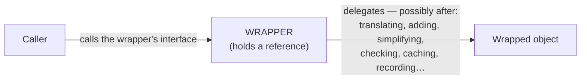
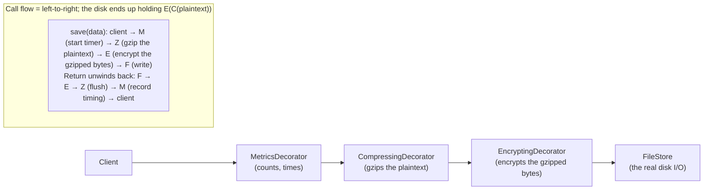
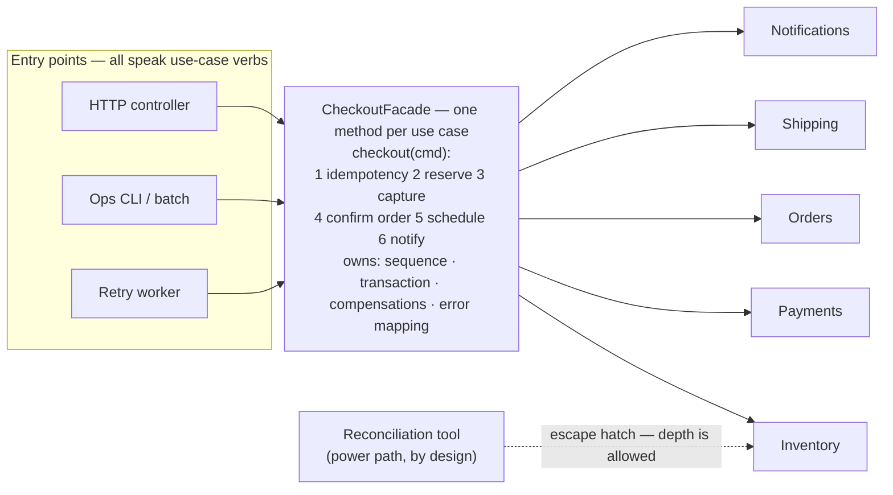
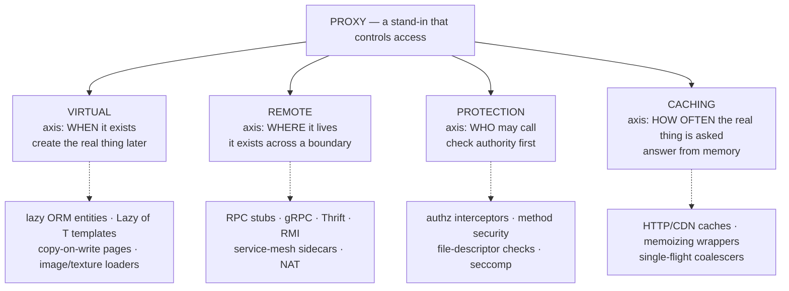

# 04 — Wrapping: Adapter, Decorator, Facade, Proxy

> **One mechanism, four reasons.** All four structural patterns share a single mechanical shape — **an object that holds another object and forwards calls to it** — and differ only in *why* the wrapper exists: to **change the face** (Adapter), to **add behavior around it** (Decorator), to **simplify a crowd** (Facade), to **control access** (Proxy). The mechanics are an afternoon; the judgment — which wrapper, when, how many layers, and what the wrapper *owes* its callers — is the senior content, and it is this file.
>
> **The file's thesis:** *a wrapper is a boundary you draw between a caller and a thing. Every boundary you draw is paid for by every future reader — so draw the ones that isolate volatility, concentrate cross-cutting behavior, or enforce policy, and draw nothing else.*

---

## 0. The Universal Wrapper — mechanics, then the bill

### 0.1 The mechanics, once for all four



In code — and this is *literally* the same skeleton for all four patterns, in all three languages:

```java
// Java — the universal shape
public final class SomeWrapper implements SomeInterface {   // or a different interface (Adapter)
    private final SomeInterface inner;                      // the held reference
    public SomeWrapper(SomeInterface inner) { this.inner = inner; }
    @Override public Result operation(Args a) {
        /* pre-work — context-dependent per pattern */
        Result r = inner.operation(a);                      // delegate
        /* post-work */
        return r;
    }
}
```

```cpp
// C++ — same shape; the language's gift is stating OWNERSHIP in the member type
class SomeWrapper final : public SomeInterface {
    std::unique_ptr<SomeInterface> inner_;      // owns (decorator chains, adapters that create)
    // or: SomeInterface& inner_;               // borrows (caller owns the lifetime — file 01 §11)
public:
    explicit SomeWrapper(std::unique_ptr<SomeInterface> inner) : inner_(std::move(inner)) {}
    Result operation(const Args& a) override { /* … */ return inner_->operation(a); }
};
```

```c
/* C — the wrapper is a struct holding a pointer + the ops the wrapper intercepts,
 * and it must state its own ownership contract in comments the way Java's type
 * system states it (file 01 §11's discipline). */
struct thing_wrapper {
    struct thing *inner;              /* borrowed or owned? CAST IN THE DOC — see below */
    /* optional: per-wrapper state (counters, cache, lock) */
};
/* The C wrapper's classic implementation: it exposes ITS OWN ops table,
 * whose slots do the extra work and forward to inner->ops->… */
static int wrapped_operation(struct thing *self, const struct args *a)
{
    struct thing_wrapper *w = self->ctx;          /* container_of-style: file 01 §6.3 */
    /* pre-work */
    int rc = w->inner->ops->operation(w->inner->ctx, a);
    /* post-work */
    return rc;
}
```

**The three questions every wrapper must answer** (they are the review checklist for this entire file):

1. **The interface question:** does the wrapper *present the same interface* as the wrapped thing (Decorator, Proxy — internal wrappers), a *translated* one (Adapter), or a *new, narrower* one over a group (Facade)?
2. **The fidelity question:** the wrapper is now the thing callers talk to — is it a **behavioral subtype** of what it wraps (file 02 §3)? Wrappers are LSP pressure points: they intercept *every* call, so a wrapper that weakens any postcondition (delays a write it promised was durable, returns stale data, changes ordering) violates the contract *silently and globally*.
3. **The identity question:** the wrapper is a *different object*. Anything that compares by identity (`==`, `equals` by default, hash maps used as registries, `getClass()` checks, serialization that records the concrete type, frameworks that persist entities by proxy identity) now behaves differently — the **wrapper identity trap**, hitting hardest in Java (proxies generated by frameworks) and anywhere `equals` is inherited.

### 0.2 The bill — what a layer costs

| Cost | What it looks like |
|---|---|
| **Reading** | "What actually happens on `charge()`?" now requires walking N hops; each wrapper pushes the truth one indirection away. The navigation cost compounds with layer count |
| **Debugging** | Stack traces grow a frame per wrapper; breakpoints hit wrappers before logic; log lines interleave from layers you forgot existed; "where did this call come from?" gets harder every layer |
| **Identity & reflection** | `instanceof`/casts, equality, serialization, ORM mapping, DI-wiring-by-type — all can break at wrapper boundaries (§0.1 Q3) |
| **Performance** | One hop per layer: negligible alone (an indirect call), real in hot loops and multiplied by megamorphic dispatch (file 01 §7.7); remote proxies add *actual* network cost behind a locally-typed interface |
| **Semantic debt** | Each wrapper is a new place the contract can silently change; the fidelity question is answered wrong most often by *caching* and *lazy* wrappers (later in this file) |

**The layer-count rule of thumb** (from production archaeology, not theory): **1–2 layers are normal; 3–5 need documentation of the chain and its ordering; 6+ means the design lost** — the behavior is now distributed across wrappers nobody reads, and the honest fix is usually a pipeline/middleware structure (file 05's Chain of Responsibility) where the order and set are *explicit data*, not object nesting.

**Where wrappers come from in real codebases** (you rarely *decide* to wrap; you *discover* wrappers): vendor SDK isolation, cross-cutting concerns (metrics/tracing/retry/auth), legacy bridging, framework-generated proxies (AOP, ORM lazy loading, RPC stubs), test fakes, and "quick fixes" that outlived their quickness. This file turns the discovered wrappers into known patterns — and known bills.

### 0.3 The four, at a glance

| | **Adapter** §1 | **Decorator** §2 | **Facade** §3 | **Proxy** §4 |
|---|---|---|---|---|
| **Intent (one line)** | Make one interface look like another | Add behavior around the same interface | Present one simple face over many parts | Control access to the same interface |
| **Interface** | **Translated** — different | **Same** — transparent | **New, narrower** — simplifying | **Same** — transparent |
| **Wrapper count** | 1 (translates one thing) | 1 per added concern, **chained** | 1 over **many** wrapped things | 1 (or a service of them) |
| **Who decides it exists** | The integrator (you, once, at the boundary) | The composer (often you, at wiring; sometimes the caller at runtime) | The subsystem's owner (you, for clients) | Often **invisible to the caller** — imposed by framework/infra |
| **Typical trigger** | A vendor/legacy interface you can't change | Combinations of orthogonal features (compression × encryption × metrics) | Five services that must be called in the right order | Cost (lazy), distance (remote), policy (protection), reuse (cache) |
| **Failure mode** | Chain of adapters nobody can trace; leaked vendor types | Invisible behavior; ordering bugs; identity surprises | God-facade; facade leak | Transparency lies: stale cache; remote's failure modes; hidden identity |
| **LSP pressure** | Must honor the **client's** contract, not the vendor's | Must remain behaviorally the same interface (± the addition) | New contract, defined by the facade — nobody's promise broken | Must honor the wrapped contract or declare exactly how it doesn't |

---

## 1. Adapter — Making Things Fit

### 1.1 Word by word

> **Word by word — *adapter*:** from Latin **adaptare** — *ad-* (to) + *aptare* (to fit), from **aptus** (fitted, suitable — the root of *apt*, *aptitude*, *inept*). An adapter is *a thing that makes another thing fit*: the power-plug adapter, the lens adapter ring, the USB-C dongle. The etymology is the design: **the adapter changes the shape between two parties; it does not change either party.**
>
> **The two parties, named:** the **client** (who expects one interface — usually *your* interface, which you control) and the **adaptee** (who offers another — usually a vendor's, a legacy system's, or a tricky API you cannot edit). The adapter is the boundary object between them.

### 1.2 Source and precise statement

The Gang of Four's intent, verbatim:

> **"Convert the interface of a class into another interface clients expect. Adapter lets classes work together that couldn't otherwise because of incompatible interfaces."**

**Precise definition used in this file:** *An Adapter is a wrapper whose single job is translation: it presents the interface a client expects, implementing every operation by translating the call — names, argument order, units, error conventions, data shapes — to the adaptee's actual interface, and translating results back. It changes nothing about the adaptee's behavior; if the translation shifts semantics beyond the mechanical mapping, that is a design decision that must be made explicitly (§1.7).*

**The two structural forms** (GoF names, still asked in interviews):

| | **Object adapter** (composition) | **Class adapter** (multiple inheritance) |
|---|---|---|
| Mechanism | Adapter *holds* the adaptee, delegates | Adapter *inherits* the adaptee (C++: plus the target interface multiple-inheritance) |
| Languages | All of them | Only those with MI (C++) — Java/C# cannot |
| Judgment | **The default, always.** Also: the target can be an interface, the adaptee can be final/sealed, and you can adapt *one instance* | Rare; sometimes cheaper in C++ when the adaptee is a base you must override anyway; but it fuses the adaptee's whole surface into the adapter's type (file 01 §8's inheritance bill) |
| Verdict | **Use this** | Know it exists; justify choosing it |

### 1.3 The problem it kills — and the interface-ownership rule

The canonical shape: your domain defines `PaymentGateway.charge(...)`; a vendor SDK ships `StripeApi.createPaymentIntent(amount, currencyCode, idempotencyKey, ..., callback)`. The naive integration lets the vendor's shape *become* your shape:

```java
// BEFORE — the vendor's interface spreads through your domain
public final class CheckoutService {
    private final StripeApi stripe;                     // domain now imports Stripe
    public Receipt checkout(Cart cart) {
        var intent = stripe.createPaymentIntent(          // vendor nouns/verbs in domain code
            cart.total().cents(), cart.total().currency(), UUID.randomUUID().toString(),
            /* …6 more parameters, two deprecated… */ null);
        return new Receipt(intent.getId(), intent.getStatus().equals("succeeded"));
    }
}
```

The costs are file 02 §5.3's welded core, now at the vendor scale, plus two vendor-specific stings: **every call site hard-codes the vendor's error taxonomy** (Stripe exceptions thrown from checkout logic — switching vendors means rewriting business code), and **the vendor's model leaks into the domain's vocabulary** ("payment intent" is a Stripe concept your domain has now adopted — the diagram is a chimera). Then the migration is a rewrite.

The fix — the domain keeps its face; the vendor wears *your* mask at the edge:

```java
// AFTER — the domain owns the interface (file 02 §5.4's ownership rule);
// the adapter makes the vendor fit.
package com.acme.checkout.domain;
public interface PaymentGateway {                        // YOUR interface, YOUR vocabulary
    PaymentResult charge(PaymentRequest req);            // domain nouns: charge, payment
}
public record PaymentRequest(OrderId order, Money amount, IdempotencyKey key) {}

// --- infra/boundary package: the ADAPTER — the only file that imports the vendor ---
package com.acme.checkout.infra;
public final class StripeGatewayAdapter implements PaymentGateway {
    private final StripeApi stripe;                      // the adaptee, sealed inside
    @Override public PaymentResult charge(PaymentRequest req) {
        try {
            // translation, all of it visible in one file: names, units, argument order,
            // idempotency mapping, error mapping, result mapping.
            var intent = stripe.createPaymentIntent(
                req.amount().cents(), req.amount().currency().code(),
                req.key().value(), /* … */);
            return switch (intent.getStatus()) {
                case "succeeded" -> PaymentResult.succeeded(intent.getId());
                case "processing" -> PaymentResult.pending(intent.getId());     // ← semantic mapping:
                default -> PaymentResult.failed(intent.getFailureReason());     //   our vocabulary
            };
        } catch (StripeApiException e) {                 // vendor exception IN, domain error OUT
            return switch (e.code()) {
                case "card_declined" -> PaymentResult.declined(e.getMessage());
                case "rate_limited"  -> PaymentResult.retryable(e.getMessage());
                default              -> PaymentResult.failed(e.getMessage());
            };
        }
    }
}
```

**The interface-ownership rule, stated once and applied everywhere:** *the side that owns the interface is the side the other adapts to; and you keep the interface on the side that is **stable and yours**.* Concretely: your domain interface is stable (it encodes *your* business concepts and changes when your business changes); vendors are volatile (they change on their release schedule). So the adapter sits in the infra package, imports the vendor, and exposes your interface — the dependency arrow points the same direction as file 02 §5's DIP. The reversal case (framework APIs you must implement — a vendor SPI) is symmetric: *they* own that interface, and the adapter is where their shape stops.

### 1.4 The wrong-fit checklist — what adapters must translate (the part tutorials skip)

An adapter is not "rename method" — the impedance mismatch between two real interfaces is a *list*, and a senior adapter handles every item explicitly:

| Mismatch | Example | The adapter's duty |
|---|---|---|
| **Names/vocabulary** | `createPaymentIntent` → `charge` | Map intent → domain terms; never let vendor nouns into domain signatures |
| **Argument shape/order/optionality** | 10 positional params with two deprecated → one `PaymentRequest` record | Bundle, default, reorder; validate presence at your boundary |
| **Units and formats** | cents vs major units; timestamps as epoch-ms vs `Instant`; enums as strings | Convert *once*, at the seam, and document the direction; unit bugs are this table's most expensive row (§1.6) |
| **Error conventions** | Exceptions vs error codes vs null; vendor's named errors | Translate to *one* domain error model at the boundary; the rest of the system sees exactly one taxonomy — this is what makes the next vendor cheap |
| **Result semantics** | `status: "processing"` (vendor state machine) vs domain `pending` | Map to *your* state model; decide and document lossy mappings (what your model can't express vendor-side) |
| **Calling conventions** | Callback vs future vs blocking; pagination schemes | Normalize to one style at the boundary (usually your style — often async/future) |
| **Behavioral gaps** | Vendor has no idempotency key; or lacks partial refunds | **The design decision:** emulate (client-side dedup table), go without (degrade the domain invariant — loudly), or choose a different vendor. This row is where adapters stop being mechanical (§1.7) |
| **Resource semantics** | Vendor objects need explicit close; your interface has no close | Adapt the *lifecycle* too: the adapter owns vendor resources and closes them (RAII in C++, try-with-resources in Java, cleanup contracts in C) |

### 1.5 Tri-language mechanics

**Java — the adapter in §1.3 is complete; note what the *next* vendor costs:** a new class in the same package implementing the same interface. The receipt for the whole rule: *the second vendor should touch zero domain files* — if it doesn't, the interface leaked vendor semantics somewhere and you find it now, while it's cheap.

**C++ — object adapter with stated ownership; plus the RAII twist specific to the language:**

```cpp
// Domain header — no vendor include anywhere in sight:
namespace checkout::domain {
class PaymentGateway {
public:
    virtual ~PaymentGateway() = default;
    virtual PaymentResult charge(const PaymentRequest& req) = 0;
};
} // namespace

// Adapter — the only TU that includes the vendor SDK:
namespace checkout::infra {
class StripeGatewayAdapter final : public domain::PaymentGateway {
    stripe::Api& api_;                         // BORROWED: the adapter does not own the vendor client;
                                               // the composition root does (lifetime is a decision — file 01 §11)
public:
    explicit StripeGatewayAdapter(stripe::Api& api) : api_(api) {}

    domain::PaymentResult charge(const domain::PaymentRequest& req) override {
        try {
            auto intent = api_.create_payment_intent(
                stripe::Money{ req.amount().cents(), to_stripe_currency(req.amount().currency()) },
                req.key().value());
            return to_domain(intent);           // mapping kept in anonymous-namespace helpers below
        } catch (const stripe::ApiError& e) {
            return to_domain_error(e);          // vendor exception does not escape this file
        }
    }
private:
    static domain::PaymentResult to_domain(const stripe::Intent&);      // static pure mappings —
    static domain::PaymentResult to_domain_error(const stripe::ApiError&); // unit-testable in isolation!
};
} // namespace
```

> **[DEEP DIVE] The C++-specific gift: exception and ownership translation become *types*.** In Java, "vendor exceptions must not escape" is a discipline (catch and map); in C++, the same discipline is enforceable with `noexcept` on the boundary methods *if* the mapping is total — a compile-time-checked promise that the adapter never leaks the vendor's failure model. Similarly, "who owns the vendor client" is unstateable in Java (GC decides) but in C++ it is the member type: `stripe::Api&` (borrow) vs `std::unique_ptr<stripe::Api>` (own) — and the adapter's construction then forces the ownership decision into the open (file 01 §11.2's lifetime proof, applied to integration). If you write C++ adapters with references/unique_ptr by design rather than by accident, your integration boundaries have provable lifetimes; that is a genuinely senior C++ claim.

**C — the adapter is a struct + an ops table where every slot translates; the kernel's own driver model:**

```c
/* DOMAIN's interface (owned by your subsystem, in your header): */
struct payment_gateway_ops {
    enum pay_result (*charge)(void *ctx, const struct payment_request *req, struct pay_detail *out);
};
struct payment_gateway { const struct payment_gateway_ops *ops; void *ctx; };

/* ADAPTER: the vendor's client is the ctx; every call translates. */
struct stripe_adapter {
    struct stripe_client *vendor;        /* owned: stripe_adapter_destroy() frees it */
};
static enum pay_result stripe_charge(void *ctx, const struct payment_request *req,
                                     struct pay_detail *out)
{
    struct stripe_adapter *a = ctx;      /* the container_of discipline (file 01 §6.3) */
    struct stripe_intent intent;
    char key[64];
    uuid_to_str(req->key, key, sizeof key);
    int rc = stripe_create_intent(a->vendor, req->amount_cents, req->currency_code,
                                  key, &intent);          /* vendor call */
    if (rc == STRIPE_ERR_RATE_LIMIT) return PAY_RETRYABLE; /* error taxonomy translation */
    if (rc == STRIPE_ERR_CARD)       { out->code = intent.failure; return PAY_DECLINED; }
    if (rc != 0)                     { out->code = intent.failure; return PAY_FAILED; }
    out->ref = intent.id[0] ? strdup(intent.id) : NULL;    /* result mapping — ownership noted */
    return intent.pending ? PAY_PENDING : PAY_SUCCEEDED;
}
const struct payment_gateway_ops stripe_gateway_ops = { .charge = stripe_charge };
/* Composition (main.c): struct payment_gateway gw = { &stripe_gateway_ops, &adapter }; */
```

> **[KERNEL & SYSTEMS] The kernel is the world's largest collection of adapters — it is *made* of them.** Each **device driver** adapts a device's register layout and protocol to a kernel subsystem's interface: `pci_driver`/`net_device_ops`/`block_device_operations` are the "client interfaces", the hardware is the adaptee, and the driver is the adapter — which is why the kernel can have a hundred network drivers and one network stack. Higher up, the same pattern holds at scale: **`compat` syscalls adapt 32-bit ABIs to 64-bit kernels** (`compat_sys_read` translating a 32-bit `stat` structure — a *data-shape* adapter, exactly §1.4's row 3); **FUSE** adapts any userspace filesystem implementation to the kernel's VFS ops tables; **Wine** adapts Windows PE binaries' expectations (syscalls, DLLs, registry) to POSIX — an adapter as an entire compatibility layer. The rule that falls out of the kernel's practice, and the one to say in interviews: **adapters belong at boundaries where one side cannot change; the kernel never adapts its core to a driver — drivers adapt to the core.** That is exactly §1.3's ownership rule, validated across 30 million lines.

### 1.6 Production reality — the receipts, the traps, and the two big failure modes

**Receipts (where adapters pay):**
- **Vendor churn isolation:** the payment-PSP story — adding vendor #2 touches one class + registration (file 03 §5.1); ✓ the *second* vendor is the receipt (file 02 §2.5's rule).
- **Legacy coexistence:** the old mainframe/COBOL service, the SOAP endpoint, the on-prem license-check SDK — their interfaces stop at the adapter; migration increments become possible (run both through one domain interface; route traffic gradually).
- **Testing:** the adapter is the natural **fake boundary** — the domain's tests use a `FakePaymentGateway` (an in-memory adapter, structurally identical); this is also why *the interface exists at all* (file 02 §5.8's substitution story, cashed).
- **Framework SPIs, reversed:** implementing `javax.sql.DataSource`, a Spring `HandlerInterceptor`, a gRPC `Codec` — the *framework* owns the interface; your adapter is where your code fits their shape; the same discipline inverts (your types stay yours; the vendor contract stops at the file).
- **The decommissioning path:** an adapter is the scaffold for replacement — you swap the adaptee and keep the interface while the migration runs; when the migration completes, the adapter's *deletion* is the celebration.

**Trap 1 — the leaky adapter.** The adapter returns the vendor's type (`StripeIntent` instead of `PaymentResult`) "just this once, it has a field we need." The domain now imports the vendor; the ownership rule is broken; the second vendor becomes a domain-wide refactor. **Review rule: the adapter's public surface may not mention any vendor type — ever — including in exceptions, results, and logs (map ids to strings).** If a needed field is "vendor-only," the question is whether it belongs in the domain at all; if yes, it gets a domain name.
**Trap 2 — unit bugs at the seam.** cents↔dollars, epoch-ms↔seconds, kilobytes↔bytes (the Mars Climate Orbiter class of failure, which was *precisely* an interface mismatch between team interfaces — a real spacecraft lost to a failed adapter). The adapter's mapping functions get their own unit tests with boundary values (0, 1 unit, max, negative, rounding halves); this is the one place where "test the translation" is non-negotiable, because *no other test can catch a wrong unit* — downstream code is correct for the wrong number.
**Trap 3 — adapter chains.** Adapter over adapter over adapter, each added by a different team/quarter ("we'll adapt the adapted thing"), until behavior is untraceable and each layer's tests pass while the composition fails. **Rule: adapters terminate at a boundary — an adapter's adaptee is a *foreign* interface, not your own prior adapter.** Wrapping your own output is a Decorator/Transformation job; if you see your own type on both sides of an adapter, the real issue is that two of your own interfaces diverged — reconcile the interfaces instead (the divergence is the bug, the adapter is pain relief that becomes the disease).
**Trap 4 — the adapter that "fixes" semantics.** Emulating a missing capability (idempotency! partial refunds!) *inside* the adapter changes the adapter from translation to *policy* — sometimes correct (and exactly what the boundary is for), but only when chosen openly: the emulation's state (a dedup table) now needs storage, lifetime, GC, and failure analysis, i.e., it's a component. The failure mode of hiding policy in an adapter is that the fake capability silently breaks under concurrency/multi-instance deployment (the in-process dedup table that works fine with one pod and buys double-charges with three). **Decision rule: adapters translate; emulations are declared as such, with their state's scope (per-process? shared?) documented and tested.**

### 1.7 Misconceptions

> **[MISCONCEPTION]** *"Adapter is just renaming methods."* Renaming is row 1 of an 8-row translation table (§1.4); the expensive rows are units, errors, semantics, and lifecycle. A senior adapter is a *complete* mapping between two conventions — and the completeness is testable (map every vendor error code; every unit; every null case).
>
> **[MISCONCEPTION]** *"Adapt the vendor to us — or adapt us to the vendor — either way, same thing."* The direction *is* the design: adapters point **from** the volatile side **to** the stable side (§1.3). Reversed ownership (your interface living in the vendor's shape) is how codebases end up unable to leave a vendor — the configuration is a rewrite.
>
> **[MISCONCEPTION]** *"Two interfaces with the same methods are the same interface."* The *behavioral* contract is what the client depends on (file 02 §3): error timing, retry semantics, ordering, thread-safety. An adapter that maps methods but changes "throws on invalid input" to "returns null" has shipped a different contract; the LSP checklist (file 02 §3.5) applies to the adapter *toward its client-facing interface*.
>
> **[MISCONCEPTION]** *"Adapters are temporary scaffolding."* Some are (decommissioning paths); the *boundary* adapters — vendor isolation, legacy coexistence — are durable architecture, and pretending they're temporary is how they go undocumented and get "cleaned up" by someone who then re-couples the domain to the vendor.

### 1.8 When NOT to adapt — the honest refusals

- **When you own both sides:** change one side instead. Two of your own interfaces that need an adapter usually means they should have been one interface (or one should have been refactored to be it) — the adapter would cement the divergence.
- **When the mismatch is behavioral, not structural:** a vendor whose *semantics* violate your needs (no idempotency, at-most-once delivery when you need at-least-once) is not an adapter problem — it's a vendor-selection problem, or an explicit emulation component (§1.6 trap 4), decided loudly.
- **When the vendor will be gone before the adapter pays off:** a spike, a POC, a vendor on a 2-month exit path — direct calls plus a TODO beat a boundary nobody will maintain. (The receipt test again: what change does this adapter absorb, and is it coming?)
- **When the "foreign" interface is actually stable, dumb, and ubiquitous:** you don't adapt `java.util.List` or `std::string` into your own interfaces — the universal vocabulary is already shared (file 02 §5.8's wrap-itis; writing a `StringAdapter` is the canonical instance of the disease).

---

## 2. Decorator — Behavior, Added Around an Object

### 2.1 Word by word

> **Word by word — *decorator*:** from Latin **decorare** — *to adorn, to grace*, from **decus** (ornament, distinction, honor — the root of *decorum*, *decent*, and the back-formation *decor*). A decorator adds *around* a thing that remains exactly what it was: the room is still the room when it has a new coat of paint; the vase is still the vase on a better pedestal. The etymology carries two design facts: **the addition is outside the thing** (wrapping, not rewriting) and **the thing's identity is unchanged** (the room didn't become a different room).
>
> **The pattern in one literal sentence:** *take an object, wrap it in another object that presents the same interface, and have the wrapper add its own behavior on the way through.*

### 2.2 Source and precise statement

The Gang of Four's intent, verbatim:

> **"Attach additional responsibilities to an object dynamically. Decorators provide a flexible alternative to subclassing for extending functionality."**

Note the two words doing the work: **"dynamically"** (the composition happens at *runtime*, per instance — not baked into the type graph at compile time) and **"an object"** (singular — you decorate *this* instance, not the class; two instances of the same class can carry different decoration stacks).

**Precise definition used in this file:** *A Decorator is a wrapper that implements the same interface as the object it wraps, holds that object, and adds behavior — before, after, or around the delegated call — so that features can be composed, reordered, and configured per instance at runtime, with the wrapper remaining (behaviorally) the interface it presents.*

**The structural signature** — the "doubly recursive" shape that makes chains possible:

```java
public interface Component {           // the one interface everything speaks
    Result operation(Args a);
}
public final class Concrete implements Component { /* the real work */ }

public final class Decorator implements Component {     // ⚠ implements…
    private final Component inner;                       // …and holds — the same type
    public Decorator(Component inner) { this.inner = inner; }
    @Override public Result operation(Args a) {
        /* before */
        Result r = inner.operation(a);                   // delegate — possibly modified after
        /* after */
        return r;
    }
}
```

Because a decorator *is a* `Component` and *holds a* `Component`, a decorator can wrap a decorator forever: `new B(new A(new Concrete()))`. **The chain is a data structure** — the composition `new B(new A(concrete))` is the runtime value describing the behavior — and that is the entire trick. Where inheritance bakes the feature set into a type at compile time, decorator passes the feature set as an object graph built at wiring time (file 02 §5.4's composition root) or even per call.

### 2.3 The problem it kills — combinatorial class explosion

The GoF's own motivating sketch (a text view that can have a border *and/or* a scrollbar) is the pattern's purest instance of a universal problem: **orthogonal features multiplied by static inheritance.**

```
Features: {compression, encryption, metrics} — how many subclasses for every combination?

Inheritance world (2^N classes, one per combination):
    PlainStore
    CompressedStore                    EncryptedStore                 MetricsStore
    CompressedEncryptedStore           CompressedMetricsStore         EncryptedMetricsStore
    CompressedEncryptedMetricsStore
    … and tooltips, retries, buffers, caching: 2^N grows exponentially

Decorator world (N classes, one per feature, composed freely):
    new MetricsStore(new CompressedStore(new EncryptedStore(new FileStore())))
    new EncryptedStore(new FileStore())                    // any subset
    new CompressedStore(new MetricsStore(new FileStore())) // any order (⚠ order = semantics, §2.6)
    // add a 7th feature: ONE new class; all 2^7 combinations become available
```

Three properties fall out — and each is a distinct reason the pattern exists:

1. **Exponential → linear.** N feature classes compose into 2^N behavior sets. Adding feature #N+1 is one class, not N new combination-classes (the same economy as OCP's second case, file 02 §2.5, now on the *feature-composition* axis).
2. **Runtime, per-instance.** A `FileStore` instance can be compressed in one configuration and not another, decided at wiring time from a config snapshot — inheritance decides per *type*, decorator decides per *instance*.
3. **Features stay ignorant of each other.** `CompressionStore` knows only "a store"; it has never heard of encryption or metrics. This is the *orthogonality* precondition (and the pattern's silent assumption — §2.8 names where it breaks): decorators assume features compose without coordinating. When features must *know about each other*, wrapping is the wrong shape.

### 2.4 Mechanics — the chain, the wiring, and the two hazards



**The wiring** is where decorators differ from their reputation: the chain is *constructed*, explicitly, usually at the composition root, often from configuration:

```java
// The composition root (file 02 §5.4) — the chain is data, built once, INSIDE-OUT:
FileStore store = new FileStore(root);                                  // innermost: the disk itself
if (cfg.encryption())  store = new EncryptingStore(store, keySource);  // wraps the disk: the bytes
                                                                       // reaching the disk are ciphertext
if (cfg.compression()) store = new CompressingStore(store);            // wraps encryption: compresses
                                                                       // the caller's PLAINTEXT — good order
store = new MetricsStore(store, metrics);                              // outermost: sees every call first
return store;   // callers receive Component — they cannot tell the stack, by design
```

Two clarifications this code makes that most prose misses. **(1) Build order is inside-out; call order is outside-in.** The first line constructs the *innermost* layer (the disk); each following statement wraps the accumulator; the *last* wrapper added is the *outermost* and sees every call *first*. Read down the chain as built — `Metrics → Compressing → Encrypting → FileStore` — and the disk ends up holding `E(C(p))`; which is why each line's comment states **what the disk ends up holding**: it is the one statement of a chain that never confuses anyone. **(2) Nobody downstream sees the stack** — the client holds `Component`, so the decoration is invisible by design (which is the point, and also §2.6's debugging tax).

**Hazard 1 — accidental non-transparency.** "Same interface" is necessary, not sufficient: the wrapper must keep the wrapped contract's *behavioral* promises (file 02 §3's fidelity question). The classic exhibits:

- **`BufferedInputStream.available()`** documents that it returns an *estimate* — the wrapper cannot know the future (what's still in the buffer plus what the stream has). The JDK documents the deviation *because* transparency is impossible here; the review rule: any decorator method whose semantics it cannot fully preserve gets its deviation **documented at the interface** (a contract amendment) or the method is not implemented at all (better).
- **Identity:** `decorated == decorated` is false; `equals` may be inherited-identity; `instanceof ConcreteStore` checks fail on the wrapper. Codebases where anything keys/dedups/serializes by object identity will break *specifically and only* where decoration is on — the wrapper identity trap strikes (§0.1 Q3). Mitigations: key by a domain id, provide `unwrap()`, or don't decorate the identity-bearing object (decorate the *operation* surface, not the *entity*).
- **Exceptions:** a retry decorator that catches and retries changes the *timing* and *multiplicity* of the inner's observable effects — perfectly fine when intended, a contract amendment when accidental (file 02 §3.4 V6's side-effects-as-contract).

**Hazard 2 — the delegation-performance trap (the Java I/O lesson, generalizable).** A wrapper that implements only the "convenient" method often degrades the bulk path:

```java
// THE TRAP: FilterInputStream's default read(byte[], off, len) calls the single-byte
// read() in a loop. A decorator that overrides ONLY the single-byte read() looks correct —
// and silently converts every bulk read into N virtual calls. In I/O, N = megabytes.
@Override public int read() { /* +1 bookkeeping */ return inner.read(); }
// Missing: @Override read(byte[] b, int off, int len) { /* bookkeeping in ONE call */ … }
```

**Generalizable rule: a wrapper that adds per-call work must override the *bulk* variants too — or the chain's performance becomes an artifact of which methods each layer forgot.** (This single oversight has made more slow pipelines than any algorithm bug; it is close to the top of "things senior engineers catch in review that juniors don't.")

**Chain order is semantics, not style.** `new Encrypting(new Compressing(store))` and `new Compressing(new Encrypting(store))` are *different systems*: the former compresses plaintext then encrypts (small ciphertext — good); the latter encrypts then compresses (compression of ciphertext ≈ nothing — wasted CPU). And the security-critical version of the same sentence: **compress-then-encrypt is the correct order; letting an attacker-influenced secret share a compression context with attacker-controlled input is a compression oracle (the CRIME attack class)** — a real-world demonstration that decorator ordering decisions can be CVEs. The rule for every chain: **document the order as part of the system's spec, test the order explicitly, and make the wiring reviewable in one screen** (this is exactly why §2.6 argues the chain should become explicit pipeline data once it exceeds ~3–4 layers).

### 2.5 Tri-language mechanics

**Java — the canonical chain, plus the middleware variant:**

```java
// (1) THE TEXTBOOK: java.io itself. Read the nesting inside-out:
var in = new ObjectInputStream(
             new GZIPInputStream(                       // decompress: stored bytes → plaintext
                 new BufferedInputStream(               // buffer INSIDE gzip: batches reads of the
                     new FileInputStream("data.bin")))); //  compressed file — see the order note
// Each wrapper adds exactly one behavior; the whole file API stack is decorators.
// The order question for real: BufferedInputStream INSIDE vs OUTSIDE GZIPInputStream:
//   inside  = buffers COMPRESSED bytes (fewer syscalls; gzip sees buffered input)  ← usually best
//   outside = buffers DECOMPRESSED bytes (bulk reads from callers are cheap; gzip still reads
//             the file in small chunks unless it buffers internally)
// The JDK's own docs and countless blog posts argue this — which IS the lesson: order is
// engineering, not trivia; you test/measure it, per usage pattern.

// (2) THE MIDDLEWARE VARIANT — servlet filters are decorators in a chain:
public class RequestTimingFilter implements Filter {           // wraps the request/response pair
    public void doFilter(ServletRequest req, ServletResponse res, FilterChain chain) {
        long t0 = System.nanoTime();
        chain.doFilter(new LoggingRequestWrapper(req), res);   // ← the WRAPPER: same interface,
                                                               //   augmented behavior — every
                                                               //   downstream reader sees it
        metrics.record("filter.time", System.nanoTime() - t0);
    }
}
// The plugin host (servlet container) owns the chain ORDER (web.xml/@Order); each filter
// decorates toward the application. The container is the composition root of the chain.

// (3) A DOMAIN-LEVEL decorator with state — and its thread-safety note:
public final class RetryingNotifier implements Notifier {
    private final Notifier inner;
    private final RetryPolicy policy;              // immutable — safe to share
    @Override public void notify(Alert alert) {    // ⚠ retry + "notify" semantics: at-least-once
        int attempt = 0;                           //   means DUPLICATES unless the inner is idempotent
        while (true) {
            try { inner.notify(alert); return; }
            catch (TransientException e) {
                if (++attempt > policy.maxAttempts()) throw e;
                sleep(policy.backoff(attempt));    // the decorator AMENDED the contract (visibility!):
                                                   // callers now see multi-second latency + duplicates.
            }                                      // This amendment must be DOCUMENTED WITH THE INTERFACE,
        }                                          // not discovered in an incident (file 02 §3.4 V6).
    }
}
```

**C++ — runtime chain first (the everyday shape), then the compile-time variant (the C++ signature move):**

```cpp
// (1) RUNTIME — the chain with ownership stated: the outermost owns the chain downward.
class Store { public: virtual ~Store() = default; virtual void save(std::span<const std::byte>) = 0; };

class CompressingStore final : public Store {
    std::unique_ptr<Store> inner_;                 // OWNS its inner: destroying the head
public:                                            // tears down the whole chain
    explicit CompressingStore(std::unique_ptr<Store> inner) : inner_(std::move(inner)) {}
    void save(std::span<const std::byte> data) override {
        auto compressed = gzip(data);
        inner_->save(compressed);
    }
};
// Wiring (composition root):
std::unique_ptr<Store> store = std::make_unique<FileStore>(root);
if (cfg.metrics)     store = std::make_unique<MetricsStore>(std::move(store), meters_);
if (cfg.encryption)  store = std::make_unique<EncryptingStore>(std::move(store), key_source_);
// Notice: std::move(store) at every step — the chain's ownership is threaded explicitly;
// forgetting a move is a compile error, not a stale alias: the type system audits the chain.

// (2) COMPILE-TIME — the static decorator: features as class templates, zero virtual dispatch.
//    This is policy-based composition (file 01 §7.2's monomorphization, aimed at wrapping):
template <class Inner>
class MetricsDecorator : public Inner {            // inherits Inner's interface directly
    Meters& meters_;
public:
    MetricsDecorator(Inner inner, Meters& m) : Inner(std::move(inner)), meters_(m) {}
    void save(std::span<const std::byte> data) { AutoTimer t(meters_); Inner::save(data); }
};
using ProdStore = MetricsDecorator<EncryptingDecorator<CompressingDecorator<FileStore>>>;
// Every call is statically bound and inlinable; the "stack" is a TYPE. Bills: compile time,
// code size (one instantiation per combination used), errors that print template novels, and
// the stack is fixed at compile time (config-driven chains need the runtime form — or a
// runtime selection among instantiated types). Choose per file 02 §5.4's rule: runtime
// variance → runtime chain; fixed hot path → static stack.
```

**C — wrapping ops tables; the kernel does this at every layer:**

```c
/* The reader interface (ops) and a decorator that wraps ANY implementation: */
struct reader_ops {
    ssize_t (*read)(void *ctx, void *buf, size_t n);
};

struct counting_reader {
    struct reader                inner;        /* the wrapped reader (by value: interface + ctx) */
    struct perf_counter          counter;      /* the decorator's OWN state (thread-safety lives here) */
};
static ssize_t counting_read(void *ctx, void *buf, size_t n)
{
    struct counting_reader *c = ctx;           /* container_of discipline */
    ssize_t r = c->inner.ops->read(c->inner.ctx, buf, n);
    perf_count(&c->counter, r > 0 ? (size_t)r : 0);
    return r;
}
static const struct reader_ops counting_ops = { .read = counting_read };
/* Wiring: struct counting_reader cr = { .inner = real_reader, … };
 *         struct reader wrapped = { &counting_ops, &cr };
 * ANY reader (file, socket, TLS, disk) can be wrapped without knowing anything —
 * the ops-table structure makes every implementation uniformly wrappable. */
```

> **[KERNEL & SYSTEMS] Decorator chains you already trust with your data:** `dm-crypt` is a decorator over a block device — it *is* `EncryptingStore` for the entire disk layer — and device-mapper deliberately lets you **stack** (`dm-linear` → `dm-crypt` → `dm-integrity` → the physical device). The layer order is explicit system configuration (`dmsetup` tables), documented, and security-relevant: integrity inside vs outside encryption changes what an attacker can forge and what "valid ciphertext" means (the dm-integrity + dm-crypt ordering debates are the §2.4 CRIME lesson in disk form — order is semantics, engineering, and at times security policy). The **LSM (Linux Security Modules) stack** is the access-control instance: `capability` and SELinux/AppArmor hooks are *chained* — each module inspects, then defers to the next unless it denies — a decorator chain where one layer may *stop* the stack (note that: the moment a layer can stop the chain, you have crossed from Decorator into its cousin Chain of Responsibility, file 05 §5 — the same structure, one behavior apart). And `kprobes` insert observational decorators around *arbitrary kernel functions at runtime* — `MetricsDecorator` for the kernel, with the same visibility questions. **The pattern is not OO exotica: it is the shape of stackable, order-meaningful system layers — which is exactly why its order and contracts must be treated as engineering.**

### 2.6 Production reality — middleware, AOP, and the pipeline discipline

**Where decoration is the industry's normal shape** (name these in interviews; they show you recognize patterns-in-the-wild):

| System | The decorators | The interface being preserved |
|---|---|---|
| **HTTP servers everywhere** | Middleware: gzip, auth, rate-limit, tracing, CORS (Express/Koa, Go's `http.Handler` wrapping, ASP.NET middleware, Rack) | The request/response pair (or the handler) |
| **gRPC/Thrift** | Interceptors (client + server): retry, auth, deadlines, metadata propagation | The call |
| **Spring/Guice frameworks** | AOP "around" advice, `@Transactional`, `@Cacheable`, `@Retryable` — *proxy*-implemented decorators (the Proxy pattern is their engine; §4) | The bean's interface |
| **Servlet/Java EE** | Filters, `HttpServletRequestWrapper` subclasses | Request/response |
| **.NET DI** | Decorator registration in the container (`services.Decorate<IMessageBus, OutboxMessageBus>()`) | The service interface |
| **Resilience libs** | Retry, circuit-breaker, bulkhead, timeout wrappers (Polly, resilience4j, Hystrix-era) — each feature a wrapper | The guarded operation |
| **Streams/media** | Codec/filter stacks (AAudio, GStreamer elements, ImageIO readers) | The stream/frame interface |

**The pipeline-order specification — the practical artifact this section exists to produce.** When 4+ cross-cutting decorators stack, the *canonical order* (outside → inside) and its reasons should be written down like a protocol:

```
REQUEST PATH (outermost first):
  1. tracing/metrics      — must see the whole request, including retries
  2. authentication        — before consuming any budget or touching downstream services
  3. rate limiting         — after auth (per-identity limits!), before expensive work
  4. idempotency/dedup     — before retry (so retries don't re-execute committed effects)
  5. retry                 — OUTSIDE the circuit breaker: retry revisits the breaker each attempt
  6. circuit breaker       — inside retry: protects downstream from the storm that caused it
  7. timeout               — per attempt (inside retry) or overall (outside)? — DECIDE + document;
                             both exist in production; "wrapping the whole retry budget in one
                             wall-clock timeout" is the common safe default
  8. cache                 — CLOSEST to the service if hits shouldn't consume retry budget, and
                             ALWAYS outside failures: never let a cache layer memoize errors you
                             didn't design it to memoize (the cached-failure incident, §2.6 below)
  9. business logic        — knows none of the above
```

Every swap in that list changes observable behavior — and the list itself is the interview answer to "how do you structure cross-cutting concerns": **as an explicitly ordered, documented pipeline, then implement it with decorators (or CoR), then *test the order* (a test that asserts a rate-limited request never reaches retry; an unauthenticated request never consumes cache entries).** The order is a contract; the tests are its enforcement.

**The pipeline-incident catalogue** (each a real, common production story this section lets you pre-empt):

| Incident | Mechanism | The lesson |
|---|---|---|
| **Cached failures** | Cache decorator placed *inside* retry: first attempt fails transiently; the cache memoizes the failure; the retry hits the cache and "fails" instantly; **the failure is now sticky** | Never cache without an explicit result-class filter (cache successes by policy; pass-through or negative-cache-under-TTL deliberately) |
| **Retry storm through the breaker** | Retry *outside* breaker with high concurrency: each layer's retries multiply (5 clients × 3 retries = 15 hits per intent); the breaker trips from the multiplication, not the incident | Retry respects a global budget; breaker inside retry; jitter; idempotency keys end-to-end |
| **Duplicate side effects** | Retrying decorator over a non-idempotent inner (payments, emails): "at-least-once" notifies everyone twice at the worst moment | Idempotency *at the innermost effect* (the effect's owner), not the decorator's hope; document amended semantics at the interface (§2.5's `RetryingNotifier` note) |
| **Auth bypass via wrapper** | A wrapper that re-dispatches internally (`RequestDispatcher.forward`) skips outer filters; or a servlet-container "async dispatch" runs filters twice | Chains assume single passage; re-entrant paths must be specified and tested (idempotent front filters!) |
| **The invisible stack in the debugger** | Six wrappers; breakpoints in the business method hit last; stack traces are 40 frames of `doFilter`/`invoke`/`proceed` | Wrap with named classes and log-correlation pass-through; teach the team the stack map; keep chains ≤5 without docs (the §0.2 rule) |
| **Serialization identity loss** | The ORM/serializer persists the wrapper's concrete class (or fails to); or equals-by-identity dedup breaks post-wrap | Wrappers around *entities* are the danger zone (§2.4 hazard 1); decorate behavior surfaces, key entities by domain id |

### 2.7 Misconceptions

> **[MISCONCEPTION]** *"Decorator is just inheritance in disguise."* It is inheritance's *replacement* on the feature-composition axis: inheritance fixes features in the type (2^N classes, compile-time, class-wide); decorator composes them in an object graph (N classes, runtime, per-instance — §2.3). The similarity (implementing the interface + delegating) is the mechanism; the changed axis (per-instance runtime composition) is the point.
>
> **[MISCONCEPTION]** *"Decorators are always transparent."* Same interface, yes — same *behavioral contract*, only as far as the decorator preserves it. Buffering changes timing and `available()`; retrying changes multiplicity and latency; caching changes freshness. Each deviation must be *documented with the interface* (an amendment callers can read) or eliminated. "Transparent" is a promise the decorator makes and can break — §2.4 is the register of where.
>
> **[MISCONCEPTION]** *"Order doesn't matter — decorators are commutative."* §2.4's compress/encrypt pair and §2.6's pipeline are the disproof; *ordering is semantics*. The only decorators that commute are those with no shared entities — and you can't know that without tracing their state.
>
> **[MISCONCEPTION]** *"Nesting streams is the pattern; the pattern is only for I/O."* I/O is the *textbook illustration*; the production weight is middleware, AOP, resilience, and layered system plumbing (§2.6's table; §2.5's docker/LSM exhibits). If you can name the decorator chain inside your web framework, you own this pattern.

### 2.8 When NOT to decorate — the orthogonality precondition and the alternatives

- **When features are not orthogonal.** Decorators assume each layer can do its work without coordinating with the others. Features that must *negotiate* — a cache that must consult a write-through log, an encryption layer whose key rotation must pause writes, two layers that share a budget — need a coordinator (Mediator, or a single richer component), not nested wrappers pretending independence. The tell: a decorator needs a reference to *another* decorator (e.g., cache reaching the retry decorator) — the stack wants to be an object.
- **When the combination set is fixed and small.** One compression feature, decided at startup, that will never combine: a constructor parameter or a subclass is simpler; a one-layer "chain" is ceremony (file 02 §6.2). The pattern's receipt is the *2^N* it avoids — if N is one and frozen, the receipt is blank.
- **When identity, serialization, or reflection must see through.** Entity-like objects persisting through ORMs, objects used as registry keys, anything a framework casts/`instanceof`s: decoration breaks those paths (§2.4 hazard 1) — decorate the *service*, not the *entity*.
- **When the chain would exceed readability without a pipeline.** Beyond ~4–5 layers, convert to an *explicit pipeline*: an ordered array of handlers (Chain of Responsibility, file 05 §5) or a middleware registry — same behavior, but the stack becomes configuration/data with a documented order (§2.6's spec), testable as a unit, debuggable by printing the list. **Decorator is the mechanism; the pipeline is the management structure.** Seniors reach for the pipeline exactly when the stack stops fitting in one head.
- **When the wrapper is pure overhead:** a decorator that adds nothing on this path ("for symmetry with the others") — every layer is paid by every reader forever (§0.2); wrappers must earn their frame.

### 2.9 Interview bank and drill

> **[INTERVIEW]** The decorator cluster, model answers:
> — ***"Why would you use a decorator instead of inheritance?"*** — the 2^N → N compression (§2.3) with the two extra properties named: runtime per-instance configuration, and orthogonality (features stay unaware of each other). Then the honest boundary: *"it assumes independent features; when they coordinate, I stop nesting and make the stack an explicit object or a pipeline."*
> — ***"Explain java.io to me."*** — the textbook chain: each stream class adds one responsibility around the same byte-oriented interfaces; `BufferedInputStream(new FileInputStream)` is buffering as a wrapper; `GZIPInputStream` adds decompression; the chain is built inside-out; the lessons I'd cite: the bulk-read delegation trap (§2.4 hazard 2), and that the wrapper *is* the contract — e.g., `available()`'s documented estimation, *"which is exactly how a good decorator admits where it can't be transparent."*
> — ***"Where do decorators live in modern stacks?"*** — middleware/interceptor pipelines, DI-registered decoration (Spring `@Transactional`/`@Cacheable` implemented via proxy-decorators), resilience wrappers — and the professional artifact: an **ordered, documented pipeline spec with order-assertion tests** (§2.6), because order is semantics.
> — ***"Your retry decorator double-charges customers. Diagnose."*** — the model: retry converts at-most-once into at-least-once (multiplicity is a contract amendment, §2.4); the *effect* was not idempotent; the fix belongs at the innermost effect owner (idempotency keys at the payment gateway), and the interface documentation must state the amended semantics — *"decorators may not silently strengthen side effects; if they amend the contract, the contract is where it's written down."*
> — ***"When would you refuse to decorate?"*** — non-orthogonal features (coordination → Mediator), identity-sensitive objects (ORMs, registry keys), fixed one-feature stacks (constructor/subclass), chains past ~5 without a pipeline conversion, and any wrapper whose receipt is empty (file 02 §6.2's discipline, this file's §0.2 bill).

**[DRILL]** Design the file-store stack from §2.4 for real: features = {compression, encryption, metrics}, configured per deployment edge; payloads up to 2 GB; the store is shared across request threads; readers must read back everything writers wrote; compliance requires at-rest encryption (and *proving* it). Decide: (a) the chain order and its justification; (b) ownership/lifecycle of the chain; (c) what each decorator's tests must cover (give at least five distinct test *classes*, not cases); (d) the compliance question: how does ops *prove* a given object was written encrypted; (e) the graceful path when a payload is already compressed (double-compression) — and where that knowledge may live. *(Model: (a) **Order, outermost → innermost: Metrics → Compressing → Encrypting → FileStore** — and the direction is worth deriving once, carefully, because chain-order reasoning is a skill the interview probes. On the way *down*, transforms run outermost-first: `Metrics.save(p)` times the call; `Compressing.save(p)` computes `z = gzip(p)`; `Encrypting.save(z)` computes `c = E(z)`; `FileStore.save(c)` writes. The disk holds `E(C(p))`: compression saw *plaintext* (effective), and encryption ran *last* (the disk never holds plaintext). The mnemonic that survives deadlines: **the transform that must see the caller's raw data sits outside; the transform that must be the last thing before storage sits inside.** The mirrored chain — `Metrics(Encrypting(Compressing(FileStore)))` — encrypts first and hands *ciphertext* to the compressor: the disk then holds `C(E(p))`, correct on read-back but spending CPU on high-entropy data (the §2.4 example, made mechanical). Justification for our order: smaller ciphertext at rest (effective compression) and no shared compression context between attacker-influenced and secret bytes (the CRIME reasoning; revisit if the compressor becomes content-addressed or attacker-driven). (b) Ownership: the root owns the outermost `Store` (unique_ptr head owns the chain, §2.5); the *shared* chain is immutable-after-build (config snapshot) with Metrics holding its own thread-safe counters (the decorator's mutable state is the one thing needing concurrency discipline — file 01 §4.5); readers and writers share it freely because the chain introduces no per-request state. (c) Test classes: **1. Transparency/round-trip contract suite** (same bytes in ⇒ same bytes out for every chain configuration; run each feature ON/OFF as 2^|features| combinations against one contract suite — the LSP-suite shape from file 02 §3.5 applied to chains); **2. Order-behavior tests** (assert E(C(p)) reaches the disk — e.g., spy the innermost store: payload is *both* smaller than plaintext *and* not matching the plaintext/gzip magic — the order made observable); **3. Delegation-surface tests** (bulk operations forwarded: no per-byte fallback — the §2.4 hazard-2 regression suite: assert call counts on the inner for a bulk save/read); **4. Failure-amendment tests** (if any decorator retries or queues: duplicates/timing documented and asserted; on failure at layer k, earlier layers' cleanup ran — e.g., metrics recorded the error, no partial artifacts); **5. Concurrency tests** (M threads × N payloads through one chain; counters exact; no interleaved corruption; read-back equals write-set — file 01 §4.5's sharing protocol enforced). And a sixth: **configuration-matrix integration test** — every deployment profile (compression on/off × encryption on/off) boots and round-trips, because the matrix is where wiring bugs hide. (d) Proof of encryption: the *right* answer is structural, not forensic — (i) the write path *cannot* reach `FileStore` unencrypted because the composition root constructs the chain and nothing else holds the file store handle (architecturally: FileStore is package-private, only the root wires it — visible in code review and the type system); (ii) a **canary test** in CI writes a known plaintext marker and asserts the on-disk bytes never contain it (cheap, catches regressions where someone wires the wrong chain); (iii) envelope metadata: the encryptor writes a key-version header so *auditors* can verify for historical objects (the operational side: key IDs + rotation records); (iv) the strong version: disk encryption at the dm-crypt layer (kernel) *in addition*, so proof reduces to block-layer configuration (defense in depth — and the §2.5 kernel exhibit pays off). Model answer says all four layers briefly, ordered from code-structural to forensic, and notes (iv) is the only one that survives application bugs. (e) Double-compression knowledge: the *store* may not sniff "looks compressed" heuristically (fragile, CPU-wasteful, and a side-channel-ish behavior); the decision belongs *above the chain*: callers (or the domain service) know their payload class and request `storeWriter.withoutCompression()` — i.e., the chain composition is per-payload-category at the root (two configured chains: text-ish → compressed; already-compressed media → bypass), chosen by *content metadata the domain owns*, not by magic bytes. If a bypass is needed *inside* one chain, the honest shape is a policy decorator with an explicit predicate owned by the caller (`CompressIf(predicate)`) — the predicate is domain knowledge made visible and testable — never heuristics buried in the compressor.)*

---

## 3. Facade — One Face Over Many Parts

### 3.1 Word by word

> **Word by word — *facade*:** English borrowed **façade** from French (*façade*), which took it from Italian **facciata** — *the front of a building* — from **faccia** (*face*), from Latin **facies** (form, appearance, face; ancestor of *face*, *surface*, *superficial* — note that last relative). The cedilla is the only Frenchified letter: *façade* is literally *fac(c)ade*, *the face-y side*. Two things the etymology fixes in place: the facade is **the side designed for the street** (the audience), and **the building stands behind it, unchanged** (the structure is not replaced — the plumbing is real).
>
> **The pattern in one literal sentence:** *give the outside world one purpose-built face — a small set of operations phrased in its language — while the many-part structure behind the face continues to exist, able to be reached by those who need depth.*

### 3.2 Source and precise statement

The Gang of Four's intent, verbatim:

> **"Provide a unified interface to a set of interfaces in a subsystem. Facade defines a higher-level interface that makes the subsystem easier to use."**

Dissect the sentence — every clause is load-bearing: **"unified"** (one thing, where there were many: the *many → one* move), **"a set of interfaces in a subsystem"** (the thing being simplified is plural; if it were one interface, you'd need an Adapter, not a Facade), **"higher-level"** (the facade's methods speak in *use cases* — `checkout`, `settle`, `publish` — not in primitive steps like `decrementStock`, `capturePayment`; the level is the whole point), and **"easier to use"** (the measured goal is client effort, not internal elegance). The GoF also state the pattern's most-misremembered clause explicitly elsewhere: *clients that need to can still use the subsystem classes directly* — **the facade simplifies the common path; it does not lock the doors.**

**Precise definition used in this file:** *A Facade is a small, stable, client-shaped type whose methods each implement one **use case** by orchestrating several subsystem parts — owning the sequence, the transaction boundary, and the error mapping — while leaving the subsystem reachable for callers with deeper needs. It presents a new, narrower interface instead of mirroring the ones it orchestrates.*

**What makes it the odd one out among this file's four:** Adapter, Decorator, and Proxy all preserve a wrapped interface (translated, augmented, or controlled). The Facade **replaces several interfaces with a new one** — which is why it is the only structural pattern that is *additive rather than substitutive*, and the only one that is naturally **audience-shaped** (built for a class of callers, not for a wrapped object).

### 3.3 The problem it kills — sequences with no owner, and doors with no count

**Problem 1 — the sequence with no owner.** A use case is inherently a *sequence*: check idempotency → reserve stock → charge the card → record the order → schedule shipping → notify. The sequence carries real invariants — an order, a transaction scope, and **compensations** (undo earlier steps when a later one fails). Without a facade, every entry point re-implements the dance:

```java
// THREE entry points, N months apart, each "just calling the services directly":
// web checkout                                 batch re-processor
inv.reserve(items);                              inv.reserve(items);
pay.charge(card, amt);                           if (pay.charge(card, amt))
orders.create(...);                                  orders.create(...);   // ← no reservation release
shipping.schedule(...);                          shipping.schedule(...);   // ← no compensation anywhere
// ops retry tool (has the same calls, in a different order, missing the notify)
```

Three implementations of one business rule: they **diverge** (the batch path forgot the compensation → money captured for stock it never got), they **drift from invariants** (the ops tool reordered calls — its author never saw the original design), and every fix must be applied three times (the DRY failure of file 01 §12.1, one level up: duplicated *procedure*, not knowledge). The absence is also invisible: nothing in the codebase is named "the checkout procedure," so reviewing "who owns checkout?" has no file to open.

**Problem 2 — doors with no count.** The subsystem has thirty callable parts. Actual demand is three use cases at 90% and depth at 10%. Without a facade: every new client must learn thirty objects and internally simulate the common sequence; the *system's* interface exists only in scattered call sites and the heads of whoever wrote them. The facade installs a deliberate, documented, **countable** surface: "the module has five operations" is a statement you can review, version, and test — with no facade, it's a folk tale.

**Problem 3 — the hidden one: stability needs something to be stable.** Every serious API makes a promise: *these operations mean what they say; we will not break this surface without notice.* Without a facade, there is no artifact to promise about — the "API" is an accidental summary of internals, and any refactor inside the subsystem silently breaks clients (they were coupled to the plumbing). The facade is where **semantic stability becomes possible at all**: it is the object of the versioning contract (§3.6), the pairing of *simplification* with *ownership of the promise*. Hold this idea: it explains why every big system — git, kernels, glibc, SDKs — has facades whether or not their authors said the word.

### 3.4 Mechanics — the orchestration boundary

**Structure.** The facade holds references to subsystem parts (injected — file 02 §5.4; it *owns the sequence, not the parts*) and exposes one method per use case. Each method is the *only* place the subsequence lives:



**The transaction-boundary insight — the facade's most valuable single property.** A facade method is the natural unit of work: it spans exactly the scope of one business intent. Review the alternatives and why each loses:

| Transaction drawn at… | Why it's wrong |
|---|---|
| Each repository call | Partial states become visible between steps; "reserve committed, charge failed" is a business-invalid state readable by others |
| The controller / HTTP layer | HTTP concerns leak into transactional scope (a redirect failure rolls back money?); and *every* entry point draws its own boundary — the divergence problem, transactionally |
| The facade method (`@Transactional` at the use case) | The intent's atomicity matches the transaction's atomicity — one checkout intent, one boundary, one owner |

(Java-flavored, but the law is language-neutral: C++'s RAII transaction guard, C's explicit `begin`/`commit`/`rollback`, or an ORM unit-of-work — the *placement* question is the same, and the answer is the same: **use-case granularity**.)

**The thinness rule — the line between a facade and a god class.** A facade contains *orchestration policy*: sequence order, transaction scope, retry/idempotency handling at the use-case level, compensation calls, error mapping. A facade contains **no domain rules**: pricing, eligibility, stock math, tax, state transitions — those live in subsystem components. The reviewer's test: **"would this line make sense inside one of the subsystem parts?"** If yes, it belongs there; the facade only calls it. This rule is what keeps §3.6's god-facade failure mode at bay, and it has a name worth using in review: *the facade sequences; it does not decide.*

**Knowledge direction — what separates Facade from Mediator, one line each, because interviews conflate them:**

| | Facade | Mediator (file 08) |
|---|---|---|
| Who knows whom | Facade knows subsystems; **subsystems don't know the facade exists** | Colleagues know the mediator *and talk through it* (peer coordination) |
| Traffic direction | One-way: outside → in | Many-to-many: peers ↔ peers, routed |
| The change it buys | Clients stop knowing internals | Components stop knowing *each other* |

**Multiple facades are normal — audience-shaped, not subsystem-shaped.** The reconciliation tool needs `diagnose(orderId)` and `repair(orderId)`; the customer path needs `checkout(cmd)`. Two client groups, two facades over the same subsystem — an ISP at the system level (file 02 §4: interfaces shaped for their clients, not for their implementers). The anti-lesson is a single "GodFacade" trying to serve every audience: it grows a method per whim and a rule per method (§3.6).

### 3.5 Tri-language mechanics

**Java — the everyday one (most engineers build facades daily; naming the pattern is what changes):**

```java
@Service                                        // the facade layer's home in a layered app
public final class CheckoutFacade {
    private final Inventory inventory;          // parts injected (file 02 §5): the facade OWNS
    private final Payments payments;            // the sequence, not the parts
    private final Orders orders;
    private final IdempotencyStore idempotency;

    @Transactional                              // ← the use-case is the unit of work (§3.4)
    public Receipt checkout(CheckoutCommand cmd) {
        var prior = idempotency.find(cmd.key());            // 1. replay protection (order-level)
        if (prior.isPresent()) return prior.get();          //    retries are the norm, not the exception

        var order = orders.createPending(cmd);              // 2. durable intent first (auditable)
        var reservation = inventory.reserve(cmd.items());   // 3. may throw → tx rolls back cleanly
        try {
            payments.capture(order.id(), cmd.payment());    // 4. idempotency key flows end-to-end
        } catch (PaymentDeclined e) {
            inventory.release(reservation);                 // 5. COMPENSATION — explicit, ordered,
            throw new CheckoutFailed(e.declineCode());      //    mapped to the facade's vocabulary
        }
        orders.markConfirmed(order.id());
        var receipt = Receipt.of(order, cmd);
        idempotency.store(cmd.key(), receipt);              // 6. same tx: intent + result atomically
        return receipt;
    }
}
```

Notes an interviewer will probe, all folded into the code: the **controller is not the facade** — the controller *adapts* HTTP to the facade's use-case interface, i.e., the controller is an **Adapter over the facade** (this file's patterns stack: §1 wraps §3). The `@Transactional` on the facade method is the §3.4 table's answer. The compensation is *explicit and in-order* (`release` after `capture` fails) — the sequence's inverse, written where the sequence is, one readable screen. And `IdempotencyStore` is checked *first* because at use-case granularity, "have I already done this intent?" is the facade's question, not any subsystem's (each subsystem also idempotent internally, at its own granularity — file 03 §3's builder drill generalized: **every layer is idempotent at its own scope**).

**C++ — the same facade with ownership and transaction stated as types:**

```cpp
class CheckoutFacade {
public:
    CheckoutFacade(Inventory& inv, Payments& pay, Orders& orders, Db& db)
        : inv_(inv), pay_(pay), orders_(orders), db_(db) {}          // borrowed parts: the root owns them

    Receipt checkout(const CheckoutCommand& cmd) {
        Transaction tx(db_);                       // RAII: the ctor BEGINs; the dtor ROLLS BACK
                                                   // unless commit() ran — rollback by default
        auto order = orders_.create_pending(cmd);  // durable intent
        auto reservation = inv_.reserve(cmd.items());
        try {
            pay_.capture(order.id(), cmd.payment());        // idempotency key end-to-end
        } catch (const PaymentDeclined& e) {
            inv_.release(reservation);                       // compensation, explicit order
            throw CheckoutFailed{e.code()};                  // translated to the facade's error type
        }
        orders_.mark_confirmed(order.id());
        tx.commit();                               // ← the one success point; failure paths can't forget
        shipper_.schedule_async(order.id());       // post-commit, non-critical: outside the boundary
        return Receipt::of(order, cmd);
    }
private:
    Inventory& inv_;  Payments& pay_;  Orders& orders_;  Db& db_;
    Shipping shipper_;
};
```

> **[DEEP DIVE] The C++ facts worth saying out loud:** (1) **"rollback by default" is a design choice, not a language one** — the RAII transaction guard makes *forgetting* to roll back impossible (destructor discipline), which is the C++ version of Java's `@Transactional` machinery; the pattern (scope-bound side-effect reversal) is the same one `std::lock_guard` uses for unlocking (file 01 §11). (2) **Where external effects sit relative to `commit()` is a deliberate trade**: the code above captures payment *inside* the transaction span (compensation on decline), so a crash *after* capture but *before* commit leaves money moved and no order — small window, real risk; the alternative (the **outbox pattern**: commit intent + an "execute capture" row atomically, execute after commit with retries) shrinks the window to a verifiable row. The drill (§3.9) derives when each is right; the interview skill is *naming the window* rather than assuming it away (this is where "we'll just use a transaction" candidates get separated: **transactions don't span the network**). (3) **The facade's pull to keep every call synchronous is politically attractive and architecturally expensive** — each synchronous external call inside the use case is a latency contribution and a failure mode in the critical path; facades are where you decide, per step, sync-vs-post-commit-async (§3.6's graduation).

**C — the module header *is* the facade, and the linker can enforce it:**

```c
/* checkout.h — THE module's face: five verbs, opaque everything. */
struct checkout_facade;                                  /* opaque: callers cannot see parts */
struct checkout_facade *checkout_create(const struct checkout_config *cfg);
/*  Returns NULL + errno on config errors; owns its subsystem handles internally. */
enum checkout_result { CHECKOUT_OK, CHECKOUT_DECLINED, CHECKOUT_INVALID, CHECKOUT_RETRYABLE };
enum checkout_result checkout_run(struct checkout_facade *f,
                                  const struct checkout_request *req,
                                  struct checkout_receipt     *out);   /* caller-owned out-param */
void checkout_destroy(struct checkout_facade *f);

/* checkout.c — internals: static linkage = the boundary is enforced by the toolchain. */
static enum checkout_result reserve_then_capture(struct checkout_facade *f, ...);
/* …subsystem handles (inventory, payments, orders) live INSIDE the struct; no other TU sees them.
 * Build with -fvisibility=hidden: even non-static symbols aren't exported — the header's
 * promises are the ONLY promises, mechanically. (This is the C translation of Java packages
 * and C++ namespaces/friends: the facade is a module-boundary discipline, not just a class.) */
```

The C version teaches the architecture-level reading of the pattern: **the facade is the public surface of a translation unit / module / team** — the header file is the face, the `.c` is the building, and the discipline (`static`, visibility, opaque types) is what keeps outsiders on the street. Java's `package-private`, C++'s headers-with-namespaces, Rust's `pub` — every language that has modules *has this version of Facade*, even when it never names the pattern.

> **[KERNEL & SYSTEMS] The kernel is a facade-acting-as-civilization — with the pattern's clauses visible at planetary scale.** The **syscall ABI** is a facade: a few hundred stable verbs (`open`, `read`, `write`, `mmap`…) over a subsystem of tens of millions of lines; its stability discipline is explicit doctrine — **"we do not break userspace"** — and the shape of the promise is the pattern's §3.3 problem-3 answer: append-only additions, decades of backward compatibility, and `compat` shims (§1.5's adapters) where even that wasn't enough. The **VFS** is the unified-interface-over-a-set version almost word for word: `open/read/write/close` over ext4, XFS, NFS, FUSE, tmpfs — clients speak file verbs, not filesystem dialects; subsystems (filesystems) don't know the VFS "client's" use case exists. **glibc** adds the layer on top with **symbol versioning** (`read@GLIBC_2.2.5`): a *versioned* facade — the mechanism by which a binary from years ago still binds to a fixed meaning of a verb whose implementation has changed many times (the strongest possible answer to "how do you evolve a facade without breaking clients?"). And `/proc` + `/sys` are the operator audience's facades: `diagnose`-shaped and `configure`-shaped surfaces over internals that were never designed as objects — the same split as §3.4's reconciliation facade: **the customer facade and the ops facade are different faces of the same building, each shaped for its street.**

### 3.6 Production reality — where facades stand, and when they rot

**Where facades stand (inventory the system you work on; you will find five of these):**

| Facade | The many behind the one | Note |
|---|---|---|
| A layered app's **service/use-case layer** | Repositories, clients, mappers, policies | The controller *adapts* transport to it (§3.5); most engineers build facades without the word |
| A **service's public HTTP API** | Its entire domain + data layer | The API contract *is* a facade with an SLA attached: every stable-API discipline (additive evolution, deprecation windows, versioning) is facade discipline |
| A **module/package boundary** in any language | Its internals | The header/`public`/`pub` surface; review the facade's import budget like a firewall rule |
| An **SDK's "easy" mode** | The full-power API | **libcurl**: `curl_easy_*` (a single handle, staged options, one call) over `curl_multi_*` (event-loop, multiplexing, sockets); **git**: porcelain (`git commit`) over plumbing (`git hash-object`, `write-tree`) — the porcelain/plumbing split is the pattern's most-quoted industrial case, *designed as a pair* |
| An **ops/admin surface** | The same core the customer path uses | Reconciliation/runbook tools; deliberately *second* facade, wider verbs, same internals (§3.4) |

**The lifecycle discipline (the receipt for a facade):** the facade is the artifact that semantic versioning applies to — internal refactors *should not* bump it, and any bump *must* mean clients care. The measured statement in review: *"this change is internal; the facade's signatures and semantics are untouched"* vs *"this changes `checkout`'s failure vocabulary — major version, deprecation path."* If a team can't tell which sentence applies, they don't actually have a facade — they have a folder.

**Failure mode 1 — the god facade.** The facade accretes domain rules because "everything already goes through it": pricing logic appears in `checkout`, a discount rule enters a `retry` method, an `if (customer.isVip())` becomes eleven `if`s. Symptoms: facade LOC growing with *rules* (not with use cases); the facade's dependency list = the whole system; every feature PR touches it (churn data, file 01 §10.4). The mechanism is *convenience gravity*, and the fix is §3.4's thinness rule applied ruthlessly: extract the rules to their subsystem owners; the facade returns to sequencing. Review invariant: **the facade's method bodies should read as a numbered list of verbs on other types** — the moment a body contains a formula, a policy, or a state machine, it is misplacing someone else's logic.

**Failure mode 2 — the leaking facade.** Signatures expose subsystem entity types (`reserve` returns `InventoryReservation`; `checkout` takes `PaymentIntent`) — clients are now coupled to internals *through* the boundary; the facade versioned its names but not its types, so a `PaymentIntent` change is a client-visible break. Fix rule: **facade signatures speak composed, facade-owned types** (commands, receipts, DTOs) — in C, the `struct checkout_request/receipt` You define; in Java, records in the facade's package; the subsystem entity never crosses. And the subtle version: methods that are fine but *too low* (`getInventorySnapshotForSku`) — the facade has become a remote-control; high-level verbs are the contract (§3.2's "higher-level").

**Failure mode 3 — the facade that isn't the owner.** Two owners of the sequence: the facade *and* an orchestration engine / the retry tool's copy / a second squad's "temporary" direct calls — §3.3 problem 1 returns while a facade exists, which is worse than no facade (two decrees, chosen per traffic). Detection: count the *writers* of the sequence (grep for the first three calls in order, anywhere); enforcement: the facade's parts are `private`/`static`/unpublished — strict visibility is what makes the ownership physical, not aspirational.

**The graduation line (when the facade is no longer the right owner).** Facades own *synchronous, bounded* sequences. The engineering signals to hand the sequence over to a **workflow/state machine** (durable execution engines, saga orchestrators, or a hand-rolled state table + workers): steps wait on external confirmations (payment clearance, shipping events) spanning minutes-to-days; retries need persistence across restarts; the sequence needs visibility/audit as *data* (which step failed, per order); compensating logic grows beyond a screen; multiple teams need to watch/edit the flow. The move is not "delete the facade" — the facade stays as the **synchronous front** (`accept`, `query`) while the engine owns progression. The interview-ready one-liner: ***"a facade is a function over time-zero; the moment the use case has a timeline, the timeline needs to be state, not stack frames."***

### 3.7 Misconceptions

> **[MISCONCEPTION]** *"A facade is any class that hides a system behind fewer methods."* Hiding is the *effect*; the *substance* is unified **use-case-level** verbs plus **ownership** of sequence, transaction, and error vocabulary (§3.2–§3.4). A thinner wrapper with no orchestration that merely renames calls is a (possibly unnecessary) wrapper; the facade's value is the owned procedure, counted and versioned.
>
> **[MISCONCEPTION]** *"Facade means clients can no longer reach the subsystems."* Directly contradicted by the GoF's own text and by every designed example: porcelain coexists with plumbing, `curl_easy` with `curl_multi`, syscalls with everything built on them. **Imprisoning clients is not a goal — and pursuing it is how power users end up forking your subsystem or shelling into the database.** Simplify the common path; keep the deep path open and *governed* (a second, deliberate facade for the deep audience — §3.4).
>
> **[MISCONCEPTION]** *"Facade is just a big Adapter."* Adapter: *translate* one interface so a specific client fits (F(subsystem) → one client's shape). Facade: *aggregate* many interfaces behind a new use-case-level one, owning orchestration. They also compose — §3.5's controller (adapter) over facade — but the intents, the economics, and the failure modes are different: adapters end at boundaries; facades *create* boundaries.
>
> **[MISCONCEPTION]** *"Since god facades happen, avoid facades."* God facades are a **rule-enforcement failure** (thinness rule ignored), not an argument against the pattern — exactly as god-object risk doesn't argue against classes. The defenses are concrete: use-case-level methods, orchestration-only bodies, owned types in signatures, churn review on the facade file, and a split into per-audience faces when one face starts serving two streets.
>
> **[MISCONCEPTION]** *"One facade per subsystem, forever."* Facades are **audience-shaped**: the customer facade and the ops facade over one core is normal, good design (§3.4's ISP point). What's abnormal is one facade trying to serve all audiences — that's the god facade, arriving through the front door.

### 3.8 When NOT to build a facade

- **The subsystem is small and the client is one.** Three calls, one caller, no stability promise: a facade adds vocabulary, indirection, and a maintenance surface for zero absorbed change. (The one exception worth naming: if the "one caller" is the *first* of many — a platform module being born — the facade is the platform's interface being designed early, which is a decision to make consciously, not by default.)
- **The actual need is translation, coordination, or edge policy.** Adapter (one interface → another), Mediator (peers ↔ peers), API gateway (deployment/runtime boundary: auth, routing, rate limits at the perimeter) — the gateway is *not* a facade: it's an Adapter+Proxy+policy stack whose famous mistake is growing facade ambitions (business orchestration at the perimeter — the "smart gateway, dumb services" anti-pattern; the pendulum's actual lesson is *neither* side should hold the other's logic).
- **All clients are power users.** If 90% of traffic needs the fine-grained path, the facade serves a minority's convenience while aging as a second truth (the "we must also update the facade" chore). Read the usage data: facades exist for *common* paths; if the common path is deep, don't build the shallow face.
- **The sequence has a timeline.** Multi-minute/day flows with external confirmations belong in a workflow/state machine (§3.6's graduation) — an in-code facade pretending to own a week-long process ends up as a switch over states with a `Thread.sleep` somewhere, and that file is how teams learn this lesson the expensive way.
- **You'd be creating a second owner of the sequence.** If an orchestration engine already owns progression, the facade's job is accept/query only — two decree-writers is §3.6's failure mode 3.

### 3.9 Interview bank and drill

> **[INTERVIEW]** The facade cluster, model answers:
> — ***"Facade vs Adapter vs Mediator — and where does an API gateway fit?"*** — the intent triangle: Adapter *translates* one interface (two parties, one fit); Facade *aggregates* many interfaces behind new use-case-level verbs (many → one, one-directional knowledge, additive access); Mediator *coordinates* peers who know it (routing many ↔ many, decoupling components from each other). Gateway: a runtime/deployment-boundary apparatus (routing, authn, rate limits — Proxy-family and policy) that must *not* absorb either role's logic: "smart endpoints and dumb pipes" is the corrected pendulum — orchestration belongs in the use-case layer (a facade), not at the perimeter.
> — ***"You're told to add `@Transactional` to the checkout flow. Where does it go, and what must never be inside it?"*** — the §3.4 table: use-case granularity (the facade), because that's the scope of the business atom; inside it, only the local-system steps (order rows, reservation rows, idempotency record); **never the network** — external calls (payments, shipping) can't roll back, so they're either compensated (decline path) or moved post-commit via the outbox/state pattern, with the crash window *named* rather than assumed away. (Bonus depth if pressed: proxy/AOP mechanics behind the annotation — file 04 §4 — and the self-invocation trap that silently skips it.)
> — ***"The reconciliation team wants to repair orders directly. They're asking for DB access. What do you give them?"*** — the §3.4/§3.6 answer: a *second facade* — an ops-shaped audience surface (diagnose/repair verbs) over the same subsystems, with composed DTOs, its own versioning, its own audit logging. Never DB access (that's a second owner of invariants with none of the checks), never "make the customer facade more flexible" (that's the god facade's front door). Name the ISP tie: two audiences, two interfaces, one implementation — system-level interface segregation.
> — ***"git and libcurl — name the pattern's shape in each."*** — porcelain/plumbing and easy/multi: **the designed pair** — a use-case face for the common path, the full-power face kept open, both versioned *separately*; the senior footnote: the pairs work because the easy face was designed *with* the power face (same owners, same invariants), not layered on by a different team later — that distinction is why some SDK easy-modes are trustworthy and others are lossy summaries that drift.
> — ***"When does a facade stop being the right tool?"*** — the graduation line (§3.6): timeline, persistence of retries, multi-day external confirmations, growing compensations, audit-as-data → workflow/state machine owns progression; the facade demotes to accept/query; sync facade over async engine is the healthy end-state, not a compromise.

**[DRILL]** Design the checkout boundary of a small marketplace as a facade, knowing what you now know. Facts: checkout = reserve inventory (may fail) → capture payment (may fail; can also **time out with an unknown outcome**) → create/confirm order → schedule shipping → notify. Entry points: customer HTTP, an admin retry tool, an event re-processor. The reconciliation team needs deep inspection and repair. Payments can be *slow* (seconds not milliseconds), and the business says "an order must never exist without either a captured payment or an explicit refund." Deliverables: (a) the facade's method set (use-case verbs) and what each orchestrates; (b) the transaction scope — what's inside, what's outside, and where the outbox fits; (c) the capture-timeout design (the unknown-outcome case — this is the drill's core); (d) the reconciliation surface without DB access or god-facade-itis; (e) the idempotency story across all three entry points; (f) the graduation signal — when this facade's job splits and what each half becomes. *(Model: (a) **Facade methods (verbs, not steps):** `checkout(cmd) → Receipt`, `cancel(orderId) → CancelResult`, `queryStatus(orderId) → StatusView`; each is a full use case with its own transaction+compensation story; `cancel` is *not* a private helper — cancellation is a first-class business intent with its own invariants (refund-if-captured! the business rule quoted in the brief becomes an explicit branch here, not a hope). (b) **Transaction scope:** one local transaction holding the *durable intent*: upsert the pending order keyed by idempotency key + write **outbox rows** ("reserve stock", "capture payment") — commit; workers execute the outbox rows post-commit, each idempotent, retried with backoff, and each *transitioning the order's state* on completion. Why outbox rather than capture-inside-transaction: the crash window (money moved, no order) shrinks from "seconds, unverifiable" to "a row you can read and replay"; the reserve/capture steps are network I/O and therefore *cannot* be in the DB transaction — saying this sentence cleanly is the interview's real target. (c) **Capture timeout — the unknown-outcome core:** a timeout is NOT a failure — the payment may have succeeded. Design the three-state discipline: attempt capture with the idempotency key; on transport-timeout, the order enters `payment_unknown` and the outbox worker **queries the PSP by the same idempotency key** after backoff (the key makes the query exact — "did intent K commit?"), the webhook path also lands on the same reconciliation verb, and only the PSP's answer transitions the order (captured → confirm; not-found → safe retry; declined → release reservation). The invariant from the brief ("never an order without captured-money-or-refund") is enforced by *state transitions requiring money truth*, never by assuming the happy path; the admin tool exposes `resolvePaymentUnknown(orderId)` as a deliberate, audited verb — not a side door. (d) **Reconciliation surface:** a second facade (`ReconciliationFacade`: `diagnose(orderId)`, `repairReservation(...)`, `resolvePaymentUnknown(...)`) over the same subsystems — or, better at this scale, the subsystems publish their *own* ops interfaces (inventory's `release/recount`, payments' `reconcile(key)`) and the recon facade composes them; either way the internal entity types stay inside — the recon facade speaks DTOs, logs every repair (who/when/why — those repairs are the incident-record of tomorrow), and is versioned independently. No DB access, because repair verbs must go through the same invariant-checks the happy path uses — *repair is a use case too*. (e) **Idempotency:** one key per *logical* checkout, minted by the customer client, carried in the command; the first writer of the key wins (unique index on the intent row); retries by any entry point — admin retry, event re-processor — replay the stored result via the same facade verb (`checkout` with the same key returns the original Receipt; the DSS/event re-processor re-derives the same key from the event id — *keys, not attempts, define identity*). The admin tool additionally gets `resolvePaymentUnknown` for the ambiguous class (in (c)) — auditable, not silent. (f) **Graduation:** already near — the order's Postgres-backed state + outbox worker *is* a baby workflow engine; the honest senior line to the team: "we've built a two-verb state machine; the moment we need per-step retry views, timeouts-as-states, or multi-day waits (e.g., shipping confirmation SLAs), migrate progression to a workflow engine (Temporal-style) and keep this facade as `accept/query/cancel` — the synchronous face over a durable timeline." Bonus line that lands well in interviews: *"the moment I write `switch (order.state)` with retries in Java, I know I'm re-implementing a workflow engine — the question is when to stop re-implementing it.")*

---

## 4. Proxy — The Stand-In That Controls Access

### 4.1 Word by word

> **Word by word — *proxy*:** from Latin **procurator** — *a manager, an agent, one who acts on another's behalf* (from **procurare**: *pro-* (for) + *curare* (to care) — "to care for, on behalf of") — through Old French *procuracie* and Middle English *prokecie/proxie*. The **legal sense is the primary one**: voting **by proxy**, marriage by proxy, the **power of attorney** — you designate a stand-in who holds *your authority* and acts as you, while being *not you*. Then computing adopted it for exactly the same arrangement: an intermediary with the authority to act for the real party — the **network proxy** that sends requests on your behalf, the **reverse proxy** that answers on the server's behalf.
>
> **The two facts the etymology fixes:** (1) **same authority** — the stand-in presents itself in the principal's place (same interface, to the outside world); (2) **it interposes** — it stands *between* the caller and the real party, and what it's for is deciding **how the access happens**: when, where, whether, how often. The proxy is not the principal; it is the principal's *interposition*.

### 4.2 Source and precise statement

The Gang of Four's intent, verbatim:

> **"Provide a surrogate or placeholder for another object to control access to it."**

Every noun is a design decision. **"Surrogate"** names the stand-in-with-authority reading (the caller believes it holds the subject — same interface); **"placeholder"** names the stand-in-until-needed reading (the real thing may not exist yet — virtual proxies); **"control access"** is the verb — and it is *the* verb, the one that separates Proxy from every other wrapper in this file. A decorator *adds behavior the client asked for*; an adapter *changes a shape so a client fits*; a proxy *governs access along an axis the caller may not even see*. The client doesn't want the proxy's function — the client wants the subject, and the proxy is the *arrangement of the getting*.

**Precise definition used in this file:** *A Proxy is a same-interface stand-in that interposes on calls to a subject to control access along one or more axes — **when** the subject is created (virtual), **where** it lives (remote), **who** may call it (protection), **how many answers exist** (caching), even **whether calls are observed** (logging/audit) — while presenting itself to callers as the subject.*

**The pattern's defining tension, stated up front because everything downstream in this section is about it:** *the proxy claims the subject's interface — but access control is exactly where it will not behave like the subject.* Lazy loading is slow on first call; the remote participant is on the wrong side of the network; the guard says *no*; the cache answers with yesterday's truth. §4.6 is entirely about this tension and the discipline it demands: **a proxy may deviate — but only where its deviation is part of a documented contract, and never where it silently corrupts semantics.** This is the pattern the LSP (file 02 §3) watches most closely, precisely because the deviation is *invisible by construction*: the caller was told it holds the subject.

### 4.3 The family — four classic axes and a modern menagerie



**The classics, in the GoF's own vocabulary plus its "varieties" appendix:**

| Variety | What it controls | Mechanism | Canonical examples |
|---|---|---|---|
| **Virtual** | *When* the subject exists | Hold enough to identify/create it; construct on first use; sometimes "ghost" state loaded in fragments | Hibernate lazy entities; `Lazy<T>` (C#), hand-rolled C++ lazy; heavy image/document loaders; copy-on-write — the **copy is created at first write** |
| **Remote** | *Where* the subject lives | Local object marshals calls over the boundary; the real implementation is another process/machine | RMI (the GoF's own example), gRPC/Thrift/GraphQL clients, service-mesh sidecars, filesystem-distributing mounts (NFS), compiling-to-RPC stubs |
| **Protection** | *Who* may invoke | Interpose an authority check before delegating; may deny, log, rate-limit | Method/URL security interceptors, capability checks, container-jailed syscalls, verified partial order |
| **Caching** | *How often* the real subject is consulted | Memoize answers; may coalesce concurrent identical requests (single-flight); TTL/freshness policy | HTTP caches and CDNs (literally named proxies), memoization layers, the classic "cached entity" wrapper |
| **Smart reference** (the GoF's fifth, now embedded in languages) | *What else happens on use*: counting, locking, logging | Reference wrapper with `operator->`/`get` semantics | `shared_ptr`/`unique_ptr` (lifetime control), `weak_ptr` (guarding against dangling), synchronized wrappers, reference-counted handles |
| **Observation / logging / audit** | *Whether calls are witnessed* | Interpose, record, delegate | Audit proxies, `strace`/tracing agents at process boundaries, `LD_PRELOAD` interposers |

Two wrinkles worth owning before the comparison table, because interviewers use them:

- **The axes combine; the pattern keeps its name by its *dominant* job.** An RPC client with retry + cache + auth headers (every `client` in service code today) is a remote proxy *carrying* caching and protection behaviors. Fine — say the dominant variety and list the carried ones; the discipline (§4.6) applies to each axis present.
- **The "reference" varieties have migrated into language and OS machinery.** Smart pointers, `weak_ptr`, COW pages, file descriptors: the *pattern* didn't die — it became so useful it got standardized. Knowing this is what lets you say "a `shared_ptr` is a smart-reference proxy" in a C++ interview and be right in a non-trivial way.

### 4.4 Proxy vs Decorator vs Adapter — the definitive discriminator

Mechanically, all three are "an object holding another object, forwarding calls" (§0.1). Intent is the entire difference, and the discriminator needs to be **one sentence you can say in review**:

> **Adapter answers "does the interface fit?" (shape) · Decorator answers "what extra happens around the call?" (capabilities the client wants) · Proxy answers "how does access to the subject happen — when/who/where/how often?" (interposition, possibly invisible).**

| | **Adapter** (§1) | **Decorator** (§2) | **Proxy** (§4) |
|---|---|---|---|
| Interface | Translated | Same | Same |
| Intent | Fit | Add | Control access |
| Who instantiates the wrapper | The integrator, once, at a boundary | The composer (often the client or wiring), openly | Often not the caller at all: **framework, ORM, RPC generator, security layer** — the proxy *is* the object the caller is handed |
| Caller's awareness | Aware (it asked for the fit) | Usually aware (it composed the chain) — or configured centrally | **Often unaware** — the interposition is designed to be invisible |
| Typical deviation from the subject's contract | Different contract by definition (the client's one) | The added behavior — documented | **The access axis itself**: later (lazy), farther (remote), guarded (protection), staler (cache) |
| Failure mode when confused | Chain nobody can trace | Invisible behavior, order bugs | **Silent semantic drift** — the lie of transparency (§4.6) |

The practical judgment call that trip people in code review: *the same class can be both.* A wrapper that logs + validates + delegates could be called either. Ask the two questions in order: **(1) Does the caller experience the wrapper's job as a *capability it wants* (then decorator — it should be composable at the client's discretion) or as the *conditions of access* (then proxy — it's infrastructure)?** **(2) Who creates it?** Client-visible composition → decorator culture; framework-injected unseen → proxy culture. And the honest verdict many modern wrappers deserve: *"AOP advice is mechanically proxy-based decoration; I call it a proxy when it's infrastructure the caller can't see (transactional, security) and a decorator when teams compose it deliberately (retry policies in wiring) — the name tells the team how to reason about its failure modes."* Naming the intent *is* the skill.

### 4.5 Mechanics and implementations, tri-language

**The skeleton** is §0.1's universal shape (`implements Subject`, holds `Subject`, delegates). What changes per variety and language is *how the stand-in is manufactured* and *what it must promise*. The manufacturing is where production reality lives:

**Java — the dynamic-proxy world (where the pattern became infrastructure):**

```java
// (1) HAND-WRITTEN — the transparent-ish virtual proxy, thread-safe lazy (file 03 §4.5):
public final class ExpensiveReportProxy implements ReportGenerator {
    private final DataSource source;                       // enough to CREATE the subject…
    private volatile ReportGenerator real;                 // …the subject itself, created once

    @Override public Report generate(Spec spec) {
        ReportGenerator r = real;                          // volatile read, local (the file 03 pattern!)
        if (r == null) {
            synchronized (this) {
                r = real;
                if (r == null) real = r = new ExpensiveReportGenerator(source);
            }
        }
        return r.generate(spec);                           // delegate: first call pays construction
    }
}

// (2) THE INDUSTRY ENGINE — java.lang.reflect.Proxy: the JDK generates the stand-in class
//     at runtime for any interface; every call lands in one InvocationHandler:
ReportGenerator generator = (ReportGenerator) Proxy.newProxyInstance(
    ReportGenerator.class.getClassLoader(),
    new Class<?>[]{ ReportGenerator.class },
    (proxy, method, args) -> {                             // ← every call, one funnel
        long t0 = System.nanoTime();
        try   { return method.invoke(realGenerator, args); }        // the delegate (reflection)
        catch (InvocationTargetException e) { throw e.getCause(); } // unwrap, don't leak reflection
        finally { metrics.record(method.getName(), System.nanoTime() - t0); }
    });
// This ONE JDK facility is the substrate under: Spring AOP, @Transactional, @Cacheable,
// @PreAuthorize, Micrometer timing, RMI stubs (classic), Mockito mocks, remote clients,
// Hibernate's lazy initialization in many paths. Learning its rules IS learning those tools:
//   · interface-based: the target must implement an interface (JDK) or Spring falls back to
//     CGLIB — SUBCLASS generation, which cannot proxy final classes/methods, needs a
//     non-final constructor path, and fails in ways decorators never do;
//   · THE SELF-INVOCATION TRAP (the Javascript-world's "this is not the proxy"): a method
//     calling another method of the SAME object goes to `this` — the raw target, NOT the
//     proxy — so @Transactional/@Cacheable/@Async on the callee SILENTLY don't apply;
//   · identity: `aBean instanceof MyImpl` is false (the proxy is a sibling class);
//     `equals` through proxies needs care; annotations on the interface vs class resolve
//     differently per path — the class of proxies has no held state you can reflect on.
```

> **[DEEP DIVE] The self-invocation trap, told as the incident it is** — because it is the single most valuable proxy fact in application engineering. A service method `settle()` is annotated `@Transactional`; it calls `this.recalculate()`; `recalculate()` is *also* annotated `@Transactional` but relies on being in its own transaction (say, it needs to commit a partial step). Calls from outside the class arrive **through the proxy** (proxy → advice → target), so `settle()` gets its transaction. But `settle()`'s internal call is `this.recalculate()` — plain, same-object, no proxy in the path — so the second annotation is **inert**: no new transaction, the two methods share `settle()`'s transaction, and the "partial commit" never happens. Nothing fails; the wrong thing succeeds; an audit three months later finds money and orders disagree. The mechanisms to carry out of this: (a) proxy-based behavior attaches at the *boundary of the object* (calls entering it), never at calls inside it; (b) the fixes are structural — split the bean (the standard fix: `recalculate()` moves to its own bean so the injected — proxied — reference is used), self-inject the proxy (a workaround that admits the flaw), or use AspectJ weaving (compile/load-time bytecode weaving, which *does* see internal calls — the honest trade-off: a different, heavier mechanism with different failure modes); (c) the pattern-level lesson: **a proxy controls access at the object boundary, so any design that needs behavior at an *inner* boundary cannot be built from proxies** — the boundary placement is a design decision, not an annotation detail. Candidates who can narrate `settle/recalculate` with this precision have operated Java services; the rest have watched talks about them.

```java
// (3) THE TESTING ENGINE, SAME MACHINERY — Mockito's mocks ARE dynamic proxies:
var payments = mock(Payments.class);                 // a generated stand-in implementing Payments
when(payments.charge(any(), any())).thenThrow(new TimeoutException());  // scripted behavior
// So "mock the interface, inject the fake" (file 02 §5.8) and "@Transactional's mechanics"
// are the same object-model fact: an interface plus a generated stand-in.
```

**C++ — proxies the language builds in, and proxies the language *warns* about:**

```cpp
// (1) SMART REFERENCES — the standard library's proxies for LIFETIME ACCESS:
std::shared_ptr<Connection> c = pool.acquire();   // the proxy controls: when the subject dies
                                                  // (last reference), and how you reach it (operator->)
// shared_ptr is not "a pointer": it is a stand-in that controls the access axis "lifetime" —
// a smart-reference proxy. The chainable operator-> (through however many wrappers) is the
// language-level support for proxy chains: proxy->member keeps dereferencing proxies
// until a raw pointer appears — the OO proxy stack, standardized in the syntax.

// (2) RAII SCOPE PROXIES — access to a RESOURCE, not an object:
std::lock_guard<std::mutex> g(m);                 // a proxy standing between you and the mutex:
                                                  // you never touch the lock; access is scoped
                                                  // (the access axis: "for how long, by whom");

// (3) LAZY — hand-rolled virtual proxy with once-init (magic statics, file 03 §4.5):
template <class T>
class Lazy {
    mutable std::once_flag once_;                  // mutable: initialized on FIRST USE (a const read)
    mutable std::optional<T> value_;
public:
    const T& get() const {
        std::call_once(once_, [&] { value_.emplace(load_something<T>()); });
        return *value_;
    }
};
// First call pays loading; later calls are an optional check — the virtual proxy with
// thread-safe once semantics, in twenty lines, no interface ceremony (templates make it possible).

// (4) THE CAUTIONARY TALE EVERY C++ ENGINEER MUST KNOW — vector<bool> and the COW string:
std::vector<bool> flags(1024);
flags[0] = true;               // WAIT — what does flags[0] return? NOT a bool&.
// vector<bool> is the standard's proxy: operator[] returns a PROXY REFERENCE (a bit-packed
// accessor that converts to bool and accepts assignment). And it breaks the vector's contract:
//   · auto v = flags[0];          — fine (bool, copied) — but auto& r = flags[0];  — a proxy,
//   · &flags[0]                   — ill-formed (cannot take the address of a bit);
//   · passing flags[0] to templates expecting T&  — fails; sort/copy off the element type break;
//   · genericity dies: code `template<class C> void f(C& c){ auto& x = c[0]; }` works for
//     every container EXCEPT this one. The committee's verdict (implied by later guidance):
//     the proxy bought 8x memory and cost the container's TYPE CONTRACT — a lesson about
//     proxies-as-API, which is §4.6's lesson: proxies are only acceptable when their
//     differences are explicit and localized. (Historical twin: pre-C++11 std::string's
//     copy-on-write design — operator[] had to return a proxy or detach; its thread-safety
//     and invalidation subtleties were judged worse than copies; modern std::string is
//     copy-always. Two standard-library proxy experiments, two retreats: **when a proxy
//     must hide inside an API pretending to be the real thing, the pretend ends painfully.**)
```

**C and the kernel — the proxy as system architecture (this is where "interposition" becomes the whole design):**

```c
/* The file descriptor: the OS's classic protection proxy. User code NEVER holds the file,
 * the socket, or the pipe — it holds a handle, and EVERY operation on the handle is
 * validated by the kernel against the handle's type and permissions:
 *     read(fd, ...)  → the kernel checks: is fd open? right direction? permitted for this process?
 * The handle is the stand-in; access "through" it is the interposition. (This is also why
 * fd-passing between processes is a capability transfer — you are handing over the proxy.) */

/* COW pages: the MMU as a hardware-level virtual proxy for memory.
 * After fork(), both processes' page tables point to the SAME physical frames, marked RO.
 * Reads proceed directly (the shared frame IS the mapping). The first WRITE faults; the
 * kernel — the proxy resolving the access — silently materializes a private copy.
 * The pattern's "create the real thing on first use" with the user having no idea. */

/* seccomp / gVisor / Firecracker: when you must run UNTRUSTED code, you build a proxy for
 * the syscall interface itself:
 *   - seccomp-bpf: a protection proxy filtering each syscall (allow/deny/kill);
 *   - gVisor: a userspace "kernel" that IMPLEMENTS the syscalls (the real kernel is only
 *     reached through the proxy's reimplementation) — a remote-ish, virtual-ish proxy whose
 *     subject is the OS itself;
 *   - Firecracker: a micro-VM so small the hypervisor boundary is the proxy.
 * Each controls the access axis "what is permitted across this boundary", each is trusted
 * precisely because the interposition is COMPLETE (no side doors), and each shows the
 * kernel world's rule: proxies are placed at privilege boundaries to be the checking point. */

/* LD_PRELOAD: the dynamic linker as a proxy factory for the whole link interface —
 * interposing malloc/tcmalloc/jemalloc, sanitizers, tracing fakes: every call to the
 * symbol is routed through your stand-in. NAT (network address translation) is the same
 * idea for packets: hosts behind the proxy act with the proxy's public identity. */
```

> **[KERNEL & SYSTEMS] One sentence that holds this section together:** *the operating system is a lattice of access-control interpositions — page tables in front of memory, file descriptors in front of objects, syscalls in front of the kernel, sockets in front of the network, capabilities in front of everything — and each is a Proxy in the pattern's precise sense: a same-interface stand-in that exists to control an access axis.* The pattern in userland and the pattern in the kernel differ in one respect only: the kernel cannot afford optional transparency — its proxies are *mandatory* stops on every path, which is exactly what makes them enforceable, and exactly why the colleague who says "a proxy is just a wrapper" has never had to enforce anything.

### 4.6 The transparency lie — where proxies violate LSP, and the discipline that repairs it

This is the section's payload. **A proxy promises the subject's interface; access control promises deviations from the subject's behavior. The two promises collide, and the collision is named "transparency."** The disciple's move is not to *achieve perfect transparency* (impossible for most axes) but to *make each deviation explicit, typed, or documented where the caller must encounter it*. The full catalogue:

| Proxy axis | The necessary deviation | Where it hides | The honest repair |
|---|---|---|---|
| **Virtual** (when) | First access is slow (the subject is being built); lazy failures (the session is gone; the disk is missing) surface *at use time*, not construction | "Just a getter" that occasionally takes seconds; exceptions like `LazyInitializationException` thrown from an innocent accessor | Document at the interface ("first call initializes"), offer `warmup()`/prefetch, or make creation explicit (`load()`) when the latency budget can't absorb surprise; never let the lazy exception be the *first* time callers learn laziness exists |
| **Remote** (where) | Networks add latency (4–6 orders of magnitude), *partial failure* (timeouts with unknown outcomes — §3.9's exact theme), reordering, duplication; a local-looking call can "fail" in ways no local call can | The stub's method signatures — `charge()` looks local, isn't; timeouts are not in the interface; "unknown outcome" is not an exception any local code was written to expect | **Design the interface for the network** (§4.9's core rule): deadlines, idempotency keys, `Result`/`Future`/async types, retry-safety as contract; the proxy may remain as mechanism — the *lies must leave the surface*: `CompletableFuture<Receipt> charge(...)` tells the truth that `Receipt charge(...)` conceals |
| **Protection** (who) | Calls that "exist" may be refused; behavior differs per caller identity (not per arguments — an invisible input!) | Authorization errors from "pure" methods; behavior that changes with ambient identity (request context) | Accept it — the denial *is* the contract — but make identity an explicit, documented dimension (`@PreAuthorize` visible on the method, authz documented per operation, 401/403 typed); the anti-pattern is *silent* redaction (empty results instead of denials — the debugger's worst friend) |
| **Caching** (how often) | Answers can be *stale*; side-effect-on-read semantics drift (a cache of a read-once resource reads zero times); invalidation bugs serve wrong data with total confidence | "It's a getter, getters are pure and current — right?" | Freshness is *in the interface*: TTLs as documented parameters (HTTP's `Cache-Control` is the industry's answer — the protocol carries the policy), or naming (`getCached()`) where language allows; *never* cache across a contract that promised linearizability without saying so |
| **Smart reference** (what else) | Timing changes (when destruction happens — `shared_ptr` cycles never do; when copies happen — COW `operator[]`); reference *types* that aren't references (`vector<bool>`, `string` COW) | The type system — looks like `T&` | Prefer true references; when a proxy reference is unavoidable, make it a *named documented type* (and rare — the standard's two retreats are the field's ruling) |
| **Observation** (whether) | Latency/behavior shifts under observation (tracing overhead, audit locks) | Non-observable by definition until it matters (perf) | Budget it like any decorator (§2's bill); observability overhead gets measured, not assumed |

**The distilled rule for the whole pattern — say this in an interview and watch the follow-ups get respectful:** ***A proxy may control access, but it must not lie about it: every axis it interposes (lazy, remote, guarded, cached) is a term of the contract — put each term where the caller will meet it (the signature, the type, the docs, or the protocol), because the one thing a stand-in may never do is change the behavior of an interface without changing the interface.*** The GoF never wrote this sentence; every production postmortem from RMI through Hibernate to sidecar meshes is an argument for it.

**The two great case studies that taught the industry this rule (name them; they carry weight):**

1. **RMI, then everything RPC** — the GoF-era example aged into a cautionary tale: remote interfaces that *looked* local produced systems where every call could hang (no deadlines in the type), every failure was ambiguous (timeout ≠ failure), retries duplicated effects (no idempotency convention), and latency hid in "getters." The industry's corrections accumulated into a doctrine: **the eight fallacies of distributed computing** (Deutsch, 1994 — the network is *not* reliable, latency is *not* zero, bandwidth is *not* infinite, the topology *does not* stay put…) and then into protocol design: gRPC's explicit **deadlines**, status codes, and metadata; idempotency keys as first-class parameters; async/`Future` surfaces. **Modern RPC stubs are still remote proxies — but the honest ones put the network in the signature.** When you say "RPC is a remote proxy" in an interview, append this sentence: *"and the bad ones lie — the fix is in the interface, not the stub."*
2. **ORM lazy loading** — the virtual proxy's cautionary tale: entities arrive as stand-ins; touching a field (the innocent getter!) fires SQL; **N+1** (one query for the list, N for the fields — the proxy's "when" axis multiplied by iteration); `LazyInitializationException` when the session dies before the touching (the proxy's failure arriving at a place no local code was built to handle it); "open session in view" as the industry band-aid (session spans the request — leaks the data layer into the web layer to keep proxies alive). The disciplined endpoints: **fetch plans** (decide the loading graph explicitly — the "when" axis moved into the query), **DTO projections** (don't proxy entities — project the data you mean), or an ORM whose laziness is opt-in. The core lesson again: *laziness is an I/O decision wearing a getter's costume; make the I/O decision explicit.*

### 4.7 Production reality — where proxies run your systems (and their receipts)

| Estate | The proxy | What it buys | The deployed discipline |
|---|---|---|---|
| **Every service client** | RPC stubs (gRPC/Thrift/custom) | Calls-as-methods; generated marshal/unmarshal; connection management | Deadlines, idempotency keys, retry budgets (*mesh retries × app retries — one budget*), explicit failure types |
| **Service mesh** | Sidecar proxy (Envoy et al.) | mTLS, retries, telemetry, traffic shifting — without app changes | "The proxy is the network": version the mesh like a platform; watch total retry multiplication with app layers; the sidecar's transparency is *protocol-aware*, not blind |
| **Spring/Java stacks** | Dynamic proxies (JDK/CGLIB) at bean boundaries | Transactions, caching, security, metrics — declaratively | Know the traps cold: self-invocation, final classes, proxy-of-proxy ordering (`@Order`), checked-exception rollback rules; prefer explicit calls where semantics are critical |
| **ORMs / lazy entities** | Virtual proxies | Don't-load-what-you-don't-touch | Fetch plans or DTOs; laziness never reaches the API surface as a surprise (§4.6) |
| **HTTP/CDN layer** | Caching + reverse proxies (literally named) | Scale, latency, protection | Freshness as protocol (`Cache-Control`, `Vary`) — the industry's *correct* transparency model: policy travels with the data |
| **Test suites** | Mock/proxy doubles | Isolation, scripted faults | Same machinery as production AOP; remember what you're faking (behavior) vs verifying (interactions — the over-mocking trap) |
| **Sandboxes** | seccomp/gVisor/Firecracker/WASM runtimes | Contain untrusted code | Complete interposition or none (one unchecked door voids the guard); the security-of-proxies principle |
| **Debuggers/observability** | `ptrace`, `strace`, eBPF trampolines, `LD_PRELOAD` agents | See/intercept without source changes | Overhead budgeting; probe safety (don't break the observed); attach/detach lifecycle |

**The two failure-mode families, stated once because every row's incident is one of them:**

1. **The invisibility incident** — behavior attached by a proxy that nobody can see in the code: the transaction that didn't start (self-invocation), the cache serving stale FX rates (money converted at yesterday's rate — the §4.9 drill), the mesh retry storm multiplying app retries, the audit proxy that silently swallowed its own failures. **Detection tools:** read the *call path* as objects (who is actually invoked?), not the file as code; trace annotations to their proxy generation rules; keep a written register of every interposition layer in the system (§0.2's map, now with names — "here be proxies").
2. **The completeness incident** — the interposition has a hole: the second code path that bypasses the proxy (raw JDBC next to the ORM; the direct call beside the meshed one; the syscall that seccomp's allowlist forgot to gate means untrusted code found the one ungated resource). **Rule: at privilege/consistency boundaries, the proxy must be total for the boundary to mean anything** — "most traffic goes through the guard" is the same as "no guard," stated statistically to make the point.

### 4.8 Misconceptions

> **[MISCONCEPTION]** *"Proxy and Decorator are the same — same code, different words."* Same mechanics (§0.1), different everything else that matters: intent (control access vs add capability), creation ownership (often framework vs often client), visibility (designed-invisible vs typically visible), and contract posture (Proxy *must* document its access-axis deviations — §4.6; Decorator documents its added behavior — §2.4). The mechanical sameness is *why* the confusion exists and *why* the discriminating question in §4.4 must be about intent and authorship, never about code shape.
>
> **[MISCONCEPTION]** *"A good proxy is fully transparent."* Transparence is impossible on every axis that matters (when/where/who/how-often all change something observable); the engineering target is not transparency but **honest deviation**: each access term expressed in the interface, type, naming, or protocol — §4.6's table is the checklist, RMI and Hibernate are the case law, `Cache-Control` is the model citizen.
>
> **[MISCONCEPTION]** *"Remote calls are just method calls with a wire."* The remote proxy's interface conceals four physically-absent guarantees: latency ≈ 0, success/failure is clear, effects happen once, order is stable. Each concealed guarantee becomes an incident class (hangs, unknown outcomes, duplicates, reorderings); the repair is interface-level (§4.6 case study 1). The sentence that should end every RPC design conversation: *"the network is not transparent; the interface must say so."*
>
> **[MISCONCEPTION]** *"Lazy loading is an optimization — free wins."* Lazy is a *policy about I/O timing* with its own failure modes (first-use latency spikes, N+1 explosion, deferred failures like `LazyInitializationException`); the optimization is real but conditional — it wins when the untouched fraction is high and the touch-point failures are designed for; it loses whenever iteration guarantees touching (then it only multiplies round trips) or the session lifetime can't cover use. Decide per access path, in the fetch plan — not by annotation habit.
>
> **[MISCONCEPTION]** *"Dynamic proxies are runtime magic; nothing to know."* The rules are mechanical and enumerable, which is what makes the traps *predictable*: interface vs subclass generation; final-class/method limits; constructor requirements; boundary-only interception (self-invocation's structural cause); reflection unwrapping in handlers; identity/annotation-resolution quirks. §4.5's Java block is the checklist; the two-line summary for an interview: *"the proxy sits between the caller and the bean, so anything that skips the boundary skips the behavior — the mechanics decide where the boundary is."*
>
> **[MISCONCEPTION]** *"Proxies are advanced; the platform libraries can be trusted to explain themselves."* `vector<bool>` and COW `string` were the *standard library's* proxies, and both were rolled back because the deviations weren't containable inside the API's promises — see §4.5(4). Even the best-governed library on Earth concluded: **proxy-reference types leak their nature through every generic path; make them rare, named, and documented.**

### 4.9 When NOT to proxy — and the honesty alternatives

- **No access axis exists.** Direct call, local object, no permissions, no reuse-worthy etc. — the proxy adds a hop and a mystery for nothing (§0.2's bill, again; the most common review finding).
- **The client wants the *capability*, not control of access.** You're just adding behavior (rounding, logging the client asked to see, a default) → **Decorator** — visible, composable, honestly ordered (§2.4). Proxies are for infrastructure; decorators for features. If in doubt, ask who chose it — the caller choosing means decorator culture.
- **Transparency cannot be funded (remote!).** Don't hand out local-looking objects for distributed subjects: make distribution a *term* of the interface (async/`Future`/`Result`, deadlines, idempotency keys, explicit `Remote` naming) — then the stub behind that interface is an implementation detail instead of a lie (§4.6 repair). **Never reuse a local domain interface across a process boundary as-is**; design the boundary type deliberately — the cost is real (extra mapping), the alternative is RMI's decade of pain, already paid once by the industry so you don't have to pay it again.
- **Identity, equality, or serialization must see the real object.** Registries keyed by instance, `equals`-based dedup, cast-dependent frameworks, serializers persisting concrete types — a proxy changes every one of those answers invisibly. Restrict proxying to service/interfaces, keep entities/tokens/IDs proxy-free; where the ORM must proxy entities, keep the proxied-ness inside the persistence boundary (return DTOs out of it).
- **The layer is becoming the system's hidden behavior taxonomy.** When the set of proxies *is* the architecture but no document names them — transactions on some paths, cache on others, retries multiplying — prefer *explicit* compositions at the boundary (decorators/registries/pipelines with visible order — §2.6's pipeline) over yet more invisible interception, and keep an interposition register (§4.7 family 1). Proxies are powerful where they're *uniform and infrastructural*; they become debt where they're *selective surprises*.

### 4.10 Interview bank and drill

> **[INTERVIEW]** The proxy cluster — these questions map almost one-to-one onto real incidents, which is why they separate levels:
> — ***"Proxy vs Decorator vs Adapter — and what does the annotation on this method actually do at runtime?"*** — the §4.4 discriminator first (intent: control access / add behavior / fit shape), then the mechanics with authorship as the tell (framework-injected vs caller-composed). For the annotation half: name the generation mechanism (JDK interface proxy vs CGLIB subclass), the boundary-only interception rule, and *immediately* the two traps — self-invocation invisibility and final-class/method ineligibility — because those are where production bites. The model close: *"mechanically, AOP advice is proxy-based decoration; I call it a proxy for the team because its failure mode is invisibility, and that's the mental model I need in review."*
> — ***"Why can't a timeout be trusted? What's the correct client design for `charge()`?"*** — the unknown-outcome theorem from §3.9/§4.6: a timeout is tri-valued (succeeded / failed / unknown-because-the-answer-died-in-flight); no retry-without-idempotency can distinguish them; so the *interface* carries: idempotency key parameters, a reconciliation verb (`queryByKey`), typed outcomes that include "unknown," deadlines + retry budgets as explicit policy — and the client-side counterpart: never assume, reconcile. This is the same story as the facade drill's capture-timeout, now owned by the interface designer rather than the orchestrator — noticing that *it's one theme seen from two seats* is exactly the level of synthesis SDE3 loops probe.
> — ***"Explain the `@Transactional` + self-invocation bug to a junior — and then tell me when AspectJ is the right answer."*** — the model: the proxy sits at the bean's boundary; external calls enter through it; internal `this` calls never reach it; so annotations are *boundary-entry behaviors*, not method properties. AspectJ (compile/load-time weaving) rewrites *all* callsites including internal ones — genuinely different mechanics (bytecode weaving vs stand-in object) with different costs (build tooling, debugging, semantic subtlety: weaving at classes changes behavior at *call* sites, which makes behavior depend on call location rather than object identity — a subtle model shift teams should choose knowingly). The right-answer shape: *"first fix the design (split the bean — the usual honest fix); use AspectJ when the inner-boundary behavior is genuinely required and the team accepts the mechanism trade."*
> — ***"What is vector<bool> really, and what does it teach?"*** — §4.5(4): a bit-packed container whose `operator[]` returns a proxy reference; the teach: proxies inside generic APIs break the substitutability the API promised (`T&`, addresses, algorithms) — **a proxy is acceptable only when its deviations are explicit and containable; inside a container's `operator[]`, they are neither, and the standard retreated twice (COW string → copy-always; vector<bool> → permanent footnote).** Saying "the field's ruling against certain proxies" *with both examples* is a strong senior signal.
> — ***"Where is the pattern in this building (your production stack)?"*** — the §4.7 inventory: service clients, sidecar mesh, Spring beans, ORM entities, CDN, test doubles, sandboxes, debuggers — with the two failure families named (invisibility, incompleteness) and the two register-keeping practices: an interposition register (what's between our code and the world) and a budget discipline (retries/timeouts/observability each owned once, at one seat). The candidate who can draw *their own* proxy lattice on a whiteboard is done: they operate it.

**[DRILL]** A payments service exposes `FxRates.rate(from, to)` (called constantly) and `Payments.charge(...)` (called per order). Requirements land in one quarter: (a) rate lookups must hit the upstream provider *at most* once per 60 seconds per currency pair, and callers who need stricter guarantees must be visible; (b) `charge` must be audited (who/when/amount) and restricted so only the settlement service may charge; (c) the underlying provider client is *expensive* to construct (TLS setup, config fetch) and must be created once, on first use; (d) an admin tool must be able to replay a charge. For each requirement: name the proxy variety (or the honest non-proxy alternative), the interposition axis, and **the exact place the deviation from "a plain local method" is documented**; then assemble the composed design (what sits over what), and finish with the LSP audit: for each layer, "what can a caller assume and what must they not" — and where in the code/signature that assumption is written. *(Model: (a) **Caching proxy** with the axis *how often* — and the deliberate interface decision: the method is renamed/typed so freshness is a term of the contract (`rateWithin(from, to, maxAge)` or `rate()` documented + `rateFresh()` for force), because the LSP audit's failure mode is money converted at a stale rate: an eager reader of §4.6's table adds here *"the cache is `single-flight` too — concurrent misses for the same pair coalesce, or a burst of trading math becomes a provider DDoS"*. Deviation documented: method naming + javadoc/TTL constant + a metrics gauge for hit ratio; tests: freshness bounds and coalescing asserted. (b) **Protection proxy** (axis *who*) + **observation proxy** (axis *whether*) — and the cheaper honest alternative for the *who* half: **not every requirement deserves a proxy**: if the charge interface is only ever obtained from the settlement service's own wiring, role-based *interface segregation* (file 02 §4: `SettlementPayments` capability interface exposed only to the settlement module, proxy-free at compile time) is stronger than a runtime guard — use the runtime proxy where the boundary is genuinely dynamic (plugin callers, shared bus); where it isn't, a narrower interface *is* the guard. Audit stays a proxy (observation is uniformly infrastructural, invisible by design — and its own failure policy documented: audit failure fails the charge or not? *That sentence — the audit proxy's failure semantics — must be written down*; silent audit loss is an incident of the invisibility family). Deviation documented: authz errors typed and documented per operation (never silent redaction); audit semantics on the write path. (c) **Virtual proxy** (axis *when*) — once-init, thread-safe (the §4.5 Java volatile-DCL or C++ `std::call_once` shape), and the deviation (first-call latency) documented + warmed in startup ("initialize provider during boot" — for a *shared, known-needed* dependency, warm explicitly: laziness's whole premise is the untouched fraction; a client that's touched at startup by design should be born eagerly — *the deviation exists only if the laziness is real*). (d) **The admin replay is NOT a proxy** — it's a *use case*: a deliberate, audited verb on the ops facade (§3.4's second-audience surface) that calls `queryByKey`/`replayCharge(idempotencyKey)`; dressing it as an invisible proxy (a magic retry layer) would violate §4.9's "selective surprises" rule; replay is a capability with authority implications and must be explicit. **Assembled stack, innermost out:** provider client (real subject, lazy-init via (c) but warmed at boot) → caching+single-flight proxy for rates (a), per-pair keyed, TTL 60s, with the *fresh* variant exposed — wait: the freshness deviation means there are two methods; implement as one proxy exposing both (cache hit for `rateWithin`, pass-through for `rateFresh`) → protection/audit proxies around charge, applied at the *settlement module's boundary* (and only if (b)'s dynamic-caller precondition holds; else capability interfaces do the job) → the ops facade replay verb (not a proxy) → callers. **LSP audit lines, one per seat:** rates-cached: *"callers may assume: the answer was true within TTL; callers must not assume: currentness — use `rateFresh`; written in: method names + docs + a metrics gauge (hit ratio) so the deviation is *operationally visible* too."* charge-protected: *"callers may assume: each authorized call arrives with typed denial semantics and an audit record; must not assume: availability when the audit sink is down — the fail-open/fail-closed decision is documented per-operation (charges: fail-closed; reads: fail-open)."* charge-audited: *"callers must not assume: the audit is free or infallible — its latency and its failure mode are contract terms."* provider-lazy: *"must not assume: first call is fast — the mitigation is the boot warmup, and the gauge measures stray laziness."* The closing line for the interview: *"every proxy in this stack has exactly one documented axis, one named deviation, and one operational signal — a proxy without those three is a bug in waiting, wearing an interface.")*

---

## 5. The Wrapper Decision — and the Close of the File

### 5.1 Symptom → wrapper (the one-page triage)

The whole file, compressed into what you ask when you see (or need) a layer:

| You observe / need | Reach for | Not | Because |
|---|---|---|---|
| A foreign interface (vendor, legacy, framework) you cannot change | **Adapter** (§1) | Editing business code to speak the vendor's dialect | The stable side owns the interface; the volatile side adapts (§1.3) |
| Orthogonal features combining per instance (compress × encrypt × metrics) | **Decorator chain** (§2) | 2^N subclasses | N classes, runtime composition, per-instance stacks (§2.3) |
| Cross-cutting behavior (retry, auth, tracing) around many operations | **Decorator / middleware pipeline** (§2.6) | Copy-paste per call site; or invisible AOP everywhere | One implementation, explicit order, order-as-spec (§2.6) |
| 4+ layers in one chain | **Pipeline conversion** (§2.8) | More nesting | The stack must become visible data (order, set, tests) |
| Many subsystems, one common path, divergent re-implementations | **Facade** (§3) | Letting every entry point re-implement the sequence | The sequence needs an owner: transaction, compensation, vocabulary (§3.3) |
| Different audiences over one core (customers, ops, partners) | **Audience-shaped facades** (§3.4) | One god facade "flexible" for all | ISP at system scale; each face versioned for its street |
| Access must be governed: lazy, remote, guarded, cached, observed | **Proxy** (§4) | Decorator (if the client wants the capability) — or nothing (if no axis exists) | The discriminators: who creates it, who benefits (§4.4) |
| A remote subject | **Stub as mechanism + interface designed for the network** (§4.6, §4.9) | A local-looking interface over the wire | Timeouts are tri-valued; latency and partial failure are contract terms |
| Entities/identity-bearing objects | **Keep them unwrapped** (DTOs out of the persistence boundary) | Proxying entities into registries/equality paths | The identity trap (§0.1 Q3, §4.9) |
| A "wrapper" with none of the above stories | **Nothing** | The wrapper | §0.2's bill: every layer is paid by every future reader |

### 5.2 The three-question receipt — the review instrument for any layer

Every wrapper in this file, at any age, in any codebase, must be able to answer three questions. If any answer is missing, the wrapper is debt — and these questions are how you find out in one review pass (the file 02 §2.5 "receipt" discipline, aimed at layers):

1. **Which volatility does it absorb, or which boundary does it enforce?** (Vendor churn / feature combinations / sequence ownership / access axes / identity or policy boundaries.) If the answer is "consistency" or "it was requested" — §0.2's empty receipt.
2. **Who creates it — and therefore which failure modes does it own?** Client-composed → visible, order must be spec'd; framework-injected → invisible, must be in the interposition register; ORM-generated → must not leak past the persistence boundary. Authorship predicts the incidents (§4.4, §4.7).
3. **What does it deviate on, and where is that written down?** Every wrapper deviates somewhere (translation semantics, added behavior, freshness, latency, permissions). The deviation's address — signature, type, docs, protocol, or a register — is the wrapper's liability insurance (§4.6's rule generalized: *a wrapper may change behavior, but it may not change it silently*).

**The layer budget**, restated as policy (from §0.2, now with teeth): **0–2 layers:** free movement, no ceremony. **3–5 layers:** a documented chain (order, set, why each exists) and order-assertion tests — the "interposition register" lives here. **6+ layers:** design review with a bias to conversion (pipeline data / middleware registry / explicit composition) — the behavior is no longer legible in the code, and illegible behavior is unowned behavior. And the pairing rule: **invisible layers (proxies) get counted against the budget most strictly, because they're the ones nobody can see to count.**

### 5.3 Wrapper anti-patterns — the overshoot catalogue for this file

| Anti-pattern | Recognition signature | Corrective |
|---|---|---|
| **The identity-blind wrapper** | Proxies/decorators over entities: `equals`/hashCode breaks, registry misses, serialization surprises, ORM wrappers escaping the data layer | Wrappers around *services/behavior surfaces*; entities travel as DTOs/values (§4.9) |
| **The adapter chain** | Adapter over your own prior adapter; three teams of "adapting the adapted" | Adapters terminate at foreign boundaries; two of *your* interfaces diverged → reconcile the interfaces (§1.6 trap 3) |
| **Decorator hell** | 6+ nested `new X(new Y(new Z(...)))` with order knowledge held in one engineer's head | Pipeline conversion: explicit ordered list, registry, order-assertion tests (§2.8) |
| **The god facade** | Facade LOC grows *with rules*; every feature PR touches it; `if (vip)` count rising | Thinness rule: facade sequences, subsystem decides; extract rules; split audiences (§3.6) |
| **The leaky facade/adapter** | Subsystem/vendor types in the boundary's signatures | Composed, boundary-owned types only; vendor types never cross (§1.6 trap 1, §3.6) |
| **The invisible proxy layer** | Behavior attached by annotation/framework that no human can enumerate; incidents traced to "why did that happen?" | Interposition register (what's between our code and the world, in order); prefer explicit composition for critical semantics; know the proxy-generation rules cold (§4.7–§4.8) |
| **The silent drifter** | Docs claim transparency; behavior deviates (stale cache, swallowed errors, delayed writes) | Deviations written at the interface — or the behavior fixed; "transparent" is a promise, not a default (§2.4, §4.6) |
| **The error-swallowing wrapper** | `catch → log → return null` at a boundary; "it never throws now" | Boundaries *map* errors (Adapter: one taxonomy), never *erase* them; erased failures replay as incidents with the cause deleted (§4.4 failure modes) |
| **The symmetry wrapper** | "Every service gets a wrapper for consistency"; empty delegating classes | Layers earn their frame; symmetry is not a receipt (§0.2, again — it keeps earning its place on this list because it keeps shipping) |

### 5.4 File-level interview bank

> **[INTERVIEW]** The structural four as one question — the way staff interviews ask it:
> — ***"Four patterns wrap objects: Adapter, Decorator, Facade, Proxy. Walk me through choosing between them."*** — lead with the one-sentence discriminator and derive everything from it: **Adapter fits shapes · Decorator adds wanted capabilities · Facade simplifies a crowd · Proxy governs access.** Then the two tie-breakers: (a) **who creates the wrapper** — integrator-once (adapter), composer openly (decorator), owner-for-an-audience (facade), framework/infra often invisibly (proxy); (b) **what the caller knows** — adapter callers know they're adapting; decorator callers usually composed it; facade callers may never know the many exist; proxy callers are *supposed* to not know, which is exactly its danger and why §4.6's honesty rule exists. Close with the composition reality: *"they stack — a controller is an adapter over a facade; a facade's transaction is a proxy; a mesh sidecar is a proxy around every adapter; the interview answer is a lattice, not a list."*
> — ***"You inherit a codebase described as 'layered.' Audit it."*** — the method from this file: (1) **Inventory** — every wrapper, by grep + framework knowledge (annotations → proxies; `implements X` holding `X` → decorators/proxies; `*Adapter`, `*Facade`, `*Proxy`, `*Gateway` names — then *verify by intent*, because names lie in both directions); (2) **Classify by intent** (§5.1 table) — ambiguity is signal, not noise: it usually means a layer doing two jobs, which is the finding; (3) **Run the three-question receipt** (§5.2) on each — missing answers are the work items; (4) **Count chains and registers** — any chain past 5 is a conversion candidate; any invisible layer not in a register is an incident *queued*; (5) **LSP audit** — per layer, the assumption callers may hold and the deviation they must not assume, and whether the deviation has an address; (6) **Prioritize by evidence** — churn (file 01 §10.4) and incident history point at which wrapper to fix first: the god facade edited by everyone, the stale cache that fired twice last quarter, the self-invocation transaction bug in the payments path. The answer's shape matters as much as the content: *this is an audit method with an instrument per step, not an opinion.*
> — ***"Integrate a new vendor into a system that already has a payments boundary."*** — the composition walkthrough from this file, in order: (1) **Adapter first** — the vendor fits *your* interface (ownership rule, error taxonomy mapped, units tested, vendor types sealed at the seam — §1); (2) **the access axes next, only if real** — an FX-rate cache needs a freshness contract (§4.6's table run consciously); a rate limiter needs a protection-shaped guard; client construction laziness only if the untouched-path fraction is real (§4.9); each with its deviation *documented*; (3) **the facade question** — does this vendor participate in sequences with owners? Then it plugs *behind* the existing facade (one more subsystem reference; the sequence doesn't change) — and if it participates in *new* use cases, the facade grows *methods*, not rules (thinness rule as the growth test); (4) **versioning** — the boundary's promise gets a changelog: what clients may now assume, what stayed fixed; (5) **test shape** — adapter mapping tests (units, errors), the LSP suite at the boundary interface (file 02 §3.5's contract suite — every gateway, real or fake, passes it), and one end-to-end use-case narrative through the facade. The candidate signal: reaching for *all four patterns in one breath only after* the substitution story and the axes are established — not deploying the quartet for its own sake.
> — ***"When is a sidecar mesh proxy *not* a facade?"*** — precision test: the sidecar interposes on access (where/who/how often — proxy-family, catastrophic if invisible and uncounted: retry multiplication) — it does **not** unify a subsystem into use-case verbs (that's a facade's job, and pushing orchestration into the mesh is the "smart gateway" mistake §3.8 names). The right sentence: *"the mesh is a proxy lattice I must register and budget; the facade is where my use cases live — different layers of the same building, and confusing them puts business logic in infrastructure, which is the most expensive place to debug it."*

### 5.5 Drill pack

**D1 — Read the wrapper, name the pattern, find the planted flaw.** Five sketches (one-line summaries); for each: name the wrapper family and intent, name the flaw, state the one-line fix, and name which section's rule was violated. (i) A `CachingUserRepository implements UserRepository` that populates from a DB and never invalidates on `save()`; (ii) `LegacySmsAdapter.send()` whose signature accepts and returns `com.vendor.SmsResult`; (iii) a logging decorator that `catch`es exceptions from the wrapped store, logs them, and returns `false` (the interface's boolean meant "stored"); (iv) an `OrderFacade` whose `checkout()` computes a 12-line discount ladder inline ("while I'm here"); (v) a chain `Retrying(Compressing(FileStore))` where `Compressing` is idempotent-executed twice per retry and metrics double-count. *(Model: (i) **Caching proxy** (axis: how often) — flaw: staleness by omission (reads may serve pre-save state; concurrent callers see phantom versions); fix: invalidate on write / version-stamp cache entries / drop the cache and document why freshness wins — rule: §4.6 caching row *"freshness is a term of the contract"* (and the write-path question every cache design must answer). (ii) **Adapter** — flaw: the leak (§1.6 trap 1): the vendor type crosses the boundary; the domain now depends on `com.vendor` at compile time; the next vendor cannot be added without touching callers; fix: map to domain types at the seam (`send()` takes `SmsRequest`, returns the domain's outcome enum) — rule: §1.3's ownership rule + §1.6's "no vendor type in the public surface, ever." (iii) **Decorator or proxy by authorship** — flaw: **error-erasure**: a boolean interface where `false` means "didn't store" now also means "store threw and was logged"; callers cannot distinguish retryable failure from definitive rejection; incidents replay without their cause; fix: map-and-rethrow (the decorator's contract keeps the error taxonomy) or extend the interface if a new outcome is genuinely needed — rule: §4.4's boundary-mapping (and §5.3's error-swallowing row). (iv) **Facade** — flaw: **god-facade creep** (a *rule* — the discount ladder — inside the sequencer); fix: extract to a `PricingPolicy` (injected domain component); facade returns to a numbered list of verbs — rule: §3.4's thinness test ("would this line make sense inside a subsystem part?"). (v) **Decorator chain** — flaw: retry semantics unbounded by the chain composition: compression is not idempotent-safe under retry in the sense that each retry re-compresses (fine, but double metrics and CPU), and worse, the chain's retry is *re-executing compression around a store that may have partially written*; the flaw is retry placed by accident (nobody chose "retry outside compression") with unowned duplication semantics; fix: state the chain order as spec, make the retried unit the *logical* store operation (single-flight/lock or idempotent keys at the store), counters inside the compressed layer or count *attempts* explicitly — rule: §2.4/§2.6 (order = semantics; pipeline spec) + §2.5's amended-semantics documentation.)*

**D2 — The quarter's worth of requests, one design.** A B2B SaaS: (1) enterprise buyers demand SSO (SAML/OIDC) alongside existing passwords — several providers, more coming; (2) an internal "billing run" job must charge all tenants nightly, audited, retry-safe, and rate-limit-friendly to the PSP; (3) the platform team wants *every* outbound HTTP client to carry timeout+retry+telemetry defaults without each squad re-implementing them; (4) support needs read-only, scoped visibility into "why did this tenant's run fail" without access to other tenants. Name the pattern(s) per item, the boundary each creates, and the two cross-cutting risks you'd register immediately. *(Model: (1) **Adapter per provider + one domain-owned `SsoProvider` interface + a registry** (file 03 §1.2 flavor 4): providers are volatile, the authz domain is stable — adapters at the seam, provider types sealed, contract tests per adapter (the LSP suite: same identity semantics, same error taxonomy); the "more coming" is the receipt for the registry (and per §1.8, not every future provider justifies platform-izing until the *second* one ships — here it has). (2) **Facade (the billing use case) + retry-safe design as contract**: `runBilling(night)` orchestrates per-tenant units (tenant-scoped small transactions — deliberately *not* one giant one), idempotency keys per charge (the §4.10 drill's `charge` discipline), a **protection proxy/guard** for PSP rate limits (the axis: how often — a token bucket in front of the client, or the mesh's rate limiting — *counted in the interposition register*), audit as an observation proxy on the charge path (with its failure semantics written: billing audit is fail-closed — no audit, no charge). (3) **Decorator chain at the client factory** — or better per §2.6 once it stabilizes: a small middleware pipeline with a *documented order* (telemetry → timeout → retry → breaker) and order-assertion tests; the pattern choice is decorator *in form*, pipeline *in management* — and the register entry: "every outbound client carries these four layers, in this order, as of version X" (the invisible made visible). (4) **Audience-shaped read-only facade** (support diagnostics) over the same run/tenant subsystems — scoped verbs (`diagnoseRun(tenantId, runId)`), tenant isolation enforced *inside* the facade's composed queries (the guard is data-scoping in the queries, not a hopeful filter at the edge), immutable DTOs only. **The two cross-cutting risks to register immediately**: (a) **retry multiplication across layers** — job-level retries × HTTP-client decorator retries × mesh retries × PSP-side advisories — one budget owner must be named (the §2.6 incident table's row 2, cashed at scale); (b) **invisible-layer inventory** — between (3)'s defaults and any mesh, the outbound path now has layers no single team owns end-to-end; the register + an ownership matrix (who owns timeout budgets, who owns retries' idempotency) is the artifact that prevents the quarter from ending in a pager storm. Bonus senior line: *"items 1–4 each add a boundary; my first deliverable is the map of all four on one page — the designs are straightforward once the lattice is visible.")*

### 5.6 Rapid-fire record (under five seconds each)

| Prompt | Answer |
|---|---|
| Adapter vs Facade in one line? | Fits one interface / unifies many behind use-case verbs |
| Decorator vs Proxy in one line? | Adds capabilities the client wants / governs access the client may not see |
| Decorator vs inheritance? | Runtime per-instance composition; N classes vs 2^N |
| The interface-ownership rule? | Keep the interface on the stable side; the volatile side adapts |
| The facade's three owned things? | Sequence, transaction boundary, error vocabulary |
| The thinness rule? | Facade sequences; subsystem decides — no rules in the sequencer |
| libcurl's facade pair? | `curl_easy_*` over `curl_multi_*` (easy = facade, multi = power) |
| git's? | Porcelain over plumbing |
| The kernel's facade discipline? | "We do not break userspace" — append-only syscalls, `compat` shims, glibc symbol versioning |
| VFS in pattern terms? | Unified facade over filesystems (open/read/write verbs) |
| Why does Spring `@Transactional` sometimes do nothing? | Self-invocation skips the proxy boundary; also final classes/methods unproxiable (CGLIB) |
| JDK proxy vs CGLIB? | Interface-based generated implementation vs generated subclass |
| The cached-failure incident? | Cache inside retry memoizes the failure — retries "fail fast" forever |
| Proxy axis the network breaks? | Remote: timeout is tri-valued (ok/failed/unknown) — reconcile, don't assume |
| The RPC design rule? | Put the network in the interface: deadlines, idempotency keys, typed unknown |
| Lazy loading's three incidents? | N+1; first-call latency spikes; deferred failures (`LazyInitializationException`) |
| vector<bool> teaches? | Proxy references leak through every generic path — the field's ruling against hidden proxies |
| The wrapper honesty rule? | A wrapper may change behavior, but never silently — deviations get an address |
| The layer budget? | 0–2 free; 3–5 documented + order tests; 6+ convert to pipeline |
| The three-question receipt? | Which volatility/boundary? Who creates it? What deviation, documented where? |
| The two proxy failure families? | Invisibility (nobody knows it's there) and incompleteness (a bypass exists) |
| Facade's graduation signal? | The use case gets a timeline — workflow/state owns progression; facade becomes accept/query |

### 5.7 Closing — how this file loads forward

What leaves file 04 as equipment:

1. **The wrapper lattice** — the four intents (fit / add / simplify / govern), the authorship tell (who creates it), and the stacking reflex (adapters at edges, facades at sequence boundaries, decorators for features, proxies for access — all composed, all accounted).
2. **The honesty rule** — carried from §0.1's three questions through §4.6's table: a wrapper may deviate from what it wraps, but each deviation must have an address (signature, type, docs, protocol, register). This is the file's one sentenced distilled.
3. **The receipts and budgets** — the three-question receipt per layer, the layer budget, the identity trap, the LSP audit — all instruments reusable in any codebase, any language, including the kernel's (`fd`, COW pages, seccomp, glibc versioning as the pattern's industrial-strength exhibits).
4. **The integration discipline** — interface ownership, error-taxonomy mapping, leak-proofing at seams, and the transaction/sequence ownership that facades formalize: the set of rules that turns "we integrated a vendor" from an incident source into one file plus a registry entry.

**Where each section recurs downstream:**

| From file 04 | Resurfaces in |
|---|---|
| §1 adapters at boundaries | File 08 (Bridge = adapter *intent* moved before the class explosion; the two are twins), file 05 (Strategy's context often adapts), file 09 (integration case studies) |
| §2 decorators, pipelines, order-as-spec | File 05 §5 (Chain of Responsibility — the sibling where layers may *stop*; middleware is where the two families meet), file 06 (chain-order anti-patterns) |
| §3 facades, sequences, transaction ownership | File 09 (the checkout/payments case study threads: the file 03 builder drill, the file 04 §3 drill, and the file 09 narrative are one system seen from three seats), file 06 (god facade) |
| §4 proxies, access axes, RPC honesty | File 05 (Command as the *materialized* call that remote proxies serialize; Observer registration vs proxy interposition), file 07 (agent/mesh cards), file 09 (distributed-systems questions) |
| §5 receipts, budgets, anti-patterns | File 06 in full (the anti-pattern catalogue), file 07's exam-day cards |

**Next:** `05_BEHAVIORAL_PATTERNS.md` — Strategy, Observer, Command, State, Chain of Responsibility, Template Method: the six ways to *move behavior* — where algorithms become objects, state becomes explicit, calls become data, and chains become something you can configure — the patterns that turn "how the system acts" into a design surface.

---


